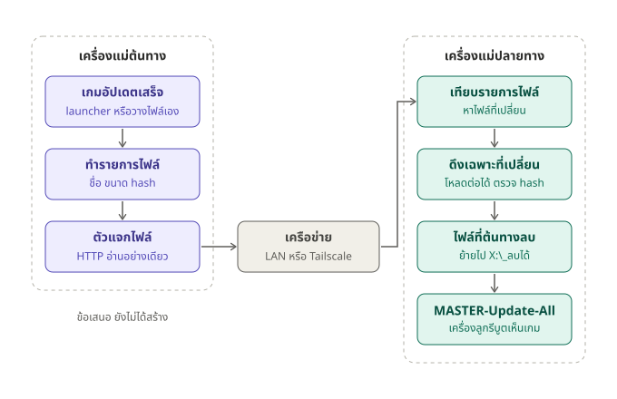

# GameSync — sync เกมระหว่างเครื่องแม่

เครื่องแม่ **ต้นทาง** (มีเกมครบ เช่น สาขาหลัก) แจกเกม เครื่องแม่ **ปลายทาง** (สาขาอื่น หรือ server ตัวที่ 2) ดึงเฉพาะไฟล์ที่เปลี่ยน
ไฟล์เกมที่ปลายทางมีอยู่แล้วถูกใช้ต่อ ถ้าเนื้อไฟล์ตรงกัน (เช็กด้วย sha256) ก็ไม่โหลดใหม่ แม้ AutoSync จะเป็นคนโหลดมาก็ตาม



## ต้องมี
- **Node.js 18 ขึ้นไป** หรือเมนู GCafe ที่ build แล้ว (`GCafe\app\0JAYSHOP.exe`) ปุ่มจะเลือกตัวที่มีให้เอง ไม่ต้องลงแพ็กเกจอะไรเพิ่ม
- ต้นทางกับปลายทางต้องต่อถึงกัน: LAN เดียวกัน หรือข้ามสาขาด้วย Tailscale / ZeroTier — **อย่าเปิดพอร์ตให้อินเทอร์เน็ตทั้งโลกเห็น**

## เครื่องแม่ต้นทาง
1. กด `GAMESYNC-Source.bat` ครั้งแรก จะได้ไฟล์ `GameSync\gamesync.json` พร้อม `key` ใหม่ (ไฟล์นี้ไม่อยู่ใน git เพราะมี key)
2. เปิดพอร์ตในไฟร์วอลล์ 1 ครั้ง (Command Prompt แบบ admin — เจ้าของร้านรันเอง):
   ```
   netsh advfirewall firewall add rule name="OSYNC GameSync" dir=in action=allow protocol=TCP localport=8765
   ```
3. เปิดหน้าต่างค้างไว้ รอบแรกจะอ่านทุกเกมเพื่อทำรายการไฟล์ ร้านที่มีเกมหลาย TB ใช้เวลาหลายชั่วโมง และดิสก์จะทำงานหนัก
   แนะนำให้ตั้ง `source.indexHours` เป็นช่วงร้านปิด หรือจำกัดความเร็วด้วย `source.readLimitMBps`
   รอบต่อไปอ่านเฉพาะไฟล์ที่ขนาดหรือเวลาเปลี่ยน
4. ดูสถานะ: `GAMESYNC-Source.bat status`

## เครื่องแม่ปลายทาง
1. clone OSYNC ลงไดรฟ์เกม แล้วกด `GAMESYNC-Pull.bat list` 1 ครั้ง เพื่อสร้าง `GameSync\gamesync.json`
2. แก้ `GameSync\gamesync.json`: `key` (ก๊อปจากต้นทาง), `pull.url` (เช่น `http://100.64.0.10:8765`), `pull.drives`, `pull.hours`
3. `GAMESYNC-Pull.bat list` ดูว่าจะโหลดอะไร (ยังไม่โหลดจริง)
4. `GAMESYNC-Pull.bat` โหลดตอนนี้ หรือ `GAMESYNC-Pull.bat --watch` ให้เช็กเองทุก `pull.everyMinutes` นาที
5. เกมเปลี่ยนแล้วจะรัน `MASTER-Update-All` ให้เอง เมนูจะมีเกมใหม่ จากนั้นรีบูตเครื่องลูก

## ทำงานยังไง
| ขั้น | ที่ | ทำอะไร |
|---|---|---|
| 1 | ต้นทาง | หาเกมใน `X:\Online`, `X:\Mobile`, `X:\PvP`, `X:\Single Player`, `X:\Web`, `X:\Common` และเกม Steam ใน `X:\SteamLibrary` / `X:\steam` |
| 2 | ต้นทาง | ทำรายการไฟล์ (path, ขนาด, เวลา, sha256) ลง `GameSync\_data\index` — ไฟล์ที่กำลังถูกเขียน หรือเกม Steam ที่กำลังอัปเดต จะยังไม่แจก |
| 3 | ต้นทาง | แจกผ่าน HTTP ต้องมี `key` และแจกได้เฉพาะไฟล์ที่อยู่ในรายการ อ่านไฟล์อื่นในเครื่องไม่ได้ |
| 4 | ปลายทาง | เทียบกับไฟล์ในเครื่อง: ขนาดและเวลาตรง = ข้าม, ขนาดตรงแต่เวลาต่าง = เช็ก sha256 ถ้าเหมือนก็แค่แก้เวลา, นอกนั้นโหลด |
| 5 | ปลายทาง | โหลดลง `ไฟล์.gsync-part` (หลุดแล้วโหลดต่อได้) ตรวจ sha256 แล้วค่อยสลับเข้าที่ เกมใหม่จะโหลดลง `โฟลเดอร์.gsync-new` แล้วค่อยเปลี่ยนชื่อตอนครบ เมนูจึงไม่เห็นเกมที่โหลดไม่เสร็จ |
| 6 | ปลายทาง | ไฟล์ที่ต้นทางลบไปแล้ว **ไม่ลบ** แต่ย้ายไป `X:\_ลบได้\GameSync\<วันเวลา>\...` ตามกฎของร้าน |
| 7 | ปลายทาง | Steam: เขียน `appmanifest_<id>.acf` เป็นไฟล์สุดท้าย และข้ามเกม Steam ทั้งหมดถ้า Steam เปิดอยู่ |
| 8 | ปลายทาง | บันทึก `GameSync\_data\synced.json` ให้ `Build-GameList` รู้ตัวเปิดเกม (ไม่ต้องเดา) แล้วรัน `MASTER-Update-All` |

## ตั้งค่า `GameSync\gamesync.json`
| ค่า | ความหมาย |
|---|---|
| `key` | รหัสเดียวกันทั้งต้นทางและปลายทาง ต้นทางสร้างให้เอง |
| `source.drives` | ไดรฟ์ที่แจก เช่น `"EFHI"` |
| `source.categories`, `source.steam` | หมวดโฟลเดอร์ที่แจก และจะแจกเกม Steam ไหม |
| `source.include` / `source.exclude` | เลือกเกมด้วยชื่อหรือ id ใช้ `*` ได้ เช่น `["E/Online/*", "I/Single Player/Cyberpunk*"]` |
| `source.port`, `source.bind` | พอร์ต (8765) และ IP ที่รับ (`0.0.0.0` = ทุก network card) |
| `source.readLimitMBps`, `source.indexHours`, `source.reindexMinutes` | จำกัดความเร็วอ่านดิสก์, ช่วงเวลาที่ทำรายการไฟล์ (เช่น `"02:00-09:00"`), ทำรายการใหม่ทุกกี่นาที |
| `pull.url` | ที่อยู่ของต้นทาง |
| `pull.drives` | ว่าง = ใช้ตัวอักษรไดรฟ์เดียวกับต้นทาง, `{"E": "H"}` = เกมจาก E: ของต้นทางให้ลง H: ของเครื่องนี้ |
| `pull.hours`, `pull.everyMinutes` | ช่วงเวลาที่ให้โหลด (ค่าเริ่มต้น `"02:00-09:00"`) และเช็กทุกกี่นาทีในโหมด `--watch` |
| `pull.parallel`, `pull.downloadLimitMBps` | โหลดพร้อมกันกี่ไฟล์, จำกัดความเร็ว (0 = ไม่จำกัด) |
| `pull.moveRemoved` | `true` = ย้ายไฟล์ที่ต้นทางลบไปไว้ใน `_ลบได้` |
| `pull.skipAutoSyncFolders` | `true` = ไม่แตะโฟลเดอร์ที่ AutoSync ของเครื่องนี้ดูแลอยู่ (กันสองระบบแย่งกัน) |
| `pull.afterSync` | `"update-all"` = รัน `MASTER-Update-All` หลังเกมเปลี่ยน, `"none"` = ไม่รัน |

## ข้อควรรู้
- ช่วงที่กำลังโหลด เครื่องลูกที่เปิดเกมนั้นอยู่อาจเจอไฟล์เก่ากับใหม่ปนกัน ควรตั้ง `pull.hours` เป็นช่วงร้านปิด
- เกมที่ต้นทางลบทั้งเกม ปลายทาง **ไม่ลบตาม** (ลบเองถ้าไม่ต้องการ) — ที่ย้ายไป `_ลบได้` คือไฟล์ที่หายไปจากเกมที่ยังอยู่
- ไฟล์ที่เกมเปิดค้างอยู่ที่ปลายทางจะสลับไม่ได้ เกมนั้นจะขึ้นว่า "NOT complete" แล้วทำต่อให้ในรอบหน้า
- เกม Steam: ที่ปลายทางต้องเพิ่ม library (`X:\SteamLibrary`) ใน Steam เอง 1 ครั้ง และบัญชี Steam ของเครื่องนั้นต้องมีเกมนั้น
- Riot / EA / Epic: GameSync ส่งแค่ไฟล์เกม ข้อมูลการติดตั้งของ launcher อยู่ใน C: ของแต่ละเครื่อง ให้ launcher ที่ปลายทางอัปเดตเอง (MASTER-Start-All)
- ทดสอบแล้วบนเครื่องเดียว: ชุดทดสอบ 28 กรณี (`node GameSync\test-gamesync.js`) และเกมจริง 2 เกม (1.3 GB ตรงกันทุกไฟล์)
  **ยังไม่ได้ทดสอบข้ามเครื่องจริง** และยังไม่ได้ลองรันผ่าน `0JAYSHOP.exe` แทน Node
