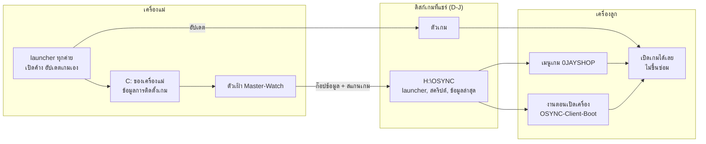
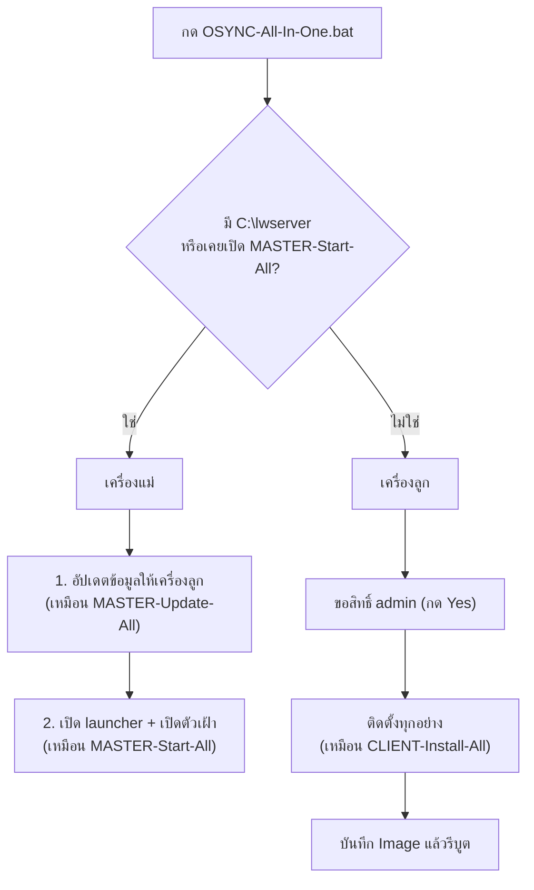
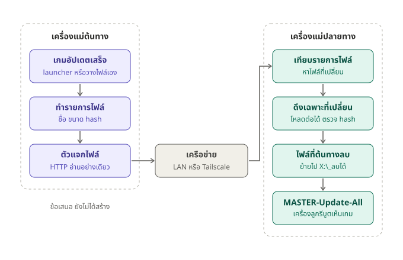

# OSYNC ทำงานยังไง

อธิบายการทำงานของ OSYNC ตั้งแต่กดปุ่มจนเครื่องลูกเปิดเกมได้ วิธีใช้แบบสั้นอยู่ใน [README.md](README.md) ส่วนปัญหาที่เคยเจออยู่ใน [KNOWLEDGE.md](KNOWLEDGE.md)

## ปัญหาที่ OSYNC แก้

ร้านเกม diskless มีเครื่องแม่ 1 เครื่อง เครื่องลูกทุกเครื่องไม่มีฮาร์ดดิสก์เป็นของตัวเอง ซึ่งทำให้เกิด 3 เรื่อง:

| ข้อจำกัดของ diskless | ผลที่ตามมา |
|---|---|
| C: ของเครื่องลูกกลับเป็นค่าเดิมทุกครั้งที่รีบูต | ของที่ติดตั้งตอนเปิดเกมครั้งแรก (กันโกง, VC++, Social Club) หายหมด เกมช้าหรือเด้งปิด |
| เครื่องลูกมองไม่เห็น C: ของเครื่องแม่ | ข้อมูลว่า "ติดตั้งเกมนี้แล้ว" ของ Riot, EA, Epic อยู่ใน C: ของเครื่องแม่ launcher บนเครื่องลูกจึงขึ้นให้ติดตั้งหรือซ่อม |
| เครื่องลูกเห็นดิสก์เกมร่วมกัน ด้วยตัวอักษรไดรฟ์เดียวกับเครื่องแม่ | ทางแก้จึงต้องผ่านดิสก์นี้ `H:\OSYNC` อยู่ที่นี่ เครื่องแม่เขียน เครื่องลูกอ่าน |

แนวคิดหลัก: **เครื่องแม่ก๊อปข้อมูลที่จำเป็นจาก C: ขึ้นดิสก์เกม แล้วเครื่องลูกดึงไปใช้เอง**



## ปุ่มเดียว: `OSYNC-All-In-One.bat`

กดไฟล์เดียวได้ทั้งเครื่องแม่และเครื่องลูก มันจะดูเองว่าอยู่บนเครื่องไหน:



- **เครื่องลูก** ต้องกดในโหมด super workstation (แก้ Image) แล้วบันทึก Image ไม่อย่างนั้นของที่ติดตั้งจะหายตอนรีบูต
- **เครื่องแม่ที่ไม่มี `C:\lwserver`** จะถูกเข้าใจว่าเป็นเครื่องลูก ให้ระบุเองด้วยคำสั่งด้านล่าง กดปุ่มนี้ซ้ำได้ ไม่เสียหาย

```bat
OSYNC-All-In-One.bat master
```

ปุ่มเดิม 3 ปุ่มยังใช้ได้เหมือนเดิม ปุ่มนี้แค่เรียกของเดิมให้ในครั้งเดียว

## เครื่องแม่: ตัวเฝ้า Master-Watch

ตัวเฝ้าเริ่มเองทุกครั้งที่ล็อกอิน (`HKCU\...\Run\OSYNC-Master`) ทำงานซ่อนอยู่ และทำ 3 อย่างนี้ทุก 1 นาที:

1. **เปิด launcher ทั้ง 9 ค่ายค้างไว้** Riot, Steam, Epic, EA app, HoYoPlay, Garena, Ubisoft, Rockstar, Modrinth ตัวไหนปิดไปจะเปิดกลับ เกมจึงอัปเดตเองที่เครื่องแม่
2. **ติดตั้งอัปเดตของ Riot Client ที่ค้างอยู่** โดยรีสตาร์ท Riot Client ให้เมื่อไม่มีเกมเปิดหรือกำลังอัปเดตอยู่ เครื่องลูกจะได้ไม่ต้องอัปเดตเอง
3. **ก๊อปข้อมูลให้เครื่องลูก** เมื่อเกมเปลี่ยนแล้วนิ่งครบ 2 นาที และทุก 1 ชั่วโมงอีกรอบ

ถ้ายังมีเกมอัปเดตไม่เสร็จ ตัวเฝ้าจะรอก่อน เพราะข้อมูลที่ก๊อปตอนเกมอัปเดตครึ่งทางจะทำให้เครื่องลูกขึ้นซ่อม ถ้าก๊อปไม่ผ่านจะลองใหม่ใน 30 นาที

### สิ่งที่ `MASTER-Update-All` ก๊อป

| ขั้น | ค่าย | ก๊อปอะไร |
|---|---|---|
| 1 | Riot | สถานะการติดตั้ง VALORANT / LoL / TFT ลง `_system\Metadata` โดยปิด auto-update ในสำเนาของเครื่องลูกเสมอ และไม่เอาไฟล์อัปเดตของ Riot Client ที่ค้างอยู่ |
| 2 | EA | Registry ของ EA app และเกม พร้อมข้อมูลการติดตั้ง |
| 3 | Epic | รายการเกม Epic |
| 4 | EasyAntiCheat | รายการเกมที่เครื่องแม่ติดตั้งกันโกงไว้ |
| 5 | เมนู | สแกนเกมทุกไดรฟ์ลง `GCafe\data\games.json` |

ทำได้ทีละรอบเท่านั้น ถ้าตัวเฝ้ากับปุ่มเริ่มพร้อมกัน รอบหลังจะรอรอบแรกจบก่อน

## เครื่องลูก: 3 จังหวะ

### 1. ครั้งเดียว ตอนแก้ Image

`CLIENT-Install-All` (หรือ All-In-One) ทำ 7 ขั้น ของที่ติดตั้งจะอยู่ใน Image ทุกเครื่องได้ด้วยกัน:

| ขั้น | ทำอะไร |
|---|---|
| 1 Riot | ให้ Riot เริ่มแบบเงียบตอนล็อกอิน |
| 2 Steam | ทำสิ่งที่ Steam ทำตอนเปิดเกมครั้งแรก โดยอ่านจาก `installscript.vdf` ของแต่ละเกม เช่น กันโกง, Social Club, VC++ และค่า Registry |
| 3 EA | ลงทะเบียน EA app, เกม EA และติดตั้ง EA AntiCheat |
| 4 EAC | ติดตั้ง EasyAntiCheat ของเกมนอก Steam เช่น Fortnite |
| 5 เมนู | ตั้งเมนู 0JAYSHOP ให้เปิดตอนล็อกอิน และวางไอคอนบนเดสก์ท็อป |
| 6 NT | ตั้งค่า NEWTHINGS-GAMES (GTA SA / SA-MP) |
| 7 Boot | สร้างงาน `OSYNC-Client-Boot` ให้เครื่องลูกเซ็ตตัวเองทุกครั้งที่เปิดเครื่อง |

ถ้าเครื่องใช้ภาษาระบบที่ทำให้ภาษาไทยในเกมเป็นตัวเอเลี่ยน จะถาม 1 คำถามตอนเริ่มว่าจะแก้ไหม

### 2. ทุกครั้งที่เปิดเครื่อง

งาน `OSYNC-Client-Boot` ทำงานเป็น SYSTEM รอดิสก์เกมพร้อมสูงสุด 3 นาที แล้วทำขั้น 1-4 ซ้ำ **เฉพาะของที่ยังไม่มี** ลงเกมใหม่ที่เครื่องแม่จึงไม่ต้องแก้ Image แค่รีบูตเครื่องลูก

บูตไม่ช้าเพราะระบบจำว่าทำอะไรไปแล้ว:

| ของที่จำ | จำไว้ที่ |
|---|---|
| Steam first-run ที่ Steam มีตัวจำให้ | `HasRunKey` ของเกมนั้น |
| Steam first-run รายการอื่น | `HKLM\SOFTWARE\OSYNC\SteamFirstRun` ค่า 1 = สำเร็จ, 2 = ไม่ผ่าน (ตอนบูตจะข้าม ตอนแก้ Image จะลองใหม่) |
| EA AntiCheat | `HKLM\SOFTWARE\OSYNC\EAAntiCheat` (ชื่อเกม + เวอร์ชันตัวติดตั้ง) |
| EasyAntiCheat | `ProductsInstalled` ของ EasyAntiCheat เอง |

C: ของเครื่องลูกกลับค่าเดิมทุกรีบูต ค่าที่จำจึงอยู่ถาวรเฉพาะที่อยู่ใน Image ของใหม่ที่สะสมหลังบันทึก Image จะถูกติดตั้งซ้ำทุกครั้งที่บูต ถ้าบูตเริ่มช้าให้กด All-In-One ในโหมดแก้ Image แล้วบันทึกอีกรอบ

### 3. ตอนเปิดเกมจากเมนู

เมนูอ่านรายการจาก `GCafe\data\games.json` แล้วเปิดเกมผ่านตัวเปิดของแต่ละค่าย:

- **Riot:** `RiotStart.ps1` ก๊อปสถานะการติดตั้งล่าสุดจากดิสก์เกมลง C: ของเครื่องลูกก่อนเปิด Riot Client จึงไม่ขึ้นซ่อม
- **Epic:** `EpicStart.ps1` เตรียมรายการเกมแบบเดียวกัน
- **Steam, EA และเกมที่เปิดจาก exe:** เปิดจากดิสก์เกมตรง ๆ

## ตัวติดตั้งแต่ละตัวทำงานยังไง

ตัวติดตั้งทุกตัวผ่าน `Invoke-Installer` ใน `GAMELUNCHER\ClientSetup\_system\Settings.ps1`:

- ทำงานแบบซ่อนหน้าต่าง จำกัดเวลา 5 นาทีต่อตัว
- มีบรรทัดสถานะที่ขยับทุกวินาที เช่น `| 1:23 / 5:00  [3/26] ...` และชื่อหน้าต่างแสดงข้อความเดียวกัน บรรทัดนี้ไม่ลงไฟล์ log
- หมดเวลาแล้วปิดทั้งตัวติดตั้งและโปรแกรมย่อย กันไม่ให้ตัวที่ค้างไปขวางตัวถัดไป

ของที่ตั้งใจข้าม:

| ข้าม | เหตุผล |
|---|---|
| `EAappInstaller`, `EAAntiCheat` | ใช้ EA app ตัวกลาง และมีขั้นตอน 3 จัดการแล้ว |
| .NET ของ Steam | Windows 10/11 มี .NET 4.8 อยู่แล้ว ส่วนตัวติดตั้ง .NET 3.5 จะค้างรอ Windows Update |
| รายการที่ Steam ระบุว่าใช้กับ Windows รุ่นอื่น | ไม่เกี่ยวกับเครื่องนี้ |

ของที่หลายเกมใช้ร่วมกัน เช่น Rockstar Games Launcher ของ GTA V และ RDR2 จะติดตั้งครั้งเดียว

## เครื่องแม่ ↔ เครื่องแม่: GameSync

ใช้เมื่อมีเครื่องแม่มากกว่า 1 เครื่อง (สาขาอื่น หรือ server ตัวที่ 2) เครื่องที่มีเกมกด `GAMESYNC-Source.bat` เปิดค้างไว้
เครื่องอื่นกด `GAMESYNC-Pull.bat` เพื่อดึงเฉพาะไฟล์ที่เปลี่ยน ไฟล์ที่มีอยู่แล้วเทียบด้วย sha256 ถ้าเหมือนกันก็ไม่โหลดใหม่
เกมใหม่จะโหลดลงโฟลเดอร์ชั่วคราวแล้วค่อยย้ายเข้าที่ตอนครบ เมนูจึงไม่เห็นเกมที่โหลดไม่เสร็จ พอเกมเปลี่ยนจะรัน `MASTER-Update-All` ให้เอง



รายละเอียด การตั้งค่า และข้อจำกัด: [GameSync/README-TH.md](GameSync/README-TH.md)

เมนูเกม (`Build-GameList`) ใช้ตัวเปิดเกมที่รู้อยู่แล้วก่อนเดาเอง: เกมที่ GameSync ก๊อปมา (`GameSync\_data\synced.json`)
และเกมที่ AutoSync ลงไว้ (`first_exe` ในรายการเกมของ AutoSync เช่น `zRunGame.exe` ตัวเดียวกับที่เมนูเก่าใช้)

## ไฟล์ log และปุ่มปิด

| เรื่อง | ที่อยู่ | ปิดด้วย |
|---|---|---|
| ตัวเฝ้าเครื่องแม่ | `C:\Users\Public\OSYNC-Master-Watch.log` | `GAMELUNCHER\ClientSetup\Update-Master\Master-Start-All-Off.bat` |
| ติดตั้งเครื่องลูกตอนแก้ Image | `C:\Users\Public\OSYNC-Install-All.log` | - |
| เซ็ตตัวเองตอนเปิดเครื่อง | `C:\Users\Public\OSYNC-Boot-Setup.log` | `GAMELUNCHER\ClientSetup\Install-Client\Boot-AutoSetup-Off.bat` (โหมดแก้ Image) |

## ลงเกมใหม่

เมื่อกด All-In-One ทั้งเครื่องแม่และเครื่องลูกไว้แล้ว:

1. ลงเกมที่เครื่องแม่ ลงในไดรฟ์ที่เครื่องลูกเห็น
2. รอประมาณ 3 นาที ให้ตัวเฝ้าก๊อปข้อมูลและสแกนเกม
3. รีบูตเครื่องลูก เกมใหม่จะขึ้นในเมนูและพร้อมเล่น

## สิ่งที่ยังทำเองไม่ได้

- **Ubisoft, Rockstar, Battle.net แบบไม่ผ่าน Steam:** ยังไม่รองรับอัตโนมัติ
- **กันโกงที่ติดตั้งตอนเปิดเกมครั้งแรก เช่น ACE (Delta Force, Arena Breakout):** ต้องเปิดเกมครั้งแรกในโหมดแก้ Image
- **เกมที่ต้องใช้ .NET 3.5:** ต้องเปิดฟีเจอร์ `NetFx3` ของ Windows ในโหมดแก้ Image
- **เครื่องแม่สาขาใหม่:** ต้องตั้งค่า launcher และเมนูตาม [SETUP-AI.md](SETUP-AI.md) ก่อน ปุ่ม All-In-One ใช้กับเครื่องที่ตั้งค่าแล้ว
- **GameSync ข้อมูลการติดตั้งของ Riot / EA / Epic:** GameSync ส่งแค่ไฟล์เกม launcher ที่เครื่องแม่ปลายทางต้องอัปเดตเอง
