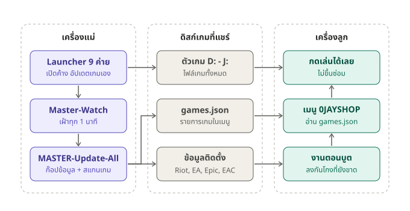

# OSYNC — ระบบเกมสำหรับร้านเกม diskless (0JAYSHOP)

ใช้บน **เครื่องแม่ (master)** ของร้านที่ใช้ diskless (LW / Kritidet) วางโฟลเดอร์ไว้บนไดรฟ์เกมที่เครื่องลูกมองเห็น
เครื่องลูกจึงใช้ path เดียวกับเครื่องแม่ได้ เช่น `H:\OSYNC\...`

อธิบายการทำงานทั้งระบบพร้อมแผนภาพ: [HOW-IT-WORKS.md](HOW-IT-WORKS.md)



**สรุปสั้น:** เครื่องลูก diskless รีเซ็ต C: ทุกรีบูต และมองไม่เห็น C: ของเครื่องแม่ Riot / EA / Epic จึงขึ้นให้ติดตั้งหรือซ่อม และกันโกงหายทุกรีบูต
OSYNC แก้โดยให้เครื่องแม่ก๊อปข้อมูลที่จำเป็นขึ้นดิสก์เกมที่แชร์ แล้วเครื่องลูกดึงไปใช้เอง:
1. **เครื่องแม่** — เปิด launcher 9 ค่ายค้างไว้ให้เกมอัปเดตเอง ตัวเฝ้า `Master-Watch` รัน `MASTER-Update-All` เมื่อเกมอัปเดตเสร็จและนิ่ง 2 นาที (และทุก 1 ชั่วโมง) เพื่อก๊อปข้อมูลติดตั้ง Riot / EA / Epic / EasyAntiCheat และสแกนเกมลง `games.json`
2. **เครื่องลูก** — `CLIENT-Install-All` ครั้งเดียวตอนแก้ Image (กันโกง, Steam first-run, EA app, เมนู) แล้วงาน `OSYNC-Client-Boot` ลงของใหม่ให้เองทุกครั้งที่เปิดเครื่อง
3. **เมนู 0JAYSHOP** — อ่าน `games.json` ตอนกดเล่นเกม Riot / Epic จะก๊อปข้อมูลล่าสุดลง C: ก่อนเปิด จึงไม่ขึ้นซ่อม

sync ไฟล์เกมระหว่างเครื่องแม่ด้วยกัน (สาขาอื่น / server อีกตัว): **GameSync** — ดู [GameSync/README-TH.md](GameSync/README-TH.md)

## ปุ่มเดียวจบ
กด `OSYNC-All-In-One.bat` ได้ทั้งเครื่องแม่และเครื่องลูก มันจะดูเองว่าเป็นเครื่องไหน แล้วทำทุกอย่างให้
- **เครื่องแม่:** อัปเดตข้อมูลให้เครื่องลูก แล้วเปิด launcher ทุกค่ายค้างไว้ + เปิดตัวเฝ้าที่อัปเดตข้อมูลให้เอง
- **เครื่องลูก:** กดในโหมด super workstation (แก้ Image) แล้ว **บันทึก Image** ติดตั้งทุกอย่างและตั้งให้เครื่องลูกเซ็ตเกมใหม่เองตอนเปิดเครื่อง

เครื่องแม่ที่ไม่มี `C:\lwserver` จะถูกเข้าใจว่าเป็นเครื่องลูก ให้สั่ง `OSYNC-All-In-One.bat master`

## ปุ่มแยก
| ปุ่ม | กดที่ | เมื่อไร |
|---|---|---|
| `GAMELUNCHER\ClientSetup\MASTER-Start-All.bat` | เครื่องแม่ กดครั้งเดียว | เปิด launcher ทุกค่ายตอนนี้และทุกครั้งที่ล็อกอิน ปิดไปจะเปิดกลับเอง เกมอัปเดตเองที่เครื่องแม่ — อัปเดตเสร็จแล้วทำ `MASTER-Update-All` ให้เองภายใน ~3 นาที และทุก 1 ชั่วโมงอีกรอบ เครื่องลูกเข้าเกมได้เลยไม่ขึ้นซ่อม (ปิด: `Update-Master\Master-Start-All-Off.bat`, log: `C:\Users\Public\OSYNC-Master-Watch.log`) |
| `MASTER-Update-All.bat` | เครื่องแม่ | หลังติดตั้ง / อัปเดต / ลบเกม (ถ้าเปิด MASTER-Start-All ไว้ ทำให้เองแล้ว) — อัปเดตข้อมูล Riot, EA, Epic, EasyAntiCheat ให้เครื่องลูก และสแกนรายการเกมในเมนูใหม่ (ไม่ต้องปิด Riot Client) |
| `CLIENT-Install-All.bat` | เครื่องลูก 1 เครื่อง ในโหมด super workstation (แก้ Image) แล้ว **บันทึก Image** | **ครั้งเดียว** — Riot แบบเงียบ, สิ่งที่ Steam ติดตั้งตอนเปิดเกมครั้งแรก (กันโกง BattlEye/ACE/Ricochet/EasyAntiCheat, Social Club, DirectX, VC++), EA app + เกม EA + EA AntiCheat, EasyAntiCheat ของ Epic, เมนูเกม 0JAYSHOP, NEWTHINGS-GAMES (GTA SA) และงาน `OSYNC-Client-Boot` ที่ทำให้เครื่องลูก **เซ็ตเกมใหม่เองทุกครั้งที่เปิดเครื่อง** (ลงเกมใหม่ไม่ต้องแก้ Image แค่รีบูตเครื่องลูก) — ถามครั้งเดียวตอนเริ่มว่าจะแก้ภาษาไทยเอเลี่ยนในเกมไหม (Y แล้วต้องรีสตาร์ท) |

| `GAMESYNC-Source.bat` | เครื่องแม่ที่มีเกม (ต้นทาง) เปิดค้างไว้ | ทำรายการไฟล์เกมใน E F H I ... แล้วแจกให้เครื่องแม่อื่น (ต้องมี key) — [GameSync/README-TH.md](GameSync/README-TH.md) |
| `GAMESYNC-Pull.bat` | เครื่องแม่ปลายทาง (สาขาอื่น / server ตัวที่ 2) | ดึงเฉพาะไฟล์เกมที่เปลี่ยนจากต้นทาง ไฟล์ที่มีอยู่แล้วใช้ต่อ ไฟล์ที่ต้นทางลบย้ายไป `X:\_ลบได้` แล้วรัน `MASTER-Update-All` ให้ (`list` = ดูก่อน, `--watch` = เช็กเรื่อยๆ) |

ผลการติดตั้งที่เครื่องลูกเก็บไว้ที่ `C:\Users\Public\OSYNC-Install-All.log`, ผลตอนเปิดเครื่องที่ `C:\Users\Public\OSYNC-Boot-Setup.log` (ของที่ทำแล้วจะข้าม จึงบูตเร็ว)
ของใหม่สะสมเยอะจนบูตช้า → กด `CLIENT-Install-All.bat` ใส่ Image อีกรอบ; ปิดการเซ็ตตอนเปิดเครื่อง: `GAMELUNCHER\ClientSetup\Install-Client\Boot-AutoSetup-Off.bat` (โหมดแก้ Image)

## ลงเกมใหม่ในอนาคต
เมื่อกด `OSYNC-All-In-One` ที่เครื่องแม่ และใส่ Image ของเครื่องลูกไว้แล้ว: ลงเกมที่เครื่องแม่ → รอ ~3 นาที → **รีบูตเครื่องลูก** จบ

| เกมจาก | ติดตั้งที่เครื่องแม่ | แล้วกด |
|---|---|---|
| Steam | ลงใน `X:\SteamLibrary` ของไดรฟ์ที่เครื่องลูกเห็น | ไม่ต้องกด (หรือ `MASTER-Update-All.bat`) → รีบูตเครื่องลูก |
| Riot (VALORANT/LoL/TFT) | อัปเดตใน Riot Client จนขึ้น Play (เปิด MASTER-Start-All ไว้ = อัปเดตเอง) | ไม่ต้องกด (หรือ `MASTER-Update-All.bat`) — เครื่องลูกกดเล่นได้เลย |
| Epic | ลงในไดรฟ์ที่เครื่องลูกเห็น เช่น `X:\EPIC\<เกม>` | ไม่ต้องกด (หรือ `MASTER-Update-All.bat`) → รีบูตเครื่องลูก |
| EA app | ลงในไดรฟ์ที่เครื่องลูกเห็น เช่น `X:\EA\<เกม>` | ไม่ต้องกด (หรือ `MASTER-Update-All.bat`) → รีบูตเครื่องลูก (เมนูจะเปิด EA app ให้กด Play; ถ้ารู้ offer id ใส่ใน `GCafe\tools\_system\Build-GameList.ps1` แล้วเปิดเกมตรงได้) |
| เกมออนไลน์ / มือถือ / Garena / โปรแกรม | วางโฟลเดอร์เกมใน `X:\Online\<เกม>`, `X:\Mobile\<เกม>`, `X:\PvP\<เกม>`, `X:\Single Player\<เกม>` หรือ `X:\Web\<โปรแกรม>` | ไม่ต้องกด (หรือ `MASTER-Update-All.bat`) — เมนูหา exe ให้เอง (ดูบรรทัด `AUTO added ...` ใน log ว่าเลือกถูกไหม ถ้าผิดเพิ่มใน `GCafe\data\games.custom.json`) |
| Ubisoft / Rockstar / Battle.net (ไม่ผ่าน Steam) | ยังไม่รองรับอัตโนมัติ — ใช้เวอร์ชัน Steam ถ้ามี | ให้ AI ช่วยเพิ่ม |

รูปปก: Steam ใช้รูปจาก Steam, เกมอื่นใช้ `zPoster.jpg` ในโฟลเดอร์เกม หรือทำจากไอคอนให้เอง, ใส่รูปเองได้ที่ `GCafe\data\posters\<id>.jpg`

## โครงสร้างโฟลเดอร์
```
OSYNC\
  OSYNC-All-In-One.bat      ปุ่มเดียว ใช้ได้ทั้งเครื่องแม่และเครื่องลูก
  MASTER-Update-All.bat     ปุ่มเครื่องแม่
  CLIENT-Install-All.bat    ปุ่มเครื่องลูก
  GAMESYNC-Source.bat       GameSync ต้นทาง: แจกเกมให้เครื่องแม่อื่น
  GAMESYNC-Pull.bat         GameSync ปลายทาง: ดึงเกมที่เปลี่ยน
  HOW-IT-WORKS.md           อธิบายการทำงานทั้งระบบ
  GameSync\                 ตัวโปรแกรม GameSync (Node.js ไฟล์เดียว) + คู่มือ README-TH.md
  docs\                     แผนภาพ + แนวคิดระบบ Game Sync
  _system\                  สคริปต์ของปุ่มด้านบน
  GAMELUNCHER\              ตัวโปรแกรม launcher ทุกค่าย (ห้ามย้าย/เปลี่ยนชื่อ) + ClientSetup\
    ClientSetup\
      MASTER-Start-All.bat  เครื่องแม่: เปิด launcher ทุกค่ายค้างไว้ + อัปเดตข้อมูลเครื่องลูกให้เองหลังเกมอัปเดต
      VALORANT.bat ... RiotSilent.vbs, EpicSilent.vbs   ตัวเปิดเกมที่เมนูเรียกใช้ (ห้ามย้าย)
      Install-Client\       ปุ่มติดตั้งเครื่องลูกทีละอย่าง (ใช้ตอนแก้ปัญหา)
      Update-Master\        ปุ่มอัปเดตเครื่องแม่ทีละอย่าง
      Master-Move\          ย้าย launcher ที่ติดตั้งใน C: มาไว้ใน GAMELUNCHER
      Diagnose\             ตรวจปัญหาที่เครื่องลูก (RiotDiag, LinkScan)
      _system\              สคริปต์และข้อมูล
      README-TH.txt         คู่มือ launcher
  GCafe\                    โปรแกรมเมนูเกม 0JAYSHOP — คู่มือ GCafe\README-TH.txt
  Riot Games\               ตัวเกม VALORANT (ไม่อยู่ใน git)
```

สิ่งที่ **ไม่อยู่ใน git** (แต่ละเครื่องแม่สร้างเอง): ตัวเกม, ตัวโปรแกรม launcher, `GCafe\app` (โปรแกรมที่ build แล้ว),
`GCafe\data\games.json` และรูปปกอัตโนมัติ, ข้อมูล snapshot ของ Riot/EA/Epic/EasyAntiCheat — ดู `.gitignore`

## เริ่มที่สาขาใหม่
1. ติดตั้ง Git แล้ว clone ลงไดรฟ์เกมที่เครื่องลูกเห็น เช่น `git clone https://github.com/fbpinote-svg/OSYNC.git F:\OSYNC`
2. เปิด Claude Code ในโฟลเดอร์นั้น แล้วให้อ่าน `KNOWLEDGE.md` (ปัญหาที่เคยเจอ + วิธีแก้) และทำตาม `SETUP-AI.md`

## มีปัญหา
ดู `KNOWLEDGE.md` — รวมอาการที่เคยเจอ (Riot ขึ้น REPAIR, Apex เด้งปิด, ภาษาเอเลี่ยน, เกมเปิดไม่ติดที่เครื่องลูก ฯลฯ) พร้อมสาเหตุและวิธีแก้

## อัปเดตจากเครื่องแม่หลัก
```
cd /d H:\OSYNC
git add -A
git commit -m "อธิบายสิ่งที่เปลี่ยน"
git push
```
สาขาอื่นดึงของใหม่: `git pull` แล้วกด `GCafe\tools\Build-App.bat` (ถ้ามีแก้ source) และ `MASTER-Update-All.bat`
