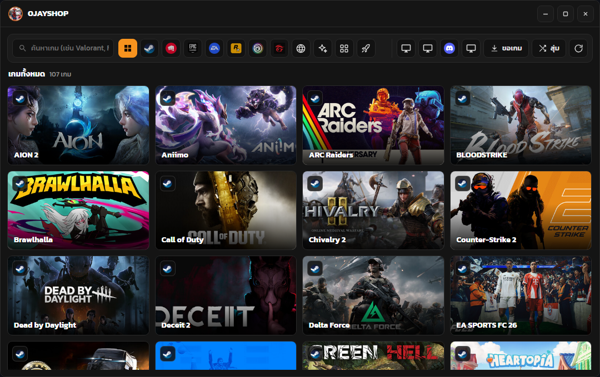
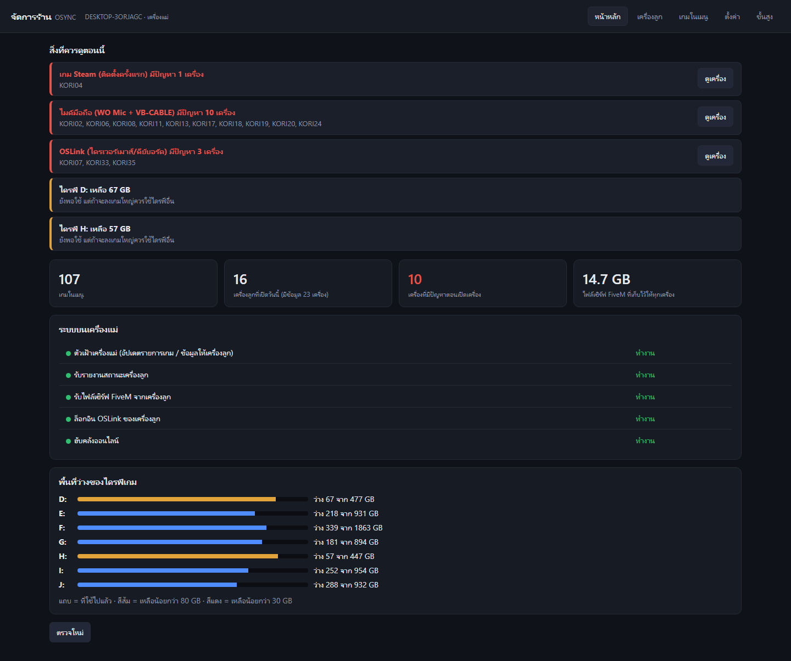

# OSYNC — ระบบเกมของร้านเกม diskless (ร้าน 0JAYSHOP)

OSYNC ทำให้เกม ตัวเปิดเกม (launcher) และเมนูเกมที่ลงไว้บน **เครื่องแม่** ใช้ได้บน **เครื่องลูก diskless** ทุกเครื่อง

- **เครื่องแม่:** ลงหรืออัปเดตเกมครั้งเดียว แล้วระบบทำรายชื่อเกมกับข้อมูลที่ launcher ต้องใช้ให้เอง
- **เครื่องลูก:** บูตแล้วพร้อมเล่น มีเมนูเกม, launcher ที่จำเกมได้, ไดรเวอร์ไมค์ และล็อกอินของลูกค้าคนก่อนถูกล้างแล้ว
- **อยู่ที่เดียว:** ทุกอย่างอยู่ในโฟลเดอร์ `H:\OSYNC` บนไดรฟ์เกม และใช้ไฟล์ `OSYNC.bat` ไฟล์เดียว



*เมนูเกมของร้าน (107 การ์ดจริง) — รายละเอียดใน [06-MENU.md](System/Docs/06-MENU.md)*



*คอนโซลแอดมินบนเครื่องแม่: สิ่งที่ควรดู · บริการที่รันอยู่ · พื้นที่ไดรฟ์ — รายละเอียดใน [07-CONSOLE-ONLINE-FUNCTIONS.md](System/Docs/07-CONSOLE-ONLINE-FUNCTIONS.md)*

## ร้านนี้ใช้อยู่

| | |
|---|---|
| diskless | LW (`C:\lwserver` บนเครื่องแม่) |
| เครื่องแม่ | `DESKTOP-3ORJAGC` · `192.168.51.201` |
| เครื่องลูก | `KORIxx` · `192.168.51.1xx` · Windows 2 Image: Win10 IoT LTSC 2021 (19045) / Win11 Pro (26300) |
| OSYNC | `H:\OSYNC` · ไดรฟ์เกมที่แชร์ `D E F G H I J` |
| Steam | `F:\steam` · VALORANT / LoL / TFT ที่ `H:\RIOT\Riot Games` |
| เมนูเกม | 0JAYSHOP Client (Electron + Next.js) แบบเมนูเกมอย่างเดียว |

## เริ่มใช้

**เครื่องแม่:** ดับเบิลคลิก `H:\OSYNC\OSYNC.bat` จะเห็นเมนูนี้ (ข้อความจริงจาก [`System/Scripts/OSYNC.ps1`](System/Scripts/OSYNC.ps1#L137)):

```
 OSYNC   DESKTOP-3ORJAGC = MASTER   H:\OSYNC
 ------------------------------------------------------------
  Master
    1  Update clients now (after installing / updating games)
    2  Watcher ON  - keep launchers open, update clients by itself
    3  Watcher OFF
    4  First-time setup of a new master
  Client (super workstation mode, then save the image)
    5  Install everything on this client
  Both
    6  Check the system
    7  Tools ...
    0  Exit
```

| อยากทำ | กด |
|---|---|
| ลง / อัปเดตเกมเสร็จ อยากให้เครื่องลูกเห็นเลย | `1` (หรือเปิดตัวเฝ้า `2` ไว้ ระบบทำเองทุกครั้งที่เกมเปลี่ยน) |
| ตรวจว่าระบบครบไหม | `6` |
| เปิดคอนโซลแอดมิน | `System\Console\OSYNC-Console.exe` (หรือทางลัด "OSYNC Console" บนเดสก์ท็อปเครื่องแม่) |

**เครื่องลูก:**
- ไม่ต้องกดอะไร งานตั้งเวลา `OSYNC-Client-Boot` ทำทุกอย่างให้เองทุกครั้งที่บูต
- ถ้าจะทำ Image ใหม่ ให้เปิดเครื่องลูก 1 เครื่องต่อ 1 Image ในโหมด super แล้วดับเบิลคลิก `OSYNC.bat` (บนเครื่องลูกจะติดตั้งเลยโดยไม่มีเมนู) จากนั้นบันทึก Image
- ขั้นตอนเต็มอยู่ใน [02-INSTALL-UPDATE.md](System/Docs/02-INSTALL-UPDATE.md)

**แก้ค่าของร้าน:**
- แก้ที่ `Settings\settings.txt` หรือในคอนโซลหน้า "ตั้งค่า"
- เครื่องลูกเห็นค่าใหม่หลังรีบูต
- ค่าทุกตัวอยู่ใน [09-SETTINGS.md](System/Docs/09-SETTINGS.md)

## เอกสาร

เริ่มที่ **[System/Docs/README.md](System/Docs/README.md)** (สารบัญ) แล้วอ่านตามลำดับ:

| บท | เรื่อง |
|---|---|
| [01 ภาพรวม](System/Docs/01-OVERVIEW.md) | diskless ทำงานยังไง, ภาพใหญ่ของระบบ, โฟลเดอร์, บริการบนเครื่องแม่ |
| [02 ติดตั้ง / อัปเดต / ทำ Image](System/Docs/02-INSTALL-UPDATE.md) | ทีละขั้น + ปุ่มทุกข้อของ OSYNC.bat |
| [03 เครื่องแม่](System/Docs/03-MASTER.md) | สคริปต์ Master-* ทีละฟังก์ชัน |
| [04 เครื่องลูก: บูตและไดรเวอร์](System/Docs/04-CLIENT-BOOT.md) | ทุกขั้นตอนตอนบูต, ไมค์ WO Mic / VB-CABLE, จอเสมือน, Sunshine |
| [05 เครื่องลูก: เกมและบัญชี](System/Docs/05-CLIENT-GAMES.md) | launcher แต่ละค่าย, ล้างล็อกอิน, OSLink, GTA / FiveM, Apex |
| [06 เมนูเกม](System/Docs/06-MENU.md) | โปรแกรม 0JAYSHOP Client ทีละฟังก์ชัน |
| [07 คอนโซลและคลังออนไลน์](System/Docs/07-CONSOLE-ONLINE-FUNCTIONS.md) | หน้าเว็บแอดมิน, API, ฮับ, aria2 |
| [08 แกนกลางและเครื่องมือ](System/Docs/08-CORE-TOOLS.md) | `Common.ps1`, `Http-Lib.ps1`, `OSYNC.ps1`, `Tool-*` |
| [09 ค่าของร้าน](System/Docs/09-SETTINGS.md) | ทุกค่าใน settings.txt + สคริปต์ที่อ่าน |
| [10 ดัชนีฟังก์ชัน](System/Docs/10-FUNCTION-INDEX.md) | ฟังก์ชันทั้งหมดในโค้ด พร้อมลิงก์ไปบรรทัดจริง |

## ใน repo นี้มีอะไร / ไม่มีอะไร

- **มี:** สคริปต์ของเรา (`System\`), ซอร์สเมนูเกม (`Menu\source`, `Menu\tools`), ค่าของร้าน (`Settings\`), เอกสาร
- **ไม่มี** (ดู [.gitignore](.gitignore)):
  - เกม และ launcher ของค่ายเกม
  - ตัวติดตั้งของคนอื่น (`Tools\`)
  - โปรแกรมเมนูที่ build แล้ว
  - ข้อมูลที่เครื่องแม่สร้าง (`System\Data`) และ log
- **ไม่ใส่ข้อมูลลับเด็ดขาด:**
  - repo นี้เป็น public ห้ามใส่รหัสผ่าน, token, ข้อมูลลูกค้า หรืออีเมลส่วนตัว
  - กุญแจคลังออนไลน์อยู่ที่ `System\Data\Online\online.key` ซึ่งไม่ขึ้น git
