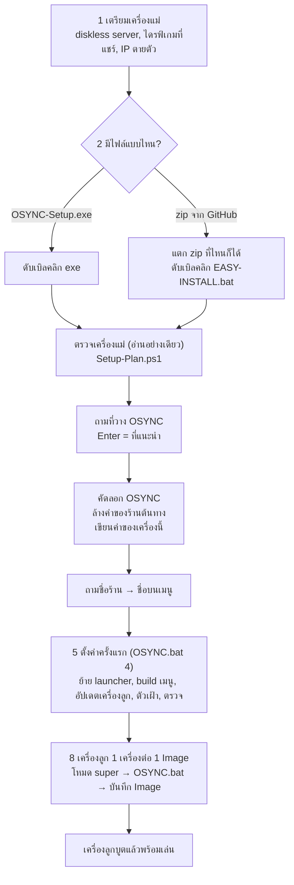
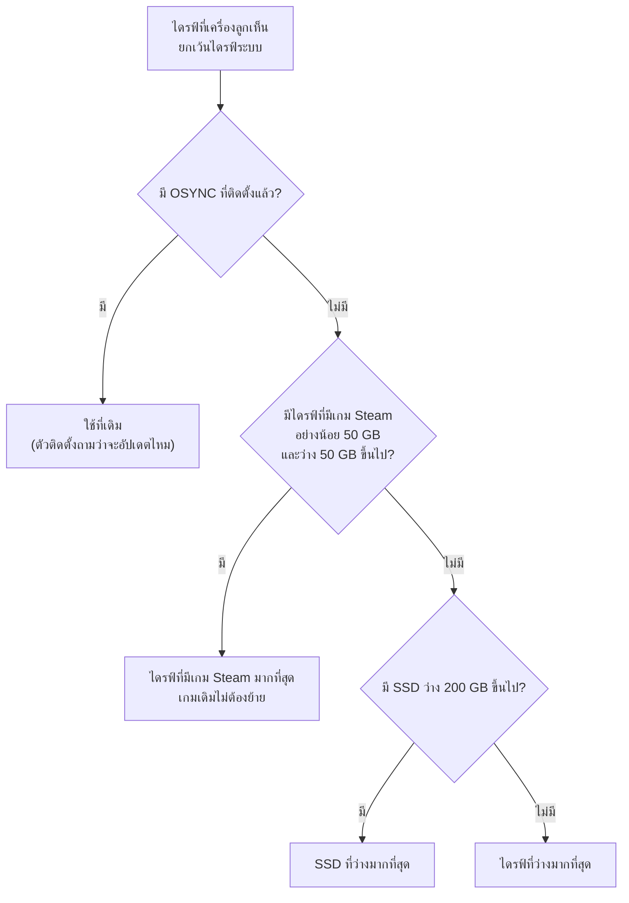

# 00 · Easy Install: ติดตั้ง OSYNC บนเครื่องแม่ของร้านคุณ

คู่มือนี้สำหรับ **ร้านอื่นที่จะนำ OSYNC ไปใช้** อ่านบทนี้บทเดียวก็ติดตั้งได้ครบ ตั้งแต่เตรียมเครื่อง เลือกตำแหน่งวางไฟล์ให้เหมาะกับเครื่องแม่ของร้านคุณ ติดตั้ง ไปจนถึงทำ Image เครื่องลูก

- ตัวติดตั้งจะ **ตรวจเครื่องแม่ก่อน แล้วเสนอที่วางให้เอง** กด Enter = ใช้ค่าที่แนะนำ
- ค่าที่ติดมาจากร้านต้นทาง (ชื่อเครื่อง, IP, ชื่อสาขา) จะถูกล้างออกให้ ร้านคุณเริ่มจากค่าว่างของตัวเอง
- ข้อความบนจอที่ยกมาในบทนี้เป็นข้อความจริงจากโค้ด ตัวอย่างผลตรวจเครื่องมาจากเครื่องแม่ของร้าน 0JAYSHOP เมื่อ 20 พ.ย. 2026

## สารบัญ

- [1. สิ่งที่ต้องมีก่อนติดตั้ง](#1-สิ่งที่ต้องมีก่อนติดตั้ง)
- [2. เลือกวิธีติดตั้ง](#2-เลือกวิธีติดตั้ง)
- [3. วางไฟล์ตรงไหนให้เหมาะกับเครื่องแม่ของคุณ](#3-วางไฟล์ตรงไหนให้เหมาะกับเครื่องแม่ของคุณ)
- [4. ติดตั้งทีละขั้น](#4-ติดตั้งทีละขั้น)
- [5. ตั้งค่าครั้งแรก (OSYNC.bat เลข 4)](#5-ตั้งค่าครั้งแรก-osyncbat-เลข-4)
- [6. ค่าที่ร้านใหม่ควรตรวจใน settings.txt](#6-ค่าที่ร้านใหม่ควรตรวจใน-settingstxt)
- [7. โปรแกรมเครื่องมือใน Tools\](#7-โปรแกรมเครื่องมือใน-tools)
- [8. ทำ Image เครื่องลูก](#8-ทำ-image-เครื่องลูก)
- [9. ตรวจว่าครบ และอัปเดตภายหลัง](#9-ตรวจว่าครบ-และอัปเดตภายหลัง)
- [10. ปัญหาที่พบบ่อย](#10-ปัญหาที่พบบ่อย)
- [11. ให้ AI ของร้านอื่นติดตั้งให้](#11-ให้-ai-ของร้านอื่นติดตั้งให้)

## ภาพรวมทั้งหมด



---

## 1. สิ่งที่ต้องมีก่อนติดตั้ง

| ต้องมี | ทำไม | ตรวจยังไง |
|---|---|---|
| **เครื่องแม่** Windows 10 / 11 64 บิต และบัญชี admin | สคริปต์ทั้งหมดเป็น Windows PowerShell 5.1 ที่มากับ Windows ขั้นตั้งค่าครั้งแรกขอสิทธิ์ admin เอง | ตัวตรวจเครื่องแสดงบรรทัด `Windows: ... PowerShell 5.1 ...` |
| **โปรแกรม diskless server** บนเครื่องแม่ | OSYNC ทำงานคู่กับ diskless ที่โค้ดรู้จักคือ LW (Kritidet / CCU, `C:\lwserver`), CCBoot, iCafeCloud, NxD, ggRock | บรรทัด `diskless server:` ถ้าขึ้น `NOT FOUND` แปลว่าไม่ได้รันบนเครื่องแม่ |
| **ไดรฟ์เกมที่แชร์ให้เครื่องลูก** อย่างน้อย 1 ลูก และไม่ใช่ C: | เครื่องลูกมองไม่เห็น C: ของเครื่องแม่ OSYNC, launcher และเกมต้องอยู่บนไดรฟ์ที่แชร์ และเครื่องลูกต้องเห็นเป็น **อักษรไดรฟ์เดียวกับเครื่องแม่** | ตาราง `2. Drives` ช่อง `clients` ต้องเป็น `yes` |
| **IP ตายตัว** ของเครื่องแม่ | เครื่องลูกส่งรายงานและเปิดไฟร์วอลล์ให้ IP นี้ (`MasterIP`) | บรรทัด `network:` ถ้าขึ้น `DHCP` ให้ตั้ง IP ตายตัวก่อน |
| พื้นที่ว่างบนไดรฟ์ที่จะวาง OSYNC | ตัวระบบ + โปรแกรมเมนูไม่ถึง 1 GB (วิธี A) หรือประมาณ 2 GB ถ้า build เมนูเอง (วิธี B, ร้าน 0JAYSHOP `Menu` 1.7 GB) · launcher ทั้งชุดของร้าน 0JAYSHOP 5.7 GB · ที่เหลือคือเกม | ตาราง `2. Drives` ช่อง `free GB` |
| Node.js LTS (ติดตั้งจาก zip เท่านั้น) | ใช้ build โปรแกรมเมนูจากซอร์ส และอ่านรายการไดรฟ์เกมจากฐานข้อมูลของ LW ถ้าใช้ `OSYNC-Setup.exe` ไม่ต้องมี | บรรทัด `Node.js:` |
| อินเทอร์เน็ต | launcher อัปเดตตัวเอง, build เมนูจากซอร์สต้องโหลดเครื่องมือ (`npm ci`) | — |

> ทำบนเครื่องแม่เท่านั้น ห้ามรันตัวติดตั้งบนเครื่องลูก (เครื่องลูกใช้ `OSYNC.bat` ตอนทำ Image ดู[ข้อ 8](#8-ทำ-image-เครื่องลูก))

---

## 2. เลือกวิธีติดตั้ง

| | วิธี A: `OSYNC-Setup.exe` (แนะนำ) | วิธี B: `EASY-INSTALL.bat` จาก zip ของ GitHub |
|---|---|---|
| ได้ไฟล์จากไหน | ร้านที่ใช้ OSYNC อยู่ทำให้: `OSYNC.bat` → `7` Tools → `19` ได้ไฟล์ `System\Dist\OSYNC-Setup-<วันที่>.exe` ไฟล์เดียว (มีเครื่องมือครบ 754 MB, แบบ `-NoTools` ประมาณ 190 MB) **เหมาะกับสาขาของร้านเอง** | https://github.com/fbpinote-svg/OSYNC → ปุ่ม **Code** → **Download ZIP** |
| โปรแกรมเมนูเกม | **build มาแล้ว** ใช้ได้ทันที | มีแต่ซอร์ส ต้อง build ตอนตั้งค่าครั้งแรก (ต้องมี Node.js LTS + อินเทอร์เน็ต ไม่กี่นาที) |
| โปรแกรมเครื่องมือ (`Tools\`: Sunshine, WO Mic, VB-CABLE, Parsec ...) | **ครบทุกตัว เหมือนร้านต้นทางทุกไฟล์** ตรวจ SHA256 ให้ ([ข้อ 7.1](#71-สาขาที่ติดตั้งด้วย-osync-setupexe-ได้ครบเหมือนร้านต้นทาง-100)) | ไม่มี ร้านใส่เอง ([ข้อ 7.3](#73-ติดตั้งจาก-zip-ของ-github-ร้านใส่เครื่องมือเอง)) |
| ค่าของร้านต้นทาง | ล้างแล้วตั้งแต่ตอนทำไฟล์ และล้างซ้ำตอนติดตั้ง | ล้างตอนติดตั้ง |
| ขั้นตอนหลังจากนั้น | เหมือนกันทุกอย่าง (ตัวติดตั้งตัวเดียวกัน [`Setup-Install.ps1`](../Scripts/Setup-Install.ps1)) | เหมือนกัน |

ตอนนี้ยังไม่มีไฟล์ exe วางบน GitHub Releases ของโปรเจกต์ ร้านที่ไม่มีคนส่งไฟล์ exe ให้ ใช้วิธี B ได้เลย

---

## 3. วางไฟล์ตรงไหนให้เหมาะกับเครื่องแม่ของคุณ

### 3.1 กฎ 6 ข้อ

1. **ทุกอย่างที่เครื่องลูกต้องเปิด อยู่บนไดรฟ์ที่เครื่องลูกเห็น** ห้ามอยู่ C: ของเครื่องแม่ (OSYNC, launcher, เกม, โปรแกรมใน `Tools\`)
2. **OSYNC อยู่ในโฟลเดอร์เดียว** เช่น `E:\OSYNC` ทุกสคริปต์หาที่อยู่ของโฟลเดอร์อื่นจากตำแหน่งของตัวเอง ([`Common.ps1`](../Scripts/Common.ps1#L14)) จึงวางไดรฟ์ไหนชื่ออะไรก็ได้ แต่ห้ามแยกโฟลเดอร์ย่อยไปไว้คนละที่
3. **เกมที่ลงไว้แล้วไม่ต้องย้าย** ถ้าอยู่บนไดรฟ์ที่แชร์ OSYNC หา library ของ Steam ทุกอันจาก `libraryfolders.vdf` ของ Steam เอง และหา `X:\SteamLibrary`, `X:\Steam`, `X:\Games\Steam` ทุกไดรฟ์ที่แชร์ ([`Get-SteamLibraries`](../Scripts/Common.ps1#L209))
4. **launcher ย้ายเข้า `OSYNC\Launchers\`** (Steam, Riot Client, EA, Epic, Garena, Ubisoft, Rockstar, HoYoPlay, Modrinth, Battle.net, GOG, Nexon, Amazon) ขั้นตั้งค่าครั้งแรกข้อ 2 ย้ายให้ทีละตัวและถามก่อน · launcher ที่อยู่บน C: **ต้อง** ย้าย · ที่อยู่บนไดรฟ์ที่แชร์อยู่แล้วจะย้ายหรือไม่ก็ได้
5. **เกมใหม่ลงใน `OSYNC\GAME\<launcher>`** เช่น Steam ให้เพิ่ม `X:\OSYNC\GAME\Steam` เป็น library และตั้งเป็นค่าเริ่มต้น (Steam → Settings → Storage) · ไดรฟ์อื่นที่มีที่ว่างเพิ่มเป็นโฟลเดอร์เกมได้ด้วยค่า `GameFolders` (เช่น `F:\GAME;G:\GAME`) หรือในคอนโซลแอดมิน
6. **อย่าให้ไดรฟ์เกมเหลือที่ว่างต่ำกว่า 10%** เกมอัปเดตไม่ผ่านเมื่อไดรฟ์เต็ม (ตัวตรวจเครื่องเตือน `has less than 10% free`)

### 3.2 โครงโฟลเดอร์หลังติดตั้ง

```
X:\OSYNC\                      ← ไดรฟ์ที่เครื่องลูกเห็น (ตัวติดตั้งแนะนำให้)
├─ OSYNC.bat                    ปุ่มเดียวของระบบ (เครื่องแม่ = เมนู, เครื่องลูก = ติดตั้งทันที)
├─ Settings\                    ค่าของร้าน: settings.txt, extra-games.json, game-start.json, gta5_settings*.xml
├─ Launchers\                   Steam\ "Riot Client"\ EA\ Epic\ Garena\ Ubisoft\ Rockstar\ HoYoPlay\ ...
├─ GAME\                        เกมใหม่: GAME\Steam\ GAME\Online\ ...   (ชื่อโฟลเดอร์ = ค่า GamesFolder)
├─ Menu\                        โปรแกรมเมนูเกม: app\ (โปรแกรม) data\ (รายชื่อเกม, รูป) config.json (ชื่อร้าน, หน้าตา)
├─ Tools\                       โปรแกรมเครื่องมือ (ข้อ 7): Sunshine0J\ WOMic\ VBCABLE\ Parsec\ WinRAR\ ... + TOOLS-MANIFEST.txt
└─ System\
   ├─ Scripts\                  สคริปต์ทั้งหมด
   ├─ Client\                   ไฟล์ที่ Image เครื่องลูกเรียก (ห้ามย้าย)
   ├─ Data\                     ข้อมูลที่เครื่องแม่ทำให้เครื่องลูก + setup-plan.txt (ผลตรวจเครื่องตอนติดตั้ง)
   ├─ Docs\                     เอกสารชุดนี้
   └─ Backup\                   ไฟล์เดิมตอนอัปเดต
```

ขนาดจริงของร้าน 0JAYSHOP (20 พ.ย. 2026) ไว้กะพื้นที่: `Launchers` 5.7 GB (EA 1.5, Riot Client 0.9, Battle.net 0.8, Epic 0.8 ...), `Menu` 1.7 GB, `System` 0.2 GB, `Tools` 1.0 GB, `GAME` 154 GB · เกม Steam ส่วนใหญ่อยู่ใน `X:\SteamLibrary` ของ 6 ไดรฟ์ รวมประมาณ 3.3 TB

### 3.3 ตัวติดตั้งเลือกไดรฟ์ให้ยังไง

ตัวตรวจเครื่อง [`Setup-Plan.ps1`](../Scripts/Setup-Plan.ps1) **อ่านอย่างเดียว ไม่เปลี่ยนอะไร** แล้วเลือกที่วาง OSYNC ตามลำดับนี้ ([บรรทัด 99-114](../Scripts/Setup-Plan.ps1#L99)):



- ได้ที่วางเป็น `<ไดรฟ์>:\OSYNC` ถ้าไม่ชอบ พิมพ์ที่อื่นแทนตอนถาม `Folder` ได้ (ตัวติดตั้งเตือนถ้าไดรฟ์นั้นเครื่องลูกมองไม่เห็น)
- ไดรฟ์ที่แชร์อื่นที่ว่าง 100 GB ขึ้นไป ถูกเสนอเป็น "more game room" (`X:\GAME`) แค่เสนอ ไม่เขียนลงค่าให้ เพิ่มเองเมื่อจะลงเกมที่นั่นจริง
- **ไดรฟ์ที่เครื่องลูกเห็น** อ่านจาก: 1) ฐานข้อมูลของ LW (`C:\lwserver\config\lwservice.db` ตาราง `tServerDiskMng` แบบอ่านอย่างเดียว ต้องมี Node.js) 2) `SharedDrives` ใน `settings.txt` (เฉพาะ OSYNC ที่ติดตั้งแล้ว ค่าในไฟล์ที่โหลดมาเป็นของร้านต้นทาง จึงไม่ใช้) 3) ไม่เจอทั้งสองอย่าง = ทุกไดรฟ์ fixed ยกเว้นไดรฟ์ระบบ (diskless ตัวอื่นที่ไม่ใช่ LW ให้ตรวจช่อง `clients` ในตารางแล้วแก้ `SharedDrives` เองถ้าไม่ตรง)
- ประเภทดิสก์ (NVMe SSD / SSD / HDD) อ่านจาก Windows (`Get-PhysicalDisk`) ดิสก์ RAID หรือดิสก์เสมือนอาจขึ้น `?`

### 3.4 ตัวอย่างตามแบบเครื่องแม่

| เครื่องแม่ของคุณเป็นแบบนี้ | ตัวติดตั้งแนะนำ | ทำเพิ่ม |
|---|---|---|
| ไดรฟ์เกมที่แชร์ลูกเดียว (เช่น D:) | `D:\OSYNC` ทุกอย่างอยู่ D: | ไม่มี |
| ลง Steam และเกมไว้แล้วใน `F:\SteamLibrary` (ไดรฟ์ที่แชร์) | `F:\OSYNC` (ไดรฟ์ที่มีเกม Steam มากที่สุด) | ไม่ต้องย้ายเกม · launcher ย้ายเข้า `F:\OSYNC\Launchers` ตอนข้อ 5 |
| SSD ที่ว่างเยอะ + HDD ใหญ่ ยังไม่มีเกม | SSD ที่ว่าง 200 GB ขึ้นไป | เกมใหญ่ที่ไม่ค่อยเล่นลงที่ HDD ได้ (เพิ่ม `GameFolders=<HDD>:\GAME` หรือ library ของ Steam บน HDD) |
| หลายไดรฟ์ NVMe แบบร้าน 0JAYSHOP (D E F G H I J) | ไดรฟ์ที่มีเกม Steam มากที่สุด | เกมกระจายอยู่ใน `X:\SteamLibrary` ของแต่ละไดรฟ์ได้ ไม่ต้องรวม |
| launcher ลงไว้ใน `C:\Program Files` | ไดรฟ์ตามกฎข้างบน | ตัวตรวจขึ้น `MOVE: on the system drive` → ข้อ 5 ย้ายให้ (ปิด launcher ให้เอง ถามก่อน) |
| library ของ Steam อยู่บนไดรฟ์ที่เครื่องลูกไม่เห็น | — | ตัวตรวจขึ้น `NOT SEEN BY CLIENTS` → ย้ายเกม (Steam → Settings → Storage → Move) ไปไดรฟ์ที่แชร์ หรือเพิ่มไดรฟ์นั้นใน diskless server |
| เครื่องแม่ได้ IP จาก DHCP | — | ตั้ง IP ตายตัวก่อน (ตัวตรวจเตือน `fixed IP for the master first`) |
| รันบนเครื่องที่ไม่มี diskless server | — | ตัวตรวจเตือน `run the setup on the MASTER` ย้ายไปรันบนเครื่องแม่ |

### 3.5 ตัวอย่างผลตรวจเครื่องจริง

ผลจากเครื่องแม่ร้าน 0JAYSHOP (ตัดบางบรรทัด) เปิดดูเองได้ทุกเมื่อ: `OSYNC.bat` → `7` Tools → `23` (บันทึกไว้ที่ `System\Data\setup-plan.txt` ด้วย)

```
OSYNC plan for DESKTOP-3ORJAGC   2026-11-20 20:02   (read only - nothing was changed)

1. This PC
   Windows: Microsoft Windows 11 Pro build 26200   PowerShell 5.1.26100.9444   admin: False
   diskless server: LW (Kritidet / CCU) (C:\lwserver)
   network: IP 192.168.51.203   gateway 192.168.51.1   fixed IP
   Node.js: v24.20.0   .NET 4 compiler: yes

2. Drives (clients see: DEFGHIJ - from the LW server settings)
   drive  size GB  free GB  type            clients  name
   C:         465      128  NVMe SSD        system - nothing for clients goes here  C
   D:         477       66  NVMe SSD        yes      NVME GAME 05
   F:        1863      339  NVMe SSD        yes      NVME GAME 03
   G:         894      181  SSD SATA        yes      SSD GAME 01
   H:         447       57  SSD SATA        yes      NVME GAME 06
   K:         447      171  SSD SATA        NO       Image
   L:         224      166  SSD SATA        NO       SSD Write back 01

4. Steam games
   D:\SteamLibrary                            10 games    372 GB   OK, stays where it is
   F:\SteamLibrary                            19 games   1349 GB   OK, stays where it is

5. Suggested placement
   OSYNC folder:   H:\OSYNC      (OSYNC is already on this drive (H:\OSYNC))
   launchers:      H:\OSYNC\Launchers\<name>   (Steam, Riot Client, EA, Epic ...)
   new games:      H:\OSYNC\GAME\<launcher>    (Steam: add H:\OSYNC\GAME\Steam as a library and make it the default)
   never on C:     anything a client PC must open (clients do not see the master's system drive)
```

| ส่วน | อ่านยังไง |
|---|---|
| `1. This PC` | Windows, สิทธิ์ admin, diskless server ที่เจอ, IP และว่าตายตัวไหม, Node.js |
| `2. Drives` | ทุกไดรฟ์: ขนาด ที่ว่าง ประเภท และ **เครื่องลูกเห็นไหม** (`yes` / `NO` / `system`) ไดรฟ์ `NO` ของร้านนี้คือไดรฟ์ Image และ write-back ของ diskless ห้ามวาง OSYNC |
| `3. Launchers` | launcher ที่ลงไว้ อยู่ที่ไหน และต้องย้ายไหม |
| `4. Steam games` | library ของ Steam ทุกอัน จำนวนเกม ขนาด (จาก `SizeOnDisk` ในไฟล์ `appmanifest_*.acf`) และเครื่องลูกเห็นไหม |
| `5. Suggested placement` | ที่วางที่แนะนำ พร้อมเหตุผลในวงเล็บ |

### 3.6 ลง launcher และเกมแต่ละค่ายไว้ที่ไหน

**ลำดับที่แนะนำ**
1. ติดตั้ง OSYNC ก่อน ([ข้อ 4](#4-ติดตั้งทีละขั้น))
2. ลง launcher ที่ร้านใช้ **ตามปกติ** (ที่ตัวติดตั้งของมันเสนอ แม้เป็น C: ก็ได้) แล้วล็อกอิน
3. `OSYNC.bat` → `4` ขั้น 2 ย้าย launcher เข้า `X:\OSYNC\Launchers\<ชื่อ>` ให้ทีละตัว ตัวย้ายแก้ registry, เซอร์วิส, งานตั้งเวลา และ shortcut ให้ชี้ที่ใหม่ด้วย **ห้ามย้ายโฟลเดอร์เองด้วยมือ และห้ามทำ junction ไว้ที่ C:**
4. ในแต่ละ launcher ตั้งที่ลงเกมให้เป็นไดรฟ์ที่เครื่องลูกเห็น (ตามตารางข้างล่าง)
5. ลงหรืออัปเดตเกมให้เสร็จ แล้ว `OSYNC.bat` → `1` (หรือเปิดตัวเฝ้า `2`) เกมจะขึ้นเมนูเอง เครื่องลูกเห็นหลังรีบูต

| ค่าย / ชนิดเกม | launcher อยู่ที่ (หลังย้าย) | ลงเกมที่ (แนะนำ) | OSYNC หาเกมเจอจาก ([`Master-GameList.ps1`](../Scripts/Master-GameList.ps1)) |
|---|---|---|---|
| Steam | `Launchers\Steam` | `X:\OSYNC\GAME\Steam` (Steam → Settings → Storage → เพิ่ม library แล้วตั้งเป็นค่าเริ่มต้น) หรือ `X:\SteamLibrary` บนไดรฟ์ที่แชร์ลูกไหนก็ได้ | `libraryfolders.vdf` + `appmanifest_*.acf` ของ Steam |
| Riot (VALORANT, LoL, TFT) | `Launchers\Riot Client` (ชื่อโฟลเดอร์ต้องเป็น `Riot Client` เป๊ะ ไม่งั้น Riot ลงตัวเองใหม่) | ไดรฟ์ที่แชร์ เช่น `X:\OSYNC\GAME\Riot` (ร้าน 0JAYSHOP ใช้ `H:\RIOT\Riot Games`) · ใน `GAME\` ใช้ชื่อโฟลเดอร์ตามชื่อค่าย (`Riot`, `EA`, `Epic`, `Ubisoft`, `BattleNet`, `GOG`, `Rockstar`, `Amazon`, `Nexon`) ตัวสแกนโฟลเดอร์จะไม่นับโฟลเดอร์เหล่านี้เป็นเกมซ้ำ | `product_settings.yaml` ที่ `OSYNC.bat` → `1` คัดไว้ใน `System\Data\Riot` · อัปเดตเกมใน Riot Client จนขึ้น Play ก่อนกด `1` |
| EA app | `Launchers\EA` | ไดรฟ์ที่แชร์ เช่น `X:\OSYNC\GAME\EA` (EA app → Settings → Download) | registry `Install Dir` ของเกมที่มี `__Installer\installerdata.xml` · เกมที่รู้ offer id ใส่ `Settings\extra-games.json` → `eaOffers` จะเปิดเกมตรง |
| Epic Games | `Launchers\Epic` | ไดรฟ์ที่แชร์ เช่น `X:\OSYNC\GAME\Epic` (เลือกตอนกด Install) | รายการติดตั้งของ Epic (`InstallLocation`) |
| Ubisoft, Battle.net, GOG, Rockstar, Amazon, Nexon | `Launchers\<ชื่อ>` | ไดรฟ์ที่แชร์ เช่น `X:\OSYNC\GAME\<ชื่อค่าย>` | รายการ "Installed apps" ของ Windows ที่ชี้ไปไดรฟ์ที่แชร์ (จัดหมวดตามผู้ผลิต) |
| HoYoPlay (Genshin, Star Rail, ZZZ ...) | `Launchers\HoYoPlay` | ค่าเริ่มของมัน `Launchers\HoYoPlay\games` หรือ `GAME\HoYoPlay\<เกม>` (ย้ายแล้วกด "Locate game" ใน HoYoPlay) | สแกนโฟลเดอร์ |
| Garena และเกมออนไลน์ที่เปิดจาก exe | `Launchers\Garena` | `GAME\Garena\<เกม>` หรือ `GAME\Online\<เกม>` | สแกนโฟลเดอร์ |
| เกมชนิดอื่น | — | `GAME\<หมวด>\<เกม>`: `Online`, `PvP`, `Mobile`, `Single Player` (หรือ `Offline`), `Gacha`, `Emulator`, `Web` | สแกนโฟลเดอร์ · ชื่อโฟลเดอร์หมวด = หมวดในเมนู |
| โปรแกรมของร้าน (Discord, RustDesk ...) | — | `X:\OSYNC\Tools\<ชื่อ>` | ไม่ขึ้นเป็นเกม · อยากให้ขึ้นเมนู ใส่ใน `Settings\extra-games.json` |

- **สแกนโฟลเดอร์ทำงานยังไง:** ดูทุกโฟลเดอร์เกม (`GAME\` + `GameFolders`) และ `X:\Games\<หมวด>`, `X:\<หมวด>` ทุกไดรฟ์ D-Z · โฟลเดอร์เกมที่ยังไม่มีในเมนู = เลือกไฟล์ `.exe` ที่น่าจะเป็นตัวเปิดเอง (ชื่อมี launcher / start / play หรือคล้ายชื่อโฟลเดอร์ ไม่ใช่ setup / updater / anticheat) แล้วขึ้นคำเตือน `AUTO added <เกม> [หมวด] -> <exe>  (check it once)` ให้ตรวจครั้งเดียว
- **ถ้าเดาผิด หรือเกมอยู่นอกโฟลเดอร์เหล่านี้:** ใส่ใน `Settings\extra-games.json` → `games`
  `{ "id": "ชื่อสั้น", "title": "ชื่อที่โชว์", "cat": "Online", "platform": "Garena", "exe": "X:\\...\\game.exe", "root": "X:\\...", "args": "" }` · ซ่อนการ์ดที่ไม่ต้องการ: `{ "id": "auto-...", "hide": true }`
- **ห้ามลงเกมไว้ใน C:** ของเครื่องแม่ (เครื่องลูกมองไม่เห็น) และอย่าลงซ้อนใน `Launchers\` ยกเว้นค่าเริ่มของ Steam / HoYoPlay

---

## 4. ติดตั้งทีละขั้น

### 4.1 วิธี A: `OSYNC-Setup.exe`

1. คัดลอกไฟล์ `OSYNC-Setup-<วันที่>.exe` ไปที่เครื่องแม่ แล้วดับเบิลคลิก (ไม่ต้องคลิกขวา Run as administrator ขั้นที่ต้องใช้ admin ขอเอง)
   - Windows อาจขึ้น "Windows protected your PC" เพราะไฟล์ไม่ได้เซ็นชื่อดิจิทัล → **More info** → **Run anyway**
2. ตัว exe แตกไฟล์ลง `%TEMP%` แล้วเปิดตัวติดตั้งในหน้าต่างเดียวกัน (`OSYNC setup: unpacking ...`)
3. **ตรวจเครื่อง** `== This master (read only - nothing changes yet)` แสดงผลแบบ[ข้อ 3.5](#35-ตัวอย่างผลตรวจเครื่องจริง) อ่านส่วน `5. Suggested placement` ให้เข้าใจก่อน
4. **ที่วาง** `== Where to put OSYNC` ขึ้น `Folder [X:\OSYNC]` → กด **Enter** เพื่อใช้ที่แนะนำ หรือพิมพ์ที่อื่น
   - ถ้าไดรฟ์ไม่อยู่ในรายการที่เครื่องลูกเห็น ขึ้น `WARNING X: is not in the drives the clients see` → ตอบ `N` แล้วเลือกใหม่
   - ถ้าโฟลเดอร์ไม่ว่าง ถามก่อน (ไม่ลบอะไร) · ถ้ามี OSYNC อยู่แล้ว หยุดและบอกให้เลือกอัปเดต
5. **คัดลอก** `== Copy OSYNC to X:\OSYNC` → `done` สร้าง `Launchers`, `GAME`, `Tools`, `System\Data`, `System\Backup`, `Menu\data`
6. **ค่าของร้านคุณ** `== This shop`
   - ล้างค่าของร้านต้นทาง ([`Clear-ShopValues`](../Scripts/Setup-Install.ps1#L59), [`Clear-MenuShop`](../Scripts/Setup-Install.ps1#L66))
   - บันทึกผลตรวจเครื่องไว้ที่ `System\Data\setup-plan.txt`
   - เขียน `SharedDrives`, `MasterPC` (ชื่อเครื่องนี้), `MasterIP` (IP ของการ์ดที่มี gateway) ลง `Settings\settings.txt`
   - ถาม `Shop name (shown on the game menu) [GAME CENTER]` → พิมพ์ชื่อร้าน ชื่อนี้ขึ้นบนเมนู และเป็นชื่อไฟล์โปรแกรมเมนู (`Menu\app\<ชื่อร้าน>.exe`)
7. `== Branch of a shop with the shop web? (Enter = skip)` → กด **Enter** (ใช้เฉพาะสาขาที่มีเว็บร้าน)
8. เปิดหน้าต่าง **ตั้งค่าครั้งแรก** ให้เอง (Windows ถามสิทธิ์ admin กด Yes) → ไป[ข้อ 5](#5-ตั้งค่าครั้งแรก-osyncbat-เลข-4)

### 4.2 วิธี B: `EASY-INSTALL.bat` จาก zip ของ GitHub

1. ติดตั้ง **Node.js LTS** จาก nodejs.org ก่อน (ใช้ build เมนูในข้อ 5)
2. โหลด zip: https://github.com/fbpinote-svg/OSYNC → **Code** → **Download ZIP**
3. แตก zip ไว้ที่ไหนก็ได้ เช่น `Downloads\OSYNC-main` **โฟลเดอร์นี้ไม่ใช่ที่ใช้งานจริง** ตัวติดตั้งคัดลอกไปที่ที่เลือกให้ ลบโฟลเดอร์นี้ทิ้งได้หลังติดตั้งเสร็จ · อย่ากด `OSYNC.bat` ในโฟลเดอร์นี้ (ระบบจะหยุดและบอกให้ใช้ `EASY-INSTALL.bat`)
4. ดับเบิลคลิก `EASY-INSTALL.bat` ในโฟลเดอร์ที่แตก
5. ขั้นต่อไปเหมือน[วิธี A](#41-วิธี-a-osync-setupexe) ข้อ 3-8 ต่างกันข้อเดียว: หลังตั้งชื่อร้านจะขึ้น
   `the menu program is not built yet (a project download has only its source) ...` เป็นเรื่องปกติ ข้อ 5 ขั้น 4 จะ build ให้

### 4.3 ติดตั้งแบบไม่ถาม (สำหรับช่าง)

ใส่ต่อท้ายชื่อไฟล์ เช่น `OSYNC-Setup-20261120-2007.exe -Target E:\OSYNC -ShopName "MY SHOP" -Yes` หรือ `EASY-INSTALL.bat -Target E:\OSYNC -Yes`

| สวิตช์ | ความหมาย |
|---|---|
| `-Target X:\OSYNC` | ติดตั้งที่โฟลเดอร์นี้แทนที่ที่แนะนำ |
| `-ShopName "MY SHOP"` | ชื่อร้าน (ตัวอักษร `\ / : * ? " < > \|` ถูกตัดออก) |
| `-Yes` | ไม่ถามอะไร ใช้ค่าแนะนำทั้งหมด ไม่ถามเรื่องสาขา · ถ้าเจอ OSYNC เดิมแต่ไม่ได้ใส่ `-Upgrade` หรือ `-Target` จะหยุด |
| `-NoWizard` | ไม่เปิดตั้งค่าครั้งแรกต่อ แค่บอกว่าต้องกดอะไร |
| `-Upgrade X:\OSYNC` | อัปเดต OSYNC ที่มีอยู่ (ดู[ข้อ 9](#9-ตรวจว่าครบ-และอัปเดตภายหลัง)) |
| `-Source <โฟลเดอร์>` | เอาไฟล์จากโฟลเดอร์นี้แทน payload ใน exe (`EASY-INSTALL.bat` ใส่ให้เอง) |
| `-PlanOnly` | แค่ตรวจเครื่องแม่และแสดงที่วางที่แนะนำ ไม่ติดตั้งอะไร (บอกด้วยถ้ามี OSYNC ติดตั้งอยู่แล้ว) |

---

## 5. ตั้งค่าครั้งแรก (`OSYNC.bat` เลข 4)

[`Master-Setup.ps1`](../Scripts/Master-Setup.ps1) ถามก่อนทุกการเปลี่ยน ขั้นที่เสร็จแล้วบอก `OK` รันซ้ำได้ตลอด (`OSYNC.bat` → `4`)

| ขั้น | ขึ้นบนจอ | ควรตอบ |
|---|---|---|
| 1 | `== 1 Drives the client PCs see` แสดง `SharedDrives` ตอนนี้กับที่เจอ | `Y` ถ้าที่เจอตรงกับไดรฟ์ที่แชร์จริงใน diskless server |
| 2 | `== 2 Launchers into Launchers\` ทีละ launcher ที่ลงไว้ที่อื่น แสดงแผนย้าย (DryRun) แล้วถาม `Move ... now (it will be closed)?` | `Y` ทุกตัวที่อยู่บน C: · ตัวที่อยู่บนไดรฟ์ที่แชร์แล้ว จะย้ายหรือไม่ก็ได้ · launcher ที่ยังไม่ลง ให้ลงก่อนแล้วกลับมา `4` ใหม่ |
| 3 | `== 3 Steam games` แสดง library ทุกอัน | อ่านอย่างเดียว ทำตามคำแนะนำ (เพิ่ม `X:\OSYNC\GAME\Steam` เป็น library เริ่มต้น) |
| 4 | `== 4 Game menu` ชื่อร้าน + เปิด `config.json` ใน Notepad ได้ · วิธี B: `Get the build tools (npm ci: internet, a few minutes) and build the menu now?` | วิธี B ตอบ `Y` แล้วรอ (โหลดเครื่องมือ build แล้ว build ให้) |
| 5 | `== 5 Update clients now` | `Y` ทำข้อมูลเกมและรายชื่อเกมให้เครื่องลูก |
| 6 | `== 6 Watcher` | `Y` ตัวเฝ้าเปิด launcher ค้างไว้และอัปเดตเครื่องลูกเองเมื่อเกมเปลี่ยน |
| 7 | `== 7 Check` | อ่านผล ข้อที่ไม่ผ่านจะบอกวิธีแก้ |

โลโก้ร้าน: `Menu\tools\_system\Make-Brand.ps1 -Image <รูป>` (ทำไอคอนโปรแกรมให้ด้วย) แล้ว build เมนูใหม่ (`OSYNC.bat` → `7` → `3`)

---

## 6. ค่าที่ร้านใหม่ควรตรวจใน `settings.txt`

ไฟล์ `X:\OSYNC\Settings\settings.txt` (หรือคอนโซลแอดมินหน้า "ตั้งค่า") เครื่องลูกเห็นค่าใหม่หลังรีบูต รายละเอียดทุกค่าอยู่ใน [09-SETTINGS.md](09-SETTINGS.md)

**ค่าที่ตัวติดตั้งเขียนหรือล้างให้:**

| ค่า | หลังติดตั้ง | หมายเหตุ |
|---|---|---|
| `SharedDrives` | ไดรฟ์ที่เครื่องลูกเห็น (จาก LW หรือไดรฟ์ fixed) | ต้องตรงกับ diskless server |
| `MasterPC`, `MasterIP` | ชื่อและ IP ของเครื่องนี้ | `MasterPC` คือสิ่งที่ทำให้ทุกเครื่องรู้ว่าเครื่องไหนเป็นเครื่องแม่ |
| `Role` | `auto` | |
| `GameFolders` | ว่าง | เพิ่มเองเมื่อลงเกมในไดรฟ์อื่น |
| `ClientBlockCpuz`, `ClientApexClean`, `ClientApexMinimal`, `ClientSteamVerify`, `ClientSteamVerifyApps` | ว่าง (ปิด) | ค่าทดสอบ Apex ของร้านต้นทาง |
| `OnlineBranch`, `OnlineBranchName`, `OnlineBind`, `OnlineExternalIP` | ว่าง | คลังออนไลน์: ว่าง = ใช้ชื่อเครื่อง / ไม่ผูก IP |

**ค่าเปิดปิดงานตอนบูตเครื่องลูก** (ค่าเริ่มต้นติดมาจากไฟล์ ตรวจว่าร้านคุณต้องการไหม · งานไหนต้องใช้โปรแกรมใน `Tools\` แต่ไม่มี จะข้ามเอง):

| ค่า | ทำอะไร | ต้องมี |
|---|---|---|
| `ClientMicDrivers` | ลงไมค์ WO Mic + VB-CABLE ถ้ายังไม่มี | `Tools\WOMic`, `Tools\VBCABLE` |
| `ClientParsec` | ลง Parsec ถ้ายังไม่มี | `Tools\Parsec` |
| `ClientVdd` | จอเสมือน 1920x1080 ถ้ายังไม่มี | `Tools\VirtualDisplay` |
| `ClientNodeJs`, `ClientPython` | ใส่ Node.js / Python ลง PATH | `Tools\NodeJS`, `Tools\Python` |
| `ClientWinRAR` | ลง WinRAR ถ้ายังไม่มี | `Tools\WinRAR` |
| `ClientSunshineAutoStart` | เปิด Sunshine ของร้านเป็นเซอร์วิส | `Tools\Sunshine0J` |
| `SunshineIpBase`, `SunshinePcPrefix`, `SunshinePcCount` | แผนพอร์ต Sunshine ตาม IP และชื่อเครื่องของสาขา ([ข้อ 7.2](#72-sunshine-ของสาขา-วง-ip-และชื่อเครื่อง)) | — |
| `ClientOslinkReset`, `ClientOslinkLogin`, `ClientOslinkDrivers`, `ClientOslinkStart`, `ClientOslinkReport` | OSLink (เล่นทางไกลของ LDPlayer) | `<ไดรฟ์ที่แชร์>:\LDPlayer\OSLink` ร้านที่ไม่ใช้ OSLink จะถูกข้ามเอง |
| `ClientGtaSettings` | ตั้งกราฟิก GTA V / FiveM ตามไฟล์ร้าน (ขนาดจอใช้ของเครื่องนั้น) | `Settings\gta5_settings*.xml` |
| `ClientClearLogins` | ล้างล็อกอินเกมของลูกค้าคนก่อนตอนบูต | — |
| `ClientDesktopMenuOnly`, `ClientDesktopIcons` | เดสก์ท็อปเหลือแค่ไอคอนเมนู + ไอคอนที่ระบุ | — |
| `ClientPowerLock` | ลูกค้าปิด / รีสตาร์ตเครื่องเองไม่ได้ | — |

---

## 7. โปรแกรมเครื่องมือใน `Tools\`

### 7.1 สาขาที่ติดตั้งด้วย `OSYNC-Setup.exe`: ได้ครบเหมือนร้านต้นทาง 100%

`OSYNC-Setup.exe` (ทำด้วย `OSYNC.bat` → `7` → `19`) **พาโฟลเดอร์ `Tools\` ของร้านต้นทางไปทั้งหมด** พร้อมรายการไฟล์ `Tools\TOOLS-MANIFEST.txt` (SHA256 และขนาดของทุกไฟล์)
- ติดตั้งเสร็จ ตัวติดตั้งเทียบทุกไฟล์กับรายการ แล้วขึ้น `tools: all <จำนวน> files are the same as the pack (SHA256)` = **เหมือนต้นทางทุกไบต์** ([`Test-ToolsSame`](../Scripts/Setup-Install.ps1#L98))
- `OSYNC.bat` → `6` (ตรวจระบบ) มีแถว `Tools` บอกว่ายังตรงกับไฟล์ติดตั้งอยู่ไหม (เทียบขนาดทุกไฟล์)
- อัปเดตด้วย exe ตัวใหม่: ทุกโฟลเดอร์เครื่องมือถูกแทนด้วยของใหม่ (ของเดิมเก็บใน `System\Backup\upgrade-<วันที่>\Tools`) ยกเว้น **`Sunshine0J\config` ของสาขาเอง** ([`Sync-Tools`](../Scripts/Setup-Install.ps1#L78)) · ไฟล์ที่เสียหรือถูกแก้จะกลับเป็นของต้นทาง
- ไฟล์ exe จึงใหญ่ (ร้าน 0JAYSHOP 20 พ.ย. 2026: 754 MB) และมีโปรแกรมของผู้ผลิตอื่นกับรหัสหน้าเว็บ Sunshine อยู่ข้างใน **ส่งให้สาขาของร้านเองเท่านั้น ห้ามวางให้โหลดสาธารณะ** · ร้านอื่นที่มีโปรแกรมของตัวเอง ทำ exe แบบไม่มีเครื่องมือได้: `Tool-Pack.ps1 -NoTools`

เครื่องมือที่ร้าน 0JAYSHOP มีและติดไปกับ exe (20 พ.ย. 2026, 14 โฟลเดอร์, 6,969 ไฟล์, 1,000 MB):

| โฟลเดอร์ | รุ่น / ไฟล์ | ใช้ทำอะไร |
|---|---|---|
| `Sunshine0J` | Sunshine 0JAYSHOP v1.0.0-beta.12 (`2026.1120.185841.dc8e29ad`) | ให้ลูกค้าเล่นทางไกล (เซอร์วิสตอนบูต + การ์ดเมนู) |
| `WOMic` | `WOMicClientSetup6.4.exe` + ไดรเวอร์ 2.1.0.0 ที่ Microsoft เซ็น | ไมค์จากมือถือ |
| `VBCABLE` | VB-CABLE `VBCABLE_Setup_x64.exe` 2.1.5.8 ทั้งชุด | ไมค์ / ลำโพงเสมือน |
| `Parsec` | `parsec-windows.exe` | เล่นทางไกลด้วย Parsec |
| `VirtualDisplay` | VDD / MttVDD 25.7.23 จอเสมือน 1920x1080 240 Hz | เครื่องที่ไม่มีจอ |
| `WinRAR` | WinRAR 7.23 x64 ภาษาไทย | เปิดไฟล์บีบอัด |
| `WebView2` | WebView2 Runtime 1.3.315.17 (ตัวติดตั้ง offline) | โปรแกรมที่มีหน้าต่างแบบเว็บ |
| `NodeJS` | Node.js 26.13.1 LTS แบบ portable | เครื่องลูกที่ต้องใช้ Node.js |
| `Python` | Python 3.14.10 64 บิต | เครื่องลูกที่ต้องใช้ Python |
| `Medal` | Medal 2646.632.1 (รันได้โดยไม่ต้องติดตั้ง) | อัดคลิปเกม (การ์ดเมนู) |
| `aria2` | `aria2c.exe` | คลังเกมออนไลน์ |
| `DepotDownloader` | DepotDownloader 3.4.0 | ปุ่ม "ขอเกม" Steam |
| `FiveM-ReShade`, `FiveM-Mods` | ReShade + ม็อดสำหรับ FiveM | ตัวเลือกในการ์ด FiveM |

**ไม่ได้ติดไปกับ exe (ต้องทำที่สาขา):**
- **OSLink (LDPlayer, เล่นทางไกล):** ร้าน 0JAYSHOP ติดตั้งไว้ที่ `E:\LDPlayer\OSLink` นอกโฟลเดอร์ OSYNC เป็นโปรแกรมที่ต้องติดตั้งจริง (เซอร์วิส `LDRemoteSvc`) และล็อกอินบัญชีของร้าน สาขาต้องลงจากเว็บของ LDPlayer ไว้ที่ `<ไดรฟ์ที่แชร์>:\LDPlayer\OSLink` แล้วล็อกอินเอง จากนั้น `OSYNC.bat` → `1`: ระบบตรวจลายเซ็นไฟล์ OSLink ให้เครื่องลูกเชื่อถือ ใส่การ์ด OSLink ในเมนูเอง และเครื่องลูกใส่ไดรเวอร์ให้ทุกบูต (ขั้นตอนเต็มสำหรับ AI: [SETUP-AI ข้อ 10](SETUP-AI.md#10-oslink-เล่นทางไกลของ-ldplayer-ติดตั้ง-แก้ไดรเวอร์-และใส่ในเมนู))
- **launcher และเกม:** ลงและล็อกอินที่สาขา ([ข้อ 3.6](#36-ลง-launcher-และเกมแต่ละค่ายไว้ที่ไหน))
- **ชื่อร้านและโลโก้บนเมนู:** ตัวติดตั้งถามชื่อ (พิมพ์ชื่อเดียวกับร้านหลักได้) โลโก้ใส่ด้วย `Make-Brand.ps1` ([ข้อ 5](#5-ตั้งค่าครั้งแรก-osyncbat-เลข-4))

### 7.2 Sunshine ของสาขา: วง IP และชื่อเครื่อง

Sunshine 0JAYSHOP ตั้งพอร์ตของแต่ละเครื่องจาก IP: เครื่องที่ n มี IP = `SunshineIpBase` + n → พอร์ต `20000 + n x 100` (หน้าเว็บ = พอร์ต + 1)
ค่าเริ่มต้นคือแผนของร้าน 0JAYSHOP: `SunshineIpBase=192.168.51.100`, `SunshinePcPrefix=KORI`, `SunshinePcCount=72` (KORI01 = 192.168.51.101 พอร์ต 20100 ... KORI72 = 192.168.51.172 พอร์ต 27200)

สาขาที่ใช้วง IP หรือชื่อเครื่องต่างไป:
1. แก้ 3 ค่านี้ใน `Settings\settings.txt` เช่น เครื่องลูก PC01-PC40 ที่ 192.168.1.101-140 → `SunshineIpBase=192.168.1.100`, `SunshinePcPrefix=PC`, `SunshinePcCount=40`
2. `OSYNC.bat` → `7` → `24` แสดงก่อนว่าจะเขียนอะไร แล้วถาม → เขียนโปรไฟล์เครื่อง (`shop_ip_profiles`) และเราเตอร์ (`shop_gateway_list`) ลงคอนฟิก Sunshine ([`Tool-SunshineProfiles.ps1`](../Scripts/Tool-SunshineProfiles.ps1)) ค่าอื่นของ Sunshine คงเดิม (UPnP, ปิดจอ VDD ตอนลูกค้าต่อ, รหัสหน้าเว็บ)
3. รีบูตเครื่องลูก · พอร์ตแต่ละเครื่องต้องเปิดที่เราเตอร์ของสาขา (Sunshine เปิด UPnP ไว้ ถ้าเราเตอร์รองรับจะเปิดให้เอง)

### 7.3 ติดตั้งจาก zip ของ GitHub: ร้านใส่เครื่องมือเอง

zip ของโปรเจกต์ไม่มี `Tools\` (เป็นโปรแกรมของผู้ผลิตแต่ละราย) ร้านโหลดจากเว็บทางการแล้ววางตามชื่อนี้ งานตอนบูตจะหาเจอเอง ตัวที่ไม่มีจะข้าม (`SKIP (no Tools\...)`)
| โฟลเดอร์ | ใส่อะไร (ชื่อไฟล์ที่โค้ดหา) |
|---|---|
| `Tools\WOMic\` | `WOMicClientSetup*.exe` และโฟลเดอร์ `driver\` (`womic.inf`, `womic.sys`, `womic.cat` รุ่น 2.1.0.0 ที่ Microsoft เซ็น, `wolicheng-publisher.cer`, `devcon.exe`) รายละเอียดใน [04-CLIENT-BOOT.md](04-CLIENT-BOOT.md) |
| `Tools\VBCABLE\` | ชุด VB-CABLE ที่แตก zip ทั้งชุด (`VBCABLE_Setup_x64.exe` ต้องอยู่กับไฟล์ `.inf` / `.sys` / `.cat`) |
| `Tools\Parsec\` | `parsec-windows*.exe` |
| `Tools\WinRAR\` | ตัวติดตั้งทางการของ WinRAR (ร้าน 0JAYSHOP ใช้ `winrar-x64-723th.exe`) |
| `Tools\WebView2\` | `MicrosoftEdgeWebView2RuntimeInstallerX64.exe` |
| `Tools\NodeJS\` | Node.js แบบ portable (`node.exe` อยู่ในโฟลเดอร์นี้) |
| `Tools\Python\` | Python (`python.exe` อยู่ในโฟลเดอร์นี้) |
| `Tools\VirtualDisplay\` | ชุดจอเสมือน (`tool\vdd-tool.exe`, `driver\`, `config\`) |
| `Tools\aria2\` | `aria2c.exe` (คลังออนไลน์) |

---

## 8. ทำ Image เครื่องลูก

ทำ **1 เครื่องต่อ 1 Image** (ถ้าร้านมีหลาย Image เช่น Windows 10 กับ 11 ทำทุก Image)

1. ตั้งเครื่องลูก 1 เครื่องเป็นโหมด super (โหมดที่บันทึกลง Image ได้) ใน diskless server
2. บูตเครื่องนั้น เปิด `X:\OSYNC\OSYNC.bat` (บนเครื่องลูกจะติดตั้งทันทีโดยไม่มีเมนู)
3. รอจนจบ อ่านตารางผล `RESULT` (`OK` / `SKIP` / `FAIL`)
4. บันทึก Image ใน diskless server แล้วปิดโหมด super
5. เครื่องลูกทุกเครื่องบูตใหม่ งาน `OSYNC-Client-Boot` ทำทุกอย่างให้เองทุกครั้งที่บูต

ขั้นตอนเต็มและทุกขั้นที่เครื่องลูกทำ: [02-INSTALL-UPDATE.md ข้อ 4](02-INSTALL-UPDATE.md#4-ทำ--รีเฟรช-image-เครื่องลูก) และ [04-CLIENT-BOOT.md](04-CLIENT-BOOT.md)

---

## 9. ตรวจว่าครบ และอัปเดตภายหลัง

**ตรวจ:**
- `OSYNC.bat` → `6` ตรวจทั้งระบบ ([02 ข้อ 6](02-INSTALL-UPDATE.md#6-ตรวจระบบด้วย-tool-check-เลข-6))
- `OSYNC.bat` → `7` → `23` ตรวจเครื่องแม่และดูที่วางที่แนะนำอีกครั้ง (อ่านอย่างเดียว บันทึกที่ `System\Data\setup-plan.txt`)

**อัปเดต OSYNC รุ่นใหม่:**
- วิธี A: รัน `OSYNC-Setup.exe` ตัวใหม่ ตอบ `Y` ที่ `Update X:\OSYNC (keeps Settings, games, launchers, menu config)?`
- วิธี B: โหลด zip ใหม่ แตกที่ใหม่ ดับเบิลคลิก `EASY-INSTALL.bat` แล้วตอบ `Y` แบบเดียวกัน
- ที่ถูกแทน: `OSYNC.bat`, `README.md`, `System\Scripts`, `System\Client`, `System\Docs` (และโปรแกรมเมนูถ้ามาในไฟล์) ของเดิมเก็บไว้ใน `System\Backup\upgrade-<วันที่>`
- `Tools\`: ทุกโฟลเดอร์เครื่องมือที่มากับ exe ถูกแทนด้วยของใหม่ (เก็บ `Sunshine0J\config` ของสาขาไว้) แล้วตรวจ SHA256 ทุกไฟล์ ([ข้อ 7.1](#71-สาขาที่ติดตั้งด้วย-osync-setupexe-ได้ครบเหมือนร้านต้นทาง-100))
- ที่ไม่ถูกแตะ: `Settings` (ค่าใหม่ที่รุ่นใหม่เพิ่มจะต่อท้ายให้ ค่าเดิมคงไว้), เกม, launcher, เครื่องมือที่ exe ไม่มี, ชื่อร้านและหน้าตาเมนู
- `EASY-INSTALL.bat` ในโฟลเดอร์ที่ติดตั้งแล้วใช้อัปเดตตัวเองไม่ได้ (ขึ้น `is an OSYNC that is already installed`) ต้องใช้จากไฟล์ที่โหลดมาใหม่

---

## 10. ปัญหาที่พบบ่อย

| อาการ / ข้อความ | สาเหตุ | แก้ |
|---|---|---|
| `This folder is a download of OSYNC, not an installed OSYNC - nothing was done.` | ดับเบิลคลิก `OSYNC.bat` ในโฟลเดอร์ที่แตกจาก zip (ยังไม่ได้ติดตั้ง ระบบกันไว้ไม่ให้ทำอะไร) | ดับเบิลคลิก `EASY-INSTALL.bat` ในโฟลเดอร์เดียวกัน |
| `Tools\<ชื่อ> is in use - not updated` | โปรแกรมในโฟลเดอร์นั้นเปิดอยู่บนเครื่องแม่ (เช่น Medal) | ปิดโปรแกรมนั้น แล้วรัน exe อัปเดตอีกครั้ง |
| `tools: N of M files are NOT the same as the pack` หรือแถว `Tools` เป็น WARN | ไฟล์เครื่องมือถูกแก้ ถูกลบ หรือคัดลอกไม่ครบ | รัน `OSYNC-Setup.exe` ตัวล่าสุดแบบอัปเดตอีกครั้ง (ใส่ทุกโฟลเดอร์คืน) |
| `Windows protected your PC` ตอนเปิด exe | ไฟล์ไม่ได้เซ็นชื่อดิจิทัล | **More info** → **Run anyway** |
| `This file has no OSYNC inside.` | ไฟล์ exe เสียหรือโหลดไม่ครบ | ขอไฟล์ใหม่ |
| `diskless server: NOT FOUND` | รันบนเครื่องที่ไม่ใช่เครื่องแม่ หรือ diskless ที่โค้ดไม่รู้จัก | รันบนเครื่องแม่ · ถ้าเป็น diskless ตัวอื่น ติดตั้งต่อได้ แต่ตรวจ `SharedDrives` เอง |
| `WARNING X: is not in the drives the clients see` | เลือกไดรฟ์ที่เครื่องลูกมองไม่เห็น | ตอบ `N` แล้วเลือกไดรฟ์ที่แชร์ |
| `... already has OSYNC - run this again and choose update` | โฟลเดอร์ที่เลือกมี OSYNC อยู่แล้ว | รันใหม่แล้วตอบอัปเดต หรือใช้ `-Upgrade` |
| `... is an OSYNC that is already installed - use its OSYNC.bat` | เปิด `EASY-INSTALL.bat` ในโฟลเดอร์ที่ติดตั้งแล้ว | ใช้ `OSYNC.bat` ของโฟลเดอร์นั้น · อัปเดตด้วยไฟล์ที่โหลดใหม่ |
| `the menu program is not built yet` | ติดตั้งจาก zip ของ GitHub | ปกติ: ข้อ 5 ขั้น 4 build ให้ (ต้องมี Node.js) |
| `npm ci failed` | ไม่มีอินเทอร์เน็ต หรือ Node.js รุ่นเก่า | ต่อเน็ต ลง Node.js LTS ใหม่ แล้ว `OSYNC.bat` → `4` อีกครั้ง |
| ช่อง `clients` เป็น `yes` ทุกไดรฟ์ทั้งที่แชร์ไม่ครบ | ไม่ได้ใช้ LW หรือไม่มี Node.js ตัวตรวจเลยถือว่าทุกไดรฟ์ fixed แชร์ | แก้ `SharedDrives=` ใน `settings.txt` ให้ตรงกับ diskless server |
| เครื่องลูกไม่เห็นเกมใหม่ | เครื่องลูกเห็นของใหม่หลังรีบูตเท่านั้น และเครื่องแม่ต้องอัปเดตข้อมูลก่อน | `OSYNC.bat` → `1` (หรือเปิดตัวเฝ้า `2`) แล้วรีบูตเครื่องลูก |
| launcher ขอติดตั้งใหม่บนเครื่องลูก | launcher ยังอยู่บน C: ของเครื่องแม่ | `OSYNC.bat` → `4` ขั้น 2 ย้ายเข้า `Launchers\` แล้วทำ Image ใหม่ |

บทเรียนอื่นที่เคยเจอในร้านจริง: [KNOWLEDGE.md](KNOWLEDGE.md)

---

## 11. ให้ AI ของร้านอื่นติดตั้งให้

AI (เช่น Claude Code) ทำงานส่วนใหญ่ได้เอง: ตรวจเครื่อง, ติดตั้ง, ตั้งค่า, ย้าย launcher, build เมนู, อัปเดตเครื่องลูก, ตรวจระบบ แต่ **ไม่ใช่ 100%** มีขั้นที่คนต้องทำเองเสมอ:
- กด Yes ที่หน้าต่าง UAC ของ Windows
- ล็อกอินบัญชี launcher (Steam, Riot, EA, Epic ...) รหัสผ่านและรหัสยืนยัน และกดยอมรับข้อตกลงของแต่ละโปรแกรม
- ตั้งค่าในโปรแกรม diskless: เพิ่มไดรฟ์เกม, โหมด super, บันทึก Image
- ตั้ง IP ตายตัวที่เราเตอร์ และเปิด / รีบูตเครื่องลูกเพื่อทดสอบเกมจริง
- อนุญาตให้ดาวน์โหลดโปรแกรมเสริม (`Tools\`) และซื้อเกม / บัญชี

ขั้นตอนสำหรับ AI ทีละขั้น พร้อมจุดที่ต้องหยุดถามเจ้าของร้าน: [SETUP-AI.md](SETUP-AI.md) (บอก AI ว่า "อ่าน System\Docs\SETUP-AI.md แล้วติดตั้งตามนั้น")

### เริ่มยังไง: ข้อความแรกที่พิมพ์ให้ AI

**ต้องมีก่อน:** AI ที่สั่งงานบนเครื่องได้ (รันคำสั่งและอ่านไฟล์ในเครื่องได้) เช่น Claude Code แบบโปรแกรมบนเครื่อง หรือแบบ command line เปิดบน **เครื่องแม่** ด้วยบัญชีที่เป็น admin · AI แบบแชตบนเว็บอย่างเดียวติดตั้งให้ไม่ได้ ทำได้แค่อธิบาย

**ก. สาขาของร้าน: ติดตั้งใหม่ด้วย `OSYNC-Setup.exe` (ได้โปรแกรมเครื่องมือครบเหมือนร้านหลัก)**

ร้านหลักทำไฟล์ด้วย `OSYNC.bat` → `7` → `19` แล้วคัดลอก **3 ไฟล์** จาก `System\Dist` ไปสาขา (เช่นลง USB แล้ววางที่ `D:\OSYNC-ติดตั้ง`): `OSYNC-Setup-<วันที่>.exe`, `SETUP-AI.md`, `00-EASY-INSTALL.md`

```
ช่วยติดตั้งระบบ OSYNC บนเครื่องนี้ให้หน่อย เครื่องนี้คือเครื่องแม่ของร้านเกม diskless (สาขาของร้านหลัก)
ไฟล์ที่เตรียมไว้อยู่ใน D:\OSYNC-ติดตั้ง : OSYNC-Setup-<วันที่>.exe (ตัวติดตั้ง มีโปรแกรมเครื่องมือครบ),
SETUP-AI.md และ 00-EASY-INSTALL.md (คู่มือ)
1. อ่าน SETUP-AI.md ให้จบก่อน (อ่าน 00-EASY-INSTALL.md ประกอบ) แล้วทำตามทีละขั้นเท่านั้น
2. ตรวจเครื่องด้วย "OSYNC-Setup-<วันที่>.exe" -PlanOnly (ยังไม่ติดตั้งอะไร)
3. สัมภาษณ์ผมตามข้อ 2 ของ SETUP-AI.md ให้ครบ ถามทีละหัวข้อ อย่าเดาเอง
   รวมถึงวง IP และชื่อเครื่องลูก เพื่อตั้ง Sunshine ให้ตรงกับร้านนี้
   สรุปแผนให้ผมตอบ "ตกลง" ก่อนติดตั้ง
4. ติดตั้งตามข้อ 3 ของ SETUP-AI.md แล้วแสดงบรรทัด "tools: ... same as the pack" ให้ผมดู
5. ขั้นที่ผมต้องกดเองหรือล็อกอินเอง ให้บอกทีละขั้นแล้วรอผม ห้ามขอรหัสผ่าน
6. คุยกับผมเป็นภาษาไทย
```

**ข. สาขาที่ติดตั้งแล้ว: อัปเดตเป็นรุ่นใหม่** (คัดลอก 3 ไฟล์ชุดใหม่ไปเหมือนข้อ ก.)

```
ช่วยอัปเดตระบบ OSYNC บนเครื่องนี้ (เครื่องแม่ที่ติดตั้ง OSYNC ไว้แล้ว) เป็นรุ่นใหม่
ไฟล์รุ่นใหม่อยู่ใน D:\OSYNC-ติดตั้ง : OSYNC-Setup-<วันที่>.exe, SETUP-AI.md, 00-EASY-INSTALL.md
1. อ่าน SETUP-AI.md ข้อ 0, 0.1 และข้อ 9 (อัปเดตร้านที่ติดตั้งแล้ว) ให้จบก่อน แล้วทำตามข้อ 9 ทีละขั้น
2. ตรวจของเดิมก่อนอัปเดต แล้วสรุปให้ผมดู
3. ถามผมก่อนเริ่มว่าอัปเดตตอนนี้ได้ไหม (เครื่องลูกเห็นของใหม่หลังรีบูต)
4. หลังอัปเดตรายงาน: อะไรเปลี่ยน, ค่าใหม่ใน settings ที่ต้องตั้ง, บรรทัด "tools: ... same as the pack",
   ผลตรวจก่อนและหลัง แล้วบอกว่าต้องรีบูตเครื่องลูกเมื่อไหร่
5. ห้ามขอรหัสผ่าน คุยกับผมเป็นภาษาไทย
```

**ค. ร้านอื่น: ติดตั้งจาก GitHub** (ไม่มีโปรแกรมเครื่องมือ ร้านใส่เอง)

```
ช่วยติดตั้งระบบ OSYNC บนเครื่องนี้ให้หน่อย เครื่องนี้คือเครื่องแม่ของร้านเกม diskless
1. ดาวน์โหลด https://github.com/fbpinote-svg/OSYNC/archive/refs/heads/main.zip (อนุญาตให้โหลดไฟล์นี้)
   แล้วแตกไว้ที่ %USERPROFILE%\Downloads\OSYNC-main
2. อ่าน System\Docs\SETUP-AI.md ในโฟลเดอร์นั้นให้จบก่อน แล้วทำตามทีละขั้นเท่านั้น
3. ตรวจเครื่องแล้วสัมภาษณ์ผมตามข้อ 2 ของ SETUP-AI.md ให้ครบ ถามทีละหัวข้อ อย่าเดาเอง
   สรุปแผนให้ผมตอบ "ตกลง" ก่อนติดตั้ง
4. ขั้นที่ผมต้องกดเองหรือล็อกอินเอง ให้บอกทีละขั้นแล้วรอผม ห้ามขอรหัสผ่าน
5. คุยกับผมเป็นภาษาไทย
```

**ง. ทำค้างไว้ แล้วเปิด AI ใหม่ให้ทำต่อ:**

```
ทำต่อจากที่ค้างไว้: อ่าน <ที่วาง OSYNC>\System\Docs\SETUP-AI.md และ <ที่วาง OSYNC>\System\Data\setup-answers.txt
แล้วตรวจด้วย <ที่วาง OSYNC>\OSYNC.bat check ว่าถึงขั้นไหนแล้ว บอกผมก่อนทำขั้นต่อไป
```

**AI จะสัมภาษณ์ก่อนติดตั้งเสมอ** ([SETUP-AI ข้อ 2](SETUP-AI.md#2-สัมภาษณ์เจ้าของร้าน-ต้องครบก่อนติดตั้ง)) ถามทีละหัวข้อ แล้วสรุปแผนให้ตกลงก่อนลงมือ เตรียมคำตอบเหล่านี้ไว้:

| หัวข้อ | สิ่งที่ AI จะถาม |
|---|---|
| ร้านและเครื่องลูก | ชื่อร้าน + โลโก้, ยี่ห้อ diskless, จำนวนเครื่องลูก + ชื่อ + ช่วง IP, Image กี่ตัว (Windows 10 / 11), เวลาเปิดปิดร้าน |
| ไดรฟ์ | แต่ละไดรฟ์ใช้ทำอะไร, ไดรฟ์ไหนห้ามแตะ (Image / write-back), เครื่องลูกเห็นไดรฟ์ไหน, ในไดรฟ์มีอะไรอยู่แล้ว, จะวาง OSYNC ที่ไหน, เกมแต่ละค่ายลงไดรฟ์ไหน, ไดรฟ์ไหนใกล้เต็ม |
| launcher และเกม | launcher ครบหรือยัง ต้องการเพิ่มตัวไหน, บัญชีของร้านหรือลูกค้าล็อกอินเอง, เกมที่ต้องมีลงครบ / อัปเดตหรือยัง ต้องการลงเพิ่มเกมไหน, เกมนอก launcher, เกมที่มีกันโกงระดับ kernel, เกมที่ไม่อยากให้ขึ้นเมนู |
| งานตอนบูต | ไมค์ (WO Mic / VB-CABLE), เล่นทางไกล (Parsec / Sunshine / OSLink), จอเสมือน, ล้างล็อกอิน, ห้ามลูกค้าปิดเครื่อง, ไอคอนเดสก์ท็อป, โปรแกรมเครื่องมือใน `Tools\` (มากับ exe หรือต้องโหลดเพิ่ม), วง IP และชื่อเครื่องสำหรับ Sunshine |
| ระบบเดิม | เมนูเกม / ระบบอัปเดตเกมที่ใช้อยู่ ใช้คู่หรือแทน, สิ่งที่ห้ามยุ่งเด็ดขาด |

AI จะไม่ถามรหัสผ่าน ล็อกอินบัญชีต่างๆ ให้เจ้าของร้านทำเอง

---
[← สารบัญเอกสาร](README.md) · [02 ติดตั้ง / อัปเดต / ทำ Image →](02-INSTALL-UPDATE.md)
