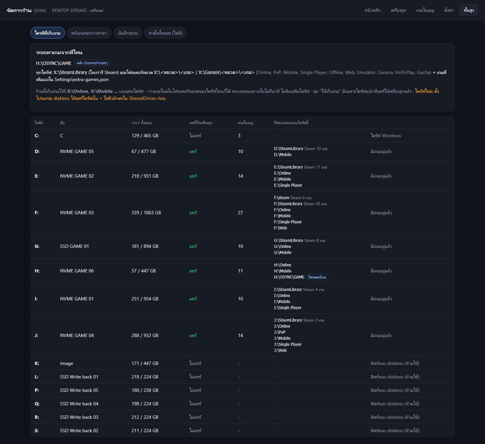
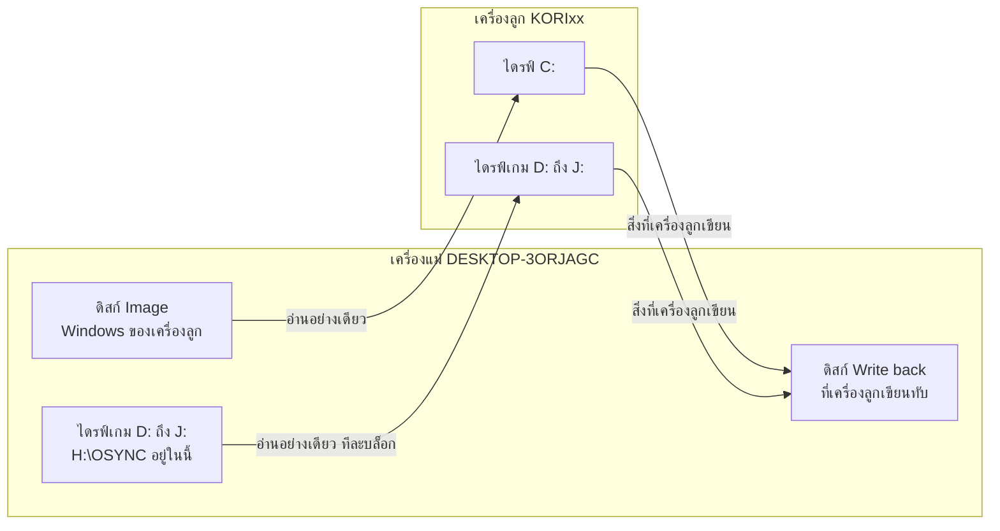
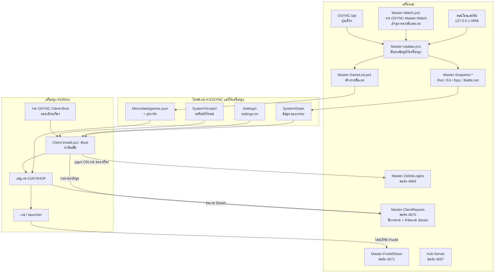
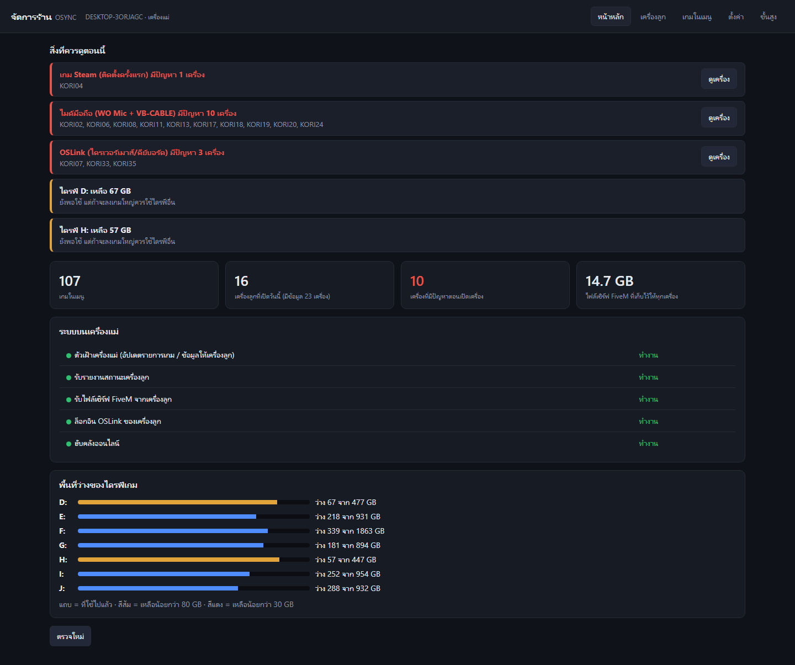
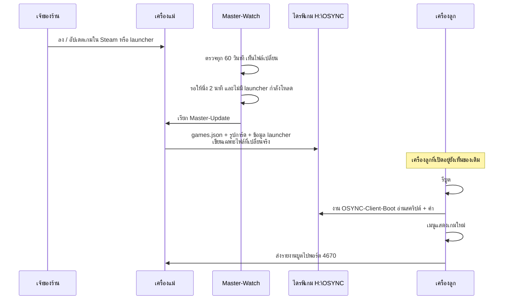
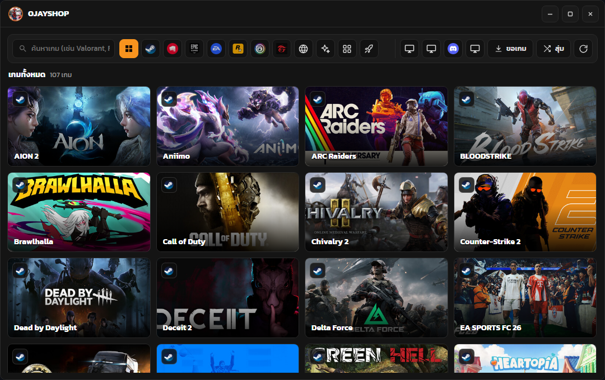

# 01 · ภาพรวมระบบ OSYNC (ร้าน 0JAYSHOP)

OSYNC คือระบบที่ทำให้เกม ตัวเปิดเกม (launcher) และเมนูเกมที่ลงไว้บน **เครื่องแม่** ใช้ได้บน **เครื่องลูก diskless** ทุกเครื่อง โดยไม่ต้องลงทีละเครื่อง

- เครื่องแม่ลงหรืออัปเดตเกมครั้งเดียว ระบบทำรายชื่อเกมและข้อมูลที่ launcher ต้องใช้ให้เอง
- เครื่องลูกบูตแล้วมีทุกอย่างพร้อม: เมนูเกม, launcher ที่จำที่อยู่เกมได้, ไดรเวอร์ไมค์, ล้างล็อกอินของลูกค้าคนก่อน
- ทุกอย่างอยู่ในโฟลเดอร์เดียว `H:\OSYNC` บนไดรฟ์เกม และกดที่ไฟล์เดียว `OSYNC.bat`

> เอกสารนี้เขียนจากโค้ดและค่าจริงใน repo + เครื่องแม่ของร้าน ณ วันที่ 20 พ.ย. 2026

## สารบัญ

1. [ร้านนี้ใช้อะไรอยู่ (ข้อมูลจริง)](#1)
2. [diskless ทำงานยังไง — เรื่องที่ต้องเข้าใจก่อน](#2)
3. [ภาพใหญ่: เครื่องแม่ ↔ ไดรฟ์เกม ↔ เครื่องลูก](#3)
4. [โฟลเดอร์ใน H:\OSYNC](#4)
5. [บริการที่รันอยู่บนเครื่องแม่ (พอร์ต / งานตั้งเวลา)](#5)
6. [วงจรประจำวัน: ลงเกมใหม่จนลูกค้าเห็น](#6)
7. [สิ่งที่ลูกค้าเห็น](#7)
8. [อ่านเอกสารบทไหนต่อ](#8)

---

<a id="1"></a>
## 1. ร้านนี้ใช้อะไรอยู่ (ข้อมูลจริง)

| เรื่อง | ค่าจริงของร้าน | มาจาก |
|---|---|---|
| โปรแกรม diskless | LW (ฝั่งเซิร์ฟเวอร์อยู่ที่ `C:\lwserver` บนเครื่องแม่) | เครื่องแม่ |
| เครื่องแม่ | `DESKTOP-3ORJAGC` IP `192.168.51.201` | `Settings\settings.txt` → `MasterPC`, `MasterIP` |
| เครื่องลูก | ชื่อ `KORIxx` วง `192.168.51.0/24` (เช่น KORI01 = `192.168.51.101`, KORI35 = `192.168.51.135`) | รายงานที่เครื่องลูกส่งมา (`C:\ProgramData\OSYNC\ClientReports`) |
| Windows ของเครื่องลูก | 2 Image เลือกตอนบูต: **Win10 IoT LTSC 2021** (build 19045) และ **Win11 Pro** (build 26300) | ฐานข้อมูล LW (`tClient.osver`) + รายงานบูต |
| ที่อยู่ OSYNC | `H:\OSYNC` | — |
| ไดรฟ์เกมที่แชร์ให้เครื่องลูก | `D E F G H I J` (7 ไดรฟ์) | `SharedDrives=DEFGHIJ` |
| Steam | `F:\steam` (เกมอยู่ใน `X:\SteamLibrary` ของแต่ละไดรฟ์) | `Menu\data\games.json` |
| VALORANT / LoL / TFT | `H:\RIOT\Riot Games` | — |
| Launcher ใน `H:\OSYNC\Launchers` | BattleNet, EA, Epic, Garena, HoYoPlay, Modrinth, Riot Client, Roblox, Rockstar, Ubisoft | โฟลเดอร์จริง |
| เกมในเมนู | **107 การ์ด**: Steam 43 · Apps 16 · Online 15 · Launchers 10 · Anime RPG 8 · EA 5 · Riot 3 · Rockstar 3 · Garena 2 · Epic 1 · Ubisoft 1 | `Menu\data\games.json` |
| ชื่อเมนู | `0JAYSHOP` ป้าย `VIP` แบบเมนูเกมอย่างเดียว (`menuOnly: true`) ไม่มีระบบเวลา/ร้านค้า (`apiUrl` ว่าง) | `Menu\config.json` |

ภาพจริงจากคอนโซลแอดมินของร้าน: ไดรฟ์ทั้งหมดของเครื่องแม่ ไดรฟ์ที่แชร์ และที่ระบบหาเกม



---

<a id="2"></a>
## 2. diskless ทำงานยังไง — เรื่องที่ต้องเข้าใจก่อน

เครื่องลูกไม่มีฮาร์ดดิสก์ของตัวเอง มันบูตและอ่านไฟล์ผ่านแลนจากเครื่องแม่ 3 แบบ:



กฎ 4 ข้อที่ทุกสคริปต์ใน OSYNC ยึดไว้:

1. **เครื่องลูกเห็นไฟล์ที่เครื่องแม่เปลี่ยน หลังรีบูตเท่านั้น**
   - เครื่องลูกอ่านไดรฟ์เกมแบบบล็อก ถ้าเครื่องแม่เขียนไฟล์ทับตอนเครื่องลูกเปิดอยู่ เครื่องลูกอาจอ่านได้ไฟล์เสียจนกว่าจะรีบูต
   - สคริปต์ฝั่งเครื่องแม่จึงเขียนไฟล์ที่เครื่องลูกใช้เฉพาะตอนที่เนื้อหาเปลี่ยนจริง
   - เช่น `Master-GameList.ps1` เทียบ games.json ใหม่กับของเดิมก่อน ถ้าเหมือนกันจะไม่เขียนทับ ("unchanged, not rewritten")
   - ฝั่งเมนูเกมก็จำรายชื่อเกมที่อ่านได้ครั้งล่าสุดไว้ ถ้าอ่านไฟล์ได้ขยะก็ยังแสดงรายชื่อเดิม (`loadGames` ใน `main.js`)
2. **ทุกอย่างที่เครื่องลูกเปลี่ยนหายตอนรีบูต:** ไดรเวอร์ ล็อกอิน ไฟล์ในไดรฟ์ C:
   - งานที่ต้องมีทุกครั้งจึงทำ **ทุกบูต** ผ่านงานตั้งเวลา `OSYNC-Client-Boot` (ดู [04-CLIENT-BOOT.md](04-CLIENT-BOOT.md))
3. **ถ้าอยากให้ติดถาวร ต้องบันทึกลง Image:**
   - เปิดเครื่องลูก 1 เครื่องต่อ 1 Image ในโหมด super แล้วกด `OSYNC.bat client`
   - จากนั้นบันทึก Image (ดู [02-INSTALL-UPDATE.md](02-INSTALL-UPDATE.md))
4. **เครื่องแม่คือเครื่องที่ชื่อตรงกับ `MasterPC`:**
   - ไฟล์ `settings.txt` เครื่องลูกอ่านด้วย จึงใช้ชื่อเครื่องตัดสินว่าเป็นแม่หรือลูก
   - ห้ามตั้ง `Role=master`

---

<a id="3"></a>
## 3. ภาพใหญ่: เครื่องแม่ ↔ ไดรฟ์เกม ↔ เครื่องลูก



| ฝั่ง | ทำอะไร | บท |
|---|---|---|
| เครื่องแม่ | อัปเดตรายชื่อเกม, เก็บข้อมูล launcher ให้เครื่องลูก, เฝ้าการลงเกม, รับรายงาน | [03-MASTER.md](03-MASTER.md) |
| เครื่องลูก (บูต) | ตั้งค่า launcher, ไดรเวอร์ไมค์ / จอเสมือน, ล้างล็อกอิน, เปิดเมนู | [04-CLIENT-BOOT.md](04-CLIENT-BOOT.md), [05-CLIENT-GAMES.md](05-CLIENT-GAMES.md) |
| เมนูเกม | การ์ดเกม, ค้นหา, หมวด, เลือกกราฟิก GTA, ขอเกม Steam | [06-MENU.md](06-MENU.md) |
| คอนโซลแอดมิน | ดูสถานะเครื่องลูก, จัดการเกม, ตั้งค่า | [07-CONSOLE-ONLINE-FUNCTIONS.md](07-CONSOLE-ONLINE-FUNCTIONS.md) |

---

<a id="4"></a>
## 4. โฟลเดอร์ใน H:\OSYNC

```
H:\OSYNC\
├─ OSYNC.bat            ปุ่มเดียว ใช้ได้ทั้งเครื่องแม่และเครื่องลูก  (ขึ้น git)
├─ Clear-Logins.bat     ล้างล็อกอินเกมบนเครื่องลูกเอง               (ขึ้น git)
├─ README.md            หน้าแรกของ repo                               (ขึ้น git)
├─ Settings\            ค่าของร้าน: settings.txt, extra-games.json,
│                       game-start.json, gta5_settings*.xml             (ขึ้น git)
├─ System\
│  ├─ Scripts\          สคริปต์ PowerShell ทั้งหมด 63 ไฟล์              (ขึ้น git)
│  ├─ Client\           ตัวเปิดเล็กๆ ที่เครื่องลูกใช้ (Boot.ps1 + VBS 12 ไฟล์) (ขึ้น git)
│  ├─ Console\          คอนโซลแอดมิน (index.html, OSYNC-Console.exe + ซอร์ส .cs) (ขึ้น git)
│  ├─ Docs\             เอกสารชุดนี้ + images\                         (ขึ้น git)
│  ├─ Tests\            สคริปต์ทดสอบคอนโซล / คลังออนไลน์              (ขึ้น git)
│  ├─ Data\             ข้อมูลที่เครื่องแม่สร้าง (snapshot launcher, กุญแจ) (ไม่ขึ้น git)
│  └─ Backup\           ของเก่าก่อนอัปเดต                               (ไม่ขึ้น git)
├─ Menu\                เมนูเกม 0JAYSHOP Client
│  ├─ source\           ซอร์ส Electron + Next.js                        (ขึ้น git)
│  ├─ tools\            ตัว build / ทำโลโก้                              (ขึ้น git)
│  ├─ config.json       ค่าของเมนู                                      (ขึ้น git)
│  ├─ app\              โปรแกรมที่ build แล้ว                           (ไม่ขึ้น git)
│  └─ data\             games.json + รูปการ์ด (สร้างบนเครื่องแม่)       (ขึ้นเฉพาะ brand\)
├─ Launchers\           โปรแกรมของค่ายเกม 10 ตัว                       (ไม่ขึ้น git)
├─ GAME\                HoYoPlay\Genshin, Online\NEWTHINGS-GAMES        (ไม่ขึ้น git)
├─ Tools\               ตัวติดตั้งของคนอื่น: WOMic, VBCABLE, Parsec, Sunshine0J,
│                       VirtualDisplay, WebView2, NodeJS, Python, WinRAR, aria2,
│                       DepotDownloader, FiveM-ReShade, FiveM-Mods, Medal (ไม่ขึ้น git)
└─ _system\Install-All.ps1  ตัวส่งต่อให้ Image รุ่นเก่า → System\Client\Boot.ps1 (ขึ้น git)
```

`.gitignore` ใส่แบบ "ห้ามทุกอย่าง ยกเว้นที่ระบุ" จึงไม่มีเกม, launcher, โปรแกรมของคนอื่น หรือข้อมูลที่สร้างบนเครื่องแม่หลุดขึ้น git

---

<a id="5"></a>
## 5. บริการที่รันอยู่บนเครื่องแม่ (พอร์ต / งานตั้งเวลา)

| บริการ | สคริปต์ | งานตั้งเวลา | พอร์ต | รับอะไร |
|---|---|---|---|---|
| ตัวเฝ้าเครื่องแม่ | `Master-Watch.ps1` (ผ่าน `Master-Watch.vbs`) | `OSYNC-Master-Watch` (ตอนล็อกอิน) + HKCU Run `OSYNC-Master` | — | ทุก 60 วินาที: เปิด launcher ใน `Launchers\` ค้างไว้ให้อัปเดตเกมเอง · ติดตั้งอัปเดตของ Riot Client ที่รออยู่ · เมื่อเกมเปลี่ยนแล้วนิ่ง 2 นาที (และทุก 60 นาทีอยู่แล้ว) สั่ง `Master-Update.ps1` ถ้าไม่มี launcher กำลังโหลด · คลังออนไลน์ซิงก์ทุก 5 นาที · log `C:\Users\Public\OSYNC-Master-Watch.log` |
| รับรายงานเครื่องลูก + คำขอเกม Steam | `Master-ClientReports.ps1` | `OSYNC-ClientReports` | 4670 (วง LAN) | รายงานหลังบูตของเครื่องลูก และคำขอ "ขอเกม Steam" จากเมนู |
| รับไฟล์เซิร์ฟ FiveM | `Master-FiveMShare.ps1` | `OSYNC-FiveMShare` | 4671 (`FiveMSharePort`) | ไฟล์เซิร์ฟ FiveM ที่เครื่องลูกโหลดมา (ไม่รับล็อกอิน) |
| เก็บกุญแจ OSLink ของแต่ละเครื่อง | `Master-OslinkLogins.ps1` | `OSYNC-OslinkLogins` | 4669 (`OslinkLoginPort`) | กุญแจ OSLink ของแต่ละเครื่องลูก |
| ฮับคลังออนไลน์ | `Hub-Server.ps1` | `OSYNC-Hub` (ตอนล็อกอิน) | 4667 | รายการเกมระหว่างสาขา (ร้านนี้มีสาขาเดียว) |
| คอนโซลแอดมิน | `Console-Server.ps1` | เปิดจาก `System\Console\OSYNC-Console.exe` | 4666 เฉพาะ `127.0.0.1` | หน้าเว็บจัดการร้าน เปิดได้จากเครื่องแม่เท่านั้น |

ภาพจริง: หน้าหลักของคอนโซล แสดงบริการทั้ง 5 ตัว ("ระบบบนเครื่องแม่") พร้อมสิ่งที่ควรดูตอนนี้ และพื้นที่ไดรฟ์



---

<a id="6"></a>
## 6. วงจรประจำวัน: ลงเกมใหม่จนลูกค้าเห็น



ถ้าไม่อยากรอตัวเฝ้า กด `OSYNC.bat` บนเครื่องแม่ แล้วเลือกข้อ **1 อัปเดตเครื่องลูก** หรือกด **อัปเดตรายการเกม** ในคอนโซลหน้า "เกมในเมนู"

---

<a id="7"></a>
## 7. สิ่งที่ลูกค้าเห็น

เมนูเกม 0JAYSHOP บนเครื่องลูก มีหมวดตามค่ายเกม ช่องค้นหา ปุ่มขอเกม และปุ่มสุ่ม



*ภาพจากโปรแกรมเมนูที่ build จริงของร้าน กับรายชื่อเกมจริง 107 การ์ด (ถ่ายบนเครื่องแม่ด้วยตัวจำลองส่วนที่ต่อกับ Windows แทน Electron ดู [06-MENU.md](06-MENU.md))*

---

<a id="8"></a>
## 8. อ่านเอกสารบทไหนต่อ

| อยากรู้ | อ่าน |
|---|---|
| ติดตั้ง / อัปเดต / ทำ Image ทีละขั้น และปุ่มทุกข้อของ OSYNC.bat | [02-INSTALL-UPDATE.md](02-INSTALL-UPDATE.md) |
| เครื่องแม่ทำอะไร ทีละสคริปต์ ทีละฟังก์ชัน | [03-MASTER.md](03-MASTER.md) |
| เครื่องลูกบูตแล้วทำอะไรบ้าง ไดรเวอร์ไมค์ / จอเสมือน / Sunshine | [04-CLIENT-BOOT.md](04-CLIENT-BOOT.md) |
| launcher แต่ละค่าย ล้างล็อกอิน OSLink GTA/FiveM Apex | [05-CLIENT-GAMES.md](05-CLIENT-GAMES.md) |
| เมนูเกม | [06-MENU.md](06-MENU.md) |
| คอนโซลแอดมินและคลังออนไลน์ | [07-CONSOLE-ONLINE-FUNCTIONS.md](07-CONSOLE-ONLINE-FUNCTIONS.md), [CONSOLE-ONLINE.md](CONSOLE-ONLINE.md) |
| ไลบรารีกลาง (`Common.ps1`) และเครื่องมือ `Tool-*` | [08-CORE-TOOLS.md](08-CORE-TOOLS.md) |
| ค่าทุกตัวใน settings.txt | [09-SETTINGS.md](09-SETTINGS.md) |
| หาฟังก์ชันตามชื่อ | [10-FUNCTION-INDEX.md](10-FUNCTION-INDEX.md) |
| อาการ → สาเหตุ → วิธีแก้ ที่เคยเจอ | [KNOWLEDGE.md](KNOWLEDGE.md) |

---
[← กลับสารบัญเอกสาร](README.md)
