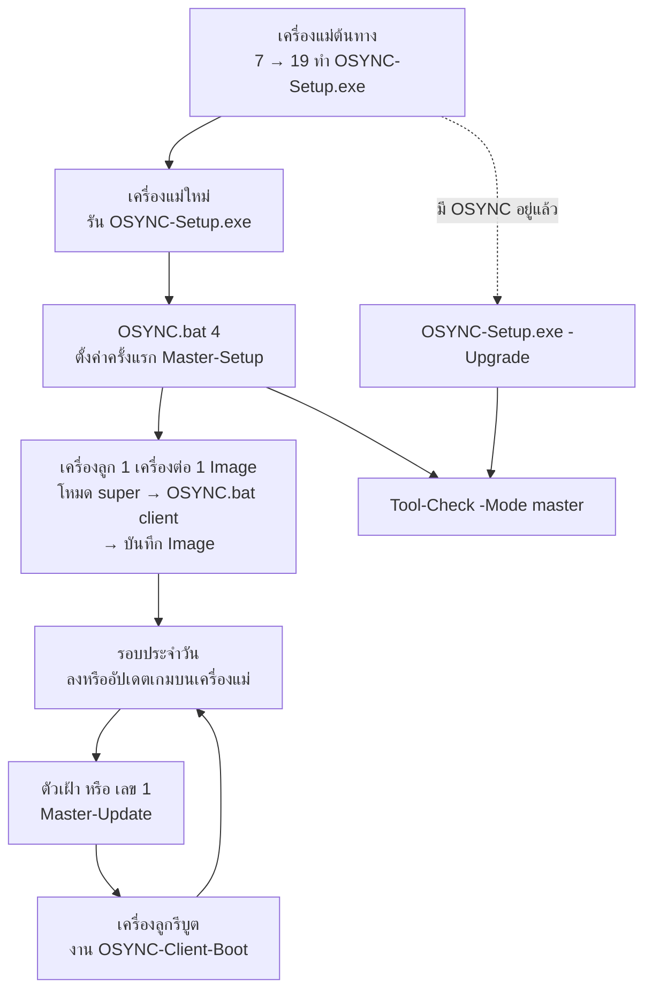
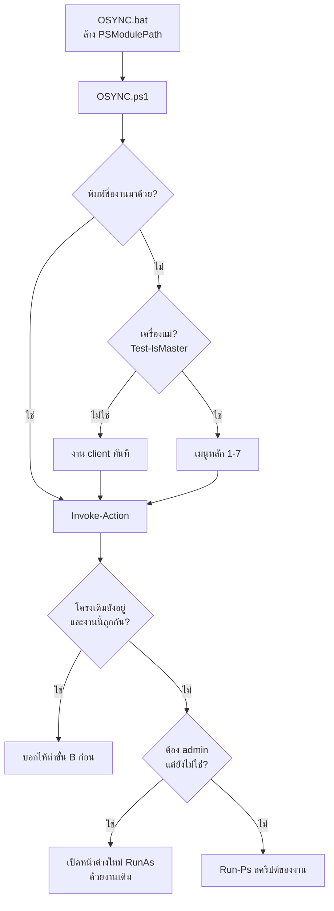
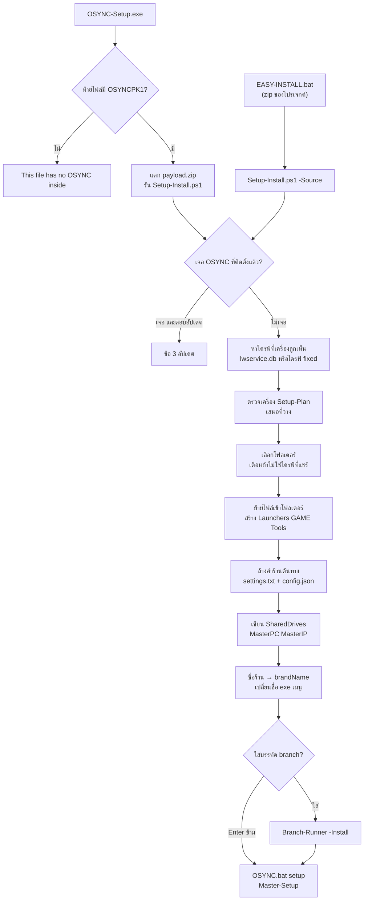
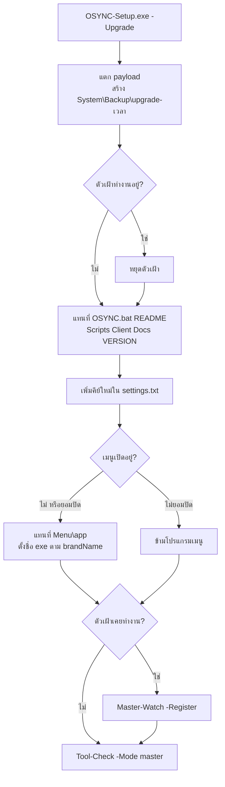
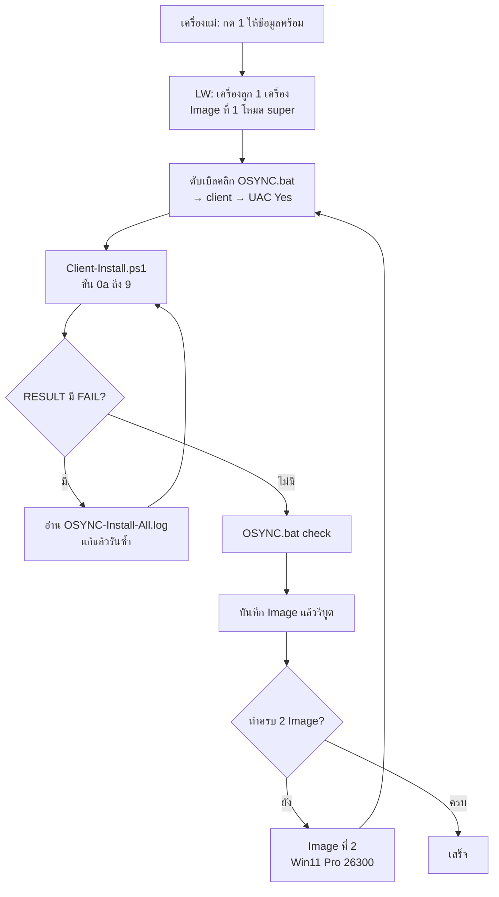
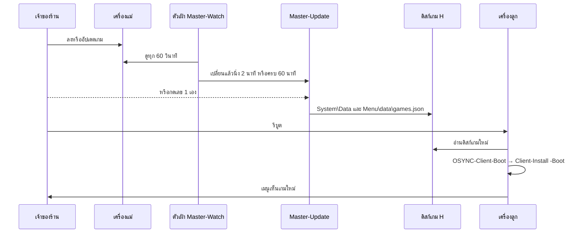
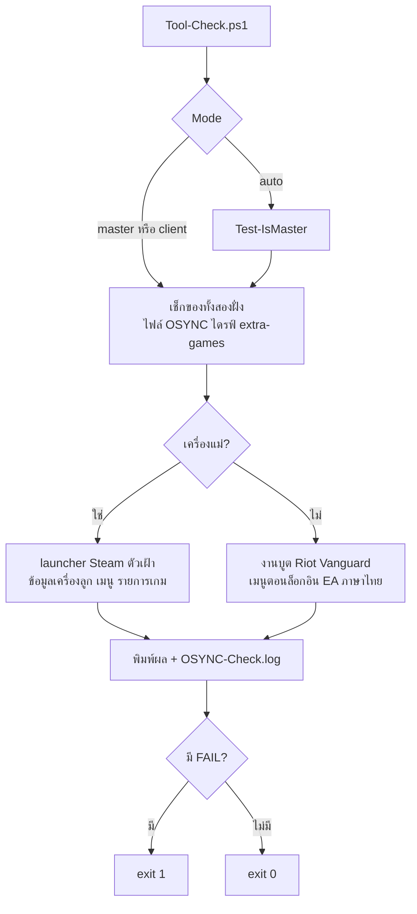
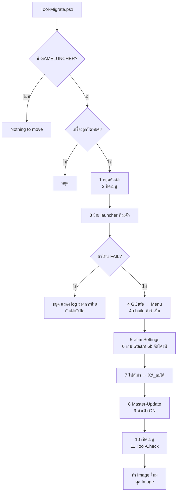

# 02 · ติดตั้ง อัปเดต และทำ Image (ทีละขั้น)

บทนี้คือคู่มือทำงานทีละขั้นของ OSYNC: ปุ่ม `OSYNC.bat` แต่ละเลขทำอะไร, ตั้งเครื่องแม่สาขาใหม่ด้วย `OSYNC-Setup.exe`, อัปเดตเครื่องแม่,
ทำ Image เครื่องลูก, รอบประจำวันหลังลงเกม, การตรวจระบบ (`Tool-Check`) และการย้ายโครงเดิม (`Tool-Migrate`, ขั้น B)
ร้านนี้: เครื่องแม่ `DESKTOP-3ORJAGC` (`MasterIP=192.168.51.201`), OSYNC อยู่ `H:\OSYNC`, ไดรฟ์ที่เครื่องลูกเห็น `SharedDrives=DEFGHIJ`, เครื่องลูกชื่อ `KORIxx`
รายละเอียดทีละฟังก์ชันของสคริปต์ที่พูดถึงในบทนี้อยู่ใน [08 · แกนกลางและเครื่องมือ](08-CORE-TOOLS.md)

## สารบัญ

- [ภาพรวม](#ภาพรวม)
- [1. เมนู `OSYNC.bat` ทุกเลข](#1-เมนู-osyncbat-ทุกเลข)
- [2. ตั้งเครื่องแม่สาขาใหม่ด้วย `OSYNC-Setup.exe`](#2-ตั้งเครื่องแม่สาขาใหม่ด้วย-osync-setupexe)
- [3. อัปเดตเครื่องแม่ที่มี OSYNC อยู่แล้ว](#3-อัปเดตเครื่องแม่ที่มี-osync-อยู่แล้ว)
- [4. ทำ / รีเฟรช Image เครื่องลูก](#4-ทำ--รีเฟรช-image-เครื่องลูก)
- [5. รอบประจำวัน: ลงหรืออัปเดตเกมบนเครื่องแม่](#5-รอบประจำวัน-ลงหรืออัปเดตเกมบนเครื่องแม่)
- [6. ตรวจระบบด้วย `Tool-Check` (เลข 6)](#6-ตรวจระบบด้วย-tool-check-เลข-6)
- [7. `Tool-Migrate` ย้ายโครงเดิมเป็นโครงใหม่ (ขั้น B)](#7-tool-migrate-ย้ายโครงเดิมเป็นโครงใหม่-ขั้น-b)
- [ปัญหาที่เคยเจอ / ข้อควรรู้](#ปัญหาที่เคยเจอ--ข้อควรรู้)

## ภาพรวม

งานทั้งหมดเริ่มจากปุ่มเดียว `H:\OSYNC\OSYNC.bat` ทั้งบนเครื่องแม่และเครื่องลูก
เครื่องแม่ทำข้อมูลและรายการเกม เครื่องลูกอ่านไดรฟ์เกมแบบ block-level จึงเห็นของใหม่ **หลังรีบูต** เท่านั้น
สิ่งที่ตั้งบน C: ของเครื่องลูกหายตอนรีบูต ยกเว้นตั้งในโหมด super แล้วบันทึกเข้า Image

---

## 1. เมนู `OSYNC.bat` ทุกเลข

[`OSYNC.bat`](../../OSYNC.bat) ล้างค่า `PSModulePath` (เปิดจาก PowerShell 7 แล้ว Windows PowerShell หา `Get-FileHash` ไม่เจอ) แล้วรัน
[`System\Scripts\OSYNC.ps1`](../Scripts/OSYNC.ps1) พร้อมคำที่พิมพ์ต่อท้าย เช่น `OSYNC.bat check`

**เครื่องไหนเห็นเมนู:**
- เครื่องแม่ (ร้านนี้คือเครื่องที่ชื่อตรงกับ `MasterPC=DESKTOP-3ORJAGC`) ดับเบิลคลิกแล้วได้เมนูตัวเลข
- เครื่องลูก ดับเบิลคลิกแล้ว **ไม่มีเมนู** ทำ `client` (ติดตั้งทุกอย่างของเครื่องลูก) ทันที
  ถ้าจะใช้งานย่อยของเครื่องลูก (เช่น เลข 7 → 4 ถึง 16) ต้องพิมพ์ชื่องานใน cmd เช่น `H:\OSYNC\OSYNC.bat eac`
- งานที่ต้องสิทธิ์ admin: เมนูเปิดหน้าต่างใหม่แบบ "Run as administrator" (กด Yes ที่ UAC) แล้วทำงานในหน้าต่างนั้น

### เมนูหลัก (เครื่องแม่)

| เลข | ชื่องาน | รันอะไร | เครื่อง | admin |
|---|---|---|---|---|
| 1 | `update` | `Master-Update.ps1` อัปเดตข้อมูล Riot / EA / Epic / EAC / Battle.net + รายการเกมให้เครื่องลูก | แม่ | ไม่ |
| 2 | `watch-on` | `Master-Watch.ps1 -Register` เปิดตัวเฝ้า และตั้งให้เปิดเองตอนล็อกอิน (งาน `OSYNC-Master-Watch` + `HKCU\...\Run\OSYNC-Master`) | แม่ | ไม่ |
| 3 | `watch-off` | `Master-Watch.ps1 -Unregister` หยุดตัวเฝ้าทุกตัว และลบการเปิดเองทั้งสองทาง | แม่ | ไม่ |
| 4 | `setup` | `Master-Setup.ps1` ตั้งค่าเครื่องแม่ครั้งแรก (ถามก่อนทุกขั้น) | แม่ | ใช่ |
| 5 | `client` | `Client-Install.ps1` ติดตั้งทุกอย่างของเครื่องลูก (ถ้าเป็นเครื่องแม่ ถามยืนยันก่อน) | ลูก (โหมด super) | ใช่ |
| 6 | `check` | `Tool-Check.ps1` ตรวจระบบ อ่านอย่างเดียว | ทั้งสอง | ไม่ |
| 7 | - | เมนู Tools (ตารางถัดไป) | แม่ | - |
| 0 | - | ออก | - | - |

### เมนู 7 Tools

บนจอเรียงเป็นกลุ่ม: Master (23, 1, 2, 18, 3, 19, 24, 25) · Branch (20-22) · Client (4-14) · Problems (15, 16) · 17 (ขึ้นเฉพาะตอนยังมีโครงเดิม) · 0 กลับ

| 7 → เลข | ชื่องาน | รันอะไร | เครื่อง | admin |
|---|---|---|---|---|
| 23 | `plan` | `Setup-Plan.ps1 -OutFile System\Data\setup-plan.txt` ตรวจเครื่องแม่ (อ่านอย่างเดียว): ไดรฟ์, SSD / HDD, ไดรฟ์ที่เครื่องลูกเห็น, launcher, library ของ Steam, IP แล้วบอกที่วางที่แนะนำ ([00 ข้อ 3](00-EASY-INSTALL.md#3-วางไฟล์ตรงไหนให้เหมาะกับเครื่องแม่ของคุณ)) | แม่ | ไม่ |
| 25 | `bluestacks` | `Master-Move-BlueStacks.ps1 -DryRun` → ถาม "Move BlueStacks now (it is closed first) and put it in the game menu?" → ย้าย BlueStacks 5 จาก `C:\Program Files\BlueStacks_nxt` + `C:\ProgramData\BlueStacks_nxt` ไป `<ไดรฟ์ที่แชร์ที่ว่างที่สุด>:\Emulator\BlueStacks\Program` + `\Data` แก้ registry / COM / ไฟล์ engine / ไดรเวอร์ `BlueStacksDrv_nxt` / shortcut / ไฟร์วอลล์ ทำไฟล์ให้เครื่องลูก (`System\Data\BlueStacks`) และใส่การ์ด "BlueStacks 5" ในเมนู · ร้านนี้ DryRun 20 พ.ย. 2026: ไป `F:\Emulator\BlueStacks` (490 MB + 4,148 MB, F: ว่าง 339 GB), registry ที่ต้องแก้ 9 คีย์ | แม่ | ใช่ |
| 24 | `sunshine-profiles` | `Tool-SunshineProfiles.ps1 -DryRun` → ถาม "Write these PC profiles into the Sunshine 0JAYSHOP config?" → เขียนโปรไฟล์เครื่องจาก `SunshineIpBase` / `SunshinePcPrefix` / `SunshinePcCount` ([00 ข้อ 7.2](00-EASY-INSTALL.md#72-sunshine-ของสาขา-วง-ip-และชื่อเครื่อง)) · ร้านนี้ขึ้น `already has these profiles - nothing to change` | แม่ | ไม่ |
| 1 | `move` | เลือก launcher จากรายการ → `Master-Move-Launcher.ps1 -Launcher <ชื่อ> -DryRun` → ถาม "Move ... now?" → ย้ายจริง | แม่ | ใช่ |
| 2 | `steam-library` | `Master-Steam-Library.ps1 -DryRun` → ถาม → ย้ายเกม Steam จริง (ปิด Steam ก่อน) | แม่ | ใช่ |
| 18 | `organize` | `Tool-Organize-Drive.ps1 -DryRun` → ถาม "Shop closed and every client PC off" → ย้ายจริง | แม่ (ร้านปิด) | ใช่ |
| 3 | `build-menu` | `Menu\tools\_system\Build-App.ps1` build โปรแกรมเมนูใหม่ | แม่ | ไม่ |
| 19 | `pack` | `Tool-Pack.ps1` ทำ `System\Dist\OSYNC-Setup-<วันที่>.exe` | แม่ | ไม่ |
| 20 | `branch` | `Branch-Runner.ps1 -Install` | แม่ของสาขา | ใช่ |
| 21 | `branch-status` | `Branch-Runner.ps1 -Status` | แม่ของสาขา | ไม่ |
| 22 | `branch-off` | ถามก่อน → `Branch-Runner.ps1 -Uninstall` | แม่ของสาขา | ใช่ |
| 4 | `steam-firstrun` | `Client-Steam-FirstRun.ps1` (ตัวติดตั้งครั้งแรกของเกม Steam ทุกเกม) | ลูก (super) | ใช่ |
| 5 | `ea-install` | `Client-EA.ps1` (EA app + EA AntiCheat) | ลูก (super) | ใช่ |
| 6 | `ea-uninstall` | `Client-EA.ps1 -Uninstall` | ลูก (super) | ใช่ |
| 7 | `eac` | `Client-EAC.ps1` (EasyAntiCheat) | ลูก (super) | ใช่ |
| 8 | `newthings` | ถาม "Also fix Thai text" → `Client-NEWTHINGS.ps1` (+ `-FixThaiText` ถ้าตอบ Y) | ลูก (super) | ใช่ |
| 9 | `riot-startup-on` | เขียน `HKLM\Software\Microsoft\Windows\CurrentVersion\Run\RiotStart` = `wscript.exe "<OSYNC>\System\Client\Riot.vbs" background` และลบ `HKCU\...\Run\RiotClient` | ลูก (super) | ใช่ |
| 10 | `riot-startup-off` | ลบ `RiotStart` ออกจาก Run ทั้ง HKLM และ HKCU | ลูก (super) | ใช่ |
| 11 | `firewall master` | `Client-Firewall.ps1 -From master` เปิดไฟร์วอลล์ + ยอมให้เครื่องแม่รีโมตเข้า | ลูก (super) | ใช่ |
| 12 | `firewall lan` | `Client-Firewall.ps1 -From lan` ยอมทั้ง LAN (/24 ของ `MasterIP`) | ลูก (super) | ใช่ |
| 13 | `firewall off` | `Client-Firewall.ps1 -From off` ลบกฎที่ยอมไว้ | ลูก (super) | ใช่ |
| 14 | `boot-off` | `schtasks /Delete /TN OSYNC-Client-Boot /F` เลิกตั้งเกมใหม่ตอนบูต (เปิดคืน = `OSYNC.bat client`) | ลูก (super) | ใช่ |
| 15 | `riot-diag` | `Tool-RiotDiag.ps1` รายงานเมื่อ Riot ขึ้น REPAIR | ลูก | ไม่ |
| 16 | `link-scan` | `Tool-LinkScan.ps1` รายงานลิงก์โฟลเดอร์ที่เสีย | ลูก | ไม่ |
| 17 | `migrate` | `Tool-Migrate.ps1` ขั้น B (ขึ้นเฉพาะเมื่อมีโฟลเดอร์ `GAMELUNCHER`) | แม่ | ใช่ |
| 0 | - | กลับ | - | - |

**Branch (20-22):** มีในโค้ด แต่ร้านนี้ไม่ใช้ ไม่มี `C:\AT9-Branch` และผลตรวจล่าสุดขึ้น `Branch runner: not installed`
**เลข 17:** ร้านนี้ไม่ขึ้นแล้ว เพราะไม่มี `H:\OSYNC\GAMELUNCHER` (ขั้น B ทำไปแล้ว 17 พ.ย. 2026 ดู[ข้อ 7](#7-tool-migrate-ย้ายโครงเดิมเป็นโครงใหม่-ขั้น-b))

### งานที่สั่งได้ด้วยชื่อเท่านั้น

| คำสั่ง | ทำอะไร |
|---|---|
| `OSYNC.bat master` | `Master-Update.ps1` แล้วต่อด้วย `Master-Watch.ps1 -Register` (แบบปุ่ม All-In-One เดิม) |
| `OSYNC.bat ea-anticheat` | `Client-EA-AntiCheat.ps1` (ไม่มีในเมนูตัวเลข) |
| `OSYNC.bat move Riot` | ย้าย launcher ตัวนั้นโดยไม่ต้องเลือกจากรายการ (ชื่อ: Steam, Riot, EA, Epic, Garena, Ubisoft, Rockstar, HoYoPlay, Modrinth, BattleNet, GOG, Nexon, Amazon) |
| `OSYNC.bat firewall lan` | เหมือน 7 → 12 (ใส่ `master`, `lan` หรือ `off`; ไม่ใส่ = `master`) |
| `OSYNC.bat branch "<บรรทัดติดตั้ง>"` | `Branch-Runner.ps1 -Install -Command <บรรทัด>` (ร้านนี้ไม่ใช้) |

**ก่อนขั้น B** (ยังมี `GAMELUNCHER` และยังไม่มี `Launchers`) งาน `master`, `update`, `watch-on`, `setup`, `client`, `move`, `steam-library` ถูกกันไว้
ร้านนี้ผ่านขั้น B แล้ว จึงไม่ถูกกัน

### `Clear-Logins.bat` (เครื่องลูก)

| คำสั่ง | ทำอะไร |
|---|---|
| `Clear-Logins.bat` | ขอ admin (เช็กด้วย `fltmc`) → `Client-ClearLogins.ps1` ปิด launcher แล้วลบล็อกอินที่บันทึกไว้ของทุกบัญชีในเครื่อง |
| `Clear-Logins.bat check` | `Client-ClearLogins.ps1 -CheckOnly` แค่แสดงรายการที่จะลบ (ก็ขอ admin เหมือนกัน) |

ทำเองอยู่แล้วทุกครั้งที่บูตเครื่องลูก (Client-Install ขั้น 1i, ร้านนี้ `ClientClearLogins=on`) บนเครื่องแม่ไม่ทำอะไร

---

## 2. ตั้งเครื่องแม่สาขาใหม่ด้วย `OSYNC-Setup.exe`

คู่มือสำหรับร้านอื่นแบบอ่านบทเดียวจบ (เตรียมเครื่อง, เลือกที่วางไฟล์, ติดตั้งจาก exe หรือ zip ของ GitHub): [00-EASY-INSTALL.md](00-EASY-INSTALL.md) · ข้อนี้คือรายละเอียดของโค้ด

### 2.1 ทำไฟล์ติดตั้งบนเครื่องแม่ต้นทาง (7 → 19)

`Tool-Pack.ps1` ทำไฟล์เดียว `System\Dist\OSYNC-Setup-<yyyyMMdd-HHmm>.exe` และคัดลอก `SETUP-AI.md` + `00-EASY-INSTALL.md` ไว้ข้างกัน (ให้คน / AI ที่สาขาอ่านก่อนติดตั้ง) (เปลี่ยนที่เก็บด้วย `-Out <โฟลเดอร์>`, `-NoExe` = หยุดที่ `payload.zip` + `Setup.cmd` + `Setup-Install.ps1` ไว้ทดสอบเอง, `-NoTools` = ไม่ใส่ `Tools\`)

| อยู่ในไฟล์ | ไม่อยู่ในไฟล์ |
|---|---|
| `OSYNC.bat`, `README.md`, `System\Scripts`, `System\Client`, `System\Docs`, `System\VERSION.txt` (เขียนใหม่ตอนแพ็ก) | เกม, launcher, `System\Data`, `System\Backup`, ไฟล์ `*.log`, OSLink (`E:\LDPlayer`, ต้องติดตั้งเองที่สาขา) |
| `Tools\` ทุกโฟลเดอร์ + `Tools\TOOLS-MANIFEST.txt` (SHA256 + ขนาดทุกไฟล์ ยกเว้น `Sunshine0J\config`) เพิ่ม 20 พ.ย. 2026 · `-NoTools` = ไม่ใส่ · ร้านนี้: 14 โฟลเดอร์ 6,969 ไฟล์ 1,000 MB → exe 754 MB (ทำใน 118 วินาที) · **มีโปรแกรมของผู้ผลิตอื่นและรหัสหน้าเว็บ Sunshine ส่งให้สาขาของร้านเองเท่านั้น** | |
| `Settings\settings.txt` ที่ล้างค่าเฉพาะร้านนี้เป็นว่าง (`SharedDrives`, `MasterIP`, `MasterPC`, `GameFolders`, `ClientBlockCpuz`, `ClientApexClean`, `ClientApexMinimal`, `ClientSteamVerify`, `ClientSteamVerifyApps`, `OnlineBranch`, `OnlineBranchName`, `OnlineBind`, `OnlineExternalIP`) และ `Role=auto` | `Menu\source`, รายการเกมและโลโก้ของร้านนี้ |
| `Settings\extra-games.json` ที่ `"games": []` และไฟล์ `.json` / `.xml` อื่นใน `Settings\` (`game-start.json`, `gta5_settings*.xml`, ใส่เพิ่ม 20 พ.ย. 2026) | |
| `Menu\app` (โปรแกรมเมนูที่ build แล้ว 1 ตัว), `Menu\tools`, `Menu\README-TH.txt`, `Menu\config.json` แบบกลาง (`brandName=GAME CENTER`, ล้างโลโก้ / `apiUrl` / `machineId` / แบนเนอร์, `featured=[]`), `Menu\data` ว่าง | |

ค่าอื่นใน `settings.txt` (สวิตช์เปิดปิดงาน, พอร์ต, `OnlineHub`) ติดไปตามเดิม ตัวติดตั้งล้างรายการเดียวกันซ้ำอีกรอบตอนติดตั้ง ([`Clear-ShopValues`](../Scripts/Setup-Install.ps1#L59))
**แก้ 20 พ.ย. 2026:** บนเครื่องที่ `%TEMP%` เป็นชื่อสั้นแบบ 8.3 (ชื่อผู้ใช้ยาวเกิน 8 ตัว เช่นเครื่องแม่ร้านนี้ `C:\Users\CCU_MA~1`) ชื่อไฟล์ทุกตัวใน `payload.zip` เคยขึ้นต้นด้วย `d/` ทำให้ exe หา `Setup-Install.ps1` ไม่เจอ (`OSYNC setup failed: Value cannot be null.`) ตอนนี้ใช้ชื่อเต็มของ `%TEMP%` แล้ว ทดสอบ exe ที่ทำใหม่ติดตั้งลงโฟลเดอร์ทดสอบผ่าน

### 2.2 รันบนเครื่องแม่ใหม่

คัดลอกไฟล์ `.exe` ไปที่เครื่องแม่ใหม่แล้วดับเบิลคลิก ตัว exe แตก `payload.zip` ลงโฟลเดอร์ชั่วคราวใน `%TEMP%` แล้วรัน `Setup-Install.ps1 -Payload <zip>` ในหน้าต่างเดียวกัน จบแล้วลบโฟลเดอร์ชั่วคราวเอง
ไม่ต้องใช้สิทธิ์ admin ตอนคัดลอก ขั้นตั้งค่าครั้งแรกตอนท้ายจะขอเอง

| สวิตช์ | ความหมาย |
|---|---|
| (ไม่ใส่) | ถามที่วางโฟลเดอร์และชื่อร้าน (กด Enter = ค่าที่แนะนำ) |
| `-Target X:\OSYNC` | ติดตั้งใหม่ที่โฟลเดอร์นี้ (ยังถามยืนยันโฟลเดอร์ถ้าไม่มี `-Yes`) |
| `-ShopName "MY SHOP"` | ชื่อร้านที่แสดงบนเมนู (ไม่ใส่ = `GAME CENTER`) ตัวอักษร `\ / : * ? " < > \|` ถูกตัดออก |
| `-Yes` | ไม่ถามอะไร ใช้ค่าแนะนำ / ตอบใช่ ไม่ถามเรื่องสาขา ไม่รอ Enter ตอนจบ · ถ้าเจอ OSYNC เดิมในเครื่องแต่ไม่ได้ใส่ `-Upgrade` หรือ `-Target` จะหยุด (exit 1) |
| `-Upgrade X:\OSYNC` | อัปเดต OSYNC ที่มีอยู่ (ดู[ข้อ 3](#3-อัปเดตเครื่องแม่ที่มี-osync-อยู่แล้ว)) |
| `-NoWizard` | ไม่เปิดขั้นต่อไปให้ (ติดตั้งใหม่ = ไม่เปิด `OSYNC.bat setup`, อัปเดต = ไม่รัน `Tool-Check`) แค่บอกว่าต้องกดอะไรต่อ |
| `-Payload <zip>` | ไฟล์ payload (ตัว exe ใส่ให้เอง) |
| `-PlanOnly` | แค่ตรวจเครื่อง (`Setup-Plan.ps1`, ดึงเฉพาะ `System\Scripts` ออกจาก payload) ไม่ติดตั้ง · เจอ OSYNC ที่ติดตั้งแล้วบอก `OSYNC already installed here: ...` · ไม่ถามเรื่องอัปเดต |
| `-Source <โฟลเดอร์>` | เอาไฟล์จากโฟลเดอร์ที่แตกจาก zip ของโปรเจกต์แทน payload (`EASY-INSTALL.bat` ใส่ให้เอง) · ถ้าโฟลเดอร์นั้นเป็น OSYNC ที่ติดตั้งแล้ว (มี `Launchers\` หรือ `System\Data\`) หยุดทันที |
| `-BranchCommand "<บรรทัด>"` | ติดตั้ง branch runner ต่อเลย (ร้านนี้ไม่ใช้) |

ตัวอย่าง: `OSYNC-Setup-20261120-1200.exe -Target E:\OSYNC -ShopName "MY SHOP" -Yes`

### 2.3 ขั้นตอนที่ `Setup-Install.ps1` ทำ (ติดตั้งใหม่)

1. อ่านรุ่นจาก `System/VERSION.txt` ใน payload (หรือในโฟลเดอร์ `-Source`) แล้วแสดง
2. หาไดรฟ์ fixed ทุกตัวยกเว้นไดรฟ์ระบบ และหา OSYNC ที่ติดตั้งแล้ว ([`Test-Installed`](../Scripts/Setup-Install.ps1#L19): ที่รากไดรฟ์ หรือโฟลเดอร์ชั้นแรก ที่มี `OSYNC.bat` + `System\Scripts\Common.ps1` + `Launchers\` หรือ `System\Data\` โฟลเดอร์ที่แตกจาก zip จึงไม่นับ) ถ้าเจอ ถามว่าจะอัปเดตไหม
3. หาไดรฟ์ที่เครื่องลูกเห็น: ถ้ามี `C:\lwserver\config\lwservice.db` และมี Node.js อ่านตาราง `tServerDiskMng` (แบบอ่านอย่างเดียว) ไม่งั้นใช้ไดรฟ์ fixed ทุกตัวยกเว้น C: (เรียงตามตัวอักษร)
4. แตกไฟล์ลงโฟลเดอร์ชั่วคราว ([`Expand-Files`](../Scripts/Setup-Install.ps1#L51): payload.zip หรือคัดลอกโฟลเดอร์ `-Source` โดยไม่เอา `.git`, `System\Data`, `System\Backup`, `System\Dist`, `Menu\source\node_modules`)
5. **ตรวจเครื่อง** `Setup-Plan.ps1 -PassThru` (อ่านอย่างเดียว แสดงผลแบบ [00 ข้อ 3.5](00-EASY-INSTALL.md#35-ตัวอย่างผลตรวจเครื่องจริง)) แล้วใช้ที่วางที่แนะนำเป็นค่าตั้งต้น (ไม่มีผล = `<ไดรฟ์แรกที่เครื่องลูกเห็น>:\OSYNC` แบบเดิม)
6. ถามโฟลเดอร์ · ถ้าไดรฟ์ไม่อยู่ในรายการ เตือนแล้วถาม · ถ้าโฟลเดอร์มี `OSYNC.bat` แล้ว หยุด · ถ้าไม่ว่าง ถามก่อน (ไม่ลบอะไร) · ตอบไม่ = ลบโฟลเดอร์ชั่วคราวแล้วจบ ([`Quit`](../Scripts/Setup-Install.ps1#L139))
7. ย้ายไฟล์เข้าโฟลเดอร์ (ของที่มีอยู่แล้วไม่ทับ) สร้าง `Launchers`, `GAME`, `Tools`, `System\Data`, `System\Backup`, `Menu\data`
8. ล้างค่าของร้านต้นทางใน `settings.txt` ([`Clear-ShopValues`](../Scripts/Setup-Install.ps1#L59) รายการเดียวกับข้อ 2.1) และใน `Menu\config.json` ([`Clear-MenuShop`](../Scripts/Setup-Install.ps1#L66): `brandBadge`, `brandLogo`, `brandMark`, `apiUrl`, `machineId`, แบนเนอร์, `featured=[]`) แล้วบันทึกผลตรวจเครื่องที่ `System\Data\setup-plan.txt` · รายการ `games` ใน `Settings\extra-games.json` ถูกล้าง (เป็นเกมบนไดรฟ์ของร้านต้นทาง ระบบหาเกมของร้านใหม่เอง)
9. เขียน `Settings\settings.txt`: `SharedDrives`, `MasterPC=<ชื่อเครื่องนี้>`, `MasterIP=<IP ของการ์ดที่มี gateway>`
10. ถามชื่อร้าน → แก้ `"brandName"` ใน `Menu\config.json` (ไม่จัดรูปไฟล์ใหม่) และเปลี่ยนชื่อ exe ตัวใหญ่ (>50 MB) ใน `Menu\app` เป็น `<ชื่อร้าน>.exe` · ไม่มีโปรแกรมเมนู (ติดตั้งจาก zip) = บอกว่าขั้นตั้งค่าครั้งแรกข้อ 4 จะ build ให้
11. `Tools\`: ถ้าโฟลเดอร์ปลายทางมี `Tools\` อยู่แล้ว ใส่ทีละโฟลเดอร์ ([`Sync-Tools`](../Scripts/Setup-Install.ps1#L78)) แล้วเทียบทุกไฟล์กับ `TOOLS-MANIFEST.txt` ([`Test-ToolsSame`](../Scripts/Setup-Install.ps1#L98)): `tools: all <n> files are the same as the pack (SHA256)` · ทดสอบ 20 พ.ย. 2026: 6,969 ไฟล์ตรงทั้งหมด
12. `Unblock-File` ทุกไฟล์ใน `System`, `Menu\app`, `Menu\tools` แล้วลบโฟลเดอร์ชั่วคราว
13. ถามบรรทัดติดตั้ง branch runner (กด Enter = ข้าม) · ร้านนี้กด Enter
14. เปิด `OSYNC.bat setup` (= เลข 4, ขอ admin เปิดหน้าต่างของตัวเอง)
15. บอกขั้นต่อไป: เครื่องลูก 1 เครื่องต่อ 1 Image โหมด super: `OSYNC.bat client` แล้วบันทึก Image

### 2.4 ตั้งค่าครั้งแรก `Master-Setup.ps1` (เลข 4)

ถามก่อนทุกการเปลี่ยน ขั้นที่ทำไปแล้วจะบอกว่า OK รันซ้ำได้ตลอด (`-DryRun` = แค่แสดง ไม่ถาม ไม่เปลี่ยน)

1. **ไดรฟ์ที่เครื่องลูกเห็น** → `SharedDrives` (อ่านจาก `lwservice.db` เหมือนข้อ 2.3) และ `MasterPC`, `MasterIP` (เขียนเฉพาะตอนยังว่าง)
2. **ย้าย launcher เข้า `Launchers\`** ทีละตัวที่ติดตั้งอยู่ที่อื่น (DryRun ก่อน แล้วถาม) · launcher ที่ยังไม่ได้ลง ให้ลงก่อน (Tool-Check บอก "install Steam / Riot / EA / Epic, then OSYNC.bat > 4")
3. **Steam** แสดง library ทุกอัน · เกมที่อยู่ในโฟลเดอร์ Steam → แนะนำ 7 → 2 · เกมใหม่ให้ลงใน `GAME\Steam`
4. **เมนูเกม** แสดงชื่อร้าน เปิด `config.json` ใน Notepad ได้ · ถ้ายังไม่ build และมี `Menu\source\node_modules\electron` ถามว่าจะ build ไหม (ไฟล์ติดตั้งมีโปรแกรมที่ build แล้ว แต่ไม่มี `Menu\source`) · ถ้าไม่มี `node_modules` แต่มี `npm` และ `Menu\source\package-lock.json` (ติดตั้งจาก zip ของโปรเจกต์) ถาม `Get the build tools (npm ci: internet, a few minutes) and build the menu now?` → `npm ci` แล้ว `Build-App.ps1`
5. **อัปเดตเครื่องลูก** (`Master-Update.ps1`)
6. **ตัวเฝ้า** (`Master-Watch.ps1 -Register`)
7. **ตรวจ** (`Tool-Check.ps1 -Mode master`)

จบแล้วไป[ข้อ 4](#4-ทำ--รีเฟรช-image-เครื่องลูก) ทำ Image เครื่องลูก

---

## 3. อัปเดตเครื่องแม่ที่มี OSYNC อยู่แล้ว

### 3.1 ด้วย `OSYNC-Setup.exe` (เครื่องแม่ร้านอื่น / สาขา)

รัน exe ตัวใหม่ แล้วตอบ Y ที่ "Update ... (keeps Settings, games, launchers, menu config)?" หรือสั่ง `OSYNC-Setup-<วันที่>.exe -Upgrade H:\OSYNC`
(ใส่ `-Yes` อย่างเดียวจะไม่อัปเดต ต้องมี `-Upgrade <โฟลเดอร์>` ด้วยเสมอ: "never updated without a person saying so")

| ถูกแทนที่ (ของเก่าไปไว้ `System\Backup\upgrade-<yyyyMMdd-HHmmss>`) | คงไว้ตามเดิม |
|---|---|
| `OSYNC.bat`, `README.md`, `System\Scripts`, `System\Client`, `System\Docs`, `System\VERSION.txt` | `Settings\` (เพิ่มเฉพาะคีย์ใหม่ พร้อมบรรทัดคำอธิบายของคีย์นั้น ค่าที่ร้านตั้งไม่เปลี่ยน) |
| `Menu\app` (เฉพาะตอนเมนูปิด หรือยอมให้ปิด) ของเก่าไป `...\Menu-app` ชื่อ exe ตั้งตาม `brandName` | `Menu\config.json`, รายการเกม, โปสเตอร์, `Launchers`, `GAME`, `System\Data` |
| `Tools\<ชื่อ>` ทุกโฟลเดอร์ที่ไฟล์ติดตั้งมี (ของเก่าไป `...\Tools\<ชื่อ>`) + `Tools\TOOLS-MANIFEST.txt` แล้วตรวจ SHA256 ทุกไฟล์ | `Tools\Sunshine0J\config` ของร้านนั้น, โฟลเดอร์ใน `Tools\` ที่ไฟล์ติดตั้งไม่มี |

ขั้นตอน:
1. แตก payload ลง `%TEMP%\osync-setup-<เวลา>` สร้างโฟลเดอร์สำรอง
2. หยุดตัวเฝ้า (`Master-Watch.ps1`) ของโฟลเดอร์นั้น ระหว่างเปลี่ยนสคริปต์
3. ย้ายของเก่าไปโฟลเดอร์สำรอง แล้ววางของใหม่ ทีละรายการ · `Tools\` ทีละโฟลเดอร์ (`Sync-Tools`, คืน `Sunshine0J\config` เดิม) แล้ว `Test-ToolsSame` · ทดสอบ 20 พ.ย. 2026: แก้คอนฟิก Sunshine + ทำไฟล์ `WinRAR\SOURCE.txt` เสียไว้ก่อน → อัปเดตแล้วคอนฟิกของสาขายังอยู่ ไฟล์ที่เสียกลับเป็นของต้นทาง และ 6,969 ไฟล์ตรงทั้งหมด
4. เพิ่มคีย์ใหม่ใน `settings.txt` · ตั้ง `MasterPC` ถ้ายังว่าง
5. เมนูเปิดอยู่ → ถาม "Close it to update the menu program?" · ตอบไม่ = ไม่อัปเดตโปรแกรมเมนู · ปิดแล้วอัปเดต และเปิดเมนูคืนผ่าน `System\Client\Menu.vbs`
6. ตัวเฝ้าเคยทำงาน → `Master-Watch.ps1 -Register` เปิดใหม่ด้วยสคริปต์ใหม่
7. `Unblock-File`, ลบโฟลเดอร์ชั่วคราว, ถามเรื่อง branch (Enter = ข้าม)
8. `Tool-Check.ps1 -Mode master`

### 3.2 เครื่องแม่ร้านนี้

- เครื่องแม่ร้านนี้คือต้นทางที่ใช้ทำ `OSYNC-Setup.exe` (7 → 19) โฟลเดอร์ `H:\OSYNC` เป็นโฟลเดอร์ git (มี `.git`; `Tool-Migrate` ตั้งใจไม่ย้าย `.git` เพื่อให้ประวัติอยู่ต่อ)
- วิธีดึงรุ่นใหม่มาที่เครื่องนี้ (git หรืออื่น ๆ): ไม่ระบุในโค้ด
- หลังแก้สคริปต์ใน `System\Scripts` ด้วยมือ:
  1. ตัวเฝ้ายังรันโค้ดเก่าอยู่: กด **3** (`watch-off` หยุดทุกตัว) แล้ว **2** (`watch-on`) · กด 2 อย่างเดียวจะได้ "watcher: already running"
  2. กด **6** ตรวจระบบ
  3. เครื่องลูกได้สคริปต์ใหม่ **ตอนรีบูตครั้งถัดไป** ไม่ต้องทำ Image ใหม่ เพราะ Image เรียกแค่ไฟล์ใน `System\Client` (`Boot.ps1`: "Keep this file here with this name: client images point at it. The work is in System\Scripts.")
- `Setup-Install` หยุด/เปิดใหม่เฉพาะตัวเฝ้า ไม่แตะคอนโซลและฮับ (งาน `OSYNC-Hub` ทำงานอยู่บนเครื่องนี้ เปิดตอนล็อกอิน) สองตัวนี้ใช้โค้ดใหม่เมื่อเริ่มใหม่ เช่น หลังรีสตาร์ตเครื่องแม่ (งานเปิดเองดูใน [CONSOLE-ONLINE.md](CONSOLE-ONLINE.md))

---

## 4. ทำ / รีเฟรช Image เครื่องลูก

**เมื่อไหร่ต้องทำ:** ครั้งแรก, หลังขั้น B (Image เก่ายังชี้ไฟล์เดิม), หรือเมื่อต้องเปลี่ยนสิ่งที่อยู่ใน Image เท่านั้น
ขั้น 5-7 ของ `Client-Install.ps1` (ไอคอนเมนูตอนล็อกอิน, NEWTHINGS, งานบูต `OSYNC-Client-Boot`) ทำเฉพาะตอนแก้ Image ขั้นอื่นทำซ้ำเองทุกบูต

**ร้านนี้มี 2 Image:** Win10 IoT LTSC 2021 (build 19045) และ Win11 Pro (26300) ต้องทำ **ทีละ Image ใช้เครื่องลูก 1 เครื่องต่อ 1 Image** (ทำ 2 รอบ)
(`HOW-IT-WORKS.md` เรียกชื่อ Image ว่า Kernelos10, Kernelos11)

**ก่อนเริ่ม (บนเครื่องแม่):** กด 1 ให้เสร็จก่อน · ขั้น 3 EA ข้ามถ้ายังไม่มี `System\Data\EA\ea-client.reg` ("OSYNC.bat > 1 on the master first") · ขั้น 5 เมนูข้ามถ้ายังไม่มีโปรแกรมเมนู

ขั้นตอน (ต่อ 1 Image):
1. ในโปรแกรม LW ตั้งเครื่องลูก 1 เครื่องให้บูต Image นั้นใน **โหมด super** (วิธีตั้งในโปรแกรม LW: ไม่ระบุในโค้ด)
2. บูตเครื่องนั้น ดับเบิลคลิก `H:\OSYNC\OSYNC.bat` → เครื่องลูกไม่มีเมนู ทำ `client` ทันที → กด **Yes** ที่ UAC
3. `Client-Install.ps1` ถามเรื่องภาษาไทยเฉพาะเมื่อ code page ไม่ใช่ 874 · ร้านนี้ `ClientThaiFix=on` = แก้ให้เลยไม่ถาม (มีผลหลังรีสตาร์ต)
4. รอจนขึ้นตาราง `RESULT` (เขียว OK / เหลือง SKIP / แดง FAIL) · log เต็ม `C:\Users\Public\OSYNC-Install-All.log`
5. (แนะนำ) `OSYNC.bat check` บนเครื่องนั้น ดูกลุ่มเช็กของเครื่องลูกใน[ข้อ 6](#6-ตรวจระบบด้วย-tool-check-เลข-6)
6. **บันทึก Image** ในโหมด super แล้วรีบูต (ข้อความท้าย: "Now SAVE THE IMAGE (super workstation), then reboot this PC.")
   เมนูเกมไม่เปิดระหว่างติดตั้ง (หน้าล็อกของเมนูจะบังหน้าต่างผลลัพธ์) จะเปิดเองหลังรีบูต
7. ทำซ้ำกับ Image ที่สอง

### ขั้นของ `Client-Install.ps1` (ย่อ)

| ขั้น | ทำอะไร | ตอนแก้ Image | ทุกบูต |
|---|---|---|---|
| 0a | กันไดรเวอร์ CPU-Z (EA Javelin) ตาม `ClientBlockCpuz` | ✓ | ✓ |
| 0 | Sunshine 0JAYSHOP เป็นบริการ (เครื่องที่ไม่มี Sunshine ของตัวเอง) | ✓ | ✓ |
| 0b | ส่งไฟล์เซิร์ฟ FiveM ให้เครื่องแม่ (เบื้องหลัง) | - | ✓ |
| 1 | Riot เปิดเงียบตอนล็อกอิน (`Run\RiotStart`) | ✓ | ✓ |
| 1b | ซ่อมไอคอนเมนูก่อนล็อกอิน | - | ✓ |
| 1c-1e | Roblox, ปิด Resume, ลูกค้าปิด/รีสตาร์ตเครื่องเองไม่ได้ | ✓ | ✓ |
| 1h, 1i | กราฟิก GTA V / FiveM, ล้างล็อกอินเกม | ✓ | ✓ |
| 1l, 1j, 1k, 1m | OSLink: ไดรเวอร์, MAC ของตัวเอง, ล็อกอิน, เปิดในถาด | ✓ | ✓ |
| 1f, 1g, 1o, 1p | ไมค์ (WO Mic + VB-CABLE), Parsec, WebView2 / Node.js / Python, จอเสมือน VDD | ✓ | ✓ |
| 1q, 1r, 1u, 1v | Steam: ไม่อัปเดตตัวเอง, ไม่โชว์บัญชีเครื่องแม่, Steam Client Service, Battle.net Update Agent | ✓ | ✓ |
| 1s, 1t | WinRAR, Rockstar launcher บนดิสก์เกม | ✓ | ✓ |
| 2 | ตัวติดตั้งครั้งแรกของเกม Steam ทุกเกม (ตอนบูตใส่ `-SkipFailed`) | ✓ | ✓ |
| 3, 4 | EA app + เกม + EA AntiCheat, EasyAntiCheat | ✓ | ✓ |
| 5 | ไอคอนเมนูตอนล็อกอิน + บนเดสก์ท็อป (`Client-Menu.ps1 -NoStart`) | ✓ | - |
| 6 | NEWTHINGS-GAMES (GTA SA) | ✓ | - |
| 7 | งาน `OSYNC-Client-Boot` (ตอนเปิดเครื่อง, SYSTEM) → `System\Client\Boot.ps1` รอดิสก์เกมได้ถึง 3 นาที | ✓ | - |
| 8 | เดสก์ท็อปเหลือแค่ไอคอนเมนู (`ClientDesktopMenuOnly=on`) | ✓ | ✓ |
| 9 | เครื่องทดสอบ Apex แบบสะอาด (`ClientApexClean`, ร้านนี้ว่าง = ข้าม) | ✓ | ✓ |

รายละเอียดแต่ละขั้นอยู่ในบทของ `Client-Install.ps1`

**Image เก่าจากโครงเดิม:** งานบูตของ Image เหล่านั้นเรียก `<OSYNC>\_system\Install-All.ps1` ขั้น B จึงวางไฟล์ส่งต่อแบบซ่อนไว้ที่ `H:\OSYNC\_system\Install-All.ps1` (ส่งต่อไป `System\Client\Boot.ps1`)
คำอธิบายในไฟล์: "when every image is new, this folder can go" · ทุก Image ทำใหม่แล้วหรือยัง: ไม่ระบุในโค้ด

---

## 5. รอบประจำวัน: ลงหรืออัปเดตเกมบนเครื่องแม่

1. **ลง / อัปเดตเกมบนเครื่องแม่** ลงในไดรฟ์ที่เครื่องลูกเห็น (`D E F G H I J`) · Master-Setup แนะนำเกม Steam ใหม่ลง `GAME\Steam` · library Steam ของร้านนี้ (ผลตรวจ 17 พ.ย.): `D: E: F: G: I: J:\SteamLibrary`
2. **ตัวเฝ้า** (`Master-Watch.ps1`, เปิดด้วยเลข 2) ดูทุก 60 วินาที เมื่อเกม / launcher เปลี่ยนแล้วนิ่ง 2 นาที หรือครบทุก 60 นาที จะรัน `Master-Update.ps1` เอง (ล้มเหลว = ลองใหม่ใน 30 นาที)
   ไม่อยากรอ: กด **1** เอง (ตัวเฝ้ากับปุ่มชนกันไม่ได้: ตัวหลังรอได้ถึง 30 นาที)
3. **`Master-Update.ps1`** ทำ 7 ขั้น แล้วสรุปผล:

   | ขั้น | สคริปต์ | ได้อะไร |
   |---|---|---|
   | 1 Riot | `Master-Snapshot-Riot.ps1` | สถานะติดตั้ง VALORANT / LoL / TFT → `System\Data\Riot` |
   | 2 EA | `Master-Snapshot-EA.ps1` | EA app + เกม → `System\Data\EA` |
   | 3 Epic | `Master-Snapshot-Epic.ps1` | รายการเกม Epic → `System\Data\Epic` |
   | 4 EAC | `Client-EAC.ps1 -Snapshot` | รหัส EasyAntiCheat → `System\Data\EAC` |
   | 4b BNet | `Master-Snapshot-BattleNet.ps1` | Battle.net Update Agent → `System\Data\BattleNet` |
   | 5 Menu | `Master-GameList.ps1` | สแกนเกมทั้งหมด → `Menu\data\games.json` |
   | 6 Cfx | `Master-CitizenFX.ps1` | ชี้ FiveM → GTA V Legacy, RedM → RDR2 ใน `CitizenFX.ini` |

4. **รีบูตเครื่องลูก** งาน `OSYNC-Client-Boot` (SYSTEM) รัน `Boot.ps1` → `Client-Install.ps1 -Boot` ทำของที่ใหม่ (เช่น ตัวติดตั้งครั้งแรกของเกม Steam ใหม่, EA, EAC) log `C:\Users\Public\OSYNC-Boot-Setup.log`
5. เมนูบนเครื่องลูกเห็นเกมใหม่จาก `games.json` ตัวใหม่ (ข้อความท้าย Master-Update: "Clients pick this up after a reboot.")

**ข้อควรรู้ของรอบนี้**
- Riot ยังแพตช์อยู่ ขั้น 1 จะ FAIL ให้รันใหม่เมื่อเสร็จ (Riot Client เปิดค้างไว้ได้) · ตรวจว่ายังแพตช์ไหมด้วยเลข 6 (`Riot updating`)
- ลบเกมก็ต้องผ่านรอบนี้เหมือนกัน (Master-Update: "after installing / updating / removing games")
- เกม Steam ที่ตัวติดตั้งครั้งแรกล้มเหลว ตอนบูตจะข้าม (`-SkipFailed`) ไปลองใหม่ตอนแก้ Image

---

## 6. ตรวจระบบด้วย `Tool-Check` (เลข 6)

`Tool-Check.ps1` **อ่านอย่างเดียว ไม่เปลี่ยนอะไร** ใช้ได้ทั้งเครื่องแม่และเครื่องลูก
- สั่ง: เลข 6, `OSYNC.bat check`, หรือ `Tool-Check.ps1 -Mode master|client` (ค่าเริ่ม `auto` = ดูจาก `Test-IsMaster`)
- รันเองอัตโนมัติท้าย `Master-Setup` (ขั้น 7), `Setup-Install -Upgrade`, `Tool-Migrate` (ขั้น 11)
- ผลขึ้นจอ และเขียนทับ `C:\Users\Public\OSYNC-Check.log` · มี FAIL = exit code 1

| ระดับ | ความหมาย |
|---|---|
| `OK` (เขียว) | ถูกต้อง ไม่ต้องทำอะไร |
| `WARN` (เหลือง) | ใช้งานได้แต่ควรแก้ หรือรอได้ บรรทัด `->` ใต้ข้อบอกวิธีแก้ |
| `FAIL` (แดง) | ขาดหรือเสีย เครื่องลูกจะใช้ไม่ได้ ต้องแก้ตามบรรทัด `->` |

### เช็กทั้งสองฝั่ง

| รายการ | ตรวจอะไร | WARN / FAIL เมื่อ |
|---|---|---|
| `OSYNC files` | มี `OSYNC.bat`, `Settings\settings.txt`, `System\Client\Boot.ps1`, `Riot.vbs`, `Epic.vbs`, `Menu.vbs` | FAIL ถ้าขาดตัวใด → คัดลอกโฟลเดอร์ OSYNC ใหม่ |
| `Shared drives` | ทุกตัวอักษรใน `SharedDrives` มีอยู่บนเครื่องนี้ | FAIL ถ้าไม่มี → แก้ `settings.txt` |
| `OSYNC drive` | ไดรฟ์ของ OSYNC อยู่ใน `SharedDrives` | FAIL เมื่อไม่อยู่ (ไม่มีบรรทัด OK) |
| `extra-games.json` | JSON อ่านได้ | FAIL ถ้าเสีย (ลืม , หรือ ") |

### เช็กของเครื่องแม่

| รายการ | OK เมื่อ | WARN / FAIL เมื่อ |
|---|---|---|
| `Launchers` | launcher อยู่ใน `Launchers\` | WARN `Launchers in old folder` (ยังอยู่ `GAMELUNCHER`) · WARN `Launchers outside` (ลงไว้ที่อื่น → 7 → 1) · FAIL ไม่เจอ launcher เลย |
| `Steam libraries` | มี library บนไดรฟ์ที่แชร์ (บอกจำนวนเกมต่อ library) | WARN `Steam games inside Launchers` (มีเกมใน `<Steam>\steamapps` ยกเว้น 228980 → 7 → 2) · WARN ไม่มี library บนไดรฟ์ที่แชร์ |
| `Watcher autostart` | มีงาน `OSYNC-Master-Watch` (+ Run entry) ชี้โฟลเดอร์นี้ | WARN ปิด / ชี้โฟลเดอร์อื่น / มีแค่ Run entry / งานถูก disable |
| `Watcher running` | ตัวเฝ้าของโฟลเดอร์นี้ทำงาน | WARN ไม่ทำงาน หรือเป็นของโฟลเดอร์อื่น |
| `Last client update` | บรรทัดล่าสุดใน `OSYNC-Master-Watch.log` คือ `client data refreshed OK` | FAIL ถ้าล่าสุดคือ `FAILED` → กด 1 แล้วอ่านบรรทัดแดง |
| `Branch runner` | ไม่ได้ติดตั้ง (สาขาเท่านั้นที่ต้องใช้) หรือ ต่อได้ | FAIL ไม่มีข่าวเกิน 150 วินาที · WARN ต่อไม่ได้ / อ่าน state ไม่ได้ / มีตัวเก่าใน ProgramData |
| `Riot data` | ข้อมูล Riot ใน `System\Data` ใหม่กว่าการอัปเดตเกม Riot ล่าสุด | FAIL ไม่มี `System\Data\Riot` · WARN เกม Riot อัปเดตหลังการคัดลอก · WARN `Riot updating` ยังแพตช์อยู่ |
| `Roblox` | เวอร์ชันบนดิสก์เกม และ `%LOCALAPPDATA%\Roblox\Versions` ของเครื่องแม่เป็น junction ไป `Launchers\Roblox\Versions` | WARN ไม่มี junction (Roblox อัปเดตลง C:) |
| `FiveM` / `RedM` | `CitizenFX.ini` ชี้โฟลเดอร์เกมที่ใช้ได้ | WARN ชี้ผิด / ไม่ได้ชี้ (เครื่องลูกจะเจอหน้าต่างเลือกไฟล์) → กด 1 · WARN ไม่พบเกมบนไดรฟ์ที่แชร์ |
| `EA data` | มี `System\Data\EA\ea-client.reg` | FAIL ไม่มี → กด 1 |
| `Menu config` | `Menu\config.json` อ่านได้ (บอกชื่อร้าน) | WARN เมนูยังอยู่ `GCafe` · FAIL ไฟล์เสีย |
| `Menu program` | มี exe ของเมนู | WARN ซอร์สใหม่กว่าตัวที่ build → 7 → 3 · FAIL ยังไม่ build |
| `Game list` | `games.json` อ่านได้ (บอกจำนวนต่อหมวด) | FAIL ไม่มี / JSON เสีย · FAIL `Game list paths` exe ที่การ์ดเรียกไม่มีอยู่ · WARN เกมยังเปิดจากโฟลเดอร์เดิม |
| `Old layout` | - | WARN ยังมี `GAMELUNCHER` |
| `Loose launcher files` | - | WARN มี exe / dll วางตรง ๆ ใน `GAMELUNCHER` หรือ `Launchers` |

### เช็กของเครื่องลูก

| รายการ | OK เมื่อ | WARN / FAIL เมื่อ |
|---|---|---|
| `Boot setup task` | งาน `OSYNC-Client-Boot` ชี้ `System\Client` ของโฟลเดอร์นี้ (ถอด `-EncodedCommand` มาดู) | WARN ไม่มีงาน · FAIL ชี้ที่อื่น → `OSYNC.bat client` ในโหมด super แล้วบันทึก Image |
| `Riot at logon` | `HKLM\...\Run\RiotStart` ชี้ `System\Client` | WARN ไม่ได้ตั้ง · FAIL ชี้ที่อื่น |
| `Riot Vanguard` | มีบริการ `vgc` | WARN ไม่มี → ลง Vanguard ในโหมด super แล้วบันทึก Image |
| `Menu at logon` | มี shortcut ใน Startup ของทุกผู้ใช้ ชี้ `Menu.vbs` ของโฟลเดอร์นี้ | WARN ไม่มี · FAIL เป็น shortcut เก่า |
| `EA service` | `EABackgroundService` ชี้ใน `Launchers` | WARN ชี้ที่อื่น |
| `Thai text` | code page 874 | WARN code page อื่น → `OSYNC.bat newthings` (ข้อความในโค้ดเขียน "7 Tools > 8" แต่บนเครื่องลูกไม่มีเมนู) |
| `Last boot setup` | `OSYNC-Boot-Setup.log` ไม่มีขั้นที่ FAIL | WARN มีขั้น FAIL |

### ผลล่าสุดที่บันทึกไว้ในร้านนี้

`C:\Users\Public\OSYNC-Check.log` วันที่ 2026-11-17 15:42 (หลังขั้น B): **OK 15 · WARN 1 · FAIL 0**
- WARN ข้อเดียว: `Launchers outside: Steam (f:\steam)` Steam ของร้านนี้อยู่ `F:\steam` ซึ่งอยู่ใน `SharedDrives` · ข้อความแก้ไขของ Tool-Check พูดถึงกรณี launcher อยู่บน C:
- `Game list: 99 games`, ตัวเฝ้าทำงาน, `Branch runner: not installed`

---

## 7. `Tool-Migrate` ย้ายโครงเดิมเป็นโครงใหม่ (ขั้น B)

### 7.1 ประวัติในร้านนี้ (ทำแล้ว 17 พ.ย. 2026)

จาก `C:\Users\Public\OSYNC-Migrate.log` (15:38-15:40) และ `C:\Users\Public\OSYNC-StepB.log`:
- รันแบบในที่เดิม `H:\OSYNC (in place)` ผ่านสคริปต์ห่อ `StepB.ps1` (อยู่นอก repo) ซึ่งเรียก `Tool-Migrate` ด้วย `-Yes` และ `-NoMenuStart`
- log ของ StepB บันทึกว่าตอนนั้นยังมีเครื่องลูกเปิดอยู่ และเลือกทำต่อ ("owner's choice") เครื่องที่เปิดอยู่ใช้เมนู / launcher ไม่ได้จนกว่าจะรีบูตและทำ Image ใหม่
- ขั้น 3 ย้าย launcher 8 ตัวจาก `GAMELUNCHER\` เข้า `Launchers\`: Riot Client, EA app, Epic Games, Garena, Ubisoft Connect, Rockstar Games, HoYoPlay, Modrinth
- ขั้น 4 เปลี่ยนชื่อ `GCafe` → `Menu` ไฟล์ OSYNC เก่าในโฟลเดอร์เมนูไปไว้ `System\Backup\menu-old-files-20261117` · ขั้น 4b โปรแกรมเมนู up to date
- ขั้น 5 `SharedDrives` ตรงกัน · ขั้น 6 เกม Steam **ไม่ได้ย้าย** ("left where they are (they work there)")
- ขั้น 7 ไฟล์โครงเดิมไป `H:\_ลบได้\Autosync-old-20261117` (`GAMELUNCHER`, `_system`, ปุ่มเก่า 3 ตัว, คู่มือเก่า, `.gitignore`, `.gitattributes`) · `GAMELUNCHER\_archive` → `System\Backup\GAMELUNCHER-archive` · คงไว้: `.git`, `GAME`, `Clear-Logins.bat` · วางไฟล์ส่งต่อซ่อน `_system\Install-All.ps1`
- ขั้น 11 ตรวจ: OK 15 · WARN 1 · FAIL 0 (ดู[ข้อ 6](#ผลล่าสุดที่บันทึกไว้ในร้านนี้))

**ตอนนี้:** ไม่มี `GAMELUNCHER` และ `GCafe` แล้ว เลข 7 → 17 จึงไม่ขึ้น ถ้ารันอีกจะได้ "Nothing to move"
`H:\_ลบได้\Autosync-old-20261117` ยังรอเจ้าของร้านลบเอง ("delete it yourself when all is fine")

### 7.2 ทำงานอย่างไร

| พารามิเตอร์ | ความหมาย |
|---|---|
| `-DryRun` | แสดงทุกขั้น (การย้าย launcher ก็เป็น dry-run) ไม่เปลี่ยนอะไร ไม่ต้อง admin |
| `-OldRoot <โฟลเดอร์>` | ย้ายจากโฟลเดอร์อื่นมาที่ OSYNC นี้ (ไม่ใส่ = ในที่เดิม) |
| `-SkipSteamGames` | ไม่ย้ายเกม Steam |
| `-Yes` | ตอบใช่ทุกคำถาม (ยืนยันแล้วว่าเครื่องลูกปิดหมด) |
| `-NoMenuStart` | ไม่เปิดเมนูตอนจบ |

ต้องทำตอน **ร้านปิดและเครื่องลูกปิดหมด** เพราะเปลี่ยนชื่อโฟลเดอร์บนไดรฟ์เกมตอนเครื่องลูกเปิดอยู่ เครื่องลูกจะอ่านไฟล์เสียจนกว่าจะรีบูต
ต้อง admin (ยกเว้น `-DryRun`) · หยุดทันทีถ้าตั้ง `OSYNC_LAUNCHERS` / `OSYNC_MENU` (โหมดทดสอบ) · log `C:\Users\Public\OSYNC-Migrate.log`

1. หยุดตัวเฝ้า (`Master-Watch.ps1 -Unregister`)
2. ปิดเมนูบนเครื่องแม่ (ถามก่อน ไม่ยอม = หยุด)
3. ย้าย launcher ทุกตัวที่ registry บอกว่าอยู่ใน `GAMELUNCHER\` ด้วย `Master-Move-Launcher.ps1` · ตัวไหน FAIL = หยุดทั้งหมด (รันใหม่ได้ ตัวที่ย้ายแล้วข้าม) และเตือนว่าตัวเฝ้ายังปิดอยู่
4. เปลี่ยนชื่อ `GCafe` → `Menu` (ไดรฟ์เดียวกัน ไม่คัดลอก) แก้ shortcut ที่ชี้ `GCafe` ย้ายไฟล์ OSYNC เก่าในเมนูไป `System\Backup`
   4b. ซอร์สเมนูใหม่กว่าโปรแกรม → `Build-App.ps1 -NoTest` (build ไม่ผ่าน = ใช้โปรแกรมเดิมต่อ)
5. เทียบ `SharedDrives` เดิมใน `GAMELUNCHER\ClientSetup\settings.txt` และเตือนถ้า `games.custom.json` ใหม่กว่า `extra-games.json`
6. เกม Steam → `GAME\Steam` (`Master-Steam-Library.ps1` DryRun ไม่ผ่าน = ปล่อยไว้ที่เดิม)
   6b. จัดไดรฟ์ (`Tool-Organize-Drive.ps1`)
7. ไฟล์โครงเดิม → `X:\_ลบได้\Autosync-old-<วันที่>` (ไม่ลบ) · วาง README / `.gitignore` / `.gitattributes` ใหม่จาก `System\Staging` · วางไฟล์ส่งต่อซ่อนสำหรับ Image เก่า · `GAMELUNCHER` ยังอยู่ถ้ามี launcher เหลือ
8. อัปเดตเครื่องลูก (`Master-Update.ps1`)
9. เปิดตัวเฝ้า (`Master-Watch.ps1 -Register`)
10. เปิดเมนู (`System\Client\Menu.vbs`) เว้นแต่ `-NoMenuStart`
11. ตรวจ (`Tool-Check.ps1 -Mode master`) แล้วบอกขั้นต่อไป: ทำ Image ใหม่ทุก Image

---

## ปัญหาที่เคยเจอ / ข้อควรรู้

จากคอมเมนต์ในโค้ด
- **PowerShell 7:** เปิด `OSYNC.bat` จาก PowerShell 7 แล้ว module path ทำให้ Windows PowerShell หา `Get-FileHash` ไม่เจอ → `OSYNC.bat`, `Clear-Logins.bat`, `Setup.cmd` และตัว exe ติดตั้ง ล้าง `PSModulePath` ก่อนเสมอ
- **เครื่องลูกไม่มีเมนู:** ดับเบิลคลิก `OSYNC.bat` บนเครื่องลูก = ติดตั้งทันที งานย่อยของเครื่องลูกต้องพิมพ์ชื่อ (`OSYNC.bat eac`, `OSYNC.bat boot-off`, `OSYNC.bat riot-diag` ...)
- **`MasterPC` ชนะทุกอย่าง:** `settings.txt` เครื่องลูกก็อ่าน จึงใช้ชื่อเครื่องแม่เป็นตัวตัดสิน · `Role=master` ในไฟล์นี้จะทำให้เครื่องลูกเข้าใจผิดว่าเป็นเครื่องแม่ (คำเตือนใน `settings.txt`)
- **ตัวเฝ้ามี 2 ทางเข้า:** งาน `OSYNC-Master-Watch` และ `HKCU Run OSYNC-Master` เพราะ Windows เคยข้าม Run entry ตอนรีบูต (2026-11-14)
- **Riot ที่ไม่เคยลงบนเครื่องนี้ (PBE):** Riot แค่รีเฟรช manifest ไม่มี `.ok` / `.db` เคยทำให้การอัปเดตเครื่องลูกค้างหลังแพตช์ LoL (18 พ.ย. 2026) → `Get-RiotBusy` ไม่นับแล้ว
- **อัปเดตต้องมีคนสั่ง:** `Setup-Install -Yes` จะไม่อัปเดต OSYNC เดิมเอง ต้องมี `-Upgrade <โฟลเดอร์>`
- **โปรแกรมเมนูเปิดอยู่:** อัปเดตโปรแกรมเมนูได้เฉพาะตอนปิด (ชื่อ exe ของร้านคงไว้)
- **zip มาตรฐาน:** `ZipFile.CreateFromDirectory` ของ .NET Framework เขียน `\` ใน zip จึงเขียนทีละไฟล์ด้วย `/`
- **ขั้น B ตอนเครื่องลูกเปิด:** เปลี่ยนชื่อโฟลเดอร์บนไดรฟ์เกมตอนเครื่องลูกเปิด เครื่องลูกอ่านไฟล์เสียจนรีบูต และ Image เก่าไม่มีเมนูขึ้นเองจนกว่าจะทำ Image ใหม่
- **log ของ Tool-Migrate:** สคริปต์ลูกรันในหน้าต่างเดียวกัน transcript จึงไม่มีผลของสคริปต์ลูก (`Master-Move-Launcher` มี log ของตัวเอง `C:\Users\Public\OSYNC-Move-Launcher.log`)
- **ไม่ย้าย `X:\Riot Games`:** Riot จะซ่อม VALORANT ทุกเครื่อง · ไม่ย้าย `X:\LDPlayer` (บริการรีโมตรันจากที่นั่น) · เกมที่ Garena โหลดเองอยู่ที่เดิม
- **ชื่อโฟลเดอร์ Riot ต้องเป็น `Riot Client`:** ไม่งั้น Riot Client ติดตั้งตัวเองใหม่เข้า `<parent>\Riot Client`
