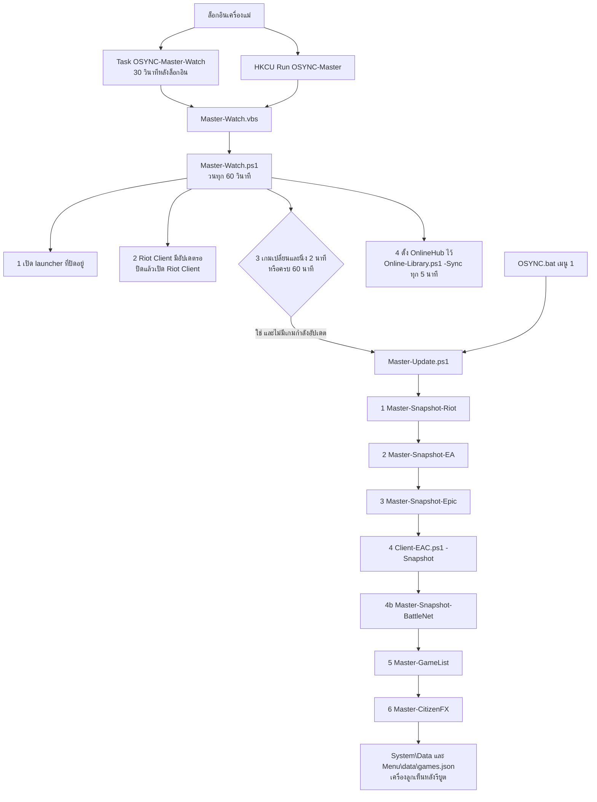
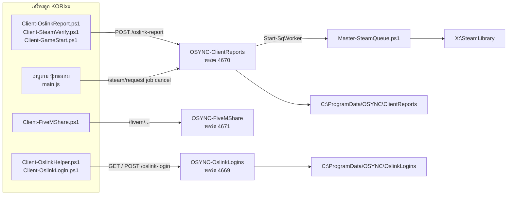
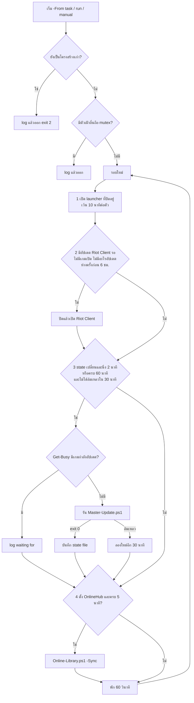
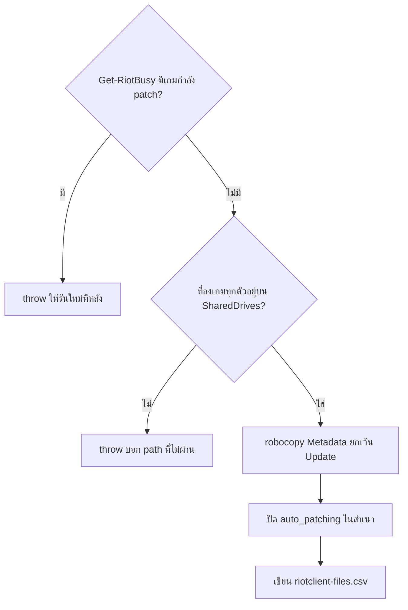
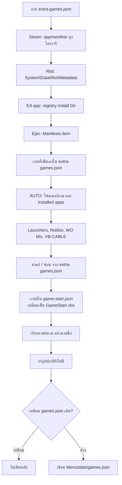
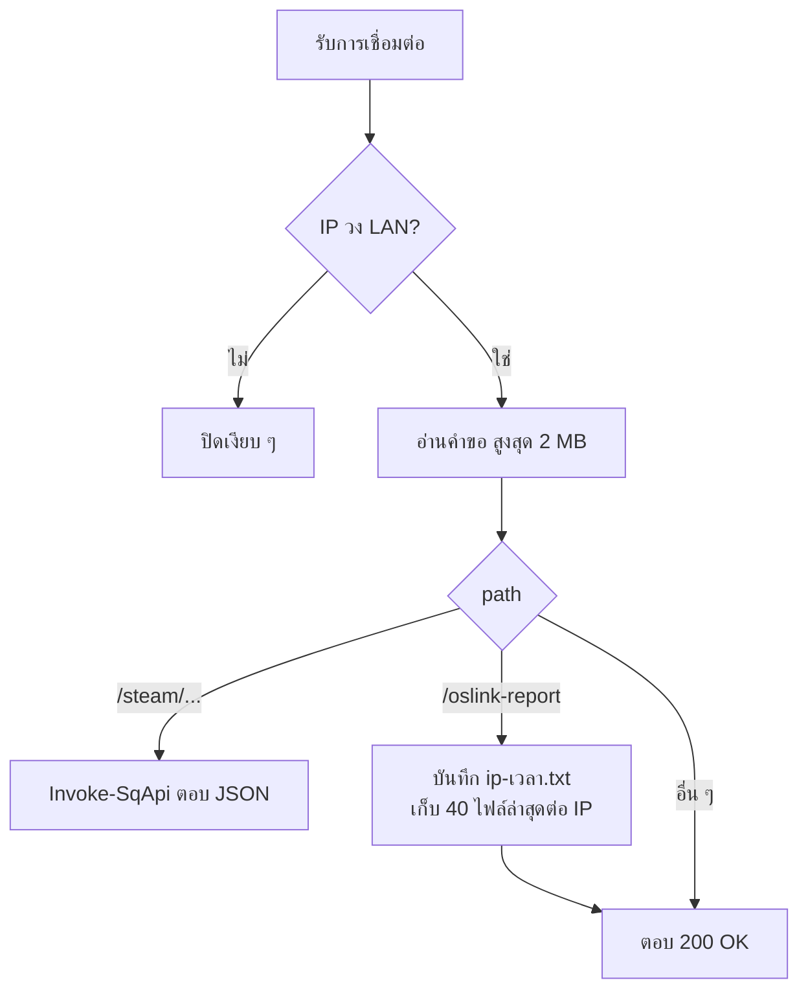
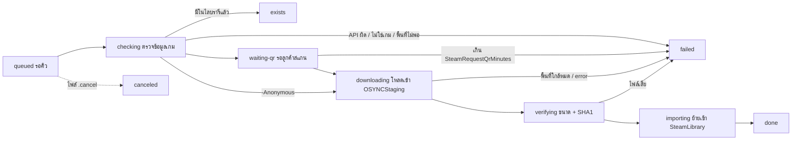
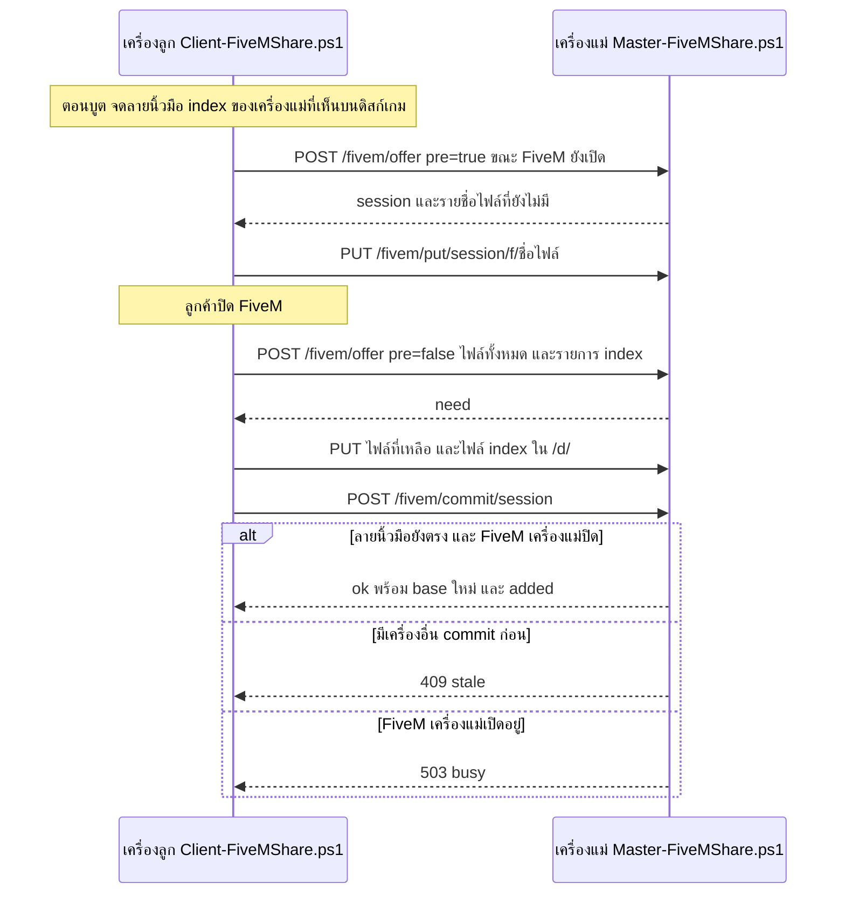
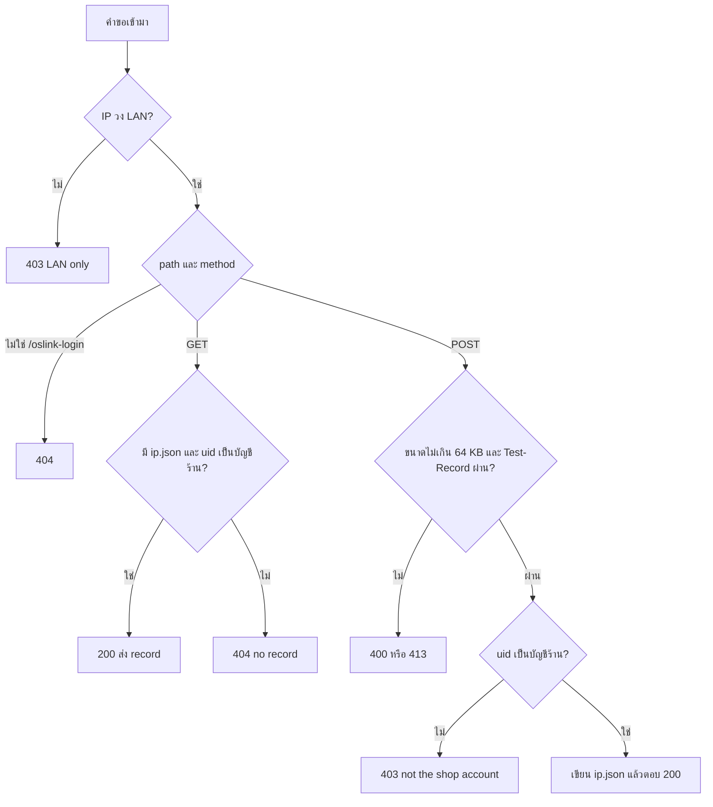
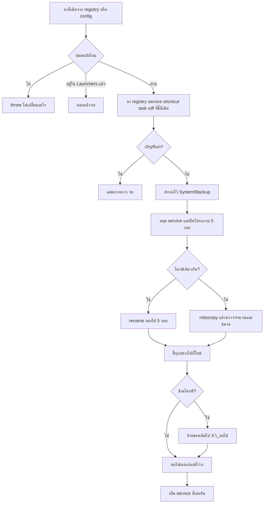

# 03 · เครื่องแม่ (Master)

บทนี้อธิบายทุกอย่างที่ทำงานบนเครื่องแม่ (`DESKTOP-3ORJAGC`, 192.168.51.201)
เครื่องแม่เป็นเครื่องเดียวที่อัปเดตเกม แล้วเตรียมข้อมูลไว้บนดิสก์เกมให้เครื่องลูกใช้ (`System\Data\`, `Menu\data\games.json`)
มีบริการเบื้องหลังที่รับข้อมูลจากเครื่องลูกในวง LAN ด้วย (รายงานหลังบูต, ขอเกม Steam, ไฟล์เซิร์ฟ FiveM, ล็อกอิน OSLink)
เครื่องลูกเห็นไฟล์ที่เครื่องแม่เปลี่ยน **หลังรีบูตเท่านั้น** (diskless อ่านดิสก์เกมแบบ block-level)

ฟังก์ชันที่มาจาก `System\Scripts\Common.ps1` (เช่น `Get-Setting`, `Get-SharedDrives`, `Get-SteamLibraries`, `Get-LauncherExe`, `Run-Ps`, `Write-IfChanged`) บทนี้บอกแค่ชื่อ รายละเอียดอยู่ในบทที่อธิบาย `Common.ps1`

## สารบัญ

- [ภาพรวม: รอบอัปเดตของเครื่องแม่](#ภาพรวม-รอบอัปเดตของเครื่องแม่)
- [บริการเบื้องหลังของเครื่องแม่](#บริการเบื้องหลังของเครื่องแม่)
- รอบอัปเดต
  - [1. `Master-Watch.ps1` — ตัวเฝ้าเครื่องแม่](#1-master-watchps1--ตัวเฝ้าเครื่องแม่)
  - [2. `Master-Watch.vbs` — ตัวเปิดตัวเฝ้าแบบไม่มีหน้าต่าง](#2-master-watchvbs--ตัวเปิดตัวเฝ้าแบบไม่มีหน้าต่าง)
  - [3. `Master-Update.ps1` — อัปเดตข้อมูลให้เครื่องลูก](#3-master-updateps1--อัปเดตข้อมูลให้เครื่องลูก)
  - [4. `Master-Snapshot-Riot.ps1` — สำเนาสถานะเกม Riot](#4-master-snapshot-riotps1--สำเนาสถานะเกม-riot)
  - [5. `Master-Snapshot-EA.ps1` — สำเนา registry ของ EA app](#5-master-snapshot-eaps1--สำเนา-registry-ของ-ea-app)
  - [6. `Master-Snapshot-Epic.ps1` — สำเนารายการเกม Epic](#6-master-snapshot-epicps1--สำเนารายการเกม-epic)
  - [7. `Master-Snapshot-BattleNet.ps1` — สำเนา Battle.net Agent](#7-master-snapshot-battlenetps1--สำเนา-battlenet-agent)
  - [8. `Master-GameList.ps1` — สร้างรายชื่อเกมของเมนู](#8-master-gamelistps1--สร้างรายชื่อเกมของเมนู)
  - [9. `Master-CitizenFX.ps1` — ชี้ FiveM / RedM ไปที่โฟลเดอร์เกม](#9-master-citizenfxps1--ชี้-fivem--redm-ไปที่โฟลเดอร์เกม)
- บริการ LAN
  - [10. `Master-ClientReports.ps1` — รับรายงานจากเครื่องลูก (พอร์ต 4670)](#10-master-clientreportsps1--รับรายงานจากเครื่องลูก-พอร์ต-4670)
  - [11. `SteamQueue-Lib.ps1` — คิวขอเกม Steam (ส่วนกลาง)](#11-steamqueue-libps1--คิวขอเกม-steam-ส่วนกลาง)
  - [12. `Master-SteamQueue.ps1` — ตัวโหลดเกม Steam ตามคำขอ](#12-master-steamqueueps1--ตัวโหลดเกม-steam-ตามคำขอ)
  - [13. `Master-FiveMShare.ps1` — รับไฟล์เซิร์ฟ FiveM (พอร์ต 4671)](#13-master-fivemshareps1--รับไฟล์เซิร์ฟ-fivem-พอร์ต-4671)
  - [14. `Master-OslinkLogins.ps1` — เก็บล็อกอิน OSLink ของแต่ละเครื่อง (พอร์ต 4669)](#14-master-oslinkloginsps1--เก็บล็อกอิน-oslink-ของแต่ละเครื่อง-พอร์ต-4669)
- ตั้งค่า / ย้ายของ
  - [15. `Master-Setup.ps1` — ตั้งค่าเครื่องแม่ครั้งแรก](#15-master-setupps1--ตั้งค่าเครื่องแม่ครั้งแรก)
  - [16. `Master-Move-Launcher.ps1` — ย้าย launcher เข้าโฟลเดอร์ Launchers](#16-master-move-launcherps1--ย้าย-launcher-เข้าโฟลเดอร์-launchers)
  - [17. `Master-Steam-Library.ps1` — ย้ายเกม Steam ออกจากโฟลเดอร์โปรแกรม](#17-master-steam-libraryps1--ย้ายเกม-steam-ออกจากโฟลเดอร์โปรแกรม)
  - [18. `Master-Move-BlueStacks.ps1` — ย้าย BlueStacks 5 เข้าไดรฟ์เกม + เมนู](#18-master-move-bluestacksps1--ย้าย-bluestacks-5-เข้าไดรฟ์เกม--เมนู)
- [ปัญหาที่เคยเจอ / ข้อควรรู้](#ปัญหาที่เคยเจอ--ข้อควรรู้)

---

## ภาพรวม: รอบอัปเดตของเครื่องแม่

- ตัวเฝ้า `Master-Watch.ps1` เริ่มเองตอนล็อกอิน แล้ววนทุก **60 วินาที** (`-CheckSeconds 60`)
- ทุกรอบมันทำ 4 อย่าง:
  1. เปิด launcher ที่ติดตั้งแล้วแต่ปิดอยู่ (ให้เกมอัปเดตเอง)
  2. ติดตั้งอัปเดตของ Riot Client ที่โหลดรอไว้
  3. ถ้าเกมเปลี่ยนแล้วนิ่ง **2 นาที** (`-SettleMinutes 2`) หรือครบ **60 นาที** (`-EveryMinutes 60`) → รัน `Master-Update.ps1`
  4. ถ้าตั้ง `OnlineHub` ไว้ → `Online-Library.ps1 -Sync` ทุก **5 นาที**
- สิ่งที่ตัวเฝ้าถือว่า "เกมเปลี่ยน" (ดู [`Get-State`](../Scripts/Master-Watch.ps1#L102)):
  - ไฟล์ `.ok` / `.manifest` / `product_settings.yaml` ใน `C:\ProgramData\Riot Games\Metadata` (ไม่นับโฟลเดอร์ `Update`)
  - ไฟล์ `*.item` ของ Epic และ `LauncherInstalled.dat`
  - ไฟล์ใน `C:\ProgramData\EA Desktop\InstallData`
  - **ชื่อ** ไฟล์ `appmanifest_*.acf` ของ Steam ทุกไลบรารี (ลง/ลบเกม = เปลี่ยน · แค่อัปเดตเกม Steam = ไม่นับ รอรอบทุก 60 นาที)
  - โฟลเดอร์เกมและรายการ Installed apps บนไดรฟ์ที่แชร์ (`Get-GameFolderStamp` ใน Common.ps1)
- `Master-Update.ps1` รันสคริปต์ 7 ขั้น **ตามลำดับนี้** (ขั้นไหนพังก็ไปขั้นต่อไป แล้วสรุปผลตอนท้าย)

| ขั้น | สคริปต์ | ผลลัพธ์ |
|---|---|---|
| 1 Riot | `Master-Snapshot-Riot.ps1` | `System\Data\Riot\Metadata` + `riotclient-files.csv` |
| 2 EA | `Master-Snapshot-EA.ps1` | `System\Data\EA\ea-client.reg`, `ea-games.reg`, `InstallData\` |
| 3 Epic | `Master-Snapshot-Epic.ps1` | `System\Data\Epic\Manifests\*.item`, `LauncherInstalled.dat` |
| 4 EAC | `Client-EAC.ps1 -Snapshot` | `System\Data\EAC\eac-products.txt` (id ของ EasyAntiCheat ที่ลงบนเครื่องแม่) |
| 4b BNet | `Master-Snapshot-BattleNet.ps1` | `System\Data\BattleNet\Agent` |
| 5 Menu | `Master-GameList.ps1` | `Menu\data\games.json` |
| 6 Cfx | `Master-CitizenFX.ps1` | `CitizenFX.ini` ข้าง FiveM / RedM บนดิสก์เกม |

---

## บริการเบื้องหลังของเครื่องแม่

ข้อมูลในตารางนี้มาจากโค้ด `-Register` / `-Install` (`Register-ScheduledTask`, `New-NetFirewallRule`) เท่านั้น ในไฟล์ของบทนี้ไม่มีการใช้ `schtasks.exe`

| บริการ (scheduled task) | เริ่มเมื่อ | บัญชีที่รัน | พอร์ต / firewall | รับอะไร | ติดตั้ง / ถอด |
|---|---|---|---|---|---|
| `OSYNC-Master-Watch` + สำรอง HKCU Run `OSYNC-Master` | ล็อกอินของผู้ใช้ที่สั่ง (หน่วง 30 วินาที) | ผู้ใช้ที่สั่ง `-Register` · `Interactive`, `RunLevel Limited` (ไม่ยกสิทธิ์) | ไม่มีพอร์ต | ไม่รับจากเครือข่าย เฝ้าไฟล์ของ launcher / โฟลเดอร์เกม | `Master-Watch.ps1 -Register` / `-Unregister` |
| `OSYNC-ClientReports` | เปิดเครื่อง (`AtStartup`) | `SYSTEM` (`ServiceAccount`, `Highest`) | TCP `ClientReportPort` (ค่าเริ่ม 4670) · rule `OSYNC client reports` (Inbound, `LocalSubnet`) | `POST /oslink-report` (รายงานหลังบูต ≤ 2 MB) · `POST /steam/request`, `GET /steam/job`, `POST /steam/cancel` | `Master-ClientReports.ps1 -Install` / `-Uninstall` (admin) |
| `OSYNC-FiveMShare` | เปิดเครื่อง | `SYSTEM` | TCP `FiveMSharePort` (4671) · rule `OSYNC FiveM share` (`LocalSubnet`) | `/fivem/offer`, `/fivem/put/...`, `/fivem/commit/...`, `/fivem/drop/...`, `/fivem/log`, `/fivem/base` | `Master-FiveMShare.ps1 -Install` / `-Uninstall` (admin) |
| `OSYNC-OslinkLogins` | เปิดเครื่อง | `SYSTEM` | TCP `OslinkLoginPort` (4669) · rule `OSYNC OSLink logins` (`LocalSubnet`) | `GET` / `POST /oslink-login` (กุญแจ OSLink ของแต่ละเครื่อง) | `Master-OslinkLogins.ps1 -Install` / `-Uninstall` (admin) |
| (ไม่มี task) worker `Master-SteamQueue.ps1` | `OSYNC-ClientReports` เปิดให้เมื่อมีงาน (`Start-SqWorker`) · ว่าง 90 วินาทีแล้วปิดเอง | บัญชีเดียวกับตัวที่เปิด (คอมเมนต์ในโค้ด: "this worker runs as SYSTEM") | ไม่มีพอร์ต | งานในโฟลเดอร์ `C:\ProgramData\OSYNC\SteamQueue\jobs` | — |

- task ทั้ง 3 ตัวของ `-Install` ตั้งเหมือนกัน: ไม่จำกัดเวลา (`ExecutionTimeLimit 0`), ล้มแล้วเริ่มใหม่ทุก 1 นาที สูงสุด 999 ครั้ง, `MultipleInstances IgnoreNew`, `StartWhenAvailable`
- task `OSYNC-Master-Watch`: `ExecutionTimeLimit` 5 นาที (task แค่เปิด `wscript.exe` ซึ่งจบทันที), `MultipleInstances IgnoreNew`
- กันรันซ้ำด้วย mutex:
  - `Local\OSYNC-Master-Watch`, `Local\OSYNC-Update-All`
  - `Global\OSYNC-ClientReports-<port>`, `Global\OSYNC-FiveMShare-<port>`, `Global\OSYNC-OslinkLogins-<port>`, `Global\OSYNC-SteamQueue-Worker`
- ใน `OSYNC.bat` ไม่มีเมนูติดตั้ง listener ทั้ง 3 ตัว ต้องสั่ง `-Install` เองในหน้าต่าง PowerShell แบบ admin หน้า "สถานะ" ของคอนโซลแอดมิน (`Console-Server.ps1`) เช็กว่าพอร์ต 4670 / 4671 / 4669 / 4667 กำลังรับอยู่ไหม แล้วบอกคำสั่งนี้

---

## 1. `Master-Watch.ps1` — ตัวเฝ้าเครื่องแม่

**หน้าที่:** เปิด launcher ทุกค่ายค้างไว้ให้เกมอัปเดตเอง แล้วรัน `Master-Update.ps1` เองเมื่อเกมเปลี่ยนเสร็จ และทุก 1 ชั่วโมง เครื่องลูกจึงได้ข้อมูลใหม่โดยไม่ต้องกด REPAIR

**เรียกจาก / ทำงานเมื่อไหร่:**
- `-Register`: `OSYNC.bat` เมนู 2 (`watch-on`), `OSYNC.bat master` (อัปเดตแล้วเปิดตัวเฝ้า), `Master-Setup.ps1` ขั้น 6, `Tool-Migrate.ps1`, `Setup-Install.ps1` (เปิดใหม่ถ้าเดิมเปิดอยู่)
- `-Unregister`: `OSYNC.bat` เมนู 3 (`watch-off`), `Tool-Migrate.ps1`
- ตัววน: `Master-Watch.vbs` เปิดตอนล็อกอิน จาก task `OSYNC-Master-Watch` หรือ HKCU Run `OSYNC-Master`
- คนที่ดูสถานะ: คอนโซลแอดมิน (ดูว่ามี mutex `Local\OSYNC-Master-Watch` + อ่าน log 15 บรรทัดท้าย), `Tool-Check.ps1`

**พารามิเตอร์:**

| ชื่อ | ค่าเริ่ม | ความหมาย |
|---|---|---|
| `-Register` | — | ตั้งให้เริ่มเองตอนล็อกอิน (task + Run) แล้วเปิดตัวเฝ้าทันที |
| `-Unregister` | — | หยุดตัวเฝ้าทุกตัว (รวมตัวจากโฟลเดอร์ OSYNC เก่า) และลบ autostart ทั้งสองทาง |
| `-From` | `manual` | ใครเปิด: `task` / `run` / `manual` (ค่าอื่น = `manual`) เขียนลง log |
| `-CheckSeconds` | 60 | พักกี่วินาทีระหว่างรอบ |
| `-SettleMinutes` | 2 | สถานะต้องนิ่งกี่นาทีก่อนรัน Master-Update |
| `-EveryMinutes` | 60 | รัน Master-Update อย่างน้อยทุกกี่นาที |

**อ่านค่า:**
- `Get-Setting 'OnlineHub'` (ว่าง = ข้ามขั้น 4)
- `$LauncherTable` + `Get-SteamDir` / `Get-LauncherExe` (หา exe ของ launcher)
- ไฟล์ที่ใช้คิด state: ดู [ภาพรวม](#ภาพรวม-รอบอัปเดตของเครื่องแม่)
- `C:\ProgramData\Riot Games\Metadata\RiotClient\Update` (อัปเดต Riot Client ที่รอติดตั้ง)
- `Get-RiotBusy` และ Epic `*.item` ที่มี `bIsIncompleteInstall` (เกมที่ยังอัปเดตไม่เสร็จ)
- `C:\Users\Public\OSYNC-Master-Watch.state` (state ครั้งที่รันสำเร็จล่าสุด)

**เขียน / เปลี่ยน:**
- `-Register`:
  - HKCU `...\CurrentVersion\Run` ชื่อ `OSYNC-Master` = `wscript.exe "<Scripts>\Master-Watch.vbs" run`
  - task `OSYNC-Master-Watch` (action `wscript.exe "<vbs>" task`)
- `-Unregister`: ลบทั้งสองอย่าง และ kill `powershell.exe` ที่รัน `Master-Watch.ps1`
- ตัววน:
  - เปิดโปรแกรม launcher
  - ปิด/เปิด Riot Client
  - เขียน `C:\Users\Public\OSYNC-Master-Watch.state` (ASCII) หลังอัปเดตสำเร็จ

**Log:** `C:\Users\Public\OSYNC-Master-Watch.log` (ใหญ่เกิน 2 MB → ย้ายเป็น `.log.old`) · ผลของ `Master-Update.ps1` ทั้งหมดก็เขียนลงไฟล์นี้ (เยื้อง 4 ช่อง)

**ขั้นตอนการทำงาน:**

*`-Unregister`*
1. ลบ Run `OSYNC-Master` และ task `OSYNC-Master-Watch`
2. kill ทุก `powershell.exe` ที่ command line มี `Master-Watch.ps1` (ยกเว้นตัวที่สั่ง `-Unregister` และตัวเอง)
3. launcher ที่เปิดอยู่ยังเปิดต่อ

*`-Register`*
1. `Stop-IfPreMigration` (ยังเป็นโครงสร้างเก่า = หยุด)
2. หยุดตัวเฝ้าที่รันจากโฟลเดอร์ OSYNC อื่น (มันถือ mutex เดียวกัน)
3. เขียน Run entry
4. สร้าง task: trigger `AtLogOn` ของผู้ใช้นี้ หน่วง `PT30S` · principal ผู้ใช้นี้ `Interactive` `Limited` · สร้าง task ไม่ได้ = ใช้ Run อย่างเดียว
5. เปิดตัวเฝ้า:
   - มี mutex อยู่แล้ว = "already running"
   - หน้าต่างนี้เป็น admin = เปิดผ่าน `explorer.exe "<vbs>"` (ให้รันในนามผู้ใช้ปกติ launcher จะไม่เป็น admin)
   - ไม่ใช่ admin = เปิด `wscript.exe "<vbs>"`
6. รอ 8 วินาที แล้วแสดงสถานะ launcher ทุกตัว (`not installed` / `open` / `opening...`)

*ตัววน (ไม่มีสวิตช์)*
1. `Test-PreMigration` จริง = log แล้วออก (exit 2)
2. จับ mutex `Local\OSYNC-Master-Watch` ไม่ได้ = มีตัวอื่นรันอยู่ → log แล้วออก
3. วนตลอด ทุก `CheckSeconds` (ทุกอย่างอยู่ใน try: error แค่ลง log แล้วรอบหน้าทำต่อ)
   1. **เปิด launcher**: ตัวที่มี exe แต่ไม่ได้รัน → เปิด · ตัวที่เพิ่งสั่งเปิดได้เวลา 10 นาทีก่อนลองใหม่
   2. **อัปเดต Riot Client**: มีโฟลเดอร์ `Update` + ไฟล์ใหม่สุดเก่ากว่า 5 นาที + ไม่มี `VALORANT*` / `League of Legends` / `LeagueClient` เปิด + `Get-Busy` ว่าง + ห่างครั้งก่อน ≥ 6 ชม. → ปิด `Riot Client`, `RiotClientServices`, `RiotClientCrashHandler` รอ 5 วินาที แล้วเปิด Riot Client ใหม่
   3. **อัปเดตเครื่องลูก**: คิด `Get-State`
      - เปลี่ยนจากครั้งที่บันทึก และนิ่ง ≥ `SettleMinutes` หรือครบ `EveryMinutes` และไม่ได้ล้มเหลวใน 30 นาทีที่ผ่านมา → เช็ก `Get-Busy`
      - มีเกมกำลังอัปเดต = log `waiting for: ...` (log ครั้งเดียวต่อข้อความ)
      - ไม่มี = รัน `Master-Update.ps1`
      - exit 0 = บันทึก state file · ไม่ใช่ 0 = รอ 30 นาทีค่อยลองใหม่
   4. **คลังออนไลน์**: ตั้ง `OnlineHub` และครบ 5 นาที → `Online-Library.ps1 -Sync` · log เฉพาะเมื่อ exit ไม่ใช่ 0 หรือผลมี `"served"` / `"finished"` ≥ 1

**ฟังก์ชัน:**

| ฟังก์ชัน | บรรทัด | หลักการทำงาน |
|---|---|---|
| [`Log`](../Scripts/Master-Watch.ps1#L25) | 25 | เขียนบรรทัด `yyyy-MM-dd HH:mm:ss ข้อความ` ลง log · ใหญ่เกิน 2 MB ย้ายเป็น `.old` ก่อน |
| [`Get-Apps`](../Scripts/Master-Watch.ps1#L30) | 30 | ไล่ `$LauncherTable` คืน Name / Proc / Exe / Args · Steam ใช้ `Get-SteamDir` + `steam.exe` ตัวอื่นใช้ `Get-LauncherExe` |
| [`Test-Running`](../Scripts/Master-Watch.ps1#L36) | 36 | มีโปรเซสชื่อตาม `Proc` อยู่ไหม |
| [`Start-App`](../Scripts/Master-Watch.ps1#L37) | 37 | `Start-Process` exe โดยให้ working dir = โฟลเดอร์ของ exe และส่ง `Args` (เช่น Steam `-silent`, EA `-silentOs`, Epic `-silent`) |
| [`Get-State`](../Scripts/Master-Watch.ps1#L102) | 102 | รวมรายการไฟล์ + เวลาแก้ไข (Riot, Epic, EA) + ชื่อ appmanifest ของ Steam + `Get-GameFolderStamp` → เรียง ตัดซ้ำ → SHA256 |
| [`Get-Busy`](../Scripts/Master-Watch.ps1#L122) | 122 | รายการที่ยังอัปเดตไม่เสร็จ: `Get-RiotBusy` (ไม่นับ `RiotClient`) + Epic `*.item` ที่แก้ใน 3 ชม. และ `bIsIncompleteInstall` เป็นจริง |

### `Get-State` — ทำไมเก็บแค่ hash
- **คืนค่า:** สตริง hex ของ SHA256 จากรายการที่เรียงแล้ว
- **ทำไม:** เทียบกับค่าที่เก็บใน `OSYNC-Master-Watch.state` ได้ง่าย และรอบแรกหลังรีบูตไม่ต้องรัน Master-Update ซ้ำถ้าไม่มีอะไรเปลี่ยน (เวลาแก้ไขของไฟล์ state = เวลาที่รันสำเร็จครั้งล่าสุด ใช้นับรอบ 60 นาทีด้วย)
- Steam เก็บแค่ **ชื่อ** appmanifest (คอมเมนต์: "which Steam games are installed") จึงจับได้แค่ลง/ลบเกม

**ค่าในร้านนี้ตอนนี้:**
- `OnlineHub=http://127.0.0.1:4667` → ขั้น 4 (คลังออนไลน์) **ทำงาน**
- `-CheckSeconds` / `-SettleMinutes` / `-EveryMinutes`: task และ Run ไม่ได้ส่งค่า จึงใช้ค่าเริ่ม 60 วินาที / 2 นาที / 60 นาที
- Steam: ไม่มี `Launchers\Steam\steam.exe` จึงใช้ `SteamPath` จาก HKCU (Steam ของร้านอยู่ที่ `F:\steam`)
- โครงสร้างใหม่ใช้อยู่แล้ว (มี `H:\OSYNC\Launchers`, ไม่มี `GAMELUNCHER`) → `Stop-IfPreMigration` ไม่บล็อก

---

## 2. `Master-Watch.vbs` — ตัวเปิดตัวเฝ้าแบบไม่มีหน้าต่าง

**หน้าที่:** เปิด `Master-Watch.ps1` แบบซ่อนหน้าต่าง แล้วส่งต่อว่าใครเปิด (`task` / `run` / `manual`)

**เรียกจาก / ทำงานเมื่อไหร่:**
- task `OSYNC-Master-Watch` → `wscript.exe "<vbs>" task`
- HKCU Run `OSYNC-Master` → `wscript.exe "<vbs>" run`
- `Master-Watch.ps1 -Register` ตอนเปิดทันที (ไม่มีอาร์กิวเมนต์ = `manual`)

**พารามิเตอร์:** อาร์กิวเมนต์ตัวแรก `task` หรือ `run` (อย่างอื่น / ไม่มี = `manual`)

**อ่านค่า:** โฟลเดอร์ของตัวเอง (หา `Master-Watch.ps1` ข้าง ๆ)

**เขียน / เปลี่ยน:** ไม่มี

**Log:** ไม่มี (`Master-Watch.ps1` เขียนว่าใครเปิดลง log ของมัน)

**ขั้นตอนการทำงาน:**
1. หาโฟลเดอร์ของไฟล์ vbs
2. รัน `powershell.exe -NoProfile -ExecutionPolicy Bypass -WindowStyle Hidden -File "<dir>\Master-Watch.ps1" -From <src>` แบบไม่มีหน้าต่าง (`0`) ไม่รอ (`False`)

**ฟังก์ชัน:** ไม่มี

**ค่าในร้านนี้ตอนนี้:** ไม่มีค่าที่ตั้งได้

---

## 3. `Master-Update.ps1` — อัปเดตข้อมูลให้เครื่องลูก

**หน้าที่:** หลังลง / อัปเดต / ลบเกม รันทุกขั้นที่สร้างข้อมูลให้เครื่องลูก (Riot, EA, Epic, EAC, Battle.net, รายชื่อเกม, FiveM/RedM) แล้วสรุปผล

**เรียกจาก / ทำงานเมื่อไหร่:**
- `OSYNC.bat` เมนู 1 (`update`) และ `OSYNC.bat master`
- `Master-Watch.ps1` ขั้น 3 (เกมเปลี่ยน / ทุก 60 นาที)
- `Master-Setup.ps1` ขั้น 5
- `Tool-Migrate.ps1`
- ไม่ต้องเป็น admin (`update` ไม่อยู่ในรายการ action ที่ขอ UAC ของ `OSYNC.ps1`)

**พารามิเตอร์:**

| ชื่อ | ความหมาย |
|---|---|
| `-GameListOut <file>` | สำหรับทดสอบ: เขียนรายชื่อเกมไปไฟล์อื่นแทน `Menu\data\games.json` (ส่ง `-Out` ให้ขั้น 5 และ `-Check` ให้ขั้น 6) และไม่เช็ก `Stop-IfPreMigration` |

**อ่านค่า:** ไม่อ่าน setting เอง (แต่ละขั้นอ่านเอง)

**เขียน / เปลี่ยน:** ผ่านสคริปต์แต่ละขั้น (ดูตารางใน [ภาพรวม](#ภาพรวม-รอบอัปเดตของเครื่องแม่))

**Log:** ออกหน้าจอ · ถ้าตัวเฝ้ารัน → ลง `C:\Users\Public\OSYNC-Master-Watch.log`

**ขั้นตอนการทำงาน:**
1. `Stop-IfPreMigration 'Update clients'` (ถ้าไม่ได้ส่ง `-GameListOut`)
2. จับ mutex `Local\OSYNC-Update-All`: มีตัวอื่นรันอยู่ → รอสูงสุด 30 นาที → ยังไม่จบ = exit 1 (ตัวเฝ้ากับปุ่มอาจสั่งพร้อมกัน)
3. รันทีละขั้นด้วย `Step`: Riot → EA → Epic → EAC (`Client-EAC.ps1 -Snapshot`) → BNet → Menu → Cfx
4. พิมพ์ตารางผล: `OK` (เขียว), `SKIP (script missing)` (เหลือง), `FAIL (exit n)` (แดง)
5. บอกว่า "Clients pick this up after a reboot"
6. มีขั้นไหน FAIL = exit 1 (ตัวเฝ้าจะถือว่าล้มเหลว แล้วลองใหม่ใน 30 นาที)

**ฟังก์ชัน:**

| ฟังก์ชัน | บรรทัด | หลักการทำงาน |
|---|---|---|
| [`Step`](../Scripts/Master-Update.ps1#L24) | 24 | ไม่มีไฟล์ = `SKIP` · รันด้วย `powershell.exe -File` แยกโปรเซส (ขั้นพังไม่ลากขั้นอื่น) · เยื้องผล 4 ช่อง · `$LASTEXITCODE` 0 = `OK` อื่น = `FAIL` |

**ค่าในร้านนี้ตอนนี้:** ไม่มีค่าที่ตั้งได้ · ทั้ง 7 สคริปต์มีอยู่ใน `System\Scripts`

---

## 4. `Master-Snapshot-Riot.ps1` — สำเนาสถานะเกม Riot

**หน้าที่:** คัดลอก `C:\ProgramData\Riot Games\Metadata` ไปไว้ `System\Data\Riot\Metadata` ให้เครื่องลูกรู้ว่า VALORANT / LoL / TFT ลงไว้แล้ว · ไม่ยอมทำถ้าเกมยังอัปเดตไม่เสร็จ หรือที่ลงเกมไม่ได้อยู่บนไดรฟ์ที่แชร์

**เรียกจาก / ทำงานเมื่อไหร่:** `Master-Update.ps1` ขั้น 1 · เครื่องลูกใช้ผลนี้ใน `Client-Riot-Start.ps1` (คัดลอกกลับด้วย `/XO`) และ `Tool-RiotDiag.ps1` (ใช้ `riotclient-files.csv`)

**พารามิเตอร์:**

| ชื่อ | ความหมาย |
|---|---|
| `-SharedDrives` | ตัวอักษรไดรฟ์ที่แชร์ · ว่าง = `Get-SharedDrives` |

**อ่านค่า:**
- `C:\ProgramData\Riot Games\Metadata` (ไฟล์ `*.live.product_settings.yaml` ช่อง `product_install_full_path`)
- `Get-RiotBusy`
- ไฟล์ทุกไฟล์ใน `Get-LauncherDir 'Riot'` (`Launchers\Riot Client`)

**เขียน / เปลี่ยน:**
- `System\Data\Riot\Metadata`: robocopy `/MIR /XD Update /XF *.lockfile lockfile`
- ในสำเนา: `auto_patching_enabled_by_player: true` → `false` แล้วคืนเวลาไฟล์ของเครื่องแม่
- `System\Data\Riot\riotclient-files.csv` (Rel, Length, SHA256 ของทุกไฟล์ใน Riot Client)

**Log:** ออกหน้าจอ (ผ่าน Master-Update)

**ขั้นตอนการทำงาน:**
1. สร้าง `System\Data\Riot`
2. `Get-RiotBusy` มีรายการ → throw "still updating, run again when it is done"
3. ไล่ yaml ทุกตัว: ไดรฟ์ของ `product_install_full_path` ไม่อยู่ใน SharedDrives → เก็บไว้ในรายการที่ไม่ผ่าน
4. มีตัวไม่ผ่าน → throw "Install path not on a shared game disk"
5. robocopy (ไม่เอาโฟลเดอร์ `Update` = อัปเดตตัวเองของ Riot Client ที่โหลดรอไว้) · exit ≥ 8 → throw
6. ปิด auto patching ในสำเนา (เครื่องแม่เท่านั้นที่ patch เกม Riot)
7. ทำ `riotclient-files.csv` ถ้ามีโฟลเดอร์ Riot Client

**ฟังก์ชัน:** ไม่มี (สคริปต์รันจากบนลงล่าง)

**ค่าในร้านนี้ตอนนี้:** `SharedDrives=DEFGHIJ` · VALORANT อยู่ที่ `H:\RIOT\Riot Games`

---

## 5. `Master-Snapshot-EA.ps1` — สำเนา registry ของ EA app

**หน้าที่:** export registry ของ EA app ให้ path ชี้ไปที่ `Launchers\EA` และ export ข้อมูลเกมที่ลงผ่าน EA app (บนไดรฟ์ที่แชร์) ให้ `Client-EA.ps1` บนเครื่องลูก import

**เรียกจาก / ทำงานเมื่อไหร่:** `Master-Update.ps1` ขั้น 2 (ไม่ต้องเป็น admin)

**พารามิเตอร์:** ไม่มี

**อ่านค่า:**
- `Get-SharedDrives`, `Get-LauncherDir 'EA'` (ต้องมีโฟลเดอร์ `EA Desktop` ข้างใน)
- registry: `HKLM\SOFTWARE\Electronic Arts`, `HKLM\SOFTWARE\WOW6432Node\Electronic Arts`, `HKLM\SOFTWARE\Classes\origin`, `origin2`, `link2ea`, `ealink`
- ทุก key `HKLM:\SOFTWARE\<ค่าย>\<เกม>` และ `HKLM:\SOFTWARE\WOW6432Node\<ค่าย>\<เกม>` ที่มีค่า `Install Dir` บนไดรฟ์ที่แชร์ + uninstall key ตาม `Product GUID`
- `C:\ProgramData\EA Desktop\InstallData`

**เขียน / เปลี่ยน:**
- `System\Data\EA\ea-client.reg` (UTF-16) · แทน `C:\\Program Files\\Electronic Arts\\EA Desktop` ด้วย path ของ `Launchers\EA`
- `System\Data\EA\ea-games.reg` (UTF-16)
- `System\Data\EA\InstallData` (robocopy `/MIR`)
- โฟลเดอร์ชั่วคราว `%TEMP%\ea_snap_<guid>`, `%TEMP%\ea_games_<guid>` (ลบทิ้งตอนจบ)

**Log:** ออกหน้าจอ · บอกจำนวนบรรทัดที่ยังชี้ `C:\Program Files\Electronic Arts` และรายชื่อเกม EA ที่ส่งให้เครื่องลูก

**ขั้นตอนการทำงาน:**
1. ไม่มี `Launchers\EA\EA Desktop` → "nothing to do", exit 0
2. `reg.exe export` ทีละ key ลงไฟล์ชั่วคราว ตัดหัว `Windows Registry Editor Version 5.00` ออก แทน path แล้วรวมเป็น `ea-client.reg` (key ไหนไม่มี = Warning)
3. หาเกม: key ที่มี `Install Dir` ขึ้นต้นด้วยไดรฟ์ที่แชร์และโฟลเดอร์มีจริง → จด `Product GUID`
4. export key เกม + uninstall key (64/32 บิต) รวมเป็น `ea-games.reg`
5. robocopy `InstallData`

**ฟังก์ชัน:** ไม่มี

**ค่าในร้านนี้ตอนนี้:** มี `H:\OSYNC\Launchers\EA\EA Desktop` → สคริปต์ทำงานเต็ม · `SharedDrives=DEFGHIJ`

---

## 6. `Master-Snapshot-Epic.ps1` — สำเนารายการเกม Epic

**หน้าที่:** คัดลอกรายการเกม Epic ที่ลงไว้ (`*.item` + `LauncherInstalled.dat`) ไปไว้ `System\Data\Epic` ให้ `Client-Epic-Start.ps1` บนเครื่องลูกใช้ตอนเปิดเกม

**เรียกจาก / ทำงานเมื่อไหร่:** `Master-Update.ps1` ขั้น 3

**พารามิเตอร์:** ไม่มี

**อ่านค่า:** `C:\ProgramData\Epic\EpicGamesLauncher\Data\Manifests\*.item`, `C:\ProgramData\Epic\UnrealEngineLauncher\LauncherInstalled.dat`, `Get-SharedDrives`

**เขียน / เปลี่ยน:** `System\Data\Epic\Manifests\*.item` (robocopy `/MIR`), `System\Data\Epic\LauncherInstalled.dat` (`Copy-Item -Force`)

**Log:** ออกหน้าจอ: ชื่อเกม + ที่ลง · ที่ลงไม่อยู่ใน SharedDrives → `WARNING ... clients cannot see it`

**ขั้นตอนการทำงาน:**
1. ไม่มีโฟลเดอร์ Manifests (ยังไม่มีเกม Epic) → ลบ `*.item` และ `LauncherInstalled.dat` เก่าใน `System\Data\Epic` แล้ว exit 0 (ไม่ถือเป็น error)
2. robocopy `*.item` · exit ≥ 8 → throw
3. คัดลอก `LauncherInstalled.dat` (ไม่มี = ลบของเก่า)
4. ไล่ manifest แต่ละตัว พิมพ์ชื่อ + `InstallLocation` และเตือนถ้าไดรฟ์ไม่ถูกแชร์

**ฟังก์ชัน:** ไม่มี

**ค่าในร้านนี้ตอนนี้:** `SharedDrives=DEFGHIJ`

---

## 7. `Master-Snapshot-BattleNet.ps1` — สำเนา Battle.net Agent

**หน้าที่:** คัดลอก Battle.net Update Agent (`C:\ProgramData\Battle.net\Agent`: `Agent.exe` + รายการเกม Blizzard `product.db`) ไปไว้ `System\Data\BattleNet\Agent` · ถ้าไม่มี Agent, Battle.net จะไม่เปิด และ Overwatch บน Steam จะไม่เริ่ม

**เรียกจาก / ทำงานเมื่อไหร่:** `Master-Update.ps1` ขั้น 4b · เครื่องลูกคัดลอกกลับไปที่ `C:\ProgramData\Battle.net\Agent` ทุกครั้งที่บูต (`Client-Install` ขั้น 1v)

**พารามิเตอร์:** ไม่มี

**อ่านค่า:** `C:\ProgramData\Battle.net\Agent`

**เขียน / เปลี่ยน:** `System\Data\BattleNet\Agent` (robocopy `/MIR /XD Logs /XF *.log *.lock` = คัดลอกเฉพาะไฟล์ที่เปลี่ยน ไม่เอา log) · **ไม่** คัดลอก registry

**Log:** ออกหน้าจอ: `unchanged` / `updated` + ชื่อโฟลเดอร์ `Agent.*` ล่าสุด + ขนาด KB

**ขั้นตอนการทำงาน:**
1. ไม่มี `Agent.exe` → "nothing to copy", exit 0
2. robocopy · exit ≥ 8 → throw
3. robocopy exit 0 = `unchanged` อื่น = `updated`

**ฟังก์ชัน:** ไม่มี

**ค่าในร้านนี้ตอนนี้:** มี `C:\ProgramData\Battle.net\Agent\Agent.exe` บนเครื่องแม่ → สคริปต์ทำงาน

---

## 8. `Master-GameList.ps1` — สร้างรายชื่อเกมของเมนู

**หน้าที่:** สแกนเกมทุกแหล่งบนเครื่องแม่ แล้วเขียน `Menu\data\games.json` ที่เมนูเกม "0JAYSHOP Client" ใช้ (ชื่อ หมวด รูปปก คำสั่งเปิด) · เขียนทับเฉพาะเมื่อรายการเปลี่ยนจริง

**เรียกจาก / ทำงานเมื่อไหร่:**
- `Master-Update.ps1` ขั้น 5
- คอนโซลแอดมิน (`Console-Server.ps1` → `Invoke-GameList`) หลัง `/api/update`, `/api/game` (แก้ชื่อ/หมวด/ซ่อน), `/api/icon`, `/api/icon/reset`, `/api/drives/add`, `/api/drives/remove` · คอนโซลรันสคริปต์นี้ตรง ๆ ไม่ผ่าน Master-Update
- ทดสอบ: `System\Tests\Sim-OnlineLibrary.ps1`

**พารามิเตอร์:**

| ชื่อ | ความหมาย |
|---|---|
| `-Out <file>` | เขียนไปไฟล์อื่น (ทดสอบ) · ว่าง = `Menu\data\games.json` และเช็ก `Stop-IfPreMigration` |

**อ่านค่า:**
- `Settings\extra-games.json` (`Read-ExtraGames`), `Settings\game-start.json`
- Settings: `GamesFolder`, `GameFolders` (ผ่าน `Get-GameFolders`), `SharedDrives`
- Steam: `Get-SteamDir`, `Get-SteamLibraries`, `appmanifest_*.acf`, `<Steam>\appcache\librarycache\<appid>\header.jpg` / `library_header.jpg`
- Riot: `System\Data\Riot\Metadata\<เกม>.live\<เกม>.live.product_settings.yaml`
- EA: registry `HKLM:\SOFTWARE\WOW6432Node\<ค่าย>\<เกม>` ค่า `Install Dir` + `DisplayName`
- Epic: `C:\ProgramData\Epic\EpicGamesLauncher\Data\Manifests\*.item` (ของเครื่องแม่เอง)
- Installed apps: `HKLM`/`HKLM WOW6432Node`/`HKCU` `...\CurrentVersion\Uninstall`
- `$LauncherTable`, `Get-RobloxExe`, `Tools\WOMic\WOMicClientSetup*.exe`, `Tools\VBCABLE\VBCABLE_ControlPanel.exe`
- รูปปก: `Menu\data\posters\<id>.jpg|png|webp`, `zPoster.jpg` ในโฟลเดอร์เกม
- เน็ต: `https://store.steampowered.com/api/appdetails?appids=<appid>&filters=basic` (timeout 8 วินาที) เฉพาะเกม Steam ที่ยังไม่มีรูปในเครื่อง

**เขียน / เปลี่ยน:**
- `Menu\data\games.json` (UTF-8 ไม่มี BOM, เฉพาะเมื่อเนื้อหาต่างจากเดิม)
- `Menu\data\posters\_auto\steam-<appid>.jpg` (คัดลอกจาก cache ของ Steam)
- `Menu\data\posters\_auto\<id>.jpg` (รูปที่ทำจากไอคอน / Splash.bmp)
- `Menu\data\posters\_auto\icons\<id>.png`
- `%TEMP%\gcafe-poster-jobs.json` (งานทำรูปที่ส่งให้ตัวทำรูป)

**Log:** ออกหน้าจอ: จำนวนเกมต่อหมวด, `total: n -> <file> (updated | unchanged, not rewritten)`, บรรทัด `WARNING ...` · คอนโซลแอดมินแสดง 12 บรรทัดท้าย

**ขั้นตอนการทำงาน:**
1. อ่าน `extra-games.json` (JSON เสีย = WARNING แล้วทำต่อแบบไม่มีค่าพิเศษ)
2. **Steam**: ทุก `appmanifest_*.acf` ในทุกไลบรารี
   - ข้าม appid `228980` (Steamworks redist), `431960` (Wallpaper Engine) และเกมที่ไม่มีโฟลเดอร์
   - ตัด ™ ® ออกจากชื่อ
   - หมวด = `steamCategories[appid]` หรือ `Steam`
   - คำสั่ง `"<Steam>\steam.exe" -applaunch <appid>` · cwd = โฟลเดอร์ Steam
3. **Riot** (ถ้ามี exe ของ Riot Client): `valorant`, `league_of_legends`, `teamfighttactics` ที่มี yaml และโฟลเดอร์เกมจริง → คำสั่ง `wscript.exe "<OSYNC>\System\Client\Riot.vbs" <เกม>` หมวด `Riot`
4. **EA app**: key ที่มี `Install Dir` และมี `__Installer\installerdata.xml` (ไม่ใช่สำเนาใน `\steamapps\`)
   - id = `ea-<ชื่อ key>`
   - อยู่ใน `eaOffers` → `origin2://game/launch?offerIds=<offer>` (ไม่มีรูป = ใช้รูป Steam ของ appid ตัวที่สอง)
   - ไม่อยู่ → เปิด EA app เฉย ๆ + WARNING ให้เติม offer id
5. **Epic** (ถ้ามี Epic launcher): ทุก `*.item` ที่โฟลเดอร์มีจริงและไม่ใช่ `bIsApplication=false` → `wscript.exe "<OSYNC>\System\Client\Epic.vbs" <AppName>` · จด `Splash.bmp` ไว้ทำรูป
6. **เกมที่เพิ่มเอง** (`extra-games.json` → `games` ที่มี `exe`): ดู [ช่องของ extra-games.json](#ช่องของ-settingsextra-gamesjson)
7. **AUTO — เกมที่ยังไม่มีใครใส่**:
   - โฟลเดอร์ใต้ `GamesFolder` + `GameFolders`:
     - ชื่อตรงหมวด (`Online`, `PvP`, `Mobile`, `Single Player`, `Offline`, `Web`, `Emulator`, `Garena`, `HoYoPlay`, `Gacha`) = ดูข้างใน
     - ไม่ใช่ชื่อหมวด และไม่ใช่ชื่อ launcher = นับเป็นเกม 1 เกม หมวด `Online`
   - `X:\Games\<หมวด>\<เกม>` และ `X:\<หมวด>\<เกม>` บนทุกไดรฟ์ D–Z
   - `Launchers\HoYoPlay\games\<เกม>`
   - Installed apps บนไดรฟ์ที่แชร์:
     - ไม่เอา: `SystemComponent`, `Steam App n`, ของ Riot, ใน `\steamapps\`, ใต้ `Launchers` / `GAMELUNCHER` / `System` / `Menu` / `GCafe` / `Tools` / `X:\Tools` / `X:\LDPlayer` / `X:\Agen` / `X:\Appdata`
     - หมวดคิดจาก publisher (Ubisoft, Blizzard → Battle.net, GOG, Rockstar, Garena/Tencent, miHoYo → HoYoPlay, ค่ายกาชา → Gacha, EA, Amazon, Nexon, อื่น ๆ → Online)
   - ไม่เอาชื่อที่เข้า `$nonGame` (OSLink, RustDesk, Discord, LDPlayer, Sunshine, Redistributable, Driver, Anti-Cheat ...)
   - ทุกเกม AUTO ขึ้น `WARNING AUTO added ... (check it once)`
8. **Launchers**: ทุกตัวใน `$LauncherTable` ที่มี exe → id `launcher-<key>` หมวด `Launchers` (Riot เปิดผ่าน `Riot.vbs riotclient`) · Roblox → `Roblox.vbs launch` · WO Mic → `tool-womic` (`WOMic.vbs`) · VB-CABLE → `tool-vbcable` หมวด `Apps`
9. **ใช้ค่าแก้**: entry ที่ไม่มี `exe` → `hide` = เอาออก · `title`, `cat`, `img`, `cmd`, `cwd` ทับของเดิม
10. **game-start.json**: การ์ดที่ id อยู่ในไฟล์และคำสั่งยังไม่ใช่ `GameStart.vbs`
    - เก็บคำสั่งเดิมไว้ในช่อง `direct`
    - คำสั่งใหม่ = `wscript.exe "<OSYNC>\System\Client\GameStart.vbs" <id>`
    - การ์ด Steam: cwd = โฟลเดอร์เกม (ให้ "เปิดตำแหน่งไฟล์" ยังเปิดโฟลเดอร์เกม)
11. **เรียง**: Steam 1, Riot 2, Epic 2.5, EA 3, Rockstar 4, Ubisoft 5, Garena 6, HoYoPlay 6.5, Gacha 6.8, Online 7, Mobile 8, Apps 98, Launchers 99, หมวดอื่น 50 · แล้วเรียงตามชื่อ
12. **รูปปก** สำหรับการ์ดที่ยังไม่มี `img`:
    - มี `posters\_auto\<id>.jpg` อยู่แล้ว = ใช้เลย
    - ไม่มี = ทำงานรูปขนาด 920×586 (`cover` จาก Splash.bmp หรือ `icon` จากไอคอน 256 px)
    - ตัวทำรูป: `Menu\app\<ชื่อร้าน>.exe --imagetool <jobs>` หรือ (ยังไม่ build) `Menu\source\node_modules\electron\dist\electron.exe Menu\tools\_system\imagetool <jobs>`
    - ไม่มีทั้งคู่ = WARNING "build the menu first"
13. **เขียน**: แปลงเป็น JSON (depth 4) · เหมือนไฟล์เดิมทุกตัวอักษร = ไม่เขียน · ต่าง = เขียนใหม่

### ช่องของการ์ดใน `games.json`

| ช่อง | ความหมาย |
|---|---|
| `id` | รหัสการ์ด เช่น `steam-1172470`, `riot-valorant`, `ea-apex`, `epic-<appname>`, `auto-<ชื่อ>`, `app-<ชื่อ>`, `launcher-steam` |
| `title` | ชื่อบนการ์ด |
| `cat` | หมวด |
| `img` | รูปปก: `/poster/<path ที่ escape แล้ว>` หรือ URL ของ Steam |
| `cmd` | คำสั่งเปิด |
| `cwd` | โฟลเดอร์ทำงาน |
| `platform` | ป้ายบนการ์ด (`Steam`, `Riot`, `EA app`, `Epic`, `Launcher` ...) |
| `direct` | มีเฉพาะการ์ดใน game-start.json: คำสั่งเดิมก่อนเปลี่ยนเป็น GameStart.vbs |

### ลำดับการหารูปปก
1. `Menu\data\posters\<id>.jpg` / `.png` / `.webp` (ร้านใส่เอง)
2. `zPoster.jpg` ในโฟลเดอร์เกม
3. Steam: header ที่ Steam cache ไว้ในเครื่อง (คัดลอกไป `posters\_auto` ให้เครื่องลูกใช้ได้แบบออฟไลน์) → ไฟล์ `_auto` เดิม → ถาม Steam store → URL CDN แบบเก่า
4. ทำจาก Splash.bmp (Epic) หรือไอคอนของโปรแกรม

### ช่องของ `Settings\extra-games.json`

ไฟล์: [extra-games.json](../../Settings/extra-games.json)

| ช่อง | Master-GameList ใช้อย่างไร |
|---|---|
| `games[]` | รายการ · entry ที่มี `exe` = เกมที่เพิ่มเอง · entry ที่ไม่มี `exe` = ค่าแก้ทับการ์ดที่หาเจอ (override) |
| `id` | id การ์ด · override จับคู่ด้วย id (id ซ้ำ ตัวหลังชนะ) |
| `title` | ชื่อบนการ์ด |
| `cat` | หมวด |
| `exe` | path หรือรายการ path · ใช้ตัวแรกที่มีจริง หลังแทน `{GAMES}` (= GamesFolder), `{LAUNCHERS}` / `{GAMELUNCHER}` (= Launchers), `{OSYNC}` · ไม่มีจริง = ข้าม + `WARNING not found, skipped` · ไฟล์ 0 ไบต์ (ไม่ใช่ link) = ข้าม + WARNING |
| `root` | โฟลเดอร์เกม (หา `zPoster.jpg`, กันไม่ให้ AUTO ซ้ำ) · ไม่ใส่ = โฟลเดอร์ของ exe |
| `args` | ต่อท้ายคำสั่ง · **ไม่ถูกแทน `{...}`** (จึงต้องใส่ path เต็ม เช่น `"H:\\OSYNC\\System\\Client\\Medal.vbs"`) |
| `img` | รูปปก (ไม่ใส่ = หาตามลำดับด้านบน) |
| `platform` | ป้ายบนการ์ด (ใช้เฉพาะ entry ที่มี `exe`) |
| `icon` | `.ico` / `.exe` สำหรับทำรูปปก เมื่อโปรแกรมเปิดไม่มีไอคอนของตัวเอง (มีจริงเท่านั้น ไม่งั้นใช้ exe) |
| `hide` | `true` = ซ่อนการ์ด · ใช้ได้เฉพาะ entry ที่**ไม่มี** `exe` |
| override: `title` `cat` `img` `cmd` `cwd` | ทับค่าการ์ดเดิม (ช่องอื่นของ override ไม่ถูกใช้) |
| `eaOffers` | `"<ค่าย>\\<เกม>"` (ชื่อ registry) → `["offer id", "Steam appid ของรูปปก"]` |
| `steamCategories` | `"appid"` → หมวด (แทนหมวด `Steam`) |
| `_help`, `_games`, `_eaOffers`, `_steamCategories` | คำอธิบายสำหรับคน · Master-GameList ไม่อ่าน |

### ช่องของ `Settings\game-start.json`

ไฟล์: [game-start.json](../../Settings/game-start.json) · Master-GameList ใช้แค่ **ชื่อ key** ใต้ `games` (= id การ์ด) ช่องอื่น `Client-GameStart.ps1` บนเครื่องลูกเป็นคนอ่าน (คำอธิบายจาก `_fields` ในไฟล์)

| ช่อง | ความหมาย |
|---|---|
| `games.<id>` | การ์ดที่ให้เปิดผ่าน `GameStart.vbs` |
| `name` | ชื่อเกมที่แสดง |
| `steamApp` | AppID ของ Steam (Client-GameStart ใช้หา appmanifest และสร้างคำสั่ง `-applaunch` ถ้าไม่มี `direct`) |
| `kill` | โปรแกรมที่ปิดถ้าค้าง (เปิดมาเกิน 45 วินาทีแล้วไม่มีหน้าต่างหรือค้าง) |
| `stopServices` | บริการที่หยุด ถ้ายังรันอยู่ตอนไม่มีเกมเปิด |
| `checks` | เช็กก่อนเปิด: `ea_anticheat`, `javelin_drivers`, `no_test_signing` |

ลบเกมออกจากไฟล์นี้ = กลับไปเปิดตรงแบบเดิม (มีผลหลังเครื่องแม่สร้างรายชื่อเกมใหม่ และเครื่องลูกรีบูต)

**ฟังก์ชัน:**

| ฟังก์ชัน | บรรทัด | หลักการทำงาน |
|---|---|---|
| [`Export-Icon`](../Scripts/Master-GameList.ps1#L31) | 31 | ดึงไอคอน 256×256 จาก exe/ico ด้วย `PrivateExtractIcons` (user32) → บันทึก PNG · ไม่มีไอคอน = `$false` |
| [`Poster`](../Scripts/Master-GameList.ps1#L41) | 41 | หา `posters\<id>.jpg/png/webp` แล้ว `zPoster.jpg` ใน root → คืน `/poster/<path>` · ไม่เจอ = `''` |
| [`SteamPoster`](../Scripts/Master-GameList.ps1#L48) | 48 | รูปเกม Steam: `Poster` → คัดลอก header จาก librarycache → `_auto` เดิม → Steam store API → URL CDN |
| [`Add-Game`](../Scripts/Master-GameList.ps1#L68) | 68 | เพิ่มการ์ด (id, title, cat, img, cmd, cwd, platform) เข้ารายการ |
| [`Expand-Path`](../Scripts/Master-GameList.ps1#L149) | 149 | แทน `{GAMES}` `{LAUNCHERS}` `{GAMELUNCHER}` `{OSYNC}` |
| [`Slug`](../Scripts/Master-GameList.ps1#L179) | 179 | เหลือแค่ A–Z a–z 0–9 แล้วเป็นตัวเล็ก (ใช้ทำ id) |
| [`ExeScore`](../Scripts/Master-GameList.ps1#L181) | 181 | คะแนน exe: ชื่อมี launcher/portable +5, start/play +3, คล้ายชื่อโฟลเดอร์ +3, ลึกลงไปชั้นละ −1 |
| [`Find-StartExe`](../Scripts/Master-GameList.ps1#L187) | 187 | exe ลึกไม่เกิน 2 ชั้น ใหญ่กว่า 100 KB ชื่อไม่เข้า `$notStart` (unins, setup, crash, anticheat ...) → เรียงคะแนน แล้วขนาด → ตัวแรก |
| [`Test-Covered`](../Scripts/Master-GameList.ps1#L200) | 200 | โฟลเดอร์นี้มีการ์ดแล้วไหม (path ตรงกัน, อยู่ข้างใน, หรือครอบการ์ดอื่น) |
| [`Add-AutoGame`](../Scripts/Master-GameList.ps1#L201) | 201 | ข้ามถ้า covered · หา exe · ไม่เจอ = WARNING · id `app-...` หรือ `auto-<slug>` · เพิ่มการ์ด + WARNING "AUTO added" |

### ทำไมเขียนทับเฉพาะเมื่อเปลี่ยน
คอมเมนต์ในโค้ด: เครื่องลูก diskless ที่เปิดอยู่อ่านไฟล์ที่ถูกเขียนทับใหม่ไม่ได้ (อ่านได้ขยะ → เมนูว่าง) จนกว่าจะรีบูต และตัวเฝ้ารันสคริปต์นี้ทุกชั่วโมง จึงเทียบข้อความกับไฟล์เดิมก่อน (`-ceq`)

**ค่าในร้านนี้ตอนนี้:**
- `GamesFolder=GAME` (→ `H:\OSYNC\GAME`), `GameFolders=` (ว่าง), `SharedDrives=DEFGHIJ`
- `extra-games.json`: 40 entry
  - 35 entry มี `exe`: Online 14, Apps 14, Anime RPG 5, Garena 2
  - ซ่อน 4: `auto-genshinimpactgame`, `auto-genshinimpact`, `auto-honkaistarrail`, `auto-zenlesszonezero`
  - override 1: `launcher-roblox` → หมวด `Online`
- `eaOffers`: 1 เกม (`Respawn\Apex`, รูปจาก Steam appid 1172470)
- `steamCategories`: 11 appid
  - EA: 1172470, 1238810, 2807960, 1222670
  - Rockstar: 271590, 3240220, 1174180
  - Ubisoft: 359550
  - Anime RPG: 4162040, 3513350, 4584110
- `game-start.json`: 1 การ์ด `steam-1172470` (Apex Legends) · `kill` 3 โปรแกรม · `stopServices` `EAAntiCheatService` · `checks` ทั้ง 3 ตัว
- `games.json` ตอนนี้ (แก้ล่าสุด 20 พ.ย. 2026 13:03): 107 การ์ด — Steam 43, Apps 16, Online 15, Launchers 10, Anime RPG 8, EA 5, Riot 3, Rockstar 3, Garena 2, Epic 1, Ubisoft 1

---

## 9. `Master-CitizenFX.ps1` — ชี้ FiveM / RedM ไปที่โฟลเดอร์เกม

**หน้าที่:** เขียน `IVPath=` ใน `<FiveM|RedM>.app\CitizenFX.ini` (หัวข้อ `[Game]`) ให้ FiveM ชี้ GTA V Legacy และ RedM ชี้ Red Dead Redemption 2 · ไฟล์นี้อยู่บนดิสก์เกม เขียนที่เครื่องแม่ครั้งเดียว เครื่องลูกทุกเครื่องก็ไม่ต้องเลือกโฟลเดอร์เอง

**เรียกจาก / ทำงานเมื่อไหร่:** `Master-Update.ps1` ขั้น 6 (ตัวเฝ้า = ทุกชั่วโมง หรือ `OSYNC.bat` เมนู 1)

**พารามิเตอร์:**

| ชื่อ | ความหมาย |
|---|---|
| `-Check` | รายงานอย่างเดียว ไม่เขียน |

**อ่านค่า:** `Get-CfxStatus` (Common.ps1: หา FiveM/RedM จากคำสั่งใน `games.json`, อ่าน IVPath, หาโฟลเดอร์เกมจาก Steam → registry ของ Rockstar → `GAME\Rockstar` / `GAME\Epic`)

**เขียน / เปลี่ยน:** `CitizenFX.ini` ผ่าน `Set-CfxIVPath` · เขียนเฉพาะเมื่อ IVPath ไม่มี หรือใช้ไม่ได้แล้ว (บรรทัดอื่นในไฟล์คงเดิม · โฟลเดอร์ที่ร้านเลือกเองและยังใช้ได้ = ไม่แตะ)

**Log:** ออกหน้าจอ

**ขั้นตอนการทำงาน:**
1. ไม่มี FiveM / RedM บนดิสก์เกม → exit 0
2. แต่ละตัว:
   - IVPath ใช้ได้ = `OK`
   - หาโฟลเดอร์เกมไม่เจอบนไดรฟ์ที่เครื่องลูกเห็น = บอกว่าจะถามโฟลเดอร์
   - `-Check` = บอกว่าจะชี้ไปไหน
   - อื่น ๆ = เขียน แล้วอ่านกลับมาเทียบ
3. เขียนไม่ได้ หรืออ่านกลับไม่ตรง → exit 1

**ฟังก์ชัน:** ไม่มี (ใช้ `Get-CfxStatus`, `Set-CfxIVPath`, `Get-CfxIVPath` จาก Common.ps1)

**ค่าในร้านนี้ตอนนี้:** การ์ด `fivem` ใน extra-games.json เปิด `I:\Online\FiveM\FiveM.exe` · GTA V Legacy (271590) / Enhanced (3240220) / RDR2 (1174180) อยู่ในหมวด Rockstar ของ `steamCategories`

---

## 10. `Master-ClientReports.ps1` — รับรายงานจากเครื่องลูก (พอร์ต 4670)

**หน้าที่:**
- เก็บรายงานสถานะที่เครื่องลูกส่งมาหลังบูต (ขั้นตอนบูตและผล, OSLink, Sunshine, Steam, FiveM, Riot ...) ให้หน้า "เครื่องลูก" ของคอนโซลแอดมิน
- ตั้งแต่ 19 พ.ย. 2026 เป็นทางเข้าของ "ขอเกม Steam" ด้วย (`/steam/*`)

**เรียกจาก / ทำงานเมื่อไหร่:**
- ติดตั้งเอง: `Master-ClientReports.ps1 -Install` (admin) → task `OSYNC-ClientReports` เริ่มทุกครั้งที่เปิดเครื่อง
- ผู้ส่ง `POST /oslink-report`:
  - `Client-OslinkReport.ps1`
  - `Client-SteamVerify.ps1`
  - `Client-GameStart.ps1`
- ผู้ส่ง `/steam/*`: เมนูเกม (`Menu\source\electron\main.js`: `steamreq:job` / `steamreq:send` / `steamreq:cancel`) เมื่อ `Menu\config.json` `ui.steamRequest` = true
- ผู้อ่านรายงาน: คอนโซลแอดมิน

**พารามิเตอร์:**

| ชื่อ | ค่าเริ่ม | ความหมาย |
|---|---|---|
| `-Install` | — | (admin, เครื่องแม่เท่านั้น) firewall rule + task + เริ่มทันที |
| `-Uninstall` | — | (admin) ลบ task + firewall rule · รายงานยังอยู่ |
| `-Status` | — | สถานะ task, พอร์ต, จำนวนรายงาน |
| `-Port` | `ClientReportPort` หรือ 4670 | พอร์ต TCP |
| `-Dir` | `C:\ProgramData\OSYNC\ClientReports` | ที่เก็บรายงาน |
| `-AllowLoopback` | — | ทดสอบ: ฟังแค่ 127.0.0.1 และไม่เช็กว่าเป็นเครื่องแม่ |
| `-MaxRequests` | 0 | ทดสอบ: ออกหลังรับ n คำขอ |

**อ่านค่า:** `Get-Setting 'ClientReportPort' '4670'`, `Test-IsMaster`, `Test-Admin` · dot-source `SteamQueue-Lib.ps1`

**เขียน / เปลี่ยน:**
- `-Install`:
  - firewall `OSYNC client reports` (Inbound TCP `<port>`, `LocalSubnet`, ทุก profile)
  - task `OSYNC-ClientReports` (`AtStartup`, `SYSTEM`)
- ตัวบริการ:
  - รายงาน `<Dir>\<ip>-<yyyyMMdd-HHmmss>.txt` (UTF-8 ไม่มี BOM)
  - ลบรายงานเก่าให้เหลือ 40 ไฟล์ล่าสุดต่อ IP
  - งาน Steam ผ่าน `Invoke-SqApi`

**Log:** ไม่มีไฟล์ log ของตัวเอง (แค่ `Write-Host`)

**ขั้นตอนการทำงาน (ตัวบริการ):**
1. ไม่ใช่เครื่องแม่ (และไม่ได้ `-AllowLoopback`) → exit 1
2. จับ mutex `Global\OSYNC-ClientReports-<port>` ไม่ได้ → "already running", exit 0
3. เปิด `TcpListener` (Any:port) · พอร์ตยังไม่ว่าง → ลองทุก 10 วินาที 30 ครั้ง (5 นาที) แล้วเลิก (exit 1 → task เริ่มใหม่)
4. วนรับทีละการเชื่อมต่อ:
   - IP ไม่ใช่วง LAN → ปิดเงียบ ๆ
   - อ่านหัว + เนื้อตาม `Content-Length` (หยุดที่ 2 MB, timeout 15 วินาที)
   - path `/steam/*` → `Invoke-SqApi` (เนื้อ ≤ 64 KB) → ตอบ JSON (error = 500 + ข้อความ "เครื่องแม่ขัดข้อง")
   - path `/oslink-report` และเนื้อ 1 ไบต์–2 MB → บันทึกไฟล์ แล้วลบไฟล์เกิน 40 ของ IP นั้น
   - ทุก path ที่ไม่ใช่ `/steam/*` → ตอบ `200 OK`

**ฟังก์ชัน:**

| ฟังก์ชัน | บรรทัด | หลักการทำงาน |
|---|---|---|
| [`Test-LanIp`](../Scripts/Master-ClientReports.ps1#L55) | 55 | แปลง IPv4-mapped เป็น IPv4 · loopback ผ่านเฉพาะ `-AllowLoopback` · ผ่านถ้าเป็น 10.x, 192.168.x, 172.16–31.x |

**ค่าในร้านนี้ตอนนี้:**
- `ClientReportPort` ไม่ได้ตั้งใน settings.txt → ใช้ **4670**
- `ClientOslinkReport=on` (เครื่องลูกส่งรายงาน OSLink)
- `ClientSteamVerify=KORI23`, `ClientSteamVerifyApps=1172470` (KORI23 ส่งผลตรวจไฟล์ Apex มาที่นี่)
- `Menu\config.json` `ui.steamRequest: true`

---

## 11. `SteamQueue-Lib.ps1` — คิวขอเกม Steam (ส่วนกลาง)

**หน้าที่:** โค้ดกลางของระบบ "ขอเกม Steam" (19 พ.ย. 2026: เจ้าของร้านอยากได้คิวดาวน์โหลดแบบ ComOom) · ตัวแปร ค่าตั้ง อ่าน/เขียนไฟล์งาน และตอบ API `/steam/*` · ดูเพิ่ม [STEAM-REQUESTS.md](STEAM-REQUESTS.md)

**เรียกจาก / ทำงานเมื่อไหร่:** dot-source โดย `Master-ClientReports.ps1` (listener) และ `Master-SteamQueue.ps1` (worker) · ไม่รันเดี่ยว

**พารามิเตอร์:** ไม่มี

**ตัวแปรที่ประกาศ:**

| ตัวแปร | ค่า |
|---|---|
| `$SqDir` | `C:\ProgramData\OSYNC\SteamQueue` |
| `$SqJobs` | `C:\ProgramData\OSYNC\SteamQueue\jobs` |
| `$SqActive` | `queued`, `checking`, `waiting-qr`, `downloading`, `verifying`, `importing` (งานที่ยังไม่จบ) |
| `$SqWorkerMutex` | `Global\OSYNC-SteamQueue-Worker` |
| `$SqUtf8` | UTF-8 ไม่มี BOM |

**อ่านค่า (ผ่าน `Get-SqSettings`):**

| Setting | ค่าเริ่ม | ความหมาย |
|---|---|---|
| `SteamRequests` | `on` | `off` / `no` / `0` / `false` = ปิดรับคำขอ |
| `SteamRequestMinFreeGB` | 30 | พื้นที่ที่ต้องเหลือบนไดรฟ์หลังลงเกม |
| `SteamRequestDrives` | ว่าง = `SharedDrives` | ไดรฟ์ที่ให้ลงเกมได้ |
| `SteamRequestQrMinutes` | 5 | เวลารอลูกค้าสแกน QR |
| (exe) | — | `Tools\DepotDownloader\DepotDownloader.exe` |

**เขียน / เปลี่ยน:** `jobs\<id>.json` (เขียนเป็น `.tmp` แล้ว `Replace` / `Move`), `jobs\<id>.cancel` · เปิด worker

**ไฟล์งาน (`jobs\<id>.json`):** `id`, `app`, `name`, `pc`, `ip`, `created`, `updated`, `state`, `message`, `progress`, `qr`, `qrUntil`, `sizeGB`, `drive`, `installdir`, `error`
- `id` = `yyyyMMdd-HHmmss-<AppID>-<เลขท้าย IP>`
- ผู้เขียนแต่ละไฟล์มีคนเดียว: listener เขียนงานใหม่และ `.cancel` · worker เขียนงานหลังจากนั้น

**Log:** ไม่มี

**API (`Invoke-SqApi`):**

| path | method | ทำอะไร |
|---|---|---|
| `/steam/job` | ใดก็ได้ | คืนงานที่ยังไม่จบของ IP นี้ (หรืองานล่าสุดใน 12 ชม.) + `on` · มีงานค้าง = เปิด worker ใหม่ถ้าหยุดไป |
| `/steam/cancel` | POST | เขียน `<id>.cancel` ของงานที่ค้าง แล้วเปิด worker |
| `/steam/request` | POST | รับ `{app, pc}` → เช็กตามลำดับ (ดูขั้นตอน) → สร้างงาน `queued` → เปิด worker |
| อื่น | — | 404 |

**ขั้นตอน `/steam/request`:**
1. `SteamRequests` ปิด → "ร้านปิดระบบขอเกมไว้"
2. IP นี้มีงานค้าง → คืนงานเดิม
3. แปลงข้อความเป็น AppID (`ConvertFrom-SqAppText`) ไม่ได้ → บอกให้ใส่ลิงก์หรือ AppID
4. เกมนี้กำลังโหลดให้เครื่องอื่น → ปฏิเสธ
5. งานค้างรวม ≥ 10 → "คิวเต็ม (10 งาน)"
6. ชื่อเครื่อง: เหลือแค่ `A-Za-z0-9_.-` ยาวไม่เกิน 32 ตัว · ว่าง = ใช้ IP
7. เขียนงาน แล้ว `Start-SqWorker`

**ฟังก์ชัน:**

| ฟังก์ชัน | บรรทัด | หลักการทำงาน |
|---|---|---|
| [`Get-SqSettings`](../Scripts/SteamQueue-Lib.ps1#L15) | 15 | อ่าน 4 setting + path ของ DepotDownloader |
| [`ConvertFrom-SqAppText`](../Scripts/SteamQueue-Lib.ps1#L28) | 28 | ตัวเลขล้วน, ลิงก์ store / steamcommunity / steamdb `/app/<id>`, `steam://<run, rungameid, install, store, nav/games/details>/<id>`, หรือ `/app/<id>` ที่ไหนก็ได้ → AppID · ไม่เข้าใจ = 0 |
| [`Read-SqJob`](../Scripts/SteamQueue-Lib.ps1#L37) | 37 | อ่าน JSON ลองได้ 3 ครั้ง ห่าง 60 ms (กันอ่านตอนอีกฝั่งกำลังเขียน) · ไม่ได้ = `$null` |
| [`Write-SqJob`](../Scripts/SteamQueue-Lib.ps1#L43) | 43 | ใส่ `updated` → เขียน `.tmp` → `File.Replace` (มีไฟล์เดิม) หรือ `File.Move` |
| [`Get-SqJobs`](../Scripts/SteamQueue-Lib.ps1#L51) | 51 | อ่านงานทุกไฟล์ `*.json` เรียงตามชื่อ (= เก่าไปใหม่) |
| [`Test-SqCancel`](../Scripts/SteamQueue-Lib.ps1#L55) | 55 | มีไฟล์ `<id>.cancel` ไหม |
| [`Get-SqView`](../Scripts/SteamQueue-Lib.ps1#L58) | 58 | ส่วนของงานที่เครื่องลูกเห็นได้ (ไม่มี path ของเครื่องแม่, ไม่มี log) + ลำดับคิว · QR ส่งเฉพาะตอน `waiting-qr` |
| [`Start-SqWorker`](../Scripts/SteamQueue-Lib.ps1#L67) | 67 | มี mutex worker อยู่แล้ว = ไม่ทำ · ไม่มี = เปิด `powershell.exe ... Master-SteamQueue.ps1` แบบซ่อน |
| [`Invoke-SqApi`](../Scripts/SteamQueue-Lib.ps1#L75) | 75 | ตัวตอบ `/steam/*` คืน `@{ code; body }` (ดูตาราง API) |

**ค่าในร้านนี้ตอนนี้:** `SteamRequests=on`, `SteamRequestMinFreeGB=30`, `SteamRequestDrives=` (ว่าง → `DEFGHIJ`), `SteamRequestQrMinutes=5` · มี `Tools\DepotDownloader\DepotDownloader.exe`

---

## 12. `Master-SteamQueue.ps1` — ตัวโหลดเกม Steam ตามคำขอ

**หน้าที่:**
- ทำงานในคิวขอเกม Steam ทีละงาน เก่าก่อน
- โหลดด้วย DepotDownloader โดยลูกค้าสแกน QR ด้วยแอป Steam ของตัวเอง (บัญชีของลูกค้า ใช้เฉพาะครั้งนี้ ไม่บันทึก)
- ตรวจ SHA1 ทุกไฟล์ แล้วย้ายเข้า `X:\SteamLibrary` พร้อม appmanifest

**เรียกจาก / ทำงานเมื่อไหร่:** `Start-SqWorker` (จาก listener `Master-ClientReports.ps1` ตอนมีคำขอ / ยกเลิก / เครื่องลูกถามสถานะของงานที่ค้าง) · ว่างเกิน `-IdleSeconds` แล้วออกเอง

**พารามิเตอร์:**

| ชื่อ | ค่าเริ่ม | ความหมาย |
|---|---|---|
| `-TestLibrary <folder>` | ว่าง (หรือ env `OSYNC_SQ_TESTLIB`) | ทดสอบ: ใช้ไลบรารีนี้อย่างเดียว ไม่มีกฎไดรฟ์ |
| `-Anonymous` | — | ทดสอบ: ไม่ใช้ QR (เกมฟรี/anonymous) |
| `-IdleSeconds` | 90 | ว่างกี่วินาทีแล้วออก |

**อ่านค่า:**
- `Get-SqSettings` (ดูบท 11), `Get-SharedDrives`, `Get-SteamLibraries`
- HKLM `SOFTWARE\WOW6432Node\Valve\Steam` `InstallPath` + `libraryfolders.vdf` ของมัน (worker รันเป็น SYSTEM ไม่มี Steam ใน HKCU)
- `https://api.steamcmd.net/v1/info/<AppID>` (User-Agent `osync-steamqueue`, timeout 40 วินาที)
- `.DepotDownloader\<depot>_<manifest>.manifest` ที่ DepotDownloader บันทึกไว้

**เขียน / เปลี่ยน:**
- `<ไดรฟ์>:\OSYNCStaging\<AppID>` (โหลดลงที่นี่ก่อน ไม่ลงไลบรารีครึ่ง ๆ กลาง ๆ)
- `<ไดรฟ์>:\OSYNCStaging\_meta\<AppID>` (ข้อมูลของ DepotDownloader เก็บไว้ใช้ `-validate` รอบหน้า)
- `<ไลบรารี>\steamapps\common\<installdir>` + `<ไลบรารี>\steamapps\appmanifest_<AppID>.acf`
- ไฟล์งาน `jobs\<id>.json` · ลบงานเก่าให้เหลือ 200 · ลบ log อายุเกิน 7 วัน · ลบ `.cancel` อายุเกิน 1 วัน

**Log:** `C:\ProgramData\OSYNC\SteamQueue\worker.log` · ผลของ DepotDownloader ต่องาน: `jobs\<id>.log`, `jobs\<id>.log.err`

**ขั้นตอนการทำงาน:**
1. จับ mutex `Global\OSYNC-SteamQueue-Worker` ไม่ได้ = มี worker อยู่แล้ว → ออก
2. งานที่ค้างสถานะกลางทาง (ไม่ใช่ `queued`) จาก worker ก่อนหน้า (รีบูต/crash) → `failed` "ระบบโหลดหยุดกลางคัน"
3. วน: เอางาน `queued` ที่เก่าสุด → `Invoke-SqJob` · error = `failed` · เขียนไฟล์งานไม่ได้ = ย้ายเป็น `.bad` (ไม่งั้นจะวนหยิบซ้ำ)
4. หลังแต่ละงาน: เก็บกวาดไฟล์เก่า
5. ไม่มีงานครบ `IdleSeconds` → ปล่อย mutex แล้วออก

**`Invoke-SqJob` ทีละขั้น:**
1. **checking**
   - ยกเลิกแล้ว = `canceled` · ไม่มี DepotDownloader = `failed`
   - ไลบรารีบนไดรฟ์ที่แชร์มี `appmanifest_<AppID>.acf` แล้ว → `exists` "ร้านมีเกมนี้แล้ว"
   - ถาม api.steamcmd.net: ประเภทต้องเป็น game / application / tool / demo / beta · `installdir` ต้องเป็นชื่อโฟลเดอร์ที่ใช้ได้
   - คิดขนาดจาก depot (`Get-SqDepots`, ไม่นับ shared depot)
2. **เลือกไลบรารี**
   - ต้องอยู่ใน `SteamRequestDrives`, ไม่ใช่โฟลเดอร์โปรแกรม Steam (`...\steam`), มี `steamapps\common`
   - มีโฟลเดอร์เก่าของเกมนี้ (ไม่มี appmanifest) = ใช้ไลบรารีนั้น ถ้าพื้นที่พอ
   - ไม่มี = เลือกไดรฟ์ที่ว่างที่สุดที่ `ว่าง − ขนาดเกม > MinFreeGB`
   - ไม่มีไดรฟ์ไหนพอ = `failed` "พื้นที่ไม่พอ"
3. **เตรียม staging**: ย้ายไฟล์ของโฟลเดอร์เก่าเข้า staging · คืน `.DepotDownloader` จาก `_meta` · staging มีไฟล์ = ใส่ `-validate`
4. **DepotDownloader**: `-app <id> -dir <stage> -max-downloads 16 -os windows -osarch 64 -language english` (+ `-qr`, + `-validate`)
   - อ่าน stdout ทีละบรรทัด ทุก 700 ms
   - เจอ QR → `Get-QrRows` → ใส่ `qr` ในงาน สถานะ `waiting-qr` + `qrUntil`
   - `Got AppInfo for` / `Using app branch` → `downloading`
   - `Processing depot` / `Manifest` / `Depot ... Downloaded` / `xx.x%` → คิด `progress` (ไม่เกิน 99)
   - `Total downloaded:` = เสร็จ · ข้อความ "not available from this account" ฯลฯ = บัญชีไม่มีเกม · "not enough space" = ดิสก์เต็ม
   - ทุก 10 วินาที เช็กพื้นที่ว่าง < `MinFreeGB` → หยุด · เขียนไฟล์งานทุก 2 วินาที
   - หยุดเพราะยกเลิก (ไฟล์ที่โหลดไว้เก็บไว้) / QR หมดเวลา / พื้นที่ → kill DepotDownloader
5. **verifying**: อ่าน manifest ทุก depot (`[OsyncSq]::ParseManifest`) · ข้าม entry ที่ Flags มีบิต 64 · เทียบขนาด + SHA1 (`[OsyncSq]::Sha1`) ทุกไฟล์ · เสียแม้ไฟล์เดียว = `failed` "กดขอใหม่เพื่อซ่อม"
6. **importing**
   - ย้ายของใน staging (ยกเว้น `.DepotDownloader`) เข้า `steamapps\common\<installdir>` (ไดรฟ์เดียวกัน = rename) · ชื่อซ้ำ = `failed`
   - ย้าย `.DepotDownloader` ไป `_meta` · ลบ staging ที่ว่าง
   - เขียน appmanifest → `done` "รีบูตเครื่องแล้วเกมจะขึ้นในเมนู"
7. ตัวเฝ้าเห็น appmanifest ใหม่ (ชื่อไฟล์เปลี่ยน) → Master-Update → เมนูมีเกมนี้ · เครื่องลูกเห็นหลังรีบูต

**ฟังก์ชัน:**

| ฟังก์ชัน | บรรทัด | หลักการทำงาน |
|---|---|---|
| [`OsyncSq.ParseManifest`](../Scripts/Master-SteamQueue.ps1#L43) (C#) | 43 | อ่าน depot manifest ของ Steam (magic `0x71F617D0` + ความยาว + protobuf) → รายการไฟล์ (name, size, flags, sha) |
| [`OsyncSq.Sha1`](../Scripts/Master-SteamQueue.ps1#L63) (C#) | 63 | SHA1 ของไฟล์ (buffer 1 MB) เป็น hex |
| [`Log`](../Scripts/Master-SteamQueue.ps1#L29) | 29 | เขียนบรรทัดลง `worker.log` (error เงียบ) |
| [`Set-SqState`](../Scripts/Master-SteamQueue.ps1#L70) | 70 | ตั้ง state / message / progress แล้ว `Write-SqJob` |
| [`Stop-SqJob`](../Scripts/Master-SteamQueue.ps1#L74) | 74 | ล้าง QR, ตั้งสถานะสุดท้าย, ลง log |
| [`Get-SqAppInfo`](../Scripts/Master-SteamQueue.ps1#L76) | 76 | ถาม api.steamcmd.net · `status` ไม่ใช่ success หรือไม่มี `common` = throw |
| [`Get-SqDepots`](../Scripts/Master-SteamQueue.ps1#L84) | 84 | depot ที่ DepotDownloader เลือกโดยปริยาย: Windows, 64-bit หรือไม่ระบุ, english หรือไม่ระบุ, ไม่ใช่ lowviolence, ไม่ใช่ DLC → Id, Size, Shared, FromApp |
| [`Get-SqLibraries`](../Scripts/Master-SteamQueue.ps1#L103) | 103 | `Get-SteamLibraries` + Steam จาก HKLM + path ใน `libraryfolders.vdf` · ไม่ซ้ำ ต้องมี `steamapps` |
| [`Get-FreeBytes`](../Scripts/Master-SteamQueue.ps1#L115) | 115 | พื้นที่ว่างของไดรฟ์ (`DriveInfo`) · error = 0 |
| [`Get-DirBytes`](../Scripts/Master-SteamQueue.ps1#L116) | 116 | รวมขนาดไฟล์ในโฟลเดอร์ |
| [`Get-QrRows`](../Scripts/Master-SteamQueue.ps1#L117) | 117 | แปลง QR ตัวอักษรของ DepotDownloader (2 ตัวอักษรต่อจุด) เป็นแถว `0/1` · ตัดขอบ · ต้องเป็นสี่เหลี่ยมจัตุรัส ขนาด 17+4n และมุมซ้ายบนขึ้นต้น `1111111` ไม่งั้น `$null` |
| [`Write-SqAppManifest`](../Scripts/Master-SteamQueue.ps1#L132) | 132 | เขียน `appmanifest_<id>.acf`: `StateFlags 4`, `buildid` ของ branch public, `InstalledDepots` (manifest + size), `SharedDepots`, language english · เขียน `.tmp` แล้วย้าย |
| [`Invoke-SqJob`](../Scripts/Master-SteamQueue.ps1#L159) | 159 | ทำงานหนึ่งงานตั้งแต่ checking ถึง done (ดูขั้นตอนด้านบน) |

### `Get-QrRows` — ทำไมต้องแปลง QR เอง
DepotDownloader วาด QR เป็นตัวอักษรในคอนโซล (จุดดำ = ตัวบล็อก, คอนโซลที่พิมพ์ไม่ได้จะเป็น `??`) · worker อ่าน stdout จากไฟล์ จึงแปลงเป็นแถว `0/1` ส่งให้เมนูเครื่องลูกวาดเอง · ตรวจรูปทรงก่อน (สี่เหลี่ยม, 17+4n, finder pattern) กันส่ง QR ครึ่งภาพ

**ค่าในร้านนี้ตอนนี้:**
- ไลบรารีที่มีอยู่: `D:\SteamLibrary` ถึง `J:\SteamLibrary` (ทั้ง 7 ไดรฟ์ใน SharedDrives)
- `F:\steam` (โฟลเดอร์โปรแกรม Steam) ไม่ถูกเลือกเป็นที่ลง
- ค่าตั้งดูบท 11

---

## 13. `Master-FiveMShare.ps1` — รับไฟล์เซิร์ฟ FiveM (พอร์ต 4671)

**หน้าที่:** รวมไฟล์เซิร์ฟ FiveM ที่เครื่องลูกโหลด (`server-cache-priv`) เข้าเครื่องแม่ ให้ทุกเครื่องมีไฟล์นั้นหลังบูตครั้งถัดไป (18 พ.ย. 2026 ไอเดียของเจ้าของร้าน · ทดสอบแล้ว: KORI12 เข้าเซิร์ฟที่เครื่องแม่โหลดไว้ โหลดเพิ่มแค่ 1 ไฟล์จาก 220)

**เรียกจาก / ทำงานเมื่อไหร่:** ติดตั้งเอง `Master-FiveMShare.ps1 -Install` (admin) → task `OSYNC-FiveMShare` เริ่มทุกครั้งที่เปิดเครื่อง · ผู้ส่ง: `Client-FiveMShare.ps1` บนเครื่องลูก

**พารามิเตอร์:**

| ชื่อ | ค่าเริ่ม | ความหมาย |
|---|---|---|
| `-Install` / `-Uninstall` | — | (admin, เครื่องแม่) firewall rule + task / ลบ |
| `-Status` | — | สถานะ task, พอร์ต, จำนวนไฟล์ cache, ลายนิ้วมือ index |
| `-Port` | `FiveMSharePort` หรือ 4671 | พอร์ต TCP |
| `-CacheDir` | จาก FiveM บนดิสก์เกม | โฟลเดอร์ `server-cache-priv` |
| `-AllowLoopback` | — | ทดสอบ: ฟัง 127.0.0.1 |
| `-MaxRequests` | 0 | ทดสอบ: ออกหลัง n คำขอ |
| `-NoProcessCheck` | — | ทดสอบ: ถือว่า FiveM บนเครื่องแม่ปิดอยู่เสมอ |

**อ่านค่า:** `Get-Setting 'FiveMSharePort' '4671'`, `Get-CfxApps` (หา `FiveM.app`), `<FiveM.app>\data\server-cache-priv` (`cache_<sha1>` + index `db\`), โปรเซส `FiveM` / `FiveM_*`

**เขียน / เปลี่ยน:**
- `-Install`:
  - firewall `OSYNC FiveM share` (Inbound TCP, `LocalSubnet`)
  - task `OSYNC-FiveMShare` (`AtStartup`, `SYSTEM`)
- ไฟล์ขาเข้า: `<ไดรฟ์ของ FiveM>:\_osync-fivem-incoming\<session 12 ตัว>\f\` (ไฟล์เซิร์ฟ) และ `\d\` (index)
- ตอน commit:
  - ย้ายไฟล์ใหม่เข้า cache (ชื่อใหม่เท่านั้น)
  - สลับโฟลเดอร์ `db` (ดู `Invoke-Adopt`)
  - index เก่าไปไว้ `<ไดรฟ์>:\_ลบได้\fivem-index-old\<เวลา>`

**Log:** `<ไดรฟ์>:\_osync-fivem-incoming\server.log` (เกิน 2 MB → `.1`) · รวมบรรทัดที่เครื่องลูกส่งมาทาง `/fivem/log` (ไม่เกิน 120 บรรทัด/เครื่อง/ชั่วโมง, ยาวไม่เกิน 300 ตัว)

**หลักการ:**
- ไฟล์และ index ถูก FiveM เข้ารหัสด้วยกุญแจที่เหมือนกันทุกเครื่อง จึง **คัดลอกอย่างเดียว ไม่เปิดอ่าน**
- รวม index สองชุดไม่ได้ จึงรับ index ของเครื่องลูก **ทั้งชุด** เฉพาะเมื่อมันโตมาจาก index ที่เครื่องแม่มีตอนนี้พอดี (เทียบ "ลายนิ้วมือ")
- เครื่องลูกที่เปิดอยู่ยังเห็น index ของตัวเองจนรีบูต (สลับเป็นโฟลเดอร์, ไฟล์ใหม่ใช้ชื่อใหม่)
- FiveM ของเครื่องแม่ต้องปิด (index ถูกใช้อยู่) ไม่งั้นตอบ `busy` ให้มาใหม่ทีหลัง
- ขีดจำกัดในโค้ด: ไฟล์ละ ≤ 1 GB (`$MaxFile`), ข้อเสนอรวม ≤ 20 GB (`$MaxOffer`), ไดรฟ์ต้องเหลือ ≥ 30 GB (`$KeepFree`), index ไฟล์ละ ≤ 512 MB
- session อยู่ในหน่วยความจำ หมดอายุเมื่อไม่มีคำขอ 3 ชม. · เริ่มบริการใหม่ = ลบโฟลเดอร์ session เก่า

**Endpoint:**

| คำขอ | ทำอะไร |
|---|---|
| `GET /fivem/base` | คืนลายนิ้วมือ index ตอนนี้ |
| `POST /fivem/log` `{pc, msg}` | เขียนหนึ่งบรรทัดลง log |
| `POST /fivem/offer` `{pc, base, files, db, pre, session}` | เสนอไฟล์ · `pre=true` = ส่งล่วงหน้าตอน FiveM ยังเปิด (ไม่มี index) · คืน `session` + `need` |
| `PUT /fivem/put/<s>/f/<ชื่อ>` | ส่งไฟล์ `cache_<sha1>` (ขนาดต้องตรงที่เสนอ) |
| `PUT /fivem/put/<s>/d/<ชื่อ>` | ส่งไฟล์ index (`CURRENT`, `MANIFEST-n`, `n.ldb`, `n.log`, `LOCK` ...) |
| `POST /fivem/commit/<s>` | รับเข้าเครื่องแม่ · คืน `base` ใหม่ + `added` |
| `POST /fivem/drop/<s>` | เครื่องลูกยกเลิก session |

**ขั้นตอนการทำงาน (ตัวบริการ):**
1. ไม่ใช่เครื่องแม่ → exit 1 · หา `server-cache-priv` ไม่เจอ → exit 1
2. สร้าง `_osync-fivem-incoming` · จับ mutex `Global\OSYNC-FiveMShare-<port>` ไม่ได้ → exit 0
3. ลบโฟลเดอร์ session เก่า (ชื่อ 12 ตัว hex)
4. เปิด listener (ลอง 30 × 10 วินาที) · log `listening on <port> (cache ...) v2`
5. วนรับทีละคำขอ → `Handle` (error ลง log)

**ฟังก์ชัน:**

| ฟังก์ชัน | บรรทัด | หลักการทำงาน |
|---|---|---|
| [`Get-CacheDir`](../Scripts/Master-FiveMShare.ps1#L34) | 34 | `-CacheDir` หรือ FiveM จาก `Get-CfxApps` → `<app>\data\server-cache-priv` |
| [`Get-Fingerprint`](../Scripts/Master-FiveMShare.ps1#L41) | 41 | ชื่อ \| ขนาด \| เวลาแก้ไข ของทุกไฟล์ใน `db` → SHA256 → 32 ตัวแรก · ว่าง = `''` |
| [`Test-FiveMRunning`](../Scripts/Master-FiveMShare.ps1#L47) | 47 | มีโปรเซส `FiveM` / `FiveM_*` ไหม (`-NoProcessCheck` = false เสมอ) |
| [`Log`](../Scripts/Master-FiveMShare.ps1#L89) | 89 | เขียน `server.log` · เกิน 2 MB ย้ายเป็น `.1` |
| [`Test-LanIp`](../Scripts/Master-FiveMShare.ps1#L105) | 105 | เหมือนบท 10: 10.x, 192.168.x, 172.16–31.x |
| [`Send`](../Scripts/Master-FiveMShare.ps1#L112) | 112 | ตอบ JSON พร้อม status code · ไม่ใช่ 200 และไม่ `-Quiet` = ลง log |
| [`Get-Free`](../Scripts/Master-FiveMShare.ps1#L119) | 119 | พื้นที่ว่างของไดรฟ์ cache |
| [`Remove-Session`](../Scripts/Master-FiveMShare.ps1#L120) | 120 | ลบโฟลเดอร์ session และเอาออกจากรายการ |
| [`Remove-OldSessions`](../Scripts/Master-FiveMShare.ps1#L125) | 125 | ลบ session ที่ไม่มีคำขอเกิน 3 ชม. |
| [`Get-MB`](../Scripts/Master-FiveMShare.ps1#L128) | 128 | ไบต์ → MB ปัดเศษ |
| [`Invoke-Adopt`](../Scripts/Master-FiveMShare.ps1#L130) | 130 | รับเข้า: ย้ายไฟล์ใหม่ (ข้ามที่มีแล้ว) → สลับ `db` → ย้าย index เก่าไป `_ลบได้` · คืนจำนวนไฟล์ที่เพิ่ม |
| [`Handle`](../Scripts/Master-FiveMShare.ps1#L152) | 152 | หนึ่งคำขอ: อ่านหัว (≤ 16 KB), เช็ก LAN, แยกตาม method + path (ดูตาราง Endpoint) |
| [`Read-Json`](../Scripts/Master-FiveMShare.ps1#L170) (ใน `Handle`) | 170 | อ่านเนื้อ JSON ตาม `Content-Length` (≤ 4 MB) · พัง = `$null` |
| [`Get-Sess`](../Scripts/Master-FiveMShare.ps1#L172) (ใน `Handle`) | 172 | คืน session เฉพาะเมื่อเป็นของ IP นี้ (session ของเครื่องอื่น = "no session") |

### `Invoke-Adopt` — สลับ index อย่างไร
1. ย้าย `cache_*` ใหม่จาก `<session>\f` เข้า cache (ชื่อที่มีแล้วข้าม)
2. `<session>\d` → `db-osync-new`
3. `db` → `db-osync-old-<เวลา>`
4. `db-osync-new` → `db`
5. `db-osync-old-<เวลา>` → `<ไดรฟ์>:\_ลบได้\fivem-index-old\<เวลา>` (ชื่อโฟลเดอร์สร้างจากรหัสตัวอักษร ให้ไฟล์สคริปต์เป็น ASCII)

หลัง commit สำเร็จ session อื่นทุกตัวถูกลบ (เริ่มจาก index เก่า รับไม่ได้แล้ว)

**ค่าในร้านนี้ตอนนี้:**
- `FiveMSharePort=4671`, `ClientFiveMShare=on`
- FiveM ของร้าน: `I:\Online\FiveM` (มี `FiveM.app\data\server-cache-priv`)
- โฟลเดอร์ขาเข้า: `I:\_osync-fivem-incoming`

---

## 14. `Master-OslinkLogins.ps1` — เก็บล็อกอิน OSLink ของแต่ละเครื่อง (พอร์ต 4669)

**หน้าที่:** เก็บกุญแจล็อกอิน OSLink ของแต่ละเครื่องลูกไว้บนเครื่องแม่ บัญชีช่วยเหลือของร้านจึงอยู่ครบทุกเครื่อง และไม่หลุดหลังรีบูต diskless (16 พ.ย.: ผู้ใช้เลือกแบบ "อัตโนมัติ")
- **ทำไม:** ล็อกอินที่ OSLink บันทึก (`userData\accounts\<uid>\userinfo.config` → `loginKey`) ผูกกับเครื่องเดียว
- เครื่องลูกบูตครั้งแรกด้วยสำเนาของเครื่องแม่ OSLink จะลงทะเบียนเครื่องนั้นใหม่ได้กุญแจ **ใหม่** ซึ่งรีบูต diskless แล้วหาย
- บริการนี้เป็นที่เก็บกุญแจของแต่ละเครื่อง:
  - `Client-OslinkHelper.ps1` ส่งมาหลัง OSLink ล็อกอิน
  - `Client-OslinkLogin.ps1` ขอคืนตอนบูตถัดไป ก่อน OSLink เริ่ม

**เรียกจาก / ทำงานเมื่อไหร่:** ติดตั้งเอง `Master-OslinkLogins.ps1 -Install` (admin) → task `OSYNC-OslinkLogins` เริ่มทุกครั้งที่เปิดเครื่อง

**พารามิเตอร์:**

| ชื่อ | ค่าเริ่ม | ความหมาย |
|---|---|---|
| `-Install` | — | (admin, เครื่องแม่) สร้างโฟลเดอร์ข้อมูล (สิทธิ์ SYSTEM + Administrators เท่านั้น) + firewall + task + เริ่ม |
| `-Uninstall` | — | (admin) ลบ task + firewall · ข้อมูลยังอยู่ |
| `-Status` | — | task, firewall, พอร์ต, จำนวนบัญชีร้านที่ล็อกอินบนเครื่องแม่, รายการ record |
| `-Port` | `OslinkLoginPort` หรือ 4669 | พอร์ต TCP |
| `-RecordDir` | `C:\ProgramData\OSYNC\OslinkLogins` | ที่เก็บ record (ไม่ได้อยู่บนดิสก์เกม) |
| `-AllowLoopback` | — | ทดสอบ: ฟัง 127.0.0.1 |
| `-MaxRequests` | 0 | ทดสอบ: ออกหลัง n คำขอ |
| `-ShopAccounts <folder>` | — | ทดสอบ: ใช้โฟลเดอร์นี้แทน `userData\accounts` ของเครื่องแม่ |

**อ่านค่า:**
- `Get-Setting 'OslinkLoginPort' '4669'`
- บริการ `LDRemoteSvc` (หาโฟลเดอร์ OSLink จาก path ของ exe) หรือ `X:\LDPlayer\OSLink\userData\accounts` บนไดรฟ์ที่แชร์
- `<OSLink>\userData\accounts\<uid>\userinfo.config` (บัญชีร้าน = บัญชีที่ล็อกอินบนเครื่องแม่ อ่านใหม่ทุกคำขอ)

**เขียน / เปลี่ยน:**
- `-Install`:
  - `icacls <RecordDir> /inheritance:r` ให้ SYSTEM + Administrators เต็มสิทธิ์
  - firewall `OSYNC OSLink logins` (`LocalSubnet`)
  - task `OSYNC-OslinkLogins` (`AtStartup`, `SYSTEM`)
- ตัวบริการ: `<RecordDir>\<ip>.json` (เขียน `.tmp` แล้วย้าย) · record: `pc`, `ip`, `at`, `uid`, `mac`, `rcmac {hklm, hkcu}`, `files {ชื่อ: base64}`

**Log:** `<RecordDir>\server.log` (เกิน 1 MB → `.1`)

**กฎความปลอดภัยในโค้ด:**
- เครื่องหนึ่งอ่าน/เขียนได้เฉพาะ record ของ **IP ตัวเอง** (เครื่อง diskless IP คงที่) ลูกค้าที่เครื่อง X จึงได้แค่ของที่เครื่อง X มีอยู่แล้ว
- **เฉพาะบัญชีของร้าน** (18 พ.ย. 2026 เจ้าของร้าน):
  - เก็บ / ส่งคืนเฉพาะ record ที่ `uid` เป็นบัญชีที่ล็อกอินบน OSLink ของเครื่องแม่
  - ลูกค้าล็อกอินบัญชีตัวเอง → POST ได้ 403 ไม่เก็บ
  - record เก่าของบัญชีอื่น → GET ได้ 404
  - ไม่มีใครล็อกอินบนเครื่องแม่ = ไม่เก็บอะไรเลย
- ชื่อไฟล์ที่รับได้: `accounts/<uid>/userinfo.config`, `accounts/<uid>/user.ini`, `lastuser.data` · base64 ไม่เกิน 24000 ตัวต่อไฟล์ · ต้องมี `userinfo.config` · เนื้อรวม ≤ 64 KB

**ขั้นตอนการทำงาน (ตัวบริการ):**
1. ไม่ใช่เครื่องแม่ → exit 1
2. สร้าง `RecordDir` · จับ mutex `Global\OSYNC-OslinkLogins-<port>` ไม่ได้ → exit 0
3. เปิด listener (Any:port) แล้ววนรับทีละคำขอ → `Handle`

**ฟังก์ชัน:**

| ฟังก์ชัน | บรรทัด | หลักการทำงาน |
|---|---|---|
| [`Get-ShopAccountsDir`](../Scripts/Master-OslinkLogins.ps1#L30) | 30 | `-ShopAccounts` → path ของบริการ `LDRemoteSvc` ขึ้นไป 2 ชั้น + `userData\accounts` → `X:\LDPlayer\OSLink\userData\accounts` · ไม่เจอ = `''` |
| [`Get-ShopUids`](../Scripts/Master-OslinkLogins.ps1#L40) | 40 | โฟลเดอร์ชื่อเป็นตัวเลข 4–30 หลักที่มี `userinfo.config` |
| [`Log`](../Scripts/Master-OslinkLogins.ps1#L88) | 88 | เขียน `server.log` · เกิน 1 MB ย้ายเป็น `.1` |
| [`Test-LanIp`](../Scripts/Master-OslinkLogins.ps1#L99) | 99 | เหมือนบท 10 |
| [`Test-Record`](../Scripts/Master-OslinkLogins.ps1#L106) | 106 | ตรวจ `pc`, `uid`, `mac` (12 hex), `rcmac` (8–64 ตัว), ชื่อไฟล์ตาม `$FileKey`, ขนาด, base64 ถูกต้อง, มี `userinfo.config` · คืนชื่อช่องที่ผิด หรือ `''` |
| [`Send`](../Scripts/Master-OslinkLogins.ps1#L122) | 122 | ตอบ JSON พร้อม status code |
| [`Handle`](../Scripts/Master-OslinkLogins.ps1#L128) | 128 | อ่านหัว (≤ 8 KB) → เช็ก LAN → GET คืน record ถ้าเป็นบัญชีร้าน · POST ตรวจแล้วเขียน (ดูแผนภาพ) |

**ค่าในร้านนี้ตอนนี้:**
- `OslinkLoginPort=4669`
- ฝั่งเครื่องลูก: `ClientOslinkLogin=on`, `ClientOslinkReset=on`
- การ์ด `app-oslink` ชี้ `E:\LDPlayer\OSLink\bin\ldremote.exe`

---

## 15. `Master-Setup.ps1` — ตั้งค่าเครื่องแม่ครั้งแรก

**หน้าที่:** ตั้งเครื่องแม่ใหม่ทีละขั้น ถามก่อนเปลี่ยนทุกครั้ง · ขั้นที่ทำแล้วแค่บอกว่า OK · รันซ้ำได้เสมอ

**เรียกจาก / ทำงานเมื่อไหร่:** `OSYNC.bat` เมนู 4 หรือ `OSYNC.bat setup` (ขอ UAC) · `Setup-Install.ps1` เปิดให้ตอนจบการติดตั้ง

**พารามิเตอร์:**

| ชื่อ | ความหมาย |
|---|---|
| `-DryRun` | แสดงว่าแต่ละขั้นจะทำอะไร ไม่ถาม ไม่เปลี่ยน (ไม่ต้องเป็น admin) |

**อ่านค่า:**
- `Get-Setting 'SharedDrives'`, `'MasterPC'`, `'MasterIP'`
- `C:\lwserver\config\lwservice.db`: อ่านผ่าน `node` (`node:sqlite` แบบ readOnly) ตาราง `tServerDiskMng` แถว `type=1` ที่มี `vdiskletter`
- `Get-LanIP`, `$LauncherTable`, `Get-LauncherInstallPath`, `Get-SteamDir`, `Get-SteamLibraries`, `Get-MenuInfo` (`Menu\config.json` `brandName`)
- HKCU Run `OSYNC-Master`, task `OSYNC-Master-Watch`

**เขียน / เปลี่ยน:** `Settings\settings.txt` (`SharedDrives`, `MasterPC`, `MasterIP` · UTF-8 ไม่มี BOM) · ที่เหลือผ่านสคริปต์อื่น (Move-Launcher, Build-App, Master-Update, Master-Watch, Tool-Check)

**Log:** ออกหน้าจอ

**ขั้นตอนการทำงาน:**
1. **ไดรฟ์ที่เครื่องลูกเห็น**
   - มี `lwservice.db` และ `node` → ใช้ไดรฟ์จากโปรแกรม diskless · ไม่มี → ไดรฟ์ fixed ทุกตัวยกเว้น C:
   - ต่างจาก `SharedDrives` → ถาม แล้วแก้บรรทัด `SharedDrives=`
   - `MasterPC` (ชื่อเครื่องนี้) / `MasterIP` (`Get-LanIP`): ว่าง = เขียนให้ · ตรง = OK · ต่าง = ไม่แตะ แค่เตือน
2. **launcher เข้า Launchers\\**: ตัวที่ยังไม่อยู่ใน Launchers แต่ติดตั้งที่อื่น → `Master-Move-Launcher.ps1 -DryRun` → ถาม → ย้ายจริง (เครื่องลูกใช้ launcher บน C: ไม่ได้)
3. **Steam**: แสดงไลบรารี · นับเกมที่อยู่ในโฟลเดอร์ Steam เอง (ไม่นับ 228980) → แนะนำ `OSYNC.bat > 7 Tools > 2` · แนะนำให้ลงเกมใหม่ที่ `GAME\Steam`
4. **เมนูเกม**:
   - ไม่มีโฟลเดอร์ Menu = แจ้งให้คัดลอกมา
   - แสดงชื่อร้าน และถามว่าจะเปิด `config.json` ใน Notepad ไหม
   - ยังไม่ build แต่มี `node_modules\electron` → ถาม build (`Menu\tools\_system\Build-App.ps1`) · ไม่มีเลย → บอกวิธี (`npm ci`)
5. **อัปเดตเครื่องลูก**: ถาม → `Master-Update.ps1`
6. **ตัวเฝ้า**:
   - Run ชี้โฟลเดอร์นี้ + มี task = ON แล้ว
   - มีแค่ Run = `Master-Watch.ps1 -Register` (เพิ่ม task)
   - ไม่มี = ถามก่อน
7. **ตรวจ**: `Tool-Check.ps1 -Mode master`
8. บอกขั้นต่อไป: ที่เครื่องลูก 1 เครื่องในโหมด super ให้รัน `OSYNC.bat` เมนู 5 แล้ว save image

**ฟังก์ชัน:**

| ฟังก์ชัน | บรรทัด | หลักการทำงาน |
|---|---|---|
| [`Ask`](../Scripts/Master-Setup.ps1#L9) | 9 | `-DryRun` = พิมพ์ว่า "would ask" แล้วคืน false · ปกติ = `Read-Host [Y/N]` ขึ้นต้น Y = true |
| [`Head`](../Scripts/Master-Setup.ps1#L10) | 10 | พิมพ์หัวข้อขั้น สีเหลือง |

**ค่าในร้านนี้ตอนนี้:** `SharedDrives=DEFGHIJ`, `MasterPC=DESKTOP-3ORJAGC`, `MasterIP=192.168.51.201`, `Role=auto` · `Menu\config.json` `brandName` = `0JAYSHOP`

---

## 16. `Master-Move-Launcher.ps1` — ย้าย launcher เข้าโฟลเดอร์ Launchers

**หน้าที่:** ย้าย launcher ที่ติดตั้งไว้เข้า `Launchers\<ชื่อ>` แบบย้ายจริง (ไม่ทิ้งของไว้ที่เดิม) และแก้ทุกอย่างที่ชี้ที่เดิม: registry, service, scheduled task, shortcut, ไฟล์ config · อ่านที่ติดตั้งจาก registry/config ของ launcher เอง จึงย้ายออกจากโครงสร้างเก่า (`E:\Autosync\GAMELUNCHER\...`) ได้ด้วย

**เรียกจาก / ทำงานเมื่อไหร่:** `OSYNC.bat > 7 Tools > 1` (`move`: DryRun ก่อน แล้วถาม) · `Master-Setup.ps1` ขั้น 2 · `Tool-Migrate.ps1` · ต้องรันใน PowerShell แบบ admin

**พารามิเตอร์:**

| ชื่อ | ความหมาย |
|---|---|
| `-Launcher` (บังคับ) | `Riot`, `EA`, `Epic`, `Rockstar`, `Garena`, `Ubisoft`, `HoYoPlay`, `Modrinth`, `Steam`, `BattleNet`, `GOG`, `Nexon`, `Amazon` |
| `-OldPath <folder>` | ใช้โฟลเดอร์นี้แทนที่ตรวจเจอ |
| `-NewPath <folder>` | ใช้ปลายทางนี้แทน `Launchers\<ชื่อ>` |
| `-DryRun` | แสดงว่าจะเปลี่ยนอะไร ไม่เปลี่ยน |

**ที่เดิมและปลายทางของแต่ละ launcher:**

| Launcher | อ่านที่เดิมจาก | ปลายทาง | service | หมายเหตุ |
|---|---|---|---|---|
| Riot | `C:\ProgramData\Riot Games\RiotClientInstalls.json` `rc_default` | `Launchers\Riot Client` | — | ชื่อต้องเป็น `Riot Client` · แก้ `RiotClientInstalls.json` · ให้ Authenticated Users สิทธิ์ Modify |
| EA | HKLM `Electronic Arts\EA Desktop` `InstallLocation` | `Launchers\EA` | `EABackgroundService` | |
| Epic | HKLM `EpicGames\Unreal Engine` `INSTALLDIR` | `Launchers\Epic` | `EpicGamesUpdater` | ถ้าอยู่ใน `(x86)` ย้ายแค่ `Launcher` (Epic Online Services อยู่ที่เดิม) |
| Rockstar | HKLM WOW6432Node `Rockstar Games\Launcher` `InstallFolder` | `Launchers\Rockstar` | `Rockstar Service` | |
| Garena | HKLM WOW6432Node `Garena\gxx` `path` | `Launchers\Garena` | `GarenaPlatform` | |
| Ubisoft | HKLM WOW6432Node `Ubisoft\Launcher` `InstallDir` (ขึ้นไป 1 ชั้นถ้าชื่อ `Ubisoft`) | `Launchers\Ubisoft` | `UpcElevationService` | ติดตั้งแบบไม่มีโฟลเดอร์แม่ `Ubisoft` → `Launchers\Ubisoft\<ชื่อเดิม>` |
| HoYoPlay | HKCU `Cognosphere\HYP\1_0` `InstallPath` | `Launchers\HoYoPlay` | — | เกมใน `HoYoPlay\games` → `<GamesFolder>\HoYoPlay\<เกม>` · ต้องกด "Locate game" ใน HoYoPlay หนึ่งครั้งหลังย้าย |
| Modrinth | HKCU uninstall `Modrinth App` `InstallLocation` | `Launchers\Modrinth` | — | |
| Steam | HKLM WOW6432Node `Valve\Steam` `InstallPath` หรือ HKCU `SteamPath` | `Launchers\Steam` | — | ย้ายทั้งโฟลเดอร์ (library 0 ไปด้วย) · แก้ `libraryfolders.vdf` สองไฟล์ |
| BattleNet | `Find-UninstallPath '^Battle\.net$'` | `Launchers\BattleNet` | — | Agent ใน `C:\ProgramData\Battle.net` ไม่แตะ |
| GOG | `Find-UninstallPath '^GOG GALAXY'` | `Launchers\GOG` | `GalaxyClientService`, `GalaxyCommunication` | |
| Nexon | `Find-UninstallPath '(?i)nexon ?plug'` | `Launchers\Nexon` | — | |
| Amazon | `Find-UninstallPath '^Amazon Games$'` | `Launchers\Amazon` | — | เกม/ข้อมูลใน AppData อยู่ที่เดิม |

service ใดก็ตามที่ path อยู่ในโฟลเดอร์เดิมถูกย้ายตามด้วย แม้ไม่อยู่ในตาราง

**อ่านค่า:** registry ตามตาราง + `...\Uninstall` 3 ที่ + Run 3 ที่ · service (`Win32_Service`) · shortcut ใน Start Menu (ทั้งเครื่อง/ผู้ใช้) และ Desktop (Public/ผู้ใช้) · scheduled task ทุกตัว · โปรเซสที่รัน/โหลดไฟล์จากโฟลเดอร์เดิม

**เขียน / เปลี่ยน:**
- ย้ายโฟลเดอร์ · แก้ค่า registry (ชนิดเดิม) · service (`Win32_Service.Change PathName`) · shortcut (Target, WorkingDirectory, IconLocation) · ไฟล์ config · `libraryfolders.vdf` · action ของ scheduled task
- สำรองไว้ก่อนที่ `System\Backup\launcher-<ชื่อ>-<yyyyMMdd-HHmmss>\`: `reg_n.reg`, `shortcuts\`, `files\`, `task_<ชื่อ>.xml`
- ย้ายข้ามไดรฟ์: ของเดิมไปไว้ `<ไดรฟ์เดิม>:\_ลบได้\<Launcher>-old-<เวลา>` (ไม่ลบ ให้ร้านลบเองหลังตรวจ)
- ลบโฟลเดอร์แม่ที่ว่างขึ้นไปไม่เกิน 4 ชั้น (ไม่แตะโฟลเดอร์ระบบ / โปรไฟล์ / Launchers)

**Log:** ย้ายจริงเขียน transcript ที่ `C:\Users\Public\OSYNC-Move-Launcher.log` (`Tool-Migrate` รันในหน้าต่างเดียวกัน transcript ของมันจึงไม่เห็นผลนี้)

**ขั้นตอนการทำงาน:**
1. หาที่เดิม / ปลายทาง ตามตาราง (`-OldPath` / `-NewPath` ทับได้)
2. **ไม่ยอมย้าย (throw)** เมื่อ:
   - ที่เดิมคือ Launchers / GAMELUNCHER / โฟลเดอร์ OSYNC (มี launcher อื่นปนอยู่)
   - เป็น root ของไดรฟ์
   - เป็นของโฟลเดอร์ OSYNC อื่น
   - ปลายทางอยู่ในที่เดิม · ไม่ใช่ admin (ยกเว้น DryRun) · ไม่มีที่เดิม · ที่เดิมเป็น link
   - ไดรฟ์เดียวกันแต่ปลายทางมีอยู่แล้ว
   - มี link ข้างในที่ไม่ใช่ symlink แบบ relative
   - ข้ามไดรฟ์แต่พื้นที่ว่าง < 1.2 เท่าของขนาด
3. อยู่ใน Launchers แล้ว = บอกแล้วจบ
4. รวบรวมทุกอย่างที่ชี้ที่เดิม (จับชื่อเต็มเท่านั้น: `E:\Steam` ไม่ตรงกับ `E:\SteamLibrary`) แล้วพิมพ์รายการ · `-DryRun` จบตรงนี้
5. สำรอง (ดูด้านบน)
6. หยุด service แล้วปิดโปรแกรม ลองได้ 5 รอบ (crash reporter / helper อาจเปิดขึ้นมาใหม่ระหว่างปิด) · ยังเหลือ = throw "nothing changed"
7. ย้าย:
   - **ไดรฟ์เดียวกัน**: rename (เกมก่อน launcher ทีหลัง) · โดนล็อก = ปิดใหม่ ลองได้ 5 รอบ · พัง = ย้ายเกมกลับ
   - **ข้ามไดรฟ์**: robocopy `/E /XJ /COPY:DAT /DCOPY:DAT` → สร้าง link ข้างในใหม่ → ตรวจจำนวนไฟล์ + ขนาดรวม ไม่ตรง = throw
8. Riot: `icacls <new> /grant *S-1-5-11:(OI)(CI)M` (Authenticated Users แก้ไขได้)
9. ชี้ registry / service / shortcut / config / vdf / task ไปที่ใหม่
10. ข้ามไดรฟ์: ย้ายของเดิมไป `_ลบได้` · ลบโฟลเดอร์แม่ที่ว่าง
11. เปิด service ที่เคยรันอยู่

**ฟังก์ชัน:**

| ฟังก์ชัน | บรรทัด | หลักการทำงาน |
|---|---|---|
| [`Say`](../Scripts/Master-Move-Launcher.ps1#L23) | 23 | `Write-Host` |
| [`RegVal`](../Scripts/Master-Move-Launcher.ps1#L24) | 24 | อ่านค่า registry · ไม่มี = `$null` |
| [`Clean`](../Scripts/Master-Move-Launcher.ps1#L25) | 25 | `/` → `\` และตัด `\` ท้าย |
| [`Repoint`](../Scripts/Master-Move-Launcher.ps1#L155) | 155 | แทน path เกม HoYoPlay (ถ้ามี) แล้วแทนที่เดิม → ที่ใหม่ ทั้งแบบ `\` และ `/` (จับชื่อเต็มเท่านั้น) |
| [`Has`](../Scripts/Master-Move-Launcher.ps1#L159) | 159 | ค่านี้มี path เดิม (ชื่อเต็ม) ไหม |
| [`Stop-Old`](../Scripts/Master-Move-Launcher.ps1#L240) | 240 | kill โปรเซสที่ exe อยู่ในที่เดิม หรือชื่ออยู่ในรายการ `$exes` |
| [`Get-Holders`](../Scripts/Master-Move-Launcher.ps1#L245) | 245 | โปรเซสที่โหลดไฟล์จากที่เดิม (ทำให้ rename ไม่ได้ ทั้งที่รันจากที่อื่น) |

**ค่าในร้านนี้ตอนนี้:** ไม่มีค่าที่ตั้งได้ · มีโฟลเดอร์ `H:\OSYNC\Launchers` แล้ว · Steam ยังอยู่ที่ `F:\steam` (ไม่มี `Launchers\Steam`)

---

## 17. `Master-Steam-Library.ps1` — ย้ายเกม Steam ออกจากโฟลเดอร์โปรแกรม

**หน้าที่:** ย้ายเกม Steam ที่อยู่ในโฟลเดอร์โปรแกรม Steam (`<Steam>\steamapps` = library 0) ไปที่ `GAME\Steam` บน **ไดรฟ์เดียวกัน** (แค่ rename ไม่คัดลอก หลายร้อย GB ก็ไม่กี่วินาที) · ไลบรารีที่ Steam ยังไม่รู้จักจะถูกเพิ่มใน `libraryfolders.vdf`

**เรียกจาก / ทำงานเมื่อไหร่:** `OSYNC.bat > 7 Tools > 2` (`steam-library`: DryRun ก่อนแล้วถาม) · `Tool-Migrate.ps1`

**พารามิเตอร์:**

| ชื่อ | ค่าเริ่ม | ความหมาย |
|---|---|---|
| `-DryRun` | — | แสดงว่าจะย้ายอะไร |
| `-Target <folder>` | `<GamesFolder>\Steam` | ปลายทาง (ต้องไดรฟ์เดียวกับ Steam) |

**อ่านค่า:** `Get-SteamDir`, `Get-SharedDrives`, `<Steam>\steamapps\libraryfolders.vdf`, `appmanifest_*.acf` ใน library 0

**เขียน / เปลี่ยน:**
- ย้าย `steamapps\common\<เกม>`, `appmanifest_<id>.acf`, `workshop\appworkshop_<id>.acf`, `workshop\content\<id>` ไป `<Target>\steamapps`
- ถ้าไลบรารีใหม่:
  - เขียน `<Target>\libraryfolder.vdf` (contentid สุ่ม)
  - เพิ่ม entry ใน `<Steam>\steamapps\libraryfolders.vdf` และ `<Steam>\config\libraryfolders.vdf` (path ตัวเล็ก)
  - สำรองไว้ที่ `System\Backup\steam-libraryfolders-<เวลา>`
- ปิด Steam (`steam.exe -shutdown`)

**Log:** ออกหน้าจอ

**ขั้นตอนการทำงาน:**
1. หา Steam ไม่เจอ → exit 1
2. ปลายทางคนละไดรฟ์ → exit 1 · ไม่อยู่บนไดรฟ์ที่แชร์ → WARNING (เครื่องลูกไม่เห็น)
3. เช็กว่า Steam รู้จักปลายทางใน `libraryfolders.vdf` ไหม
4. ทำรายการเกมใน library 0 (ปลายทางมีเกมนั้นแล้ว = ข้าม) พร้อมขนาด GB · ไม่มี = exit 0 · `-DryRun` = จบ
5. ต้องเป็น admin
6. ปิด Steam (รอ 60 วินาที) · ไม่ปิด = throw (Steam เปิดอยู่จะสร้างของที่กำลังย้ายกลับมาใหม่)
7. ไลบรารีใหม่: สำรอง vdf แล้วเพิ่ม entry (แบบเดียวกับ Steam > Settings > Storage > Add drive)
8. rename ทีละเกม + ย้าย appmanifest + workshop
9. บอกให้เปิด Steam แล้วกด `OSYNC.bat` เมนู 1

**ฟังก์ชัน:** ไม่มี

**ค่าในร้านนี้ตอนนี้:** Steam อยู่ที่ `F:\steam` · ปลายทางเริ่มต้น `H:\OSYNC\GAME\Steam` (`GamesFolder=GAME`) อยู่คนละไดรฟ์ → ถ้าไม่ใส่ `-Target` บนไดรฟ์ F: สคริปต์จะหยุดที่ขั้น 2 ("Target is on another drive")

---

## 18. `Master-Move-BlueStacks.ps1` — ย้าย BlueStacks 5 เข้าไดรฟ์เกม + เมนู

**หน้าที่:** ย้าย BlueStacks 5 (`BlueStacks_nxt`) ออกจากไดรฟ์ระบบไปไดรฟ์ที่เครื่องลูกเห็น ใส่การ์ดในเมนู และทำไฟล์ให้เครื่องลูกเปิดจากไดรฟ์เกมได้ (20 พ.ย. 2026 เจ้าของร้านสั่ง)
**เรียกจาก / ทำงานเมื่อไหร่:** `OSYNC.bat` 7 → 25 (`-DryRun` ก่อน แล้วถาม ต้องใช้ admin)
**พารามิเตอร์:** `-DryRun` · `-Target X:\Emulator\BlueStacks` (ค่าเริ่ม = ไดรฟ์ใน `SharedDrives` ที่ว่างมากที่สุด ไม่ใช่ไดรฟ์ระบบ) · `-ExportOnly` ทำ `System\Data\BlueStacks` + การ์ดใหม่ (หลังย้ายแล้วเท่านั้น)
**อ่านค่า:** `HKLM\SOFTWARE\BlueStacks_nxt` (`InstallDir`, `UserDefinedDir`, `Version`), `Engine\Manager\BstkGlobal.xml` (ชื่อ instance), โปรเซส `HD-*` / `Bstk*` และโปรเซสจากโฟลเดอร์โปรแกรม, ไดรเวอร์ `BlueStacksDrv_nxt`
**เขียน / เปลี่ยน:** `<target>\Program` และ `\Data` (robocopy แล้วเทียบจำนวนไฟล์และขนาด ไม่ตรง = หยุดก่อนแก้อะไร) · ไฟล์ข้อความใน `Data` / `Program` ที่มีที่อยู่เดิม (`.xml .bstk .conf .json .cfg .ini`) · registry ทุกค่าที่ชี้โฟลเดอร์เดิมใน `HKLM\SOFTWARE\BlueStacks_nxt`, `Classes\CLSID`, `Classes\TypeLib`, `CurrentVersion\Uninstall` / `App Paths` / `Run`, `HKCU\Software\BlueStacks_nxt` / `BlueStacksInstaller` · `sc config BlueStacksDrv_nxt binPath=` แล้ว start · shortcut ทุกคนบน Desktop / Start Menu · กฎไฟร์วอลล์ · โฟลเดอร์เดิมย้ายไป `C:\_ลบได้\BlueStacks_nxt-Program|Data-<เวลา>` · `System\Data\BlueStacks\bluestacks.reg` + `bluestacks.txt` · การ์ด `app-bluestacks` ใน `Settings\extra-games.json` (หมวด Mobile)
**Log:** `C:\Users\Public\OSYNC-Move-BlueStacks.log`
**ไม่แตะ:** BlueStacks X (`E:\BlueStacks X`) และ `BlueStacksServices` (โปรแกรมอื่นของผู้ผลิตเดียวกัน)

| ฟังก์ชัน | บรรทัด | หลักการทำงาน |
|---|---|---|
| [`Get-Size`](../Scripts/Master-Move-BlueStacks.ps1#L44) | 44 | จำนวนไฟล์และขนาดรวมของโฟลเดอร์ (ใช้เทียบหลังคัดลอก) |
| [`Find-RegKeys`](../Scripts/Master-Move-BlueStacks.ps1#L46) | 46 | `reg query /s /f <โฟลเดอร์> /d` เฉพาะส่วนที่ BlueStacks เขียน (ค้นทั้ง `HKCU\Software` ใช้เวลาหลายนาที จึงจำกัดที่) |
| [`Update-RegKey`](../Scripts/Master-Move-BlueStacks.ps1#L56) | 56 | ทุกค่า `REG_SZ` / `REG_EXPAND_SZ` ในคีย์: แทนที่อยู่เดิมด้วยที่ใหม่ (ไม่สนตัวพิมพ์) คงชนิดค่าเดิม |
| [`Get-Instances`](../Scripts/Master-Move-BlueStacks.ps1#L73) | 73 | ชื่อ instance จาก `BstkGlobal.xml` (`...\<ชื่อ>\<ชื่อ>.bstk`) ตัวแรก = ของการ์ดเมนู |
| [`Export-ForClients`](../Scripts/Master-Move-BlueStacks.ps1#L) |  | รวม `reg export` ของ `HKLM\SOFTWARE\BlueStacks_nxt`, CLSID ที่ชี้โฟลเดอร์โปรแกรม + ProgID + TypeLib, และ Interface ทุกตัวที่ `ProxyStubClsid32` = CLSID `PSFactoryBuffer` ของ BlueStacks เป็นไฟล์ UTF-16 เดียว |
| [`Add-MenuCard`](../Scripts/Master-Move-BlueStacks.ps1#L115) | 115 | แทรกการ์ด `app-bluestacks` ต้นรายการ `games` ของ `extra-games.json` เป็นข้อความ (ไฟล์คงรูปแบบเดิม) ครั้งเดียว แล้วเช็กว่ายังเป็น JSON |

**ค่าในร้านนี้ตอนนี้ (20 พ.ย. 2026):** BlueStacks 5.22.291.1008 ยังอยู่ `C:\Program Files\BlueStacks_nxt` (490 MB, 260 ไฟล์) + `C:\ProgramData\BlueStacks_nxt` (4,148 MB, 130 ไฟล์, instance `Nougat32`) ไดรเวอร์ `Running Auto` · `-DryRun`: ไป `F:\Emulator\BlueStacks` (F: ว่าง 339 GB) registry ที่ชี้ที่เดิม 9 คีย์ (`BlueStacks_nxt`, CLSID 5, TypeLib 2, Uninstall) · ไฟล์ engine ที่มีที่อยู่เดิม: `BstkGlobal.xml`, `Nougat32.bstk` · ยังไม่ได้ย้ายจริง (ต้องใช้ admin)

---
## ปัญหาที่เคยเจอ / ข้อควรรู้

รวบรวมจากคอมเมนต์ในโค้ดเท่านั้น

- **14 พ.ย. 2026 — Windows ข้าม HKCU Run ตอนรีบูต** (`Master-Watch.ps1`): จึงเพิ่ม task `OSYNC-Master-Watch` เป็นทางที่สอง · ทั้งสองทางเปิด vbs ตัวเดียวกัน mutex ให้ทำงานแค่ตัวเดียว · log บอกทุกครั้งว่าเริ่มจาก `task` / `run` / `manual`
- **launcher ต้องไม่รันเป็น admin** (`Master-Watch.ps1`): task ตั้ง `RunLevel Limited` · สั่ง `-Register` จากหน้าต่าง admin (step B, setup) จะเปิดตัวเฝ้าผ่าน `explorer.exe` ให้เป็นผู้ใช้ปกติ
- **Riot Client อัปเดตตัวเอง** (`Master-Watch.ps1`, `Master-Snapshot-Riot.ps1`):
  - ตัวเฝ้าติดตั้งอัปเดตที่โหลดรอไว้บนเครื่องแม่ เครื่องลูกจะได้ไม่ต้องติดตั้งเองทุกเครื่อง
  - Snapshot ไม่คัดลอกโฟลเดอร์ `Update` (ไม่งั้นเครื่องลูกจะติดตั้งทุกครั้งที่บูต)
- **เกม Riot ที่ patch ครึ่งทางทำให้เครื่องลูกขึ้น REPAIR** (`Master-Snapshot-Riot.ps1`, `Master-Update.ps1`): ระหว่าง patch ขั้น 1 จะ FAIL ให้รันใหม่เมื่อเสร็จ · Riot Client เปิดค้างไว้ได้
- **auto patch ของ Riot ปิดในสำเนาของเครื่องลูก** (`Master-Snapshot-Riot.ps1`): เครื่องแม่เท่านั้นที่ patch เกม · คืนเวลาไฟล์ของเครื่องแม่ให้เครื่องลูกคัดลอกแบบเดียวกับไฟล์อื่น
- **เขียน games.json ทับเฉพาะเมื่อเปลี่ยน** (`Master-GameList.ps1`): เครื่องลูก diskless ที่เปิดอยู่อ่านไฟล์ที่ถูกเขียนทับไม่ได้ (ได้ขยะ → เมนูว่าง) จนรีบูต
- **20 พ.ย. 2026 — เปิดเกมกันโกงแบบ iPlay** (`Master-GameList.ps1`): การ์ดใน `game-start.json` เปิดผ่าน `GameStart.vbs` · cwd = โฟลเดอร์เกม เพื่อให้ "เปิดตำแหน่งไฟล์" ยังเปิดโฟลเดอร์เกม
- **WO Mic Client ไม่มีบนเครื่องแม่** (`Master-GameList.ps1`): การ์ด `tool-womic` จึงเปิด `WOMic.vbs` ที่หาโปรแกรมบนเครื่องลูกเอง (เครื่องลูกลง WO Mic / VB-CABLE ตอนบูตผ่าน `Client-Mic.ps1`)
- **Battle.net: ไม่คัดลอก registry** (`Master-Snapshot-BattleNet.ps1`): `LocalBattlenetCertificate` / `PrivateKey` เข้ารหัสไว้สำหรับเครื่องนั้นเท่านั้น
- **FiveM ใช้ GTA V Enhanced (3240220) ไม่ได้** (`Master-CitizenFX.ps1`): ต้อง Legacy (271590) · เครื่องลูก diskless ไม่มี registry ของ Rockstar FiveM/RedM จึงถามโฟลเดอร์ ถ้าเครื่องแม่ไม่เขียน `IVPath` ไว้
- **18 พ.ย. 2026 — พอร์ตยังไม่ว่างชั่วครู่** (`Master-ClientReports.ps1`, `Master-FiveMShare.ps1`): listener ตัวเก่ายังถือพอร์ต จึงลองต่อ 5 นาทีแล้วหยุด (ไม่วนถี่)
- **18 พ.ย. 2026 — listener รายงานถาวร** (`Master-ClientReports.ps1`): ก่อนหน้านั้นใช้ listener ชั่วคราว · 19 พ.ย. เพิ่ม `/steam/*`
- **18 พ.ย. 2026 เย็น — FiveM share v2** (`Master-FiveMShare.ps1`):
  - KORI19 เสนอ 1.5 GB ตอน 17:16 แล้วรีสตาร์ต 17:24 โดยไม่มีอะไรมาถึง และไม่มี log บอกเหตุผล (log ของเครื่องลูกหายหลังรีบูต)
  - แก้: ส่งล่วงหน้าระหว่าง FiveM เปิด (`pre=true`) · เครื่องลูกส่ง log มาที่ `/fivem/log`
  - แก้: log ทุกคำขอที่ถูกปฏิเสธ / อัปโหลดขาด / ไฟล์ช้า · commit แล้วลบ session อื่น
  - แก้: session อยู่ 3 ชม. นับจากคำขอล่าสุด · ลบโฟลเดอร์ session เก่าตอนเริ่ม
- **ไฟล์ FiveM เข้ารหัสด้วยกุญแจเดียวกันทุกเครื่อง** (`Master-FiveMShare.ps1`): จึงคัดลอกได้แต่เปิดอ่าน/รวม index ไม่ได้ ต้องรับ index ทั้งชุดจากเครื่องที่โตมาจาก index ปัจจุบันเท่านั้น
- **16 / 18 พ.ย. 2026 — ล็อกอิน OSLink** (`Master-OslinkLogins.ps1`):
  - กุญแจของ OSLink ผูกกับเครื่อง และรีบูต diskless แล้วหาย จึงเก็บไว้ที่เครื่องแม่ตาม IP
  - 18 พ.ย. เก็บเฉพาะบัญชีของร้าน ลูกค้าคนต่อไปจะไม่ได้บัญชีของลูกค้าคนก่อน
  - record ไม่เก็บใน `System\Data` (`$RecordDir` ของ Common.ps1) เพราะเครื่องลูกอ่านได้
- **19 พ.ย. 2026 — ขอเกม Steam** (`SteamQueue-Lib.ps1`, `Master-SteamQueue.ps1`):
  - worker รันเป็น SYSTEM ไม่มี path Steam ใน HKCU จึงอ่าน HKLM เพิ่ม
  - ไม่ลงในโฟลเดอร์โปรแกรม Steam (`F:\Steam`) ลงใน `SteamLibrary` เท่านั้น
  - งานที่ค้างตอน worker หยุด (รีบูต/crash) ทำต่อไม่ได้ → `failed` ให้กดขอใหม่ (ไฟล์ที่โหลดไว้ใช้ต่อด้วย `-validate`)
  - เขียนไฟล์งานไม่ได้ → ย้ายเป็น `.bad` กันวนหยิบซ้ำ
- **`[NullString]::Value`** (`SteamQueue-Lib.ps1` `Write-SqJob`): PowerShell เปลี่ยน `$null` เป็น `''` เมื่อส่งเป็น string ซึ่ง `File.Replace` ไม่รับ
- **Riot Client ต้องอยู่ในโฟลเดอร์ชื่อ `Riot Client`** (`Master-Move-Launcher.ps1`): ไม่งั้นมันติดตั้งตัวเองใหม่ที่ `<parent>\Riot Client` · และต้องให้ Authenticated Users แก้ไขได้ (บน C: มีสิทธิ์นี้ คัดลอกข้ามไดรฟ์แล้วหาย)
- **HoYoPlay เก็บ path เกมในไฟล์ที่แก้ไม่ได้** (`Master-Move-Launcher.ps1`): หลังย้ายต้องกด "Locate game" ใน HoYoPlay หนึ่งครั้ง
- **Epic ใน `(x86)`** (`Master-Move-Launcher.ps1`): ย้ายแค่ `Launcher` ให้ Epic Online Services อยู่ที่เดิม
- **ย้าย launcher ข้ามไดรฟ์ไม่ลบของเดิม** (`Master-Move-Launcher.ps1`): ย้ายไปไว้ `X:\_ลบได้\<Launcher>-old-<เวลา>` ให้ร้านตรวจแล้วลบเอง
- **เครื่องลูกใช้ launcher บน C: ไม่ได้** (`Master-Setup.ps1`): จึงต้องย้ายเข้า `Launchers\` บนดิสก์เกม
- **ปิด Steam ก่อนย้ายเกม** (`Master-Steam-Library.ps1`): Steam ที่เปิดอยู่จะสร้างของที่กำลังย้ายขึ้นมาใหม่
