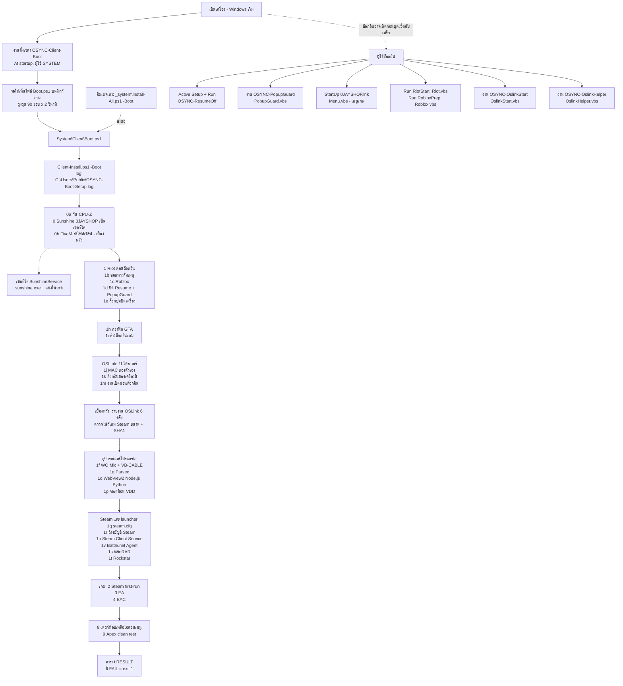
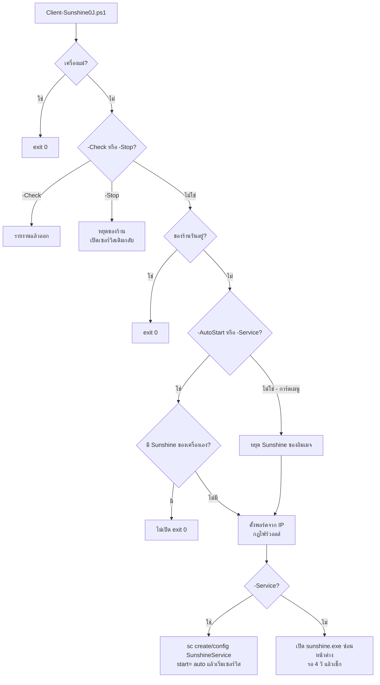
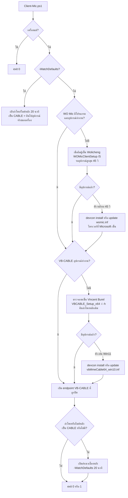
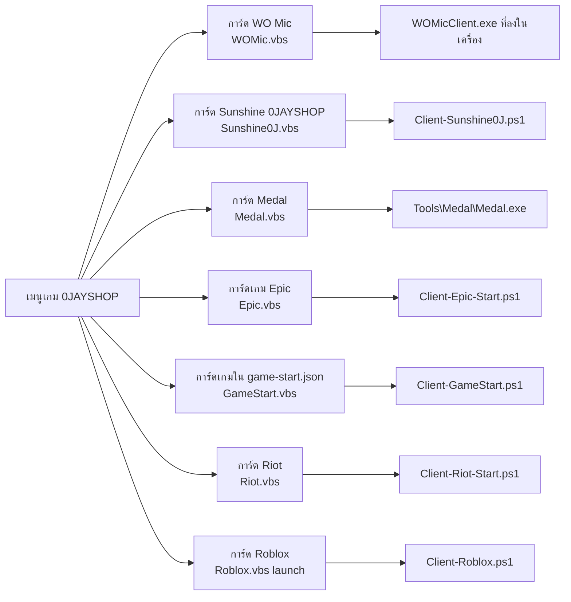
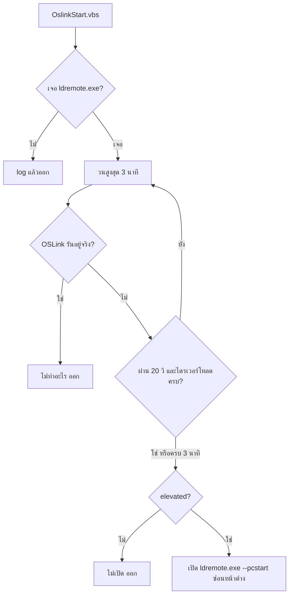

# 04 · เครื่องลูก: การบูตและไดรเวอร์

บทนี้อธิบายว่าเครื่องลูก (KORIxx) ทำอะไรบ้างตั้งแต่เปิดเครื่องจนถึงหน้าเดสก์ท็อป และอธิบายส่วนอุปกรณ์/ไดรเวอร์ของร้านเอง (ไมค์ WO Mic, VB-CABLE, Parsec, จอเสมือน VDD, Sunshine 0JAYSHOP, WinRAR, runtime)
เครื่องลูกเป็น diskless: ทุกอย่างที่เครื่องลูกเขียนเองจะหายตอนรีบูต งาน `OSYNC-Client-Boot` จึงทำทุกขั้นซ้ำทุกครั้งที่บูต ถ้าอิมเมจบันทึกของไว้แล้ว ขั้นนั้นจะเหลือแค่การตรวจไม่กี่วินาที
หัวใจของบทนี้คือ `System\Scripts\Client-Install.ps1` ส่วนสคริปต์เกมและบัญชี (Steam first-run, EA, Riot, OSLink, ล้างล็อกอิน ฯลฯ) อยู่ในบท [05-CLIENT-GAMES.md](05-CLIENT-GAMES.md)

> **กฎของเจ้าของร้าน (ไมค์/เสียง):** ส่วนไมค์และเสียงแตะเฉพาะ **WO Mic และ VB-CABLE ของระบบเมนู** เท่านั้น ไม่แตะการ์ดเสียงของเครื่อง และไม่แตะเสียงของโปรแกรมอื่น (ดูรายละเอียดใน [หัวข้อ 7 `Client-Mic.ps1`](#s7))

## สารบัญ

- [ภาพรวม: จากเปิดเครื่องถึงเดสก์ท็อป](#overview)
- [ตารางขั้นตอนบูตทุกขั้น](#steps)
- [สิ่งที่เริ่มทำงานตอนผู้ใช้ล็อกอิน](#logon)
- ส่วนเริ่มบูต
  - [1. `Boot.ps1` — ตัวเริ่มของงาน OSYNC-Client-Boot](#s1)
  - [2. `_system\Install-All.ps1` — ตัวส่งต่อของอิมเมจเก่า](#s2)
  - [3. `Client-Install.ps1` — ติดตั้ง/ตั้งค่าเครื่องลูกทุกขั้น](#s3)
- สคริปต์ที่ขั้นบูตเรียก (เรียงตามลำดับขั้น)
  - [4. `Client-Sunshine0J.ps1` — Sunshine 0JAYSHOP (ขั้น 0 และการ์ดเมนู)](#s4)
  - [5. `Client-Menu.ps1` — ทางลัดเมนูเกม (ขั้น 1b / 5)](#s5)
  - [6. `Client-PopupGuard.ps1` — ตัวปิดป๊อปอัป CrossDeviceResume (ขั้น 1d)](#s6)
  - [7. `Client-Mic.ps1` — WO Mic + VB-CABLE (ขั้น 1f)](#s7)
  - [8. `Client-Parsec.ps1` — Parsec (ขั้น 1g)](#s8)
  - [9. `Client-Runtimes.ps1` — WebView2, Node.js, Python (ขั้น 0 / 1o)](#s9)
  - [10. `Client-Vdd.ps1` — จอเสมือน VDD (ขั้น 1p)](#s10)
  - [11. `Client-WinRAR.ps1` — WinRAR (ขั้น 1s)](#s11)
  - [12. `Client-DesktopClean.ps1` — เดสก์ท็อปเหลือแค่ไอคอนเมนู (ขั้น 8)](#s12)
- ตัวเปิดตอนล็อกอิน (`System\Client\*.vbs`)
  - [13. `Menu.vbs` — เปิดเมนูเกม](#s13)
  - [14. `Riot.vbs` — เปิด Riot แบบไม่มีหน้าต่าง](#s14)
  - [15. `Roblox.vbs` — Roblox จากดิสก์เกม](#s15)
  - [16. `PopupGuard.vbs` — เริ่มตัวปิดป๊อปอัป](#s16)
  - [17. `OslinkStart.vbs` — OSLink เข้าถาดตอนล็อกอิน](#s17)
  - [18. `OslinkHelper.vbs` — ตัวช่วยล็อกอิน OSLink](#s18)
- ตัวเปิดของการ์ดเมนู (`System\Client\*.vbs`)
  - [19. `WOMic.vbs` — การ์ด WO Mic](#s19)
  - [20. `Sunshine0J.vbs` — การ์ด Sunshine 0JAYSHOP](#s20)
  - [21. `Medal.vbs` — การ์ด Medal](#s21)
  - [22. `Epic.vbs` — การ์ดเกม Epic](#s22)
  - [23. `GameStart.vbs` — การ์ดเกมแบบ iPlay](#s23)
- เครื่องมือตอนทำอิมเมจ
  - [24. `Client-Firewall.ps1` — ไฟร์วอลล์ + อนุญาตรีโมตจากเครื่องแม่](#s24)
- [ปัญหาที่เคยเจอ / ข้อควรรู้](#notes)

## ภาพรวม: จากเปิดเครื่องถึงเดสก์ท็อป

สรุปสั้น ๆ:
1. Windows เริ่ม แล้ว Task Scheduler รันงาน `OSYNC-Client-Boot` (สร้างโดยขั้น 7 ตอนทำอิมเมจ) ด้วยสิทธิ์ SYSTEM
2. งานนี้รอให้ดิสก์เกมโผล่ (สูงสุด 3 นาที) แล้วรัน `System\Client\Boot.ps1`
3. `Boot.ps1` เรียก `System\Scripts\Client-Install.ps1 -Boot` ซึ่งทำทีละขั้นตามตารางด้านล่าง แล้วพิมพ์ตาราง RESULT ลง log
4. ระหว่างนั้น Windows อาจล็อกอินแล้ว รายการใน Run / StartUp / งานตอนล็อกอิน จะเปิดเมนูเกม, Riot, Roblox, ตัวปิดป๊อปอัป, OSLink

## ตารางขั้นตอนบูตทุกขั้น

เรียงตามลำดับจริงในโค้ด `Client-Install.ps1` (ลำดับไม่ได้เรียงตามตัวเลข เช่น 1h มาก่อน 1f) · "เฉพาะบูต" = ทำเมื่อมี `-Boot` เท่านั้น · "เฉพาะทำอิมเมจ" = ทำเมื่อไม่มี `-Boot` (OSYNC.bat client) เท่านั้น · ไม่ได้เขียนไว้ = ทำทั้งสองแบบ
ค่าในร้านนี้มาจาก [`Settings\settings.txt`](../../Settings/settings.txt) · ค่าที่ไม่มีในไฟล์ใช้ค่าเริ่มต้นในโค้ด (`Get-Setting` คืนค่าเริ่มต้นเมื่อไม่มีบรรทัดหรือค่าว่าง)

| ขั้น | ชื่อ (ไทย) | สคริปต์ | ค่าที่เปิด/ปิด (ค่าเริ่มต้นในโค้ด) | ค่าในร้านนี้ตอนนี้ |
|---|---|---|---|---|
| [0a](#st-0a) | กันไดรเวอร์ CPU-Z (EA Javelin ห้าม) | ในไฟล์ `Client-Install.ps1` | `ClientBlockCpuz` on / off / ชื่อเครื่อง (`off`) และเครื่องใน `ClientApexClean` | `ClientBlockCpuz=KORI34,KORI23` → ทำแค่ 2 เครื่องนี้ |
| [0](#st-0) | Sunshine 0JAYSHOP เป็นเซอร์วิสตั้งแต่เปิด Windows | [`Client-Sunshine0J.ps1`](#s4) `-Service` (+ [`Client-Runtimes.ps1`](#s9) ถ้าไม่มี WebView2) | `ClientSunshineAutoStart` on / off / ชื่อเครื่อง (`off`) | `on` (เฉพาะเครื่องที่ไม่มี Sunshine ของตัวเอง) |
| [0b](#st-0b) | FiveM ส่งไฟล์เซิร์ฟใหม่เข้าเครื่องแม่ (เบื้องหลัง) · เฉพาะบูต | `Client-FiveMShare.ps1` → [05](05-CLIENT-GAMES.md) | `ClientFiveMShare` (`off`) | `on` |
| [1](#st-1) | Riot เปิดเงียบตอนล็อกอิน | ในไฟล์ → [`Riot.vbs`](#s14) | ไม่มีค่า (ทำเมื่อมี `Launchers\Riot Client\RiotClientServices.exe`) | — |
| [1b](#st-1b) | ซ่อมทางลัดเมนูเกม (ก่อนล็อกอิน) · เฉพาะบูต | [`Client-Menu.ps1`](#s5) `-NoStart` | ไม่มีค่า (ทำเมื่อมีโปรแกรมเมนู) | — |
| [1c](#st-1c) | Roblox เล่นจากดิสก์เกม (ลิงก์ตอนล็อกอิน) | ในไฟล์ → [`Roblox.vbs`](#s15) | ไม่มีค่า (ทำเมื่อมี Roblox ใน `Launchers\Roblox`) | — |
| [1d](#st-1d) | ปิด Windows Resume + ตัวปิดป๊อปอัป | ในไฟล์ → [`PopupGuard.vbs`](#s16) | ไม่มีค่า (ทำเมื่อมี `CrossDeviceResume.exe`) | — |
| [1e](#st-1e) | ลูกค้าปิด/รีสตาร์ตเครื่องเองไม่ได้ | ในไฟล์ | `ClientPowerLock` (`on`) | `on` |
| [1h](#st-1h) | กราฟิก GTA V / FiveM ตามไฟล์ร้าน | `Client-GtaSettings.ps1` → [05](05-CLIENT-GAMES.md) | `ClientGtaSettings` (`on`) | `on` |
| [1i](#st-1i) | ล้างล็อกอินเกมที่ค้าง | `Client-ClearLogins.ps1` → [05](05-CLIENT-GAMES.md) | `ClientClearLogins` (`on`) | `on` |
| [1l](#st-1l) | ไดรเวอร์ OSLink (เมาส์/คีย์บอร์ด/จอยเสมือน) | `Client-OslinkDrivers.ps1` → [05](05-CLIENT-GAMES.md) | `ClientOslinkDrivers` on / off / ชื่อเครื่อง (`off`) | `on` |
| [1j](#st-1j) | OSLink ใช้ MAC ของเครื่องเอง | `Client-OslinkReset.ps1` → [05](05-CLIENT-GAMES.md) | `ClientOslinkReset` on / off / ชื่อเครื่อง (`off`) | `on` |
| [1k](#st-1k) | OSLink ล็อกอินของเครื่องนี้ (เก็บที่เครื่องแม่) | `Client-OslinkLogin.ps1` → [05](05-CLIENT-GAMES.md) | `ClientOslinkLogin` on / off / ชื่อเครื่อง (`off`) | `on` |
| [1m](#st-1m) | OSLink เข้าถาดตอนล็อกอิน (ไม่มีหน้าต่าง) | ในไฟล์ → [`OslinkStart.vbs`](#s17) | `ClientOslinkStart` on / off / ชื่อเครื่อง (`off`) | `on` |
| [—](#st-report) | ส่งรายงาน OSLink ไปเครื่องแม่ (เบื้องหลัง, ชั่วคราว) · เฉพาะบูต | `Client-OslinkReport.ps1` → [05](05-CLIENT-GAMES.md) | `ClientOslinkReport` (`off`) | `on` |
| [—](#st-verify) | ตรวจไฟล์เกม Steam ขนาด + SHA1 (เบื้องหลัง) · เฉพาะบูต | `Client-SteamVerify.ps1` → [05](05-CLIENT-GAMES.md) | `ClientSteamVerify` on / ชื่อเครื่อง (ว่าง) · `ClientSteamVerifyApps` (`1172470`) | `ClientSteamVerify=KORI23`, `ClientSteamVerifyApps=1172470` |
| [1f](#st-1f) | WO Mic + VB-CABLE (ลงเมื่อยังไม่มี) | [`Client-Mic.ps1`](#s7) | `ClientMicDrivers` (`on`) · `ClientNoWoMic` on / ชื่อเครื่อง (ว่าง) | `ClientMicDrivers=on`, `ClientNoWoMic=` (ว่าง) |
| [1g](#st-1g) | Parsec (ลงเมื่อยังไม่มี) | [`Client-Parsec.ps1`](#s8) | `ClientParsec` (`on`) | `on` |
| [1o](#st-1o) | WebView2, Node.js, Python | [`Client-Runtimes.ps1`](#s9) | `ClientWebView2` / `ClientNodeJs` / `ClientPython` (`on`) | `on` / `on` / `on` |
| [1p](#st-1p) | จอเสมือน VDD 1920x1080 (ลงเมื่อไม่มีเลย) | [`Client-Vdd.ps1`](#s10) | `ClientVdd` (`on`) | `on` |
| [1q](#st-1q) | Steam ไม่อัปเดตตัวเอง (steam.cfg) | ในไฟล์ | `ClientSteamNoUpdate` on / off / ชื่อเครื่อง (`off`) | `on` |
| [1r](#st-1r) | ล้างรายชื่อบัญชี Steam ของเครื่องแม่ | ในไฟล์ | `ClientClearLogins` (`on`) | `on` |
| [1u](#st-1u) | Steam Client Service (ปุ่ม PLAY ต้องใช้) | ในไฟล์ | `ClientSteamService` (`on`) | ไม่มีในไฟล์ = `on` |
| [1v](#st-1v) | Battle.net Update Agent | ในไฟล์ | `ClientBattleNet` (`on`) | ไม่มีในไฟล์ = `on` |
| [1s](#st-1s) | WinRAR (ลงเมื่อยังไม่มี) | [`Client-WinRAR.ps1`](#s11) | `ClientWinRAR` (`on`) | `on` |
| [1t](#st-1t) | Rockstar Games Launcher บนดิสก์เกม | ในไฟล์ | `ClientRockstar` (`on`) | ไม่มีในไฟล์ = `on` |
| 1w | BlueStacks 5 จากไดรฟ์เกม | [`Client-BlueStacks.ps1`](../Scripts/Client-BlueStacks.ps1) | `ClientBlueStacks` on / off (`on`) | `on` · ข้ามจนกว่าเครื่องแม่จะย้าย BlueStacks (`OSYNC.bat` → 7 → 25) |
| [2](#st-2) | Steam first-run ของทุกเกม | `Client-Steam-FirstRun.ps1` → [05](05-CLIENT-GAMES.md) | ไม่มีค่า | — |
| [3](#st-3) | EA app / เกม EA / EA AntiCheat | `Client-EA.ps1` → [05](05-CLIENT-GAMES.md) | ไม่มีค่า (ทำเมื่อมี `System\Data\EA\ea-client.reg`) | — |
| [4](#st-4) | EasyAntiCheat (Epic และอื่น ๆ) | `Client-EAC.ps1` → [05](05-CLIENT-GAMES.md) | ไม่มีค่า | — |
| [5](#st-5) | เมนูเกม (ทางลัด) · เฉพาะทำอิมเมจ | [`Client-Menu.ps1`](#s5) `-NoStart` | ไม่มีค่า | — |
| [6](#st-6) | NEWTHINGS-GAMES (GTA SA) · เฉพาะทำอิมเมจ | `Client-NEWTHINGS.ps1` → [05](05-CLIENT-GAMES.md) | `ClientThaiFix` on / off / ask (`ask`) ใช้กับคำถามแก้ภาษาไทย | `on` |
| [7](#st-7) | สร้างงาน `OSYNC-Client-Boot` · เฉพาะทำอิมเมจ | ในไฟล์ | ไม่มีค่า (ปิดได้ด้วย OSYNC.bat > 7 Tools > 14) | — |
| [8](#st-8) | เดสก์ท็อปเหลือแค่ไอคอนเมนู | [`Client-DesktopClean.ps1`](#s12) | `ClientDesktopMenuOnly` (`off`) · `ClientDesktopIcons` | `on` · `app-discordptb,fivem,launcher-steam,launcher-rockstar,launcher-roblox` |
| [9](#st-9) | Apex: เครื่องทดสอบแบบสะอาด | ในไฟล์ | `ClientApexClean` on / ชื่อเครื่อง (ว่าง) | ว่าง → มีในโค้ด แต่ร้านนี้ปิดอยู่: `ClientApexClean=` |
| (ทุกขั้น) | Apex: เครื่องทดสอบแบบเปล่า | ในไฟล์ (`Step`) | `ClientApexMinimal` ชื่อเครื่อง (ว่าง) | `KORI23` (20 พ.ย. 2026) → บูตแล้วทำแค่ขั้น 0a, 1q, 1r, 1u, 2, 3 ขั้นอื่นขึ้น `SKIP (ClientApexMinimal)` |

ขั้นที่ข้ามบนเครื่องแม่ (`SKIP (this is the master)`): ทุกขั้น ยกเว้น 1, 1b, 1c, 1d, 1e, 2, 3, 4, 5, 6 ซึ่งไม่มีการตรวจนี้ในโค้ด (OSYNC.bat จะถามก่อนถ้าสั่ง client บนเครื่องที่ดูเหมือนเครื่องแม่)

## สิ่งที่เริ่มทำงานตอนผู้ใช้ล็อกอิน

`Run` ในตารางนี้คือ `HKLM\Software\Microsoft\Windows\CurrentVersion\Run` (ทุกผู้ใช้)

| ตอนไหน | รายการ | เปิดอะไร | ตั้งโดยขั้น |
|---|---|---|---|
| ระหว่างบูต (ยังไม่ต้องล็อกอิน) | เซอร์วิส `SunshineService` (automatic) | `Tools\Sunshine0J\tools\sunshinesvc.exe` → `sunshine.exe` + แผงในถาด | 0 |
| ล็อกอิน ก่อนเดสก์ท็อปขึ้น | Active Setup `OSYNC-ResumeOff` | `reg add` ปิด Resume ของผู้ใช้คนนั้น | 1d |
| ล็อกอิน | Run `OSYNC-ResumeOff` (สำรอง) | คำสั่ง `reg add` ชุดเดียวกัน | 1d |
| ล็อกอิน | งาน `OSYNC-PopupGuard` (BUILTIN\Users, สิทธิ์ปกติ) + Run `OSYNC-PopupGuard` (สำรอง) | [`PopupGuard.vbs`](#s16) → [`Client-PopupGuard.ps1`](#s6) | 1d |
| ล็อกอิน | ทางลัด StartUp ทุกผู้ใช้ `0JAYSHOP.lnk` | `wscript.exe` [`Menu.vbs`](#s13) → `Menu\app\0JAYSHOP.exe` | 1b (บูต) / 5 (ทำอิมเมจ) |
| ล็อกอิน | Run `RiotStart` | [`Riot.vbs`](#s14) `background` | 1 |
| ล็อกอิน | Run `RobloxPrep` | [`Roblox.vbs`](#s15) `background` | 1c |
| ล็อกอิน | งาน `OSYNC-OslinkStart` (BUILTIN\Users, สิทธิ์สูงสุด) | [`OslinkStart.vbs`](#s17) | 1m |
| ล็อกอิน | งาน `OSYNC-OslinkHelper` (BUILTIN\Users, สิทธิ์สูงสุด) | [`OslinkHelper.vbs`](#s18) → `Client-OslinkHelper.ps1` | 1k (สร้างโดย `Client-OslinkLogin.ps1`) |

โปรเซสเบื้องหลังที่บูตเซ็ตอัปเปิดไว้ (สิทธิ์ SYSTEM, ซ่อนหน้าต่าง): `Client-FiveMShare.ps1` (0b), `Client-OslinkReport.ps1` 6 ตัว (หลังบูต 150 วิ, 360 วิ, หลัง Steam / FiveM / Riot / Apex เปิดครั้งแรก), `Client-SteamVerify.ps1` (เฉพาะเครื่องใน `ClientSteamVerify`), และ `Client-Mic.ps1 -WatchDefaults` (เมื่อลำโพง/ไมค์หลักเป็น CABLE หรือยังไม่มี)

---

## 1. `Boot.ps1` — ตัวเริ่มของงาน OSYNC-Client-Boot

ไฟล์: [`System/Client/Boot.ps1`](../Client/Boot.ps1)

**หน้าที่:** จุดเริ่มของการตั้งค่าตอนบูตบนเครื่องลูก มีแค่บรรทัดเดียวที่เรียก `Client-Install.ps1 -Boot` แล้วส่ง exit code ต่อ

**เรียกจาก / ทำงานเมื่อไหร่:** งานตั้งเวลา `OSYNC-Client-Boot` ในอิมเมจ (สร้างโดย [ขั้น 7](#st-7)) ทริกเกอร์ At startup ผู้ใช้ SYSTEM ทุกครั้งที่เครื่องลูกบูต · อิมเมจเก่าเรียกผ่าน [`_system\Install-All.ps1`](#s2)
- ต้องเก็บไฟล์นี้ไว้ที่เดิมด้วยชื่อเดิม เพราะงานในอิมเมจชี้มาที่ path นี้ (คอมเมนต์บรรทัด 2)
- OSYNC.bat > 6 Check (`Tool-Check.ps1`) ตรวจว่างานนี้มีอยู่และชี้มาที่โฟลเดอร์นี้ (ถอด `-EncodedCommand` ออกมาดู)
- OSYNC.bat > 7 Tools > 14 (`boot-off`) ลบงานนี้ทิ้ง (`schtasks /Delete /TN OSYNC-Client-Boot`)

**พารามิเตอร์:** ไม่มี

**อ่านค่า:** ไม่มี · **เขียน / เปลี่ยน:** ไม่มี (ทั้งหมดอยู่ใน `Client-Install.ps1`) · **Log:** ดู [หัวข้อ 3](#s3)

**ขั้นตอนการทำงาน:**
1. หา `..\Scripts\Client-Install.ps1` จากโฟลเดอร์ของตัวเอง แล้วรันด้วย `-Boot`
2. `exit $LASTEXITCODE`

**ฟังก์ชัน:** ไม่มี

## 2. `_system\Install-All.ps1` — ตัวส่งต่อของอิมเมจเก่า

ไฟล์: [`_system/Install-All.ps1`](../../_system/Install-All.ps1)

**หน้าที่:** อิมเมจเครื่องลูกที่ทำด้วยโครงโฟลเดอร์ OSYNC แบบเก่า (ก่อน Tool-Migrate) มีงาน `OSYNC-Client-Boot` ที่รัน `<OSYNC>\_system\Install-All.ps1 -Boot` ไฟล์นี้ส่งต่อไปที่ `System\Client\Boot.ps1`

**เรียกจาก / ทำงานเมื่อไหร่:** งาน `OSYNC-Client-Boot` ของอิมเมจเก่า ทุกครั้งที่บูต · คอมเมนต์: ทำอิมเมจใหม่ด้วย `OSYNC.bat client` เมื่อทุกอิมเมจเป็นแบบใหม่แล้ว ลบโฟลเดอร์ `_system` ได้

**พารามิเตอร์:** `-Boot` (รับไว้เฉย ๆ ไม่ได้ใช้ เพราะ `Boot.ps1` ส่ง `-Boot` เองเสมอ)

**อ่านค่า / เขียน:** ไม่มี · **Log:** ดู [หัวข้อ 3](#s3)

**ขั้นตอนการทำงาน:**
1. รัน `..\System\Client\Boot.ps1`
2. `exit $LASTEXITCODE`

**ฟังก์ชัน:** ไม่มี

## 3. `Client-Install.ps1` — ติดตั้ง/ตั้งค่าเครื่องลูกทุกขั้น

ไฟล์: [`System/Scripts/Client-Install.ps1`](../Scripts/Client-Install.ps1) (574 บรรทัด)

**หน้าที่:** ทำทุกอย่างที่เครื่องลูกต้องมีในการรันครั้งเดียว มี 2 แบบ
- **แบบทำอิมเมจ** (ไม่มี `-Boot`): รันในโหมด super workstation แล้วบันทึกอิมเมจ ทำทุกขั้นรวม 5, 6, 7 และถามเรื่องภาษาไทยได้
- **แบบบูต** (`-Boot`): รันทุกครั้งที่บูตผ่าน `Boot.ps1` ไม่ถามอะไร ลงเฉพาะของที่ยังไม่มี (เกมใหม่ไม่ต้องแก้อิมเมจ แค่รีบูตเครื่องลูก) ไม่ทำขั้น 5, 6, 7

**เรียกจาก / ทำงานเมื่อไหร่:**
- `OSYNC.bat` > 5 "Install everything on this client", หรือ `OSYNC.bat client` (`OSYNC.ps1` บรรทัด 53-56)
- ดับเบิลคลิก `OSYNC.bat` บนเครื่องลูกโดยไม่ใส่คำสั่ง = `client` (`OSYNC.ps1` บรรทัด 150)
- `Boot.ps1` → `-Boot` (งาน `OSYNC-Client-Boot`)

**พารามิเตอร์:**
| พารามิเตอร์ | ความหมาย |
|---|---|
| `-Boot` | โหมดบูต: ไม่ถาม, ไม่ทำขั้น 5-7, ทำขั้นที่ "เฉพาะบูต" (1b, 0b, รายงาน OSLink, ตรวจไฟล์ Steam), log ไปที่ `OSYNC-Boot-Setup.log` |

**อ่านค่า:** `Settings\settings.txt` ผ่าน `Get-Setting` (ทุกคีย์ในตารางขั้นตอนบูต) · `HKLM\SYSTEM\CurrentControlSet\Control\Nls\CodePage` ค่า `ACP` · `Menu\config.json` (ผ่าน `Get-MenuInfo`) · `Launchers\...` · `Tools\...` · `System\Data\EA\ea-client.reg`, `System\Data\BattleNet\Agent`

**เขียน / เปลี่ยน:** ดูทีละขั้นด้านล่าง (Run, Active Setup, policy, เซอร์วิส, งานตั้งเวลา, ไฟล์ steam.cfg ฯลฯ)

**Log:** `Start-Transcript` ไปที่ `C:\Users\Public\OSYNC-Boot-Setup.log` (บูต) หรือ `C:\Users\Public\OSYNC-Install-All.log` (ทำอิมเมจ) · ผลของสคริปต์ลูกที่เรียกผ่าน `Run-Script` ก็ลงไฟล์เดียวกันนี้ (เยื้อง 4 ช่อง)

**ขั้นตอนการทำงาน (ส่วนเริ่มต้น):**
1. โหลด `Common.ps1`, หยุดถ้าโฟลเดอร์ยังเป็นโครงเก่า (`Stop-IfPreMigration` → exit 2)
2. ไม่ใช่ admin → exit 1
3. เริ่ม transcript (log ตามโหมด)
4. คำถามเดียวของสคริปต์ (เฉพาะทำอิมเมจ และ code page ไม่ใช่ 874): ภาษาไทยในเกมเป็นตัวต่างดาว จะแก้ไหม → `ClientThaiFix` on = แก้เลย, off = ไม่แก้, ask = ถาม Y/N ผลนี้ใช้ใน [ขั้น 6](#st-6)
5. ทำแต่ละขั้นผ่าน `Step` ตามลำดับด้านล่าง
6. พิมพ์ตาราง `RESULT` (ชื่อขั้น, วินาที, ผล; เขียว = OK, เหลือง = SKIP, แดง = อื่น ๆ) · โหมดทำอิมเมจบอกให้ **บันทึกอิมเมจแล้วรีบูต**
7. มีขั้นไหนขึ้นต้นด้วย `FAIL` → exit 1

**ฟังก์ชัน:**
| ฟังก์ชัน | บรรทัด | หลักการทำงาน |
|---|---|---|
| [`Run-Script`](../Scripts/Client-Install.ps1#L47) | 47 | รันสคริปต์ลูกด้วย `powershell.exe -NoProfile -ExecutionPolicy Bypass -File` (รับ `$extra` เป็นพารามิเตอร์เพิ่ม) รวม stderr เข้ามา; บรรทัดที่ขึ้นต้นด้วย `~` = สถานะสดของตัวติดตั้ง วาดทับที่เดิมด้วย `Show-Live` ไม่ลง log; บรรทัดอื่นพิมพ์เยื้อง 4 ช่อง; คืน exit code |
| [`Step`](../Scripts/Client-Install.ps1#L62) | 62 | พิมพ์หัว `== ชื่อขั้น`, ตั้งชื่อหน้าต่าง, จับเวลา, รัน scriptblock; ผลว่างหรือ 0 = `OK`, ตัวเลขอื่น = `FAIL (exit n)`, error = `FAIL: ข้อความ`, ข้อความ = ใช้ตามนั้น (`SKIP (...)` ฯลฯ) แล้วเก็บลงตารางผล |
| [`Stop-WoMicDriver`](../Scripts/Client-Install.ps1#L77) | 77 | ถอด WO Mic ออกในบูตนี้ (ใช้ในขั้น 1f และ 9) — ดูหัวข้อย่อยด้านล่าง |

### `Stop-WoMicDriver` (บรรทัด 68)
- **ใช้เมื่อ:** เครื่องอยู่ใน `ClientNoWoMic` หรือ `ClientApexClean` เท่านั้น (ตอนนี้ทั้งสองค่าว่าง จึงไม่ถูกเรียก)
- **ทำอะไร:** หาอุปกรณ์ที่ใช้เซอร์วิส `WOVAD` หรือ HardwareID มี `WOMic` → ตั้งไดรเวอร์ `WOVAD` เป็น disabled → หยุด `Audiosrv` และ `AudioEndpointBuilder` ชั่วครู่ → `pnputil /remove-device` อุปกรณ์ WO Mic → `sc stop WOVAD` → เปิด `AudioEndpointBuilder` และ `Audiosrv` กลับ
- **คืนค่า:** `''` เมื่อ WOVAD ไม่โหลดแล้ว, `'WOVAD still loaded'` เมื่อยังโหลดอยู่
- **ทำไม:** คอมเมนต์ 19 พ.ย. 2026 (Apex): แค่ปิดอุปกรณ์ไม่พอ บน KORI23 เวลา 15:03 ยังเห็น "WOVAD Running" เพราะ Windows Audio ยังจับอยู่ จึงต้องหยุด Windows Audio สักครู่
- **ข้อควรรู้:** ฟังก์ชันนี้หยุด/เปิดเซอร์วิสเสียงของ Windows ชั่วครู่ ซึ่งเป็นข้อยกเว้นเดียวของกฎ "ไม่แตะเสียงอื่น" และอยู่นอก `Client-Mic.ps1`

### ขั้นตอนการทำงาน ทีละขั้น (ตามลำดับในโค้ด)

#### ขั้น `0a Apex  - no CPU-Z driver (EA Javelin denylist)` ([บรรทัด 102](../Scripts/Client-Install.ps1#L102))
- **ทำไม:** Apex ดับตรง "Starting EA Javelin Anticheat..." บนเครื่องลูก เพราะตัวอ่านฮาร์ดแวร์/อุณหภูมิของโปรแกรม diskless (`C:\lwserver\client\lwclient64\lwhardware64.exe` → `khwsdk64.dll`) โหลดไดรเวอร์ CPU-Z `C:\Windows\Temp\cpuz160\cpuz160_x64.sys` ซึ่งอยู่ในรายการห้ามของ EA Javelin · ไดรเวอร์ CPU-Z ที่โหลดแล้วหยุดไม่ได้ ขั้นนี้จึงอยู่แรกสุด ก่อนตัวอ่านทำงาน
- **ทำ:** ข้ามบนเครื่องแม่ · ทำเมื่อ `ClientBlockCpuz` = on หรือมีชื่อเครื่องนี้ หรือเครื่องนี้อยู่ใน `ClientApexClean` · สำหรับ `cpuz152` และ `cpuz160`:
  1. ไดรเวอร์รันอยู่แล้ว → จดไว้ (สุดท้ายจะ FAIL)
  2. ลบโฟลเดอร์ `C:\Windows\Temp\<ชื่อ>` (ลบไม่ได้ = ไดรเวอร์โหลดอยู่)
  3. สร้าง **ไฟล์** ชื่อเดียวกันแทนโฟลเดอร์ ตั้ง ReadOnly + Hidden + System จึงเขียนไดรเวอร์ลงไม่ได้
  4. มีเซอร์วิสชื่อนั้นแล้ว → `sc config start= disabled`, ไม่มี → `sc create type= kernel start= disabled` เพื่อให้เริ่มไม่ได้
- ไม่แตะ `cpuz163` ของ Steam · **ผลเสีย:** หน้าจอโปรแกรม diskless ไม่เห็นอุณหภูมิ CPU ของเครื่องนั้น
- **ผล:** โหลดไปก่อนแล้ว → `FAIL (already loaded before this step ... Apex stays blocked on this boot)`
- **ร้านนี้:** `ClientBlockCpuz=KORI34,KORI23`

#### ขั้น `0 Sunshine - 0JAYSHOP from the start of Windows (PCs without their own)` ([บรรทัด 127](../Scripts/Client-Install.ps1#L127))
- **ทำไม:** เจ้าของร้าน 18 พ.ย. 2026: Sunshine 0JAYSHOP พับไว้ในถาดตั้งแต่ Windows โหลด แต่ไม่เปิดบนเครื่องที่มี Sunshine อยู่แล้ว
- **ทำ:** ข้ามบนเครื่องแม่ → ลบงานตอนล็อกอิน `OSYNC-Sunshine0J` ของเวอร์ชันแรกทิ้งเสมอ → อ่าน `ClientSunshineAutoStart` (off = ข้าม, ไม่ใช่ on และไม่มีชื่อเครื่องนี้ = ข้าม) → ไม่มี `Tools\Sunshine0J\sunshine.exe` = ข้าม → เครื่องมี Sunshine ของตัวเอง (เซอร์วิสที่ชื่อหรือ path มี sunshine อยู่นอกชุดของร้านและไม่ disabled, หรือมี `sunshine.exe` ใน `C:\Program Files\Sunshine`, `C:\Sunshine`, `C:\Users\*\Sunshine`) = ข้าม → ไม่มี WebView2 (อ่าน `pv` ใต้ `EdgeUpdate\Clients\{F3017226-...}`) → รัน [`Client-Runtimes.ps1`](#s9) ก่อน → รัน [`Client-Sunshine0J.ps1 -Service`](#s4)
- **ร้านนี้:** `ClientSunshineAutoStart=on`

#### ขั้น `0b FiveM - hand new server files to the master (background)` ([บรรทัด 144](../Scripts/Client-Install.ps1#L144))
- ข้ามบนเครื่องแม่ · เฉพาะบูต · `ClientFiveMShare` เป็น on → เปิด `Client-FiveMShare.ps1` แบบซ่อนหน้าต่างเบื้องหลัง (log `C:\Users\Public\OSYNC-FiveMShare.log`) รายละเอียดใน [05](05-CLIENT-GAMES.md)
- **ร้านนี้:** `ClientFiveMShare=on`

#### ขั้น `1 Riot  - silent start at logon` ([บรรทัด 151](../Scripts/Client-Install.ps1#L151))
- ไม่มี Riot Client ใน `Launchers` (`Get-LauncherExe 'Riot'`) → ข้าม
- เขียน Run `RiotStart` = `wscript.exe "<OSYNC>\System\Client\Riot.vbs" background` · ลบ `RiotClient` และ `RiotStart` ใต้ HKCU Run
- ไม่มีค่าเปิด/ปิด (OSYNC.bat > 7 Tools > 9 / 10 ตั้ง/ลบ `RiotStart` เองได้)

#### ขั้น `1b Menu - menu shortcuts (repair, before logon)` ([บรรทัด 164](../Scripts/Client-Install.ps1#L164))
- เฉพาะบูต · ไม่มีโปรแกรมเมนู → ข้าม · รัน [`Client-Menu.ps1 -NoStart`](#s5)
- **ทำไม:** ทำทางลัดใหม่ทันที (ไม่กี่วินาที) ก่อนตัวติดตั้งช้า ๆ จึงทันก่อน Windows ล็อกอิน · อิมเมจที่ทำด้วยโครงเก่า (ทางลัดชี้ `GCafe\app`) จะเปิดเมนูผ่าน `Menu.vbs` ตั้งแต่บูตนี้

#### ขั้น `1c Roblox - play from the game disk (links at logon)` ([บรรทัด 170](../Scripts/Client-Install.ps1#L170))
- ไม่มี Roblox ใน `Launchers\Roblox` (`Get-RobloxExe`) → ข้าม
- เขียน Run `RobloxPrep` = `wscript.exe "<OSYNC>\System\Client\Roblox.vbs" background` (ตอนล็อกอินชี้ลิงก์ `roblox://` ของผู้ใช้ไปที่ดิสก์เกม ไม่ต้องติดตั้ง) รายละเอียด `Client-Roblox.ps1` ใน [05](05-CLIENT-GAMES.md)

#### ขั้น `1d Win  - Resume off (CrossDeviceResume error popup)` ([บรรทัด 180](../Scripts/Client-Install.ps1#L180))
- **ทำไม:** Windows 11 "Resume" (`CrossDeviceResume.exe`) ไม่ได้ลงทะเบียนให้ผู้ใช้บนอิมเมจ diskless แล้วเด้ง "The parameter is incorrect"
- ไม่มี `C:\Windows\SystemApps\MicrosoftWindows.Client.CBS_cw5n1h2txyewy\CrossDeviceResume.exe` → ข้าม
- **เขียน:**
  1. Active Setup `HKLM\SOFTWARE\Microsoft\Active Setup\Installed Components\OSYNC-ResumeOff` (`StubPath` = `cmd /c reg add HKCU\Software\Microsoft\Windows\CurrentVersion\CrossDeviceResume\Configuration` ค่า `IsResumeAllowed=0` และ `IsOneDriveResumeAllowed=0`, `Version=1,0,0,0`, `IsInstalled=1`) — รันเป็นผู้ใช้ตอนล็อกอินก่อนเดสก์ท็อปขึ้น ไม่ต้องโหลด hive ของผู้ใช้
  2. Run `OSYNC-ResumeOff` = คำสั่งเดียวกัน (เผื่อ Windows ล็อกอินไปก่อนขั้นนี้เขียน Active Setup)
  3. Policy `HKLM\SOFTWARE\Policies\Microsoft\Windows\System` `EnableMmx=0` (Phone-PC linking ปิด)
  4. โหมดทำอิมเมจ: เขียนค่า HKCU ให้ผู้ใช้ที่ล็อกอินอยู่ด้วย
  5. Feature override `HKLM\SYSTEM\CurrentControlSet\Control\FeatureManagement\Overrides\8\1387020943` (`EnabledState=1`, ที่เหลือ 0) = เหมือน `ViVeTool /disable /id:56517033` เพราะทาสก์บาร์ (sihost) เปิด CrossDeviceResume ไม่ว่าค่าตั้งจะเป็นอะไร · Windows อ่านตอนเริ่มเครื่อง จึงได้ผลแน่เมื่ออยู่ในอิมเมจ
  6. ตัวปิดป๊อปอัป: Run `OSYNC-PopupGuard` = `wscript.exe "<OSYNC>\System\Client\PopupGuard.vbs"` และงาน `OSYNC-PopupGuard` (At logon, กลุ่ม `S-1-5-32-545` BUILTIN\Users, RunLevel Limited, จำกัด 5 นาที, IgnoreNew) — ใช้งานตอนล็อกอินเพราะรายการ Run เริ่มช้ากว่าป๊อปอัป

#### ขั้น `1e Power - customers cannot shut down / restart` ([บรรทัด 220](../Scripts/Client-Install.ps1#L220))
- `ClientPowerLock` ไม่ใช่ off = on
- **เขียนทุกครั้ง (ทั้ง on และ off):** `HKLM\SOFTWARE\Microsoft\Windows\CurrentVersion\Policies\Explorer` `NoClose` = 1 (on) / 0 (off) · `...\Policies\System` `shutdownwithoutlogon` = 0 (on) / 1 (off)
- on = ซ่อน Shut down / Restart / Sleep ใน Start, Alt+F4, Ctrl+Alt+Del และหน้าล็อกอิน · ร้านยังสั่งปิด/รีสตาร์ตจากหลังบ้านได้ (agent ใช้ `shutdown.exe` เป็น SYSTEM)
- **ร้านนี้:** `ClientPowerLock=on`

#### ขั้น `1h GTA   - GTA V / FiveM graphics (shop file)` ([บรรทัด 232](../Scripts/Client-Install.ps1#L232))
- ข้ามบนเครื่องแม่ · `ClientGtaSettings=off` = ข้าม · ไม่มี `Settings\gta5_settings.xml` = ข้าม · รัน `Client-GtaSettings.ps1` → [05](05-CLIENT-GAMES.md) · ใช้เวลาไม่กี่วินาที จึงอยู่ก่อนตัวติดตั้ง
- **ร้านนี้:** `ClientGtaSettings=on`

#### ขั้น `1i Logins - clear saved game logins` ([บรรทัด 241](../Scripts/Client-Install.ps1#L241))
- ข้ามบนเครื่องแม่ · `ClientClearLogins=off` = ข้าม · รัน `Client-ClearLogins.ps1` (บูตส่ง `-Boot`: ไม่ปิดอะไร; ทำอิมเมจ: ปิด launcher ก่อน) → [05](05-CLIENT-GAMES.md)
- **ร้านนี้:** `ClientClearLogins=on`

#### ขั้น `1l OSLink - drivers (virtual mouse / keyboard / gamepad)` ([บรรทัด 251](../Scripts/Client-Install.ps1#L251))
- ข้ามบนเครื่องแม่ · `ClientOslinkDrivers` off = ข้าม, ไม่ใช่ on และไม่มีชื่อเครื่องนี้ = ข้าม · รัน `Client-OslinkDrivers.ps1` (LdVMou, LdVKbd, LdScpVBus) → [05](05-CLIENT-GAMES.md)
- อยู่ก่อน 1j / 1k เพราะ OSLink ตรวจไดรเวอร์ตอนเริ่ม และสองขั้นนั้นรีสตาร์ต OSLink
- **ร้านนี้:** `ClientOslinkDrivers=on`

#### ขั้น `1j OSLink - own MAC, not the master's` ([บรรทัด 260](../Scripts/Client-Install.ps1#L260))
- ข้ามบนเครื่องแม่ · `ClientOslinkReset` แบบเดียวกับ 1l · รัน `Client-OslinkReset.ps1` → [05](05-CLIENT-GAMES.md)
- **ร้านนี้:** `ClientOslinkReset=on`

#### ขั้น `1k OSLink - this PC's own sign-in (from the master)` ([บรรทัด 270](../Scripts/Client-Install.ps1#L270))
- ข้ามบนเครื่องแม่ · `ClientOslinkLogin` แบบเดียวกับ 1l · รัน `Client-OslinkLogin.ps1` (สร้างงาน `OSYNC-OslinkHelper` ด้วย) → [05](05-CLIENT-GAMES.md)
- **ร้านนี้:** `ClientOslinkLogin=on`

#### ขั้น `1m OSLink - in the tray at logon (no window)` ([บรรทัด 282](../Scripts/Client-Install.ps1#L282))
- **ทำไม:** เจ้าของร้าน 17 พ.ย.: OSLink อยู่ในถาดตั้งแต่ล็อกอิน ไม่มีหน้าต่าง · `ldremote.exe` ต้องการสิทธิ์ admin ถ้าใส่ใน Run Windows จะถามหรือข้าม จึงใช้งานตั้งเวลาแบบสิทธิ์สูงสุด
- ข้ามบนเครื่องแม่ · `ClientOslinkStart` off หรือไม่มีชื่อเครื่องนี้ → **ลบงาน `OSYNC-OslinkStart`** แล้วข้าม
- ไม่มี `System\Client\OslinkStart.vbs` → `FAIL`
- สร้างงาน `OSYNC-OslinkStart`: At logon, กลุ่ม BUILTIN\Users, RunLevel Highest, จำกัด 10 นาที, IgnoreNew → `wscript.exe "<OSYNC>\System\Client\OslinkStart.vbs"`
- บูตและมี `explorer` รันอยู่แล้ว (มีคนล็อกอินก่อน) → `Start-ScheduledTask` ทันที (ถ้า OSLink รันอยู่ VBS จะไม่ทำอะไร)
- **ร้านนี้:** `ClientOslinkStart=on`

#### บล็อกรายงาน OSLink (ไม่ใช่ `Step`, [บรรทัด 306](../Scripts/Client-Install.ps1#L306))
- คอมเมนต์ 17 พ.ย.: **ชั่วคราว** เพื่อหาสาเหตุ OSLink ขึ้น "driver error" · เฉพาะบูต, ไม่ใช่เครื่องแม่, `ClientOslinkReport` เป็น on
- เปิด `Client-OslinkReport.ps1` แบบซ่อน 6 ตัว: `-Phase boot+150s`, `boot+360s`, `steam` (รอ 180 นาที), `fivem` (180), `riot` (180), `apex` (720) · ส่งไปเครื่องแม่ทาง LAN พอร์ต 4670 (ตามคอมเมนต์) → [05](05-CLIENT-GAMES.md)
- ไม่ลงตาราง RESULT (ไม่ได้อยู่ใน `Step`)
- **ร้านนี้:** `ClientOslinkReport=on` (คอมเมนต์ในโค้ดและ settings บอกให้เปลี่ยนเป็น off เมื่อแก้ OSLink เสร็จ)

#### บล็อกตรวจไฟล์เกม Steam (ไม่ใช่ `Step`, [บรรทัด 326](../Scripts/Client-Install.ps1#L326))
- 20 พ.ย. 2026 (Apex, กฎข้อ 1 ของคู่มือ iPlay: ไฟล์เกมต้องตรงกับที่ค่ายส่งมา) · เฉพาะบูต, ไม่ใช่เครื่องแม่, `ClientSteamVerify` = on หรือมีชื่อเครื่องนี้
- AppID จาก `ClientSteamVerifyApps` (เฉพาะตัวเลข) → เปิด PowerShell ซ่อนตัวเดียว รัน `Client-SteamVerify.ps1 -AppId <id> -Report` ทีละเกม (ตัวแรก `-DelaySeconds 240` = รอ 4 นาที) → [05](05-CLIENT-GAMES.md)
- อ่านทั้งเกมทุกบูต (Apex 68 GB ราว 10-12 นาทีผ่าน 1 Gbit ตามคอมเมนต์) จึงควรใส่รายชื่อสั้น ๆ
- **ร้านนี้:** `ClientSteamVerify=KORI23`, `ClientSteamVerifyApps=1172470`

#### ขั้น `1f Mic   - WO Mic + VB-CABLE (only if missing)` ([บรรทัด 341](../Scripts/Client-Install.ps1#L341))
- ข้ามบนเครื่องแม่
- เครื่องอยู่ใน `ClientApexClean` หรือ `ClientNoWoMic` (on หรือชื่อเครื่อง) → `Stop-WoMicDriver` แล้วจบขั้น (`OK (WO Mic taken out ...)` หรือ `FAIL`) · เหตุผล 19 พ.ย.: ไดรเวอร์ WO Mic (`WOVAD`, `womic.sys`) เซ็นด้วยใบรับรองที่หมดอายุปี 2020 และ EA บอกว่า Javelin ปิดเกมเมื่อมีไดรเวอร์แบบนี้ · ปุ่มไมค์มือถือใช้ไม่ได้บนเครื่องนั้น VB-CABLE ยังอยู่
- `ClientMicDrivers=off` → ข้าม · ไม่มีทั้ง `Tools\WOMic` และ `Tools\VBCABLE` → ข้าม · รัน [`Client-Mic.ps1`](#s7)
- **ร้านนี้:** `ClientMicDrivers=on`, `ClientNoWoMic=` (ว่าง), `ClientApexClean=` (ว่าง) → ทุกเครื่องลูกรัน `Client-Mic.ps1` · การถอด WO Mic มีในโค้ด แต่ร้านนี้ปิดอยู่

#### ขั้น `1g Parsec - Parsec app (only if missing)` ([บรรทัด 361](../Scripts/Client-Install.ps1#L361))
- ข้ามบนเครื่องแม่ · `ClientParsec=off` = ข้าม · ไม่มี `Tools\Parsec\parsec-windows*.exe` = ข้าม · รัน [`Client-Parsec.ps1`](#s8)
- **ร้านนี้:** `ClientParsec=on`

#### ขั้น `1o Runtimes - WebView2, Node.js, Python` ([บรรทัด 370](../Scripts/Client-Install.ps1#L370))
- ข้ามบนเครื่องแม่ · รัน [`Client-Runtimes.ps1`](#s9) เสมอ (สวิตช์เปิด/ปิดอยู่ในสคริปต์นั้น)

#### ขั้น `1p VDD   - virtual monitor 1920x1080 (only if missing)` ([บรรทัด 376](../Scripts/Client-Install.ps1#L376))
- ข้ามบนเครื่องแม่ · `ClientVdd=off` = ข้าม · รัน [`Client-Vdd.ps1`](#s10)
- **ร้านนี้:** `ClientVdd=on`

#### ขั้น `1q Steam - start without self-update (steam.cfg)` ([บรรทัด 387](../Scripts/Client-Install.ps1#L387))
- **ทำไม (18 พ.ย. 2026):** Steam บนเครื่องลูกติดตั้งตัวเองใหม่ทุกครั้งที่เปิด ("Updating Steam... Extracting package" ราว 1 นาที; log: "Unable to read and verify install manifest ...steam_client_win64.installed") ทั้งที่ไฟล์ตรงกับเครื่องแม่ทุกไบต์ (ตรวจ SHA256 บน KORI05) เพราะ Steam ไม่ยอมรับรายการติดตั้งบนเครื่องอื่นที่ไม่ใช่เครื่องที่เขียน
- ข้ามบนเครื่องแม่ · `ClientSteamNoUpdate` = on หรือมีชื่อเครื่องนี้ ไม่งั้นข้าม
- ทุกโฟลเดอร์ `<ไดรฟ์ใน SharedDrives>:\Steam` และ `Launchers\Steam` ที่มี `steam.exe` → เขียน `steam.cfg` (ASCII) = `BootStrapperInhibitAll=enable` และ `BootStrapperForceSelfUpdate=disable` (เขียนเฉพาะเมื่อเนื้อหาต่าง)
- เขียนลงสำเนาดิสก์เกมของเครื่องลูกนี้เท่านั้น (diskless) · Steam เครื่องแม่ยังอัปเดตตัวเองปกติ เครื่องลูกได้เวอร์ชันใหม่ในบูตถัดไป
- ไม่เจอ Steam เลย → `SKIP (no Steam on the game disks)`
- **ร้านนี้:** `ClientSteamNoUpdate=on`, `SharedDrives=DEFGHIJ`

#### ขั้น `1r Steam - no master accounts in the sign-in list` ([บรรทัด 409](../Scripts/Client-Install.ps1#L409))
- **ทำไม (18 พ.ย. 2026, เจ้าของร้าน):** Steam บนดิสก์เกมเก็บรายชื่อบัญชีที่ล็อกอินบนเครื่องแม่ (`config\loginusers.vdf`) ทุกเครื่องลูกจึงเห็นใน "Who's playing?" · token ไม่ได้อยู่บนดิสก์เกม (อยู่ใน AppData ของเครื่องแม่)
- ข้ามบนเครื่องแม่ · `ClientClearLogins=off` = ข้าม
- ทุกโฟลเดอร์ Steam (แบบเดียวกับ 1q) ที่มี `steam.exe` และ `config\loginusers.vdf`: นับ `"AccountName"` ถ้ามี → เขียนทับเป็น `"users"` ว่าง (UTF-8 ไม่มี BOM) ในสำเนาของเครื่องนี้เท่านั้น
- **ร้านนี้:** `ClientClearLogins=on`

#### ขั้น `1u Steam - Steam Client Service (PLAY needs it)` ([บรรทัด 427](../Scripts/Client-Install.ps1#L427))
- **ทำไม (18 พ.ย. 2026):** กด PLAY ใน Steam แล้วไม่มีอะไรเกิดขึ้นเกือบทุกเกม · อิมเมจของบางเครื่อง (KORI06 / 12 / 13 / 19) ไม่มีเซอร์วิสนี้
- ข้ามบนเครื่องแม่ · `ClientSteamService=off` = ข้าม
- มีเซอร์วิส `Steam Client Service` และไฟล์ `C:\Program Files (x86)\Common Files\Steam\steamservice.exe` แล้ว → จบ
- หา `<Steam>\bin\steamservice.exe` จาก (1) `HKLM\SOFTWARE\WOW6432Node\Valve\Steam` `InstallPath` (2) `<ไดรฟ์>:\Steam` (3) `Launchers\Steam` → รัน `/install` ซ่อนหน้าต่าง รอสูงสุด 2 นาที → `Start-Service`
- ยังไม่มีเซอร์วิส → `FAIL` · ทำทุกบูตเพราะเครื่อง diskless ลืม
- **ร้านนี้:** ไม่มี `ClientSteamService` ในไฟล์ = `on`

#### ขั้น `1v Battle.net - Update Agent (Battle.net, Overwatch on Steam)` ([บรรทัด 451](../Scripts/Client-Install.ps1#L451))
- **ทำไม (18 พ.ย. 2026):** Battle.net และ Overwatch บน Steam ต้องใช้ Update Agent ใน `C:\ProgramData\Battle.net\Agent` ซึ่งเครื่องลูกไม่มี
- ข้ามบนเครื่องแม่ · `ClientBattleNet=off` = ข้าม · ไม่มี `System\Data\BattleNet\Agent\Agent.exe` (เครื่องแม่ทำด้วย `Master-Snapshot-BattleNet.ps1` ใน OSYNC.bat > 1 / watcher) = ข้าม
- `robocopy /E` ไปที่ `C:\ProgramData\Battle.net\Agent` (ราว 21 MB) · robocopy ≥ 8 = `FAIL` · ไม่คัดลอก registry (คีย์เข้ารหัสไว้สำหรับเครื่องแม่เท่านั้น)
- **ร้านนี้:** ไม่มี `ClientBattleNet` ในไฟล์ = `on`

#### ขั้น `1s WinRAR - archives (only if missing)` ([บรรทัด 465](../Scripts/Client-Install.ps1#L465))
- ข้ามบนเครื่องแม่ · `ClientWinRAR=off` = ข้าม · รัน [`Client-WinRAR.ps1`](#s11)
- **ร้านนี้:** `ClientWinRAR=on`

#### ขั้น `1t Rockstar - launcher on the game disk (FiveM / GTA V)` ([บรรทัด 474](../Scripts/Client-Install.ps1#L474))
- **ทำไม (18 พ.ย. 2026):** FiveM และ GTA V ขึ้น "Rockstar Games Launcher could not be found!" เพราะอิมเมจยังชี้ที่เก่า (launcher ย้ายไป `Launchers\Rockstar` ตั้งแต่ step B 17 พ.ย.)
- ข้ามบนเครื่องแม่ · `ClientRockstar=off` = ข้าม · ไม่มี `Launchers\Rockstar\Launcher.exe` = ข้าม
- `HKLM\SOFTWARE\WOW6432Node\Rockstar Games\Launcher`: `InstallFolder` = `Launchers\Rockstar` (ถ้าต่าง), `Version` = เวอร์ชันของ `Launcher.exe` (ถ้าต่าง), `Language` = ว่าง (ถ้ายังไม่มี)
- มี `RockstarService.exe` → เซอร์วิส `Rockstar Service` ชี้ path ไม่ตรงแก้ `ImagePath`, ไม่มีเซอร์วิส `sc create ... start= demand DisplayName= 'Rockstar Game Library Service'`
- **ร้านนี้:** ไม่มี `ClientRockstar` ในไฟล์ = `on`

#### ขั้น `1w BlueStacks - Android emulator from the game disk` ([บรรทัด 505](../Scripts/Client-Install.ps1#L505)) · [`Client-BlueStacks.ps1`](../Scripts/Client-BlueStacks.ps1)
- 20 พ.ย. 2026 เจ้าของร้านให้ย้าย BlueStacks 5 ออกจาก C: ของเครื่องแม่เข้าเมนู: `Master-Move-BlueStacks.ps1` (`OSYNC.bat` → 7 → 25) ย้ายไป `<ไดรฟ์>:\Emulator\BlueStacks` แล้วทำ `System\Data\BlueStacks\bluestacks.reg` (`HKLM\SOFTWARE\BlueStacks_nxt` + คลาส COM, ProgID, TypeLib และ interface ทุกตัวที่ใช้ proxy stub ของ BlueStacks ตามที่เครื่องแม่ลงทะเบียนไว้) และ `bluestacks.txt` (ที่อยู่โปรแกรม, รุ่น)
- ขั้นนี้บนเครื่องลูก: ข้ามบนเครื่องแม่ / `ClientBlueStacks=off` / ยังไม่มี `bluestacks.reg` · `reg import` ไฟล์นั้น (ข้ามถ้า `InstallDir` ตรงและนำเข้าไฟล์รุ่นเดียวกันแล้ว เครื่อง diskless จึงนำเข้าทุกบูต) · สร้างหรือแก้เซอร์วิสไดรเวอร์ `BlueStacksDrv_nxt` (kernel, demand) ให้ชี้ `\??\<โปรแกรม>\BstkDrv_nxt.sys` บนไดรฟ์เกม แล้ว start · ไม่คัดลอกอะไรลง C:
- การ์ดเมนู "BlueStacks 5" (หมวด Mobile) เปิด `<โปรแกรม>\HD-Player.exe --instance <ชื่อ instance>` เหมือนทางลัดบนเครื่องแม่
- **ร้านนี้:** `ClientBlueStacks=on` · รอเครื่องแม่ย้ายก่อน (ขั้นนี้ขึ้น SKIP) · ยังไม่ได้ทดสอบบนเครื่องลูก
#### ขั้น `2 Steam - first-run setup of every game` ([บรรทัด 502](../Scripts/Client-Install.ps1#L502))
- รัน `Client-Steam-FirstRun.ps1` (บูตส่ง `-SkipFailed`) → [05](05-CLIENT-GAMES.md) · ไม่มีการข้ามบนเครื่องแม่ในขั้นนี้

#### ขั้น `3 EA    - EA app, games, EA AntiCheat` ([บรรทัด 513](../Scripts/Client-Install.ps1#L513))
- ไม่มี `System\Data\EA\ea-client.reg` → `SKIP (no EA data yet: OSYNC.bat > 1 on the master first)` · รัน `Client-EA.ps1` → [05](05-CLIENT-GAMES.md)

#### ขั้น `4 EAC   - EasyAntiCheat (Epic and others)` ([บรรทัด 517](../Scripts/Client-Install.ps1#L517))
- รัน `Client-EAC.ps1` → [05](05-CLIENT-GAMES.md)

#### ขั้น `5 Menu  - game menu` ([บรรทัด 522](../Scripts/Client-Install.ps1#L522)) · เฉพาะทำอิมเมจ
- ไม่มีโปรแกรมเมนู → `SKIP (build the menu on the master: OSYNC.bat > Tools)` · รัน [`Client-Menu.ps1 -NoStart`](#s5)
- **ทำไม `-NoStart`:** หน้าล็อกของเมนูอยู่บนสุดเสมอ ถ้าเปิดตอนนี้จะบังหน้าต่างนี้และ "Press Enter" จนรีบูต · เมนูเปิดเองหลังรีบูต

#### ขั้น `6 NT    - NEWTHINGS-GAMES (GTA SA)` ([บรรทัด 528](../Scripts/Client-Install.ps1#L528)) · เฉพาะทำอิมเมจ
- รัน `Client-NEWTHINGS.ps1` (ส่ง `-FixThaiText` เมื่อคำถามตอนต้นตอบแก้) → [05](05-CLIENT-GAMES.md)
- **ร้านนี้:** `ClientThaiFix=on` = แก้โดยไม่ถาม (มีผลหลังรีสตาร์ต)

#### ขั้น `7 Boot  - set up new games at every boot` ([บรรทัด 531](../Scripts/Client-Install.ps1#L531)) · เฉพาะทำอิมเมจ
- ข้ามบนเครื่องแม่
- สร้างงาน **`OSYNC-Client-Boot`**:
  - Action: `powershell.exe -NoProfile -ExecutionPolicy Bypass -WindowStyle Hidden -EncodedCommand <...>` — คำสั่งข้างในคือ วนรอสูงสุด 90 รอบ x 2 วินาที (3 นาที) จนเห็น `<OSYNC>\System\Client\Boot.ps1` แล้วรันไฟล์นั้น (ดิสก์เกมอาจโผล่หลังเครื่องเริ่มไม่นาน)
  - Trigger: At startup · Principal: `SYSTEM` (ServiceAccount, Highest)
  - Settings: AllowStartIfOnBatteries, DontStopIfGoingOnBatteries, StartWhenAvailable, ExecutionTimeLimit 1 ชั่วโมง
  - Description: `OSYNC: set up new games at boot (<path ของ Boot.ps1>)`
- path ของ `Boot.ps1` ถูกฝังลงในงาน ถ้าย้ายโฟลเดอร์ OSYNC ต้องทำอิมเมจใหม่

#### ขั้น `8 Desktop - only the game menu icon` ([บรรทัด 548](../Scripts/Client-Install.ps1#L548))
- คอมเมนต์ 17 พ.ย. (เจ้าของร้าน): เดสก์ท็อปมีแค่ไอคอนเมนู · อยู่ท้าย ๆ ทั้งตอนบูตและทำอิมเมจ เพราะต้องรอหลังตัวติดตั้งที่เพิ่มไอคอน (WO Mic, Parsec ...)
- ข้ามบนเครื่องแม่ · `ClientDesktopMenuOnly` off = ข้าม · รัน [`Client-DesktopClean.ps1`](#s12)
- **ร้านนี้:** `ClientDesktopMenuOnly=on`

#### เครื่องทดสอบแบบเปล่า `ClientApexMinimal` ([บรรทัด 61](../Scripts/Client-Install.ps1#L61))
- 20 พ.ย. 2026: เจ้าของร้านบอกว่าใช้ iPlay แล้ว Apex เล่นได้บนระบบ diskless แบบเดียวกัน ต้นเหตุจึงน่าจะอยู่ที่สิ่งที่ระบบเราทำกับเครื่องลูก ไม่ใช่ไดรเวอร์ของ LW
- เครื่องในค่านี้: ตอนบูตทำเฉพาะขั้นที่ Steam และ EA AntiCheat ต้องใช้ (`0a` กัน CPU-Z, `1q` `1r` `1u` Steam, `2` Steam first-run, `3` EA) ขั้นอื่นทั้งหมด (Sunshine, OSLink, ไมค์, Parsec, จอเสมือน, runtime, เมนู, เดสก์ท็อป ...) ขึ้น `SKIP (ClientApexMinimal)` · รายงาน Apex ยังส่งตามปกติ
- อ่านผล: Apex เข้าได้ = ต้นเหตุอยู่ในขั้นที่ข้าม (เปิดคืนทีละขั้นเพื่อหาตัว) · ยังดับ = อยู่ที่ Image / Steam / วิธีเปิด
- **ร้านนี้:** `ClientApexMinimal=KORI23` (20 พ.ย. 2026) · ผลเสียบนเครื่องนั้นระหว่างทดสอบ: ไม่มี Sunshine / ไมค์ / OSLink จากระบบเรา

#### ขั้น `9 Apex  - clean test PC (ClientApexClean)` ([บรรทัด 557](../Scripts/Client-Install.ps1#L557))
- 19 พ.ย. 2026: Apex ดับบนเครื่องลูกแต่เปิดได้บนเครื่องแม่ เครื่องใน `ClientApexClean` จึงเป็นเครื่องทดสอบแบบสะอาด
- ข้ามบนเครื่องแม่ · ไม่มีชื่อเครื่องนี้ (หรือไม่ใช่ on) → ข้าม
- ปิด (`Disable-PnpDevice`) อุปกรณ์ที่ใช้เซอร์วิส `WOVAD`, `ViGEmBus`, `VBAudioVACMME` หรือ HardwareID มี `zako` → รอ 3 วินาที → รายงานสถานะไดรเวอร์ (รวมไดรเวอร์ชื่อ zako / cpuz*) → WOVAD ยังรัน → `Stop-WoMicDriver` อีกครั้ง → ยังมีตัวไหนโหลดอยู่ = `FAIL (still loaded: ...)`
- ผลเสียบนเครื่องนั้น: ไม่มีไมค์มือถือ, จอย/จอของ Sunshine, VB-CABLE
- **ร้านนี้:** มีในโค้ด แต่ร้านนี้ปิดอยู่: `ClientApexClean=` (คอมเมนต์ใน settings 20 พ.ย.: หยุดทดสอบแล้ว ปิดของพวกนี้แล้ว Apex ก็ยังดับ และทำให้ Sunshine หา VB-CABLE ไม่เจอบน KORI23)

---

## 4. `Client-Sunshine0J.ps1` — Sunshine 0JAYSHOP (ขั้น 0 และการ์ดเมนู)

ไฟล์: [`System/Scripts/Client-Sunshine0J.ps1`](../Scripts/Client-Sunshine0J.ps1)

**หน้าที่:** เปิด Sunshine รุ่นใหม่ของร้าน (คอมเมนต์: v1.0.0-beta.4, `Tools\Sunshine0J`) ให้คนเล่นทางไกล ตั้งพอร์ตตาม IP ของเครื่อง เพิ่มกฎไฟร์วอลล์ และเปิดแบบเซอร์วิส (ตอนบูต) หรือเปิดซ่อนหน้าต่าง (การ์ดเมนู)

**เรียกจาก / ทำงานเมื่อไหร่:**
- [ขั้น 0](#st-0) ตอนบูต: `-Service`
- การ์ดเมนู "Sunshine 0JAYSHOP" (`app-sunshine0j` ใน `Settings\extra-games.json`) → [`Sunshine0J.vbs`](#s20) → สคริปต์นี้ไม่มีพารามิเตอร์
- `-AutoStart`: คอมเมนต์บอกว่าใช้โดยงานตอนล็อกอิน `OSYNC-Sunshine0J` แต่ขั้น 0 ลบงานนี้ทิ้งทุกบูตแล้ว (ดู [ข้อควรรู้](#notes))

**พารามิเตอร์:**
| พารามิเตอร์ | ความหมาย |
|---|---|
| (ไม่มี) | โหมดการ์ด: หยุด Sunshine ของอิมเมจก่อน (พอร์ตเดียวกัน) แล้วเปิดของร้าน |
| `-Stop` | หยุดของร้าน แล้วเปิดเซอร์วิส Sunshine ของอิมเมจ (ที่ตั้งเป็น Auto) กลับ |
| `-Check` | รายงานอย่างเดียว |
| `-AutoStart` | เปิดในถาด แต่ถ้าเครื่องมี Sunshine ของตัวเอง (เซอร์วิส / โฟลเดอร์ติดตั้ง / รันอยู่) ไม่หยุดไม่เปิดอะไร |
| `-Service` | แบบเดียวกับ `-AutoStart` แต่เปิดเป็นเซอร์วิส Windows `SunshineService` (`tools\sunshinesvc.exe`) เริ่มตั้งแต่ Windows เริ่ม (รวมหน้าล็อกอิน) และเปิดใหม่ถ้าดับ |

**อ่านค่า:** `Tools\Sunshine0J\sunshine.exe`, `config\sunshine.conf` · เซอร์วิสและโปรเซสที่ชื่อมี sunshine · IPv4 ของเครื่อง (`192.168.51.x`) · สถานะ Windows Firewall · โฟลเดอร์ `C:\Program Files\Sunshine`, `C:\Sunshine`, `C:\Users\*\Sunshine`

**เขียน / เปลี่ยน:**
- `Tools\Sunshine0J\config\sunshine.conf`: ลบบรรทัด `port =` เดิม แล้วใส่ `port = <พอร์ต>` (สำเนาของเครื่องนี้; รีบูต diskless คืนไฟล์กลาง)
- กฎไฟร์วอลล์ขาเข้า `OSYNC Sunshine 0JAYSHOP` อนุญาตโปรแกรม `sunshine.exe` ของร้าน (เมื่อไฟร์วอลล์เปิดอยู่และยังไม่มีกฎ)
- เซอร์วิส `SunshineService` (`sc create` / `sc config`, start= auto, DisplayName `Sunshine Service`) ในโหมด `-Service`
- โหมดการ์ด: หยุดเซอร์วิส/โปรเซส Sunshine ของอิมเมจ (แค่หยุด เซอร์วิสกลับมาในบูตถัดไป)

**พอร์ต:** IP `<net>.(offset+n)` โดย n = 1-99 → พอร์ต `20000 + n x 100`, หน้าเว็บ = พอร์ต + 1 · แผนจาก Settings `SunshineIpBase` ([`Get-SunshinePlan`](../Scripts/Common.ps1#L106), เพิ่ม 20 พ.ย. 2026 ให้สาขาที่วง IP ต่างกันตั้งได้) ร้านนี้ `192.168.51.100` (เช่น `.123` → `22300`, เว็บ `22301`) · IP อื่น → ค่าเริ่มต้นของ Sunshine `47989` (เว็บ `47990`)

**Log:** `C:\Users\Public\OSYNC-Sunshine0J.log` (และ log ของ Sunshine เองใน `Tools\Sunshine0J\config`)

**ขั้นตอนการทำงาน:**
1. เครื่องแม่ → log แล้ว exit 0
2. ไม่มี `sunshine.exe` → exit 1
3. หา: ของร้านที่รันอยู่ (`$mine`), เซอร์วิส Sunshine อื่น (`$theirSvc`), โปรเซส Sunshine อื่น (`$theirProc`)
4. `-Check` → รายงาน, `-Stop` → หยุดของร้าน + เปิดเซอร์วิส Auto ของอิมเมจกลับ
5. ของร้านรันอยู่แล้ว → exit 0
6. `-AutoStart` / `-Service`: เครื่องมี Sunshine ของตัวเอง → exit 0 · `-Service` และ `SunshineService` ของร้านรันอยู่ → exit 0
7. หยุดเซอร์วิส Sunshine ของอิมเมจที่รันอยู่ (โหมดการ์ดเท่านั้น) → รอ 2 วินาที → ฆ่าโปรเซส Sunshine อื่นที่ยังรัน (`-AutoStart` / `-Service` มาถึงตรงนี้ได้เฉพาะเมื่อไม่มี Sunshine อื่นอยู่แล้ว)
8. ตั้งพอร์ตจาก IP ลง `sunshine.conf`
9. เพิ่มกฎไฟร์วอลล์ (ถ้าจำเป็น)
10. `-Service`: ต้องมี `tools\sunshinesvc.exe` → `sc create/config` → `Start-Service` → รอสูงสุด 20 วินาทีให้เห็น `sunshine.exe` (ไม่เห็นก็ exit 0 เพราะมันรอ desktop session)
11. ไม่ใช่ `-Service`: เปิด `sunshine.exe "<conf>"` ซ่อนหน้าต่าง รอ 4 วินาที ยังรันอยู่ = exit 0 ไม่งั้น exit 1

**ฟังก์ชัน:**
| ฟังก์ชัน | บรรทัด | หลักการทำงาน |
|---|---|---|
| [`Log`](../Scripts/Client-Sunshine0J.ps1#L21) | 21 | ใส่เวลา พิมพ์ขึ้นจอ และต่อท้าย `C:\Users\Public\OSYNC-Sunshine0J.log` (UTF-8) |

**ค่าในร้านนี้ตอนนี้:** `ClientSunshineAutoStart=on` · มี `Tools\Sunshine0J\sunshine.exe` และ `tools\sunshinesvc.exe`

## 5. `Client-Menu.ps1` — ทางลัดเมนูเกม (ขั้น 1b / 5)

ไฟล์: [`System/Scripts/Client-Menu.ps1`](../Scripts/Client-Menu.ps1)

**หน้าที่:** ให้เมนูเกมเปิดพร้อม Windows (ทุกผู้ใช้) และวางไอคอนบน Public Desktop ทางลัดชี้ที่ `System\Client\Menu.vbs` ซึ่งหาโปรแกรมเมนูเอง เปลี่ยนชื่อร้าน (= ชื่อ .exe) จึงไม่ต้องแก้อิมเมจ

**เรียกจาก / ทำงานเมื่อไหร่:** [ขั้น 1b](#st-1b) (บูต) และ [ขั้น 5](#st-5) (ทำอิมเมจ) ทั้งสองส่ง `-NoStart`

**พารามิเตอร์:**
| พารามิเตอร์ | ความหมาย |
|---|---|
| (ไม่มี) | ทำทางลัด + เปิดเมนูทันที |
| `-NoStart` | ทำทางลัดอย่างเดียว |
| `-Uninstall` | ลบทางลัดของเมนู และปิดโปรเซสเมนู |

**อ่านค่า:** `Get-MenuInfo` (`Menu\config.json` `brandName` → `Menu\app\<ชื่อ>.exe`, สำรอง `0JAYSHOP.exe`) · `Menu\data\brand\app.ico`

**เขียน / เปลี่ยน:** `C:\ProgramData\Microsoft\Windows\Start Menu\Programs\StartUp\<ชื่อ>.lnk` และ `C:\Users\Public\Desktop\<ชื่อ>.lnk` (target `C:\Windows\System32\wscript.exe`, args `"<OSYNC>\System\Client\Menu.vbs"`, working dir `Menu\app`, ไอคอน `app.ico` หรือ exe, Description `<ชื่อ> game menu`) · ลบทางลัดเมนูเก่า

**Log:** ไม่มีของตัวเอง (ผลลงใน log ของ `Client-Install.ps1`)

**ขั้นตอนการทำงาน:**
1. `$ErrorActionPreference = 'Stop'`, หาโปรแกรมเมนู · ไม่มีโปรแกรม (และไม่ใช่ `-Uninstall`) → throw
2. ใน StartUp และ Public Desktop: ลบทุก `.lnk` ที่เป็นของเมนู = ชื่อตรงกับชื่อเมนู (ตอนนี้หรือเดิม `0JAYSHOP`), target ลงท้าย `\GCafe\app\*.exe` หรือ `\Menu\app\*.exe`, หรือ args มี `\System\Client\Menu.vbs`
3. `-Uninstall` → ปิดโปรเซสเมนูแล้วจบ
4. สร้างทางลัดใหม่ในทั้งสองที่
5. ไม่มี `-NoStart` และเมนูยังไม่รัน → `Start-Process explorer.exe "<Menu.vbs>"` (เปิดผ่าน explorer = สิทธิ์ผู้ใช้ปกติ ไม่ใช่ admin)

**ฟังก์ชัน:** ไม่มี

**ค่าในร้านนี้ตอนนี้:** `Menu\config.json` `brandName` = `0JAYSHOP` · มี `Menu\app\0JAYSHOP.exe` และ `Menu\data\brand\app.ico` → ทางลัดชื่อ `0JAYSHOP.lnk`

## 6. `Client-PopupGuard.ps1` — ตัวปิดป๊อปอัป CrossDeviceResume (ขั้น 1d)

ไฟล์: [`System/Scripts/Client-PopupGuard.ps1`](../Scripts/Client-PopupGuard.ps1)

**หน้าที่:** รันซ่อนตลอด session ของ Windows แล้วปิดป๊อปอัป error "...CrossDeviceResume.exe - The parameter is incorrect." ให้เอง (ป๊อปอัปมีปุ่มเดียวคือ OK และกดแล้วไม่มีอะไรเปลี่ยน ปิดที่นี่จึงเหมือนกัน)

**เรียกจาก / ทำงานเมื่อไหร่:** ตอนล็อกอิน ผ่านงาน `OSYNC-PopupGuard` และ Run `OSYNC-PopupGuard` → [`PopupGuard.vbs`](#s16) → สคริปต์นี้ (ตั้งโดย [ขั้น 1d](#st-1d)) · ทาสก์บาร์ Windows 11 เปิด CrossDeviceResume ตอนล็อกอินและตอนทาสก์บาร์กลับมาหลังหน้าล็อก

**พารามิเตอร์:**
| พารามิเตอร์ | ความหมาย |
|---|---|
| `-EverySec <n>` | ตรวจทุก n วินาที (ค่าเริ่มต้น 2) |
| `-Once` | ตรวจครั้งเดียวแล้วออก (ทดสอบ) |

**อ่านค่า:** หน้าต่างที่มองเห็นทุกบาน (Win32 `EnumWindows`) · **เขียน / เปลี่ยน:** ส่ง `WM_CLOSE` ไปหน้าต่างที่ตรง · mutex `Local\OSYNC-PopupGuard`

**Log:** `C:\Users\Public\OSYNC-PopupGuard.log` (1 บรรทัดต่อป๊อปอัปที่ปิด: เวลา ผู้ใช้ ชื่อหน้าต่าง)

**ขั้นตอนการทำงาน:**
1. คอมไพล์คลาส C# `OsyncPopupGuard` (`Add-Type`)
2. `-Once` → ตรวจครั้งเดียว exit 0
3. สร้าง mutex `Local\OSYNC-PopupGuard` · มีตัวอื่นใน session นี้แล้ว → exit 0 (หนึ่งตัวต่อ session)
4. วนไม่รู้จบ: ตรวจ แล้วหลับ `EverySec` วินาที

**ฟังก์ชัน:**
| ฟังก์ชัน | บรรทัด | หลักการทำงาน |
|---|---|---|
| [`OsyncPopupGuard.Close`](../Scripts/Client-PopupGuard.ps1#L19) (C#) | 19 | ไล่ทุกหน้าต่าง: มองเห็น, class `#32770` (กล่องข้อความ), ชื่อมีคำใน `$parts` (`CrossDeviceResume.exe`) → `PostMessage WM_CLOSE (0x0010)`; คืนรายชื่อที่ปิด |
| [`Look`](../Scripts/Client-PopupGuard.ps1#L39) | 39 | เรียก `Close` แล้วเขียนแต่ละชื่อที่ปิดลง log |

**ค่าในร้านนี้ตอนนี้:** ไม่มีค่าใน settings (เปิดเมื่อมี `CrossDeviceResume.exe`)

## 7. `Client-Mic.ps1` — WO Mic + VB-CABLE (ขั้น 1f)

ไฟล์: [`System/Scripts/Client-Mic.ps1`](../Scripts/Client-Mic.ps1) (417 บรรทัด)

> **กฎของเจ้าของร้าน (20 พ.ย. 2026, คอมเมนต์บรรทัด 17 และ 220-222):** สคริปต์นี้แตะเฉพาะไดรเวอร์ไมค์/เสียงของ **ระบบเมนูเรา = WO Mic และ VB-CABLE** เท่านั้น **ไม่แตะการ์ดเสียงของเครื่อง ไม่แตะเซอร์วิสเสียงของ Windows และไม่แตะอุปกรณ์เสียงของโปรแกรมอื่น**
> - `Show-Sound` แค่ **อ่าน** รายการลำโพง/ไมค์มาใส่รายงาน ไม่เปลี่ยนอะไร
> - การคืนลำโพง/ไมค์หลัก ทำเฉพาะเมื่อค่าหลักกลายเป็น **CABLE ของเรา** เท่านั้น แล้วเลือกกลับไปที่อุปกรณ์จริงของเครื่อง (แค่ตั้งเป็นค่าหลัก ไม่แก้ไดรเวอร์) · ไม่เลือกอุปกรณ์เสมือนของโปรแกรมอื่น (Parsec, Steam Streaming, Sunshine, Zako, Voicemeeter ...) และไม่เปลี่ยนค่าหลักที่ลูกค้าเลือกไว้ถ้าไม่ใช่ CABLE
> - การเปิด endpoint ที่ถูกปิด ทำเฉพาะ endpoint ที่ adapter เป็น VB-Audio เท่านั้น
> - ข้อยกเว้นอยู่นอกไฟล์นี้: `Stop-WoMicDriver` ใน `Client-Install.ps1` หยุด Windows Audio ชั่วครู่ เฉพาะเครื่องใน `ClientNoWoMic` / `ClientApexClean` (ตอนนี้ว่างทั้งคู่)

**หน้าที่:** ลง WO Mic Client (ไมค์มือถือ ที่ agent ของร้านสั่ง) และ VB-CABLE (สายเสียงเสมือน) แบบเงียบ **เฉพาะเมื่อเครื่องยังไม่มี** ถ้าอิมเมจมีแล้วก็แค่ตรวจไม่กี่วินาที แล้วดูแลไม่ให้ CABLE แย่งเป็นลำโพงหลัก และเปิด endpoint ของ VB-CABLE ที่ถูกปิด (Sunshine ใช้ส่งเสียงไมค์ของคนเล่นทางไกล)

**เรียกจาก / ทำงานเมื่อไหร่:** [ขั้น 1f](#st-1f) ตอนบูต (SYSTEM) หรือตอนทำอิมเมจ (admin) · ตัวเองเปิดสำเนาตัวเองเบื้องหลังด้วย `-WatchDefaults -WatchMinutes 20` · ไม่ทำบนเครื่องแม่

**พารามิเตอร์:**
| พารามิเตอร์ | ความหมาย |
|---|---|
| `-CheckOnly` | บอกอย่างเดียวว่าจะทำอะไร · บนเครื่องแม่ใช้ได้เมื่อมี `$env:OSYNC_MIC_TEST=1` |
| `-WatchDefaults` | ทำเฉพาะส่วนเฝ้าลำโพง/ไมค์หลัก (เบื้องหลัง) |
| `-WatchMinutes <n>` | เฝ้านานกี่นาที (ค่าเริ่มต้น 20) |

**อ่านค่า:**
- `HKLM\SOFTWARE\Microsoft\Windows NT\CurrentVersion` `CurrentBuildNumber` (เลือก .inf ของ VB-CABLE)
- `Tools\WOMic\WOMicClientSetup*.exe`, `Tools\WOMic\driver\` (`womic.inf` / `womic.sys` / `womic.cat` = ไดรเวอร์ 2.1.0.0 ที่ Microsoft เซ็น, `wolicheng-publisher.cer`, `devcon.exe`)
- `Tools\VBCABLE\` (`VBCABLE_Setup_x64.exe`, `vbaudio_cable64_win7.cat`, `vbMmeCable64_win10.inf` / `vbMmeCable64_win7.inf`)
- `HKLM\SOFTWARE\(WOW6432Node\)Wolicheng\WOMic` `Install_Dir`, รายการ Uninstall ที่ชื่อ `WO Mic*`
- อุปกรณ์ PnP (Get-PnpDevice), `HKLM\SOFTWARE\Microsoft\Windows\CurrentVersion\MMDevices\Audio\Render|Capture`
- `<ไดรฟ์>:\LDPlayer\OSLink\bin\devcon.exe` (devcon สำรอง)

**เขียน / เปลี่ยน:**
- ใบรับรองผู้เซ็นลง `LocalMachine\TrustedPublisher`: Beijing Wolicheng (จาก `wolicheng-publisher.cer` thumbprint ที่ปักไว้ในโค้ด) และ Vincent Burel (จาก `.cat` ของ VB-CABLE) — เหมือนติ๊ก "Always trust" ตอนลงเอง
- ติดตั้ง WO Mic (`/S`) → `Program Files (x86)\WOMic`, ไอคอนเดสก์ท็อป, ไดรเวอร์ · ติดตั้ง VB-CABLE (`-i -h`) · หรือลงไดรเวอร์ตรงด้วย `devcon install/update`
- ตั้งลำโพง/ไมค์หลัก (IPolicyConfig `SetDefaultEndpoint`) เฉพาะเมื่อกลายเป็น CABLE · เปิด endpoint VB-CABLE ที่ถูกปิด (`SetEndpointVisibility 1`)

**Log:** ผลลง log ของ `Client-Install.ps1` · ส่วนเฝ้าเบื้องหลังเขียน `C:\Users\Public\OSYNC-AudioDefaults.log`

**ขั้นตอนการทำงาน:**
1. เครื่องแม่ → exit 0 (เว้นแต่ `-CheckOnly` + `OSYNC_MIC_TEST`)
2. อ่าน build ของ Windows · คอมไพล์คลาส C# `OsyncAudio.Defaults` (Core Audio) ได้ → `$audioOk`
3. **`-WatchDefaults`** (ส่วนเบื้องหลัง): วนจนครบ `WatchMinutes` หรือจนลำโพงและไมค์เสร็จ — ทุก 15 วินาที ดูค่าหลัก (role console) ถ้ามีและไม่ใช่ CABLE → ปล่อยไว้ (เสร็จ) · ถ้าเป็น CABLE หรือไม่มี และเจออุปกรณ์จริงของเครื่อง (`Get-RealEndpoint`) → ตั้งเป็นค่าหลักทั้ง 3 role แล้วเขียน log · จบ exit 0
4. `Show-Sound 'before'` (อ่านอย่างเดียว)
5. **WO Mic:** มีโปรแกรม (`Find-WoMicClient`) และอุปกรณ์ที่ทำงาน → จบ · ไม่งั้น: หาตัวติดตั้งตัวใหม่สุด → เชื่อถือผู้เซ็น Wolicheng (ถ้า `wolicheng-publisher.cer` thumbprint ตรง) → `WOMicClientSetup*.exe /S` (รอสูงสุด 180 วิ) → **รออุปกรณ์ของตัวติดตั้งให้ทำงาน สูงสุด 45 วิ** (ตรวจทุก 3 วิ) → ยังไม่ทำงาน และไฟล์ใน `Tools\WOMic\driver` ตรง SHA256 ที่ปักไว้ (`Test-WoMicPackage`) และมี devcon → `devcon update` (มีอุปกรณ์ WO Mic แต่ไม่ทำงาน) หรือ `devcon install` `womic.inf Root\WOMic` (90 วิ) → ตรวจซ้ำ ไม่ครบ = ตั้ง `$failed`
6. **VB-CABLE:** มีอุปกรณ์ที่ทำงาน (`VBAudioVACWDM` / `VB-Audio Virtual Cable`) → จบ · ไม่งั้น: รายงานอุปกรณ์ที่ไม่มีไดรเวอร์ (`Get-VbBroken`) → ต้องมีทั้งตัวติดตั้งและ `.cat` → ตรวจลายเซ็นทั้งคู่ต้องเป็น `Vincent Burel` หรือ `BUREL VINCENT Entrepreneur individuel` (ไม่ผ่าน = ไม่ลง, `$failed`) → เชื่อถือผู้เซ็น → จำลำโพง/ไมค์หลักเดิม → `VBCABLE_Setup_x64.exe -i -h` → `Restore-AudioDefaults` → ยังไม่มีอุปกรณ์ทำงาน (เช่น Windows 11) → `devcon update` (มีอุปกรณ์ที่ไม่มีไดรเวอร์) หรือ `devcon install` `<inf> VBAudioVACWDM` (90 วิ) → `Restore-AudioDefaults` อีกครั้ง → ยังไม่มี = `$failed`
7. **endpoint VB-CABLE ที่ถูกปิด:** อ่าน MMDevices (`DeviceState` 1 active, 2 disabled, 4 not present, 8 unplugged) เฉพาะ adapter ที่มี `VB-Audio` → ตัวที่ disabled → เปิด (ชื่อเดิมคงไว้) · ไม่มีฝั่งลำโพง (Render) เลย → แจ้งว่า Sunshine ส่งไมค์ของคนเล่นทางไกลไม่ได้
8. ไม่ใช่ `-CheckOnly`: ลำโพงหรือไมค์หลักเป็น CABLE หรือ `(none)` → เปิดสำเนาตัวเองเบื้องหลัง `-WatchDefaults -WatchMinutes 20`
9. `$failed` → exit 1 ไม่งั้น exit 0

**ฟังก์ชัน:**
| ฟังก์ชัน | บรรทัด | หลักการทำงาน |
|---|---|---|
| [`Test-X64Exe`](../Scripts/Client-Mic.ps1#L33) | 33 | อ่าน PE header ของไฟล์ ตรวจว่า machine = `0x8664` (x64) |
| [`Get-MediaDevice`](../Scripts/Client-Mic.ps1#L40) | 40 | อุปกรณ์ที่มีอยู่ (PresentOnly) ทุก class ที่ชื่อหรือ HardwareID ตรง pattern (เพราะ Windows อาจแสดง VB-CABLE แบบ class และชื่อว่าง) |
| [`Get-WorkingDevice`](../Scripts/Client-Mic.ps1#L47) | 47 | กรองจาก `Get-MediaDevice` เฉพาะ Status `OK` และ class `MEDIA` หรือ `AudioEndpoint` = ทำงานจริง |
| [`Find-WoMicClient`](../Scripts/Client-Mic.ps1#L50) | 50 | หา `WOMicClient.exe` จาก registry Wolicheng, รายการ Uninstall `WO Mic*`, `Program Files (x86)` / `Program Files` `\WOMic` หรือ `\WO Mic`; คืนตัวแรกที่มีจริง |
| [`Invoke-Setup`](../Scripts/Client-Mic.ps1#L65) | 65 | รันตัวติดตั้งซ่อนหน้าต่าง รอ `$Seconds` (ค่าเริ่มต้น 180) เกินเวลา `taskkill /T /F`; คืน `exit n` หรือ `still running ... - stopped` |
| [`OsyncAudio.Defaults.Get`](../Scripts/Client-Mic.ps1#L113) (C#) | 113 | id ของลำโพง (flow 0) / ไมค์ (flow 1) หลัก ตาม role 0-2 ผ่าน `IMMDeviceEnumerator.GetDefaultAudioEndpoint` |
| [`OsyncAudio.Defaults.Set`](../Scripts/Client-Mic.ps1#L121) (C#) | 121 | ตั้ง id เป็นค่าหลักทั้ง 3 role ผ่าน `IPolicyConfig.SetDefaultEndpoint` (สิ่งที่หน้าต่าง Sound ใช้) |
| [`OsyncAudio.Defaults.Enable`](../Scripts/Client-Mic.ps1#L128) (C#) | 128 | "Enable" ใน Sound panel = `SetEndpointVisibility(id, 1)` |
| [`Get-EndpointName`](../Scripts/Client-Mic.ps1#L138) | 138 | แปลง endpoint id เป็นชื่อ (อุปกรณ์ `SWD\MMDEVAPI\<id>`); ว่าง = `(none)` |
| [`Get-AudioDefaults`](../Scripts/Client-Mic.ps1#L143) | 143 | เก็บค่าหลักทั้ง 6 ช่อง (flow 0/1 x role 0/1/2) เป็น hashtable |
| [`Show-AudioDefaults`](../Scripts/Client-Mic.ps1#L149) | 149 | พิมพ์ชื่อลำโพงและไมค์หลักตอนนี้ |
| [`Get-RealEndpoint`](../Scripts/Client-Mic.ps1#L156) | 156 | ลำโพง/ไมค์จริงของเครื่อง: class `AudioEndpoint`, Status OK, flow ตรง, ชื่อไม่ตรง `$notReal` (CABLE, VB-Audio, WO Mic, Parsec, Steam Streaming, Virtual, Sunshine, Zako, Remote Audio, Voicemeeter, Broadcast) |
| [`WLog`](../Scripts/Client-Mic.ps1#L164) | 164 | ต่อท้าย `C:\Users\Public\OSYNC-AudioDefaults.log` (เฉพาะโหมด `-WatchDefaults`) |
| [`Get-Devcon`](../Scripts/Client-Mic.ps1#L193) | 193 | devcon สำหรับลงไดรเวอร์ตรง — ดูหัวข้อย่อย |
| [`Test-WoMicPackage`](../Scripts/Client-Mic.ps1#L204) | 204 | ไฟล์ `womic.inf` / `womic.sys` / `womic.cat` ใน `Tools\WOMic\driver` ต้องมีครบและ SHA256 ตรงกับไดรเวอร์ 2.1.0.0 ที่ Microsoft เซ็น (ค่าที่ปักไว้) ไม่ตรง = ไม่ลงตรง |
| [`Format-DevconExit`](../Scripts/Client-Mic.ps1#L218) | 218 | แปล exit ของ devcon: 0 เสร็จ, 1 เสร็จแต่ Windows ขอรีสตาร์ต, 2 ล้มเหลว |
| [`Show-Sound`](../Scripts/Client-Mic.ps1#L223) | 223 | **อ่านอย่างเดียว:** พิมพ์ลำโพง/ไมค์ทั้งหมดที่ Windows เห็น พร้อม build |
| [`Get-VbBroken`](../Scripts/Client-Mic.ps1#L302) | 302 | อุปกรณ์ `ROOT\*` ที่มี HardwareID `VBAudioVACWDM` แต่ไม่ทำงาน (ไม่ใช่ OK + MEDIA) |
| [`Restore-AudioDefaults`](../Scripts/Client-Mic.ps1#L304) | 304 | หลังลง VB-CABLE: เฝ้า ~20 วินาที (10 x 2) ถ้าค่าหลักเดิมไม่ใช่ CABLE แต่ตอนนี้กลายเป็น CABLE → ตั้งกลับเป็นตัวเดิม |
| [`Get-VbEndpoints`](../Scripts/Client-Mic.ps1#L382) | 382 | อ่าน MMDevices Render/Capture เฉพาะ adapter ที่มี `VB-Audio`: flow, ชื่อ, adapter, state, id |
| [`Format-EpState`](../Scripts/Client-Mic.ps1#L394) | 394 | แปล `DeviceState` เป็นคำ (active / DISABLED / not present / unplugged) |

### `Get-Devcon` (บรรทัด 193)
- **คืนค่า:** path ของ `devcon.exe` ที่ใช้ได้ หรือว่าง
- **ลำดับ:** (1) `Tools\WOMic\driver\devcon.exe` ถ้าเป็น x64 (2) `<ไดรฟ์ใน SharedDrives>:\LDPlayer\OSLink\bin\devcon.exe` ที่เป็น x64 และ (เซ็นถูกโดย `Shanghai Chang Zhi` หรือ SHA256 ตรงกับค่าที่ปักไว้ของ OSLink 1.3.29.5)
- **ทำไม:** 18 พ.ย. 2026 devcon ในชุด WO Mic เป็น ARM64 เท่านั้น ("not a valid application for this OS platform" บนทุกเครื่อง x64) · 19 พ.ย. 2026 "UnknownError" เพราะเครื่องยังไม่มี root DigiCert Trusted Root G4 จึงยอมรับด้วย hash แทน (เหมือน `Client-OslinkDrivers.ps1`)

### ไดรเวอร์ WO Mic ที่ลงตรง (20 พ.ย. 2026 เย็น, บรรทัด 25-29, 204-216, 229-295)
- **เจอจากรายงานตอนบูต** (บล็อก WO Mic ที่เพิ่มใน `Client-OslinkReport.ps1`): ตัวติดตั้ง `WOMicClientSetup6.4.exe /S` ลงไดรเวอร์ WO Mic **2.1.0.0 ที่ Microsoft เซ็น** ให้เองอยู่แล้ว แต่อุปกรณ์ต้องใช้เวลาสักครู่กว่าจะขึ้นสถานะ OK
- โค้ดเดิมตรวจทันทีหลังตัวติดตั้งจบ เห็นว่ายังไม่มี → ลงซ้ำทันทีด้วย devcon จาก `Tools\WOMic\driver` ซึ่งตอนนั้นเป็น **ไดรเวอร์เก่าปี 2017 (1.5.0.0) ที่ผู้ผลิตเซ็นเอง ใบรับรองหมดอายุ 2020**
- ผลบนเครื่องลูก ~15 เครื่อง: `womic.sys` ถูกทับเป็นไฟล์เก่า (35,696 ไบต์ เวอร์ชัน 6.3.9600.17246) · มีอุปกรณ์ WO Mic ตัวที่สองค้างแบบเสีย (problem 14) · Windows 10 จำนวน 10 เครื่องขึ้น 1f FAIL ทั้งที่ WO Mic ตัวแรกทำงานได้ในอีกไม่กี่นาที
- **ตอนนี้:** รออุปกรณ์ของตัวติดตั้งก่อน (สูงสุด 45 วิ) · `Tools\WOMic\driver` เปลี่ยนเป็นไดรเวอร์ x64 2.1.0.0 ที่ Microsoft เซ็น (ดึงจากตัวติดตั้งตัวเดียวกัน ไม่ได้แก้ไฟล์) และโค้ดลงตรงเฉพาะเมื่อ SHA256 ทั้ง 3 ไฟล์ตรงค่าที่ปักไว้ · HardwareID `Root\WOMic` ตรงกับที่ตัวติดตั้งใช้ · ไฟล์เก่าย้ายไป `H:\_ลบได้\womic-2017-driver-20261120`
- การเชื่อถือผู้เซ็น Wolicheng ยังทำเหมือนเดิม (อ่านใบรับรองจาก `wolicheng-publisher.cer`) เพราะเคยเห็นตัวติดตั้งค้างรอคำถามเมื่อไม่มี (17 พ.ย. KORI12)
### ทางสำรอง devcon สำหรับ Windows 11 (บรรทัด 352-365)
- คอมเมนต์ 20 พ.ย. 2026: เครื่องลูกบูตได้ 2 อิมเมจ (Windows 10 IoT LTSC 2021 build 19045 หรือ Windows 11 Pro 26300 — เห็นบน KORI06/11/23/25) · บน Windows 11 ตัวติดตั้ง VB-CABLE บอก exit 0 แต่ไม่สร้างอุปกรณ์
- ตอนนี้ "มีอยู่แล้ว" นับเฉพาะอุปกรณ์ที่มีไดรเวอร์ทำงาน และถ้าตัวติดตั้งไม่สร้างอุปกรณ์ จะลงไดรเวอร์ตรงแบบที่ Windows ทำ (devcon = SetupAPI) ด้วยแพ็กเกจ Windows 10+ ของ VB-Audio ที่ Microsoft เซ็น: build ≥ 16299 ใช้ `vbMmeCable64_win10.inf` (ทั้งสองอิมเมจของร้านเข้าเงื่อนไขนี้) ต่ำกว่านั้นใช้ `vbMmeCable64_win7.inf`
- มีอุปกรณ์ root ที่ไม่มีไดรเวอร์ค้างอยู่ → `devcon update` ไม่งั้น `devcon install` (HardwareID `VBAudioVACWDM`)

### ตัวเฝ้าลำโพงหลัก `-WatchDefaults` (บรรทัด 161-187, 407-415)
- คอมเมนต์ 20 พ.ย. 2026 (KORI06, Windows 11): ตอนนี้ของการบูต Windows 11 ยังไม่แสดงลำโพง/ไมค์ของเครื่องเลย CABLE ที่เพิ่งลงจึงกลายเป็นลำโพงหลัก (ลูกค้าจะไม่ได้ยินเสียงเมื่อหูฟังโผล่)
- ตัวเฝ้ารันเบื้องหลัง 20 นาที ตรวจทุก 15 วินาที เปลี่ยนค่าหลัก **เฉพาะตอนที่เป็น CABLE ของเรา (หรือไม่มี)** และเปลี่ยนไปที่อุปกรณ์จริงของเครื่องเท่านั้น
- ค่าหลักที่ไม่ใช่ CABLE → "left as it is" ไม่แตะ

### เปิด endpoint ของ VB-CABLE (บรรทัด 376-406)
- คอมเมนต์ 20 พ.ย. 2026 (เจ้าของร้าน: "Sunshine หา VB-CABLE ไม่เจอ"): ไมค์ของคนเล่นทางไกลใน Sunshine 0JAYSHOP (0JayMic, `mic_backend` auto / vb_cable) เขียนเสียงลงลำโพงที่ **active** และ adapter เป็น "VB-Audio Virtual Cable" แล้วเกมได้ยินทาง "CABLE Output" · endpoint ที่ถูกปิดไว้ในอิมเมจ (บางเครื่องเปลี่ยนชื่อเป็น "NOT USE") Sunshine มองไม่เห็น จึงเปิดกลับ (ชื่อเดิมคงไว้)

**ค่าในร้านนี้ตอนนี้:** `ClientMicDrivers=on` · `ClientNoWoMic=` (ว่าง) · มี `Tools\WOMic\WOMicClientSetup6.4.exe` และ `Tools\WOMic\driver\` (`devcon.exe`, `womic.inf` / `womic.sys` / `womic.cat` 2.1.0.0 ที่ Microsoft เซ็น, `wolicheng-publisher.cer`, `SOURCE.txt`) · มี `Tools\VBCABLE\` ครบ (`VBCABLE_Setup_x64.exe`, `vbaudio_cable64_win7.cat`, `vbMmeCable64_win10.inf`, `vbMmeCable64_win7.inf` ...)

## 8. `Client-Parsec.ps1` — Parsec (ขั้น 1g)

ไฟล์: [`System/Scripts/Client-Parsec.ps1`](../Scripts/Client-Parsec.ps1)

**หน้าที่:** ลง Parsec แบบเงียบ **เฉพาะเมื่อเครื่องยังไม่มี** `Program Files\Parsec\parsecd.exe` (อิมเมจที่มีแล้ว = ไม่ต้องทำอะไร)

**เรียกจาก / ทำงานเมื่อไหร่:** [ขั้น 1g](#st-1g) ตอนบูต (SYSTEM) หรือทำอิมเมจ · ไม่ทำบนเครื่องแม่

**พารามิเตอร์:**
| พารามิเตอร์ | ความหมาย |
|---|---|
| `-CheckOnly` | บอกอย่างเดียวว่าจะลงอะไร |

**อ่านค่า:** `Tools\Parsec\parsec-windows*.exe` (ตัวใหม่สุดตาม FileVersion แล้วตามวันที่) · `Program Files\Parsec\parsecd.exe` · เซอร์วิส `Parsec`, อุปกรณ์ "Parsec Virtual USB", โปรเซส `parsecd`

**เขียน / เปลี่ยน:** ตัวติดตั้ง `/silent /norun` = ติดตั้งแบบ "Per User" ปกติเหมือนเครื่องแม่ (ลูกค้าล็อกอินบัญชี Parsec ของตัวเอง รีบูตก็ลืม) ลง `Program Files\Parsec`, เซอร์วิส Parsec, กฎไฟร์วอลล์ของ `parsecd.exe`, ไดรเวอร์ Parsec Virtual USB (Microsoft เซ็น จึงไม่ถาม)
- `/norun`: ตัวติดตั้งไม่เปิด Parsec เอง (จะรันเป็น SYSTEM มองไม่เห็น)
- ไม่ใช้ `/vdd` (จอเสมือนเพิ่ม) และ `/shared` (= Per Computer บัญชีเดียวทั้งเครื่อง เปิดได้แม้หน้าล็อกอิน — ไม่เหมาะกับร้าน)

**Log:** ลง log ของ `Client-Install.ps1`

**ขั้นตอนการทำงาน:**
1. เครื่องแม่ → exit 0
2. มี `parsecd.exe` แล้ว → รายงานสถานะ exit 0
3. หาตัวติดตั้ง ไม่มี → exit 0 (ข้าม) · `-CheckOnly` → บอกแล้ว exit 0
4. ตรวจลายเซ็นต้อง Valid และผู้เซ็น `Unity Technologies SF` หรือ `Parsec Cloud, Inc.` ไม่งั้น exit 1
5. `Invoke-Setup ... '/silent /norun'` (240 วิ) → มี `parsecd.exe` = exit 0 ไม่งั้น exit 1

**ฟังก์ชัน:**
| ฟังก์ชัน | บรรทัด | หลักการทำงาน |
|---|---|---|
| [`Invoke-Setup`](../Scripts/Client-Parsec.ps1#L23) | 23 | รันตัวติดตั้งซ่อนหน้าต่าง รอ `$Seconds` (ค่าเริ่มต้น 240) เกินเวลา `taskkill /T /F` (ตัวติดตั้งที่รอหน้าต่างที่ไม่มีใครเห็นตอนเป็น SYSTEM ต้องไม่ถ่วงบูต) |
| [`Get-ParsecState`](../Scripts/Client-Parsec.ps1#L32) | 32 | ข้อความสถานะ: เวอร์ชัน, เซอร์วิส, Virtual USB, `parsecd` รันกี่ตัวใน session ไหน |

**ค่าในร้านนี้ตอนนี้:** `ClientParsec=on` · มี `Tools\Parsec\parsec-windows.exe` · หมายเหตุ: คอมเมนต์บอกว่าการ์ด Parsec ในเมนูเปิด `parsecd.exe` แต่ไม่พบการ์ด Parsec ใน `Menu\data\games.json` หรือ `Settings\extra-games.json` ตอนนี้

## 9. `Client-Runtimes.ps1` — WebView2, Node.js, Python (ขั้น 0 / 1o)

ไฟล์: [`System/Scripts/Client-Runtimes.ps1`](../Scripts/Client-Runtimes.ps1)

**หน้าที่:** ให้เครื่องลูกมี runtime ที่โปรแกรมอื่นต้องใช้ (เจ้าของร้าน 18 พ.ย. 2026: "ให้โปรแกรมครบ")
- **WebView2:** ลงแบบเงียบเฉพาะเมื่อไม่มี (offline installer ของ Microsoft แบบ per machine) — เช่นแผง Sunshine 0JAYSHOP ต้องใช้
- **Node.js:** `Tools\NodeJS` (portable build ไม่ต้องติดตั้ง) ใส่ใน PATH ของเครื่อง
- **Python:** `Tools\Python` ใส่ `python.exe` และ `Scripts` ใน PATH, ลงทะเบียน PEP 514 และให้ `.py` / `.pyw` เปิดด้วย Python เมื่อยังไม่มีโปรแกรมอื่นเปิด
- PATH เพิ่มต่อท้ายเท่านั้น ไม่คัดลอกอะไรลง C:

**เรียกจาก / ทำงานเมื่อไหร่:** [ขั้น 1o](#st-1o) ทุกบูต · [ขั้น 0](#st-0) เมื่อเครื่องยังไม่มี WebView2 (ก่อนเปิด Sunshine) · ไม่เปลี่ยนเครื่องแม่

**พารามิเตอร์:**
| พารามิเตอร์ | ความหมาย |
|---|---|
| `-CheckOnly` | รายงานอย่างเดียว (ใช้บนเครื่องแม่ได้, ไม่ต้อง admin) |
| `-TestKey <subkey>` | เขียน PATH / registry ไปที่ `HKCU\<subkey>` แทนเครื่อง (ทดสอบบนเครื่องแม่) · WebView2 แค่ตรวจ ไม่ลง |

**อ่านค่า:** `ClientWebView2`, `ClientNodeJs`, `ClientPython` (off = ข้ามส่วนนั้น) · `EdgeUpdate\Clients\{F3017226-FE2A-4295-8BDF-00C3A9A7E4C5}` `pv` · `Tools\WebView2\MicrosoftEdgeWebView2RuntimeInstallerX64.exe` · `Tools\NodeJS\node.exe` · `Tools\Python\python.exe`

**เขียน / เปลี่ยน:**
- `HKLM\SYSTEM\CurrentControlSet\Control\Session Manager\Environment` `Path` (คงชนิด String/ExpandString เดิม)
- `HKLM\SOFTWARE\Python\PythonCore\<x.y>` (DisplayName, Version, SysVersion, SysArchitecture, `InstallPath`, `ExecutablePath`, `WindowedExecutablePath`, `PythonPath`)
- `HKLM\SOFTWARE\Classes\.py` → `Python.File`, `.pyw` → `Python.NoConFile` (เฉพาะเมื่อว่างหรือเป็นค่านี้อยู่แล้ว) + DefaultIcon + `shell\open\command`
- ติดตั้ง WebView2 (`/silent /install`, รอสูงสุด 5 นาที)
- broadcast `WM_SETTINGCHANGE` "Environment" ให้ Explorer รู้ว่า PATH เปลี่ยน

**Log:** ลง log ของ `Client-Install.ps1`

**ขั้นตอนการทำงาน:**
1. เครื่องแม่และไม่ใช่ `-TestKey` / `-CheckOnly` → exit 0
2. **WebView2:** ปิด → ข้าม · มีแล้ว → บอกเวอร์ชัน · ไม่มีตัวติดตั้ง → rc=1 · `-CheckOnly`/`-TestKey` → บอก · ตรวจลายเซ็นต้อง Valid และ `CN=Microsoft Corporation` → ลงเงียบ → ตรวจเวอร์ชันอีกครั้ง
3. **Node.js:** ปิด → ข้าม · ไม่มี `node.exe` → rc=1 · `Add-MachinePath Tools\NodeJS`
4. **Python:** ปิด → ข้าม · ไม่มี `python.exe` → rc=1 · `Add-MachinePath` (`Tools\Python`, `Tools\Python\Scripts`) · ไม่ใช่ `-CheckOnly`: ลงทะเบียน PEP 514 และผูก `.py`/`.pyw`
5. PATH เปลี่ยน → broadcast
6. exit rc (0 = ทุกส่วนที่เปิดอยู่ครบ, 1 = มีส่วนที่ไม่สำเร็จ)

**ฟังก์ชัน:**
| ฟังก์ชัน | บรรทัด | หลักการทำงาน |
|---|---|---|
| [`Test-Off`](../Scripts/Client-Runtimes.ps1#L20) | 20 | ค่าตั้ง (ค่าเริ่มต้น on) เป็น off / no / 0 / false หรือไม่ |
| [`Open-Key`](../Scripts/Client-Runtimes.ps1#L25) | 25 | เปิดคีย์ใต้ HKLM (หรือ `HKCU\<TestKey>`) เขียนได้ = `CreateSubKey`, อ่านอย่างเดียว = `OpenSubKey` |
| [`Add-MachinePath`](../Scripts/Client-Runtimes.ps1#L31) | 31 | อ่าน `Path` แบบไม่ขยายตัวแปร, เพิ่มโฟลเดอร์ที่ยังไม่มี (เทียบไม่สนตัวพิมพ์/ `\` ท้าย) ต่อท้าย, คงชนิดค่าเดิม; คืนรายการที่เพิ่ม |
| [`Get-WebView2Version`](../Scripts/Client-Runtimes.ps1#L53) | 53 | อ่าน `pv` ของ WebView2 (64/32 บิต) ที่ไม่ใช่ `0.0.0.0` |

**ค่าในร้านนี้ตอนนี้:** `ClientWebView2=on`, `ClientNodeJs=on`, `ClientPython=on` · มี `Tools\WebView2\MicrosoftEdgeWebView2RuntimeInstallerX64.exe`, `Tools\NodeJS\node.exe`, `Tools\Python\python.exe` (มี `python314.dll`)

## 10. `Client-Vdd.ps1` — จอเสมือน VDD (ขั้น 1p)

ไฟล์: [`System/Scripts/Client-Vdd.ps1`](../Scripts/Client-Vdd.ps1)

**หน้าที่:** จอเสมือน VDD (Virtual Display Driver, MttVDD 25.7.23, 1920x1080 240 Hz) · เจ้าของร้าน 18 พ.ย. 2026: "เช็กว่าเครื่องมี VDD 1920x1080 ไหม ไม่มี = ลง, มี = ข้าม, มีแต่ปิด = ข้าม"
- มีอุปกรณ์ VDD แล้ว (HardwareID `Root\MttVDD`, `Root\IddSampleDriver` รุ่นเก่า, หรือชื่อ "Virtual Display Driver") ไม่ว่าทำงาน / ปิด / มีปัญหา → **ไม่เปลี่ยนอะไร**
- ไม่มีเลย → ลงจาก `Tools\VirtualDisplay` (สำเนาของ `J:\Setup\VirtualDisplay-1080p240`) ด้วย `tool\vdd-tool.exe install`

**เรียกจาก / ทำงานเมื่อไหร่:** [ขั้น 1p](#st-1p) ทุกบูต (รีบูต diskless เอาออก จึงใส่กลับทุกบูต; อิมเมจที่มีแล้ว = แค่ตรวจ) · **ไม่ลงบนเครื่องแม่** (คอมเมนต์: จอเดียวของเครื่องแม่คือ VDD)

**พารามิเตอร์:**
| พารามิเตอร์ | ความหมาย |
|---|---|
| `-CheckOnly` | รายงานอย่างเดียว (ใช้บนเครื่องแม่ได้) |
| `-AssumeNone` | ใช้คู่กับ `-CheckOnly`: ทำเหมือนไม่มี VDD (ทดสอบ) |

**อ่านค่า:** อุปกรณ์ PnP และ `DEVPKEY_Device_ProblemCode` · `Tools\VirtualDisplay\tool\vdd-tool.exe` และ SHA256 ของมัน

**เขียน / เปลี่ยน (โดย vdd-tool):** ไฟล์ตั้งค่า (1 จอ 1920x1080 240 Hz) ไปที่ `C:\VirtualDisplayDriver`, ใบรับรองผู้เผยแพร่ของไดรเวอร์ (SignPath Foundation ปักไว้ในตัว tool; catalog ที่คนอื่นเซ็นถูกปฏิเสธ) ลง Trusted Publishers, สร้างอุปกรณ์ `Root\MttVDD` พร้อมไดรเวอร์ที่เซ็นแล้ว

**Log:** ลง log ของ `Client-Install.ps1`

**ขั้นตอนการทำงาน:**
1. หาอุปกรณ์ VDD (ข้ามถ้า `-AssumeNone -CheckOnly`) · มี → รายงานสถานะ exit 0
2. เครื่องแม่ (ไม่ใช่ `-CheckOnly`) → exit 0
3. ไม่มี `vdd-tool.exe` → exit 1
4. SHA256 ของ `vdd-tool.exe` ไม่ตรงกับค่าที่ปักไว้ (tool สร้าง 17 พ.ย. 2026 จาก `tool\vdd-tool.cs`) → ไม่ลง exit 1
5. `-CheckOnly` → บอก exit 0
6. `vdd-tool.exe install <Tools\VirtualDisplay>` · exit 0 = ลงแล้ว (exit 0) · exit 3 = ลงแล้วแต่ Windows ขอรีสตาร์ต (บน diskless รีสตาร์ตเอาออก) → exit 1 · อื่น ๆ → exit 1

**ฟังก์ชัน:**
| ฟังก์ชัน | บรรทัด | หลักการทำงาน |
|---|---|---|
| [`Get-Vdd`](../Scripts/Client-Vdd.ps1#L20) | 20 | อุปกรณ์ทุกตัว (รวมที่ไม่ present) ที่ HardwareID เป็น `Root\MttVDD` / `Root\IddSampleDriver` หรือชื่อ "Virtual Display Driver" (ห่อด้วย `@()` เพราะ PowerShell 5.1 ไม่มี `.Count` บน CIM object ตัวเดียว) |
| [`Get-VddState`](../Scripts/Client-Vdd.ps1#L24) | 24 | สถานะเป็นคำ: not present / working / disabled (problem code 22) / problem code n |

**ค่าในร้านนี้ตอนนี้:** `ClientVdd=on` · มี `Tools\VirtualDisplay\tool\vdd-tool.exe`, `driver\MttVDD.inf`, `config\vdd_settings.xml`

## 11. `Client-WinRAR.ps1` — WinRAR (ขั้น 1s)

ไฟล์: [`System/Scripts/Client-WinRAR.ps1`](../Scripts/Client-WinRAR.ps1)

**หน้าที่:** เจ้าของร้าน 18 พ.ย. 2026: "เพิ่ม WinRAR ในเมนูและให้เครื่องลูกรู้จัก" · ไม่มี WinRAR → ลงแบบเงียบจาก `Tools\WinRAR` ไปที่ `C:\Program Files\WinRAR` · จากนั้นให้ไฟล์บีบอัดเปิดด้วย WinRAR (เฉพาะนามสกุลที่ Windows ไม่มีโปรแกรม หรือใช้ zip folder ของ Windows เอง)

**เรียกจาก / ทำงานเมื่อไหร่:** [ขั้น 1s](#st-1s) ทุกบูต · การ์ดเมนู "WinRAR" (`app-winrar` ใน `Settings\extra-games.json`) เปิด `C:\Program Files\WinRAR\WinRAR.exe` ตรง · ไม่ทำบนเครื่องแม่

**พารามิเตอร์:**
| พารามิเตอร์ | ความหมาย |
|---|---|
| `-CheckOnly` | รายงานอย่างเดียว (ใช้บนเครื่องแม่ได้) |

**อ่านค่า:** `Tools\WinRAR\winrar-x64-*.exe` (ใหม่สุดตามเวอร์ชัน) · `Program Files\WinRAR\WinRAR.exe` · `HKLM\SOFTWARE\Classes`

**เขียน / เปลี่ยน:**
- ติดตั้ง `/S` (รอสูงสุด 3 นาที) เฉพาะเมื่อตัวติดตั้งเซ็นถูกโดย `win.rar GmbH`
- `HKLM\SOFTWARE\Classes\WinRAR` และ `WinRAR.ZIP` (ชื่อ, DefaultIcon, `shell\open\command`) เมื่อยังไม่ชี้ไปที่ WinRAR
- นามสกุล `.rar .zip .7z .tar .gz .tgz .bz2 .xz .cab .arj .lzh .lz .zst .001` → `WinRAR` (`.zip` → `WinRAR.ZIP`) เฉพาะเมื่อว่าง หรือเป็น `CompressedFolder` / `Windows.CompressedFolder` / `CABFolder` · นามสกุลที่โปรแกรมอื่นถืออยู่ ปล่อยไว้

**Log:** ลง log ของ `Client-Install.ps1`

**ขั้นตอนการทำงาน:**
1. เครื่องแม่ (ไม่ใช่ `-CheckOnly`) → exit 0
2. ไม่มี `WinRAR.exe` → หาตัวติดตั้ง (ไม่มี → exit 1) → `-CheckOnly` บอก exit 0 → ตรวจลายเซ็น → `/S` → ยังไม่มี → exit 1
3. ตั้ง ProgID 2 ตัว แล้วไล่นามสกุล
4. รายงานนามสกุลที่ตั้งและที่ปล่อยไว้ → exit 0

**ฟังก์ชัน:** ไม่มี

**ค่าในร้านนี้ตอนนี้:** `ClientWinRAR=on` · มี `Tools\WinRAR\winrar-x64-723th.exe`

## 12. `Client-DesktopClean.ps1` — เดสก์ท็อปเหลือแค่ไอคอนเมนู (ขั้น 8)

ไฟล์: [`System/Scripts/Client-DesktopClean.ps1`](../Scripts/Client-DesktopClean.ps1)

**หน้าที่:** เจ้าของร้าน 17 พ.ย. 2026: เดสก์ท็อปเครื่องลูกมี **แค่ไอคอนเมนูเกม** · ทางลัดอื่น (`.lnk` / `.url` / `.appref-ms`) บน Public Desktop, เดสก์ท็อปของทุกผู้ใช้ และ Default profile ถูก **ย้าย** ไปเก็บที่ `C:\ProgramData\OSYNC\DesktopRemoved\<ผู้ใช้>\` (ไม่ลบ) ไฟล์/โฟลเดอร์อื่นบนเดสก์ท็อปไม่แตะ · 18 พ.ย. 2026: เกมใน `ClientDesktopIcons` ได้ไอคอนบน Public Desktop ทำใหม่จาก `Menu\data\games.json` (โปรแกรม + args เดียวกับการ์ดเมนู)

**เรียกจาก / ทำงานเมื่อไหร่:** [ขั้น 8](#st-8) ทุกบูตและตอนทำอิมเมจ หลังขั้นที่ตัวติดตั้งเพิ่มไอคอน · เครื่องแม่ไม่แตะ (เว้นแต่ใช้ `-TestDir`)

**พารามิเตอร์:**
| พารามิเตอร์ | ความหมาย |
|---|---|
| `-CheckOnly` | บอกว่าจะย้าย/ทำ/ลบอะไร ไม่ทำจริง |
| `-TestDir <folder>` | ใช้แค่ `<folder>\Public\Desktop` และ `<folder>\Users\<ชื่อ>\Desktop`, เก็บสำรองที่ `<folder>\Removed` (ทดสอบ ใช้บนเครื่องแม่ได้) |

**อ่านค่า:** `ClientDesktopIcons` · `Get-MenuInfo` · `HKLM\SOFTWARE\Microsoft\Windows NT\CurrentVersion\ProfileList` (SID `S-1-5-21-*`, `ProfileImagePath`, `Default`) · `HKU\<SID>\Software\Microsoft\Windows\CurrentVersion\Explorer\User Shell Folders` `Desktop` (ถ้า hive โหลดอยู่) · `Menu\data\games.json`

**เขียน / เปลี่ยน:** ย้ายทางลัดไป `C:\ProgramData\OSYNC\DesktopRemoved\<ชื่อ>` · สร้าง `.lnk` บน Public Desktop ที่ Description = `OSYNC desktop icon (Settings ClientDesktopIcons)` · ลบไอคอนของเราที่ id ไม่อยู่ในค่าแล้ว

**Log:** ลง log ของ `Client-Install.ps1`

**ขั้นตอนการทำงาน:**
1. เครื่องแม่และไม่มี `-TestDir` → exit 0
2. รวมรายการเดสก์ท็อป: Public, ทุกโปรไฟล์ (อ่านค่า Desktop แบบ **ไม่ขยาย** `%USERPROFILE%` เพราะตอนบูตเป็น SYSTEM จะได้โปรไฟล์ของ system), Default
3. แต่ละเดสก์ท็อป (ไม่ซ้ำ): ทางลัดเมนู → เก็บไว้ · ไอคอนของเรา → ข้าม (จัดการข้อ 4-5) · อื่น ๆ → ย้ายไป `DesktopRemoved\<ชื่อ>`
4. `ClientDesktopIcons` มีค่า: อ่าน `games.json` (คลี่ array เพราะ PowerShell 5.1 ส่งมาเป็น object เดียว) → แต่ละ id: หา card → แยก `cmd` เป็น exe + args (exe ไม่มี `\` → ลองใน System32) → exe ไม่มีจริง = ข้าม → ไอคอนของ `launcher-roblox` ใช้ `Get-RobloxExe` → ชื่อ = title ตัดวงเล็บท้ายและอักขระต้องห้าม → สร้าง `.lnk` บน Public Desktop (working dir = `cwd` ของการ์ด หรือโฟลเดอร์ exe)
5. ลบไอคอนของเราที่ไม่ได้ทำในรอบนี้ (หรืออยู่นอก Public Desktop)
6. สรุปผล · ไม่มีไอคอนเมนูเลย → เตือนให้ทำ `OSYNC.bat client` · มี FAIL → exit 1

**ฟังก์ชัน:**
| ฟังก์ชัน | บรรทัด | หลักการทำงาน |
|---|---|---|
| [`Test-OwnIcon`](../Scripts/Client-DesktopClean.ps1#L22) | 22 | `.lnk` ที่ Description = แท็กของเรา = ไอคอนที่สคริปต์นี้ทำ |
| [`Test-MenuShortcut`](../Scripts/Client-DesktopClean.ps1#L27) | 27 | ทางลัดของเมนู: ชื่อตรงชื่อเมนู, หรือ target `\GCafe\app\*.exe` / `\Menu\app\*.exe` / `\System\Client\Menu.vbs`, หรือ args มี `\System\Client\Menu.vbs` |

**ค่าในร้านนี้ตอนนี้:** `ClientDesktopMenuOnly=on` · `ClientDesktopIcons=app-discordptb,fivem,launcher-steam,launcher-rockstar,launcher-roblox` (ทั้ง 5 id มีอยู่ใน `Menu\data\games.json`)

---

ตัวเปิด `.vbs` ใน `System\Client` ทุกตัวต้องอยู่ที่เดิมด้วยชื่อเดิม เพราะอิมเมจหรือเมนูเกมชี้มาที่ path นี้ (คอมเมนต์บรรทัดแรก ๆ ของทุกไฟล์) · ตัวที่เรียก PowerShell ใช้ `powershell.exe -NoProfile -ExecutionPolicy Bypass -WindowStyle Hidden -File` และ `sh.Run ..., 0` (ไม่มีหน้าต่าง)

## 13. `Menu.vbs` — เปิดเมนูเกม

ไฟล์: [`System/Client/Menu.vbs`](../Client/Menu.vbs)

**หน้าที่:** เปิดโปรแกรมเมนูเกม `Menu\app\<ชื่อร้าน>.exe` · ทางลัด StartUp / เดสก์ท็อปชี้มาที่ไฟล์นี้ เปลี่ยนชื่อร้าน (= ชื่อ .exe ใหม่) จึงไม่ต้องแก้อิมเมจ

**เรียกจาก / ทำงานเมื่อไหร่:** ทางลัด `0JAYSHOP.lnk` ใน StartUp ทุกผู้ใช้ (ตอนล็อกอิน) และบน Public Desktop (สร้างโดย [`Client-Menu.ps1`](#s5)) · `Client-Menu.ps1` (ไม่มี `-NoStart`), `Tool-Migrate.ps1`, `Setup-Install.ps1` เปิดผ่าน `explorer.exe`

**พารามิเตอร์:** ไม่มี · อ่านตัวแปร `OSYNC_MENU` (ถ้ามี ใช้แทน `<OSYNC>\Menu`)

**อ่านค่า:** ไฟล์ `.exe` ใน `Menu\app` · **เขียน:** ไม่มี · **Log:** ไม่มี

**ขั้นตอนการทำงาน:**
1. หาโฟลเดอร์ OSYNC (ขึ้นไป 3 ชั้นจากไฟล์นี้) → `Menu\app`
2. เลือก `.exe` ที่ไม่ใช่ `0JAYSHOP.exe` (ถ้ามีหลายตัว ได้ตัวสุดท้ายที่เจอ) · ไม่มี → ใช้ `0JAYSHOP.exe` (ชื่อเก่าที่เก็บไว้เป็นสำเนา)
3. ไม่เจอ → ป๊อปอัป "Game menu not found in ..." 15 วินาที · เจอ → เปิดโดยตั้ง current directory เป็น `Menu\app`

**ฟังก์ชัน:** ไม่มี

**ค่าในร้านนี้ตอนนี้:** `Menu\app` มีแค่ `0JAYSHOP.exe` → เปิดตัวนี้

## 14. `Riot.vbs` — เปิด Riot แบบไม่มีหน้าต่าง

ไฟล์: [`System/Client/Riot.vbs`](../Client/Riot.vbs)

**หน้าที่:** เตรียมเครื่อง (ไม่ให้ขึ้น Install/Repair) แล้วเปิด Riot Client ผ่าน `Client-Riot-Start.ps1` (รายละเอียดใน [05](05-CLIENT-GAMES.md))

**เรียกจาก / ทำงานเมื่อไหร่:** Run `RiotStart` ตอนล็อกอิน (`background`, ตั้งโดย [ขั้น 1](#st-1)) · การ์ดเกม Riot ในเมนู (สร้างโดย `Master-GameList.ps1`)

**พารามิเตอร์:** ตัวแรก = product: `valorant` / `league_of_legends` / `teamfighttactics` / `riotclient` (ค่าเริ่มต้น) / `background` · ตัวถัดไปส่งต่อ (ตัวที่มีช่องว่างใส่ `"` ให้)

**ขั้นตอนการทำงาน:** รัน `Client-Riot-Start.ps1 -Product <product> <ที่เหลือ>` ซ่อนหน้าต่าง ไม่รอ · **Log:** `%TEMP%\RiotStart.log` (เขียนโดย `Client-Riot-Start.ps1`)

**ฟังก์ชัน:** ไม่มี

## 15. `Roblox.vbs` — Roblox จากดิสก์เกม

ไฟล์: [`System/Client/Roblox.vbs`](../Client/Roblox.vbs)

**หน้าที่:** ชี้ลิงก์ `roblox://` ของผู้ใช้คนนี้ไปที่ Roblox ใหม่สุดใน `Launchers\Roblox` (ไม่ติดตั้งบนเครื่องลูก) แล้วเปิด Roblox เมื่อสั่ง ผ่าน `Client-Roblox.ps1` ([05](05-CLIENT-GAMES.md))

**เรียกจาก / ทำงานเมื่อไหร่:** Run `RobloxPrep` ตอนล็อกอิน (`background`, ตั้งโดย [ขั้น 1c](#st-1c)) · การ์ด `launcher-roblox` ในเมนู (`launch`)

**พารามิเตอร์:** `launch` (ค่าเริ่มต้น) / `background` · **ขั้นตอนการทำงาน:** รัน `Client-Roblox.ps1 -Mode <mode>` ซ่อนหน้าต่าง ไม่รอ · **Log:** ไม่มีในไฟล์นี้

**ฟังก์ชัน:** ไม่มี

## 16. `PopupGuard.vbs` — เริ่มตัวปิดป๊อปอัป

ไฟล์: [`System/Client/PopupGuard.vbs`](../Client/PopupGuard.vbs)

**หน้าที่:** เริ่ม [`Client-PopupGuard.ps1`](#s6) แบบซ่อนสำหรับ session นี้

**เรียกจาก / ทำงานเมื่อไหร่:** งาน `OSYNC-PopupGuard` ตอนล็อกอิน และ Run `OSYNC-PopupGuard` (สำรอง) ตั้งโดย [ขั้น 1d](#st-1d) · เปิดซ้ำได้ไม่มีปัญหา เพราะ PS1 ใช้ mutex ให้มีตัวเดียวต่อ session

**พารามิเตอร์:** ไม่มี · **ขั้นตอนการทำงาน:** รัน `Client-PopupGuard.ps1` ซ่อนหน้าต่าง ไม่รอ · **Log:** ดู [หัวข้อ 6](#s6)

**ฟังก์ชัน:** ไม่มี

## 17. `OslinkStart.vbs` — OSLink เข้าถาดตอนล็อกอิน

ไฟล์: [`System/Client/OslinkStart.vbs`](../Client/OslinkStart.vbs)

**หน้าที่:** เปิด OSLink (รีโมตเล่นของ LDPlayer) ในถาดตอนล็อกอินแบบไม่มีหน้าต่าง ไม่ติดตั้งอะไร ไม่เปลี่ยนค่า

**เรียกจาก / ทำงานเมื่อไหร่:** งาน `OSYNC-OslinkStart` (At logon, BUILTIN\Users, สิทธิ์สูงสุดของผู้ใช้ที่ล็อกอิน) สร้างโดย [ขั้น 1m](#st-1m) · ใช้งานแทน Run เพราะ `ldremote.exe` ต้องการ admin

**พารามิเตอร์:** อาร์กิวเมนต์ที่มีคำว่า `check` (เช่น `cscript //nologo OslinkStart.vbs /check`) = แสดงอย่างเดียว ไม่เปิดอะไร

**อ่านค่า:** `HKLM\SYSTEM\CurrentControlSet\Services\LDRemoteSvc\ImagePath` · `HKLM\SOFTWARE\(WOW6432Node\)XuanZhi\OSLink\InstallDir` · `<D-Z>:\LDPlayer\OSLink\bin\ldremote.exe` · `HKLM\SYSTEM\CurrentControlSet\Services\<LdVMou / LdVKbd / LdScpVBus>\Enum\Count` · โปรเซส `ldremote.exe` (WMI) · `whoami /groups`

**เขียน / เปลี่ยน:** เปิด `ldremote.exe --pcstart` ซ่อนหน้าต่าง (คำสั่ง "เปิดพร้อม Windows" ของ OSLink เอง = รายการ Run ของมันบนเครื่องแม่)

**Log:** `C:\Users\Public\OSYNC-OslinkStart.log` (เวลา ผู้ใช้ ข้อความ)

**ขั้นตอนการทำงาน:**
1. หา `ldremote.exe` (`FindExe`) · โหมด check → แสดง path, ไดรเวอร์โหลดไหม, รันอยู่ไหม, elevated ไหม แล้วออก
2. ไม่เจอ → log แล้วออก
3. วนสูงสุด 90 รอบ x 2 วินาที: OSLink รันอยู่จริง (`StaysRunning`, เซอร์วิส `LDRemoteSvc` เปิดเองหลังล็อกอินไม่กี่วินาที) → ไม่ทำอะไร ออก · ตั้งแต่รอบที่ 10 (ราว 20 วินาที) ถ้าไดรเวอร์โหลดครบ → ออกจากลูป
4. ตรวจอีกครั้งว่ารันอยู่หรือยัง → ถ้ารัน ออก (ไม่เปิดตัวที่สอง เพราะเปิดซ้ำอาจดึงหน้าต่างขึ้นมา)
5. ไม่ elevated (ผู้ใช้ทั่วไป) → ไม่เปิด (มันจะถามหา admin)
6. เปิด `ldremote.exe --pcstart` ซ่อนหน้าต่าง · log ว่าไดรเวอร์โหลดหรือยัง (ยังไม่โหลดหลัง 3 นาที OSLink อาจขึ้นคำเตือนไดรเวอร์)

**ฟังก์ชัน:**
| ฟังก์ชัน | บรรทัด | หลักการทำงาน |
|---|---|---|
| [`Log`](../Client/OslinkStart.vbs#L19) | 19 | โหมด check = พิมพ์ขึ้นจอ, ไม่งั้นต่อท้าย `%PUBLIC%\OSYNC-OslinkStart.log` พร้อมเวลาและชื่อผู้ใช้ |
| [`RegRead`](../Client/OslinkStart.vbs#L28) | 28 | อ่าน registry ไม่เจอคืน `""` |
| [`ExeIn`](../Client/OslinkStart.vbs#L37) | 37 | คืน `<โฟลเดอร์>\ldremote.exe` ถ้ามีไฟล์จริง |
| [`FindExe`](../Client/OslinkStart.vbs#L47) | 47 | หา `ldremote.exe`: (1) โฟลเดอร์ของโปรแกรมเซอร์วิส `LDRemoteSvc` (2) `InstallDir` ที่ตัวติดตั้งเขียน (3) `<D-Z>:\LDPlayer\OSLink\bin` |
| [`IsRunning`](../Client/OslinkStart.vbs#L62) | 62 | มีโปรเซส `ldremote.exe` อยู่ไหม (WMI) |
| [`StaysRunning`](../Client/OslinkStart.vbs#L72) | 72 | รันอยู่ แล้วรอ 4 วินาทียังรันอยู่ = รันจริง (เซอร์วิสเปิดตัวที่ปิดตัวเองใน 1 วินาทีด้วย เห็น 2 ครั้งห่างกัน 4 วินาที) |
| [`DriversLoaded`](../Client/OslinkStart.vbs#L80) | 80 | `Enum\Count` ≥ 1 ของ `LdVMou`, `LdVKbd`, `LdScpVBus` ครบทั้ง 3 |
| [`IsElevated`](../Client/OslinkStart.vbs#L90) | 90 | `whoami /groups` มี `S-1-16-12288` (high integrity) |

**ค่าในร้านนี้ตอนนี้:** `ClientOslinkStart=on`, `ClientOslinkDrivers=on`

## 18. `OslinkHelper.vbs` — ตัวช่วยล็อกอิน OSLink

ไฟล์: [`System/Client/OslinkHelper.vbs`](../Client/OslinkHelper.vbs)

**หน้าที่:** เริ่ม `Client-OslinkHelper.ps1` (ตัวช่วยล็อกอิน OSLink แบบซ่อน) สำหรับ session นี้ — รายละเอียดใน [05](05-CLIENT-GAMES.md)

**เรียกจาก / ทำงานเมื่อไหร่:** งาน `OSYNC-OslinkHelper` (At logon, BUILTIN\Users, สิทธิ์สูงสุด, จำกัด 45 นาที, IgnoreNew) สร้างทุกบูตโดย `Client-OslinkLogin.ps1` ใน [ขั้น 1k](#st-1k)

**พารามิเตอร์:** ไม่มี · **ขั้นตอนการทำงาน:** รัน `Client-OslinkHelper.ps1` ซ่อนหน้าต่าง ไม่รอ · **Log:** ไม่มีในไฟล์นี้

**ฟังก์ชัน:** ไม่มี

## 19. `WOMic.vbs` — การ์ด WO Mic

ไฟล์: [`System/Client/WOMic.vbs`](../Client/WOMic.vbs)

**หน้าที่:** เปิด WO Mic Client ที่ลงไว้บนเครื่องนี้ (เครื่องแม่ไม่มี WO Mic Client การ์ดจึงชี้ไปที่โปรแกรมตรง ๆ ไม่ได้)

**เรียกจาก / ทำงานเมื่อไหร่:** การ์ด `tool-womic` "WO Mic" ในเมนู (`Master-GameList.ps1` สร้างเมื่อมีตัวติดตั้งใน `Tools\WOMic`) · ส่วนการติดตั้งทำโดย [`Client-Mic.ps1`](#s7) ตอนบูต

**พารามิเตอร์:** ไม่มี · **อ่านค่า:** `HKLM\SOFTWARE\WOW6432Node\Wolicheng\WOMic\Install_Dir`, `HKLM\SOFTWARE\Wolicheng\WOMic\Install_Dir` · **เขียน:** ไม่มี · **Log:** ไม่มี

**ขั้นตอนการทำงาน:**
1. หา `WOMicClient.exe` ใน `Install_Dir` ของ registry
2. ไม่เจอ → `Program Files (x86)` / `Program Files` + `\WOMic\` หรือ `\WO Mic\`
3. ไม่เจอ → ป๊อปอัป "WO Mic is not installed on this PC yet. Restart the PC: it is installed at startup." 15 วินาที · เจอ → เปิด

**ฟังก์ชัน:** ไม่มี

## 20. `Sunshine0J.vbs` — การ์ด Sunshine 0JAYSHOP

ไฟล์: [`System/Client/Sunshine0J.vbs`](../Client/Sunshine0J.vbs)

**หน้าที่:** การ์ด "Sunshine 0JAYSHOP" (17 พ.ย. 2026) เปิด Sunshine ของร้านจาก `Tools\Sunshine0J` เมื่อกด ผ่าน [`Client-Sunshine0J.ps1`](#s4) แบบซ่อน

**เรียกจาก / ทำงานเมื่อไหร่:** การ์ด `app-sunshine0j` (`Settings\extra-games.json`: `wscript.exe "H:\OSYNC\System\Client\Sunshine0J.vbs"`)

**พารามิเตอร์:** ตัวแรก (ถ้ามี) ส่งต่อเป็น `-<ค่า>` เช่น `AutoStart` → `-AutoStart`

**ขั้นตอนการทำงาน:** รัน PS1 ซ่อนหน้าต่าง **รอจนจบ** · exit ไม่ใช่ 0 และไม่มีอาร์กิวเมนต์ → ป๊อปอัป "Sunshine 0JAYSHOP did not start. Log: C:\Users\Public\OSYNC-Sunshine0J.log" 15 วินาที · **Log:** ดู [หัวข้อ 4](#s4)

**ฟังก์ชัน:** ไม่มี

## 21. `Medal.vbs` — การ์ด Medal

ไฟล์: [`System/Client/Medal.vbs`](../Client/Medal.vbs)

**หน้าที่:** การ์ด "Medal" (18 พ.ย. 2026): Medal (คลิปเกม / อัดจอ) รันจากดิสก์เกมตรง (`Tools\Medal` = แพ็กเกจที่เซ็นของ Medal แตกไว้ ไม่ติดตั้ง ลูกค้าล็อกอินบัญชีตัวเอง รีบูตก็ลืม) · Medal เปิดครั้งแรกจะวางทางลัดบนเดสก์ท็อป ซึ่งร้านนี้ให้มีแค่ไอคอนเมนู จึงลบทิ้งระหว่างที่ Medal เปิด

**เรียกจาก / ทำงานเมื่อไหร่:** การ์ด `app-medal` (`Settings\extra-games.json`)

**พารามิเตอร์:** ไม่มี · **อ่านค่า:** `<OSYNC>\Tools\Medal\Medal.exe` · **เขียน / เปลี่ยน:** ลบ `Medal.lnk` บนเดสก์ท็อปผู้ใช้และ All Users · **Log:** ไม่มี

**ขั้นตอนการทำงาน:**
1. ไม่มี `Medal.exe` → ป๊อปอัป "Medal not found" 15 วินาที แล้วออก
2. เปิด `Medal.exe` (current directory = โฟลเดอร์ของมัน)
3. 45 รอบ x 2 วินาที (90 วินาที): ลบ `Medal.lnk` บน Desktop ของผู้ใช้และ AllUsersDesktop ถ้ามี

**ฟังก์ชัน:** ไม่มี

**ค่าในร้านนี้ตอนนี้:** มี `Tools\Medal` · `ClientDesktopMenuOnly=on`

## 22. `Epic.vbs` — การ์ดเกม Epic

ไฟล์: [`System/Client/Epic.vbs`](../Client/Epic.vbs)

**หน้าที่:** เปิดเกม Epic แบบไม่มีหน้าต่าง: ให้รายการติดตั้ง Epic ของเครื่องแม่กับเครื่องลูกก่อน แล้วเปิดเกม ผ่าน `Client-Epic-Start.ps1` ([05](05-CLIENT-GAMES.md))

**เรียกจาก / ทำงานเมื่อไหร่:** การ์ดเกม Epic ในเมนู (สร้างโดย `Master-GameList.ps1`)

**พารามิเตอร์:** `<AppName>` (ค่าเริ่มต้น `Fortnite`) · **ขั้นตอนการทำงาน:** รัน `Client-Epic-Start.ps1 -App "<AppName>"` ซ่อนหน้าต่าง ไม่รอ · **Log:** ไม่มีในไฟล์นี้

**ฟังก์ชัน:** ไม่มี

## 23. `GameStart.vbs` — การ์ดเกมแบบ iPlay

ไฟล์: [`System/Client/GameStart.vbs`](../Client/GameStart.vbs)

**หน้าที่:** เปิดเกมแบบ iPlay ไม่มีหน้าต่าง: ปิดตัวเกม/ตัวกันโกงที่ค้าง, เช็กเครื่อง, แล้วให้ launcher ของค่ายเปิด ผ่าน `Client-GameStart.ps1` ([05](05-CLIENT-GAMES.md))

**เรียกจาก / ทำงานเมื่อไหร่:** การ์ดเกมที่อยู่ใน `Settings\game-start.json` — `Master-GameList.ps1` เปลี่ยนคำสั่งการ์ดเป็น `wscript.exe "...\GameStart.vbs" <id>`

**พารามิเตอร์:** `<menu card id>` (จำเป็น ไม่มี = ออก exit 1) เช่น `steam-1172470` · **ขั้นตอนการทำงาน:** รัน `Client-GameStart.ps1 -Id "<id>"` ซ่อนหน้าต่าง ไม่รอ · **Log:** ไม่มีในไฟล์นี้

**ฟังก์ชัน:** ไม่มี

---

## 24. `Client-Firewall.ps1` — ไฟร์วอลล์ + อนุญาตรีโมตจากเครื่องแม่

ไฟล์: [`System/Scripts/Client-Firewall.ps1`](../Scripts/Client-Firewall.ps1)

**หน้าที่:** เปิด Windows Firewall บนเครื่องลูก แต่ยังให้คอนโซล diskless บนเครื่องแม่รีโมตได้ · ใช้ในโหมด super workstation (แก้อิมเมจ) แล้วบันทึกอิมเมจ ไม่ได้อยู่ในบูต

**เรียกจาก / ทำงานเมื่อไหร่:** OSYNC.bat > 7 Tools > 11 (`master`) / 12 (`lan`) / 13 (`off`) หรือ `OSYNC.bat firewall <master|lan|off>` (`OSYNC.ps1` บรรทัด 91)

**พารามิเตอร์:**
| พารามิเตอร์ | ความหมาย |
|---|---|
| `-From master` (ค่าเริ่มต้น) | ไฟร์วอลล์เปิด + อนุญาตทุกอย่างที่มาจาก **เครื่องแม่** เท่านั้น (`MasterIP`) |
| `-From lan` | ไฟร์วอลล์เปิด + อนุญาตทุกอย่างจากวง LAN ร้าน (`MasterIP` แบบ /24) |
| `-From off` | ลบกฎอนุญาต (ไฟร์วอลล์ปล่อยตามเดิม) |

**อ่านค่า:** `MasterIP` · `HKLM\SOFTWARE\Policies\Microsoft\WindowsFirewall\StandardProfile` `EnableFirewall`

**เขียน / เปลี่ยน:** ลบกฎ `OSYNC allow remote` และกฎเก่า `OSYNC allow master` · เซอร์วิส `mpssvc` (ไม่รัน → `start= auto` แล้วเริ่ม) · `netsh advfirewall set allprofiles state on` · กฎขาเข้า `OSYNC allow remote` allow ทุกพอร์ต `remoteip=<IP>` profile any

**Log:** แสดงบนหน้าจอเท่านั้น

**ขั้นตอนการทำงาน:**
1. ไม่ใช่ admin → exit 1 · `MasterIP` ว่าง (และไม่ใช่ off) → exit 1
2. ลบกฎเดิมทั้งสองชื่อ · `off` → exit 0
3. เซอร์วิสไฟร์วอลล์ไม่รัน → ตั้ง auto และเริ่ม
4. เปิดไฟร์วอลล์ทุก profile, เพิ่มกฎอนุญาต
5. policy บังคับปิดไฟร์วอลล์ (`EnableFirewall=0`) → เตือน
6. แสดงสถานะ แล้วบอกให้ทดสอบรีโมต ถ้าใช้ได้ **บันทึกอิมเมจ**

**ฟังก์ชัน:** ไม่มี

**ค่าในร้านนี้ตอนนี้:** `MasterIP=192.168.51.201` → `master` = อนุญาตจาก `192.168.51.201`, `lan` = อนุญาตจาก `192.168.51.0/24`

---

## ปัญหาที่เคยเจอ / ข้อควรรู้

(จากคอมเมนต์ในโค้ดและคอมเมนต์ใน `settings.txt`)

**บูตทั่วไป**
- ดิสก์เกมอาจโผล่หลังเครื่องเริ่มไม่นาน งาน `OSYNC-Client-Boot` จึงรอไฟล์ `Boot.ps1` สูงสุด 3 นาทีก่อนรัน (ขั้น 7)
- Windows อาจล็อกอินก่อนบูตเซ็ตอัปถึงบางขั้น: ขั้น 1b ทำทางลัดเมนูให้เร็วที่สุดก่อนตัวติดตั้ง, ขั้น 1d ใส่ Run สำรอง, ขั้น 1m สั่งงาน OSLink ให้ session ที่ล็อกอินอยู่แล้ว
- โหมดทำอิมเมจไม่เปิดเมนูเกม เพราะหน้าล็อกของเมนูอยู่บนสุดและจะบังหน้าต่างผลลัพธ์จนรีบูต
- ตัวติดตั้งที่รันเป็น SYSTEM ตอนบูตอาจรอหน้าต่างที่ไม่มีใครเห็น จึงมีเวลาจำกัดแล้ว `taskkill` (Parsec 240 วิ, WO Mic/VB-CABLE 180 วิ, devcon 90 วิ, WinRAR 3 นาที, WebView2 5 นาที, steamservice 2 นาที)
- PowerShell 5.1: JSON array มาเป็น object เดียว (DesktopClean คลี่เอง), CIM object ตัวเดียวไม่มี `.Count` (Vdd ห่อ `@()`)
- `Client-DesktopClean.ps1` อ่านค่า Desktop ของผู้ใช้แบบไม่ขยายตัวแปร เพราะตอนบูตเป็น SYSTEM `%USERPROFILE%` จะเป็นโปรไฟล์ของ system

**Windows 11 / ป๊อปอัป**
- Windows 11 Resume (`CrossDeviceResume.exe`) ไม่ได้ลงทะเบียนบนอิมเมจ diskless → "The parameter is incorrect" · ทาสก์บาร์เปิดมันไม่ว่าค่าตั้งเป็นอะไร จึงปิดทั้ง feature override, Active Setup, Run, policy และมีตัวปิดป๊อปอัปอีกชั้น

**Apex / EA Javelin (19-20 พ.ย. 2026)**
- ไดรเวอร์ CPU-Z ที่ตัวอ่านฮาร์ดแวร์ของโปรแกรม diskless โหลด อยู่ในรายการห้ามของ EA Javelin → ขั้น 0a กันโฟลเดอร์และเซอร์วิส (ร้านนี้: KORI34, KORI23) แลกกับไม่เห็นอุณหภูมิ CPU
- ไดรเวอร์ WO Mic (`WOVAD`) เซ็นด้วยใบรับรองที่หมดอายุปี 2020 → `ClientNoWoMic` · แค่ปิดอุปกรณ์ไม่พอ (KORI23 15:03 ยัง "WOVAD Running") จึงต้องหยุด Windows Audio ชั่วครู่
- `ClientApexClean` (ขั้น 9) — settings 20 พ.ย.: หยุดทดสอบแล้ว ปิดอุปกรณ์เสมือนแล้ว Apex ก็ยังดับ จึงไม่ใช่ต้นเหตุ และทำให้ Sunshine หา VB-CABLE ไม่เจอบน KORI23

**ไมค์ / เสียง (WO Mic, VB-CABLE)**
- 17 พ.ย. 2026 (KORI12): ลง WO Mic 6.x แบบเงียบแล้วค้าง เพราะไดรเวอร์เซ็นโดย Beijing Wolicheng ไม่ใช่ Microsoft → เชื่อถือผู้เซ็นก่อน
- 17 พ.ย. 2026 (เครื่องแม่): Windows แสดงอุปกรณ์ VB-CABLE แบบ class และชื่อว่าง `-Class MEDIA` หาไม่เจอ → หาทุก class
- 18 พ.ย. 2026: devcon ในชุด WO Mic เป็น ARM64 → ใช้ devcon x64 ของ OSLink
- 19 พ.ย. 2026: devcon "UnknownError" เพราะไม่มี root DigiCert G4 → ยอมรับด้วย SHA256 ที่ปักไว้
- 19 พ.ย. 2026: อาร์กิวเมนต์ devcon ที่ประกอบใน `$( )` มีเครื่องหมายคำพูดซ้อนทำให้แตก พารามิเตอร์ `Seconds` ได้ path ของ .inf (FAIL บน 8 เครื่อง) → ประกอบนอกเครื่องหมายคำพูด
- 20 พ.ย. 2026: บน Windows 11 (26300) ตัวติดตั้ง VB-CABLE บอก exit 0 แต่ไม่สร้างอุปกรณ์ → นับเฉพาะอุปกรณ์ที่ทำงาน + ทางสำรอง devcon · เครื่องแม่มีอุปกรณ์ VB-CABLE ที่ไม่มีไดรเวอร์ค้างตั้งแต่ พ.ค. ซึ่งเคยถูกนับว่า "มีแล้ว"
- 20 พ.ย. 2026 (KORI06): Windows 11 ตอนบูตยังไม่เห็นลำโพงของเครื่อง CABLE จึงกลายเป็นลำโพงหลัก → ตัวเฝ้า 20 นาที
- 20 พ.ย. 2026: Sunshine หา VB-CABLE ไม่เจอเพราะ endpoint ถูกปิด (บางเครื่องชื่อ "NOT USE") → เปิดกลับ

**Steam / launcher (18 พ.ย. 2026)**
- Steam ติดตั้งตัวเองใหม่ทุกครั้งบนเครื่องลูก ("Unable to read and verify install manifest") ทั้งที่ไฟล์ตรงกันทุกไบต์ → `steam.cfg` (ขั้น 1q)
- "Who's playing?" เห็นบัญชีของเครื่องแม่ → ล้าง `loginusers.vdf` ในสำเนาของเครื่องลูก (ขั้น 1r)
- กด PLAY แล้วเงียบ เพราะบางอิมเมจ (KORI06 / 12 / 13 / 19) ไม่มี Steam Client Service → ขั้น 1u
- Battle.net และ Overwatch บน Steam ต้องมี Update Agent → คัดลอกจากเครื่องแม่ทุกบูต (ขั้น 1v)
- "Rockstar Games Launcher could not be found!" เพราะอิมเมจยังชี้ที่เก่า → ขั้น 1t

**OSLink (17 พ.ย. 2026)**
- `ldremote.exe` ต้องการ admin รายการ Run จะถามหรือถูกข้าม → ใช้งานตั้งเวลาแบบสิทธิ์สูงสุด
- เซอร์วิส `LDRemoteSvc` เปิดตัวที่ปิดตัวเองใน 1 วินาทีด้วย → `StaysRunning` รอ 4 วินาทีก่อนเชื่อว่ารันอยู่
- รายงาน OSLink เป็นของชั่วคราว ตั้ง `ClientOslinkReport=off` เมื่อแก้ OSLink เสร็จ

**จุดในโค้ดที่ควรรู้ (ไม่ได้แก้)**
- คอมเมนต์หัวไฟล์ `Client-Install.ps1` บอกว่า `-Boot` ทำ "steps 1-4 only" แต่โค้ดจริงตอนบูตทำทุกขั้น ยกเว้น 5, 6, 7
- คอมเมนต์ใน `Client-Sunshine0J.ps1` และ `Sunshine0J.vbs` บอกว่า `-AutoStart` ใช้โดยงาน `OSYNC-Sunshine0J` "= Client-Install step 1u" แต่ขั้น 1u ตอนนี้คือ Steam Client Service และขั้น 0 ลบงาน `OSYNC-Sunshine0J` ทุกบูต
- ขั้น 1 ตั้ง Run `RiotStart` ทุกบูตโดยไม่มีค่าเปิด/ปิด ถ้าปิดด้วย OSYNC.bat > 7 Tools > 10 จะกลับมาในบูตถัดไปตราบที่ยังมี Riot Client ใน `Launchers`
