# 05 · เครื่องลูก: เกม ตัวเปิดเกม และบัญชี

บทนี้อธิบายสคริปต์ฝั่ง**เครื่องลูก** (KORIxx) ที่ทำให้ตัวเปิดเกม (launcher) และเกมบนดิสก์เกมที่แชร์มาเปิดได้ ล้างล็อกอินที่ลูกค้าคนก่อนทิ้งไว้ ดูแล OSLink (เล่นรีโมต) GTA V / FiveM และ Apex แล้วส่งรายงานสถานะไปที่เครื่องแม่

เครื่องลูก diskless ลืมทุกอย่างที่เปลี่ยนบน C: ตอนรีบูต สคริปต์ส่วนใหญ่ในบทนี้จึงรัน**ทุกครั้งที่บูต** ผ่าน `Client-Install.ps1 -Boot` (งาน `OSYNC-Client-Boot`) บางตัวรันตอนลูกค้ากดการ์ดในเมนู หรือตอนผู้ใช้ล็อกอิน

ฟังก์ชันของ `Common.ps1` เช่น `Get-Setting`, `Test-IsMaster`, `Test-Admin`, `Get-SteamLibraries`, `Invoke-Installer` จะบอกแค่ชื่อ รายละเอียดอยู่ในบทของ Common.ps1

## สารบัญ

- [ภาพรวม](#ภาพรวม)
- [ส่วนที่ 1: ล้างล็อกอิน](#ส่วนที่-1-ล้างล็อกอิน)
  - [1. `Clear-Logins.bat` — ปุ่มล้างล็อกอิน](#1-clear-loginsbat--ปุ่มล้างล็อกอิน)
  - [2. `Client-ClearLogins.ps1` — ลบล็อกอินทุกบัญชี](#2-client-clearloginsps1--ลบล็อกอินทุกบัญชี)
- [ส่วนที่ 2: ตัวเปิดเกมแต่ละค่าย](#ส่วนที่-2-ตัวเปิดเกมแต่ละค่าย)
  - [3. `Client-Steam-FirstRun.ps1` — ติดตั้งครั้งแรกของเกม Steam](#3-client-steam-firstrunps1--ติดตั้งครั้งแรกของเกม-steam)
  - [4. `Client-EA.ps1` — ลงทะเบียน EA app](#4-client-eaps1--ลงทะเบียน-ea-app)
  - [5. `Client-EA-AntiCheat.ps1` — ลง EA AntiCheat](#5-client-ea-anticheatps1--ลง-ea-anticheat)
  - [6. `Client-EAC.ps1` — ลง EasyAntiCheat](#6-client-eacps1--ลง-easyanticheat)
  - [7. `Client-Epic-Start.ps1` — เปิดเกม Epic](#7-client-epic-startps1--เปิดเกม-epic)
  - [8. `Client-Riot-Start.ps1` — เตรียมและเปิด Riot](#8-client-riot-startps1--เตรียมและเปิด-riot)
  - [9. `Client-Roblox.ps1` — Roblox จากดิสก์เกม](#9-client-robloxps1--roblox-จากดิสก์เกม)
  - [10. `Client-NEWTHINGS.ps1` — ตัวเปิด GTA SA](#10-client-newthingsps1--ตัวเปิด-gta-sa)
- [ส่วนที่ 3: Apex และการตรวจไฟล์](#ส่วนที่-3-apex-และการตรวจไฟล์)
  - [11. `Client-SteamVerify.ps1` — ตรวจไฟล์เกมเทียบ Steam](#11-client-steamverifyps1--ตรวจไฟล์เกมเทียบ-steam)
  - [12. `game-start.json` — รายชื่อเกมที่เปิดแบบ iPlay](#12-game-startjson--รายชื่อเกมที่เปิดแบบ-iplay)
  - [13. `GameStart.vbs` — ตัวเรียกจากการ์ดเมนู](#13-gamestartvbs--ตัวเรียกจากการ์ดเมนู)
  - [14. `Client-GameStart.ps1` — เช็กเครื่องแล้วเปิดเกม](#14-client-gamestartps1--เช็กเครื่องแล้วเปิดเกม)
- [ส่วนที่ 4: GTA V / FiveM](#ส่วนที่-4-gta-v--fivem)
  - [15. `gta5_settings*.xml` — ไฟล์กราฟิกของร้าน](#15-gta5_settingsxml--ไฟล์กราฟิกของร้าน)
  - [16. `Client-GtaSettings.ps1` — ตั้งกราฟิก GTA ตอนบูต](#16-client-gtasettingsps1--ตั้งกราฟิก-gta-ตอนบูต)
  - [17. `Client-FiveMShare.ps1` — ส่งไฟล์เซิร์ฟ FiveM เข้าเครื่องแม่](#17-client-fivemshareps1--ส่งไฟล์เซิร์ฟ-fivem-เข้าเครื่องแม่)
- [ส่วนที่ 5: OSLink](#ส่วนที่-5-oslink)
  - [18. `Client-OslinkDrivers.ps1` — ไดรเวอร์ OSLink](#18-client-oslinkdriversps1--ไดรเวอร์-oslink)
  - [19. `Client-OslinkReset.ps1` — ล้าง MAC และ rcmac](#19-client-oslinkresetps1--ล้าง-mac-และ-rcmac)
  - [20. `Client-OslinkLogin.ps1` — คืนล็อกอินของเครื่องนี้](#20-client-oslinkloginps1--คืนล็อกอินของเครื่องนี้)
  - [21. `Client-OslinkHelper.ps1` — ตัวช่วยหลังล็อกอิน](#21-client-oslinkhelperps1--ตัวช่วยหลังล็อกอิน)
- [ส่วนที่ 6: รายงานตอนบูตไปเครื่องแม่](#ส่วนที่-6-รายงานตอนบูตไปเครื่องแม่)
  - [22. `Client-OslinkReport.ps1` — รายงานตอนบูต](#22-client-oslinkreportps1--รายงานตอนบูต)
- [ปัญหาที่เคยเจอ / ข้อควรรู้](#ปัญหาที่เคยเจอ--ข้อควรรู้)

## ภาพรวม

ใครเรียกใคร และเมื่อไหร่ (ตัวเลขคือชื่อขั้นใน `Client-Install.ps1`)

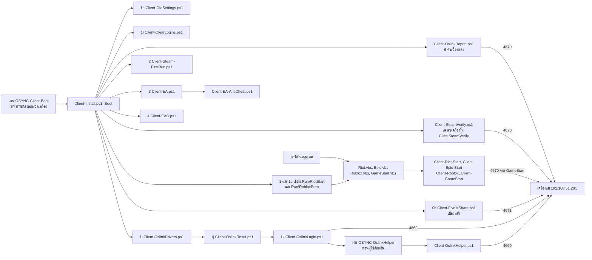

ลำดับขั้นที่เกี่ยวกับบทนี้ใน `Client-Install.ps1` (เรียงตามโค้ด)

| ขั้น | สคริปต์ | ตอนบูต (`-Boot`) | โหมดแก้ image (OSYNC.bat 5) |
|---|---|---|---|
| 0b | `Client-FiveMShare.ps1` (เบื้องหลัง) | รัน | ข้าม |
| 1 | เขียน `HKLM\...\Run\RiotStart` → `Riot.vbs background` | รัน | รัน |
| 1c | เขียน `HKLM\...\Run\RobloxPrep` → `Roblox.vbs background` | รัน | รัน |
| 1h | `Client-GtaSettings.ps1` | รัน | รัน |
| 1i | `Client-ClearLogins.ps1` | รัน (`-Boot`) | รัน (ปิดตัวเปิดเกมก่อน) |
| 1l | `Client-OslinkDrivers.ps1` | รัน | รัน |
| 1j | `Client-OslinkReset.ps1` | รัน | รัน |
| 1k | `Client-OslinkLogin.ps1` | รัน | รัน |
| (หลัง 1m) | `Client-OslinkReport.ps1` ×6 (เบื้องหลัง) | รัน | ข้าม |
| (ต่อกัน) | `Client-SteamVerify.ps1` (เบื้องหลัง) | รัน | ข้าม |
| 2 | `Client-Steam-FirstRun.ps1` | รัน (`-SkipFailed`) | รัน |
| 3 | `Client-EA.ps1` → `Client-EA-AntiCheat.ps1` | รัน | รัน |
| 4 | `Client-EAC.ps1` | รัน | รัน |
| 6 | `Client-NEWTHINGS.ps1` | ข้าม | รัน |

---

# ส่วนที่ 1: ล้างล็อกอิน

ลบ "ล็อกอินที่จำไว้" ของตัวเปิดเกมทุกค่าย ให้ลูกค้าคนต่อไปต้องล็อกอินบัญชีตัวเอง ตัวเกม ค่ากราฟิก และเซฟไม่หาย

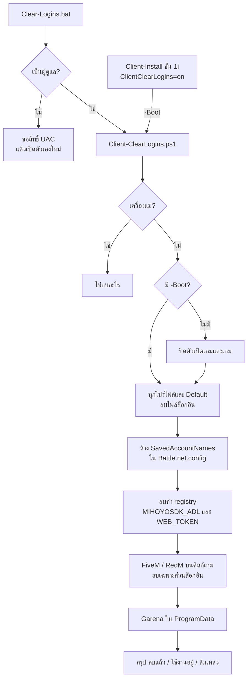

> ที่เกี่ยวข้อง: ขั้น **1r** ใน `Client-Install.ps1` (ไม่ใช่ไฟล์ในบทนี้) ล้าง `config\loginusers.vdf` ของ Steam บนดิสก์เกม (`X:\Steam` และ `Launchers\Steam`) ในสำเนาของเครื่องลูก ใช้ค่า `ClientClearLogins` ตัวเดียวกัน

## 1. `Clear-Logins.bat` — ปุ่มล้างล็อกอิน

**หน้าที่:** ปุ่มให้พนักงานกดบนเครื่องลูก เพื่อล้างล็อกอินทุกค่ายทันที ไม่ต้องรอรีบูต

**เรียกจาก / ทำงานเมื่อไหร่:** คนดับเบิลคลิก `H:\OSYNC\Clear-Logins.bat` เอง (ไม่มีอะไรเรียกไฟล์นี้อัตโนมัติ)

**พารามิเตอร์:**
- ไม่มีอาร์กิวเมนต์ = ลบจริง
- `check` = แสดงรายการที่จะลบเท่านั้น (ส่ง `-CheckOnly` ให้สคริปต์)

**อ่านค่า:** ไม่มี

**เขียน / เปลี่ยน:** ไม่มีเอง งานจริงอยู่ใน `Client-ClearLogins.ps1`

**Log:** แสดงบนหน้าจอ แล้วหยุดรอด้วย `pause`

**ขั้นตอนการทำงาน:**
1. ล้าง `PSModulePath` และเก็บ path ของตัวเองกับอาร์กิวเมนต์ไว้ใน `OSYNC_BAT` / `OSYNC_ARG`
2. ใช้ `fltmc` ตรวจสิทธิ์ผู้ดูแล ถ้าไม่ใช่: เปิดตัวเองใหม่ด้วย `Start-Process -Verb RunAs` (ส่งอาร์กิวเมนต์เดิมต่อ) แล้วจบหน้าต่างนี้
3. อาร์กิวเมนต์เป็น `check` → รัน `Client-ClearLogins.ps1 -CheckOnly` ไม่อย่างนั้นรันแบบลบจริง
4. `pause` ให้อ่านผล

**ฟังก์ชัน:** ไม่มี (ไฟล์ batch)

**ค่าในร้านนี้ตอนนี้:** ไม่มีค่าของตัวเอง

## 2. `Client-ClearLogins.ps1` — ลบล็อกอินทุกบัญชี

**หน้าที่:** ลบเฉพาะล็อกอิน / คุกกี้ล็อกอินที่จำไว้ของ FiveM, RedM, Rockstar, Steam, Epic, EA app, Riot, Ubisoft, Battle.net, Garena, HoYoPlay และ Discord ให้ทุกบัญชีผู้ใช้ในเครื่อง ไม่แตะตัวเกม ค่าเกม และเซฟ

**เรียกจาก / ทำงานเมื่อไหร่:**
- `Client-Install.ps1` ขั้น **1i** ทุกครั้งที่บูต (ใส่ `-Boot`) และตอนแก้ image (ไม่ใส่ `-Boot`) ข้ามเมื่อเป็นเครื่องแม่ หรือ `ClientClearLogins=off`
- `Clear-Logins.bat` (สั่งเอง)

**พารามิเตอร์:**
- `-CheckOnly` — แค่แสดงรายการที่จะลบ ไม่ลบ (รันบนเครื่องแม่ได้)
- `-Boot` — โหมดบูต: ไม่ปิดโปรแกรมใดเลย (Riot ที่เริ่มตอนล็อกอินอยู่ต่อได้) ไฟล์ที่ถูกใช้อยู่ = ข้ามและรายงาน
- `-TestDir <โฟลเดอร์>` — ทดสอบ: `<โฟลเดอร์>\profile` เป็นผู้ใช้คนเดียว, `<โฟลเดอร์>\FiveM.app` เป็น FiveM ตัวเดียว, registry ใช้ `HKCU\Software\OSYNC-ClearLogins-Test`

**อ่านค่า:**
- `Test-IsMaster`, `Test-Admin`, `Get-CfxApps` (Common.ps1)
- `HKLM\SOFTWARE\Microsoft\Windows NT\CurrentVersion\ProfileList` (โปรไฟล์ SID `S-1-5-21-*` และ `Default`)
- `HKU\<SID>\Software\Microsoft\Windows\CurrentVersion\Explorer\User Shell Folders` ค่า `Personal`, `Local AppData`, `AppData`
- `NTUSER.DAT` ของผู้ใช้ที่ไม่ได้ล็อกอิน (โหลดชั่วคราว)

**เขียน / เปลี่ยน (สิ่งที่ลบ):**

| ค่าย | ที่ลบ | ที่เก็บไว้ |
|---|---|---|
| Rockstar | `Documents\Rockstar Games\Social Club`, `Documents\Rockstar Games\Launcher`, `AppData\Local\Rockstar Games\Launcher`, `AppData\Local\Rockstar Games\Social Club`, `AppData\Local\DigitalEntitlements` | `Documents\Rockstar Games\GTA V` และ Red Dead Redemption 2 (ค่าและเซฟ) |
| Steam | `AppData\Local\Steam\local.vdf`, `AppData\Local\Steam\htmlcache` | |
| Epic | `EpicGamesLauncher\Saved\Config\Windows\GameUserSettings.ini`, `...\WindowsEditor\GameUserSettings.ini`, `EpicGamesLauncher\Saved\webcache*` (ใน Local) | |
| EA app | `Electronic Arts\EA Desktop\cookie.ini`, `user_*.ini`, `CEF` (ใน Local) | |
| Riot | `Riot Games\Riot Client\Data\*PrivateSettings.yaml` (ใน Local) | |
| Ubisoft | `Ubisoft Game Launcher\user.dat`, `ConnectSecureStorage.dat` (ใน Local) | |
| Battle.net | `AppData\Local\Battle.net\BrowserCaches`, ค่า `SavedAccountNames` ใน `AppData\Roaming\Battle.net\Battle.net.config` (ทำให้ว่าง), registry `Software\Blizzard Entertainment\Battle.net\Launch Options\*` ค่า `WEB_TOKEN*` | ค่าอื่นใน Battle.net.config |
| HoYoPlay | `AppData\Roaming\Cognosphere\HYP\*\fedata`, `AppData\Roaming\miHoYo\HYP\*\fedata`, registry `Software\Cognosphere\*` และ `Software\miHoYo\*` ค่า `MIHOYOSDK_ADL*` | |
| Discord | `AppData\Roaming\discord`, `discordptb`, `discordcanary` → `Local Storage`, `Session Storage`, `Network`, `WebStorage` | |
| FiveM / RedM ต่อผู้ใช้ | `AppData\Local\FiveM\FiveM.app\data\` → `nui-storage`, `game-storage\ros_profiles`, `game-storage\game_profiles`, `game-storage\signintransfer.dat`, `cache\browser` (RedM เหมือนกัน) | |
| FiveM / RedM บนดิสก์เกม | ใน `<ชื่อ>.app\`: `data\nui-storage`, `data\cache\browser`, `data\game-storage\ros_profiles`, `game_profiles`, `signintransfer.dat`, `ros_documents_*\Profiles`, `ros_launcher_documents_*\Profiles`, `ros_launcher_appdata_*\settings_user.dat`, `ros_documents_*\*.log`, `ros_launcher_documents_*\*.log` | ไฟล์ GTA ที่ FiveM โหลดไว้, `server-cache` / `server-cache-priv`, `ros_<n>\socialclub.dll`, `ros_launcher_data_*` |
| Garena (ทั้งเครื่อง) | `C:\ProgramData\Garena\gxx\cache\login`, `cache\cef`, `user` | `gxx.dat` (ค่าและโฟลเดอร์เกม) |

- ทำกับทุกโปรไฟล์ผู้ใช้และโปรไฟล์ `Default`
- ไฟล์บนดิสก์เกมที่ลบคือ**สำเนาของเครื่องลูกนี้**เท่านั้น
- โหลด hive ชั่วคราวชื่อ `HKU\OSYNC_CL_<n>` แล้ว unload
- `Battle.net.config` เขียนกลับเป็น UTF-8 ไม่มี BOM

**ไม่ปิดโปรแกรมเมื่อมี `-Boot`** ถ้าไม่มี `-Boot` จะปิดโปรเซสใน session ของผู้ใช้ (ไม่แตะ session 0 / บริการ) ที่ชื่อตรงกับ: `FiveM*`, `RedM*`, `GTA5`, `GTA5_Enhanced`, `PlayGTAV`, `RDR2`, `PlayRDR2`, `SocialClubHelper`, `LauncherPatcher`, `RockstarErrorHandler`, `steam`, `steamwebhelper`, `EpicGamesLauncher`, `EpicWebHelper`, `EADesktop`, `EACefSubProcess`, `RiotClientServices`, `RiotClientUx`, `RiotClientUxRender`, `Riot Client`, `LeagueClient`, `LeagueClientUx`, `LeagueClientUxRender`, `upc`, `UplayWebCore`, `UbisoftConnect`, `Battle.net`, `Garena`, `gxxcef`, `HYP`, `Discord`, `DiscordPTB`, `DiscordCanary` และ `Launcher` (path มี Rockstar), `Agent` (path มี Battle.net), `Update` (path มี `\discord`)

**Log:** แสดงบนหน้าจอ ตอนบูตไปอยู่ใน `C:\Users\Public\OSYNC-Boot-Setup.log` (transcript ของ Client-Install) บรรทัดสุดท้ายเป็นสรุป เช่น `Clear logins: N deleted, M in use (left)` exit 1 เมื่อมีรายการ FAILED

**ขั้นตอนการทำงาน:**
1. เป็นเครื่องแม่ (และไม่ได้ใส่ `-TestDir` / `-CheckOnly`) → พิมพ์ว่าไม่ลบ แล้ว exit 0
2. ไม่ใช่ผู้ดูแล → exit 1
3. ไม่มี `-Boot` และไม่มี `-TestDir` → ปิดโปรเซสตามรายการข้างบน รอ 2 วินาที (`-CheckOnly` = แค่บอกชื่อ)
4. ทุกโปรไฟล์: หาโฟลเดอร์ Documents / Local / Roaming (`Get-UserFolder`) → ลบเป้าหมายต่อผู้ใช้ (`Remove-Rel`) → ล้าง `SavedAccountNames` (`Clear-BnetConfig`)
5. registry ของผู้ใช้: ผู้ใช้ล็อกอินอยู่ = ใช้ hive ที่โหลดอยู่ ไม่อย่างนั้นโหลด `NTUSER.DAT` ชั่วคราว (`-CheckOnly` ไม่โหลด) → `Clear-UserRegistry`
6. FiveM / RedM บนดิสก์เกม (`Get-CfxApps`) → ลบเป้าหมายใน `.app`
7. Garena ใน ProgramData
8. พิมพ์สรุป exit 1 ถ้ามี FAILED

**ฟังก์ชัน:**

| ฟังก์ชัน | บรรทัด | หลักการทำงาน |
|---|---|---|
| [`Say`](../Scripts/Client-ClearLogins.ps1#L32) | 32 | พิมพ์ข้อความเยื้อง 2 ช่องพร้อมสี |
| [`Test-Under`](../Scripts/Client-ClearLogins.ps1#L75) | 75 | จริงเมื่อ path อยู่ใต้ base จริง (ยาวกว่า base และขึ้นต้นด้วย `base\`) กันลบนอกโฟลเดอร์ |
| [`Remove-One`](../Scripts/Client-ClearLogins.ps1#L80) | 80 | ลบไฟล์หรือโฟลเดอร์หนึ่งรายการ ลบไม่ได้ก็ปลด read-only แล้วลองใหม่ นับ found / deleted / inUse / failed |
| [`Remove-Rel`](../Scripts/Client-ClearLogins.ps1#L104) | 104 | ขยาย path ที่มี `*` หรือ `?` ได้ทุกชั้น แล้วลบทุกตัวที่เจอซึ่งอยู่ใต้ base |
| [`Get-Profiles`](../Scripts/Client-ClearLogins.ps1#L119) | 119 | รายชื่อโปรไฟล์จาก ProfileList (SID `S-1-5-21-*` ที่มีโฟลเดอร์จริง) และ `Default` |
| [`Get-UserFolder`](../Scripts/Client-ClearLogins.ps1#L134) | 134 | หาโฟลเดอร์ Documents / Local / Roaming ของโปรไฟล์จาก User Shell Folders ใช้ไม่ได้ก็ใช้ที่ปกติ |
| [`Clear-UserRegistry`](../Scripts/Client-ClearLogins.ps1#L148) | 148 | ลบค่า `MIHOYOSDK_ADL*` (HoYoverse) และ `WEB_TOKEN*` (Battle.net) ในทุกคีย์ย่อย |
| [`Clear-BnetConfig`](../Scripts/Client-ClearLogins.ps1#L171) | 171 | แทนค่า `SavedAccountNames` ใน Battle.net.config ด้วยข้อความว่าง |

### `Remove-One` / `Remove-Rel` — ลบอย่างปลอดภัย
- **รับ:** base (โฟลเดอร์โปรไฟล์หรือ `.app`) และ path สัมพัทธ์ที่มี wildcard ได้ทุกชั้น เช่น `HYP\*\fedata`
- **ทำ:** ขยายทีละชั้น แล้วลบเฉพาะตัวที่ `Test-Under` ยืนยันว่าอยู่ใต้ base
- **โฟลเดอร์:** ลบด้วย `[IO.Directory]::Delete(..., $true)` ลิงก์ข้างในถูกลบ ไม่ตามเข้าไป
- **ข้อผิดพลาด:** ข้อความที่มี "being used", "in use" หรือ "access" นับเป็น "ใช้งานอยู่" (ไม่ทำให้ exit 1) อย่างอื่นนับเป็น FAILED

### `Get-UserFolder` — ทำไมอ่านค่าแบบไม่ขยาย
ตอนบูตสคริปต์รันเป็น SYSTEM ถ้าขยาย `%USERPROFILE%` ตอนนี้จะได้โปรไฟล์ของ SYSTEM จึงอ่านด้วย `DoNotExpandEnvironmentNames` แล้วแทน `%USERPROFILE%` ด้วย path ของโปรไฟล์นั้นเอง ใช้เฉพาะ path ที่เป็นไดรฟ์จริงและไม่อยู่ใน `C:\Windows`

**ค่าในร้านนี้ตอนนี้:** `ClientClearLogins=on` (ล้างทุกครั้งที่บูตเครื่องลูก)

---

# ส่วนที่ 2: ตัวเปิดเกมแต่ละค่าย

ตัวเปิดเกมและเกมอยู่บนดิสก์เกม แต่เครื่องลูกไม่มี registry / บริการ / ตัวกันโกงที่ตัวติดตั้งเขียนไว้บนเครื่องแม่ สคริปต์กลุ่มนี้เติมของพวกนั้นให้

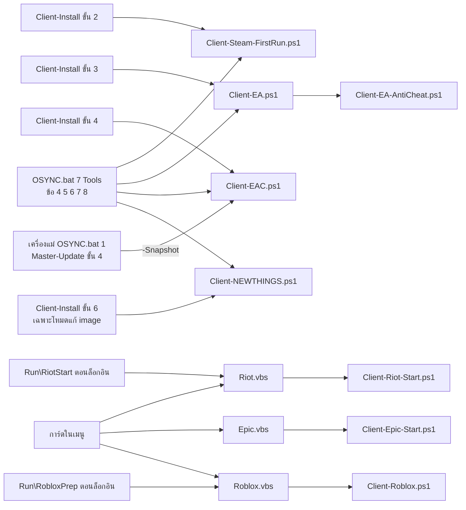

## 3. `Client-Steam-FirstRun.ps1` — ติดตั้งครั้งแรกของเกม Steam

**หน้าที่:** ทำบนเครื่องลูกแบบที่ Steam ทำตอนเปิดเกมครั้งแรกบนเครื่องใหม่: เขียน registry ที่เกมต้องการ และรันตัวติดตั้งใน install script ของเกม (BattlEye, ACE, Ricochet, EasyAntiCheat, Social Club, DirectX, VC++ ...) ใช้ได้กับทุกเกม Steam บนดิสก์เกม รวมเกมที่ลงทีหลัง

**เรียกจาก / ทำงานเมื่อไหร่:**
- `Client-Install.ps1` ขั้น **2** ทุกครั้งที่บูต (ใส่ `-SkipFailed`) และตอนแก้ image (ไม่ใส่)
- OSYNC.bat > 7 Tools > **4** (`steam-firstrun`)

**พารามิเตอร์:**
- `-DryRun` — แค่แสดงว่าจะเขียน registry อะไร และจะรันอะไร
- `-SkipFailed` — ข้ามรายการที่เคยล้มเหลว / หมดเวลามาก่อนด้วย (ตอนบูตไม่ให้ตัวติดตั้งช้าๆ ที่พังกินเวลาทุกบูต โหมดแก้ image จะลองใหม่)

**อ่านค่า:**
- `Get-SteamLibraries` (Common.ps1, อ่านจาก `libraryfolders.vdf` ของ Steam) → ทุกโฟลเดอร์ใน `steamapps\common`
- ไฟล์ `*installscript*.vdf` ในโฟลเดอร์เกม (ลึกไม่เกิน 4 ชั้น)
- ค่า `HasRunKey` ของแต่ละรายการใน registry
- มาร์กของ OSYNC: `HKLM\SOFTWARE\OSYNC\SteamFirstRun` (มุม 64-bit)

**เขียน / เปลี่ยน:**
- ค่า registry ในส่วน `Registry` ของ install script (เช่น `InstallFolderSteam` ของ GTA V) ใช้มุม 32-bit เป็นค่าเริ่ม
- รันตัวติดตั้งจากส่วน `Run Process` ผ่าน `Invoke-Installer` (Common.ps1) หมดเวลา 300 วินาทีต่อโปรแกรม
- ค่า `HasRunKey` = 1 เมื่อรายการนั้นรันครบและผ่าน
- มาร์ก `HKLM\SOFTWARE\OSYNC\SteamFirstRun` ชื่อค่า = `<เกม>|<รายการ>|<โปรแกรม คำสั่ง;...>` ค่า 1 = เสร็จ, 2 = ลองแล้วพัง

**สิ่งที่ข้าม:**
- โปรแกรมที่ชื่อมี `EAappInstaller`, `EAAntiCheat` หรือ `uninst` (ขั้นอื่นทำแล้ว / ตัวถอนการติดตั้ง)
- เกม `wallpaper_engine`
- บน Windows 10/11: ทุกอย่างใน `\_CommonRedist\DotNet\`
- ไฟล์ที่ไม่มีจริง
- รายการที่ `Requirement_OS` ไม่ตรง (มี `OSType` แต่ไม่มีเลข 10 / 11 หรือ `Is64BitWindows` ไม่ตรงกับเครื่อง)

**Log:** แสดงบนหน้าจอ / log ของ Client-Install บรรทัดสรุป `Steam first-run: N programs run in X min, ...` exit 1 เมื่อมีรายการที่มีปัญหา

**ขั้นตอนการทำงาน:**
1. ไม่ใช่ผู้ดูแล (และไม่ใช่ `-DryRun`) → throw
2. เปิด / สร้างคีย์มาร์ก
3. รวมโฟลเดอร์เกมจากทุก Steam library
4. **รอบ 1** ทุก install script: เขียนค่า `Registry` (กลุ่ม `string` / `dword` และกลุ่ม `english`) แทน `%INSTALLDIR%` ด้วยโฟลเดอร์เกม แล้วคัดรายการ `Run Process` ที่ยังต้องรันเข้าคิว
5. `-DryRun` → พิมพ์จำนวนแล้วจบ
6. **รอบ 2** รันทีละรายการ: ก่อนรันเช็ก `HasRunKey` อีกครั้ง (เกมที่ใช้ตัวติดตั้งร่วมกัน เช่น GTA V / GTA V Enhanced / RDR2 กับ Rockstar Launcher รันครั้งเดียว)
7. exit code ที่นับว่าผ่าน: 0, 1638, 3010, 1641, -2147023258 (0x80070666) หรือรายการที่มี `IgnoreExitCode=1`
8. ผ่านครบและไม่มีส่วนที่ถูกข้าม → เขียน `HasRunKey` แล้วเขียนมาร์ก 1 หรือ 2

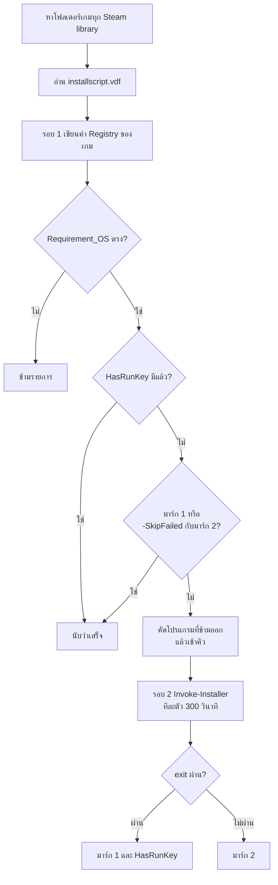

**ฟังก์ชัน:**

| ฟังก์ชัน | บรรทัด | หลักการทำงาน |
|---|---|---|
| [`Read-Vdf`](../Scripts/Client-Steam-FirstRun.ps1#L26) | 26 | ตัดข้อความ VDF เป็น token (ข้อความในเครื่องหมายคำพูด, `{`, `}`) แล้วเรียก `Read-Node` |
| [`Read-Node`](../Scripts/Client-Steam-FirstRun.ps1#L30) | 30 | อ่าน token เป็นรายการ K / V โดย V เป็นข้อความหรือรายการซ้อน |
| [`Unescape`](../Scripts/Client-Steam-FirstRun.ps1#L44) | 44 | แปลง `\\` เป็น `\` และ `\"` เป็น `"` แบบ VDF |
| [`Get-V`](../Scripts/Client-Steam-FirstRun.ps1#L45) | 45 | คืนค่า V ตัวแรกที่ชื่อ K ตรง |
| [`Open-Key`](../Scripts/Client-Steam-FirstRun.ps1#L48) | 48 | เปิดหรือสร้างคีย์จาก path แบบ Steam (HKLM / HKCU, `_WOW64_32` / `_WOW64_64`) ค่าเริ่มเป็นมุม 32-bit path แบบอื่น = throw |
| [`Expand`](../Scripts/Client-Steam-FirstRun.ps1#L56) | 56 | แทน `%INSTALLDIR%` ด้วยโฟลเดอร์เกม แล้วขยายตัวแปร environment |

### มาร์กใน `HKLM\SOFTWARE\OSYNC\SteamFirstRun` — ทำไมต้องมี
รายการที่ไม่มี `HasRunKey` (VC++, .NET, PhysX, EasyAntiCheat ...) Steam ไม่มีทางรู้ว่ารันไปแล้ว ถ้าไม่จดไว้จะรันซ้ำทุกบูตและบูตช้า จึงจดด้วยลายเซ็น "เกม + รายการ + คำสั่ง" ถ้าเกมอัปเดตแล้วคำสั่งเปลี่ยน ลายเซ็นใหม่จะทำให้รันอีกครั้ง

**ค่าในร้านนี้ตอนนี้:** ไม่มีค่าใน settings.txt ของตัวเอง Steam ของร้านอยู่ที่ `F:\steam`

## 4. `Client-EA.ps1` — ลงทะเบียน EA app

**หน้าที่:** ทำให้ EA app ที่อยู่บนดิสก์เกม (`Launchers\EA`) ใช้งานได้บนเครื่องลูก: registry, บริการ `EABackgroundService`, โปรโตคอล origin / origin2 / link2ea / ealink, ทางลัด และลง EA AntiCheat ต่อ

**เรียกจาก / ทำงานเมื่อไหร่:**
- `Client-Install.ps1` ขั้น **3** ทั้งตอนบูตและโหมดแก้ image (ข้ามถ้ายังไม่มี `System\Data\EA\ea-client.reg`)
- OSYNC.bat > 7 Tools > **5** (`ea-install`) และ > **6** (`ea-uninstall` = `-Uninstall`)

**พารามิเตอร์:**
- `-Autostart` — ให้ EA เปิดเงียบๆ ตอนล็อกอิน (ทุกผู้ใช้)
- `-Uninstall` — ถอดสิ่งที่สคริปต์นี้ใส่
- `-DryRun` — แค่แสดง

**อ่านค่า:**
- `System\Data\EA\ea-client.reg`, `ea-games.reg`, `InstallData\` (ทำโดย `Master-Snapshot-EA.ps1` บนเครื่องแม่)
- `Get-LauncherDir 'EA'` → `<EA>\EA Desktop\EABackgroundService.exe`, `EALauncher.exe`
- บริการ `EABackgroundService` เดิม, ค่า `EADM` ใน `HKLM\Software\Microsoft\Windows\CurrentVersion\Run`

**เขียน / เปลี่ยน:**
- `reg import` ทั้งสองไฟล์ (รันเป็นโปรเซสแล้วดู exit code)
- คัดลอก `InstallData` → `C:\ProgramData\EA Desktop\InstallData` (robocopy)
- บริการ `EABackgroundService` → `"<EA Desktop>\EABackgroundService.exe" -start` (สร้างใหม่ = Manual)
- ทางลัด `C:\ProgramData\Microsoft\Windows\Start Menu\Programs\EA\EA.lnk` (ไม่มีไอคอนบนเดสก์ท็อป)
- `Run\EADM` = `"<EALauncher.exe>" -silentOs` เมื่อใส่ `-Autostart` หรือมีค่านี้อยู่แล้ว (ชี้ใหม่ให้ตรงที่)
- เรียก `Client-EA-AntiCheat.ps1`
- เริ่มบริการ `EABackgroundService`

**Log:** แสดงบนหน้าจอ / log ของ Client-Install

**ขั้นตอนการทำงาน:**
1. ไม่ใช่ผู้ดูแล (และไม่ใช่ `-DryRun`) → throw
2. `-Uninstall`: ลบบริการ (เฉพาะเมื่อ path อยู่ใน `Launchers\EA`), ลบคีย์ `HKLM\SOFTWARE\(WOW6432Node\)Electronic Arts\EA Desktop` ที่ `ClientPath` ชี้มาที่นี่, ลบ `Run\EADM`, ลบทางลัด แล้วจบ
3. ขาดไฟล์ `EABackgroundService.exe`, `EALauncher.exe` หรือ `ea-client.reg` → throw (บอกให้ลง EA ใน `Launchers\EA` บนเครื่องแม่แล้ว OSYNC.bat > 1)
4. import `ea-client.reg` → import `ea-games.reg` → คัดลอก `InstallData`
5. แก้หรือสร้างบริการ → ทางลัด → autostart
6. `Client-EA-AntiCheat.ps1`
7. เริ่มบริการแล้วพิมพ์สถานะและ `ClientPath`

**ฟังก์ชัน:**

| ฟังก์ชัน | บรรทัด | หลักการทำงาน |
|---|---|---|
| [`Say`](../Scripts/Client-EA.ps1#L19) | 19 | `Write-Host` ข้อความ |

**ค่าในร้านนี้ตอนนี้:** ไม่มีค่าใน settings.txt `Client-Install` เรียกโดยไม่ใส่ `-Autostart`

## 5. `Client-EA-AntiCheat.ps1` — ลง EA AntiCheat

**หน้าที่:** ลง EA AntiCheat (Javelin) บนเครื่องลูก ให้ทุกเกม EA บนดิสก์เกม Apex / Battlefield เปิดผ่าน `EAAntiCheat.GameServiceLauncher.exe` ซึ่งต้องมีบริการ `EAAntiCheatService` (`C:\Program Files\EA\AC`) ในเครื่องเอง

**เรียกจาก / ทำงานเมื่อไหร่:**
- `Client-EA.ps1` ข้อ 5 (จึงรันทุกบูตผ่านขั้น 3)
- `OSYNC.bat ea-anticheat` (สั่งทางบรรทัดคำสั่ง ไม่มีเลขในเมนู Tools)

**พารามิเตอร์:**
- `-DryRun` — แสดงเกม / title / ตัวติดตั้งที่จะใช้ ไม่ลง

**อ่านค่า:**
- `Get-SteamLibraries` → ทุกโฟลเดอร์ใน `steamapps\common`
- ค่า `Install Dir` ทุกคีย์ใน `HKLM\SOFTWARE\WOW6432Node\*\*` และ `HKLM\SOFTWARE\*\*`
- `EAAntiCheat.cfg` ในโฟลเดอร์เกม (หา title จากรูปแบบ `default <exe> <title>`)
- ตัวติดตั้ง `__Installer\customcomponent\Javelin\EAAntiCheat.Installer.exe` และ `EAAntiCheat.Installer.exe`
- มาร์ก `HKLM\SOFTWARE\OSYNC\EAAntiCheat`, บริการ `EAAntiCheatService`

**เขียน / เปลี่ยน:**
- รัน `EAAntiCheat.Installer.exe --noui --install --title <title>` ผ่าน `Invoke-Installer` (เวลาค่าเริ่มของ Invoke-Installer)
- มาร์ก `HKLM\SOFTWARE\OSYNC\EAAntiCheat` ชื่อ `<title>|<FileVersion>` = 1 เมื่อ exit 0

**Log:** แสดงบนหน้าจอ / log ของ Client-Install exit 1 เมื่อมีตัวที่พัง หรือไม่มีบริการหลังลง

**ขั้นตอนการทำงาน:**
1. รวมโฟลเดอร์เกม (Steam + EA app)
2. โฟลเดอร์ที่มี `EAAntiCheat.cfg` → อ่าน title → เก็บตัวติดตั้ง**ทั้งสองที่**ที่มี
3. ต่อ title เลือกตัวติดตั้งรุ่นใหม่สุด แล้วเรียงจากเก่าไปใหม่ (บริการมีตัวเดียว ตัวที่ลงทีหลังสุดคือรุ่นใหม่สุด)
4. `-DryRun` → จบ
5. ต่อ title: บริการมีมาก่อน + มีมาร์ก + รุ่นบริการ ≥ รุ่นตัวติดตั้ง → ข้าม ไม่อย่างนั้นลง
6. พิมพ์สถานะบริการ

**ฟังก์ชัน:**

| ฟังก์ชัน | บรรทัด | หลักการทำงาน |
|---|---|---|
| [`Get-Ver`](../Scripts/Client-EA-AntiCheat.ps1#L45) | 45 | อ่าน FileVersion ของไฟล์เป็น `[version]` อ่านไม่ได้ = 0.0 |
| [`Get-SvcVer`](../Scripts/Client-EA-AntiCheat.ps1#L56) | 56 | รุ่นของ exe ที่บริการ `EAAntiCheatService` ชี้อยู่ ไม่มีบริการ = 0.0 |

**ค่าในร้านนี้ตอนนี้:** ไม่มีค่าใน settings.txt

## 6. `Client-EAC.ps1` — ลง EasyAntiCheat

**หน้าที่:** ลง EasyAntiCheat (EOS) บนเครื่องลูก ให้ทุกเกมบนดิสก์เกมที่ใช้ (Dead by Daylight, Rust, Chivalry 2, VRChat, Fortnite ...) Steam / Epic ลงให้เฉพาะเครื่องที่ลงเกม

**เรียกจาก / ทำงานเมื่อไหร่:**
- `Client-Install.ps1` ขั้น **4** ทั้งตอนบูตและโหมดแก้ image
- OSYNC.bat > 7 Tools > **7** (`eac`)
- เครื่องแม่: `Master-Update.ps1` ขั้น 4 (OSYNC.bat > 1) รัน `-Snapshot`

**พารามิเตอร์:**
- `-DryRun` — แสดงรายชื่อเกมเท่านั้น
- `-Snapshot` — **เครื่องแม่**: บันทึก product id ของ EAC ที่ลงในเครื่องแม่ (เช่น Fortnite ที่ไม่มี `Settings.json`) ลง `System\Data\EAC\eac-products.txt`

**อ่านค่า:**
- `HKLM\SOFTWARE\WOW6432Node\EasyAntiCheat_EOS` ค่า `ProductsInstalled`
- โฟลเดอร์เกม = โฟลเดอร์ย่อยของ: `steamapps\common` ทุก Steam library, `GAME\<ประเภท>` (`$GamesRoot` ยกเว้น `Steam`), `X:\Online`, `X:\Mobile`, `X:\PvP`, `X:\EPIC`, `X:\Games\<ประเภท>` ของทุกไดรฟ์แชร์ และ `InstallLocation` ใน `System\Data\Epic\Manifests\*.item`
- `EasyAntiCheat\Settings.json` (ค่า `productid`) และ `EasyAntiCheat_EOS_Setup.exe` (ลึกไม่เกิน 6 ชั้น)
- `System\Data\EAC\eac-products.txt`

**เขียน / เปลี่ยน:**
- `-Snapshot`: เขียน `System\Data\EAC\eac-products.txt`
- ปกติ: รัน `EasyAntiCheat_EOS_Setup.exe install <productid>` ผ่าน `Invoke-Installer`

**Log:** แสดงบนหน้าจอ / log ของ Client-Install exit 1 เมื่อไม่มีตัวติดตั้ง มีตัวที่พัง หรือไม่มีบริการ `EasyAntiCheat_EOS`

**ขั้นตอนการทำงาน:**
1. `-Snapshot` → อ่าน `ProductsInstalled` (เฉพาะ id ฐาน 16 ยาว 32 ตัว) เขียนไฟล์ แล้วจบ
2. ไม่ใช่ผู้ดูแล → throw
3. รวมโฟลเดอร์เกม หา `Settings.json` ใต้โฟลเดอร์ชื่อ `EasyAntiCheat`
4. เติม id จาก `eac-products.txt` ที่ยังไม่มี (เกม = `(master)`)
5. เกมที่ไม่มีตัวติดตั้งของตัวเองใช้ตัวที่ไฟล์ใหม่สุด ถ้าไม่มีเลยค้นหา `EasyAntiCheat_EOS_Setup.exe` ทุกที่
6. `-DryRun` → จบ
7. ข้าม id ที่อยู่ใน `ProductsInstalled` แล้ว (เมื่อบริการมีมาก่อน) ที่เหลือลงทีละตัว

**ฟังก์ชัน:** ไม่มีฟังก์ชันในไฟล์

**ค่าในร้านนี้ตอนนี้:** ไม่มีค่าใน settings.txt

## 7. `Client-Epic-Start.ps1` — เปิดเกม Epic

**หน้าที่:** ให้เครื่องลูกรู้ว่ามีเกม Epic อะไรลงไว้บนดิสก์เกม (คัดลอกรายการจากเครื่องแม่) แล้วสั่ง Epic launcher เปิดเกม ผู้เล่นล็อกอินบัญชี Epic ของตัวเองครั้งแรก ใช้บนเครื่องแม่ได้ด้วย

**เรียกจาก / ทำงานเมื่อไหร่:** การ์ดเกม Epic ในเมนู → `wscript.exe "System\Client\Epic.vbs" <AppName>` → สคริปต์นี้ (`Master-GameList.ps1` ทำการ์ด `epic-<appname>`)

**พารามิเตอร์:**
- `-App <AppName>` (บังคับ) — AppName จาก manifest เช่น `Fortnite`

**อ่านค่า:**
- `System\Data\Epic\Manifests\*.item` และ `System\Data\Epic\LauncherInstalled.dat` (ทำโดย `Master-Snapshot-Epic.ps1`)
- `Get-LauncherExe 'Epic'`

**เขียน / เปลี่ยน:**
- robocopy `*.item` → `C:\ProgramData\Epic\EpicGamesLauncher\Data\Manifests` แบบ `/XO` (ไม่ทับไฟล์ที่ใหม่กว่า)
- robocopy `LauncherInstalled.dat` → `C:\ProgramData\Epic\UnrealEngineLauncher` แบบ `/XO`
- เปิด Epic launcher ด้วย `com.epicgames.launcher://apps/<CatalogNamespace>%3A<CatalogItemId>%3A<AppName>?action=launch&silent=true` (ไม่เจอ manifest = ใช้ชื่อ App ตรงๆ)

**Log:** `%TEMP%\EpicStart.log`

**ขั้นตอนการทำงาน:**
1. คัดลอก manifest และ `LauncherInstalled.dat`
2. ไม่มี Epic launcher → log ERROR exit 1
3. หา manifest ที่ AppName ตรง → สร้าง id → เปิด launcher

**ฟังก์ชัน:**

| ฟังก์ชัน | บรรทัด | หลักการทำงาน |
|---|---|---|
| [`Log`](../Scripts/Client-Epic-Start.ps1#L11) | 11 | ต่อท้าย `%TEMP%\EpicStart.log` พร้อมเวลา |

**ค่าในร้านนี้ตอนนี้:** การ์ดที่ใช้อยู่คือ `epic-fortnite` → `Epic.vbs Fortnite`

## 8. `Client-Riot-Start.ps1` — เตรียมและเปิด Riot

**หน้าที่:** ทำให้ Riot Client บนเครื่องลูกเห็นเกมบนดิสก์เกมว่าลงแล้ว (ไม่ขึ้น Install / Repair) แล้วเปิด ต้องรันทุกครั้งเพราะ C: ของเครื่องลูกถูกรีเซ็ตตอนรีบูต

**เรียกจาก / ทำงานเมื่อไหร่:**
- ตอนผู้ใช้ล็อกอิน: `HKLM\...\Run\RiotStart` = `wscript.exe "System\Client\Riot.vbs" background` (เขียนโดย `Client-Install.ps1` ขั้น **1** ทุกบูต ถ้ามี Riot Client ใน Launchers, หรือ OSYNC.bat > 7 Tools > 9 / ปิดด้วย 10)
- การ์ดเมนู `riot-valorant`, `riot-league_of_legends`, `riot-teamfighttactics` → `Riot.vbs <product>`

**พารามิเตอร์:**
- `-Product` — `valorant`, `league_of_legends`, `teamfighttactics`, `riotclient` (ค่าเริ่ม) หรือ `background` (เตรียมแล้วเปิด Riot Client ย่อไว้ในถาด)
- `-NoLaunch` — เตรียมอย่างเดียว ไม่เปิด
- `-SkipRegistry` — ไม่แตะ HKCU (ทดสอบ)
- `-ProgramDataRoot` — เปลี่ยนที่ ProgramData (ทดสอบ) ค่าเริ่ม `$env:ProgramData`

**อ่านค่า:**
- `System\Data\Riot\Metadata\` (ทำโดย `Master-Snapshot-Riot.ps1`)
- `Get-LauncherDir 'Riot'` → `RiotClientServices.exe`
- บริการ `vgc` (Vanguard)

**เขียน / เปลี่ยน:**
- แก้ลิงก์เสียที่ `C:\ProgramData\Riot Games`, `...\Metadata`, `%LOCALAPPDATA%\Riot Games`, `...\Riot Client`, `...\RiotClient` (แทนด้วยโฟลเดอร์จริง)
- robocopy Metadata → `C:\ProgramData\Riot Games\Metadata` แบบ `/E /XO /XF *.lockfile`
- `C:\ProgramData\Riot Games\RiotClientInstalls.json` (`patchlines.KeystoneFoundationLiveWin`, `rc_default`, `rc_live` ชี้ที่ `RiotClientServices.exe`) UTF-8 ไม่มี BOM
- โปรโตคอล `riotclient://` ใน `HKCU\Software\Classes\riotclient`

**Log:** `%TEMP%\RiotStart.log` (และพิมพ์ออก)

**ขั้นตอนการทำงาน:**
1. ไม่มี `RiotClientServices.exe` → log, กล่องข้อความ 15 วินาที, exit 1
2. `Repair-Link` ทั้ง 5 ที่
3. คัดลอก Metadata (exit ≥ 8 = ERROR)
4. เขียน `RiotClientInstalls.json`
5. ตั้ง `riotclient://` (ถ้าไม่ใส่ `-SkipRegistry`)
6. เกม (ไม่ใช่ `riotclient` / `background`) และไม่มีบริการ `vgc` → เตือนด้วยกล่องข้อความ 10 วินาที ให้ลง Vanguard ใน image
7. เปิด: `riotclient` = เปิดเฉยๆ, `background` = ถ้า Riot เปิดอยู่แล้วจบ ไม่อย่างนั้น `--launch-background-mode`, เกม = `--launch-product=
 --launch-patchline=live`

**ฟังก์ชัน:**

| ฟังก์ชัน | บรรทัด | หลักการทำงาน |
|---|---|---|
| [`Log`](../Scripts/Client-Riot-Start.ps1#L19) | 19 | ต่อท้าย `%TEMP%\RiotStart.log` และพิมพ์ |
| [`Repair-Link`](../Scripts/Client-Riot-Start.ps1#L30) | 30 | path เป็นลิงก์ (reparse point) ที่ปลายทางหายไป → ลบลิงก์แล้วสร้างโฟลเดอร์จริง |

**ค่าในร้านนี้ตอนนี้:** VALORANT อยู่ที่ `H:\RIOT\Riot Games` การ์ด `riot-valorant` อยู่ในการ์ดแนะนำ (`Menu\config.json` → `ui.featured`)

## 9. `Client-Roblox.ps1` — Roblox จากดิสก์เกม

**หน้าที่:** ให้ลิงก์ `roblox://` และ `roblox-player://` ของผู้ใช้ชี้ที่ Roblox รุ่นใหม่สุดใน `Launchers\Roblox\Versions` ปุ่ม Play บนเว็บและการ์ดเมนูจึงเปิด Roblox จากดิสก์เกมได้ ไม่ต้องลง

**เรียกจาก / ทำงานเมื่อไหร่:**
- ตอนผู้ใช้ล็อกอิน: `HKLM\...\Run\RobloxPrep` = `wscript.exe "System\Client\Roblox.vbs" background` (เขียนโดย `Client-Install.ps1` ขั้น **1c**)
- การ์ด `launcher-roblox` → `Roblox.vbs launch`

**พารามิเตอร์:**
- `-Mode background` — ตั้งลิงก์อย่างเดียว
- `-Mode launch` (ค่าเริ่ม) — ตั้งลิงก์แล้วเปิด Roblox
- `-DryRun` — แสดงสิ่งที่จะเขียน ไม่เปลี่ยน

**อ่านค่า:** `Get-RobloxExe` (Common.ps1), `Test-IsMaster`, ค่าปัจจุบันใน HKCU

**เขียน / เปลี่ยน (เฉพาะเครื่องลูก เขียนเฉพาะค่าที่ต่าง):**
- `HKCU\Software\Classes\roblox` และ `roblox-player`: `(default)` = `URL: Roblox Protocol`, `URL Protocol`, `DefaultIcon`, `shell\open\command` = `"<exe>" %1` และ `version`
- `HKCU\Software\ROBLOX Corporation\Environments\roblox-player`: `(default)` = `RobloxPlayerInstaller.exe`, `baseHost` = `www.roblox.com`, `version`, `clientExe`
- บนเครื่องแม่ไม่แตะ (ตัวอัปเดตของ Roblox เขียนเองผ่าน junction)

**Log:** `C:\Users\Public\OSYNC-Roblox.log`

**ขั้นตอนการทำงาน:**
1. ไม่เจอ Roblox → log exit 1
2. เครื่องแม่ → log ว่าไม่แตะ / เครื่องลูก → เทียบและเขียนค่าที่ต่าง
3. `launch` → เปิด exe

**ฟังก์ชัน:**

| ฟังก์ชัน | บรรทัด | หลักการทำงาน |
|---|---|---|
| [`Log`](../Scripts/Client-Roblox.ps1#L15) | 15 | บรรทัดพร้อมเวลา ชื่อเครื่อง ผู้ใช้ ต่อท้าย log (`-DryRun` = พิมพ์) |

**ค่าในร้านนี้ตอนนี้:** การ์ด `launcher-roblox` และมีไอคอนบนเดสก์ท็อปด้วย (`ClientDesktopIcons` มี `launcher-roblox`)

## 10. `Client-NEWTHINGS.ps1` — ตัวเปิด GTA SA

**หน้าที่:** ตั้งค่าตัวเปิด NEWTHINGS-GAMES (GTA San Andreas / SA-MP) บนเครื่องลูก: registry ที่ตัวติดตั้งเขียน, path `gta_sa.exe` ของ SA-MP, ทางลัด และ (เลือกได้) แก้ภาษาไทยในเกมที่เป็นตัวต่างดาว

**เรียกจาก / ทำงานเมื่อไหร่:**
- `Client-Install.ps1` ขั้น **6** เฉพาะโหมดแก้ image (OSYNC.bat 5 / `OSYNC.bat client`) ใส่ `-FixThaiText` เมื่อตอบตกลง หรือ `ClientThaiFix=on`
- OSYNC.bat > 7 Tools > **8** (`newthings`, ถามก่อนว่าจะแก้ภาษาไทยไหม)

**พารามิเตอร์:**
- `-Path <โฟลเดอร์>` — โฟลเดอร์ตัวเปิด ถ้าหาเองไม่เจอ
- `-FixThaiText` — ตั้ง system locale เป็นไทย และปิด UTF-8 beta (ต้องรีสตาร์ต)

**อ่านค่า:**
- หา `NEWTHINGS-GAMES.exe` ก่อนที่ `<OSYNC>\GAME\*\NEWTHINGS-GAMES\` แล้วค่อย `X:\*\NEWTHINGS-GAMES\` และ `X:\*\*\NEWTHINGS-GAMES\` (ไดรฟ์ D–Z)
- `HKLM\SYSTEM\CurrentControlSet\Control\Nls\CodePage` ค่า `ACP`, `Get-WinSystemLocale`

**เขียน / เปลี่ยน:**
- `HKCU\Software\newthings\NEWTHINGS-GAMES` `(default)` = โฟลเดอร์
- `HKCU\Software\Microsoft\Windows\CurrentVersion\Uninstall\NEWTHINGS-GAMES` (`DisplayName`, `Publisher`, `DisplayVersion`, `DisplayIcon`, `InstallLocation`, `UninstallString`)
- `HKCU\Software\SAMP` `gta_sa_exe` = `<โฟลเดอร์>\bin\newthings\gta_sa.exe` (ถ้ามีไฟล์)
- ทางลัด `C:\ProgramData\Microsoft\Windows\Start Menu\Programs\NEWTHINGS-GAMES.lnk`
- `-FixThaiText`: `Set-WinSystemLocale th-TH`, `ACP=874`, `OEMCP=874`, `MACCP=10021`

**Log:** แสดงบนหน้าจอ / log ของ Client-Install

**ขั้นตอนการทำงาน:**
1. ไม่ใช่ผู้ดูแล → throw
2. หาโฟลเดอร์ ไม่เจอ → "skipped" exit 0
3. ชื่อโฟลเดอร์มีตัวอักษรไม่ใช่ภาษาอังกฤษ → เตือนให้ย้าย
4. เขียน registry → ทางลัด
5. พิมพ์ locale / code page; `-FixThaiText` และยังไม่ใช่ `th-TH` + 874 → แก้; ไม่ได้ใส่แต่ ACP = 65001 → แนะนำให้รันใหม่พร้อม `-FixThaiText`

**ฟังก์ชัน:** ไม่มีฟังก์ชันในไฟล์

**ค่าในร้านนี้ตอนนี้:** `ClientThaiFix=on` (Client-Install แก้ภาษาไทยให้เลยโดยไม่ถาม เมื่อ ACP ไม่ใช่ 874)

---

# ส่วนที่ 3: Apex และการตรวจไฟล์

Apex ปิดเองที่ "Starting EA Javelin Anticheat..." บนเครื่องลูก แต่เปิดได้บนเครื่องแม่จาก `E:\SteamLibrary` เดียวกัน (คอมเมนต์ 20 พ.ย. 2026) จึงทำตามหลักของเอกสาร iPlay (เป็นเอกสารของร้านอื่น เอามาแค่หลักการ ดู [IPLAY-WAY.md](IPLAY-WAY.md)):

| หลัก iPlay | สคริปต์ |
|---|---|
| 1 ไฟล์เกมตรงกับของค่ายทุกไบต์ | `Client-SteamVerify.ps1` |
| 2 ให้ launcher ของค่ายเปิดเกม | `Client-GameStart.ps1` เรียกคำสั่งเดิมของการ์ด (`direct`) |
| 4 เช็กเครื่องก่อนเปิด ไม่ผ่านก็บอก ไม่ข้ามการตรวจ | `Client-GameStart.ps1` |
| 6 ปิดตัวที่ค้างก่อนเปิดใหม่ | `Client-GameStart.ps1` |

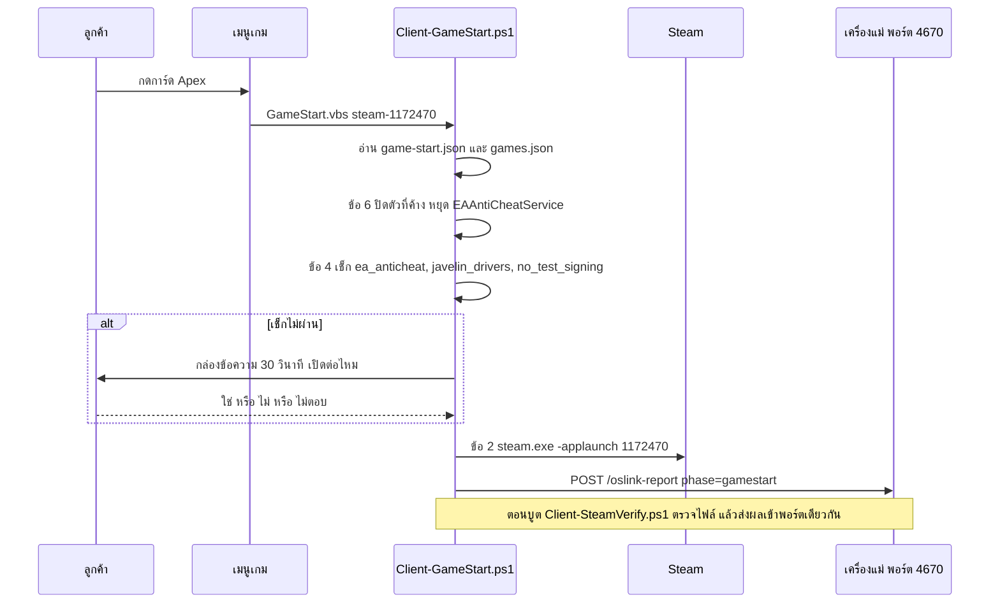

## 11. `Client-SteamVerify.ps1` — ตรวจไฟล์เกมเทียบ Steam

**หน้าที่:** ตรวจทุกไฟล์ของเกม Steam ตามที่**เครื่องนี้**อ่านจากดิสก์เกม เทียบกับ depot manifest ของ Steam (ขนาด + SHA1 ต่อไฟล์ ชุดเดียวกับที่ "Verify integrity" ของ Steam ใช้) ไม่เปลี่ยนอะไรเลย

**เรียกจาก / ทำงานเมื่อไหร่:** `Client-Install.ps1` ตอนบูต (ไม่ใช่เครื่องแม่) เมื่อ `ClientSteamVerify` = `on` หรือมีชื่อเครื่องนี้
- เปิดโปรเซส PowerShell ซ่อนหน้าต่าง 1 ตัว รันทีละเกมใน `ClientSteamVerifyApps` (ค่าเริ่ม `1172470`)
- เกมแรกใส่ `-DelaySeconds 240` (4 นาที) เกมถัดไป 0 ทุกตัวใส่ `-Report`

**พารามิเตอร์:**
- `-AppId <id>` (บังคับ) — AppID ของ Steam
- `-Report` — ส่งผลไปเครื่องแม่
- `-Quick` — ตรวจขนาดทุกไฟล์ + SHA1 เฉพาะไฟล์ชั้นบนสุดของโฟลเดอร์เกม
- `-DelaySeconds <n>` — รอก่อนเริ่ม (ค่าเริ่ม 0)
- `-MaxList <n>` — จำนวนบรรทัดไฟล์ที่ไม่ตรงที่จะแสดงสูงสุด (ค่าเริ่ม 300)

**อ่านค่า:**
- `Get-SteamLibraries` → `steamapps\appmanifest_<AppId>.acf` (`name`, `installdir`, `buildid`, `InstalledDepots`)
- manifest ของ depot `<depot>_<manifest>.manifest` ใน `depotcache` ของ: `Get-SteamDir`, `HKLM\SOFTWARE\WOW6432Node\Valve\Steam` `InstallPath`, `X:\Steam` ของทุกไดรฟ์แชร์ (`Get-SharedDrives`) และ `<library>\steamapps\depotcache`
- `Get-Setting 'MasterIP'`, `Get-Setting 'ClientReportPort' '4670'`

**เขียน / เปลี่ยน:** ไม่เปลี่ยนไฟล์ ลดลำดับความสำคัญของโปรเซสเป็น BelowNormal ส่งผลด้วย `POST http://<MasterIP>:<ClientReportPort>/oslink-report` (รอ 20 วินาที)

**Log:** พิมพ์ออก (ตอนบูตไม่มีไฟล์ log บนเครื่องลูก) ผลไปอยู่ที่เครื่องแม่ใน `C:\ProgramData\OSYNC\ClientReports` บรรทัดแรกเป็นรูปแบบเดียวกับรายงาน OSLink: `OSLink report <PC> phase=steamverify-<AppId> now=... boot=... user=...`

**ขั้นตอนการทำงาน:**
1. รอ `DelaySeconds` แล้วลดลำดับความสำคัญ
2. หา appmanifest → อ่านชื่อ โฟลเดอร์ buildid และรายการ depot / manifest
3. หาไฟล์ manifest ของแต่ละ depot ไม่เจอ = เตือนและไม่ตรวจไฟล์ของ depot นั้น
4. อ่านรายการไฟล์ (ไม่นับรายการที่ Flags มีบิต 64 ในโค้ดไม่ได้เขียนว่าบิตนี้คืออะไร)
5. รวมตามชื่อไฟล์ (ไฟล์หนึ่งอาจอยู่ในหลาย depot ผ่านถ้าตรงกับ depot ใด depot หนึ่ง)
6. แต่ละไฟล์: ไม่มี = MISSING, ขนาดไม่ตรง = SIZE, อ่านไม่ได้ = READ, SHA1 ไม่ตรง = SHA1 (บอกเวลาแก้ไขไฟล์) ทุก 500 ไฟล์พิมพ์ความคืบหน้า `~ n/total`
7. นับไฟล์ในโฟลเดอร์เกมที่ Steam ไม่รู้จัก (แสดง 40 ตัวแรก)
8. บรรทัดผล: `RESULT: FILES OK` หรือ `RESULT: FILES DIFFER (n)` หรือ `RESULT: ERROR ...`
9. `-Report` → ส่งเครื่องแม่ (ไม่มี MasterIP = ไม่ส่ง)

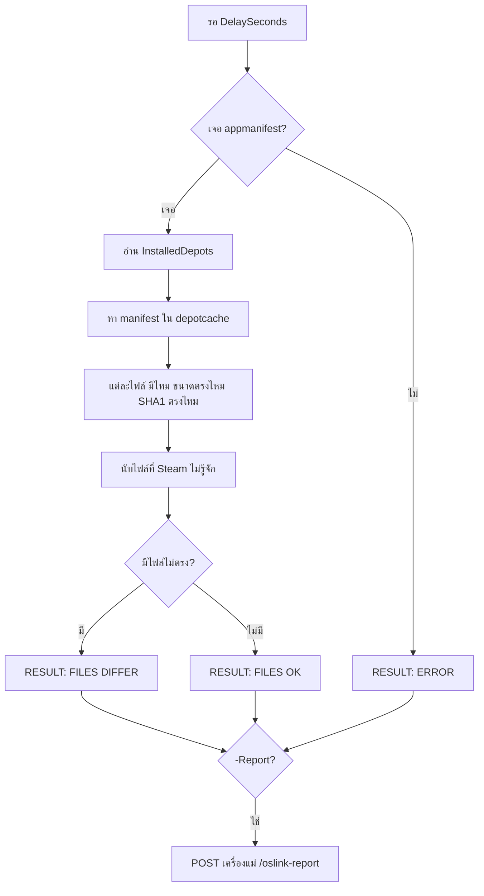

**ฟังก์ชัน:**

| ฟังก์ชัน | บรรทัด | หลักการทำงาน |
|---|---|---|
| [`V`](../Scripts/Client-SteamVerify.ps1#L20) (C#) | 20 | อ่านเลข varint ของ protobuf |
| [`Skip`](../Scripts/Client-SteamVerify.ps1#L21) (C#) | 21 | ข้ามฟิลด์ตาม wire type 0, 1, 2, 5 ชนิดอื่น = error |
| [`Hex`](../Scripts/Client-SteamVerify.ps1#L25) (C#) | 25 | ไบต์เป็นเลขฐาน 16 ตัวพิมพ์เล็ก |
| [`ParseManifest`](../Scripts/Client-SteamVerify.ps1#L27) (C#) | 27 | อ่าน depot manifest: ตรวจ magic `0x71F617D0` แล้วดึงรายการไฟล์ (ชื่อ ขนาด flags SHA1) |
| [`Sha1`](../Scripts/Client-SteamVerify.ps1#L47) (C#) | 47 | SHA1 ของไฟล์ เปิดแบบแชร์ ReadWrite / Delete บัฟเฟอร์ 1 MB |
| [`Say`](../Scripts/Client-SteamVerify.ps1#L55) | 55 | เก็บบรรทัดไว้ส่งเครื่องแม่ และพิมพ์ออก |

### `ParseManifest` — อ่านไฟล์ manifest ของ Steam เอง
- **รับ:** path ของ `<depot>_<gid>.manifest`
- **คืน:** รายการ `OsyncSvEntry` (Name, Size, Flags, Sha)
- **ทำ:** 4 ไบต์แรกต้องเป็น `0x71F617D0` 4 ไบต์ต่อมาคือความยาว payload แล้วอ่าน protobuf: ฟิลด์ 1 คือ file mapping ข้างในฟิลด์ 1 = ชื่อ (แปลง `/` เป็น `\`), 2 = ขนาด, 3 = flags, 5 = SHA1
- **ทำไม:** เป็น C# (`Add-Type`) เพื่อให้อ่านเกมใหญ่ได้เร็ว และไม่ต้องพึ่งโปรแกรมภายนอก

**ค่าในร้านนี้ตอนนี้:**
- `ClientSteamVerify=KORI23` (ตรวจเฉพาะ KORI23)
- `ClientSteamVerifyApps=1172470` (Apex)
- `ClientReportPort` ไม่มีใน settings.txt → ใช้ 4670
- คอมเมนต์ใน settings.txt: อ่านทั้งเกมทุกบูต Apex 68 GB ราว 10 นาที ผลบนเครื่องแม่ (IPLAY-WAY.md, 20 พ.ย. 00:13): 10,642 ไฟล์ 67.7 GB ผ่านทุกไฟล์ ใน 5:10 นาที

## 12. `game-start.json` — รายชื่อเกมที่เปิดแบบ iPlay

**หน้าที่:** บอกว่าการ์ดเกมไหนในเมนูต้องเปิดผ่าน `GameStart.vbs` และแต่ละเกมต้องปิดอะไร หยุดบริการอะไร เช็กอะไร

**เรียกจาก / ทำงานเมื่อไหร่:**
- `Master-GameList.ps1` (เครื่องแม่ ตอนสร้างรายชื่อเกม): การ์ดที่ id อยู่ในไฟล์นี้ ถูกเปลี่ยนคำสั่งเป็น `wscript.exe "<ClientDir>\GameStart.vbs" <id>` และเก็บคำสั่งเดิมไว้ในช่อง `direct` ของ `Menu\data\games.json`
- `Client-GameStart.ps1` อ่านตอนลูกค้ากดการ์ด

**พารามิเตอร์ / ช่องในไฟล์:** `games.<id การ์ด>`:
- `name` — ชื่อที่ใช้ในข้อความ
- `steamApp` — AppID (ใช้หาโฟลเดอร์เกม และทำคำสั่งเปิดสำรอง)
- `kill` — ชื่อโปรแกรมที่ปิดถ้าค้าง
- `stopServices` — บริการที่หยุดถ้ายังรันอยู่ตอนไม่มีเกมเปิด
- `checks` — รายการเช็ก: `ea_anticheat`, `javelin_drivers`, `no_test_signing`

**อ่านค่า / เขียน / Log:** เป็นไฟล์ค่า ไม่ได้รันเอง

**ขั้นตอนการทำงาน:** ลบเกมออกจากไฟล์ = การ์ดกลับไปเปิดตรงแบบเดิม มีผลหลังเครื่องแม่สร้างรายชื่อเกมใหม่ และเครื่องลูกรีบูต (จาก `_help` ในไฟล์)

**ฟังก์ชัน:** ไม่มี (ไฟล์ JSON)

**ค่าในร้านนี้ตอนนี้:** มีเกมเดียว

| ช่อง | ค่า |
|---|---|
| id | `steam-1172470` |
| `name` | Apex Legends |
| `steamApp` | `1172470` |
| `kill` | `r5apex.exe`, `r5apex_dx12.exe`, `EAAntiCheat.GameServiceLauncher.exe` |
| `stopServices` | `EAAntiCheatService` |
| `checks` | `ea_anticheat`, `javelin_drivers`, `no_test_signing` |

การ์ดใน `Menu\data\games.json`: `cmd` = `wscript.exe "H:\OSYNC\System\Client\GameStart.vbs" steam-1172470`, `direct` = `"f:\steam\steam.exe" -applaunch 1172470`, `cwd` = `E:\SteamLibrary\steamapps\common\Apex Legends`

## 13. `GameStart.vbs` — ตัวเรียกจากการ์ดเมนู

**หน้าที่:** ตัวเรียกเล็กๆ ไม่มีหน้าต่าง ที่การ์ดเมนูชี้ไป ห้ามย้ายหรือเปลี่ยนชื่อ เพราะการ์ดชี้ที่ไฟล์นี้

**เรียกจาก / ทำงานเมื่อไหร่:** การ์ดเกมที่อยู่ใน `game-start.json` → `wscript.exe "H:\OSYNC\System\Client\GameStart.vbs" <id การ์ด>`

**พารามิเตอร์:** อาร์กิวเมนต์แรก = id การ์ด เช่น `steam-1172470` ไม่มี = จบด้วย exit 1

**อ่านค่า:** ไม่มี

**เขียน / เปลี่ยน:** รัน `powershell.exe -NoProfile -ExecutionPolicy Bypass -WindowStyle Hidden -File "<System>\Scripts\Client-GameStart.ps1" -Id "<id>"` ซ่อนหน้าต่าง ไม่รอ

**Log:** ไม่มี

**ขั้นตอนการทำงาน:** หาโฟลเดอร์ `System\Scripts` จากที่อยู่ของไฟล์ → อ่าน id → รัน PowerShell

**ฟังก์ชัน:** ไม่มี (VBScript)

**ค่าในร้านนี้ตอนนี้:** ใช้กับการ์ด `steam-1172470`

## 14. `Client-GameStart.ps1` — เช็กเครื่องแล้วเปิดเกม

**หน้าที่:** เปิดเกมแบบ iPlay (ข้อ 2, 4, 6): ปิดตัวเกม / ตัวกันโกงที่ค้างจากรอบก่อน, เช็กว่าเครื่องพร้อมตามที่ตัวกันโกงต้องการ (ไม่ข้ามหรือปิดอะไร ไม่พร้อม = บอกลูกค้าว่าทำไม แล้วยังเลือกเปิดได้), แล้วให้ launcher ของค่ายเปิดเกมด้วยคำสั่งเดิม ไม่แตะไฟล์เกม

**เรียกจาก / ทำงานเมื่อไหร่:** `GameStart.vbs <id>` ตอนลูกค้ากดการ์ด

**พารามิเตอร์:**
- `-Id <id การ์ด>` (บังคับ)
- `-Check` — เช็กอย่างเดียว พิมพ์ผล ไม่ปิด ไม่เปิด ไม่ส่งเครื่องแม่ (ทดสอบ)

**อ่านค่า:**
- `Settings\game-start.json` → `games.<Id>`
- `Menu\data\games.json` → การ์ด (`title`, `direct`, `cmd`)
- `Get-SteamDir` (ทำคำสั่งสำรอง `steam.exe -applaunch <steamApp>` ถ้าไม่มี `direct`), `Get-SteamLibraries` (หาโฟลเดอร์เกมจาก appmanifest)
- บริการ `EAAntiCheatService` (`Win32_Service`), ไดรเวอร์ที่กำลังรัน (`Win32_SystemDriver`), `HKLM\SYSTEM\CurrentControlSet\Control` ค่า `SystemStartOptions`
- `Get-Setting 'MasterIP'`, `Get-Setting 'ClientReportPort' '4670'`

**เขียน / เปลี่ยน:**
- ปิดโปรเซสที่ค้าง (`Stop-Process -Force`), หยุดบริการใน `stopServices`
- เปิดเกมด้วย `Start-Process` (คำสั่งที่ขึ้นต้นแบบ URL เช่น `xxx://` เปิดตรง)
- ส่งสรุปสั้น `POST http://<MasterIP>:<ClientReportPort>/oslink-report` (phase=gamestart, รอ 4 วินาที)

**Log:** `C:\Users\Public\OSYNC-GameStart.log` (ทุกบรรทัดมีเวลาและ id) และส่งสรุปไปเครื่องแม่

**ขั้นตอนการทำงาน:**
1. อ่านค่าของเกมและการ์ด หาคำสั่งเปิด (`direct` → `cmd` ที่ไม่ใช่ GameStart.vbs → `steam.exe -applaunch`)
2. หาโฟลเดอร์เกม (ใช้หา `EAAntiCheat.Installer.exe`)
3. **ข้อ 6:** โปรเซสใน `kill` ที่เปิดมาไม่ถึง 45 วินาที หรือมีหน้าต่างที่ตอบสนอง = ปล่อยไว้ (ถือว่ามีเกมอยู่) ตัวอื่นถูกปิด (`Terminated stuck instance`) ถ้าไม่มีเกมอยู่เลย หยุดบริการใน `stopServices` ที่ยังรัน ปิดไปแล้วรอ 2 วินาที
4. **ข้อ 4:** ทำตาม `checks` (ดูตารางล่าง) ไม่มีคำสั่งเปิด = ปัญหาด้วย
5. `-Check` → พิมพ์ `RESULT: READY` หรือ `NOT READY - ...` และคำสั่งที่จะรัน แล้วจบ
6. มีปัญหา → กล่องข้อความภาษาไทย ปุ่มใช่ / ไม่ อยู่บนสุด รอ 30 วินาที ไม่ตอบ = เปิดต่อ ตอบ "ไม่" → ส่ง `NOT STARTED (customer chose not to)` แล้วจบ
7. **ข้อ 2:** เปิดเกม → ส่ง `STARTED (ready)` หรือ `STARTED (not ready: ...)` เปิดไม่ได้ → ส่ง `FAIL ...` และกล่องข้อความ 15 วินาที

| check | ดูอะไร | ไม่ผ่านเมื่อ (ข้อความที่ลูกค้าเห็น) |
|---|---|---|
| `ea_anticheat` | บริการ `EAAntiCheatService` และรุ่นของ exe เทียบ `EAAntiCheat.Installer.exe` ในโฟลเดอร์เกม | ไม่มีบริการ หรืออ่านรุ่นไม่ได้ → "ไม่มีตัวกันโกง EA AntiCheat ในเครื่องนี้" (รุ่นเก่ากว่า = แค่จดใน log ว่า Steam จะอัปเดตเองตอนเปิดเกม) |
| `javelin_drivers` | ไดรเวอร์ที่กำลังรัน | มี `cpuz*` หรือ `WinRing0*` → "มีไดรเวอร์ที่ตัวกันโกง EA Javelin ห้ามโหลดอยู่: ..." และจดวิธีแก้ใน log (`ClientBlockCpuz`) ส่วน `WOVAD`, `RTCore64`, `GLCKIO2`, `AsIO*`, `gdrv`, `NTIOLib*` จดใน log อย่างเดียว |
| `no_test_signing` | `SystemStartOptions` | มี `TESTSIGNING`, `DEBUG` หรือ `DISABLE_INTEGRITY_CHECKS` → "Windows เปิดโหมดทดสอบไดรเวอร์อยู่ (...)" |
| อื่นๆ | — | จด `unknown check` แล้วข้าม |

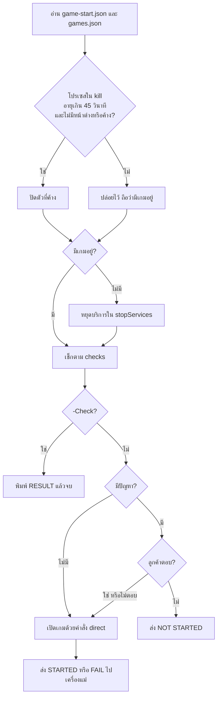

**ฟังก์ชัน:**

| ฟังก์ชัน | บรรทัด | หลักการทำงาน |
|---|---|---|
| [`Note`](../Scripts/Client-GameStart.ps1#L15) | 15 | เก็บบรรทัด (ไว้ส่งเครื่องแม่) พิมพ์ และต่อท้าย log พร้อมเวลาและ id |
| [`Get-Ver`](../Scripts/Client-GameStart.ps1#L19) | 19 | FileVersion เป็น `[version]` (แทน `,` ด้วย `.` ตัดส่วนหลังช่องว่าง) อ่านไม่ได้ = 0.0 |
| [`Send-Master`](../Scripts/Client-GameStart.ps1#L107) | 107 | ส่งหัวรายงาน phase=gamestart + ทุกบรรทัด + `RESULT:` ไปเครื่องแม่ รอไม่เกิน 4 วินาที ข้ามเมื่อ `-Check` หรือไม่มี MasterIP |

**ค่าในร้านนี้ตอนนี้:** ใช้กับ Apex (`steam-1172470`) เท่านั้น `ClientBlockCpuz=KORI34,KORI23` (เครื่องที่กัน CPU-Z ไว้) `ClientReportPort` ไม่ได้ตั้ง → 4670 IPLAY-WAY.md บันทึกว่า**ยังไม่ได้ทดสอบบนเครื่องลูก** (ทดสอบบนเครื่องแม่ 20 พ.ย.)

---

# ส่วนที่ 4: GTA V / FiveM

ตั้งกราฟิก GTA V / FiveM ให้เป็นค่าของร้านทุกบูต และส่งไฟล์เซิร์ฟที่ FiveM โหลดบนเครื่องลูกกลับเข้าเครื่องแม่ ให้เครื่องอื่นได้ใช้หลังรีบูต

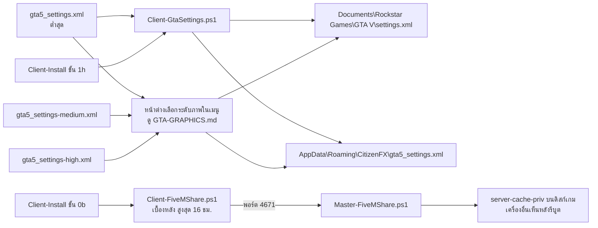

## 15. `gta5_settings*.xml` — ไฟล์กราฟิกของร้าน

**หน้าที่:** ไฟล์ `settings.xml` ของ GTA V ที่ร้านเซฟไว้ 3 ระดับใน `Settings\`

**เรียกจาก / ทำงานเมื่อไหร่:**
- `gta5_settings.xml` (ต่ำสุด) — `Client-GtaSettings.ps1` ทุกบูต และหน้าต่างเลือกระดับภาพในเมนู
- `gta5_settings-medium.xml`, `gta5_settings-high.xml` — หน้าต่างเลือกระดับภาพในเมนูเท่านั้น (ดู [GTA-GRAPHICS.md](GTA-GRAPHICS.md)) `Client-GtaSettings.ps1` ไม่ได้อ่านสองไฟล์นี้

**อ่านค่า / เขียน / Log:** เป็นไฟล์ค่า

**ขั้นตอนการทำงาน:** เปลี่ยนค่าระดับไหน = เอาไฟล์ `settings.xml` ของ GTA V มาวางทับไฟล์ของระดับนั้น แล้วรีบูตเครื่องลูก ชื่อการ์ดจอ ความละเอียด และ Hz จะถูกแทนด้วยของแต่ละเครื่อง

**ฟังก์ชัน:** ไม่มี (ไฟล์ XML)

**ค่าในร้านนี้ตอนนี้:** ทั้ง 3 ไฟล์ต่างกันแค่ค่าในตารางนี้ (อ่านจากไฟล์จริง)

| ค่า | ต่ำสุด | กลาง | สูง |
|---|---|---|---|
| `Tessellation`, `ShadowQuality`, `ReflectionQuality`, `SSAO`, `TextureQuality`, `ParticleQuality`, `WaterQuality`, `GrassQuality`, `ShaderQuality`, `PostFX` | 0 | 1 | 2 |
| `AnisotropicFiltering` | 0 | 4 | 16 |
| `MSAA` | 0 | 0 | 2 |
| `LodScale` | 0.4 | 0.7 | 1.0 |
| `CityDensity`, `PedVarietyMultiplier`, `VehicleVarietyMultiplier` | 0 | 0.5 | 1.0 |
| `DoF` | false | false | true |

ค่าอื่นเหมือนกันทั้ง 3 ไฟล์ เช่น `FXAA_Enabled=true`, `DX_Version=2`, `Windowed=2`, `VSync=0` ในไฟล์เขียนจอ `2560x1440` `180` Hz และการ์ด `NVIDIA GeForce RTX 4070 Ti SUPER` (ถูกแทนตอนเขียนลงเครื่อง)

## 16. `Client-GtaSettings.ps1` — ตั้งกราฟิก GTA ตอนบูต

**หน้าที่:** เขียนค่ากราฟิกของร้าน (`Settings\gta5_settings.xml`) ทับไฟล์ค่าของ GTA V Legacy และ FiveM ให้ทุกบัญชีในเครื่องลูกทุกครั้งที่บูต ลูกค้าเปลี่ยนเองก็หายตอนรีบูตอยู่แล้ว GTA V Enhanced ใช้รูปแบบอื่น ไม่แตะ

**เรียกจาก / ทำงานเมื่อไหร่:** `Client-Install.ps1` ขั้น **1h** ทั้งตอนบูตและโหมดแก้ image ข้ามเมื่อเป็นเครื่องแม่, `ClientGtaSettings=off` หรือไม่มีไฟล์ xml

**พารามิเตอร์:**
- `-CheckOnly` — แสดงว่าจะเขียนอะไร ไม่เขียน
- `-TestDir <โฟลเดอร์>` — เขียนลง `<โฟลเดอร์>\Documents\...` และ `<โฟลเดอร์>\AppData\Roaming\...` เท่านั้น (ใช้บนเครื่องแม่ได้)

**อ่านค่า:**
- `Settings\gta5_settings.xml` (ตัด BOM, ต้องเป็น XML ที่มี `<Settings><graphics>`)
- `Win32_VideoController` (ชื่อการ์ด, PNPDeviceID, ความละเอียดและ Hz ปัจจุบัน)
- ProfileList + Default, User Shell Folders (`Personal`, `AppData`)

**เขียน / เปลี่ยน (ทุกโปรไฟล์และ Default):**
- `<Documents>\Rockstar Games\GTA V\settings.xml`
- `<AppData\Roaming>\CitizenFX\gta5_settings.xml`
- เนื้อหาเหมือนไฟล์ร้าน ยกเว้น: `<VideoCardDescription>` = การ์ดของเครื่องนี้, `ScreenWidth` / `ScreenHeight` / `RefreshRate` = จอของเครื่องนี้, `Windowed` = 2 (borderless)
- เขียนเฉพาะไฟล์ที่ต่างจากเดิม UTF-8 ไม่มี BOM ปลด read-only ก่อน

**Log:** แสดงบนหน้าจอ / log ของ Client-Install บรรทัดสรุป `GTA: shop settings, lowest (<กว้าง>x<สูง> <Hz>Hz, card: ...) -> N file(s)` (คำว่า lowest เป็นข้อความตายตัวในโค้ด) exit 1 เมื่อเขียนไม่ได้

**ขั้นตอนการทำงาน:**
1. เครื่องแม่ (ไม่ใส่ `-TestDir`) → exit 0
2. ไม่มีไฟล์ = skip exit 0, ไม่ใช่ XML หรือไม่ใช่ไฟล์ GTA = exit 1
3. หาชื่อการ์ด (`Get-GpuName`) และโหมดจอ (`Get-ScreenMode`) แล้วแทนค่า
4. ทุกโปรไฟล์ → `Write-IfChanged` สองไฟล์
5. พิมพ์สรุป

**ฟังก์ชัน:**

| ฟังก์ชัน | บรรทัด | หลักการทำงาน |
|---|---|---|
| [`Get-GpuName`](../Scripts/Client-GtaSettings.ps1#L27) | 27 | ตัดการ์ดเสมือน / รีโมตออก เลือกการ์ด PCI ก่อน ไม่มีก็ตัวไหนก็ได้ที่ไม่ใช่เสมือน เรียง NVIDIA → AMD → อื่น |
| [`Get-ScreenMode`](../Scripts/Client-GtaSettings.ps1#L38) | 38 | ความละเอียดและ Hz ปัจจุบัน จากการ์ดจริงก่อน ไม่มีก็จอเสมือน ไม่มีเลย = ใช้ค่าในไฟล์ |
| [`Get-Profiles`](../Scripts/Client-GtaSettings.ps1#L59) | 59 | โปรไฟล์จาก ProfileList (SID `S-1-5-21-*`) และ Default |
| [`Get-UserFolder`](../Scripts/Client-GtaSettings.ps1#L74) | 74 | โฟลเดอร์ Documents / Roaming ของโปรไฟล์ (อ่านค่าแบบไม่ขยาย เหตุผลเดียวกับ ClearLogins) |
| [`Write-IfChanged`](../Scripts/Client-GtaSettings.ps1#L87) | 87 | เขียนเมื่อเนื้อหาต่าง คืน same / created / overwritten (หรือ would ... ใน `-CheckOnly`) |

### ทำไมต้องแทนชื่อการ์ดจอ
GTA ตรวจการ์ดใหม่ (และเปลี่ยนค่าทั้งหมด) เมื่อชื่อใน `<VideoCardDescription>` ไม่ตรงกับการ์ดที่รันอยู่ จึงใส่ชื่อแบบที่ DirectX / Windows เรียก หาการ์ดไม่เจอ (ไม่มีไดรเวอร์) = ใช้ข้อความในไฟล์

**ค่าในร้านนี้ตอนนี้:** `ClientGtaSettings=on` เมนูมีหน้าต่างเลือกระดับภาพสำหรับ `steam-271590` (GTA V Legacy) และ `fivem` (`Menu\config.json` → `ui.graphicsPicker`)

## 17. `Client-FiveMShare.ps1` — ส่งไฟล์เซิร์ฟ FiveM เข้าเครื่องแม่

**หน้าที่:** ส่งไฟล์ของเซิร์ฟ FiveM ที่เครื่องลูกนี้โหลดมา ไปให้เครื่องแม่ (`Master-FiveMShare.ps1`) เครื่องลูกทุกเครื่องจะมีไฟล์นั้นหลังรีบูตครั้งถัดไป ส่งเฉพาะไฟล์ของเซิร์ฟและดัชนี (index) ของ FiveM ไม่ส่งล็อกอิน ไม่ส่งค่าเกม ในวง LAN เท่านั้น ไม่รันบนเครื่องแม่

**เรียกจาก / ทำงานเมื่อไหร่:** `Client-Install.ps1` ขั้น **0b** เฉพาะตอนบูต (ไม่ใช่เครื่องแม่, `ClientFiveMShare=on`) เปิดเป็น PowerShell ซ่อนหน้าต่าง ทำงานอยู่เบื้องหลังได้นานสุด 16 ชั่วโมง

**พารามิเตอร์ (ส่วนใหญ่ใช้ทดสอบ):**
- `-CacheDir <server-cache-priv>` — โฟลเดอร์แคชของ FiveM (ค่าเริ่ม: หาจาก `Get-CfxApps` → `<FiveM>.app\data\server-cache-priv`)
- `-Master <host:port>` — ค่าเริ่ม `MasterIP:FiveMSharePort`
- `-Once` — ดูรอบเดียว ไม่รอ
- `-Since <เวลา>` — แทนเวลาบูต
- `-Hours <n>` — เวลาทำงานสูงสุด ค่าเริ่ม 16
- `-Base <fingerprint>` — แทนการอ่าน fingerprint ตอนเริ่ม
- `-Running yes|no|file:<path>` — แกล้งว่า FiveM เปิด / ปิด
- `-AheadAge <วินาที>` — ไฟล์ต้องนิ่งนานเท่านี้ก่อนส่งล่วงหน้า ค่าเริ่ม 180
- `-AheadMBps <n>` — ความเร็วสูงสุดตอนส่งล่วงหน้า ค่าเริ่ม 25 MB/s

**อ่านค่า:**
- `Get-Setting 'MasterIP'`, `Get-Setting 'FiveMSharePort' '4671'`, `Test-IsMaster`, `Get-CfxApps`
- `<server-cache-priv>\db\` (ดัชนีของ FiveM) และไฟล์ `cache_<sha1 40 ตัว>`
- โปรเซส `FiveM`, `FiveM_*`, เวลาบูต (`Win32_OperatingSystem`)

**เขียน / เปลี่ยน:** ไม่เปลี่ยนไฟล์ในเครื่อง เรียก HTTP ไปเครื่องแม่:
- `POST /fivem/log` — ทุกบรรทัด log (`{pc, msg}`)
- `POST /fivem/offer` — เสนอรายการไฟล์ (`pc`, `base`, `pre`, `files`, ตอนส่งจริงมี `db`, `session`)
- `PUT /fivem/put/<session>/f/<ชื่อ>` — ไฟล์เซิร์ฟ
- `PUT /fivem/put/<session>/d/<ชื่อ>` — ไฟล์ในดัชนี `db`
- `POST /fivem/commit/<session>` — ให้เครื่องแม่รับไฟล์เข้า

**Log:** `C:\Users\Public\OSYNC-FiveMShare.log` และทุกบรรทัดส่งไปที่ log ของเครื่องแม่ (`<ไดรฟ์>:\_osync-fivem-incoming\server.log`) เพราะ log บนเครื่องลูกหายตอนรีบูต ข้อความซ้ำจดครั้งแรก แล้วครั้งที่ 10 และ 100

**ขั้นตอนการทำงาน:**
1. เครื่องแม่ / ไม่มี MasterIP / ไม่เจอ FiveM / ไม่มี `db` → จบ
2. FiveM เปิดอยู่แล้วตอนเริ่ม → บูตนี้ไม่ร่วม จบ
3. จด fingerprint ของ `db` ตอนนี้ = `base` (ว่าง = จบ)
4. วนทุก 30 วินาที จนครบเวลา:
   - **FiveM เปิดอยู่** → `Send-Ahead`: ไฟล์ `cache_*` ใหม่กว่าเวลาบูต ที่นิ่ง 3 นาที และยังไม่ได้ส่ง → เสนอ แล้วส่งตัวที่เครื่องแม่ยังไม่มี ไม่เกิน 25 MB/s (FiveM ปิดระหว่างส่ง = หยุดรอบนี้ ผิดพลาด 3 ครั้งติด = หยุดรอบนี้)
   - **FiveM ปิด และมีไฟล์ใหม่** → รอ 20 วินาที (FiveM รีสตาร์ตตัวเองตอนเปลี่ยนเวอร์ชันเกม) ยังปิดอยู่ → `Send-Final`
5. เครื่องแม่ตอบ `stale` (ของเครื่องแม่เปลี่ยนไปแล้ว มีเครื่องอื่นเร็วกว่า) หรือ `too big` → หยุดทั้งบูตนี้

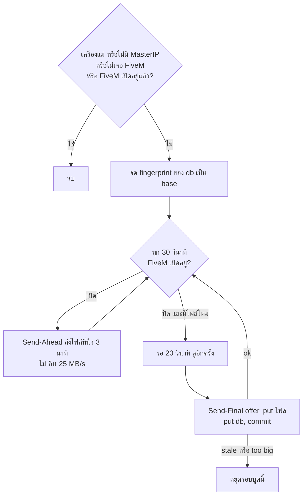

**ฟังก์ชัน:**

| ฟังก์ชัน | บรรทัด | หลักการทำงาน |
|---|---|---|
| [`Send-Log`](../Scripts/Client-FiveMShare.ps1#L23) | 23 | POST ข้อความ log ไป `/fivem/log` รอ 15 วินาที ผิดพลาดก็เงียบ |
| [`Log`](../Scripts/Client-FiveMShare.ps1#L30) | 30 | พิมพ์ ต่อท้าย log ในเครื่อง และส่งเครื่องแม่ (เมื่อรู้ที่อยู่แล้ว) |
| [`Note`](../Scripts/Client-FiveMShare.ps1#L33) | 33 | ข้อความซ้ำเดิม: จดครั้งแรก แล้วครั้งที่ 10 และ 100 |
| [`Get-Fingerprint`](../Scripts/Client-FiveMShare.ps1#L48) | 48 | SHA256 ของ "ชื่อ ขนาด เวลาแก้ไข" ทุกไฟล์ในโฟลเดอร์ ตัด 32 ตัวแรก |
| [`Test-FiveMRunning`](../Scripts/Client-FiveMShare.ps1#L54) | 54 | มีโปรเซส `FiveM` / `FiveM_*` ไหม (หรือค่าจาก `-Running`) |
| [`Get-WebReason`](../Scripts/Client-FiveMShare.ps1#L60) | 60 | ดึงเหตุผล `reason` จาก JSON ที่เครื่องแม่ตอบตอนปฏิเสธ |
| [`Invoke-Json`](../Scripts/Client-FiveMShare.ps1#L64) | 64 | ส่ง JSON และอ่าน JSON ตอบกลับ (รับคำตอบ error ด้วย) รอ 30 / 60 วินาที |
| [`Send-File`](../Scripts/Client-FiveMShare.ps1#L74) | 74 | PUT ไฟล์หนึ่งไฟล์ จำกัดความเร็วได้ด้วยการหน่วงเวลา คืนจำนวนไบต์ |
| [`Get-NewFiles`](../Scripts/Client-FiveMShare.ps1#L106) | 106 | ไฟล์ `cache_<sha1>` ขนาดมากกว่า 0 ที่ใหม่กว่า `handedUpTo` |
| [`Invoke-Offer`](../Scripts/Client-FiveMShare.ps1#L107) | 107 | เสนอรายการไฟล์ `no session` = เริ่ม session ใหม่ `stale` / `too big` = ตั้งหยุด |
| [`Send-Ahead`](../Scripts/Client-FiveMShare.ps1#L124) | 124 | ระหว่าง FiveM เปิด ส่งไฟล์ที่นิ่งแล้วล่วงหน้าแบบจำกัดความเร็ว |
| [`Send-Final`](../Scripts/Client-FiveMShare.ps1#L143) | 143 | หลัง FiveM ปิด ส่งไฟล์ที่เหลือเต็มความเร็ว แล้วส่ง `db` และ commit |

### `Send-Final` — ส่งมอบเมื่อ FiveM ปิด
- **ทำ:** เสนอไฟล์ใหม่ทั้งหมด + รายการไฟล์ใน `db` → ส่งเฉพาะไฟล์ที่เครื่องแม่บอกว่ายังต้องการ → ตรวจว่า FiveM ยังปิดและ `db` ไม่เปลี่ยน → ส่งไฟล์ `db` → commit
- **ระหว่างนั้น FiveM ถูกเปิดอีก:** หยุด ส่วนที่เหลือไปส่งล่วงหน้าแทน `db` ส่งเมื่อ FiveM ปิดอีกครั้ง
- **commit ผ่าน:** `base` = ค่าใหม่จากเครื่องแม่, `handedUpTo` = เวลาเริ่มส่ง, ล้าง session
- **ทำไม:** เครื่องแม่รับเมื่อดัชนีของตัวเองยังเป็นอันที่เครื่องนี้เริ่มจาก ถ้าไม่ใช่ (`stale`) แปลว่ามีเครื่องอื่นเร็วกว่า

**ค่าในร้านนี้ตอนนี้:** `ClientFiveMShare=on`, `FiveMSharePort=4671`, `MasterIP=192.168.51.201` การ์ด `fivem` ในเมนูชี้ที่ `I:\Online\FiveM\FiveM.exe`

---

# ส่วนที่ 5: OSLink

OSLink (LDPlayer เล่นรีโมต อยู่ที่ `<ไดรฟ์>:\LDPlayer\OSLink`) อยู่บนดิสก์เกม จึงพาของเครื่องแม่มาถึงเครื่องลูก: บัญชีที่ล็อกอินไว้, MAC (`cacheIpAdress` ใน `userData\accounts\settings.config`) และรหัสเครื่อง (`rcmac` ใน registry ที่ติดมากับ image) สคริปต์กลุ่มนี้ทำให้แต่ละเครื่องลูกเป็นเครื่องของตัวเอง ด้วยบัญชีช่วยเหลือของร้าน และลงไดรเวอร์ที่ OSLink ต้องใช้

ลำดับตอนบูต: **1l** ไดรเวอร์ → **1j** ล้าง MAC / rcmac → **1k** คืนล็อกอินของเครื่องนี้ → **1m** OSLink ในถาด (`OslinkStart.vbs` ไม่อยู่ในบทนี้) → ตอนล็อกอิน: ตัวช่วย

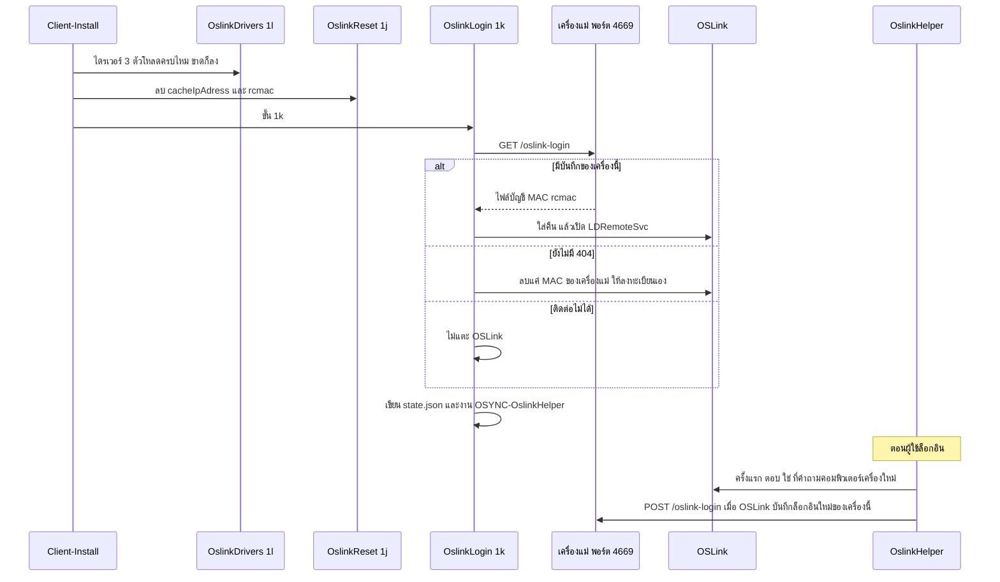

## 18. `Client-OslinkDrivers.ps1` — ไดรเวอร์ OSLink

> **20 พ.ย. 2026:** นอกจากใบรับรองและ SHA256 ที่ปักในโค้ด ไฟล์ที่เครื่องแม่ตรวจแล้ว (`System\Data\Oslink\trusted.txt` จาก `Master-Snapshot-Oslink.ps1` ขั้น 7 ของ `Master-Update`) ก็ใช้ได้เมื่อ SHA256 และใบรับรองตรงทั้งคู่ (ขึ้น `accepted: the master checked this exact file`) ให้ร้านอื่น / OSLink รุ่นใหม่ใส่ไดรเวอร์ได้โดยไม่ต้องแก้โค้ด · การ์ด OSLink ในเมนูมาเองจาก `Master-GameList` ถ้า `extra-games.json` ยังไม่มี `app-oslink`

**หน้าที่:** ลงไดรเวอร์ของ OSLink 3 ตัวแบบเงียบ **เฉพาะเมื่อยังไม่โหลด** ถ้าขาด OSLink จะขึ้น "ไดร์เวอร์ผิดปกติ คลิกเพื่อซ่อมแซม" และที่ Repair ลงบนเครื่องลูก diskless ก็หายตอนรีบูต

| ไดรเวอร์ (บริการ) | ชื่อ | hardware id | inf / cat |
|---|---|---|---|
| `LdVMou` | Virtual Mouse | `LdVMouse` | `LdVMou.inf` + `ldvcnmou.cat` |
| `LdVKbd` | Virtual Keyboard | `LdVKeyboard` | `LdVKbd.inf` + `ldvkbd.cat` |
| `LdScpVBus` | Scp Virtual Bus Driver (จอย Xbox เสมือน) | `Root\LdScpVBus` | `LdScpVBus.inf` + `ldscpvbus.cat` + `WdfCoinstaller01009.dll` |

**เรียกจาก / ทำงานเมื่อไหร่:** `Client-Install.ps1` ขั้น **1l** (ก่อน 1j / 1k เพราะ OSLink ตรวจไดรเวอร์ตอนเริ่ม และสองขั้นนั้นรีสตาร์ต OSLink) ข้ามเมื่อเป็นเครื่องแม่ หรือ `ClientOslinkDrivers` ไม่ใช่ on / ชื่อเครื่องนี้

**พารามิเตอร์:**
- `-CheckOnly` — รายงานอย่างเดียว (ใช้บนเครื่องแม่ได้)
- `-TestDir <โฟลเดอร์>` — โฟลเดอร์ = สำเนา `bin` ของ OSLink, `state.json` = สถานะไดรเวอร์ปลอม ไม่รันอะไร พิมพ์ว่าจะรันอะไร

**อ่านค่า:**
- `HKLM\SYSTEM\CurrentControlSet\Services\<ไดรเวอร์>\Enum` ค่า `Count` (≥ 1 = โหลดแล้ว)
- โฟลเดอร์ bin: path ของบริการ `LDRemoteSvc` → `HKLM\SOFTWARE\(WOW6432Node\)XuanZhi\OSLink` `InstallDir` → `X:\LDPlayer\OSLink\bin` (ต้องมี `LdVMou.inf`)
- `Get-PnpDevice`, `C:\Windows\System32\DriverStore\FileRepository`
- ลายเซ็น Authenticode ของ `.cat`, `.sys`, `WdfCoinstaller01009.dll`, `devcon.exe`

**เขียน / เปลี่ยน:**
- ยังไม่มีอุปกรณ์ → `devcon.exe install <inf> <hwid>`
- มีอุปกรณ์แต่ไม่ทำงาน → `devcon.exe update <inf> <hwid>` (ใช้ devcon ไม่ได้ → `pnputil.exe /add-driver <inf> /install`)
- ลงแล้วและ `ldremote` เปิดอยู่ → หยุดและเริ่ม `LDRemoteSvc` ใหม่ (ปิด `ldremote`, `ldremoteevent`)
- ไม่เพิ่มอะไรใน certificate store

**Log:** แสดงบนหน้าจอ / log ของ Client-Install exit 1 เมื่อมีตัวที่ลงไม่ได้

**ขั้นตอนการทำงาน:**
1. เครื่องแม่ (ไม่ใช่ทดสอบ) → จบ, ไม่ใช่ผู้ดูแล → exit 1
2. ทั้ง 3 ตัวโหลดแล้ว → จบทันที (image ที่เซฟพร้อมไดรเวอร์ = ใช้เวลาไม่กี่มิลลิวินาที)
3. หาโฟลเดอร์ bin ไม่เจอ → skip exit 0
4. ตัวที่ขาด: ดูอุปกรณ์ที่มีและว่า package อยู่ใน driver store ไหม
5. ตรวจลายเซ็น `devcon.exe` และไฟล์ของแต่ละไดรเวอร์กับใบรับรองที่ปักไว้ ไม่ผ่าน = ไม่ลงตัวนั้น และบอกชื่อไฟล์กับใบรับรอง
6. วางแผน install / update / pnputil
7. `-CheckOnly` / `-TestDir` → พิมพ์แผนแล้วจบ
8. รันทีละตัว (ซ่อน, สูงสุด 90 วินาที) แล้วรอให้ Windows โหลดสูงสุด 15 วินาที
9. รีสตาร์ต OSLink ถ้าจำเป็น (เปิดอยู่โดยไม่มีบริการ = บอกให้ปิดเปิดเองหนึ่งครั้ง)

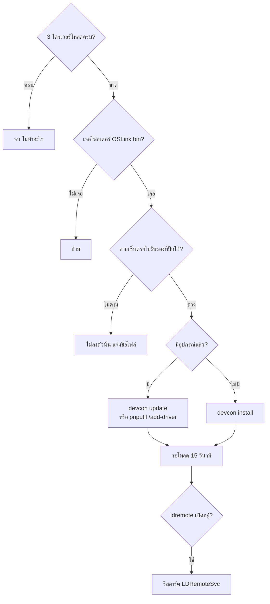

**ฟังก์ชัน:**

| ฟังก์ชัน | บรรทัด | หลักการทำงาน |
|---|---|---|
| [`Get-FakeState`](../Scripts/Client-OslinkDrivers.ps1#L64) | 64 | (ทดสอบ) สถานะจาก `state.json` ไม่มี = missing |
| [`Test-Loaded`](../Scripts/Client-OslinkDrivers.ps1#L67) | 67 | จริงเมื่อ `Services\<ไดรเวอร์>\Enum\Count` ≥ 1 |
| [`Find-OslinkBin`](../Scripts/Client-OslinkDrivers.ps1#L79) | 79 | หาโฟลเดอร์ bin ที่มี `LdVMou.inf` จากบริการ → registry ของ OSLink → `X:\LDPlayer\OSLink\bin` |
| [`Test-PinnedSignature`](../Scripts/Client-OslinkDrivers.ps1#L96) | 96 | คืนค่าว่างเมื่อลายเซ็น Valid และผู้เซ็นอยู่ในรายการปัก ไม่อย่างนั้นคืนเหตุผล |
| [`Invoke-Tool`](../Scripts/Client-OslinkDrivers.ps1#L168) | 168 | รันโปรแกรมแบบซ่อน เก็บ stdout / stderr เกินเวลา = `taskkill /T /F` |

### `Test-PinnedSignature` — รับไฟล์แบบไหน
- **ปกติ:** สถานะลายเซ็นต้องเป็น `Valid` และ thumbprint ของผู้เซ็นอยู่ในรายการปัก
- **ใบรับรองที่ปัก (อ่านจาก OSLink 1.3.29.5 บนเครื่องแม่ 17 พ.ย. 2026):** ไดรเวอร์ = Microsoft Windows Hardware Compatibility Publisher 2 ใบ + Microsoft Windows Component Publisher 1 ใบ (ของ `WdfCoinstaller01009.dll`), devcon.exe = Shanghai Chang Zhi Network Technology Co., Ltd.
- **ข้อยกเว้น (19 พ.ย.):** สถานะ `UnknownError` แต่ผู้เซ็นอยู่ในรายการปัก **และ** SHA256 ของไฟล์ตรงกับค่าที่ปักไว้ (`devcon.exe` ของ OSLink 1.3.29.5) → รับ
- **OSLink อัปเดตแล้วใบรับรองเปลี่ยน:** ไม่ลงอะไร และพิมพ์ชื่อไฟล์กับใบรับรอง ให้ตรวจแล้วเพิ่ม thumbprint ในสคริปต์

**ค่าในร้านนี้ตอนนี้:** `ClientOslinkDrivers=on` (ทุกเครื่องลูก)

## 19. `Client-OslinkReset.ps1` — ล้าง MAC และ rcmac

**หน้าที่:** ลบ MAC ของเครื่องแม่ (`cacheIpAdress`) และรหัสเครื่อง (`rcmac`) ที่ติดมา ให้ OSLink ลงทะเบียนเครื่องนี้เป็นเครื่องของตัวเองด้วยบัญชีช่วยเหลือของร้าน บัญชีที่ล็อกอินไว้ยังอยู่ ไม่แตะไฟล์บัญชี `userData\data\setting.ini` และตัวโปรแกรม

**เรียกจาก / ทำงานเมื่อไหร่:** `Client-Install.ps1` ขั้น **1j** ข้ามเมื่อเป็นเครื่องแม่ หรือ `ClientOslinkReset` ไม่ใช่ on / ชื่อเครื่องนี้

**พารามิเตอร์:**
- `-CheckOnly` — แสดงอย่างเดียว
- `-TestDir <โฟลเดอร์>` — โฟลเดอร์ OSLink ปลอม (มี `userData\`) registry = `HKCU\Software\OSYNC-OslinkTest\m` และ `\u` ไม่แตะบริการ

**อ่านค่า:**
- โฟลเดอร์ OSLink: จาก path ของบริการ `LDRemoteSvc` (โฟลเดอร์แม่ของ bin ที่มี `userData`) หรือ `X:\LDPlayer\OSLink`
- `userData\accounts\settings.config` (ดูว่ามี BOM และ `cacheIpAdress` ไหม)
- `rcmac` ใน `HKLM\SOFTWARE\ld\OSLink`, `HKLM\SOFTWARE\WOW6432Node\ld\OSLink` และ `HKU\<SID>\Software\ld\OSLink` ของทุกผู้ใช้ (ไม่ได้ล็อกอิน = โหลด `NTUSER.DAT` ชั่วคราวชื่อ `OSYNC_OL_<n>`)

**เขียน / เปลี่ยน:**
- หยุดบริการ `LDRemoteSvc` และโปรเซส `ldremote`, `ldremoteevent`
- เขียน `settings.config` ใหม่ไม่มี `cacheIpAdress` และไม่มี BOM (ค่าอื่นอยู่ครบ)
- ลบค่า `rcmac` ทุกที่
- เริ่ม `LDRemoteSvc` อีกครั้ง (ถ้าเคยรัน หรือตั้งเป็น Auto)
- เขียนลงสำเนาของเครื่องลูกเท่านั้น เครื่องแม่ไม่เปลี่ยน

**Log:** แสดงบนหน้าจอ / log ของ Client-Install exit 1 เมื่อลบไม่ได้

**ขั้นตอนการทำงาน:**
1. เครื่องแม่ → จบ, ไม่ใช่ผู้ดูแล → exit 1
2. หาโฟลเดอร์ OSLink ไม่เจอ → skip
3. อ่าน `settings.config` และดูว่ามี `rcmac` ที่ไหน (ยังไม่โหลด hive ในโหมด `-CheckOnly`)
4. ไม่มีอะไรต้องลบ → จบ, `-CheckOnly` → บอกว่าจะลบอะไร
5. หยุด OSLink แล้ว**อ่าน settings.config อีกครั้ง** (OSLink ที่กำลังปิดอาจเพิ่งเขียนกลับ)
6. เขียน `settings.config` → ลบ `rcmac` (อีกครั้งหลังหยุด) → เริ่มบริการ

**ฟังก์ชัน:**

| ฟังก์ชัน | บรรทัด | หลักการทำงาน |
|---|---|---|
| [`Find-OslinkRoot`](../Scripts/Client-OslinkReset.ps1#L29) | 29 | โฟลเดอร์ OSLink ที่มี `userData` จากบริการ หรือ `X:\LDPlayer\OSLink` |
| [`Get-Profiles`](../Scripts/Client-OslinkReset.ps1#L57) | 57 | โปรไฟล์ผู้ใช้จาก ProfileList (ไม่มี Default) |
| [`Get-RcmacPlaces`](../Scripts/Client-OslinkReset.ps1#L70) | 70 | รายการที่ที่อาจมี `rcmac` (เครื่อง 2 ที่ + ทุกผู้ใช้) โหลด hive ได้ถ้าให้ |
| [`Close-Hives`](../Scripts/Client-OslinkReset.ps1#L91) | 91 | GC แล้ว `reg unload` ทุก hive ที่โหลดไว้ |
| [`Use-Rcmac`](../Scripts/Client-OslinkReset.ps1#L93) | 93 | บอกว่าใครมี `rcmac` และลบเมื่อสั่ง คืน Who / Fail |

**ค่าในร้านนี้ตอนนี้:** `ClientOslinkReset=on`

## 20. `Client-OslinkLogin.ps1` — คืนล็อกอินของเครื่องนี้

**หน้าที่:** ให้ OSLink ล็อกอินด้วยบัญชีช่วยเหลือที่ล็อกอินไว้บนเครื่องแม่ **ในฐานะเครื่องนี้** โดยไม่ต้องมีคนล็อกอินบนเครื่องลูก กุญแจล็อกอินของ OSLink ผูกกับเครื่องเดียว จึงเก็บกุญแจของแต่ละเครื่องไว้ที่เครื่องแม่ (`Master-OslinkLogins.ps1`, เลือกตาม IP ของเครื่องลูก) แล้วใส่คืนก่อน OSLink เริ่ม

**เรียกจาก / ทำงานเมื่อไหร่:** `Client-Install.ps1` ขั้น **1k** (ตอนบูตเป็น SYSTEM) ข้ามเมื่อเป็นเครื่องแม่ หรือ `ClientOslinkLogin` ไม่ใช่ on / ชื่อเครื่องนี้

**พารามิเตอร์:**
- `-CheckOnly` — ถามเครื่องแม่แล้วรายงานอย่างเดียว
- `-TestDir <โฟลเดอร์>` — OSLink ปลอม (`<โฟลเดอร์>\userData`), registry = `HKCU\Software\OSYNC-OslinkLoginTest\m` (เครื่อง) และ `\u` (ผู้ใช้) ไม่แตะบริการและงาน
- `-Master <host:port>` — แทน `MasterIP` + `OslinkLoginPort`

**อ่านค่า:**
- `Get-Setting 'OslinkLoginPort' '4669'`, `Get-Setting 'MasterIP'`
- `GET http://<MasterIP>:4669/oslink-login` (ลอง 8 ครั้ง ห่าง 2 วินาที รอครั้งละ 3 วินาที)
- `userData\accounts\settings.config`, ProfileList, `NTUSER.DAT`

**เขียน / เปลี่ยน:**
- **มีบันทึก:** ลบโฟลเดอร์บัญชีที่เป็นตัวเลขและ `lastuser.data` ใน `accounts` → เขียนไฟล์จากบันทึก (เฉพาะชื่อแบบ `accounts/<uid 4-30 หลัก>/userinfo.config`, `user.ini`, `accounts/lastuser.data`) → `cacheIpAdress` = MAC ของเครื่องนี้ → `rcmac` ใน `HKLM\SOFTWARE\ld\OSLink` (64-bit) และทุก hive ผู้ใช้รวม Default
- **ยังไม่มี (404):** ลบแค่ `cacheIpAdress` บัญชีของเครื่องแม่อยู่ต่อ
- หยุด / เริ่ม `LDRemoteSvc` และปิด `ldremote`, `ldremoteevent`
- `C:\Users\Public\OSYNC-OslinkLogin.state.json` (`mode` = restore / first / none, `at` เวลา ms, `pc`, `master`, `baseline`)
- งาน `OSYNC-OslinkHelper`: ตอนล็อกอิน, กลุ่ม BUILTIN\Users, สิทธิ์สูงสุด, จำกัด 45 นาที, ไม่รันซ้อน → `wscript.exe "System\Client\OslinkHelper.vbs"`

**Log:** แสดงบนหน้าจอ / log ของ Client-Install exit 1 เมื่อมีส่วนที่พัง

**ขั้นตอนการทำงาน:**
1. เครื่องแม่ → จบ, ไม่ใช่ผู้ดูแล → exit 1, ไม่เจอ OSLink หรือไม่มี MasterIP → skip
2. ถามเครื่องแม่ (`Get-Record`) → found / none / error / unreachable
3. `-CheckOnly` → บอกว่าจะทำอะไร
4. ติดต่อไม่ได้ (error / unreachable) → เขียน state `none` แล้วจบ ไม่แตะ OSLink
5. หยุด OSLink → restore หรือ first (ดูด้านบน)
6. เริ่ม `LDRemoteSvc` (ถ้าเคยรันหรือเป็น Auto) → เขียน state → ลงทะเบียนงาน `OSYNC-OslinkHelper`

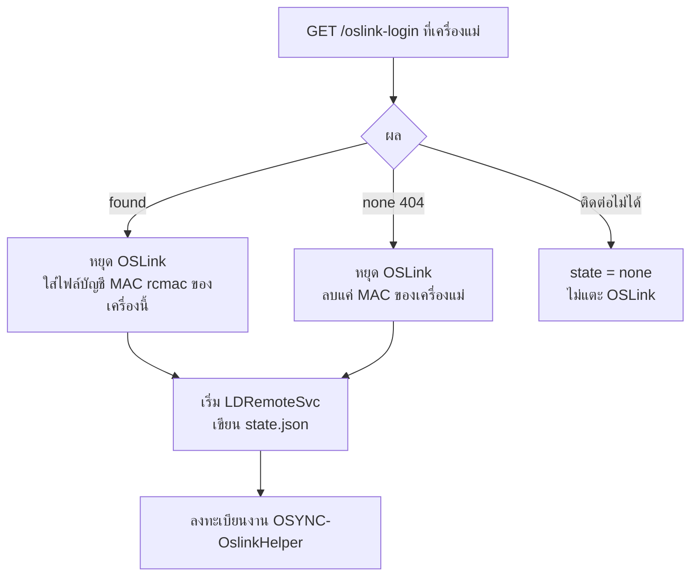

**ฟังก์ชัน:**

| ฟังก์ชัน | บรรทัด | หลักการทำงาน |
|---|---|---|
| [`Find-OslinkRoot`](../Scripts/Client-OslinkLogin.ps1#L29) | 29 | โฟลเดอร์ OSLink ที่มี `userData` จากบริการ หรือ `X:\LDPlayer\OSLink` |
| [`Get-Record`](../Scripts/Client-OslinkLogin.ps1#L45) | 45 | ถามเครื่องแม่ คืน found (พร้อมบันทึก) / none (404) / error (HTTP อื่น) / unreachable |
| [`Get-RcmacKeys`](../Scripts/Client-OslinkLogin.ps1#L77) | 77 | รายการคีย์ที่จะเขียน `rcmac`: HKLM 64-bit + ทุกผู้ใช้และ Default (โหลด hive ชั่วคราว) |
| [`Get-RcmacNow`](../Scripts/Client-OslinkLogin.ps1#L105) | 105 | อ่าน `rcmac` ของเครื่อง (ผู้ใช้ตอนบูตไม่รู้ = ค่าว่าง) ใช้ทำ baseline |
| [`Close-Hives`](../Scripts/Client-OslinkLogin.ps1#L111) | 111 | unload hive ที่โหลดไว้ |
| [`Read-Settings`](../Scripts/Client-OslinkLogin.ps1#L113) | 113 | อ่าน `settings.config` (ตัด BOM) เป็น ordered map |
| [`Write-Settings`](../Scripts/Client-OslinkLogin.ps1#L120) | 120 | เขียน map กลับเป็น JSON UTF-8 ไม่มี BOM |

### baseline ใน state.json — ทำไมต้องมี
หลังใส่คืน สคริปต์คำนวณ SHA256 ของ "ไฟล์บัญชี + MAC + rcmac" แบบเดียวกับ `Get-Hash` ของ `Client-OslinkHelper.ps1` แล้วเก็บไว้ ตัวช่วยจะส่งกลับเครื่องแม่เฉพาะเมื่อค่าเปลี่ยน (OSLink ต่ออายุกุญแจ) ไม่ส่งซ้ำของเดิมทุกบูต

**ค่าในร้านนี้ตอนนี้:** `ClientOslinkLogin=on`, `OslinkLoginPort=4669`, `MasterIP=192.168.51.201`

## 21. `Client-OslinkHelper.ps1` — ตัวช่วยหลังล็อกอิน

**หน้าที่:** รันซ่อนหลังผู้ใช้ล็อกอิน ดูแลให้ล็อกอิน OSLink ของเครื่องนี้ถูกเก็บที่เครื่องแม่:
- **ครั้งแรก** (ขั้น 1k ไม่เจอบันทึก): OSLink จะถาม "คอมพิวเตอร์เครื่องใหม่" ตัวช่วยกด "ใช่" ให้ เฉพาะเมื่อ UI Automation อ่านข้อความนั้นและเจอปุ่มชื่อ "ใช่" ได้จริง (ไม่กดมั่ว) ไม่อย่างนั้นปล่อยให้คนตอบ
- **ทุกครั้งที่ OSLink บันทึกล็อกอินของตัวเอง** (`userinfo.config` เขียนหลังบูตนี้ และมี MAC ของเครื่องนี้) แล้วต่างจากที่เครื่องแม่มี → ส่งไปเครื่องแม่

**เรียกจาก / ทำงานเมื่อไหร่:** งาน `OSYNC-OslinkHelper` (สร้างโดย `Client-OslinkLogin.ps1`) ตอนผู้ใช้ล็อกอิน → `System\Client\OslinkHelper.vbs` → สคริปต์นี้ (ซ่อนหน้าต่าง) หยุดเองหลัง 30 นาที

**พารามิเตอร์:**
- `-TestDir <โฟลเดอร์>` — OSLink ปลอม (`userData`, `state.json`, registry `HKCU\Software\OSYNC-OslinkLoginTest`)
- `-Master <host:port>` — แทนค่าใน state
- `-Once` — ดูรอบเดียว
- `-Minutes <n>` — เวลาทำงาน ค่าเริ่ม 30

**อ่านค่า:**
- `C:\Users\Public\OSYNC-OslinkLogin.state.json` (ต้องเป็น `first` หรือ `restore`)
- `userData\accounts\<uid>\userinfo.config`, `user.ini`, `accounts\lastuser.data`, `accounts\settings.config` (`cacheIpAdress`)
- `rcmac` ใน `HKLM\SOFTWARE\ld\OSLink` (64-bit) และ `HKCU\Software\ld\OSLink`
- หน้าต่างของโปรเซส `ldremote` ผ่าน UI Automation

**เขียน / เปลี่ยน:**
- กดปุ่ม "ใช่" (InvokePattern) ในหน้าต่าง OSLink ครั้งแรก
- `POST http://<master>/oslink-login` JSON (`pc`, `uid`, `mac`, `rcmac`, `files` เป็น base64) รอ 5 วินาที
- mutex `Local\OSYNC-OslinkHelper` กันรันซ้อนใน session

**Log:** `C:\Users\Public\OSYNC-OslinkHelper.log`

**ขั้นตอนการทำงาน:**
1. เครื่องแม่ → จบ, มีตัวช่วยรันอยู่แล้วใน session นี้ → จบ
2. อ่าน state ไม่ใช่ first / restore → จบ (จด log)
3. หาโฟลเดอร์ OSLink
4. โหมด restore: ตั้งค่า "ส่งล่าสุด" = baseline (เครื่องแม่มีของนี้แล้ว)
5. วนทุก 3 วินาทีจนครบเวลา:
   - โหมด first → `Try-AnswerNewPc` (กดได้ครั้งเดียว UI Automation error = เลิกลอง)
   - `Get-Signin` → ถ้า MAC มีแล้วแต่ล็อกอินยังเก่า จด log ครั้งเดียว
   - ล็อกอินของเครื่องนี้ (มี MAC และบันทึกหลังบูต) และ hash ต่างจากที่ส่งล่าสุด → `Send-Signin`
   - เครื่องแม่ตอบ 403 (เก็บเฉพาะบัญชี OSLink ของร้านที่ล็อกอินบนเครื่องแม่) → ไม่ส่ง hash นี้อีก

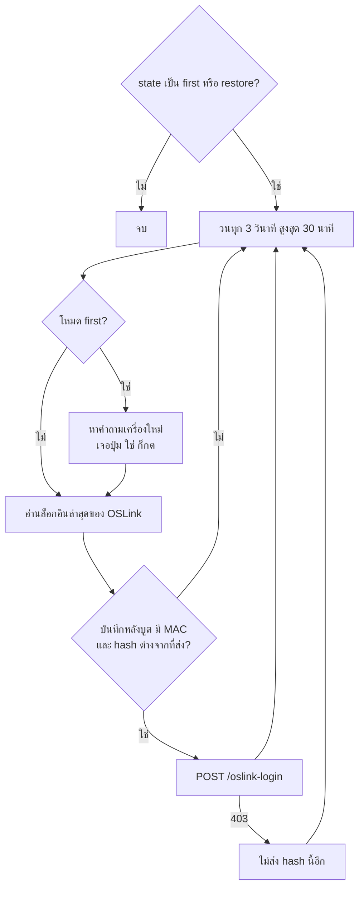

**ฟังก์ชัน:**

| ฟังก์ชัน | บรรทัด | หลักการทำงาน |
|---|---|---|
| [`Log`](../Scripts/Client-OslinkHelper.ps1#L20) | 20 | ต่อท้าย log พร้อมเวลาและชื่อผู้ใช้ |
| [`Find-OslinkRoot`](../Scripts/Client-OslinkHelper.ps1#L27) | 27 | โฟลเดอร์ OSLink ที่มี `userData` จากบริการ หรือ `X:\LDPlayer\OSLink` |
| [`Get-Rcmac`](../Scripts/Client-OslinkHelper.ps1#L41) | 41 | อ่าน `rcmac` ของ hklm หรือ hkcu |
| [`Get-Signin`](../Scripts/Client-OslinkHelper.ps1#L47) | 47 | บัญชีที่ `userinfo.config` ใหม่สุด + MAC + ไฟล์ (base64) + rcmac + เวลาบันทึก |
| [`Get-Hash`](../Scripts/Client-OslinkHelper.ps1#L59) | 59 | SHA256 ของไฟล์ทั้งหมด + MAC + rcmac (สูตรเดียวกับ baseline ใน OslinkLogin) |
| [`Send-Signin`](../Scripts/Client-OslinkHelper.ps1#L64) | 64 | POST JSON ไป `/oslink-login` รอ 5 วินาที |
| [`Try-AnswerNewPc`](../Scripts/Client-OslinkHelper.ps1#L76) | 76 | ค้นหน้าต่างของ `ldremote` หาข้อความ "คอมพิวเตอร์เครื่องใหม่" และปุ่ม "ใช่" แล้วกด จดรายการหน้าต่างที่เห็นครั้งเดียว |

### `Try-AnswerNewPc` — กดอย่างระวัง
- ข้อความไทยเขียนเป็นรหัส `\uXXXX` ในสคริปต์ ("คอมพิวเตอร์เครื่องใหม่" และ "ใช่")
- กดเฉพาะเมื่อเจอข้อความนั้นในหน้าต่าง**และ**มีปุ่ม (ControlType Button) ชื่อตรง "ใช่"
- เจอคำถามแต่ไม่เจอปุ่ม → จด log พร้อมชื่อส่วนต่างๆ 12 ตัวแรก แล้วไม่กด
- ไม่ทำในโหมด `-TestDir`

**ค่าในร้านนี้ตอนนี้:** ทำงานเมื่อ `ClientOslinkLogin=on` (ตอนนี้ on)

---

# ส่วนที่ 6: รายงานตอนบูตไปเครื่องแม่

เครื่องลูกส่งรายงานสถานะไปที่เครื่องแม่ ให้เจ้าของร้านไม่ต้องไปอ่าน log บนเครื่องลูก ฝั่งเครื่องแม่รับที่ `Master-ClientReports.ps1` (`POST /oslink-report` ในวง LAN สูงสุด 2 MB) เก็บเป็น `C:\ProgramData\OSYNC\ClientReports\<ip>-<yyyyMMdd-HHmmss>.txt` ไฟล์ใหม่สุด 40 ไฟล์ต่อเครื่อง ดูได้ในคอนโซลแอดมิน

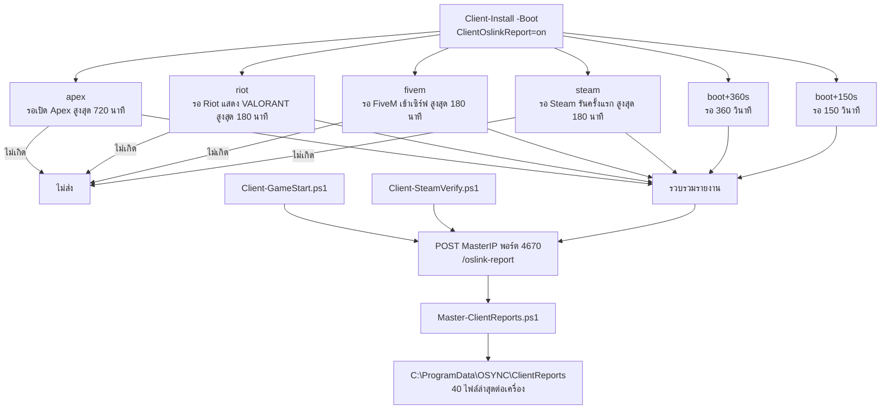

## 22. `Client-OslinkReport.ps1` — รายงานตอนบูต

**หน้าที่:** แม้ชื่อเป็น OSLink และคอมเมนต์บอกว่าเป็น "การวินิจฉัยชั่วคราว (17 พ.ย. 2026)" ตอนนี้เป็นรายงานสถานะเครื่องลูกทั้งเครื่อง: ขั้นตอนบูต, OSLink, Sunshine, Riot, FiveM, Steam, EA Javelin / Apex, เสียง / ไมค์ แล้วส่งไปที่เครื่องแม่

**เรียกจาก / ทำงานเมื่อไหร่:** `Client-Install.ps1` ตอนบูต (ไม่ใช่เครื่องแม่, `ClientOslinkReport=on`) เปิด PowerShell ซ่อนหน้าต่าง **6 ตัว**ในเบื้องหลัง (ขั้นบูตไม่รอ):

| phase | พารามิเตอร์ที่ใส่ | รออะไร (เช็กทุก) | ถ้าเจอ รอต่อ | ไม่เจอในเวลา |
|---|---|---|---|---|
| `boot+150s` | `-DelaySeconds 150` | รอ 150 วินาที | — | — |
| `boot+360s` | `-DelaySeconds 360` | รอ 360 วินาที | — | — |
| `steam` | `-WaitSteamMinutes 180` | `logs\bootstrap_log.txt` ของ Steam มีบรรทัดหลังบูต (20 วินาที) | 240 วินาที | ไม่ส่ง |
| `fivem` | `-WaitFiveMMinutes 180` | `CitizenFX_log*.log` หลังบูตมี "Downloading completed" (30 วินาที) | 60 วินาที | ไม่ส่ง |
| `riot` | `-WaitRiotMinutes 180` | log ของ Riot Client หลังบูตมี "productId: valorant" (30 วินาที) | 120 วินาที | ไม่ส่ง |
| `apex` | `-WaitApexMinutes 720` | โปรเซส `EAAntiCheat.GameServiceLauncher` หรือ `r5apex*` (5 วินาที) แล้วเฝ้าต่อสูงสุด 180 วินาที · ตั้งแต่ 20 พ.ย. 2026 รายงานมีเพิ่ม: รหัสที่ `EAAntiCheatService` ใช้ตอนปิดตัวครั้งล่าสุด (`Win32ExitCode` / `ServiceSpecificExitCode`), รายงานแครชของ Windows (WER) ของ EA AntiCheat / r5apex หลังบูต, ไฟล์ของ Apex ที่เขียนหลังบูต (`Saved Games\Respawn\Apex`, `Temp\Respawn`), สถานะ VBS, Defender และ file-system filter | 5 วินาที | ไม่ส่ง |

**พารามิเตอร์:**
- `-Phase <ข้อความ>` — ชื่อรอบ ค่าเริ่ม `manual` (`boot+150s` ทำให้เก็บ hash ไฟล์ Steam ด้วย)
- `-DelaySeconds <n>` — รอก่อนเก็บข้อมูล
- `-Print` — แสดงรายงานบนหน้าจอแทนการส่ง
- `-WaitSteamMinutes`, `-WaitFiveMMinutes`, `-WaitRiotMinutes`, `-WaitApexMinutes` — รอเหตุการณ์ตามตารางข้างบน (นาที)

**อ่านค่า:** ดูรายการส่วนของรายงานด้านล่าง ค่า settings ที่อ่าน: `Get-Setting 'MasterIP'` และบรรทัด `ClientOslink*` ใน settings.txt

**เขียน / เปลี่ยน:** ไม่เปลี่ยนอะไรในเครื่อง ส่ง `POST http://<MasterIP>:4670/oslink-report` (text/plain UTF-8, รอ 15 วินาที) พอร์ต **4670 เขียนตายในโค้ด** ไม่ได้อ่าน `ClientReportPort` (ต่างจาก SteamVerify / GameStart)

**Log:** ไม่มีไฟล์ log บนเครื่องลูก ส่งไม่ได้ก็เงียบ

**ขั้นตอนการทำงาน:**
1. phase `boot+150s` → เก็บ SHA256 ของไฟล์ Steam สำคัญใน `F:\steam` **ทันทีตอนเริ่ม** (ก่อนรอ 150 วินาที และก่อน Steam เขียนทับ): `package\steam_client_win64.installed`, `package\steam_client_win64.manifest`, `steam.exe`, `steamclient64.dll`, `steamui.dll`, `tier0_s64.dll`, `vstdlib_s64.dll`, `bin\cef\cef.win64\steamwebhelper.exe`
2. รอ `DelaySeconds`
3. รอเหตุการณ์ตามที่ใส่ (Riot → FiveM → Steam → Apex ตามลำดับในโค้ด) ไม่เกิดในเวลา = exit 0 ไม่ส่ง
4. Apex: เจอแล้วเฝ้าทุก 1 วินาที จด r5apex เห็นครั้งแรก / ล่าสุด และ `EAAntiCheatService` เคย Running ไหม หยุดเมื่อ r5apex อยู่ครบ 90 วินาที หรือหลัง 20 วินาทีไม่มีทั้ง launcher และ r5apex ผล: `APEX OK (game stayed open)` (ยังรันอยู่ หรืออยู่ ≥ 60 วินาที), `APEX FAIL (game opened then closed)`, `APEX FAIL (game never opened)`
5. รวบรวมรายงานตามส่วนด้านล่าง
6. `-Print` → แสดง, ไม่มี MasterIP → จบ, ไม่อย่างนั้นส่งเครื่องแม่

**ส่วนของรายงาน (ตามลำดับในไฟล์):**

| # | หัวข้อในรายงาน | ข้อมูล |
|---|---|---|
| 1 | บรรทัดหัว | `OSLink report <PC> phase=<phase> now=<เวลา> boot=<เวลาบูต> user=<บัญชีที่รัน>` |
| 2 | `settings:` | บรรทัดใน settings.txt ที่ขึ้นต้นด้วย `ClientOslink` |
| 3 | `UAC` | `EnableLUA` และ `ConsentPromptBehaviorAdmin` |
| 4 | `drivers (services)` | `LdVMou`, `LdVKbd`, `LdScpVBus`: state, start mode, path, `Enum\Count` |
| 5 | `devices` | อุปกรณ์ PnP ที่ hardware id / ชื่อเป็นเมาส์ คีย์บอร์ด Scp เสมือน: status, present, problem code |
| 6 | `driver store` | บรรทัด `pnputil /enum-drivers` ที่มี ldv / ldscp / scpvbus พร้อม Published Name |
| 7 | `OSLink processes / service` | โปรเซสชื่อขึ้นต้น `ld` (pid, session, เวลาเริ่ม, command line), สถานะ `LDRemoteSvc`, งาน `OSYNC-Client-Boot`, `OSYNC-OslinkStart`, `OSYNC-OslinkHelper` (รันล่าสุด, ผล) |
| 8 | `boot log: OSLink steps` | จาก `C:\Users\Public\OSYNC-Boot-Setup.log`: ขั้นที่ชื่อมี OSLink และบรรทัดที่มี OSLink / RESULT / ขึ้นต้น 1l 1m 1j 1k |
| 9 | `boot setup: RESULT table + ...` | log บูตของขั้น 0, 0a, 1f, 1i, 1q, 1r, 1s, 1t, 1u, 1v, 3, 9 และตาราง RESULT ทั้งหมด |
| 10 | `Rockstar sign-in data per user` | ต่อผู้ใช้ใน `C:\Users`: `DigitalEntitlements`, `Rockstar Games\Launcher`, `Documents\Rockstar Games\Social Club` จำนวนไฟล์ ไฟล์ใหม่สุด เวลาสร้างโฟลเดอร์ |
| 11 | `OslinkStart.log` | 30 บรรทัดท้ายของ `C:\Users\Public\OSYNC-OslinkStart.log` |
| 12 | `setupapi.dev.log` | 60 บรรทัดท้ายที่เกี่ยวกับไดรเวอร์ 3 ตัวหรือ devcon |
| 13 | `OSLink log files` | ไฟล์ .log / .txt ใหม่สุด 6 ไฟล์หลังบูต (โฟลเดอร์ OSLink และโฟลเดอร์ ldremote / oslink / ldplayer / changzhi ใน AppData / ProgramData) บรรทัดที่มี driver / error / fail / repair ฯลฯ 25 บรรทัดท้าย |
| 14 | `Sunshine already on this PC` | บริการ Sunshine, โฟลเดอร์ที่ลง (รุ่น และค่าบางตัวใน `sunshine.conf`: port, output_name, adapter_name, encoder, shop_start_with_system, shop_apply_all_ips, upnp, locale, mouse_backend, mic_backend, display_device_prep), โปรเซสและพอร์ตที่ฟัง, อุปกรณ์จอ / อินพุตเสมือน (zako, virtual display, IddCx, parsec virtual, vigem, virtual gamepad), สถานะไฟร์วอลล์และกฎของ Sunshine |
| 15 | `Riot / VALORANT` | Vanguard `vgc` / `vgk`, ไฟล์ใน `C:\ProgramData\Riot Games\Metadata\valorant.live`, เนื้อหา `RiotClientInstalls.json`, บรรทัดใน log ของ Riot Client หลังบูตที่เกี่ยวกับ valorant / vanguard + สถานะ อัปเดต ซ่อม ฯลฯ (25 บรรทัดท้าย) |
| 16 | `FiveM servers joined since this boot` | `server-cache-priv`: จำนวนไฟล์ ขนาด MB ที่ใหม่กว่าบูต; ต่อ log หลังบูต: เซิร์ฟ (IP ที่ไม่ใช่ 192.168), จำนวน resource, โหลดที่เครื่องนี้กี่ตัวกี่ MiB, mounted, completed, connected; และ 8 บรรทัดท้ายของ `OSYNC-FiveMShare.log` |
| 17 | `Steam` | ต่อโฟลเดอร์ Steam: รุ่น manifest, `.installed`, รุ่น `steam.exe`, มี `steam.cfg` ไหม, `bootstrap_log` (จำนวนบรรทัด, 6 บรรทัดก่อนบูต, ไม่เกิน 150 บรรทัดหลังบูต), `connection_log` 12 บรรทัดท้าย, `console_log` การเปิดเกม 40 บรรทัดท้าย, `gameprocess_log` adding PID / exit code 30 บรรทัดท้าย; โปรเซส steam*; hash ตอนบูต (เฉพาะ `boot+150s`); บริการ `Steam Client Service` |
| 18 | `EA Javelin Anticheat / Apex` | `EAAntiCheatService` (state, start, exe, รุ่น), Secure Boot, ผลเฝ้า Apex (phase apex), ค่าใน `HKLM\SOFTWARE\EA\AC` และ `...\Valve\Steam\Apps\1172470` (ทั้ง WOW6432Node และไม่ใช่), 8 ไฟล์ล่าสุดใน `C:\ProgramData\eaanticheat`, รายชื่อในโฟลเดอร์ `E:\SteamLibrary\steamapps\common\Apex Legends`, บรรทัด 1172470 ใน gameprocess_log หลังบูต, ไดรเวอร์ kernel ที่รันอยู่และไม่ใช่ของ Microsoft, `bcdedit` (testsigning / nointegritychecks / debug / hypervisorlaunchtype), event Application / System หลังบูตที่เกี่ยวกับ Javelin / anticheat / r5apex (15 ตัวท้าย) |
| 19 | `ldremote logs` | ไฟล์ `ldremote*.log` (ไม่ใช่ service) ใน `bin\log` หลังบูต 30 บรรทัดท้าย ไม่กรอง |
| 20 | `sound / mic of our menu system + game starts` | 12 บรรทัดท้ายของ `OSYNC-AudioDefaults.log` และ `OSYNC-GameStart.log`, บรรทัดเรื่องไมค์ (0JayMic ฯลฯ) ใน `Tools\Sunshine0J\config\sunshine.log` 12 บรรทัดท้าย, ลำโพง / ไมค์ที่มีตอนนี้พร้อมสถานะ |

**ฟังก์ชัน:**

| ฟังก์ชัน | บรรทัด | หลักการทำงาน |
|---|---|---|
| [`Get-SteamDirs`](../Scripts/Client-OslinkReport.ps1#L27) | 27 | โฟลเดอร์ Steam จาก `SteamPath` ของทุกผู้ใช้ใน HKU และ `InstallPath` ใน HKLM ไม่มีเลยใช้ `F:\steam` |
| [`Get-SteamLogSinceBoot`](../Scripts/Client-OslinkReport.ps1#L38) | 38 | บรรทัดใน `bootstrap_log.txt` ที่เวลาไม่ก่อนเวลาที่ให้ |
| [`Get-FiveMLogs`](../Scripts/Client-OslinkReport.ps1#L41) | 41 | `CitizenFX_log*.log` ที่แก้หลังเวลาที่ให้ ทั้งบนดิสก์เกมและใน AppData ของผู้ใช้ |
| [`Get-RiotLogs`](../Scripts/Client-OslinkReport.ps1#L46) | 46 | log ของ Riot Client ของทุกผู้ใช้ที่แก้หลังเวลาที่ให้ |
| [`Add`](../Scripts/Client-OslinkReport.ps1#L94) | 94 | เพิ่มบรรทัดในรายงาน |
| [`Sec`](../Scripts/Client-OslinkReport.ps1#L95) | 95 | เพิ่มบรรทัดว่างและหัวข้อ `===== <ชื่อ>` |

**ค่าในร้านนี้ตอนนี้:** `ClientOslinkReport=on` (คอมเมนต์ใน settings.txt: ชั่วคราว 17 พ.ย. แก้ OSLink เสร็จแล้วเปลี่ยนเป็น off), `MasterIP=192.168.51.201`

---

# ปัญหาที่เคยเจอ / ข้อควรรู้

จากคอมเมนต์ในโค้ด

- **ล้างล็อกอิน FiveM (18 พ.ย. 2026):** ลบเฉพาะส่วนล็อกอิน Rockstar ใน `game-storage` ไฟล์ GTA ที่ FiveM โหลด, `server-cache` / `server-cache-priv` (โหลดครั้งเดียวบนเครื่องแม่ ใช้ทุกเครื่อง), `socialclub.dll` และ `ros_launcher_data_*` ต้องอยู่ ไม่อย่างนั้น FiveM ขึ้น "Rockstar Games Launcher could not be found" (`Client-ClearLogins.ps1`)
- **โฟลเดอร์ผู้ใช้ตอนบูต:** สคริปต์รันเป็น SYSTEM ถ้าขยาย `%USERPROFILE%` จะได้โปรไฟล์ระบบ จึงอ่าน User Shell Folders แบบไม่ขยาย (`Client-ClearLogins.ps1`, `Client-GtaSettings.ps1`)
- **Steam first-run:** .NET 3.5 ของ Steam (`DotNetFx35Client /q`) รอ Windows Update จนหมดเวลาบนเครื่องลูก จึงข้ามบน Windows 10/11 รายการที่ไม่มี HasRunKey จะรันซ้ำทุกบูตถ้าไม่จด จึงมีมาร์กของ OSYNC ตอนบูตใส่ `-SkipFailed` ไม่ให้ตัวติดตั้งช้าที่พังกินเวลาทุกบูต (`Client-Steam-FirstRun.ps1`)
- **Steam libraries:** อ่านจาก `libraryfolders.vdf` ของ Steam เกมใน `Launchers\Steam\steamapps` จึงเจอด้วย (เดิมดูแค่ `X:\SteamLibrary` และ `X:\Steam`) (`Client-Steam-FirstRun.ps1`)
- **EA AntiCheat รุ่นเก่า (18 พ.ย. 2026):** Apex ของ Steam มีตัวติดตั้งเก่า (1.0.15546623) ใน `__Installer` คู่กับตัวใหม่ (1.0.16556144) เคยหยิบตัวใน `__Installer` ก่อน เครื่องลูกเลยได้ EA AntiCheat เก่าและ Apex ปิดที่ "Starting EA Javelin Anticheat..." ตอนนี้ดูทั้งสองที่และใช้รุ่นใหม่สุด (`Client-EA-AntiCheat.ps1`)
- **EA AntiCheat ไม่มีบนเครื่องลูก:** EA app ลงให้เฉพาะเครื่องที่ลงเกม (เครื่องแม่) เครื่องลูกจึงขึ้น "Checking for updates..." แล้วปิด (`Client-EA-AntiCheat.ps1`)
- **reg import ใน PowerShell 5.1:** `reg.exe` พิมพ์ข้อความสำเร็จทาง stderr ซึ่ง PS 5.1 มองเป็น error ร้ายแรงเมื่อใช้ `-ErrorAction Stop` จึงรันเป็นโปรเซสแล้วดู exit code (`Client-EA.ps1`)
- **ไม่มีไอคอนบนเดสก์ท็อป (17 พ.ย.):** EA และ NEWTHINGS ทำทางลัดแค่ใน Start Menu เจ้าของร้านให้เดสก์ท็อปมีแค่ไอคอนเมนู
- **EasyAntiCheat ของ Fortnite:** id ไม่มีใน `Settings.json` จึงใช้ `-Snapshot` บนเครื่องแม่ (`Client-EAC.ps1`)
- **ลิงก์เสียของ Riot:** image เก่ามีโฟลเดอร์ Riot เป็นลิงก์ไปโปรเจกต์ AutoSync ที่ลบแล้ว ทำให้อ่านเขียนพังทุกครั้ง จึงแทนด้วยโฟลเดอร์จริง (`Client-Riot-Start.ps1`)
- **Vanguard:** VALORANT / League / TFT ต้องมี Vanguard (`vgc`) ใน image ของเครื่องลูก ไม่อย่างนั้นเกมจะขอลงและรีบูต (`Client-Riot-Start.ps1`)
- **Roblox ตามรุ่นไม่ทัน:** ถ้าดิสก์เกมเก่ากว่ารุ่นปัจจุบันของ Roblox มันจะอัปเดตลง `%LOCALAPPDATA%` ของเครื่องลูก (หายตอนรีบูต) ให้เปิด Roblox บนเครื่องแม่หนึ่งครั้งเพื่ออัปเดตดิสก์เกม (`Client-Roblox.ps1`)
- **NEWTHINGS / ภาษาไทย:** โฟลเดอร์ชื่อไม่ใช่ภาษาอังกฤษทำให้ GTA SA / SA-MP และทางลัดพัง ให้ไว้ใน path ภาษาอังกฤษ เช่น `H:\Online\NEWTHINGS-GAMES` ตัวเลือก "Beta: Use Unicode UTF-8" (code page 65001) ทำให้ภาษาไทยเป็นตัวต่างดาว ต้องเป็น 874 (`Client-NEWTHINGS.ps1`)
- **ไฟล์เกมสองเวอร์ชัน (20 พ.ย. 2026):** ไฟล์หนึ่งอยู่ได้ในสอง depot เช่น `EAAntiCheat.*` ของ Apex มีทั้งใน depot เกม (11 พ.ย.) และ depot Javelin (19 พ.ย.) จึงนับผ่านถ้าตรงอันใดอันหนึ่ง ตอนบูตรันเป็น SYSTEM ไม่มีค่า Steam ใน HKCU จึงหา `depotcache` จาก HKLM และ `X:\Steam` ด้วย (`Client-SteamVerify.ps1`)
- **PS 5.1 กับ JSON array:** `ConvertFrom-Json` ส่ง array ทั้งก้อนเป็นวัตถุเดียว ต้องเก็บใส่ตัวแปรก่อนแล้วค่อยกรอง (`Client-GameStart.ps1`)
- **ตัวที่ค้างกับตัวกันโกง:** ตัวเกมที่ค้างจากรอบก่อนทำให้ตัวกันโกงไม่ยอมเริ่มรอบใหม่ จึงปิดก่อน ตัวที่เพิ่งเปิดไม่ถึง 45 วินาทีหรือมีหน้าต่างที่ตอบสนองไม่ปิด (`Client-GameStart.ps1`)
- **ไดรเวอร์ที่ EA ห้าม:** บอกลูกค้าเฉพาะตัวที่ EA ระบุชื่อ (CPU-Z, WinRing0) ไดรเวอร์ใบรับรองหมดอายุ / ปรับแต่งอื่นจดใน log ให้ร้านดู (`Client-GameStart.ps1`)
- **การ์ดจอ KORI12 (17 พ.ย.):** หาแบบการ์ด PCI ไม่เจอ ("card: not found") จึงมีทางสำรองใช้การ์ดอะไรก็ได้ที่ไม่ใช่จอเสมือน / รีโมต (`Client-GtaSettings.ps1`)
- **จอของ GTA (17 พ.ย. เจ้าของร้านเลือก):** ใช้จอจริงของแต่ละเครื่อง ไม่ใช่ 2560x1440 180 Hz ในไฟล์ร้าน เครื่องที่ไม่มีจอใช้จอเสมือน (`Client-GtaSettings.ps1`)
- **FiveMShare v2 (18 พ.ย. 2026):** KORI19 เสนอไฟล์ 1.5 GB เวลา 17:16 แล้วรีสตาร์ต 17:24 ไม่มีอะไรถึงเครื่องแม่และไม่มี log เหลือให้ดู ตอนนี้ทุกบรรทัด log ส่งไปเครื่องแม่ด้วย และส่งล่วงหน้าระหว่างเล่น เพราะเครื่องมักถูกรีสตาร์ตไม่นานหลังปิด FiveM (`Client-FiveMShare.ps1`)
- **FiveM รีสตาร์ตตัวเอง:** ตอนเปลี่ยนเวอร์ชันเกม FiveM ปิดแล้วเปิดใหม่เอง จึงดูสองครั้งห่าง 20 วินาทีก่อนส่งมอบ (`Client-FiveMShare.ps1`)
- **ลายเซ็น WdfCoinstaller (17 พ.ย. KORI12 / KORI04):** เครื่องลูกที่ยังไม่ได้ลง catalog ของจอยอ่านลายเซ็นในตัวไฟล์ (Microsoft Windows Component Publisher) จึงปักใบนี้เพิ่ม (`Client-OslinkDrivers.ps1`)
- **devcon UnknownError (19 พ.ย. 2026):** 11 จาก 20 เครื่องลูกอ่านลายเซ็น `devcon.exe` เป็น UnknownError ตอนบูต เพราะยังไม่มี root DigiCert Trusted Root G4 ในเครื่อง เลยไม่ได้ลงอะไร จึงรับไฟล์ที่ผู้เซ็นและ SHA256 ตรงกับที่ปักไว้ (`Client-OslinkDrivers.ps1`)
- **กุญแจ OSLink ผูกกับเครื่อง (16 พ.ย. ทดสอบบน AT9COM22):** ใช้กุญแจและ MAC ของเครื่องแม่ = ทุกเครื่องเหมือนเครื่องแม่ (ต่อไม่ได้ / หลุด) ลบแค่ MAC = OSLink ถาม "เครื่องใหม่?" ลงทะเบียนด้วยกุญแจใหม่ แล้วบูตถัดไปหาย ("กรุณาล็อกอินใหม่") จึงเก็บกุญแจของแต่ละเครื่องไว้ที่เครื่องแม่ (`Client-OslinkLogin.ps1`, `Client-OslinkReset.ps1`)
- **settings.config ของ OSLink:** มี BOM หรือค่าหาย OSLink จะเด้งหน้าต่าง "Update" / "New feature" และ OSLink ที่เปิดอยู่เขียนค่ากลับตอนปิด จึงต้องหยุดก่อนแก้ แล้วอ่านซ้ำหลังหยุด (`Client-OslinkReset.ps1`)
- **403 จากเครื่องแม่ (18 พ.ย. 2026):** เครื่องแม่เก็บเฉพาะบัญชี OSLink ของร้าน (ที่ล็อกอินบนเครื่องแม่) บัญชีอื่นไม่ถูกเก็บ และหายตอนรีบูต (`Client-OslinkHelper.ps1`)
- **เรื่องที่รายงานตอนบูตใช้ตาม:** Steam ขึ้น "Updating Steam..." ทุกครั้ง (18 พ.ย.), FiveM ใช้ไฟล์เซิร์ฟของเครื่องแม่ไหม (18 พ.ย.), VALORANT ขึ้น "UPDATING" บนเครื่องลูก (18 พ.ย.), EA FAIL บน KORI12 / 17 ในขั้น 3 (18 พ.ย.), กด PLAY ใน Steam แล้วไม่มีอะไรเกิด (18 พ.ย.), exit code -1073741701 (0xC000007B) = ไฟล์เกมเสีย จาก OW2 (18 พ.ย.), Apex ปิดที่ Javelin (19 พ.ย.), Sunshine ตัวที่สองต้องไม่ชนกับ Sunshine เดิม (17 พ.ย.), Sunshine หา VB-CABLE ไม่เจอ (20 พ.ย.) (`Client-OslinkReport.ps1`)
