# 06 · โปรแกรมเมนูเกม 0JAYSHOP Client (ทีละฟังก์ชัน)

โปรแกรมเมนูเกมที่ลูกค้าเห็นบนเครื่องลูก (KORIxx) ตัวโปรแกรมคือ `Menu\app\0JAYSHOP.exe` (Electron 44) ส่วนหน้าจอเขียนด้วย Next.js 16 + React 19 แล้ว export เป็นไฟล์ HTML ธรรมดา
โปรแกรมอ่านรายชื่อเกมจาก `Menu\data\games.json` (เครื่องแม่สร้างให้) และค่าของร้านจาก `Menu\config.json` แล้วเปิดเกมตามที่ลูกค้ากด
**ร้านนี้ใช้แบบ "เมนูเกมอย่างเดียว ออฟไลน์"**: `apiUrl` ว่าง และ `ui.menuOnly: true` → ไม่มีหน้าต่างนับเวลา ไม่มีแท็บร้าน ไม่มีหน้าล็อก ระบบร้าน / ระบบเวลาอ่านที่ [SHOP-API.md](SHOP-API.md) (เอกสารนี้ไม่เขียนซ้ำ)

ซอร์สอยู่ที่ `Menu\source\` · เลขบรรทัดในเอกสารนี้นับจากไฟล์จริงวันที่ 20 พ.ย. 2026

## สารบัญ

- [ภาพรวมสถาปัตยกรรม](#ภาพรวมสถาปัตยกรรม)
- [ลูกค้าเห็นอะไร ทีละขั้น](#ลูกค้าเห็นอะไร-ทีละขั้น)
- [ค่าใน config.json](#ค่าใน-configjson)
- ไฟล์ในโปรแกรม
  - [1. electron/main.js — โปรเซสหลักของโปรแกรม](#1-electronmainjs--โปรเซสหลักของโปรแกรม)
  - [2. electron/preload.js — สะพานระหว่างหน้าเว็บกับโปรเซสหลัก](#2-electronpreloadjs--สะพานระหว่างหน้าเว็บกับโปรเซสหลัก)
  - [3. src/lib/config.js — อ่านค่าร้านในหน้าเว็บ](#3-srclibconfigjs--อ่านค่าร้านในหน้าเว็บ)
  - [4. src/app/layout.jsx — โครงหน้าเว็บ](#4-srcapplayoutjsx--โครงหน้าเว็บ)
  - [5. src/app/dialog/page.jsx — หน้าต่างเมนูเกม](#5-srcappdialogpagejsx--หน้าต่างเมนูเกม)
  - [6. src/components/Icons.jsx — ไอคอนเส้น](#6-srccomponentsiconsjsx--ไอคอนเส้น)
  - [7. src/lib/api.js — REST ทาง apiUrl](#7-srclibapijs--rest-ทาง-apiurl)
  - [8. src/app/page.jsx — HUD หน้าต่างนับเวลา](#8-srcapppagejsx--hud-หน้าต่างนับเวลา)
  - [9. src/app/lock/page.jsx — หน้าล็อกเต็มจอ](#9-srcapplockpagejsx--หน้าล็อกเต็มจอ)
  - [10. src/components/ShopTabs.jsx — แท็บร้าน](#10-srccomponentsshoptabsjsx--แท็บร้าน)
  - [11. src/components/TopupPanel.jsx — กล่องเติมเงิน](#11-srccomponentstopuppaneljsx--กล่องเติมเงิน)
  - [12. src/lib/totp.js — รหัส 2-Step](#12-srclibtotpjs--รหัส-2-step)
  - [13. package.json — ข้อมูลแพ็กเกจ](#13-packagejson--ข้อมูลแพ็กเกจ)
  - [14. next.config.js — ตั้งค่า Next.js](#14-nextconfigjs--ตั้งค่า-nextjs)
- [การ build และส่งขึ้นเครื่องลูก](#การ-build-และส่งขึ้นเครื่องลูก)
  - [15. tools/Build-App.bat — ปุ่ม build](#15-toolsbuild-appbat--ปุ่ม-build)
  - [16. tools/_system/Build-App.ps1 — ตัว build จริง](#16-tools_systembuild-appps1--ตัว-build-จริง)
  - [17. tools/_system/AppName.ps1 — ชื่อไฟล์โปรแกรม](#17-tools_systemappnameps1--ชื่อไฟล์โปรแกรม)
  - [18. tools/_system/Set-ExeInfo.mjs — ชื่อร้านในข้อมูลไฟล์ exe](#18-tools_systemset-exeinfomjs--ชื่อร้านในข้อมูลไฟล์-exe)
  - [19. tools/_system/Set-ExeIcon.ps1 — ใส่ไอคอนลง exe](#19-tools_systemset-exeiconps1--ใส่ไอคอนลง-exe)
  - [20. tools/_system/Make-Brand.ps1 — ทำโลโก้และไอคอน](#20-tools_systemmake-brandps1--ทำโลโก้และไอคอน)
  - [21. tools/_system/imagetool/ — ตัวทำรูปปก](#21-tools_systemimagetool--ตัวทำรูปปก)
- [ปัญหาที่เคยเจอ / ข้อควรรู้](#ปัญหาที่เคยเจอ--ข้อควรรู้)

---

## ภาพรวมสถาปัตยกรรม

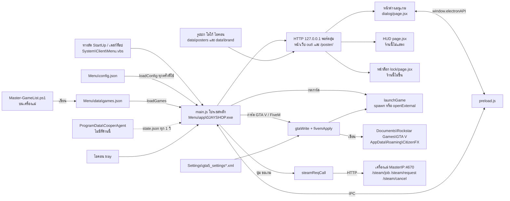

- **โปรเซสหลัก (`main.js`)** ทำทุกอย่างที่ต้องแตะไฟล์หรือเปิดโปรแกรม หน้าเว็บทำเองไม่ได้ (`contextIsolation: true`, `nodeIntegration: false`) ต้องเรียกผ่าน `window.electronAPI` ที่ `preload.js` เปิดไว้ให้
- **หน้าเว็บ** โหลดจากเซิร์ฟเวอร์ HTTP ในโปรแกรมเอง `http://127.0.0.1:<พอร์ตสุ่ม>` (เครื่องอื่นเข้าไม่ได้) มี 3 หน้า: `/` = HUD, `/dialog/?tab=gamemenu` = เมนูเกม, `/lock/` = หน้าล็อก
- **รูปทุกรูปในเครื่อง** (ปก โลโก้ ไอคอน) ส่งผ่าน `/poster/<path เต็มที่เข้ารหัส>`
- **หน้าต่างโชว์ทีละ 1** (13 พ.ย.): HUD กับเมนูเกมไม่ขึ้นพร้อมกัน แถบงานมีปุ่มเดียว

| หน้าต่าง | หน้าเว็บ | ขนาด | ร้านนี้ตอนนี้ |
|---|---|---|---|
| HUD | `/` → `src/app/page.jsx` | กว้าง 310 × `hudSize`% สูงตามหน้า ชิดขวาบน | สร้างแต่ไม่แสดง (`ui.menuOnly: true`) |
| เมนูเกม | `/dialog/?tab=<แท็บ>` → `src/app/dialog/page.jsx` | 1080×680 (เล็กสุด 880×560) × `menuSize`% ไม่เกินจอ | เปิดตอนเริ่มโปรแกรม เป็นหน้าต่างหลัก |
| หน้าล็อก | `/lock/` → `src/app/lock/page.jsx` (จอหลัก) · จอรองเป็นสีดำ | เต็มจอทุกจอ | ไม่ขึ้น (ต้องมีไฟล์ของ Cooper Agent ซึ่ง [SHOP-API.md](SHOP-API.md) บอกว่าเครื่องลูกยังไม่มี) |

---

## ลูกค้าเห็นอะไร ทีละขั้น

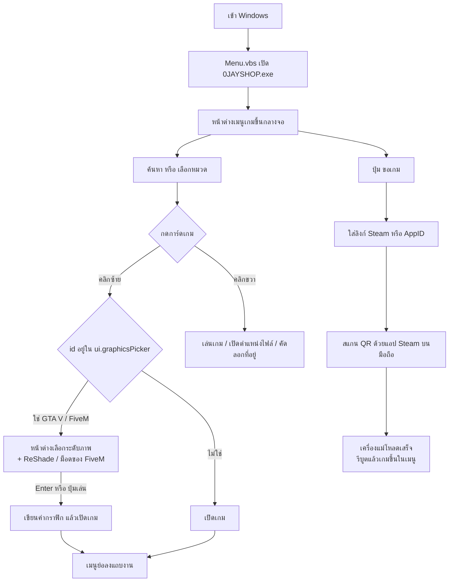

1. **เริ่ม** — เข้า Windows แล้วทางลัด `0JAYSHOP` ใน StartUp (ทุกผู้ใช้) เปิด `System\Client\Menu.vbs` ซึ่งหา `Menu\app\<ชื่อร้าน>.exe` เอง (ตอนนี้ `0JAYSHOP.exe`) ไอคอน `0JAYSHOP` บนเดสก์ท็อปทำแบบเดียวกัน
2. **หน้าต่างเมนูเกม** ขึ้นกลางจอเมื่อหน้าวาดเสร็จ (รอไม่เกิน 2.5 วิ) เป็นหน้าต่างธรรมดา ไม่ค้างบนสุด ลาก / ย่อ / ขยายได้ · มีไอคอน `0JAYSHOP` ใน tray คลิกขวามีแค่ "เปิดเกมเมนู" (ไม่มีปุ่มออก)
3. **แถบบน** — โลโก้ + ชื่อร้าน · ปุ่ม ย่อ / ขยาย-คืนขนาด / ปิด · **ปุ่มปิด (และ Alt+F4) แค่ย่อเมนูไว้ที่แถบงาน** ไม่ปิดโปรแกรม
4. **แถบเครื่องมือ** — ช่องค้นหา "ค้นหาเกม (เช่น Valorant, FiveM)" · ปุ่มหมวด (ไอคอน) · ปุ่มโปรแกรมด่วน = 4 ตัวแรกของหมวด `Apps` (ตอนนี้ AnyDesk, Brave, Discord PTB, Google Chrome) · ปุ่ม "ขอเกม" · ปุ่ม "สุ่ม" · ปุ่มโหลดรายชื่อเกมใหม่
5. **รายชื่อเกม** — หัวข้อ "เกมทั้งหมด" + จำนวน แล้วการ์ด: รูปปก, ไอคอนค่ายมุมการ์ด, ชื่อเกม, ชี้เมาส์ขึ้นปุ่ม "เล่นเกม" · รูปปกเสีย = ตัวอักษรแรกของชื่อ · ตอนนี้ `games.json` บนเครื่องแม่มี 107 เกม
6. **หมวด** — ปุ่มแรก "ทั้งหมด" แล้วหมวดตามลำดับที่เจอใน `games.json` (ตอนนี้ Steam, Riot, Epic, EA, Rockstar, Ubisoft, Garena, Online, Anime RPG, Apps, Launchers) · ปุ่มเป็นไอคอนอย่างเดียว ชื่อหมวด + จำนวนขึ้นเมื่อชี้เมาส์
7. **ค้นหา** — กรองทันทีที่พิมพ์ ไม่สนตัวพิมพ์ใหญ่เล็ก หาในชื่อเกม ชื่อหมวด (ทั้งชื่อในไฟล์และชื่อไทย) และค่าย · `Ctrl+F` = ไปช่องค้นหา · `Esc` = ล้างคำ · ไม่เจอ = "ไม่พบเกมที่ตรงกับคำค้นหา" + ปุ่ม "ดูเกมทั้งหมด"
8. **กดการ์ด** — toast "กำลังเปิด: <ชื่อ>..." → เกมเริ่ม → เมนูย่อลงแถบงานเอง · เปิดไม่ได้ = toast "เปิดไม่สำเร็จ: <สาเหตุ>"
9. **คลิกขวาการ์ด** — กล่องเล็ก: ชื่อเกม + ที่อยู่ไฟล์บนเครื่อง (หรือ "ไม่พบตำแหน่งไฟล์ของเกมนี้บนเครื่อง") · "เล่นเกม" · "เปิดตำแหน่งไฟล์" (เปิด Explorer แล้วเมนูย่อ) · "คัดลอกที่อยู่" · ปิดเมื่อคลิกที่อื่น / กด Esc / หมุนลูกกลิ้งเมาส์ / เปลี่ยนขนาดหน้าต่าง / สลับไปหน้าต่างอื่น
10. **ตัวเลือกภาพ GTA** — การ์ด Grand Theft Auto V Legacy และ FiveM ขึ้นหน้าต่าง "เลือกระดับภาพ": ขนาดจอ + Hz, ชื่อการ์ดจอ, 3 ระดับ (ต่ำสุด "แนะนำ" / กลาง / สูง) · FiveM มีแถว "ReShade ภาพสวย" (และม็อดถ้ามี) · `Enter` = เล่น · `Esc` = ยกเลิก · ลูกศร = เลือกระดับ · ดับเบิลคลิกระดับ = เล่นเลย · ข้อความล่าง "รีบูตแล้วกลับเป็นต่ำสุด" (ละเอียด: [GTA-GRAPHICS.md](GTA-GRAPHICS.md))
11. **ขอเกม** — หน้าต่าง "ขอเกม Steam": ใส่ลิงก์หน้าเกม Steam หรือเลข AppID → "ส่งคำขอ" → สถานะ (รอคิว / กำลังตรวจ / รอสแกน QR / กำลังโหลด / กำลังตรวจไฟล์ / กำลังเพิ่มเข้าคลัง / เสร็จแล้ว / มีเกมนี้แล้ว / ไม่สำเร็จ / ยกเลิกแล้ว) → QR ให้สแกนด้วยแอป Steam (นับถอยหลัง) → แถบ % → เสร็จ → รีบูตแล้วเกมขึ้นในเมนู · `Esc` ปิดหน้าต่างได้ งานยังทำต่อ · ปุ่ม "ยกเลิกคำขอ" / "ขอเกมอื่น" (ฝั่งเครื่องแม่: [STEAM-REQUESTS.md](STEAM-REQUESTS.md))
12. **สุ่ม** — สุ่ม 1 เกมที่ไม่ใช่หมวด `Launchers` / `Apps` แล้วเปิด (สุ่มได้ GTA ก็ถามระดับภาพ)
13. **โหลดใหม่** — อ่าน `games.json` ใหม่ (เครื่อง diskless เห็นไฟล์ใหม่ของเครื่องแม่หลังรีบูตเท่านั้น ระหว่างนั้นใช้รายการที่อ่านได้ตอนเปิดโปรแกรม)
14. **เปิดซ้ำ** — ดับเบิลคลิกไอคอนเดสก์ท็อป หรือคลิก tray ตอนเมนูย่ออยู่ = เมนูเดิมกลับขึ้นมา (เปิดได้ทีละตัวต่อเครื่อง)

### ภาพหน้าจอจริง

ภาพทั้งหมดถ่ายเมื่อ 20 พ.ย. 2026 ด้วยวิธีนี้:
- ใช้ตัวเมนูที่ build จริงของร้าน (`Menu\app\resources\app\out`) กับรายชื่อเกมจริง (`Menu\data\games.json` 107 เกม) ขนาดหน้าต่าง 1080x680 เท่ากับที่ `openCenterDialog` เปิด
- ส่วนที่ Electron ต่อกับ Windows (`window.electronAPI`) ใช้ตัวจำลองแทน จึงไม่มีเกมไหนถูกเปิดจริงตอนถ่าย

**1. หน้าแรก: เกมทั้งหมด** (ข้อ 3–5)

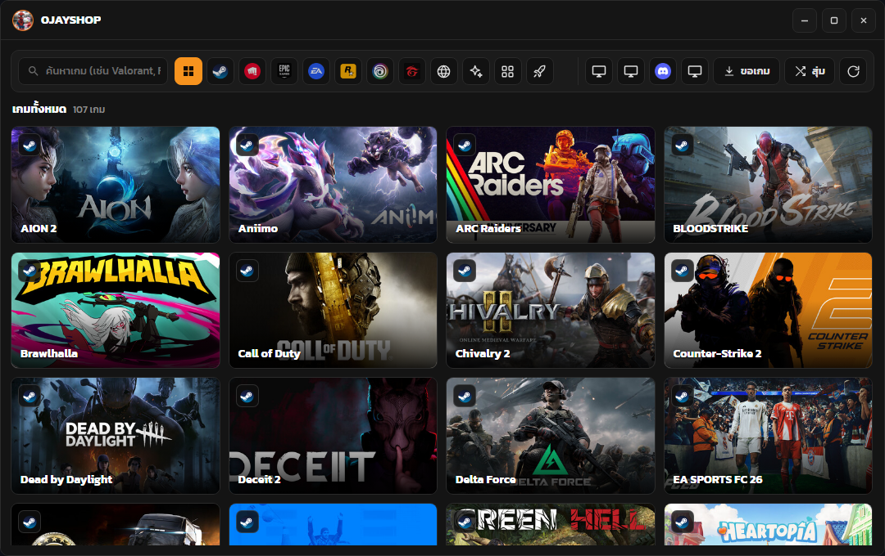

*แถบบนมีโลโก้กับปุ่มหน้าต่าง · แถบเครื่องมือมีช่องค้นหา, ปุ่มหมวด 12 ปุ่ม, ปุ่มโปรแกรมด่วน, "ขอเกม", "สุ่ม" และโหลดใหม่ · ด้านล่างเป็นการ์ดเกมพร้อมไอคอนค่ายที่มุม*

**2. เลือกหมวด** (ข้อ 6): ภาพนี้คือหมวด Anime RPG มี 8 เกม

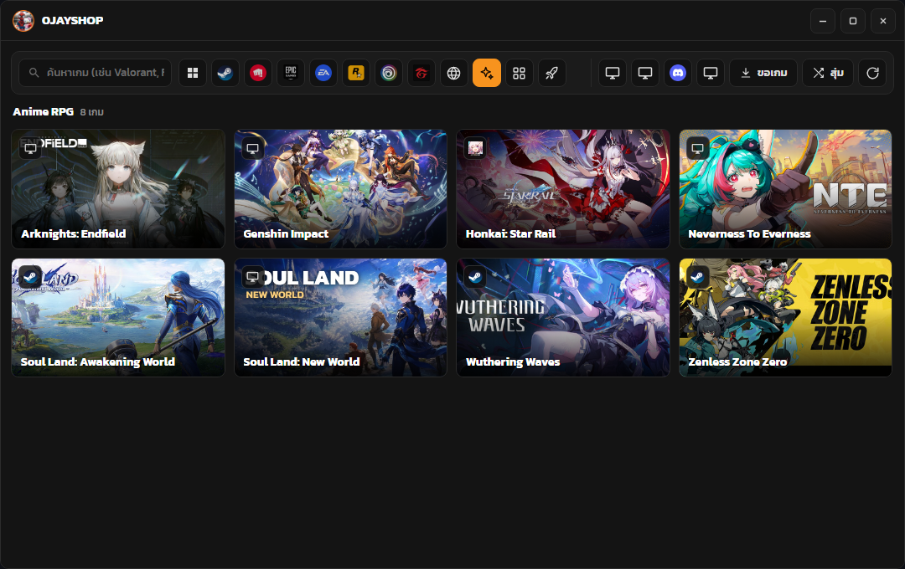

*การ์ดที่ไม่มีรูปปกแสดงตัวอักษรแรกของชื่อแทน (Arknights: Endfield, Neverness To Everness)*

**3. ค้นหา** (ข้อ 7): ภาพนี้พิมพ์ว่า "gta"

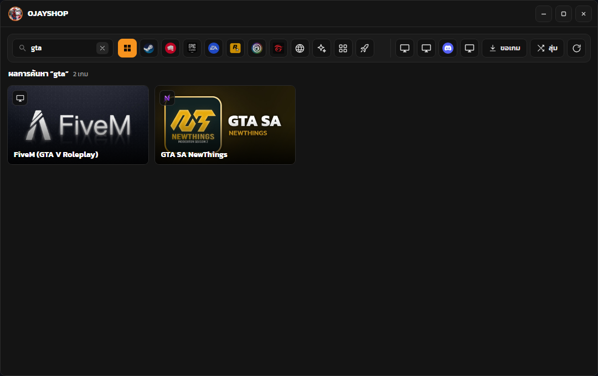

**4. คลิกขวาที่การ์ด** (ข้อ 9)

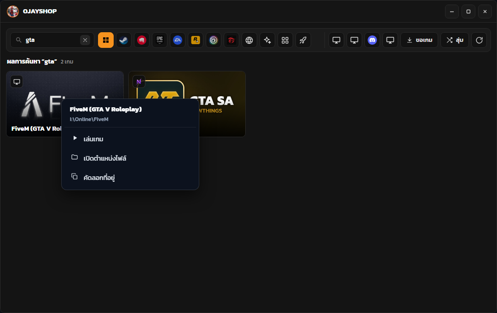

*กล่องแสดงชื่อเกม ที่อยู่บนเครื่อง (`I:\Online\FiveM`) และปุ่ม เล่นเกม / เปิดตำแหน่งไฟล์ / คัดลอกที่อยู่*

**5. ตัวเลือกระดับภาพ GTA V / FiveM** (ข้อ 10)

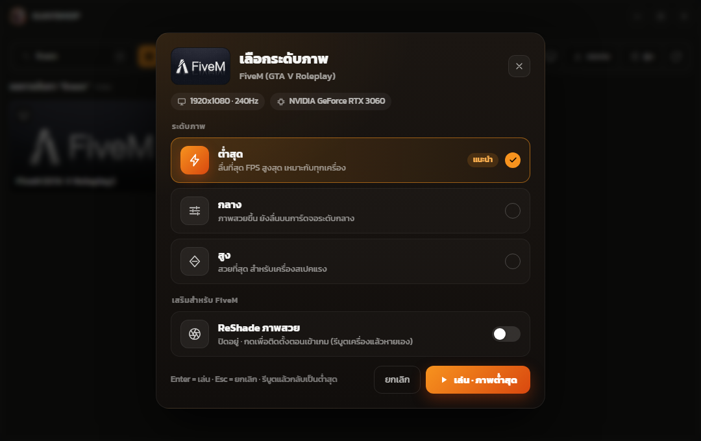

*ขนาดจอ 1920x1080 · 240Hz และชื่อการ์ดจอในภาพนี้เป็น **ค่าตัวอย่างของตัวจำลอง** บนเครื่องลูกจะเห็นค่าของเครื่องนั้นจาก `gtaInfo()` · แถว ReShade ขึ้นเพราะร้านมี `Tools\FiveM-ReShade` และยังไม่มีม็อดใน `Tools\FiveM-Mods`*

**6. ขอเกม Steam** (ข้อ 11)

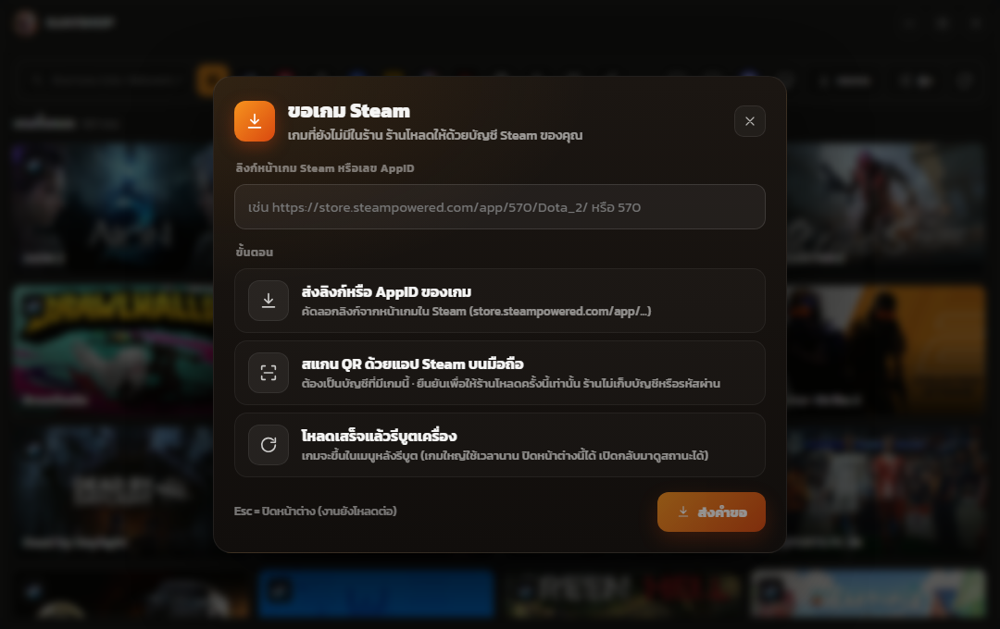

*ยังไม่มีงานจึงแสดงฟอร์ม: ช่องลิงก์ / AppID และ 3 ขั้นตอน*

ร้านนี้ลูกค้า **ไม่เห็น**: HUD เวลาคงเหลือ, แท็บร้าน (ซื้อไอดี / คลังรหัส / แชทร้าน / เติมเงิน / บัญชี), คอลัมน์ขวา (แบนเนอร์ / แนะนำจากร้าน / ประกาศ), แถบสถานะล่าง, หน้าล็อก

---

## ค่าใน config.json

ไฟล์ `Menu\config.json` ใช้ร่วมกันทุกเครื่อง · แก้ด้วย Notepad (UTF-8) หรือคอนโซล OSYNC แท็บ "ระบบร้าน" (แก้ได้ 5 คีย์: `apiUrl` `machineId` `brandName` `ui.menuOnly` `ui.sidePanel` — `System\Scripts\Console-Server.ps1:14`)

| คีย์ | ค่าตอนนี้ | ความหมาย / ผลที่ร้านนี้ |
|---|---|---|
| `_help` | ข้อความอังกฤษ | คำอธิบาย โปรแกรมไม่อ่าน · ข้อความชวนให้คิดว่าตั้ง `apiUrl` แล้วทุกระบบพร้อม — ไม่จริง ดู [SHOP-API.md](SHOP-API.md) ข้อ 0 |
| `brandName` | `0JAYSHOP` | ชื่อร้าน: ชื่อหน้าต่าง, tooltip ของ tray, ชื่อแอปใน Windows (AppUserModelId), ชื่อบนเมนู, ชื่อไฟล์ exe ตอน build, ชื่อทางลัด · ว่าง = `0JAYSHOP` |
| `brandBadge` | `VIP` | ป้ายข้างชื่อร้านบน HUD · มีในโค้ด แต่ร้านนี้ไม่เห็น: `ui.menuOnly=true` |
| `brandLogo` | `data\brand\logo.png` | โลโก้ (ไฟล์เทียบกับ `Menu\` หรือ URL) มุมซ้ายบนของเมนู และหน้าล็อก · ว่าง = `data\brand\logo.png` ถ้ามีไฟล์ |
| `machineId` | `""` | ว่าง = ชื่อเครื่อง (`os.hostname()` เช่น KORI12) · ใช้เป็น `pc` ในคำขอเกม Steam และ `X-Machine-ID` ของ `apiUrl` · ห้ามใส่ค่า (ทุกเครื่องจะได้ ID เดียวกัน) |
| `apiUrl` | `""` | ว่าง = ออฟไลน์ ไม่ยิงเน็ต · มีในโค้ด แต่ร้านนี้ปิดอยู่: `apiUrl=""` ([SHOP-API.md](SHOP-API.md) ข้อ 1.2) |
| `_ui_help` | ข้อความไทย | คำอธิบายคีย์ `ui` โปรแกรมไม่อ่าน |
| `ui.font` | `Kanit` | ฟอนต์: `Kanit` / `Prompt` / `Chakra Petch` / `Leelawadee UI` / `Tahoma` · ค่าอื่น = `Kanit` |
| `ui.hudSize` | `100` | % ขนาด HUD (80–130 นอกนั้น = 100) · ร้านนี้ไม่เห็น HUD |
| `ui.menuSize` | `100` | % ขนาดเมนูเกม: หน้าต่าง 1080×680 (เล็กสุด 880×560) คูณ % ไม่เกินจอ − 20 px และ zoom ทั้งหน้า |
| `ui.lockSize` | `100` | % zoom หน้าล็อก · ร้านนี้ไม่มีหน้าล็อก |
| `ui.hudBanner` | `""` | รูปแบนเนอร์ (ไฟล์เทียบ `Menu\` หรือ URL) · `""` = การ์ดไล่สีไม่มีรูป · `off` = ซ่อน · อยู่บน HUD และคอลัมน์ขวาของเมนู → ร้านนี้ไม่เห็น (`menuOnly=true`, `sidePanel=false`) |
| `ui.hudBannerTag` | `""` | ป้ายบนแบนเนอร์ (ไม่เกิน 24 ตัว) · ว่าง = `HOT ID SALE` |
| `ui.hudBannerText` | `""` | ข้อความบนแบนเนอร์ (ไม่เกิน 140 ตัว) · ว่าง = `ไอดี Valorant / ROV / Steam สกินแรร์ พร้อมส่ง` |
| `ui.featured` | `riot-valorant`, `steam-578080`, `fivem` | id เกมในกล่อง "แนะนำจากร้าน" (ไม่เกิน 6) = VALORANT, PUBG: BATTLEGROUNDS, FiveM · มีในโค้ด แต่ร้านนี้ไม่เห็น: `ui.sidePanel=false` (กล่องอยู่ในคอลัมน์ขวา) |
| `ui.categoryNames` | `{}` | ชื่อหมวดที่โชว์ เพิ่ม/ทับค่าเริ่ม · ค่าเริ่ม (`config.js:85`): Online=เกมออนไลน์, Apps=โปรแกรม, Launchers=ตัวเปิดเกม, Single Player=เกมเนื้อเรื่อง, Mobile=เกมมือถือ, Emulator=อีมูเลเตอร์, Gacha=เกมกาชา, Riot=Riot Games, Battle.net=Battle.net · หมวดอื่นโชว์ชื่อตามไฟล์ |
| `ui.graphicsPicker` | `steam-271590`, `fivem` | id เกมที่ถามระดับภาพก่อนเล่นทุกครั้ง (ไม่เกิน 10) = Grand Theft Auto V Legacy, FiveM · ไม่มีคีย์ = ค่าเดียวกันนี้ |
| `ui.menuOnly` | `true` | `true` = เมนูเกมอย่างเดียว: ไม่แสดง HUD, เปิดเมนูตอนเริ่ม, ไม่มีแท็บร้าน, เมนูไม่ค้างบนสุด, ปิด = ย่อ, tray มีแค่ "เปิดเกมเมนู" · ต้องเป็น `true` จริงๆ (ค่าอื่น = `false`) |
| `ui.sidePanel` | `false` | `false` = ไม่มีคอลัมน์ขวา (แบนเนอร์ระบบร้าน, แบนเนอร์ร้าน, แนะนำจากร้าน, ประกาศ) และไม่มีแถบสถานะ (ชื่อเครื่อง, เวลา, ปุ่ม "แชทร้าน") · ค่าอื่น = มี |
| `ui.steamRequest` | `true` | `true` = ปุ่ม "ขอเกม" ส่งไป `http://<MasterIP>:<ClientReportPort>` จาก `Settings\settings.txt` → ตอนนี้ `http://192.168.51.201:4670` (ไม่มี `ClientReportPort` ในไฟล์ จึงใช้ 4670) · URL `http(s)://host:port` = ส่งไปที่นั้น · ค่าอื่น = ไม่มีปุ่ม |

คีย์ที่โค้ดอ่านแต่ไม่มีในไฟล์: `brandMark` = โลโก้เล็กไม่มีตัวหนังสือ (ว่าง = `data\brand\logo-mark.png` ถ้ามี — ตอนนี้ไม่มีไฟล์ จึงใช้ `brandLogo`)

ข้อควรรู้:
- **ไม่ต้อง build ใหม่** เมื่อแก้ค่าในไฟล์นี้ — `main.js` อ่านไฟล์ใหม่ทุกครั้งที่ใช้ (สร้างหน้าต่าง, เปิดหน้า, กดปิด) · ยกเว้น `brandName` ที่เป็นชื่อไฟล์ exe และข้อมูลในไฟล์ exe (ต้อง Build-App)
- **เครื่องลูกเห็นค่าใหม่หลังรีบูต** (`_ui_help`: "แก้แล้วเครื่องลูกเห็นหลังรีบูต")
- **JSON พัง = ค่าเริ่มทั้งหมด** (`readJson` คืน `{}`) → `menuOnly` กลายเป็น `false` = HUD และแท็บร้านโผล่ · บันทึกแล้วตรวจลูกน้ำ / วงเล็บ
- ฝั่งเครื่องแม่ของปุ่มขอเกม: `Settings\settings.txt` `SteamRequests=on` (off = ปุ่มยังอยู่ แต่ลูกค้าเห็นว่าร้านปิดระบบไว้)
- คนอื่นที่อ่านไฟล์นี้: `tools\_system\AppName.ps1` (ชื่อ exe), `Get-MenuInfo` ใน `System\Scripts\Common.ps1:339`, `Console-Server.ps1`

---

## 1. `electron/main.js` — โปรเซสหลักของโปรแกรม

**หน้าที่:** โปรเซสหลักของ Electron: เปิดเซิร์ฟเวอร์ HTTP ในเครื่องให้หน้าเว็บ, สร้างหน้าต่าง (HUD, เมนูเกม, หน้าล็อก) และ tray, รับคำสั่งจากหน้าเว็บทาง IPC แล้วเปิดเกม / เขียนค่ากราฟิก GTA / ส่งคำขอเกมไปเครื่องแม่

**เรียกจาก / ทำงานเมื่อไหร่:**
- เครื่องลูก: ทางลัดใน StartUp และ Public Desktop → `wscript.exe System\Client\Menu.vbs` → `Menu\app\0JAYSHOP.exe` · ทางลัดสร้างโดย `System\Scripts\Client-Menu.ps1 -NoStart` จาก `OSYNC.bat > 5` (ขั้น "5 Menu") และทุกบูต (ขั้น "1b Menu" ของ `Client-Install.ps1 -Boot`)
- เปิดตัวที่สองบนเครื่องเดียวกัน = ตัวเดิมเอาหน้าต่างขึ้นมา แล้วตัวใหม่ปิดเอง
- เครื่องแม่: `Master-GameList.ps1:316` รัน `0JAYSHOP.exe --imagetool <jobs.json>` เพื่อทำรูปปก (ไม่มีหน้าต่าง)
- `Build-App.ps1` รันพร้อม env `GCAFE_SELFTEST` เพื่อทดสอบหลัง build

**พารามิเตอร์:**
- `--imagetool <jobs.json>` — ทำรูปปกตามไฟล์งานแล้วจบ (ดูข้อ 21)
- env สำหรับทดสอบเท่านั้น: `GCAFE_SELFTEST=<โฟลเดอร์>` (self-test), `GCAFE_SELFTEST_CAT=<หมวด>` (กดหมวดก่อนถ่ายรูป), `GCAFE_GTA_TESTDIR=<โฟลเดอร์>` (เขียนค่ากราฟิกลงโฟลเดอร์นี้ ไม่เปิดเกม), `GCAFE_STEAMREQ_URL=<url>` (ทับที่อยู่เครื่องแม่ของปุ่มขอเกม), `GCAFE_STEAMREQ_APP=<AppID>` (AppID ที่ self-test ส่ง ค่าเริ่ม 480)

**อ่านค่า:**
- `Menu\config.json` (ทุกครั้งที่เรียก `loadConfig`)
- `Menu\data\games.json`, `Menu\data\brand\logo.png` / `logo-mark.png` / `app.ico`, `Menu\data\posters\_auto\icons\<id>.png`
- หน้าเว็บใน `out\` (ตัวที่ build แล้ว: `Menu\app\resources\app\out\`)
- `Settings\settings.txt` คีย์ `MasterIP`, `ClientReportPort` (ปุ่มขอเกม)
- `Settings\gta5_settings.xml`, `gta5_settings-medium.xml`, `gta5_settings-high.xml`
- `Tools\FiveM-ReShade\`, `Tools\FiveM-Mods\<ชื่อ>\`
- คลิกขวา: `<Steam>\steamapps\libraryfolders.vdf`, `appmanifest_<id>.acf`, `%ProgramData%\Riot Games\Metadata\<product>.live\<product>.live.product_settings.yaml`
- `%ProgramData%\CooperAgent\state.json` และ `gcafe.json` (ทุก 1 วิ)
- env `COMPUTERNAME`, `ProgramData`

**เขียน / เปลี่ยน:**
- เปิดพอร์ต HTTP ที่ `127.0.0.1` พอร์ตที่ระบบสุ่มให้ (`listen(0)`) — ฟังเฉพาะในเครื่อง ไม่มีกฎ firewall
- `%ProgramData%\CooperAgent\gcafe\alive.json` ทุก 2 วิ (เฉพาะถ้าโฟลเดอร์มีอยู่แล้ว)
- GTA: `Documents\Rockstar Games\GTA V\settings.xml` และ `%APPDATA%\CitizenFX\gta5_settings.xml` ของผู้ใช้ที่เล่น
- FiveM: `<FiveM>\FiveM.app\plugins\*` (`ReShade64.dll` เป็น `dxgi.dll`), `mods\*`, `osync-installed.json` และ `CitizenFX.ini` `[Addons] ReShade5=`
- self-test: `selftest-*.png`, `selftest.json` ในโฟลเดอร์ `GCAFE_SELFTEST`
- เปิดเกมเป็นโปรเซสแยก (detached)

**Log:** `%TEMP%\gcafe-gta-graphics.log` (เฉพาะตัวเลือกภาพ GTA / FiveM) · ส่วนอื่นของโปรแกรมไม่เขียน log

**ขั้นตอนการทำงาน:**
1. ตั้งชื่อแอปใน Windows = `brandName` (บรรทัด 10 เรียก `loadConfig` ตั้งแต่ต้นไฟล์)
2. มี `--imagetool` → โหลด `tools\_system\imagetool\render.js` ทำรูปปกแล้วจบ (ไม่มีหน้าต่าง ไม่ล็อกตัวเดียว)
3. `requestSingleInstanceLock` ไม่ได้ = มีตัวอื่นเปิดอยู่ → ปิดตัวเอง (ตัวเดิมได้ `second-instance` → `showMainWindow`)
4. `whenReady`: `loadGames()` ครั้งแรก (หลังบูตอ่านได้เสมอ)
5. `startServer(out)` ได้พอร์ต → `createMainWindow` (HUD ร้านนี้ไม่แสดง) → `createTray`
6. มี `GCAFE_SELFTEST` → `runSelfTest` แล้วหยุดตรงนี้
7. `ui.menuOnly` → `openCenterDialog('gamemenu')` เปิดเมนูเกมทันที
8. `agentTick` ทุก 1 วิ (ตามสถานะระบบร้าน) และ `writeAlive` ทุก 2 วิ

**การเปิดเกมจากการ์ด** (หน้าเว็บ → `main.js`):

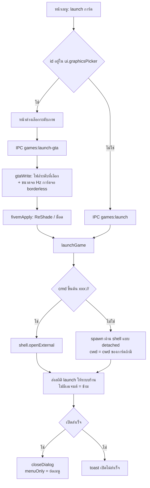

**ช่อง IPC ทั้งหมด** (`ipcMain` — หน้าเว็บเรียกผ่าน `preload.js` ข้อ 2):

| ช่อง | บรรทัด | ชนิด | ทำอะไร |
|---|---|---|---|
| `config:get` | [654](../../Menu/source/electron/main.js#L654) | on (sync) | คืน `loadConfig()` ให้ preload ทำ `window.appConfig` ตอนโหลดหน้า |
| `games:list` | [655](../../Menu/source/electron/main.js#L655) | handle | รายชื่อเกม `withIcons(loadGames())` |
| `games:launch` | [656](../../Menu/source/electron/main.js#L656) | handle | `launchGame(game)` สำเร็จแล้ว `closeDialog(false)` |
| `gta:info` | [858](../../Menu/source/electron/main.js#L858) | handle | ขนาดจอ, Hz, การ์ดจอ (`gtaInfo`) |
| `fivem:state` | [859](../../Menu/source/electron/main.js#L859) | handle | ReShade / ม็อดของ FiveM มีไหม เปิดอยู่ไหม |
| `games:launch-gta` | [860](../../Menu/source/electron/main.js#L860) | handle | `gtaWrite(level)` + `fivemApply` แล้ว `launchGame` + `closeDialog(false)` · ระดับที่ไม่รู้จัก = `low` · มี `GCAFE_GTA_TESTDIR` = ไม่เปิดเกม คืนผลทดสอบ |
| `steamreq:job` | [912](../../Menu/source/electron/main.js#L912) | handle | `GET /steam/job` ที่เครื่องแม่ |
| `steamreq:send` | [913](../../Menu/source/electron/main.js#L913) | handle | `POST /steam/request` body `{app: ข้อความ ≤300 ตัว, pc: machineId}` |
| `steamreq:cancel` | [914](../../Menu/source/electron/main.js#L914) | handle | `POST /steam/cancel` |
| `games:location` | [917](../../Menu/source/electron/main.js#L917) | handle | หาเกมตาม id แล้ว `gameLocation` |
| `games:reveal` | [921](../../Menu/source/electron/main.js#L921) | handle | ไฟล์ = `showItemInFolder` · โฟลเดอร์ = `openPath` แล้ว `closeDialog(false)` |
| `window-minimize` | [935](../../Menu/source/electron/main.js#L935) | on | ย่อ HUD |
| `hud:fit` | [938](../../Menu/source/electron/main.js#L938) | on | ปรับความสูง HUD ตามหน้า (200 ถึงสูงจอ − 40) รับเฉพาะจากหน้า HUD |
| `window-close` | [947](../../Menu/source/electron/main.js#L947) | on | ซ่อน HUD + เมนู แล้วขึ้น balloon "โปรแกรมซ่อนอยู่ที่นี่ คลิกเพื่อเปิดกลับมา" |
| `dialog-maximize` | [955](../../Menu/source/electron/main.js#L955) | on | ขยาย / คืนขนาดเมนู |
| `dialog-minimize` | [958](../../Menu/source/electron/main.js#L958) | on | ย่อเมนู |
| `quit-app` | [960](../../Menu/source/electron/main.js#L960) | on | ของเก่า: แค่ซ่อนหน้าต่าง ไม่ปิดโปรแกรม |
| `agent:get` | [963](../../Menu/source/electron/main.js#L963) | handle | `readAgent()` สถานะระบบร้าน |
| `api:call` | [964](../../Menu/source/electron/main.js#L964) | handle | `apiCall` ไปเว็บร้าน (token อยู่ใน main เท่านั้น) |
| `open-dialog` | [965](../../Menu/source/electron/main.js#L965) | on | `openCenterDialog(tab)` |
| `close-dialog` | [966](../../Menu/source/electron/main.js#L966) | on | `closeDialog(true)` |
| `launch-game` | [969](../../Menu/source/electron/main.js#L969) | on | ของเก่า: `launchGame({cmd})` |
| `order-placed` | [971](../../Menu/source/electron/main.js#L971) | on | เมนูเปิดอยู่ = เก็บไว้ใน `pendingOrders` · ไม่งั้นส่ง `order-notify` ให้ HUD |

ส่งจาก main ไปหน้าเว็บ: `agent:update` ([208](../../Menu/source/electron/main.js#L208), ทุกหน้าต่าง), `switch-tab` ([606](../../Menu/source/electron/main.js#L606), [645](../../Menu/source/electron/main.js#L645)), `order-notify` ([565](../../Menu/source/electron/main.js#L565), [973](../../Menu/source/electron/main.js#L973)) · event ของแอป: `second-instance` ([978](../../Menu/source/electron/main.js#L978)), `whenReady` ([980](../../Menu/source/electron/main.js#L980)), `window-all-closed` ([1087](../../Menu/source/electron/main.js#L1087))

**ฟังก์ชัน:**

| ฟังก์ชัน | บรรทัด | หลักการทำงาน |
|---|---|---|
| [`gcafeRoot`](../../Menu/source/electron/main.js#L42) | 42 | โฟลเดอร์ `Menu\`: ตัวที่ build แล้ว = แม่ของ `app\` · ตอนพัฒนา = แม่ของ `source\` |
| [`readJson`](../../Menu/source/electron/main.js#L48) | 48 | อ่าน JSON (ตัด BOM) ไม่มี / พัง = คืนค่า fallback |
| [`localImageUrl`](../../Menu/source/electron/main.js#L58) | 58 | ไฟล์รูปในเครื่อง (path เต็มหรือเทียบ `Menu\`) → `/poster/<path>?v=<เวลาไฟล์>` · URL `http:` `data:` `/` ส่งต่อเหมือนเดิม |
| [`buildStamp`](../../Menu/source/electron/main.js#L67) | 67 | เวลาไฟล์ `out\index.html` แบบ `YYYY-MM-DD HH:MM` (จำไว้) โชว์มุมหน้าล็อก |
| [`p2`](../../Menu/source/electron/main.js#L72) | 72 | เติม 0 ให้ครบ 2 หลัก (ใน `buildStamp`) |
| [`loadUi`](../../Menu/source/electron/main.js#L82) | 82 | ตรวจและกรองค่า `config.json` "ui" เป็นค่าที่ใช้จริง (ดูหัวข้อย่อยด้านล่าง) |
| [`pct`](../../Menu/source/electron/main.js#L85) | 85 | ขนาด % ปัดเป็นจำนวนเต็ม 80–130 นอกนั้น = 100 |
| [`text`](../../Menu/source/electron/main.js#L86) | 86 | ข้อความ trim + ตัดความยาว · ไม่ใช่ string = `''` |
| [`loadConfig`](../../Menu/source/electron/main.js#L110) | 110 | อ่าน `config.json` ใหม่ทุกครั้ง คืน brandName, brandBadge, brandLogo, brandMark, icons, apiUrl, machineId, ui, build |
| [`iconFile`](../../Menu/source/electron/main.js#L130) | 130 | path ไอคอน `data\posters\_auto\icons\<id>.png` (ตัดอักขระที่ใช้ในชื่อไฟล์ไม่ได้) |
| [`launcherIcons`](../../Menu/source/electron/main.js#L133) | 133 | ชื่อค่าย / หมวด → URL ไอคอน launcher ที่มีไฟล์จริง (Steam, Riot, EA, EA app, Epic, Garena, Rockstar, Ubisoft, HoYoPlay, Battle.net, Discord, Roblox, Amazon) |
| [`withIcons`](../../Menu/source/electron/main.js#L143) | 143 | ใส่ `icon` ให้เกมที่มีไฟล์ไอคอนของตัวเองและยังไม่มี `icon` |
| [`loadGames`](../../Menu/source/electron/main.js#L154) | 154 | อ่าน `games.json` · อ่านได้และไม่ว่าง = จำไว้ · พัง = คืนรายการที่อ่านได้ล่าสุด |
| [`readAgent`](../../Menu/source/electron/main.js#L181) | 181 | อ่าน `state.json` + `gcafe.json` ของ Cooper Agent → สถานะ (เชื่อมแล้ว = token `gt_` + server http(s) + `state.json` ใหม่ไม่เกิน 60 วิ) |
| [`broadcast`](../../Menu/source/electron/main.js#L206) | 206 | ส่ง `agent:update` ไปทุกหน้าต่าง |
| [`writeAlive`](../../Menu/source/electron/main.js#L212) | 212 | เขียน `alive.json` (เวลา, pid, managed, showing lock/hud, version) ถ้าโฟลเดอร์ `gcafe` มี |
| [`showLock`](../../Menu/source/electron/main.js#L220) | 220 | เปิดหน้าล็อกเต็มจอทุกจอ (kiosk, บนสุดระดับ screen-saver, ปิดไม่ได้, ห้ามไปหน้าอื่น) จอหลัก `/lock/` จอรองสีดำ · ซ่อน HUD · ทำลายหน้าต่างเมนู |
| [`keepLockOnTop`](../../Menu/source/electron/main.js#L253) | 253 | ดันหน้าล็อกกลับให้เต็มจอและอยู่บนสุด · โฟกัสจอหลักไม่ถี่กว่า 3 วิ |
| [`hideLock`](../../Menu/source/electron/main.js#L266) | 266 | ทำลายหน้าต่างล็อกทั้งหมด |
| [`agentTick`](../../Menu/source/electron/main.js#L273) | 273 | ทุก 1 วิ: `readAgent` → ต้องล็อก = เชื่อมแล้ว + ไม่มีการเช่า + ไม่มี `ending` → `showLock` / `hideLock` + `showMainWindow` → `broadcast` |
| [`apiCall`](../../Menu/source/electron/main.js#L286) | 286 | ยิง `<server>/api/gcafe/<ชื่อ>` + Bearer token · ชื่อต้องอยู่ใน allowlist 17 ชื่อ · timeout 10 วิ · คืน `{ok, status, data}` |
| [`launchGame`](../../Menu/source/electron/main.js#L309) | 309 | เปิดเกม: `cmd` แบบ `xxx://` → `shell.openExternal` · อื่น → `spawn` ผ่าน shell, detached, ซ่อนหน้าต่าง, `cwd` ถ้ามีจริง · แล้วส่งสถิติ `launch` (ไม่รอ) |
| [`splitCmd`](../../Menu/source/electron/main.js#L333) | 333 | แยกบรรทัดคำสั่งเป็นคำ (`"..."` นับเป็นคำเดียว) |
| [`steamAppDir`](../../Menu/source/electron/main.js#L341) | 341 | โฟลเดอร์เกม Steam: `libraryfolders.vdf` → `appmanifest_<id>.acf` → `steamapps\common\<installdir>` |
| [`riotProductDir`](../../Menu/source/electron/main.js#L361) | 361 | โฟลเดอร์เกม Riot จาก `product_install_full_path` ใน yaml ของ Riot |
| [`gameLocation`](../../Menu/source/electron/main.js#L374) | 374 | ตำแหน่งไฟล์ของการ์ด (คลิกขวา) ตามชนิดคำสั่ง · ไม่มีจริง = error ไทย |
| [`gameById`](../../Menu/source/electron/main.js#L406) | 406 | หาเกมใน `games.json` ตาม id |
| [`getAppIcon`](../../Menu/source/electron/main.js#L411) | 411 | ไอคอนหน้าต่าง / tray: `data\brand\app.ico` > `electron\tray-icon.png` > รูปฝังในโค้ด |
| [`startServer`](../../Menu/source/electron/main.js#L439) | 439 | HTTP server `127.0.0.1` พอร์ตสุ่ม: `/poster/` = รูป · อื่น = ไฟล์ใน `out\` |
| [`hudScale`](../../Menu/source/electron/main.js#L495) | 495 | `hudSize / 100` |
| [`createMainWindow`](../../Menu/source/electron/main.js#L497) | 497 | สร้าง HUD 310×460 × hudSize ชิดขวาบน โปร่งใส ไร้กรอบ บนสุด · menuOnly = ไม่แสดง · กดปิด = ซ่อน · ถูกทำลาย = ปิดโปรแกรม |
| [`showMainWindow`](../../Menu/source/electron/main.js#L535) | 535 | เอาหน้าต่างของโปรแกรมขึ้นมา: ล็อกอยู่ = โฟกัสหน้าล็อก · menuOnly = `openCenterDialog('gamemenu')` · เมนูเปิดอยู่ = เมนู · อื่น = HUD |
| [`backToHud`](../../Menu/source/electron/main.js#L553) | 553 | เมนูปิดแล้ว: HUD กลับมา (ไม่แย่งโฟกัสถ้าเพิ่งเปิดเกม) + ส่ง toast ที่ค้าง · menuOnly = ไม่ทำอะไร |
| [`closeDialog`](../../Menu/source/electron/main.js#L568) | 568 | ปิดหน้าต่างเมนู (จำว่าจะโฟกัส HUD ไหม) · ไม่มีเมนู = `backToHud` |
| [`createTray`](../../Menu/source/electron/main.js#L576) | 576 | ไอคอน tray + เมนูคลิกขวา (menuOnly: "เปิดเกมเมนู" อย่างเดียว) · ไม่มีปุ่มออก · คลิก / ดับเบิลคลิก = `showMainWindow` |
| [`openCenterDialog`](../../Menu/source/electron/main.js#L598) | 598 | เปิดเมนูเกม: มีอยู่แล้ว = เอาขึ้น + `switch-tab` · ไม่มี = สร้างใหม่ กลางจอ ไร้กรอบ โปร่งใส · ล็อกอยู่ = ไม่เปิด |
| [`fitW`](../../Menu/source/electron/main.js#L613) | 613 | ความกว้าง × menuSize ไม่เกินจอ − 20 |
| [`fitH`](../../Menu/source/electron/main.js#L614) | 614 | ความสูง × menuSize ไม่เกินจอ − 20 |
| [`reveal`](../../Menu/source/electron/main.js#L632) | 632 | โชว์เมนูเมื่อวาดเสร็จ (`ready-to-show` หรือครบ 2.5 วิ) แล้วซ่อน HUD |
| [`gtaLog`](../../Menu/source/electron/main.js#L671) | 671 | ต่อบรรทัดใน `%TEMP%\gcafe-gta-graphics.log` (พังก็ไม่หยุด) |
| [`gtaGpuName`](../../Menu/source/electron/main.js#L675) | 675 | ชื่อการ์ดจอจริง (ไม่ใช่จอเสมือน) จาก `app.getGPUInfo` / ANGLE · ไม่ได้ = `Win32_VideoController` (NVIDIA > AMD > อื่น) · จำไว้ |
| [`rank`](../../Menu/source/electron/main.js#L694) | 694 | ลำดับการ์ด: NVIDIA 0, AMD 1, อื่น 2 |
| [`gtaInfo`](../../Menu/source/electron/main.js#L702) | 702 | จอหลัก: กว้าง × สูง (คูณ scaleFactor), Hz, ชื่อการ์ดจอ |
| [`xmlText`](../../Menu/source/electron/main.js#L707) | 707 | escape `&` `<` `>` สำหรับ XML |
| [`gtaWrite`](../../Menu/source/electron/main.js#L708) | 708 | ไฟล์ระดับภาพของร้าน + จอ / Hz / borderless / การ์ดจอของเครื่องนี้ → เขียน 2 ไฟล์ของ GTA V และ FiveM |
| [`setVal`](../../Menu/source/electron/main.js#L712) | 712 | แทนค่า `<Tag value="...">` ใน XML |
| [`osyncRoot`](../../Menu/source/electron/main.js#L735) | 735 | โฟลเดอร์ OSYNC (แม่ของ `Menu\`) |
| [`fivemApp`](../../Menu/source/electron/main.js#L736) | 736 | โฟลเดอร์ `FiveM.app` ข้าง `FiveM.exe` ของการ์ด (หรือในโฟลเดอร์ทดสอบ) · ไม่ใช่ FiveM = `''` |
| [`listFiles`](../../Menu/source/electron/main.js#L743) | 743 | รายชื่อไฟล์ทุกไฟล์ใต้โฟลเดอร์ (path ย่อย) |
| [`walk`](../../Menu/source/electron/main.js#L745) | 745 | เดินโฟลเดอร์ย่อย (ใน `listFiles`) |
| [`reshadeDir`](../../Menu/source/electron/main.js#L754) | 754 | `<OSYNC>\Tools\FiveM-ReShade` |
| [`modsDir`](../../Menu/source/electron/main.js#L755) | 755 | `<OSYNC>\Tools\FiveM-Mods` |
| [`reshadeFiles`](../../Menu/source/electron/main.js#L756) | 756 | คู่ [ต้นทาง, ชื่อใน plugins] ของ ReShade (ไม่เอา `SOURCE.txt`, `ReShade64.dll` → `dxgi.dll`) · ไม่มี `ReShade64.dll` = ว่าง |
| [`modNames`](../../Menu/source/electron/main.js#L761) | 761 | ชื่อโฟลเดอร์ม็อดที่มีไฟล์และไม่ขึ้นต้น `_` |
| [`manifestOf`](../../Menu/source/electron/main.js#L767) | 767 | อ่าน `osync-installed.json` (รายชื่อไฟล์ที่เมนูคัดลอกไป) |
| [`manifestSave`](../../Menu/source/electron/main.js#L768) | 768 | เขียน `osync-installed.json` |
| [`fivemState`](../../Menu/source/electron/main.js#L769) | 769 | ReShade มีให้ใช้ไหม / เปิดอยู่ไหม, ม็อดแต่ละตัวเปิดอยู่ไหม (จาก manifest) |
| [`copyIn`](../../Menu/source/electron/main.js#L780) | 780 | คัดลอกไฟล์เข้าโฟลเดอร์ปลายทาง คืนรายชื่อที่คัดลอก |
| [`removeOnly`](../../Menu/source/electron/main.js#L790) | 790 | ลบเฉพาะไฟล์ในรายชื่อ |
| [`fivemReshadeAck`](../../Menu/source/electron/main.js#L796) | 796 | สร้างข้อความ `ID:<hash> acknowledged ...` จากชื่อเครื่อง (Jenkins one-at-a-time ตัวพิมพ์เล็ก) |
| [`iniSet`](../../Menu/source/electron/main.js#L809) | 809 | ตั้งค่า / ลบ key ใน `[section]` ของไฟล์ ini (latin1, คงชนิดขึ้นบรรทัดเดิม) คืน true ถ้าไฟล์เปลี่ยน |
| [`fivemApply`](../../Menu/source/electron/main.js#L828) | 828 | เปิด / ปิด ReShade และม็อดตามที่ลูกค้าเลือก |
| [`steamReqBase`](../../Menu/source/electron/main.js#L876) | 876 | ที่อยู่เครื่องแม่ของปุ่มขอเกม: env > `ui.steamRequest` เป็น URL > `true` = `http://<MasterIP>:<ClientReportPort หรือ 4670>` · อื่น = `''` |
| [`get`](../../Menu/source/electron/main.js#L884) | 884 | อ่าน `key=value` จาก `settings.txt` (ตัดคอมเมนต์ `#`) |
| [`steamReqCall`](../../Menu/source/electron/main.js#L890) | 890 | HTTP ไปเครื่องแม่ timeout 8 วิ คืน JSON หรือข้อความ error ไทย |
| [`runSelfTest`](../../Menu/source/electron/main.js#L997) | 997 | ทดสอบหลัง build: ถ่ายรูป HUD / เมนู / ตัวเลือกภาพ / ขอเกม แล้วเขียน `selftest.json` และปิดโปรแกรม |
| [`save`](../../Menu/source/electron/main.js#L998) | 998 | บันทึกภาพหน้าจอเป็น PNG |
| [`visible`](../../Menu/source/electron/main.js#L999) | 999 | นับหน้าต่างที่มองเห็น |
| [`js`](../../Menu/source/electron/main.js#L1022) | 1022 | รัน JavaScript ในหน้าเมนู (ทดสอบตัวเลือกภาพ) |
| [`js`](../../Menu/source/electron/main.js#L1050) | 1050 | รัน JavaScript ในหน้าเมนู (ทดสอบขอเกม) |
| [`wait`](../../Menu/source/electron/main.js#L1051) | 1051 | รอ ms |

### `loadConfig` / `loadUi` — ค่าร้านอ่านใหม่ทุกครั้ง

- **อินพุต:** ไม่มี (อ่าน `Menu\config.json`) · **คืน:** object ค่าร้านที่กรองแล้ว · ไม่มี cache: เรียกตอนสร้างหน้าต่าง, ตอนหน้าเว็บโหลด (`config:get`), ตอนกดปิดเมนู, ตอน `showMainWindow` / `backToHud` / `hudScale` / ส่งคำขอเกม
- `loadUi` กรอง: font ต้องอยู่ใน 5 ตัว · ขนาด 80–130 · ข้อความตัดความยาว (banner 400, tag 24, text 140) · `featured` ≤ 6, `graphicsPicker` ≤ 10 (ไม่มี = GTA V + FiveM) · `categoryNames` ชื่อ ≤ 40 ตัว · `menuOnly` ต้องเป็น `true` · `sidePanel` ปิดเฉพาะ `false` · `steamRequest` = `true` หรือ URL `http(s)://host[:port]` หรือมี env `GCAFE_STEAMREQ_URL`
- ทำไมรายการฟอนต์อยู่ในฟังก์ชัน: comment บรรทัด 81 — `loadConfig()` ถูกเรียกตั้งแต่บรรทัด 10 ก่อนค่าคงที่ระดับไฟล์ถูกสร้าง
- `brandLogo` / `brandMark` / `hudBanner` ถูกแปลงเป็น `/poster/...?v=<เวลาไฟล์>` — เปลี่ยนรูปแล้วได้ที่อยู่ใหม่ ไม่มีเครื่องไหนค้างรูปเก่า

### `loadGames` — รายชื่อเกมบนเครื่อง diskless

- อ่าน `Menu\data\games.json` (เครื่องแม่เขียนด้วย `System\Scripts\Master-GameList.ps1` = `OSYNC.bat > 1` ขั้น "5 Menu - game list")
- เหตุผล (comment บรรทัด 151): เครื่องแม่เขียนไฟล์ใหม่หลังเครื่องลูกบูต เครื่องลูกจะอ่านเป็นขยะจนรีบูต → อ่านได้ไม่ว่าง = จำไว้ (`lastGoodGames`) · อ่านพัง = ใช้รายการที่จำไว้แทนเมนูว่าง
- ฟิลด์ในแต่ละเกมที่เมนูใช้:

| ฟิลด์ | ใช้ทำอะไร |
|---|---|
| `id` | key, `ui.featured`, `ui.graphicsPicker`, คลิกขวา, ไอคอน `_auto\icons\<id>.png` |
| `title` (หรือ `name`) | ชื่อบนการ์ด, ค้นหา, toast, สถิติ |
| `cat` (หรือ `category`) | หมวด · ไม่มี = `Online` |
| `platform` | ป้ายค่ายใน tooltip, ไอคอนมุมการ์ด, ค้นหา |
| `img` | รูปปก (`/poster/...`) |
| `cmd` | คำสั่งเปิดเกม |
| `cwd` | โฟลเดอร์ทำงานตอนเปิด และตำแหน่งไฟล์สำรองของคลิกขวา |
| `icon` | ไอคอนเล็ก (`withIcons` ใส่ให้ถ้ามีไฟล์) |
| `direct` | เมนูไม่อ่าน — คำสั่งเดิมของการ์ดที่เปิดผ่าน `GameStart.vbs` (`Master-GameList.ps1:271-273`) |

### `startServer` — เซิร์ฟเวอร์ในเครื่อง

1. `/poster/<path>`: รับเฉพาะ `.jpg .jpeg .png .webp .gif` · ไฟล์ไม่มี = 404 · ส่ง `Cache-Control: no-cache` + `ETag` (ขนาด-เวลาไฟล์) · `If-None-Match` ตรง = 304 (13 พ.ย.: เดิมรูปเก่าค้างได้ถึงวัน)
2. อื่นๆ: `/` = `index.html` · ไม่มีไฟล์ / เป็นโฟลเดอร์ → ลอง `<path>\index.html`, `<path>.html` สุดท้าย `index.html` · ไฟล์ `.html` ส่ง no-cache
3. ฟังที่ `127.0.0.1` พอร์ต 0 (ระบบเลือก) → เปิดโปรแกรมใหม่ได้พอร์ตใหม่ทุกครั้ง

### หน้าต่าง — `createMainWindow` / `openCenterDialog` / `showMainWindow` / `backToHud` / `closeDialog`

- **ทีละหน้าต่าง** (13 พ.ย.): เปิดเมนู = เมนูขึ้นเมื่อวาดเสร็จแล้ว HUD ถอย (`reveal`) · ปิดเมนู = HUD กลับที่เดิม
- **menuOnly** (17 พ.ย.): HUD ถูกสร้างแต่ไม่แสดง (หน้า HUD ยังโหลด) · เมนูเปิดตอนเริ่ม · เมนูไม่ always on top · `close` ของเมนู (X, เปิดเกม, Alt+F4) = ย่อ · `showMainWindow` (tray, เปิดซ้ำ) = เอาเมนูขึ้น · `backToHud` ไม่ทำอะไร
- **เปิดเกม / เปิด Explorer** แล้วเรียก `closeDialog(false)` — เดิมเมนูอยู่บนสุดจะบังเกม (comment 658, 930) · menuOnly = แค่ย่อ
- ทุกหน้าต่างกัน `page-title-updated` ชื่อหน้าต่างจึงเป็น `brandName` เสมอ

### `gameLocation` — คลิกขวา "เปิดตำแหน่งไฟล์"

หาเกมจาก `games.json` ตาม id เท่านั้น (16 พ.ย.: หน้าเว็บสั่งเปิด path อื่นไม่ได้) แล้วดูคำสั่ง:
1. `steam.exe ... -applaunch <id>` → โฟลเดอร์เกมจริง (`steamAppDir`) · หาไม่เจอ = ไฟล์ `steam.exe`
2. `wscript.exe` / `cscript.exe` + `.vbs`: `Riot.vbs <product>` → โฟลเดอร์ของ Riot (`riotProductDir`) หรือ `<OSYNC>\Launchers\Riot Client` · `Roblox.vbs` → `<OSYNC>\Launchers\Roblox` · `.vbs` อื่น (เช่น `GameStart.vbs`, `Epic.vbs`) → `cwd`
3. exe path เต็ม → ไฟล์ exe (Explorer เลือกไฟล์ให้)
4. อื่น → `cwd`
5. path ไม่มีจริง → "ไม่พบตำแหน่งไฟล์ของเกมนี้บนเครื่อง"

### `gtaWrite` / `gtaGpuName` — ตัวเลือกภาพ GTA V / FiveM

- **อินพุต:** ระดับ `low` / `medium` / `high` → ไฟล์ `Settings\gta5_settings.xml` / `gta5_settings-medium.xml` / `gta5_settings-high.xml` · **คืน:** `{info, written}`
- ขั้นตอน: อ่านไฟล์ระดับ → แทน `ScreenWidth` `ScreenHeight` (จอหลัก × scaleFactor), `RefreshRate` (ถ้า > 1), `Windowed` = 2 (borderless ตามที่เจ้าของเลือก), `VideoCardDescription` = ชื่อการ์ดจอ → เขียน `Documents\Rockstar Games\GTA V\settings.xml` และ `AppData\Roaming\CitizenFX\gta5_settings.xml` (ลบ read-only ก่อน)
- ทำไมต้องใส่ชื่อการ์ดจอ: comment 666 — ชื่อไม่ตรงกับชื่อ DirectX ที่ GTA เช็ก GTA จะรีเซ็ตค่าทั้งหมด · ชื่อมาจาก Chromium (ตัวเดียวกับที่ GTA เห็น) ตัดจอเสมือน (Microsoft Basic, Parsec, Virtual, IddSample ฯลฯ) ไม่ได้ค่อยถาม Windows
- อะไรพังในขั้นนี้ **ไม่หยุดเกม** — log ไว้แล้วเปิดเกมด้วยค่าที่มีอยู่

### `fivemApply` / `fivemReshadeAck` — ReShade และม็อดของ FiveM

- ReShade เปิด: คัดลอก `Tools\FiveM-ReShade\*` เข้า `FiveM.app\plugins` (`ReShade64.dll` เป็น `dxgi.dll`) จดรายชื่อใน `osync-installed.json` · ปิด: ลบเฉพาะไฟล์ในรายชื่อ
- ReShade เปิดต้องมีบรรทัด `ReShade5=ID:<hash> acknowledged that ReShade 5.x has a bug that will lead to game crashes` ใต้ `[Addons]` ใน `FiveM.app\CitizenFX.ini` — FiveM บล็อก ReShade 5+ ถ้าไม่มี (เจอบนเครื่องลูก 17 พ.ย.) · hash = Jenkins one-at-a-time ของชื่อเครื่องตัวพิมพ์เล็ก แต่ละเครื่องได้บรรทัดของตัวเอง · ปิด ReShade = เอาบรรทัดออก
- ม็อด: โฟลเดอร์ `Tools\FiveM-Mods\<ชื่อ>` คัดลอกเข้า `FiveM.app\mods` · ปิด = ลบเฉพาะไฟล์ของม็อดนั้น
- เครื่อง diskless รีบูตแล้วไฟล์เหล่านี้หายเอง (comment 734)

### `steamReqBase` / `steamReqCall` — ปุ่ม "ขอเกม Steam"

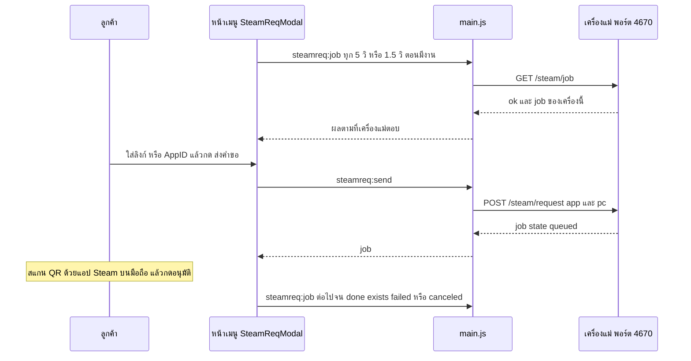

- ที่อยู่: env `GCAFE_STEAMREQ_URL` > `ui.steamRequest` ที่เป็น URL > `true` = `MasterIP` + `ClientReportPort` (ไม่มี = 4670) จาก `Settings\settings.txt` · `MasterIP` ต้องเป็นเลข IPv4
- ที่อยู่ว่าง → `{ok:false, off:true, message:'ร้านปิดระบบขอเกมไว้'}` · ต่อไม่ได้ → "ติดต่อเครื่องแม่ไม่ได้ ลองใหม่อีกครั้ง หรือแจ้งพนักงาน" · ตอบไม่ใช่ JSON → "เครื่องแม่ตอบกลับผิดรูปแบบ"
- ฝั่งเครื่องแม่ (คิว, DepotDownloader, QR): `Master-ClientReports.ps1`, `Master-SteamQueue.ps1` — อ่าน [STEAM-REQUESTS.md](STEAM-REQUESTS.md)

### ระบบร้าน — `readAgent` / `agentTick` / `showLock` / `apiCall` (ร้านนี้ไม่ทำงาน)

ใช้ไฟล์ `%ProgramData%\CooperAgent\state.json` + `gcafe.json` ของ Cooper Agent 1.20+ (token อยู่ใน main เท่านั้น ไม่ถึงหน้าเว็บ) · ไม่มีไฟล์ = ออฟไลน์ ไม่มีหน้าล็อก · **หน้าล็อกไม่ดู `ui.menuOnly`** — ถ้าวันหนึ่งมีไฟล์เอเจนต์บนเครื่องลูก หน้าล็อกจะขึ้นแม้เป็นเมนูอย่างเดียว · รายละเอียดทั้งหมด (allowlist, รูปแบบไฟล์, endpoint): [SHOP-API.md](SHOP-API.md) ข้อ 2.2–2.3 และ 4.2

### `runSelfTest` — ทดสอบหลัง build

รอ 3 วิ → ถ่าย HUD → เปิดเมนู → รอ 6 วิ → นับเกม / การ์ด / หมวด, ตรวจว่าโชว์หน้าต่างเดียว → ชี้เมาส์การ์ดแรก ถ่าย `selftest-gamemenu.png` → กดการ์ด FiveM ต้องขึ้นตัวเลือกภาพ (ไม่ใช่เปิดเกม) ถ่าย `selftest-gfx.png` แล้ว Esc ต้องปิด (หรือเลือก "กลาง" + ReShade เมื่อมี `GCAFE_GTA_TESTDIR`) → ทดสอบขอเกมเมื่อมี `GCAFE_STEAMREQ_URL` → ปิดเมนู → เขียน `selftest.json` → ออก

**ค่าในร้านนี้ตอนนี้:** `ui.menuOnly=true` (HUD ไม่แสดง เมนูเปิดตอนเริ่ม ปิด = ย่อ) · `apiUrl=""` · ปุ่มขอเกมไปที่ `http://192.168.51.201:4670` · `graphicsPicker` = `steam-271590`, `fivem` · `Tools\FiveM-ReShade\ReShade64.dll` มี → FiveM มีแถว ReShade · `Tools\FiveM-Mods` มีแต่ `README.txt` → ไม่มีแถวม็อด · `data\brand\app.ico` มี (ไอคอนหน้าต่าง / tray)

---

## 2. `electron/preload.js` — สะพานระหว่างหน้าเว็บกับโปรเซสหลัก

**หน้าที่:** เปิด `window.appConfig` (ค่าร้าน) และ `window.electronAPI` (คำสั่งที่หน้าเว็บเรียกได้) ให้ทุกหน้า โดยหน้าเว็บไม่ได้สิทธิ์ Node

**เรียกจาก / ทำงานเมื่อไหร่:** ทุกหน้าต่างที่ `main.js` สร้าง (`webPreferences.preload`) โหลดก่อนหน้าเว็บทุกครั้ง

**พารามิเตอร์:** ไม่มี

**อ่านค่า:** `config:get` แบบ sync (ได้ `loadConfig()` จาก main)

**เขียน / เปลี่ยน:** ไม่มี · **Log:** ไม่มี

**ขั้นตอนการทำงาน:**
1. `window.appConfig` = `ipcRenderer.sendSync('config:get')` — ค่าร้านตอนหน้าโหลด
2. `window.electronAPI` = รายการด้านล่าง

| `window.electronAPI.*` | ช่อง IPC | ใช้ที่ |
|---|---|---|
| `minimize()` | `window-minimize` | HUD |
| `fitHud(h)` | `hud:fit` | HUD |
| `close()` | `window-close` | HUD |
| `quitApp()` | `quit-app` | ไม่มีหน้าไหนเรียก (ของเก่า) |
| `openDialog(tab)` / `closeDialog()` | `open-dialog` / `close-dialog` | HUD / เมนู |
| `maximizeDialog()` / `minimizeDialog()` | `dialog-maximize` / `dialog-minimize` | เมนู |
| `getGames()` | `games:list` | `api.js` `getGames` |
| `launch(game)` | `games:launch` | `api.js` `launchGame` |
| `launchGame(cmd)` | `launch-game` | `api.js` สำรอง (ของเก่า) |
| `gtaInfo()` / `launchGta(game, level, extras)` / `fivemState(game)` | `gta:info` / `games:launch-gta` / `fivem:state` | ตัวเลือกภาพ |
| `gameLocation(id)` / `revealGame(id)` | `games:location` / `games:reveal` | คลิกขวา |
| `steamReq.job()` / `.send(text)` / `.cancel()` | `steamreq:job` / `steamreq:send` / `steamreq:cancel` | ขอเกม |
| `onOpenSettings(cb)` | ฟัง `open-settings` | main ไม่เคยส่ง (ไม่ได้ใช้) |
| `onSwitchTab(cb)` | ฟัง `switch-tab` | เมนู |
| `onOrderNotify(cb)` | ฟัง `order-notify` | HUD |
| `sendOrder(data)` | `order-placed` | แท็บร้าน |
| `agent.get()` / `agent.onUpdate(cb)` / `agent.api(method, p, body)` | `agent:get` / ฟัง `agent:update` / `api:call` | ระบบร้าน |

**ฟังก์ชัน:** ไม่มีฟังก์ชันตั้งชื่อ (มีแต่ arrow function ใน object ข้างบน)

**ค่าในร้านนี้ตอนนี้:** ไม่มีค่าของตัวเอง

---

## 3. `src/lib/config.js` — อ่านค่าร้านในหน้าเว็บ

**หน้าที่:** ให้หน้าเว็บอ่านค่าร้าน (จาก `window.appConfig`) พร้อมค่าเริ่ม และตั้งฟอนต์ / zoom ของหน้า

**เรียกจาก / ทำงานเมื่อไหร่:** import โดย `dialog/page.jsx`, `page.jsx`, `lock/page.jsx`, `api.js` · ทำงานตอนหน้าโหลด

**พารามิเตอร์:** ไม่มี (module)

**อ่านค่า:** `window.appConfig` · localStorage `gcafe_api_url`, `gcafe_machine_id`, `gcafe_brand`, `gcafe_auth_token` (ค่าใน localStorage **ชนะ** `config.json` — [SHOP-API.md](SHOP-API.md) ข้อ 1.1) · `process.env.NEXT_PUBLIC_API_URL` ตอน build (ไม่ได้ตั้ง)

**เขียน / เปลี่ยน:** localStorage `gcafe_brand` (ผ่าน `setBrandConfig` เมื่อ `/station/session` ส่ง brand) · style ของ `<html>`: `--ui-font`, `zoom` · **Log:** ไม่มี

**ขั้นตอนการทำงาน:** ไม่มีขั้นตอน — เป็นชุดฟังก์ชันให้เรียก · ค่าคงที่: `CONFIG` (timeout 4000 ms, ค่าเริ่ม `PC-01`, `0JAYSHOP`, `VIP`), `FONT_CHOICES`, `CATEGORY_NAMES`

**ฟังก์ชัน:**

| ฟังก์ชัน | บรรทัด | หลักการทำงาน |
|---|---|---|
| [`appConfig`](../../Menu/source/src/lib/config.js#L7) | 7 | คืน `window.appConfig` หรือ `{}` นอก Electron |
| [`getApiBaseUrl`](../../Menu/source/src/lib/config.js#L22) | 22 | localStorage `gcafe_api_url` > `apiUrl` > `NEXT_PUBLIC_API_URL` > `''` |
| [`isOnline`](../../Menu/source/src/lib/config.js#L29) | 29 | มี base URL ไหม (ไม่มีที่เรียก) |
| [`setApiBaseUrl`](../../Menu/source/src/lib/config.js#L33) | 33 | เขียน `gcafe_api_url` (ไม่มีที่เรียก) |
| [`getMachineId`](../../Menu/source/src/lib/config.js#L41) | 41 | localStorage `gcafe_machine_id` > `machineId` (main ใส่ชื่อเครื่องให้แล้ว) > `PC-01` |
| [`setMachineId`](../../Menu/source/src/lib/config.js#L48) | 48 | เขียน `gcafe_machine_id` (ไม่มีที่เรียก) |
| [`getBrandConfig`](../../Menu/source/src/lib/config.js#L57) | 57 | ชื่อ / ป้าย / โลโก้ / โลโก้เล็ก: localStorage `gcafe_brand` > `config.json` > ค่าเริ่ม ทีละช่อง · ชื่อ `G-CAFE` ถูกข้าม · โลโก้เล็กไม่มี = โลโก้ปกติ |
| [`setBrandConfig`](../../Menu/source/src/lib/config.js#L72) | 72 | เขียน `gcafe_brand` |
| [`getUiConfig`](../../Menu/source/src/lib/config.js#L90) | 90 | ค่า `ui` ให้หน้าเว็บ + ค่าเริ่ม (ชื่อหมวดรวมกับ `categoryNames`, ข้อความแบนเนอร์) |
| [`pct`](../../Menu/source/src/lib/config.js#L92) | 92 | % 80–130 นอกนั้น = 100 |
| [`getBuildStamp`](../../Menu/source/src/lib/config.js#L114) | 114 | เวลา build จาก main (`''` นอกแอป) |
| [`getIcons`](../../Menu/source/src/lib/config.js#L119) | 119 | แมพไอคอนค่ายจาก main |
| [`applyUi`](../../Menu/source/src/lib/config.js#L125) | 125 | ตั้ง `--ui-font` และ `zoom` ของหน้าตาม `hud` / `menu` / `lock` คืนค่า ui |
| [`getAuthToken`](../../Menu/source/src/lib/config.js#L138) | 138 | อ่าน `gcafe_auth_token` (ไม่มีโค้ดเขียนค่านี้) |
| [`setAuthToken`](../../Menu/source/src/lib/config.js#L145) | 145 | เขียน / ลบ token (ไม่มีที่เรียก) |

**ค่าในร้านนี้ตอนนี้:** ฟอนต์ Kanit, zoom 100% ทุกหน้า · `apiUrl` ว่าง → `getApiBaseUrl()` = `''` (ถ้า localStorage ไม่มีค่าเก่า)

---

## 4. `src/app/layout.jsx` — โครงหน้าเว็บ

**หน้าที่:** โครง HTML ร่วมของทุกหน้า: `<html lang="th">`, โหลด `fonts.css` (ฟอนต์ใน `public\fonts`) และ `globals.css`

**เรียกจาก / ทำงานเมื่อไหร่:** Next.js ใช้ครอบทุกหน้าตอน build (static export)

**พารามิเตอร์:** `children` · **อ่านค่า:** ไม่มี · **เขียน / เปลี่ยน:** ไม่มี · **Log:** ไม่มี

**ขั้นตอนการทำงาน:** ตั้ง metadata `title: '0JAYSHOP'`, `description` แล้ว render `<body>{children}</body>` · ชื่อหน้าต่างจริงคือ `brandName` เพราะ main กัน `page-title-updated`

**ฟังก์ชัน:**

| ฟังก์ชัน | บรรทัด | หลักการทำงาน |
|---|---|---|
| [`RootLayout`](../../Menu/source/src/app/layout.jsx#L9) | 9 | คืน `<html lang="th"><body>` ครอบหน้า |

**ค่าในร้านนี้ตอนนี้:** title คงที่ `0JAYSHOP`

---

## 5. `src/app/dialog/page.jsx` — หน้าต่างเมนูเกม

**หน้าที่:** หน้าที่ลูกค้าใช้จริงที่ร้านนี้: รายชื่อเกม, หมวด, ค้นหา, เปิดเกม, คลิกขวา, ตัวเลือกภาพ GTA, ขอเกม Steam · ถ้าไม่ใช่ menuOnly มีแท็บร้านด้วย

**เรียกจาก / ทำงานเมื่อไหร่:** `openCenterDialog` โหลด `http://127.0.0.1:<พอร์ต>/dialog/?tab=<แท็บ>` · ร้านนี้เปิดตอนเริ่มโปรแกรม และไม่ถูกทำลายระหว่างใช้ (ปิด = ย่อ)

**พารามิเตอร์:** query `?tab=gamemenu|shop|inventory|chat|topup|account` (`order` = `shop`) · หรือ IPC `switch-tab`

**อ่านค่า:** `window.appConfig` (ผ่าน `config.js`), รายชื่อเกม (`gamesService.getGames`), ไอคอนค่าย, สถานะระบบร้าน (`agent.get` / `agent:update`) · ถ้าเชื่อมระบบร้าน: `GET state` ทุก 60 วิ (แบนเนอร์ / ประกาศ / สีที่ร้านตั้ง)

**เขียน / เปลี่ยน:** clipboard (คัดลอกที่อยู่) · เรียก IPC ตามตาราง preload · **Log:** ไม่มี

**ขั้นตอนการทำงาน:**
1. ตั้งแบรนด์, ชื่อเครื่อง, ฟอนต์ + zoom (`applyUi('menu')`), ไอคอน
2. อ่านแท็บจาก query + ฟัง `switch-tab`
3. ฟังคีย์: `Ctrl+F` ไปช่องค้นหา · `Esc` ล้างคำค้น
4. `loadLauncherGames()` ครั้งแรก (และเมื่อกดโหลดใหม่)
5. ทุก render: นับหมวดตามลำดับในรายการ, ตัด 4 ตัวแรกของ `Apps` เป็นปุ่มด่วน, กรองตามหมวด + คำค้น, หาเกม `featured`
6. วาด: แถบบน (ไม่มีแท็บเมื่อ menuOnly) → แถบเครื่องมือ → หัวข้อ + จำนวน → การ์ด (หรือ "กำลังโหลดรายชื่อเกม…" / กล่องว่าง) → คอลัมน์ขวา (เมื่อ `sidePanel`) → แถบสถานะ (เมื่อ `sidePanel` และไม่ใช่ menuOnly) → แท็บร้าน (ไม่ใช่ menuOnly)
7. วาดกล่องลอยเมื่อเปิด: เมนูคลิกขวา, ตัวเลือกภาพ, ขอเกม, toast (3.2 วิ)

**ฟังก์ชัน:**

| ฟังก์ชัน | บรรทัด | หลักการทำงาน |
|---|---|---|
| [`catOf`](../../Menu/source/src/app/dialog/page.jsx#L27) | 27 | หมวดของเกม `cat` > `category` > `Online` |
| [`hms`](../../Menu/source/src/app/dialog/page.jsx#L29) | 29 | วินาที → `HH:MM:SS` |
| [`PcIcon`](../../Menu/source/src/app/dialog/page.jsx#L34) | 34 | ไอคอนจอคอม (แทนไอคอนที่หาไม่ได้) |
| [`Poster`](../../Menu/source/src/app/dialog/page.jsx#L39) | 39 | รูปปก + ตัวอักษรแรกของชื่อซ้อนข้างหลัง · รูปเสีย = เหลือตัวอักษร |
| [`SmallIcon`](../../Menu/source/src/app/dialog/page.jsx#L50) | 50 | ไอคอนเล็ก · เสีย / ไม่มี = `PcIcon` |
| [`DialogContent`](../../Menu/source/src/app/dialog/page.jsx#L55) | 55 | ตัวหน้าเมนูทั้งหมด (state, การกรอง, การวาด) |
| [`load`](../../Menu/source/src/app/dialog/page.jsx#L73) | 73 | `GET state` ของระบบร้าน → `screen.menu` (เฉพาะเมื่อเชื่อมแล้ว ทุก 60 วิ) |
| [`showToast`](../../Menu/source/src/app/dialog/page.jsx#L99) | 99 | toast 3.2 วิ |
| [`handleKeyDown`](../../Menu/source/src/app/dialog/page.jsx#L136) | 136 | `Ctrl+F` = แท็บเกม + โฟกัสช่องค้นหา · `Esc` = ล้างคำค้น |
| [`loadLauncherGames`](../../Menu/source/src/app/dialog/page.jsx#L149) | 149 | โหลดรายชื่อเกม (`gamesService.getGames`) พังได้ `[]` |
| [`handleCloseDialog`](../../Menu/source/src/app/dialog/page.jsx#L172) | 172 | ปุ่ม X → `closeDialog` (menuOnly = ย่อ) |
| [`handleMinimizeDialog`](../../Menu/source/src/app/dialog/page.jsx#L175) | 175 | ปุ่มย่อ |
| [`handleMaximizeDialog`](../../Menu/source/src/app/dialog/page.jsx#L178) | 178 | ปุ่มขยาย / คืนขนาด |
| [`handleLaunchGame`](../../Menu/source/src/app/dialog/page.jsx#L182) | 182 | toast "กำลังเปิด" → `gamesService.launchGame` → ไม่สำเร็จ = toast "เปิดไม่สำเร็จ" |
| [`openGfx`](../../Menu/source/src/app/dialog/page.jsx#L196) | 196 | เปิดตัวเลือกภาพ (เริ่มที่ `low`) แล้วถาม `gtaInfo` และ `fivemState` |
| [`playGfx`](../../Menu/source/src/app/dialog/page.jsx#L208) | 208 | ปิดตัวเลือก → toast → `launchGta(game, level, extras)` (extras เฉพาะเมื่อได้สถานะ FiveM) |
| [`launch`](../../Menu/source/src/app/dialog/page.jsx#L222) | 222 | id อยู่ใน `graphicsPicker` = `openGfx` · ไม่งั้น `handleLaunchGame` |
| [`openCtx`](../../Menu/source/src/app/dialog/page.jsx#L229) | 229 | คลิกขวา: เปิดเมนูที่ตำแหน่งเมาส์ แล้วถาม `gameLocation(id)` |
| [`close`](../../Menu/source/src/app/dialog/page.jsx#L240) | 240 | ปิดเมนูคลิกขวา (mousedown, blur, resize, wheel) |
| [`onKey`](../../Menu/source/src/app/dialog/page.jsx#L241) | 241 | `Esc` ปิดเมนูคลิกขวา |
| [`revealCtx`](../../Menu/source/src/app/dialog/page.jsx#L255) | 255 | "เปิดตำแหน่งไฟล์" → `revealGame(id)` → toast |
| [`copyCtx`](../../Menu/source/src/app/dialog/page.jsx#L262) | 262 | "คัดลอกที่อยู่" → clipboard → "คัดลอกแล้ว" แล้วปิดใน 0.7 วิ |
| [`handleLaunchRandom`](../../Menu/source/src/app/dialog/page.jsx#L269) | 269 | สุ่มเกมที่ไม่ใช่ `Launchers` / `Apps` (ไม่มีเลย = ทุกเกม) แล้ว `launch` |
| [`catName`](../../Menu/source/src/app/dialog/page.jsx#L285) | 285 | ชื่อหมวดที่โชว์ (`categoryNames` หรือชื่อเดิม) |
| [`badgeIcon`](../../Menu/source/src/app/dialog/page.jsx#L308) | 308 | ไอคอนมุมการ์ด: ไอคอนค่ายของ `platform` · ค่าย `Launcher` หรือไม่มีค่าย = ไอคอนของเกมเอง |
| [`catIcon`](../../Menu/source/src/app/dialog/page.jsx#L309) | 309 | ไอคอนปุ่มหมวดจากไอคอนค่าย (ไม่มี = ไอคอนเส้นใน `Icons.jsx`) |
| [`GameCtxMenu`](../../Menu/source/src/app/dialog/page.jsx#L499) | 499 | กล่องคลิกขวา กว้าง 300 อยู่ในหน้าต่างเสมอ (พลิกซ้าย / ขึ้นใกล้ขอบ) |
| [`item`](../../Menu/source/src/app/dialog/page.jsx#L508) | 508 | ปุ่มหนึ่งแถวในกล่องคลิกขวา (ไม่มี path = จางและกดไม่ได้) |
| [`GfxRow`](../../Menu/source/src/app/dialog/page.jsx#L562) | 562 | แถวในตัวเลือกภาพ: ไอคอน หัวข้อ คำอธิบาย ด้านขวา |
| [`GfxCheck`](../../Menu/source/src/app/dialog/page.jsx#L574) | 574 | วงกลมเครื่องหมายถูกของระดับที่เลือก |
| [`GfxSwitch`](../../Menu/source/src/app/dialog/page.jsx#L582) | 582 | สวิตช์เปิด / ปิด (ReShade, ม็อด) |
| [`GfxPicker`](../../Menu/source/src/app/dialog/page.jsx#L589) | 589 | หน้าต่าง "เลือกระดับภาพ" |
| [`key`](../../Menu/source/src/app/dialog/page.jsx#L593) | 593 | คีย์ในตัวเลือกภาพ: Esc ยกเลิก, Enter เล่น, ลูกศรเลือกระดับ |
| [`setEx`](../../Menu/source/src/app/dialog/page.jsx#L606) | 606 | แก้ค่าเสริม FiveM (`reshade`, `mods`) |
| [`SrQr`](../../Menu/source/src/app/dialog/page.jsx#L679) | 679 | วาด QR จากแถว `'0'/'1'` ที่เครื่องแม่ส่งมาเป็น SVG ขอบ 3 ช่อง |
| [`SteamReqModal`](../../Menu/source/src/app/dialog/page.jsx#L690) | 690 | หน้าต่าง "ขอเกม Steam" |
| [`tick`](../../Menu/source/src/app/dialog/page.jsx#L703) | 703 | ถาม `steamReq.job()` ซ้ำ: ทุก 1.5 วิ ตอนงานกำลังทำ · ทุก 5 วิ ตอนว่าง |
| [`key`](../../Menu/source/src/app/dialog/page.jsx#L716) | 716 | `Esc` ปิดหน้าต่างขอเกม |
| [`send`](../../Menu/source/src/app/dialog/page.jsx#L723) | 723 | ส่งลิงก์ / AppID (`steamReq.send`) · error โชว์ใต้กล่อง |
| [`cancel`](../../Menu/source/src/app/dialog/page.jsx#L734) | 734 | ยกเลิกคำขอ (`steamReq.cancel`) |
| [`DialogPage`](../../Menu/source/src/app/dialog/page.jsx#L840) | 840 | ครอบ `DialogContent` ด้วย `Suspense` ("กำลังโหลด...") |

### รายชื่อ หมวด ค้นหา

- หมวดเรียงตามลำดับที่เจอเกมแรกของหมวดในรายการ (`Master-GameList.ps1` เรียงหมวด Steam, Riot, Epic, EA, Rockstar, Ubisoft, Garena, HoYoPlay, Gacha, Online, Mobile, ..., Apps, Launchers แล้วเรียงชื่อ)
- ค้นหา = ตัวพิมพ์เล็ก ตรงบางส่วนกับ `title`, หมวด, ชื่อหมวดที่โชว์, `platform` · ไม่ส่งคำค้นไปเซิร์ฟเวอร์
- tooltip การ์ด = `ชื่อ · ค่าย` (ไม่มีค่าย = ชื่อหมวด)

### `GfxPicker` — ตัวเลือกระดับภาพ

- 3 ระดับ: `low` "ต่ำสุด" (ป้าย "แนะนำ"), `medium` "กลาง", `high` "สูง" · เปิดมาเลือก `low` เสมอ
- chip บน: ขนาดจอ + Hz ("กำลังตรวจจอ..." / "ตรวจจอไม่ได้ ใช้ค่าของร้าน") และชื่อการ์ดจอ (ถ้าหาได้)
- ส่วน "เสริมสำหรับ FiveM" ขึ้นเมื่อ `fivemState` ok และมี ReShade หรือม็อด · สวิตช์เริ่มตามที่ติดตั้งอยู่
- ปุ่ม "เล่น · ภาพ<ระดับ>" · คลิกพื้นหลัง = ยกเลิก

### `SteamReqModal` — ขอเกม Steam

- สถานะที่ถือว่า "กำลังทำ": `queued`, `checking`, `waiting-qr`, `downloading`, `verifying`, `importing` (มีปุ่ม "ยกเลิกคำขอ")
- ไม่มีงาน = ฟอร์ม (ช่องลิงก์ + 3 ขั้นตอน) · มีงาน = ชื่อเกม / AppID, ป้ายสถานะ (+ คิวที่), ขนาด GB, ไดรฟ์, QR + นับถอยหลัง (`qrUntil`), ข้อความ, แถบ % (`downloading` / `verifying` / `importing`)
- งานจบแล้ว (`done`, `exists`, `failed`, `canceled`) ยังโชว์อยู่ → ปุ่ม "ขอเกมอื่น" เปิดฟอร์มใหม่
- ฟิลด์ที่หน้านี้อ่านจากเครื่องแม่: `ok`, `on`, `message`, `job.state`, `name`, `app`, `queuePos`, `sizeGB`, `drive`, `qr`, `qrUntil`, `message`, `progress`

**ค่าในร้านนี้ตอนนี้:** `menuOnly=true` → ไม่มีแท็บ, ไม่มีชิปเวลา, ไม่มี `ShopTabs` · `sidePanel=false` → ไม่มีคอลัมน์ขวาและแถบสถานะ · `steamRequest=true` → มีปุ่ม "ขอเกม" · `graphicsPicker` = GTA V Legacy + FiveM

---

## 6. `src/components/Icons.jsx` — ไอคอนเส้น

**หน้าที่:** ไอคอน SVG แบบเส้นของเมนูเกม (17 พ.ย.: ไม่ใช้ emoji ตามที่เจ้าของเลือก) สีตามสีตัวหนังสือของปุ่ม

**เรียกจาก / ทำงานเมื่อไหร่:** `dialog/page.jsx` (ปุ่ม, หมวด, ตัวเลือกภาพ, ขอเกม)

**พารามิเตอร์:** `name`, `size` (20), `fill` (false = เส้น, true = ทึบ), `className`, `style`

**อ่านค่า:** ไม่มี · **เขียน / เปลี่ยน:** ไม่มี · **Log:** ไม่มี

**ขั้นตอนการทำงาน:** หา path ของ `name` ในตาราง `P` (ไม่รู้จัก = `gamepad`) แล้วคืน `<svg viewBox="0 0 24 24">` · `CATEGORY_ICON` = ไอคอนของหมวดที่ไม่มีไอคอนค่ายในเครื่อง: Online=globe, Anime RPG=sparkles, Gacha=gem, HoYoPlay=sparkles, Single Player=book, Mobile=phone, Emulator=gamepad, Apps=apps, Launchers=rocket (หมวดอื่น = gamepad)

**ฟังก์ชัน:**

| ฟังก์ชัน | บรรทัด | หลักการทำงาน |
|---|---|---|
| [`Icon`](../../Menu/source/src/components/Icons.jsx#L35) | 35 | วาดไอคอนตามชื่อ ขนาด และแบบเส้น / ทึบ |

**ค่าในร้านนี้ตอนนี้:** ไม่มีค่าของตัวเอง

---

## 7. `src/lib/api.js` — REST ทาง apiUrl

**หน้าที่:** ตัวเรียก REST ตรงจากหน้าเว็บไป `apiUrl` (ทาง A ใน [SHOP-API.md](SHOP-API.md)) และ `gamesService` ที่เมนูใช้โหลดรายชื่อ / เปิดเกม

**เรียกจาก / ทำงานเมื่อไหร่:** `dialog/page.jsx` ใช้ `gamesService.getGames` และ `gamesService.launchGame` · `page.jsx` (HUD) ใช้ `sessionService` · ชุดอื่นไม่มีที่เรียก

**พารามิเตอร์:** ไม่มี (module)

**อ่านค่า:** `getApiBaseUrl()`, `getMachineId()`, `getAuthToken()` จาก `config.js`

**เขียน / เปลี่ยน:** request HTTP ไป `apiUrl` (ร้านนี้ไม่มี) · `setBrandConfig` เมื่อ session ส่ง brand · **Log:** ไม่มี

**ขั้นตอนการทำงาน:** `apiRequest` = ไม่มี `apiUrl` → `{ok:false, error:'offline'}` ทันที · มี → `fetch` + header `X-Machine-ID` (+ Bearer ถ้ามี token) timeout 4 วิ · 2xx + JSON = ok · รูปแบบ request / response ทุก endpoint: [SHOP-API.md](SHOP-API.md) ข้อ 3.A

**ฟังก์ชัน:**

| ฟังก์ชัน | บรรทัด | หลักการทำงาน |
|---|---|---|
| [`apiRequest`](../../Menu/source/src/lib/api.js#L5) | 5 | ตัวยิง REST กลาง (ดูขั้นตอน) |
| [`getSession`](../../Menu/source/src/lib/api.js#L44) | 44 | `GET /station/session` · ได้ `brand` = บันทึก · พัง = Guest / Offline / 0 วินาที |
| [`heartbeat`](../../Menu/source/src/lib/api.js#L64) | 64 | `POST /station/heartbeat {machineId, usedSec}` |
| [`lock`](../../Menu/source/src/lib/api.js#L71) | 71 | `POST /station/lock` (ไม่มีที่เรียก) |
| [`logout`](../../Menu/source/src/lib/api.js#L78) | 78 | `POST /station/logout` |
| [`getItems`](../../Menu/source/src/lib/api.js#L90) | 90 | `GET /shop/games` (ไม่มีที่เรียก) |
| [`submitOrder`](../../Menu/source/src/lib/api.js#L98) | 98 | `POST /shop/buy` (ไม่มีที่เรียก) |
| [`getPurchasedAccounts`](../../Menu/source/src/lib/api.js#L117) | 117 | `GET /shop/inventory` (ไม่มีที่เรียก) |
| [`getGames`](../../Menu/source/src/lib/api.js#L133) | 133 | `GET /games` ได้ array ไม่ว่าง = ใช้รายการนั้น · ไม่งั้น `electronAPI.getGames()` (= `games.json`) |
| [`launchGame`](../../Menu/source/src/lib/api.js#L145) | 145 | `electronAPI.launch(game)` (หรือ `launchGame(cmd)` ของเก่า) แล้วรายงาน `POST /games/launch` (ออฟไลน์ = ข้ามทันที) |
| [`syncCloudSave`](../../Menu/source/src/lib/api.js#L161) | 161 | `POST /games/sync-save` (ไม่มีที่เรียก) |
| [`setMouseSensitivity`](../../Menu/source/src/lib/api.js#L168) | 168 | `POST /system/mouse` (ไม่มีที่เรียก) |
| [`getMessages`](../../Menu/source/src/lib/api.js#L183) | 183 | `GET /counter/chat` (ไม่มีที่เรียก) |
| [`sendMessage`](../../Menu/source/src/lib/api.js#L192) | 192 | `POST /counter/chat` (ไม่มีที่เรียก) |
| [`getPackages`](../../Menu/source/src/lib/api.js#L216) | 216 | `GET /billing/packages` (ไม่มีที่เรียก) |
| [`requestTopup`](../../Menu/source/src/lib/api.js#L224) | 224 | `POST /billing/promptpay` (ไม่มีที่เรียก) |
| [`getProfile`](../../Menu/source/src/lib/api.js#L246) | 246 | `GET /member/me` (ไม่มีที่เรียก) |
| [`redeem`](../../Menu/source/src/lib/api.js#L252) | 252 | `POST /member/redeem` (ไม่มีที่เรียก) |

**ค่าในร้านนี้ตอนนี้:** มีในโค้ด แต่ร้านนี้ปิดอยู่: `apiUrl=""` → ทุกฟังก์ชันตอบ offline ทันที รายชื่อเกมมาจาก `games.json`

---

## 8. `src/app/page.jsx` — HUD หน้าต่างนับเวลา

**หน้าที่:** หน้าต่างเล็กมุมขวาบน: เวลาคงเหลือ / ทั้งหมด / ใช้ไป, ปุ่ม 6 ช่อง (ซื้อไอดีเกม, คลังรหัส, แชทแอดมิน, เติมเงิน-ต่อเวลา, เกมเมนู, ออกจากระบบ), แบนเนอร์, ปุ่ม "บัญชีของฉัน" / "ร้านไอดีเกม"

**เรียกจาก / ทำงานเมื่อไหร่:** `createMainWindow` โหลด `http://127.0.0.1:<พอร์ต>/` ตอนเริ่มโปรแกรม (ร้านนี้หน้าต่างถูกซ่อน แต่หน้ายังโหลด)

**พารามิเตอร์:** ไม่มี

**อ่านค่า:** แบรนด์ (`getBrandConfig`), ui (`applyUi('hud')`), `sessionService.getSession()`, สถานะระบบร้าน (`agent.get` / `agent:update`), `order-notify`

**เขียน / เปลี่ยน:** IPC `hud:fit`, `open-dialog`, `window-minimize`, `window-close` · heartbeat / logout ทาง A หรือ `logout` ทาง B · **Log:** ไม่มี

**ขั้นตอนการทำงาน:**
1. `applyUi('hud')` แล้ววัดความสูงการ์ด ส่ง `hud:fit` ทุกครั้งที่เปลี่ยน (หน้าต่างสูงตามหน้า ปุ่มล่างไม่จมขอบ)
2. ฟังสถานะระบบร้าน + นาฬิกาทุก 1 วิ
3. `getSession()` ครั้งเดียว → `totalSec`, `usedSec`
4. ทุก 1 วิ `usedSec + 1` จนถึง `totalSec` · ทุกเลขที่หาร 30 ลงตัวส่ง heartbeat
5. เชื่อมระบบร้าน = เวลาคำนวณจาก `startedAt` / `endsAt` + `serverOffsetMs` แทน
6. ออกจากระบบ: กล่องยืนยัน → ระบบร้าน `POST logout` (409 = รอ 2.5 วิ ลองใหม่) หรือ `/station/logout` แล้วซ่อน

**ฟังก์ชัน:**

| ฟังก์ชัน | บรรทัด | หลักการทำงาน |
|---|---|---|
| [`Home`](../../Menu/source/src/app/page.jsx#L7) | 7 | หน้า HUD ทั้งหน้า (หัว, แถบสถานะ, เวลา, ปุ่ม 6 ช่อง, แบนเนอร์, dock, กล่องยืนยัน, toast) |
| [`send`](../../Menu/source/src/app/page.jsx#L25) | 25 | วัดความสูงการ์ด HUD ส่ง `fitHud` เมื่อเปลี่ยน |
| [`formatTime`](../../Menu/source/src/app/page.jsx#L126) | 126 | วินาที → `HH:MM:SS` |
| [`showToast`](../../Menu/source/src/app/page.jsx#L133) | 133 | toast 2.4 วิ |
| [`handleOpenDialog`](../../Menu/source/src/app/page.jsx#L139) | 139 | เปิดหน้าต่างเมนูที่แท็บนั้น |
| [`handleMinimize`](../../Menu/source/src/app/page.jsx#L147) | 147 | ย่อ HUD |
| [`handleClose`](../../Menu/source/src/app/page.jsx#L153) | 153 | toast "ซ่อนไปที่ System Tray แล้ว" แล้ว `close()` |
| [`handleConfirmLogout`](../../Menu/source/src/app/page.jsx#L160) | 160 | ออกจากระบบ (ทาง B: toast เก็บเวลา / คืนคูปอง · ทาง A: logout แล้วซ่อน) |
| [`call`](../../Menu/source/src/app/page.jsx#L164) | 164 | `agent.api('POST', 'logout', {})` |
| [`fmt`](../../Menu/source/src/app/page.jsx#L170) | 170 | สตางค์ → `฿` |

**ค่าในร้านนี้ตอนนี้:** มีในโค้ด แต่ร้านนี้ปิดอยู่: `ui.menuOnly=true` (หน้าต่างไม่แสดง) · `apiUrl=""` → `getSession` ได้ Guest / Offline ทันที ไม่มี heartbeat · รายละเอียดการนับเวลา: [SHOP-API.md](SHOP-API.md) ข้อ 4

---

## 9. `src/app/lock/page.jsx` — หน้าล็อกเต็มจอ

**หน้าที่:** หน้าจอตอนเครื่องว่าง (ไม่มีการเช่า): ล็อกอินสมาชิก, สแกน QR, คูปองเงินสด / บัตรเวลา, สมัครสมาชิก, เติมเงิน — เครื่องปลดล็อกเองเมื่อเอเจนต์เห็นการเช่าใหม่

**เรียกจาก / ทำงานเมื่อไหร่:** `showLock` โหลด `/lock/` บนจอหลัก เมื่อ `agentTick` เห็นว่าเชื่อมระบบร้าน + ไม่มีการเช่า + ไม่มี `ending`

**พารามิเตอร์:** ไม่มี

**อ่านค่า:** แบรนด์, `applyUi('lock')`, build stamp, สถานะเอเจนต์, `GET state` ทุก 15 วิ

**เขียน / เปลี่ยน:** `POST login`, `start`, `qr-login`, `coupon`, `ticket`, `topup` ผ่าน `agent.api` · **Log:** ไม่มี

**ขั้นตอนการทำงาน:** ซ้าย = โลโก้ ชื่อร้าน (หรือ headline) ชื่อเครื่อง นาฬิกา วันที่ ข้อความ · ขวา = แท็บที่ร้านเปิด (สมาชิก / สแกน QR / คูปอง-บัตรเวลา / สมัครสมาชิก) · pass ล็อกอินอยู่ 110 วิ · คูปองที่ตรวจแล้วอยู่บนจอ 120 วิ · มุมขวาล่าง `build <เวลา>` · flow และ endpoint ทั้งหมด: [SHOP-API.md](SHOP-API.md) ข้อ 3.B (B1) และ 4.2

**ฟังก์ชัน:**

| ฟังก์ชัน | บรรทัด | หลักการทำงาน |
|---|---|---|
| [`keepWords`](../../Menu/source/src/app/lock/page.jsx#L17) | 17 | หัวข้อ: คำอังกฤษติดกัน (≤24 ตัว) ไม่ตัดบรรทัด |
| [`OptionScroll`](../../Menu/source/src/app/lock/page.jsx#L26) | 26 | กล่องแพ็กเกจเลื่อนได้ สูง 300 + ปุ่ม "เลื่อนดูแพ็กเกจเพิ่ม" เมื่อยังมีข้างล่าง |
| [`check`](../../Menu/source/src/app/lock/page.jsx#L29) | 29 | ยังเลื่อนลงได้อีกไหม |
| [`hm`](../../Menu/source/src/app/lock/page.jsx#L50) | 50 | วินาที → "x ชม. y นาที" |
| [`mmss`](../../Menu/source/src/app/lock/page.jsx#L55) | 55 | วินาที → `m:ss` |
| [`LockScreen`](../../Menu/source/src/app/lock/page.jsx#L80) | 80 | หน้าล็อกทั้งหน้า |
| [`loadState`](../../Menu/source/src/app/lock/page.jsx#L118) | 118 | `GET state` ทุก 15 วิ |
| [`gotLogin`](../../Menu/source/src/app/lock/page.jsx#L150) | 150 | ได้ pass: นับอายุ 110 วิ เลือกแพ็กเกจแรกที่จ่ายไหว |
| [`doLogin`](../../Menu/source/src/app/lock/page.jsx#L157) | 157 | `POST login` · `TOTP_REQUIRED` = ขอรหัส 6 หลัก · `wrong_network` = แจ้งพนักงาน |
| [`doStart`](../../Menu/source/src/app/lock/page.jsx#L170) | 170 | `POST start {pass, option}` → "เครื่องกำลังปลดล็อก…" |
| [`newQr`](../../Menu/source/src/app/lock/page.jsx#L181) | 181 | `qr-login create` แล้ว poll ทุก 2 วิ |
| [`submitTicket`](../../Menu/source/src/app/lock/page.jsx#L208) | 208 | 8 ตัว = คูปอง (`coupon check`) · 10 ตัว = บัตรเวลา (`ticket`) |
| [`mergeCoupon`](../../Menu/source/src/app/lock/page.jsx#L236) | 236 | `coupon merge` รวมคูปองอีกใบ |
| [`startCoupon`](../../Menu/source/src/app/lock/page.jsx#L251) | 251 | `coupon start` หักจากคูปอง · `priceChanged` = โหลดตัวเลือกใหม่ |
| [`fmtTicket`](../../Menu/source/src/app/lock/page.jsx#L270) | 270 | จัดรูป `XXXX-XXXX` / `XXXXX-XXXXX` |

**ค่าในร้านนี้ตอนนี้:** มีในโค้ด แต่ร้านนี้ไม่ทำงาน: ต้องมีไฟล์ Cooper Agent บนเครื่องลูก ([SHOP-API.md](SHOP-API.md): ยังไม่มี) · `ui.lockSize=100`

---

## 10. `src/components/ShopTabs.jsx` — แท็บร้าน

**หน้าที่:** แท็บในหน้าต่างเมนู: เติมเงิน / ต่อเวลา (สมาชิกหรือคูปอง), ซื้อไอดีเกม, คลังรหัส (ดูข้อมูลไอดี, รหัส 2-Step, Steam Guard), แชทร้าน, บัญชี — ทุกแท็บคุยกับเว็บร้านผ่าน `agent.api`

**เรียกจาก / ทำงานเมื่อไหร่:** `dialog/page.jsx` เมื่อแท็บไม่ใช่ `gamemenu` และไม่ใช่ menuOnly · ไม่เชื่อมระบบร้าน = กล่อง "ต้องเชื่อมระบบร้าน" + ปุ่ม "กลับไปเกมเมนู"

**พารามิเตอร์:** `tab`, `linked`, `site`, `offsetMs`, `onToast`, `onTab`

**อ่านค่า:** `panel`, `coupon`, `shop`, `orders`, `steam-guard`, `chat`, `account` ของเว็บร้าน · `offsetMs` (นาฬิกาเว็บ − นาฬิกาเครื่อง)

**เขียน / เปลี่ยน:** `extend`, `buy`, `coupon`, `chat send` · clipboard · `order-placed` (toast บน HUD) · **Log:** ไม่มี

**ขั้นตอนการทำงาน:** ดู [SHOP-API.md](SHOP-API.md) ข้อ 3.B และ 5 · `call` ลองซ้ำ 1 ครั้งหลัง 2.5 วิ เมื่อได้ 409 (token กำลังหมุน) · บรรทัดขึ้นต้น `#` ในข้อมูลไอดีไม่แสดง

**ฟังก์ชัน:**

| ฟังก์ชัน | บรรทัด | หลักการทำงาน |
|---|---|---|
| [`hm`](../../Menu/source/src/components/ShopTabs.jsx#L36) | 36 | วินาที → ชม. / นาที |
| [`call`](../../Menu/source/src/components/ShopTabs.jsx#L43) | 43 | `gcApi` + 409 ที่ไม่ใช่ `priceChanged` = รอ 2.5 วิ ลองใหม่ 1 ครั้ง |
| [`errOf`](../../Menu/source/src/components/ShopTabs.jsx#L52) | 52 | ข้อความ error จากคำตอบ หรือค่าแทน |
| [`notifyHud`](../../Menu/source/src/components/ShopTabs.jsx#L54) | 54 | ส่ง `sendOrder({text})` ให้ HUD โชว์ toast |
| [`Notice`](../../Menu/source/src/components/ShopTabs.jsx#L58) | 58 | กล่องข้อความกลางจอ + ปุ่มกลับเกมเมนู |
| [`copyText`](../../Menu/source/src/components/ShopTabs.jsx#L70) | 70 | คัดลอกเข้า clipboard |
| [`lineEmoji`](../../Menu/source/src/components/ShopTabs.jsx#L75) | 75 | ไอคอนหน้าบรรทัดข้อมูลไอดีตามคำในป้าย |
| [`TotpBox`](../../Menu/source/src/components/ShopTabs.jsx#L90) | 90 | รหัส 2-Step 6 หลักสด (เปลี่ยนทุก 30 วิ) ตามนาฬิกาเว็บร้าน |
| [`copy`](../../Menu/source/src/components/ShopTabs.jsx#L103) | 103 | คัดลอกรหัส 2-Step |
| [`SecretView`](../../Menu/source/src/components/ShopTabs.jsx#L121) | 121 | ข้อมูลไอดีทีละบรรทัด (ป้าย, ค่า, ปุ่มคัดลอก) + `TotpBox` ใต้บรรทัดคีย์ 2FA |
| [`copy`](../../Menu/source/src/components/ShopTabs.jsx#L124) | 124 | คัดลอกบรรทัด / ทั้งหมด |
| [`SteamGuard`](../../Menu/source/src/components/ShopTabs.jsx#L155) | 155 | ปุ่ม "รับโค้ด Steam Guard" |
| [`get`](../../Menu/source/src/components/ShopTabs.jsx#L158) | 158 | `POST steam-guard {orderId}` |
| [`SteamResult`](../../Menu/source/src/components/ShopTabs.jsx#L172) | 172 | โชว์โค้ด Steam Guard หรือ error |
| [`copy`](../../Menu/source/src/components/ShopTabs.jsx#L175) | 175 | คัดลอกโค้ด Steam Guard |
| [`CustomHoursRow`](../../Menu/source/src/components/ShopTabs.jsx#L191) | 191 | แถว "กำหนดเอง" 1..maxHours ชั่วโมง ราคาจาก `hourPrices` |
| [`go`](../../Menu/source/src/components/ShopTabs.jsx#L198) | 198 | ตั้งจำนวนชั่วโมงในช่วงที่ใช้ได้ |
| [`stop`](../../Menu/source/src/components/ShopTabs.jsx#L199) | 199 | กันคลิกทะลุไปเลือกแถว |
| [`OptionList`](../../Menu/source/src/components/ShopTabs.jsx#L225) | 225 | รายการแพ็กเกจต่อเวลา (แพงกว่ายอด = จาง) |
| [`TopupTab`](../../Menu/source/src/components/ShopTabs.jsx#L256) | 256 | แท็บเติมเงิน / ต่อเวลา: โหมดสมาชิก หรือโหมดคูปอง |
| [`load`](../../Menu/source/src/components/ShopTabs.jsx#L266) | 266 | โหลด `panel` หรือ `coupon panel` ทุก 15 วิ (403 = ลองอีกแบบ) |
| [`mergeCoupon`](../../Menu/source/src/components/ShopTabs.jsx#L299) | 299 | `coupon panelMerge` รวมคูปองอีกใบ |
| [`extend`](../../Menu/source/src/components/ShopTabs.jsx#L315) | 315 | `extend` หรือ `coupon extend` (กันกดซ้ำ) |
| [`ShopTab`](../../Menu/source/src/components/ShopTabs.jsx#L413) | 413 | แท็บซื้อไอดี: สินค้า, ยืนยัน, ผลการซื้อ |
| [`load`](../../Menu/source/src/components/ShopTabs.jsx#L420) | 420 | `GET shop` |
| [`buy`](../../Menu/source/src/components/ShopTabs.jsx#L426) | 426 | `POST buy {productId, expectedPrice}` |
| [`OrderRow`](../../Menu/source/src/components/ShopTabs.jsx#L506) | 506 | แถวไอดีในคลัง: "ดูข้อมูลไอดี" / "รับรหัส 2-Step" หรือ Steam Guard |
| [`twoStep`](../../Menu/source/src/components/ShopTabs.jsx#L509) | 509 | Steam = `steam-guard` · อื่น = หาคีย์ 2FA ในข้อมูลไอดี |
| [`InventoryTab`](../../Menu/source/src/components/ShopTabs.jsx#L545) | 545 | แท็บคลังรหัส (`orders list`) |
| [`getSecret`](../../Menu/source/src/components/ShopTabs.jsx#L557) | 557 | `orders reveal` (จำไว้ต่อ order) |
| [`openView`](../../Menu/source/src/components/ShopTabs.jsx#L565) | 565 | เปิดกล่องข้อมูลไอดี |
| [`DT`](../../Menu/source/src/components/ShopTabs.jsx#L595) | 595 | วันที่ + เวลาแบบไทยสั้น |
| [`ChatTab`](../../Menu/source/src/components/ShopTabs.jsx#L598) | 598 | แท็บแชทร้าน (ticket ของเว็บ) โหลดใหม่ทุก 15 วิ |
| [`load`](../../Menu/source/src/components/ShopTabs.jsx#L605) | 605 | `chat list` / `chat open` |
| [`send`](../../Menu/source/src/components/ShopTabs.jsx#L619) | 619 | `chat send` (ไม่เกิน 1000 ตัว) |
| [`AccountTab`](../../Menu/source/src/components/ShopTabs.jsx#L668) | 668 | แท็บบัญชี (อ่านอย่างเดียว) |
| [`tile`](../../Menu/source/src/components/ShopTabs.jsx#L677) | 677 | กล่องตัวเลขหนึ่งช่อง |
| [`ShopTabs`](../../Menu/source/src/components/ShopTabs.jsx#L715) | 715 | ใส่ offset นาฬิกาเว็บใน context แล้วแสดง `ShopTabsInner` |
| [`ShopTabsInner`](../../Menu/source/src/components/ShopTabs.jsx#L723) | 723 | ไม่เชื่อม = Notice "ต้องเชื่อมระบบร้าน" · ไม่งั้นเลือกแท็บ · แท็บไม่รู้จัก = "ไม่พบเมนูนี้" |

**ค่าในร้านนี้ตอนนี้:** มีในโค้ด แต่ร้านนี้ปิดอยู่: `ui.menuOnly=true` (ไม่มีแท็บให้กด) และไม่มีเอเจนต์

---

## 11. `src/components/TopupPanel.jsx` — กล่องเติมเงิน

**หน้าที่:** กล่องเติมเงินที่ใช้ทั้งในแท็บเติมเงินและหน้าล็อก: `auto` = QR PromptPay ยอดพอดี (ระบบเติมเองเมื่อเงินเข้าจริง) · `slip` = ลิงก์แนบสลิป · `web` = QR ไปหน้าเติมเงินของเว็บ · โค้ดนี้ไม่เพิ่มเงิน / เวลาเอง

**เรียกจาก / ทำงานเมื่อไหร่:** `ShopTabs.jsx` (`TopupTab`) และ `lock/page.jsx` (หลังล็อกอิน, ส่ง `pass`) · export `gcApi`, `baht`, `UI` ให้ไฟล์อื่น

**พารามิเตอร์:** `cfg` (`auto`, `min`, `max` เป็นบาท), `pass`, `onBalance`, `title`

**อ่านค่า / เขียน:** `POST topup` action `create` / `status` / `cancel` · **Log:** ไม่มี

**ขั้นตอนการทำงาน:** เลือกยอด (50/100/200/500 ที่อยู่ในช่วง หรือพิมพ์เอง) → `create` → โชว์ QR → poll `status` ทุก 3 วิ (`auto`) หรือ 5 วิ (อื่น) → สำเร็จ / หมดเวลา · หน่วยเงิน: [SHOP-API.md](SHOP-API.md) ข้อ 2.2

**ฟังก์ชัน:**

| ฟังก์ชัน | บรรทัด | หลักการทำงาน |
|---|---|---|
| [`gcApi`](../../Menu/source/src/components/TopupPanel.jsx#L10) | 10 | `electronAPI.agent.api` · ไม่มี = `{ok:false, error:'offline'}` |
| [`baht`](../../Menu/source/src/components/TopupPanel.jsx#L15) | 15 | สตางค์ → `฿x` |
| [`mmss`](../../Menu/source/src/components/TopupPanel.jsx#L33) | 33 | วินาที → `m:ss` |
| [`TopupPanel`](../../Menu/source/src/components/TopupPanel.jsx#L38) | 38 | กล่องเติมเงิน 3 แบบ + poll สถานะ |
| [`body`](../../Menu/source/src/components/TopupPanel.jsx#L49) | 49 | ใส่ `pass` (หน้าล็อก) ลงใน body |
| [`create`](../../Menu/source/src/components/TopupPanel.jsx#L70) | 70 | `topup create {amount}` (ตรวจช่วงบาทเมื่อ `auto`) |
| [`cancel`](../../Menu/source/src/components/TopupPanel.jsx#L81) | 81 | `topup cancel` (เฉพาะ `auto`) แล้วล้างกล่อง |

**ค่าในร้านนี้ตอนนี้:** มีในโค้ด แต่ร้านนี้ปิดอยู่ (ไม่มีแท็บร้าน ไม่มีหน้าล็อก)

---

## 12. `src/lib/totp.js` — รหัส 2-Step

**หน้าที่:** คำนวณรหัส 2-Step 6 หลัก (TOTP, RFC 6238) จากคีย์ 2FA ในข้อมูลไอดีที่ซื้อ บนเครื่องลูกเอง (คีย์ไม่ออกจากเครื่อง) เขียน SHA-1 / HMAC เองเพื่อใช้ได้ทุก origin

**เรียกจาก / ทำงานเมื่อไหร่:** `ShopTabs.jsx` (`TotpBox`, `SecretView`, `OrderRow`, `lineEmoji`)

**พารามิเตอร์:** ไม่มี (module) · **อ่านค่า / เขียน:** ไม่มี · **Log:** ไม่มี

**ขั้นตอนการทำงาน:** หาคีย์ในบรรทัด (`otpauth://` / ป้าย 2FA / base32 ตัวใหญ่ล้วน) → base32 → HMAC-SHA1 ของเลขช่วง 30 วิ → 6 หลัก

**ฟังก์ชัน:**

| ฟังก์ชัน | บรรทัด | หลักการทำงาน |
|---|---|---|
| [`cleanTotpSecret`](../../Menu/source/src/lib/totp.js#L8) | 8 | ล้างคีย์ (ตัดช่องว่าง `-` `=` ท้าย, ตัวใหญ่) ต้องเป็น base32 16–128 ตัว |
| [`base32Bytes`](../../Menu/source/src/lib/totp.js#L13) | 13 | base32 → bytes |
| [`sha1`](../../Menu/source/src/lib/totp.js#L28) | 28 | SHA-1 แบบเขียนเอง |
| [`hmacSha1`](../../Menu/source/src/lib/totp.js#L68) | 68 | HMAC-SHA1 |
| [`totpCode`](../../Menu/source/src/lib/totp.js#L83) | 83 | รหัส 6 หลักของเวลา t ช่วง 30 วิ |
| [`totpRemaining`](../../Menu/source/src/lib/totp.js#L98) | 98 | วินาทีที่เหลือก่อนรหัสเปลี่ยน |
| [`totpSecretFromLine`](../../Menu/source/src/lib/totp.js#L105) | 105 | คีย์ 2FA ในบรรทัดเดียว (ป้ายต้องเป็นคำแบบ 2FA / TOTP / authenticator / รหัส 2 ...) ไม่มี = `''` |
| [`visibleLines`](../../Menu/source/src/lib/totp.js#L121) | 121 | บรรทัดที่โชว์ได้ (ตัดบรรทัดว่างและบรรทัดขึ้นต้น `#`) |
| [`totpSecretFromText`](../../Menu/source/src/lib/totp.js#L126) | 126 | คีย์แรกในข้อความทั้งก้อน |

**ค่าในร้านนี้ตอนนี้:** มีในโค้ด แต่ร้านนี้ไม่ได้ใช้ (ไม่มีแท็บคลังรหัส)

---

## 13. `package.json` — ข้อมูลแพ็กเกจ

**หน้าที่:** ชื่อ / รุ่น / ไฟล์เริ่ม / dependency ของซอร์ส

**เรียกจาก / ทำงานเมื่อไหร่:** `npm ci` (ลง `node_modules`), Electron (หา `main`), `Build-App.ps1` (อ่าน `name`, `version` ไปเขียน `package.json` ตัวเล็กใน `app\resources\app`)

**ค่า:**
- `name` = `0jayshop-timer-client` · `version` = `1.0.0` (ไปอยู่ใน `alive.json`) · `main` = `electron/main.js`
- scripts: `dev` = `next dev` · `build` = `next build` · `start` = `electron .` · `dist` = `next build` + electron-packager (Build-App **ไม่ใช้** ตัวนี้)
- dependencies: `next ^16.3.5`, `react ^19.3.0`, `react-dom ^19.3.0` · devDependencies: `@electron/packager ^20.3.0`, `electron ^44.3.0`
- `resedit` ที่ `Set-ExeInfo.mjs` ใช้ ไม่ได้อยู่ในไฟล์นี้ (มาเป็น dependency ต่อของแพ็กเกจอื่นใน `package-lock.json`)

**ฟังก์ชัน:** ไม่มี (ไฟล์ข้อมูล)

---

## 14. `next.config.js` — ตั้งค่า Next.js

**หน้าที่:** ตั้งให้ Next.js export เป็นไฟล์ static ที่ `main.js` เสิร์ฟเองได้

**เรียกจาก / ทำงานเมื่อไหร่:** `next build` (จาก `Build-App.ps1` ขั้น 1)

**ค่า:** `output: 'export'` (ได้โฟลเดอร์ `out\`) · `images.unoptimized: true` · `trailingSlash: true` (หน้าเป็น `/dialog/index.html`, `/lock/index.html` — `startServer` หา `index.html` ในโฟลเดอร์ให้)

**ฟังก์ชัน:** ไม่มี

---

## การ build และส่งขึ้นเครื่องลูก

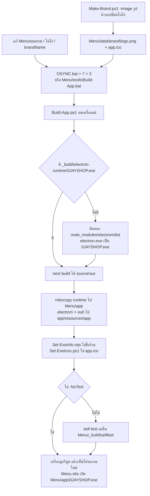

- **ไม่ต้องลง Node.js** — ใช้ `electron.exe` ใน `source\node_modules` รันแบบ Node (`ELECTRON_RUN_AS_NODE=1`) · ถ้ายังไม่มี `node_modules`: ลง Node.js LTS แล้ว `npm ci` ใน `Menu\source` (ข้อความของ `Build-App.ps1:15`)
- **build เมื่อไหร่**: หลังแก้ `Menu\source\`, เปลี่ยน `app.ico` (ไอคอนของไฟล์ exe) หรือ `brandName` (ชื่อไฟล์ exe) · แก้ `config.json` อย่างอื่นไม่ต้อง build
- **ใครเรียก Build-App**: `OSYNC.bat > 7 Tools > 3 "Build the menu program"` (`OSYNC.ps1:61`), `Menu\tools\Build-App.bat`, `Master-Setup.ps1:78` (ถามตอนตั้งเครื่องแม่ใหม่ถ้ายังไม่ได้ build), `Tool-Migrate.ps1:103` (`-NoTest`)
- **ส่งขึ้นเครื่องลูก**: ไม่มีขั้นคัดลอก — เครื่องลูกเปิดโปรแกรมจาก `Menu\app\` บนไดร์ฟเกมที่ใช้ร่วมกัน จึงเห็นโปรแกรมใหม่หลังรีบูต · ทางลัดทำครั้งเดียวใน Image (`OSYNC.bat > 5`) และซ่อมทุกบูต ชี้ไปที่ `System\Client\Menu.vbs` ซึ่งหา exe ชื่อร้านใน `Menu\app` เอง (ชื่ออื่นที่ไม่ใช่ `0jayshop.exe` มาก่อน ไม่มีค่อยใช้ `0JAYSHOP.exe`) — เปลี่ยนชื่อร้านจึงไม่ต้องแก้ Image
- **โลโก้และไอคอน**: `powershell -ExecutionPolicy Bypass -File Menu\tools\_system\Make-Brand.ps1 -Image <รูป>` → `data\brand\logo.png` + `app.ico` · ไอคอนหน้าต่าง / tray และไอคอนทางลัดอ่าน `app.ico` ตอนใช้งาน (`getAppIcon`, `Client-Menu.ps1:29-36`) ส่วนไอคอนในไฟล์ exe ต้อง Build-App

**ค่าในร้านนี้ตอนนี้:** `brandName=0JAYSHOP` → `Menu\app\0JAYSHOP.exe` (ไฟล์เดียว build ล่าสุด 19 พ.ย. 2026 21:11) · `Menu\_build\electron-runtime\0JAYSHOP.exe` มีแล้ว · self-test ล่าสุดใน `Menu\_build\selftest` วันที่ 17 พ.ย. 2026

---

## 15. `tools/Build-App.bat` — ปุ่ม build

**หน้าที่:** ปุ่มดับเบิลคลิกบนเครื่องแม่: รัน `Build-App.ps1` แล้วรอกดปุ่ม

**เรียกจาก / ทำงานเมื่อไหร่:** คนกดเอง (เครื่องแม่) หลังแก้ `source\` · comment: ปิด 0JAYSHOP บนเครื่องนี้ก่อน ตอนท้ายเปิดเมนูทดสอบไม่กี่วินาที

**พารามิเตอร์:** ไม่มี · **อ่านค่า / เขียน:** ตาม `Build-App.ps1` · **Log:** หน้าจอเท่านั้น

**ขั้นตอนการทำงาน:** `powershell.exe -NoProfile -ExecutionPolicy Bypass -File "%~dp0_system\Build-App.ps1"` → `pause`

**ฟังก์ชัน:** ไม่มี

---

## 16. `tools/_system/Build-App.ps1` — ตัว build จริง

**หน้าที่:** build หน้าเว็บจาก `source\`, ประกอบโปรแกรมลง `app\`, ใส่ชื่อร้าน + ไอคอนลง exe แล้วทดสอบ

**เรียกจาก / ทำงานเมื่อไหร่:** `Build-App.bat`, `OSYNC.ps1:61` (`build-menu`), `Master-Setup.ps1:78`, `Tool-Migrate.ps1:103` (`-NoTest`)

**พารามิเตอร์:** `-NoTest` = ข้าม self-test

**อ่านค่า:** `config.json` (ผ่าน `AppName.ps1`), `source\package.json`, `source\node_modules\electron\dist\electron.exe`, `node_modules\next`, `data\brand\app.ico`

**เขียน / เปลี่ยน:** `_build\electron-runtime\` (ครั้งแรก), `source\out\`, `app\` (runtime + `resources\app\electron`, `resources\app\out`, `resources\app\package.json`), ลบ `app\resources\app.asar` และ `default_app.asar`, version info + ไอคอนใน exe, `_build\selftest\*` · env ชั่วคราว `ELECTRON_RUN_AS_NODE`, `NEXT_TELEMETRY_DISABLED`, `GCAFE_SELFTEST`

**Log:** หน้าจอเท่านั้น (บรรทัด `Compiled` / `error` / `warn` / `Route` ของ next build, `published: ...`, `selftest.json`)

**ขั้นตอนการทำงาน:**
1. dot-source `AppName.ps1` → `$AppName`, `$AppExe`, `$AppNames`
2. เมนูรันอยู่จาก `app\` = หยุด "Close ... first." · ไม่มี `electron.exe` ใน `node_modules` = หยุด
3. ยังไม่มี `_build\electron-runtime\0JAYSHOP.exe` → robocopy `electron\dist` → เปลี่ยน `electron.exe` เป็น `0JAYSHOP.exe` → ลบ `default_app.asar`
4. `next build` ด้วย Electron-as-Node → `source\out` (ไม่ผ่าน = หยุด)
5. robocopy runtime → `app\` (ข้าม `app.asar` และโฟลเดอร์ `app`, ลองซ้ำ 10 ครั้งห่าง 3 วิ เพราะ antivirus) → ลบ `app.asar` → mirror `electron\` และ `out\` → เขียน `package.json` ตัวเล็ก (`name`, `version`, `main`)
6. `brandName` ไม่ใช่ `0JAYSHOP` → คัดลอกเป็น `app\<ชื่อร้าน>.exe` ด้วย (เก็บ `0JAYSHOP.exe` ไว้ให้ทางลัดเก่า)
7. ทุก exe: `Set-ExeInfo.mjs` (ไม่ผ่าน = WARNING) · มี `app.ico` → `Set-ExeIcon.ps1` (ลอง 10 ครั้งห่าง 3 วิ)
8. ไม่ใส่ `-NoTest` → ล้าง `_build\selftest` → เปิด `$AppExe` พร้อม `GCAFE_SELFTEST` → รอ 40 วิ (เกิน = ปิดทิ้ง + error) → พิมพ์ `selftest.json`

**ฟังก์ชัน:** ไม่มี (สคริปต์ตรง)

**ค่าในร้านนี้ตอนนี้:** `$AppName=0JAYSHOP` → มี exe เดียว `Menu\app\0JAYSHOP.exe`

---

## 17. `tools/_system/AppName.ps1` — ชื่อไฟล์โปรแกรม

**หน้าที่:** dot-source แล้วได้ชื่อโปรแกรมจาก `config.json` `brandName` (ตัดอักขระที่ใช้ในชื่อไฟล์ไม่ได้)

**เรียกจาก / ทำงานเมื่อไหร่:** `Build-App.ps1` บรรทัด 12

**พารามิเตอร์:** ไม่มี · **อ่านค่า:** `Menu\config.json` · **เขียน / เปลี่ยน:** ตัวแปร `$AppName` (ว่าง = `0JAYSHOP`), `$AppExe` = `Menu\app\<AppName>.exe`, `$AppNames` = ชื่อปัจจุบัน + `0JAYSHOP` · **Log:** ไม่มี

**ขั้นตอนการทำงาน:** อ่าน JSON (พัง = `$null`) → ตัด `\ / : * ? " < > |` → ตั้ง 3 ตัวแปร

**ฟังก์ชัน:** ไม่มี · กติกาเดียวกันมีใน `Get-MenuInfo` (`System\Scripts\Common.ps1:339`)

**ค่าในร้านนี้ตอนนี้:** `$AppName=0JAYSHOP`, `$AppExe=H:\OSYNC\Menu\app\0JAYSHOP.exe`

---

## 18. `tools/_system/Set-ExeInfo.mjs` — ชื่อร้านในข้อมูลไฟล์ exe

**หน้าที่:** ใส่ชื่อร้านลง version info ของ exe (Task Manager / Properties โชว์ชื่อร้าน ไม่ใช่ "Electron")

**เรียกจาก / ทำงานเมื่อไหร่:** `Build-App.ps1` ขั้น 7 รันด้วย `electron.exe` แบบ Node: `Set-ExeInfo.mjs <exe> <name> <source\node_modules>`

**พารามิเตอร์:** `exe`, `name`, `modules` (ไม่ครบ = exit 2)

**อ่านค่า:** ไฟล์ exe, แพ็กเกจ `resedit` ใน `node_modules` · **เขียน / เปลี่ยน:** ไฟล์ exe (`FileDescription`, `ProductName`, `CompanyName` = ชื่อร้าน, `OriginalFilename`, `InternalName` = ชื่อไฟล์) ทุกภาษา · **Log:** หน้าจอ `exe info: ...` หรือ `exe info FAILED ...`

**ขั้นตอนการทำงาน:** อ่าน exe (ลองซ้ำ) → อ่าน VersionInfo (ไม่มี = exit 1) → ตั้งค่าทุกภาษา → เขียนกลับ (ลองซ้ำ)

**ฟังก์ชัน:**

| ฟังก์ชัน | บรรทัด | หลักการทำงาน |
|---|---|---|
| [`sleep`](../../Menu/tools/_system/Set-ExeInfo.mjs#L13) | 13 | หยุดรอแบบ sync (`Atomics.wait`) |
| [`retry`](../../Menu/tools/_system/Set-ExeInfo.mjs#L14) | 14 | ลองซ้ำสูงสุด 20 ครั้งห่าง 1.5 วิ เมื่อไฟล์ถูกจับ (`EBUSY` `EPERM` `EACCES`) · error อื่น = exit 1 |

**ค่าในร้านนี้ตอนนี้:** ชื่อที่ใส่ = `0JAYSHOP`

---

## 19. `tools/_system/Set-ExeIcon.ps1` — ใส่ไอคอนลง exe

**หน้าที่:** เปลี่ยนไอคอนหลักของ exe เป็นไฟล์ `.ico` (แบบ `rcedit --set-icon`) ด้วย Win32 API

**เรียกจาก / ทำงานเมื่อไหร่:** `Build-App.ps1` ขั้น 7 เมื่อมี `data\brand\app.ico`

**พารามิเตอร์:** `-Exe` (บังคับ), `-Ico`, `-List` (แค่แสดงกลุ่มไอคอน)

**อ่านค่า:** resource ของ exe, ไฟล์ `.ico` · **เขียน / เปลี่ยน:** resource `RT_ICON` / `RT_GROUP_ICON` ใน exe · **Log:** หน้าจอ `icon set: ...`

**ขั้นตอนการทำงาน:** compile class C# `ExeIcon` (ครั้งเดียว) → `-List` = พิมพ์กลุ่ม · ไม่งั้น `Set`: หากลุ่มไอคอนแรก → ลบไอคอนเดิมของกลุ่ม → ใส่รูปจาก `.ico` ด้วยเลข id ที่ว่าง → เขียนกลุ่มใหม่ → `EndUpdateResource`

**ฟังก์ชัน** (method ของ class C# ในไฟล์ — ไม่มีฟังก์ชัน PowerShell):

| ฟังก์ชัน | บรรทัด | หลักการทำงาน |
|---|---|---|
| [`IsInt`](../../Menu/tools/_system/Set-ExeIcon.ps1#L27) | 27 | ชื่อ resource เป็นตัวเลขไหม |
| [`Groups`](../../Menu/tools/_system/Set-ExeIcon.ps1#L29) | 29 | อ่านกลุ่มไอคอนทั้งหมดและ id ไอคอนในไฟล์ exe |
| [`Set`](../../Menu/tools/_system/Set-ExeIcon.ps1#L50) | 50 | แทนกลุ่มไอคอนแรก (ที่ Explorer โชว์) ด้วยรูปทั้งหมดใน `.ico` |

**ค่าในร้านนี้ตอนนี้:** ใช้ `Menu\data\brand\app.ico` (มีไฟล์)

---

## 20. `tools/_system/Make-Brand.ps1` — ทำโลโก้และไอคอน

**หน้าที่:** ตัดรูปเป็นวงกลม (มีวงขอบสี) ทำโลโก้ร้าน PNG และไอคอนแอป `.ico`

**เรียกจาก / ทำงานเมื่อไหร่:** คนรันเอง: `powershell -ExecutionPolicy Bypass -File Menu\tools\_system\Make-Brand.ps1 -Image <รูป>` (อ้างใน `README.md` ของ OSYNC, `SETUP-AI.md`, `Setup-Install.ps1:138`) แล้วรัน Build-App

**พารามิเตอร์:** `-Image` (บังคับ, jpg/png) · `-CenterX` `-CenterY` (0.5) จุดกลางเป็นสัดส่วนของรูป · `-Radius` (0.48) รัศมีเป็นสัดส่วนของด้านสั้น · `-Ring` (`#f97316`) สีวงขอบ (ว่าง = ไม่มีขอบ)

**อ่านค่า:** ไฟล์รูป · **เขียน / เปลี่ยน:** `Menu\data\brand\logo.png` (512×512) และ `app.ico` (256, 128, 64, 48, 32, 24, 16 แบบ PNG ใน ico) · **Log:** หน้าจอ `logo: ...`, `icon: ...`

**ขั้นตอนการทำงาน:** โหลดรูป → `Round 512` บันทึก `logo.png` → `Round` ทุกขนาด → เขียนหัว ICO + รายการ + ข้อมูล PNG → บันทึก `app.ico`

**ฟังก์ชัน:**

| ฟังก์ชัน | บรรทัด | หลักการทำงาน |
|---|---|---|
| [`Round`](../../Menu/tools/_system/Make-Brand.ps1#L14) | 14 | วาดรูปส่วนที่ตัดลงวงกลมขนาด size พื้นโปร่งใส + วงขอบหนา 3.5% |
| [`PngBytes`](../../Menu/tools/_system/Make-Brand.ps1#L30) | 30 | Bitmap → byte PNG |

**ค่าในร้านนี้ตอนนี้:** `data\brand\` มี `logo.png`, `app.ico` (8 ต.ค. 2026) และ `source.jpg` · ไม่ได้ทำ `logo-mark.png` (สคริปต์นี้ไม่ทำไฟล์นั้น)

---

## 21. `tools/_system/imagetool/` — ตัวทำรูปปก

**หน้าที่:** ทำรูปปกการ์ด 920×586 ด้วย canvas ของ Chromium (อ่าน jpg / png / webp / bmp / ico ได้) จากรูปในเกม หรือจากไอคอนโปรแกรม

**เรียกจาก / ทำงานเมื่อไหร่:** `Master-GameList.ps1:311-319` บนเครื่องแม่ เมื่อมีเกมที่ไม่มีรูปปก: `Menu\app\0JAYSHOP.exe --imagetool <jobs.json>` (`main.js:14-18`) · ยังไม่เคย build = `source\node_modules\electron\dist\electron.exe <โฟลเดอร์ imagetool> <jobs.json>` (ผ่าน `main.js` ของโฟลเดอร์นี้)

**ไฟล์:** `main.js` (เรียก `render.js` ด้วย argument ตัวสุดท้าย) · `package.json` (`gcafe-imagetool`, `main: main.js`) · `render.js` (ตัวทำงาน) · `page.html` (ฟังก์ชันวาด)

**พารามิเตอร์:** ไฟล์งาน JSON: `[{mode: 'cover' หรือ 'icon', src, out, w, h, fx, fy}]`

**อ่านค่า:** ไฟล์งาน (`%TEMP%\gcafe-poster-jobs.json`), รูปต้นทาง · **เขียน / เปลี่ยน:** ไฟล์ jpg ตาม `out` (`Menu\data\posters\_auto\<id>.jpg`) · **Log:** หน้าจอ `imagetool: n/m posters`, `FAILED <ไฟล์>: ...`

**ขั้นตอนการทำงาน:**
1. ปิด hardware acceleration → เปิดหน้าต่างซ่อน (offscreen, `webSecurity: false`) โหลด `page.html`
2. ทุกงาน: `render(job)` ในหน้า → ได้ JPEG คุณภาพ 0.9 → เขียน `out`
3. `cover`: รูปแนวนอน = ครอบตัดเต็มการ์ด (`fx` `fy`) · รูปแนวตั้ง / สี่เหลี่ยม (กว้าง/สูง < 1.25) = รูปเต็มกลางการ์ดบนพื้นเบลอ · `icon` = พื้นสีเบลอจากไอคอน + แสงด้านหลัง + ไอคอนกลาง
4. ครบแล้วปิดโปรแกรม

**ฟังก์ชัน:**

| ฟังก์ชัน | บรรทัด | หลักการทำงาน |
|---|---|---|
| [`load`](../../Menu/tools/_system/imagetool/page.html#L4) | 4 | โหลดรูปเป็น `Image` (`page.html`) |
| [`cover`](../../Menu/tools/_system/imagetool/page.html#L7) | 7 | วาดรูปเต็มกรอบแบบครอบตัด ตามจุด fx/fy (`page.html`) |
| [`render`](../../Menu/tools/_system/imagetool/page.html#L12) | 12 | วาดปกหนึ่งใบตาม mode คืน data URL JPEG (`page.html`) |
| [`run`](../../Menu/tools/_system/imagetool/render.js#L14) | 14 | ตัว export ของ `render.js`: เปิดหน้าซ่อน ทำทุกงาน เขียนไฟล์ แล้ว `app.quit()` |

**ค่าในร้านนี้ตอนนี้:** ใช้ `Menu\app\0JAYSHOP.exe` (มีแล้ว) เป็นตัวทำรูป

---

## ปัญหาที่เคยเจอ / ข้อควรรู้

จาก comment ในโค้ด:

- **13 พ.ย. — หน้าต่างโชว์ทีละ 1**: HUD กับเมนูไม่ขึ้นพร้อมกัน แถบงานมีปุ่มเดียว · เปิดเมนูซ่อน HUD ปิดเมนู HUD กลับ (`main.js:26-27`, `main.js:630`)
- **13 พ.ย. — รูปโลโก้ / ปกใหม่ไม่ขึ้น**: เดิมรูปเก่าค้างได้ถึงวัน → `/poster/` ส่ง no-cache + ETag และที่อยู่รูปมี `?v=<เวลาไฟล์>` (`main.js:57`, `main.js:444-445`)
- **diskless — `games.json` ใหม่อ่านเป็นขยะจนรีบูต** → จำรายการที่อ่านได้ล่าสุด และอ่านครั้งแรกตอนเปิดโปรแกรม ("right after boot it is always readable") (`main.js:151-152`, `main.js:981`)
- **`loadConfig()` ถูกเรียกตั้งแต่บรรทัด 10** ก่อนค่าคงที่ระดับไฟล์มีอยู่ → รายการฟอนต์ต้องอยู่ในฟังก์ชัน (`main.js:81`)
- **`--imagetool` ต้องเช็กก่อน single-instance lock** ไม่งั้นทำรูปไม่ได้ตอนเมนูเปิดอยู่ (`main.js:13`)
- **หน้าล็อก**: kiosk / เต็มจอติดแน่นอนเมื่อหน้าต่างแสดงแล้วเท่านั้น · แถบงานกับหน้าล็อกต่างเป็น top-most ตัวที่ยกล่าสุดชนะ → ยกหน้าล็อกซ้ำทุกวินาที · เมนูถูกปิดจริง (ไม่ใช่ซ่อน) ลูกค้าคนถัดไปไม่เห็นคำค้น / แท็บของคนก่อน (`main.js:236`, `main.js:251`, `main.js:247`)
- **ไม่มีปุ่มออกใน tray** — ลูกค้าต้องปิดโปรแกรมร้านไม่ได้ · `quit-app` เดิมจากหน้าเว็บถูกเพิกเฉย (`main.js:589`, `main.js:959`) · หน้าจอไม่มีทางปิดโปรแกรม ต้องหยุดโปรเซสเอง (เช่น Task Manager หรือ `Client-Menu.ps1 -Uninstall` ที่หยุดโปรเซสให้)
- **IPC `add-time` เดิมให้หน้าเติมเงินเพิ่มเวลาได้โดยไม่จ่ายเงิน** — เอาออกแล้ว เวลาเปลี่ยนจากการเช่าจริงเท่านั้น (`main.js:975`)
- **16 พ.ย. — คลิกขวา** หาตำแหน่งจาก `games.json` ตาม id เท่านั้น หน้าเว็บสั่งเปิด path อื่นไม่ได้ (`main.js:329-332`)
- **เกม / Explorer ต้องไม่อยู่หลังเมนูที่อยู่บนสุด** → เปิดแล้วปิด (หรือย่อ) เมนูทันที (`main.js:658`, `main.js:930`)
- **17 พ.ย. — GTA รีเซ็ตค่าทั้งหมดถ้าชื่อการ์ดจอไม่ตรงชื่อ DirectX** → ใส่ชื่อการ์ดจอของเครื่องนั้นทุกครั้ง · อะไรพังขั้นนี้ไม่หยุดเกม (`main.js:666-667`)
- **17 พ.ย. — FiveM ไม่โหลด ReShade 5+** (ไฟล์อยู่ใน plugins แต่ไม่มี ReShade) จนกว่า `CitizenFX.ini` มี `[Addons] ReShade5=ID:<hash ชื่อเครื่อง> ...` แต่ละเครื่องจึงได้บรรทัดของตัวเอง (`main.js:791-795`)
- **ReShade / ม็อด FiveM บนเครื่อง diskless หายเองหลังรีบูต** · ปิดแล้วลบเฉพาะไฟล์ที่เมนูคัดลอก (`osync-installed.json`) (`main.js:733-734`)
- **17 พ.ย. — menuOnly**: เมนูเกมคือทั้งโปรแกรม ปิด (X, เปิดเกม, Alt+F4) = ย่อลงแถบงาน (`main.js:627`)
- **12 พ.ย. — สถิติเปิดเกม** ส่งแค่ชื่อเกม ไม่รอ และไม่ขวางการเปิดเกม (`main.js:320`)
- **Build: antivirus จับไฟล์ exe ไว้หลายวินาทีหลังคัดลอก / หลังปิดโปรแกรม** → robocopy ลอง 10 ครั้ง, ใส่ไอคอนลอง 10 ครั้ง, `Set-ExeInfo` ลอง 20 ครั้ง (`Build-App.ps1:37`, `Build-App.ps1:60`, `Set-ExeInfo.mjs:12`)
- **`electron.exe` เป็นโปรแกรม GUI**: PowerShell รอและได้ `$LASTEXITCODE` เฉพาะเมื่ออ่าน output → ต่อ pipe ไว้ (`Build-App.ps1:55`)
- **เปลี่ยนชื่อร้านแล้ว `app\0JAYSHOP.exe` ยังอยู่** เป็นสำเนาให้ทางลัดเก่ายังใช้ได้ (`Build-App.ps1:48`)
- **หน้าล็อก 13 พ.ย.**: ที่จอ 1366x768 แพ็กเกจที่ 5 ถูกซ่อนโดยไม่มีสัญญาณ → กล่องเลื่อน + ปุ่ม "เลื่อนดูแพ็กเกจเพิ่ม" · ความสูงใช้ % ไม่ใช้ vh เพราะ zoom · โลโก้ร้านเป็นสี่เหลี่ยมมน ครอบวงกลมแล้วตัดมุม (`lock/page.jsx:25`, `lock/page.jsx:63`, `lock/page.jsx:295`)
- **หน้า pre-render**: นาฬิกาเริ่มที่ 0 จน mount ไม่งั้นเวลาไม่ตรงกับตอน build (React #418) (`lock/page.jsx:84`, `dialog/page.jsx:89`)
- **17 พ.ย. — ไม่ใช้ emoji ในเมนูเกม** ใช้ไอคอนเส้นแทน (`Icons.jsx:1`, `dialog/page.jsx:16`)
- **HUD สูงตามหน้า** ฟอนต์ใหญ่ / zoom / ชื่อยาวไม่ดันปุ่มล่างจมขอบ (`main.js:492-493`)
- **ฟอร์มตั้งค่าลับใน HUD ถูกเอาออก** — ลูกค้าเปิดได้ ตอนนี้แบรนด์ / API มาจาก `config.json` (`page.jsx:40`, `page.jsx:324`)
