# 07 · คอนโซลแอดมินและคลังออนไลน์ (ทีละฟังก์ชัน)

บทนี้อธิบาย **คอนโซลแอดมินของเครื่องแม่** กับ **คลังออนไลน์** ไล่ทีละไฟล์และทีละฟังก์ชัน
- คอนโซลคือหน้าเว็บบนเครื่องแม่ (`127.0.0.1:4666`) ใช้ดูสถานะร้าน เครื่องลูก แก้ชื่อ/หมวด/รูปเกม ตั้งค่า และจัดไดรฟ์เกม เปิดผ่าน `OSYNC-Console.exe`
- คลังออนไลน์คือการแชร์เกมข้ามสาขาด้วย BitTorrent: มีฮับ (`Hub-Server.ps1`) เก็บรายการเกมของทุกสาขาและเป็น tracker ส่วนแต่ละสาขารัน `Online-Library.ps1` และใช้ aria2 ส่งไฟล์
- คู่มือการใช้งานแบบสั้นอยู่ที่ [CONSOLE-ONLINE.md](CONSOLE-ONLINE.md) บทนี้คือรายละเอียดของโค้ด

## สารบัญ
- [แผนภาพรวม](#แผนภาพรวม)
- [ตาราง API ทั้งหมดของคอนโซล](#ตาราง-api-ทั้งหมดของคอนโซล)
- [1. `OSYNC-Console.exe` — ตัวเปิดคอนโซล](#1-osync-consoleexe--ตัวเปิดคอนโซล)
- [2. `Console-Server.ps1` — เซิร์ฟเวอร์คอนโซล](#2-console-serverps1--เซิร์ฟเวอร์คอนโซล)
- [3. `index.html` — หน้าเว็บคอนโซล](#3-indexhtml--หน้าเว็บคอนโซล)
- [4. `Online-Library.ps1` — คลังออนไลน์ฝั่งสาขา](#4-online-libraryps1--คลังออนไลน์ฝั่งสาขา)
- [5. `Hub-Server.ps1` — ฮับและ tracker](#5-hub-serverps1--ฮับและ-tracker)
- [6. `Online-Torrent.ps1` — สร้างและตรวจไฟล์ทอร์เรนต์](#6-online-torrentps1--สร้างและตรวจไฟล์ทอร์เรนต์)
- [7. `Online-Upnp.ps1` — ขอพอร์ตจากเราเตอร์ (UPnP)](#7-online-upnpps1--ขอพอร์ตจากเราเตอร์-upnp)
- [8. `Test-Console.ps1` — ทดสอบคอนโซล](#8-test-consoleps1--ทดสอบคอนโซล)
- [9. `Sim-OnlineLibrary.ps1` — จำลองคลังออนไลน์](#9-sim-onlinelibraryps1--จำลองคลังออนไลน์)
- [10. `Fake-Igd.ps1` — เราเตอร์ปลอมสำหรับทดสอบ](#10-fake-igdps1--เราเตอร์ปลอมสำหรับทดสอบ)
- [ค่าในร้านนี้ตอนนี้ (สรุป)](#ค่าในร้านนี้ตอนนี้-สรุป)
- [ปัญหาที่เคยเจอ / ข้อควรรู้](#ปัญหาที่เคยเจอ--ข้อควรรู้)

## แผนภาพรวม

**คอนโซล:** ใครเปิดอะไร และ API ของคอนโซลไปเรียกสคริปต์ไหนบนเครื่องแม่

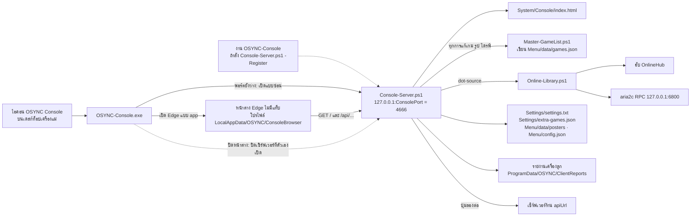

**คลังออนไลน์:** ฮับ สาขา aria2 และ UPnP

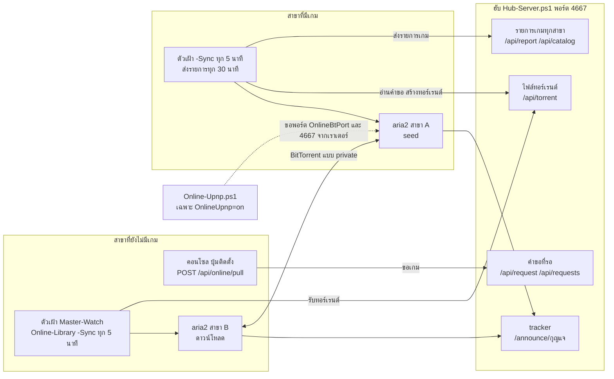

> ร้านนี้ตอนนี้: `OnlineHub=http://127.0.0.1:4667` (เครื่องแม่เป็นฮับเอง) และ `OnlineUpnp=off` = มี **สาขาเดียว** และ **ไม่มี UPnP** ดูรายละเอียดที่ [ค่าในร้านนี้ตอนนี้](#ค่าในร้านนี้ตอนนี้-สรุป)

## ตาราง API ทั้งหมดของคอนโซล

เส้นทางทั้งหมดอยู่ใน `$handler` ของ [`Console-Server.ps1`](../Scripts/Console-Server.ps1#L410) ทุกคำขอต้องมี Host เป็น `localhost` หรือ `127.0.0.1` (ไม่งั้น 403) · คำขอ POST ต้องมีหัว `X-OSYNC: 1` (ไม่งั้น 403) · เส้นทางที่บังคับ POST แต่ส่ง GET มา = 405 · ฟังก์ชันโยน error = 400 พร้อมข้อความ · ไม่ตรงเส้นทางไหน = 404

| Method | Path | ทำอะไร (ฟังก์ชัน) | อาจเปลี่ยนอะไร | หน้าเว็บที่เรียก |
|---|---|---|---|---|
| GET | `/` | ส่ง `System\Console\index.html` | - | เปิดหน้า |
| GET | `/static/<ชื่อไฟล์>` | ส่งไฟล์ใน `System\Console` ตามชื่อ (ชื่อใช้ได้แค่ `A-Z a-z 0-9 . _ -`) | - | ไม่มีใน index.html ตอนนี้ |
| GET | `/poster/<path>` | ส่งรูป `.png .jpg .jpeg .webp .gif .ico .bmp` เฉพาะใต้ `Menu`, `Launchers`, โฟลเดอร์เกม (`Get-GameFolders`) หรือรูปที่ `games.json` ใช้อยู่ ([`Test-MenuImage`](../Scripts/Console-Server.ps1#L168)) · มี `..` = 404 | - | รูปการ์ดในหน้าเกม |
| GET | `/api/status` | [`Get-ConsoleStatus`](../Scripts/Console-Server.ps1#L269) | - | `loadStatus` (ขั้นสูง › บันทึกระบบ) |
| GET | `/api/games` | [`Get-ConsoleGames`](../Scripts/Console-Server.ps1#L96) + [`Get-Cats`](../Scripts/Console-Server.ps1#L72) | - | `loadGames` |
| POST | `/api/game` `{id,title,cat,hide}` | [`Set-GameOverride`](../Scripts/Console-Server.ps1#L117) แล้ว [`Invoke-GameList`](../Scripts/Console-Server.ps1#L65) | `Settings\extra-games.json`, `Menu\data\games.json` | `saveGame` |
| POST | `/api/icon` `{id,data}` | [`Set-GameIcon`](../Scripts/Console-Server.ps1#L150) แล้ว `Invoke-GameList` | `Menu\data\posters\<id>.png/.jpg/.webp`, `games.json` | `pickIcon` |
| POST | `/api/icon/reset` `{id}` | [`Remove-GameIcon`](../Scripts/Console-Server.ps1#L163) แล้ว `Invoke-GameList` | ลบรูปใน `posters`, `games.json` | `resetIcon` |
| POST | `/api/update` | `Invoke-GameList` (รัน `Master-GameList.ps1`) | `games.json` | `runUpdate` |
| GET | `/api/drives` | [`Get-ConsoleDrives`](../Scripts/Console-Server.ps1#L188) | - | `loadDrives` |
| POST | `/api/drives/add` `{letter หรือ path, clientsOff}` | [`Add-GameDrive`](../Scripts/Console-Server.ps1#L224) แล้ว `Invoke-GameList` | สร้างโฟลเดอร์หมวดบนไดรฟ์, อาจเพิ่ม `GameFolders` ใน settings.txt, `games.json` | `addDrive` |
| POST | `/api/drives/remove` `{path}` | [`Remove-GameDrive`](../Scripts/Console-Server.ps1#L259) แล้ว `Invoke-GameList` | ลบ path ออกจาก `GameFolders` (ไฟล์เกมไม่ถูกลบ), `games.json` | `removeDrive` |
| GET | `/api/online` | [`Get-OnlineView`](../Scripts/Online-Library.ps1#L176) | สร้างโฟลเดอร์ `OnlineData`, เดินงานดาวน์โหลด ([`Update-PullJobs`](../Scripts/Online-Library.ps1#L259)) ซึ่งอาจเปิด aria2 และเขียน `jobs.json`, `torrents\` | `loadOnline` |
| POST | `/api/online/publish` | [`Publish-Branch`](../Scripts/Online-Library.ps1#L165) | ฮับ: `branches\<สาขา>.json` · ในเครื่อง: `published.txt`, `sizes.json` | `publish` |
| POST | `/api/online/pull` `{key}` | [`Start-Pull`](../Scripts/Online-Library.ps1#L236) | ฮับ: `requests.json` · ในเครื่อง: `jobs.json` และอาจเริ่ม aria2 | `pull` |
| GET | `/api/online/jobs` | [`Get-PullJobs`](../Scripts/Online-Library.ps1#L207) | - | ไม่มีใน index.html ตอนนี้ |
| GET | `/api/overview` | [`Get-ConsoleOverview`](../Scripts/Console-Server.ps1#L324) | - | `loadHome` |
| GET | `/api/clients` | [`Get-ConsoleClients`](../Scripts/Console-Server.ps1#L293) | - | `loadClients` |
| GET | `/api/client?ip=<IP>` | [`Get-ConsoleClientReport`](../Scripts/Console-Server.ps1#L318) | - | `showReport` |
| GET | `/api/settings` | [`Get-SettingsView`](../Scripts/Console-Server.ps1#L352) | - | `loadSettings`, `loadRaw` |
| POST | `/api/setting` `{key,value}` | [`Set-ConsoleSetting`](../Scripts/Console-Server.ps1#L365) | แก้ 1 บรรทัดใน `Settings\settings.txt` | `saveSetting` |
| GET | `/api/shop` | [`Get-ShopView`](../Scripts/Console-Server.ps1#L374) | - | `loadShop` |
| POST | `/api/shop` `{apiUrl,machineId,brandName,menuOnly,sidePanel}` | [`Set-ShopConfig`](../Scripts/Console-Server.ps1#L385) | 5 ค่าใน `Menu\config.json` | `saveShop` |
| POST | `/api/shop/test` | [`Test-ShopApi`](../Scripts/Console-Server.ps1#L399) | - (ส่ง GET ไป `<apiUrl>/station/session`) | `testShop` |
| POST | `/api/_stop` | หยุดเซิร์ฟเวอร์ (ได้เฉพาะเปิดด้วย `-AllowStop`) ไม่งั้น 404 | - | `Test-Console.ps1` |

หมายเหตุ: เส้นทาง GET ไม่ได้เช็ก method (ส่ง POST ที่มีหัว `X-OSYNC` มาก็ได้คำตอบเดียวกัน) · `/api/shop` ใช้ path เดียวกันทั้งอ่าน (ไม่ใช่ POST) และบันทึก (POST)

---

## 1. `OSYNC-Console.exe` — ตัวเปิดคอนโซล

**หน้าที่:** เปิดคอนโซลเป็นหน้าต่างโปรแกรมของตัวเองบนเครื่องแม่: เปิดเซิร์ฟเวอร์คอนโซลแบบซ่อนถ้ายังไม่มี รอให้ตอบ เปิดหน้า `http://127.0.0.1:<ConsolePort>/` ใน Edge แบบ app แล้วปิดเซิร์ฟเวอร์เมื่อปิดหน้าต่าง ซอร์สคือ [`System\Console\OSYNC-Console.cs`](../Console/OSYNC-Console.cs)

**เรียกจาก / ทำงานเมื่อไหร่:**
- ผู้ใช้ดับเบิลคลิก ร้านนี้มีไอคอน `OSYNC Console.lnk` บนเดสก์ท็อปเครื่องแม่ ชี้ไปที่ `H:\OSYNC\System\Console\OSYNC-Console.exe` (ตรวจ 20 พ.ย. 2026) · ไม่มีสคริปต์ไหนในโค้ดสร้างไอคอนนี้ (ไม่ระบุในโค้ด)
- ไม่ได้อยู่ในเมนู `OSYNC.bat`

**พารามิเตอร์:**
- `--root <โฟลเดอร์ OSYNC>` ใช้โฟลเดอร์นี้แทน (เช่น ทดสอบกับสำเนา) · ไม่ใส่ = โฟลเดอร์ของ exe ถ้ามี `System\Scripts\Console-Server.ps1` ไม่งั้นขึ้นไป 2 ชั้น (`System\Console` → ราก OSYNC)

**อ่านค่า:** `Settings\settings.txt` คีย์ `MasterPC` และ `ConsolePort` (อ่านเองด้วยฟังก์ชัน `Setting` ไม่ได้ใช้ Common.ps1) · มีโฟลเดอร์ `GAMELUNCHER` / `Launchers` ไหม · ตัวแปร `OSYNC_LAUNCHERS` · ที่อยู่ `msedge.exe` · รายการ process `msedge.exe` ผ่าน WMI

**เขียน / เปลี่ยน:** สร้างโฟลเดอร์โปรไฟล์ Edge `%LOCALAPPDATA%\OSYNC\ConsoleBrowser` · เปิด process `powershell.exe` (เซิร์ฟเวอร์) และ `msedge.exe` · ฆ่าเซิร์ฟเวอร์ที่ตัวเองเปิดเมื่อหน้าต่างปิด

**Log:** ไม่มี · error แสดงเป็นกล่องข้อความหัว "OSYNC Console"

**ขั้นตอนการทำงาน:**
1. หาโฟลเดอร์ OSYNC (`--root` หรือหาเอง) ไม่เจอ `System\Scripts\Console-Server.ps1` = แจ้ง "ไม่เจอโฟลเดอร์ OSYNC" แล้วจบ (exit 1)
2. `MasterPC` ไม่ว่างและไม่ตรงกับชื่อเครื่องนี้ = แจ้ง "คอนโซลใช้ได้เฉพาะเครื่องแม่" (exit 2)
3. มี `GAMELUNCHER` แต่ไม่มี `Launchers` และไม่ได้ตั้ง `OSYNC_LAUNCHERS` = ยังเป็นโครงเดิม แจ้งให้ทำ `OSYNC.bat > 7 > 17` ก่อน (exit 2)
4. อ่าน `ConsolePort` (ค่าไม่ถูก = 4666) แล้วใช้ URL `http://127.0.0.1:<port>/`
5. ถ้าพอร์ตยังไม่มีคนฟัง ([`Alive`](../Console/OSYNC-Console.cs#L45)): เปิด `powershell.exe -NoProfile -ExecutionPolicy Bypass -WindowStyle Hidden -File Console-Server.ps1 -Port <port>` แบบไม่มีหน้าต่าง ลบ `PSModulePath` ออกก่อน แล้วเช็กทุก 0.3 วิ · เซิร์ฟเวอร์ปิดเอง = แจ้ง exit code (exit 3) · เกิน 40 วิ = ฆ่าแล้วแจ้ง (exit 3)
6. หา Edge ([`FindEdge`](../Console/OSYNC-Console.cs#L60)) ไม่เจอ = เปิด URL ด้วยเบราว์เซอร์หลักแล้วจบ (เซิร์ฟเวอร์เปิดค้างต่อ)
7. เปิด Edge: `--app=<url> --user-data-dir="%LOCALAPPDATA%\OSYNC\ConsoleBrowser" --no-first-run --no-default-browser-check --window-size=1320,900`
8. ถ้า exe นี้เป็นคนเปิดเซิร์ฟเวอร์: รอ 4 วิ แล้วเช็กทุก 2 วิว่ายังมี `msedge.exe` ที่ใช้โปรไฟล์นี้ไหม ([`ProfileOpen`](../Console/OSYNC-Console.cs#L71)) พอไม่มีแล้ว = ฆ่าเซิร์ฟเวอร์ · ถ้าเซิร์ฟเวอร์มีอยู่ก่อนแล้ว (เช่น งาน `OSYNC-Console`) จะไม่แตะ

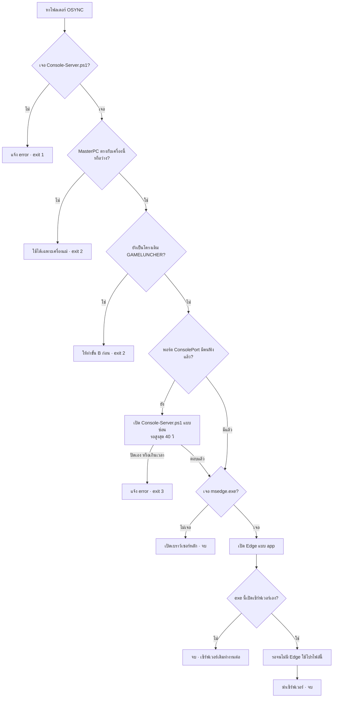

**ฟังก์ชัน:**

| ฟังก์ชัน | บรรทัด | หลักการทำงาน |
|---|---|---|
| [`Msg`](../Console/OSYNC-Console.cs#L23) | 23 | กล่องข้อความหัว "OSYNC Console" ปุ่ม OK |
| [`Setting`](../Console/OSYNC-Console.cs#L28) | 28 | อ่าน `Key=Value` บรรทัดแรกที่ตรงจากไฟล์ settings (UTF-8) ไม่เจอหรืออ่านไม่ได้ = ค่าว่าง |
| [`Alive`](../Console/OSYNC-Console.cs#L45) | 45 | ลองต่อ TCP ไป `127.0.0.1:<port>` รอ 1 วิ ต่อได้ = เซิร์ฟเวอร์ทำงาน (ไม่ส่ง HTTP) |
| [`FindEdge`](../Console/OSYNC-Console.cs#L60) | 60 | หา `msedge.exe` ใน Program Files (x86), Program Files, LocalAppData ตามลำดับ |
| [`ProfileOpen`](../Console/OSYNC-Console.cs#L71) | 71 | ถาม WMI ว่ามี `msedge.exe` ที่ command line มีโฟลเดอร์โปรไฟล์คอนโซลไหม |
| [`Main`](../Console/OSYNC-Console.cs#L87) | 87 | ขั้นตอนทั้งหมดด้านบน · คืน exit 0/1/2/3 |

### `Alive` — ทำไมเช็กด้วย TCP ไม่ใช่ HTTP
คอมเมนต์ในโค้ด: เซิร์ฟเวอร์ตอบได้ทีละคำขอ และ `/api/status` ใช้เวลาหลายวินาที ถ้าโพลด้วย HTTP คำขอจะต่อคิวจนไม่ได้คำตอบทันเวลา การต่อ TCP ที่ไม่ส่งอะไรเซิร์ฟเวอร์จะปิดทันที

**วิธีคอมไพล์ (หัวไฟล์):** `C:\Windows\Microsoft.NET\Framework64\v4.0.30319\csc.exe /nologo /target:winexe /optimize /codepage:65001 /win32icon:console.ico /r:System.Management.dll /r:System.Windows.Forms.dll /out:OSYNC-Console.exe OSYNC-Console.cs` (ไม่ต้องติดตั้งอะไรเพิ่ม)

**ค่าในร้านนี้ตอนนี้:** `MasterPC=DESKTOP-3ORJAGC` (เครื่องนี้) · `ConsolePort=4666` · ร้านนี้ผ่านขั้น B แล้ว (มีโฟลเดอร์ `Launchers`) · มีโปรไฟล์ `%LOCALAPPDATA%\OSYNC\ConsoleBrowser` แล้ว

---

## 2. `Console-Server.ps1` — เซิร์ฟเวอร์คอนโซล

**หน้าที่:** เว็บเซิร์ฟเวอร์เล็ก ๆ บน `127.0.0.1:<ConsolePort>` (ใช้ `Http-Lib.ps1`) ส่งหน้า `index.html` และตอบ `/api/...` ทั้งหมดของคอนโซล ดู [ตาราง API](#ตาราง-api-ทั้งหมดของคอนโซล)

**เรียกจาก / ทำงานเมื่อไหร่:**
- `OSYNC-Console.exe` เปิดแบบซ่อนเมื่อพอร์ตยังว่าง
- งาน `OSYNC-Console` (ตอนล็อกอิน) ถ้าเคยสั่ง `Console-Server.ps1 -Register` · ร้านนี้ตรวจ 20 พ.ย. 2026 ไม่มีงานนี้
- `System\Tests\Test-Console.ps1` เปิดบนพอร์ตทดสอบ 4766
- ไม่ได้อยู่ในเมนู `OSYNC.bat`

**พารามิเตอร์:**
- `-Port` พอร์ต · 0 (ค่าเริ่ม) = `ConsolePort` หรือ 4666
- `-Register` ลงงาน `OSYNC-Console` ตอนล็อกอิน (ผู้ใช้นี้ ซ่อนหน้าต่าง ไม่มีเวลาจำกัด ไม่เปิดซ้อน) แล้วเริ่มทันที · `-Unregister` ลบงาน
- `-AllowStop` เปิดให้ `POST /api/_stop` หยุดเซิร์ฟเวอร์ (ใช้ทดสอบ)
- `-TestRoot <โฟลเดอร์>` โฟลเดอร์เกมที่เพิ่มใต้โฟลเดอร์นี้ข้ามการเช็กไดรฟ์ (ทดสอบบนไดรฟ์ Windows)

**อ่านค่า:**
- Settings: `ConsolePort`, `GamesFolder`, `GameFolders`, `SharedDrives`, `MasterPC` (ผ่าน `Test-IsMaster`), `ClientReportPort` (ค่าเริ่ม 4670), `FiveMSharePort` (4671), `OslinkLoginPort` (4669), คีย์ `Online*` ทั้งหมด (ผ่าน `Get-OnlineConfig`)
- ไฟล์: `Menu\data\games.json`, `Settings\extra-games.json`, `Menu\data\posters\*`, `Menu\config.json`, `System\Docs\SHOP-API.md`, `appmanifest_*.acf` ในไลบรารี Steam, log ตัวเฝ้า `C:\Users\Public\OSYNC-Master-Watch.log`, รายงานเครื่องลูก `%ProgramData%\OSYNC\ClientReports\*.txt` หรือ `%USERPROFILE%\OSYNC-StepB\oslink-reports\*.txt`, แคช FiveM `data\server-cache-priv\cache_*` และ `<ไดรฟ์>:\_osync-fivem-incoming\server.log`
- ระบบ: mutex `Local\OSYNC-Master-Watch` (ตัวเฝ้าทำงานไหม), พอร์ตที่กำลังฟังในเครื่อง, `Win32_LogicalDisk`
- ตัวแปรทดสอบ: `OSYNC_SETTINGS`, `OSYNC_MENU` (ผ่าน Common.ps1)

**เขียน / เปลี่ยน:**
- `Settings\extra-games.json`, `Settings\settings.txt` (ทีละบรรทัด), `Menu\config.json` (5 ค่า), `Menu\data\posters\<id>.*` — เขียนเป็นไฟล์ `.tmp` แล้วย้ายทับ, CRLF, คง BOM ตามไฟล์เดิม
- `Menu\data\games.json` ผ่าน `Master-GameList.ps1` ทุกครั้งที่แก้เกม รูป หรือไดรฟ์
- โฟลเดอร์หมวดบนไดรฟ์เกม (เพิ่มไดรฟ์)
- สิ่งที่คลังออนไลน์เขียน (ดูหัวข้อ 4)
- งาน `OSYNC-Console` (`-Register`) · ฟังพอร์ต `127.0.0.1:<ConsolePort>` เท่านั้น ไม่ตั้งกฎ firewall
- mutex `Local\OSYNC-Console-<port>` กันเปิดซ้อน

**Log:** ไม่มีไฟล์ log ของตัวเอง · `Http-Lib.ps1` เขียน log คำขอเฉพาะเมื่อตั้ง `$env:OSYNC_HTTP_LOG`

**ขั้นตอนการทำงาน:**
1. dot-source `Common.ps1`, `Http-Lib.ps1`, `Online-Library.ps1` (ได้แค่ฟังก์ชัน)
2. `-Port` = 0 → อ่าน `ConsolePort`
3. `-Register` / `-Unregister` → จัดการงาน `OSYNC-Console` แล้วจบ
4. ตั้งค่าคงที่: หมวดมาตรฐาน `$BaseCats` (Online, Steam, Riot, Epic, EA, Rockstar, Ubisoft, Garena, HoYoPlay, Gacha, Mobile, Single Player, Emulator, Apps, Launchers), หมวดที่สร้างบนไดรฟ์ใหม่ `$DriveCats` (Online, Mobile, Single Player, Emulator, Garena, HoYoPlay, Gacha), ชื่อโฟลเดอร์ที่สแกนทุกไดรฟ์ `$ScanKinds` (Online, PvP, Mobile, Single Player, Offline, Web, Emulator, Garena, HoYoPlay, Gacha)
5. จับ mutex `Local\OSYNC-Console-<port>` ไม่ได้ = "the console already runs on port ..." แล้วจบ
6. `Start-HttpServer -Bind 127.0.0.1` ตอบทีละคำขอ ตาม `$handler`

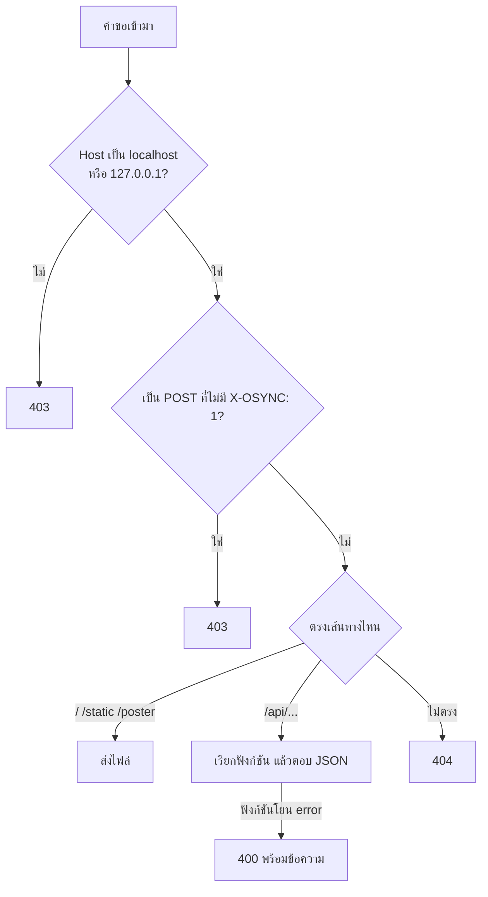

**ฟังก์ชัน:**

| ฟังก์ชัน | บรรทัด | หลักการทำงาน |
|---|---|---|
| [`Read-JsonFile`](../Scripts/Console-Server.ps1#L48) | 48 | อ่าน JSON แบบ UTF-8 ตัด BOM · ไม่มีไฟล์ = `$null` |
| [`Write-TextFile`](../Scripts/Console-Server.ps1#L49) | 49 | เขียนเป็น CRLF ลง `<ไฟล์>.tmp` แล้วย้ายทับ · คง BOM ถ้าไฟล์เดิมมี |
| [`Set-SettingLine`](../Scripts/Console-Server.ps1#L57) | 57 | แก้บรรทัด `Key=` แรกใน settings.txt (คอมเมนต์อื่นอยู่ครบ) · ไม่มี = เพิ่มท้ายไฟล์พร้อมคอมเมนต์ "set by the admin console" |
| [`Invoke-GameList`](../Scripts/Console-Server.ps1#L65) | 65 | รัน `Master-GameList.ps1` ในอีก process · คืน `ok` (exit 0) และ 12 บรรทัดท้ายของผล |
| [`Get-Cats`](../Scripts/Console-Server.ps1#L72) | 72 | หมวดมาตรฐาน + ทุกหมวดที่ games.json / extra-games.json ใช้อยู่ (ชื่อหมวดต้องขึ้นด้วยตัวอักษร/ตัวเลข ยาวไม่เกิน 40) |
| [`Get-ExtraIndex`](../Scripts/Console-Server.ps1#L82) | 82 | จัด extra-games.json ตาม id: รายการที่มี `exe` = เกมที่เพิ่มเอง (ชื่อ/หมวดของมันเอง) · ไม่มี `exe` = ค่าทับ (title, cat, hide) |
| [`Get-ConsoleGames`](../Scripts/Console-Server.ps1#L96) | 96 | รายการเกมจาก games.json + เกมที่ซ่อนอยู่ (ไม่อยู่ใน games.json) พร้อมธง renamed / recat / added / customIcon |
| [`Set-Prop`](../Scripts/Console-Server.ps1#L116) | 116 | ตั้งค่า property ในที่เดิม (ลำดับคีย์ไม่เปลี่ยน) ไม่มีก็เพิ่ม |
| [`Set-GameOverride`](../Scripts/Console-Server.ps1#L117) | 117 | แก้ชื่อ / หมวด / ซ่อน ใน extra-games.json ดูหัวข้อย่อยด้านล่าง |
| [`Set-GameIcon`](../Scripts/Console-Server.ps1#L150) | 150 | รับรูป base64 (ตัด `data:...,` ออก) ขนาด 32 ไบต์ – 8 MB · ดูไบต์หัวไฟล์ว่าเป็น PNG / JPG / WEBP · ลบรูปเก่าทุกนามสกุลแล้วเขียน `posters\<id><นามสกุล>` |
| [`Remove-GameIcon`](../Scripts/Console-Server.ps1#L163) | 163 | ลบ `posters\<id>.png/.jpg/.jpeg/.webp` |
| [`Test-MenuImage`](../Scripts/Console-Server.ps1#L168) | 168 | รูปนี้เมนูใช้อยู่ไหม: เก็บชุด path จาก `img` = `/poster/...` ของ games.json (โหลดใหม่เมื่อ games.json เปลี่ยน) |
| [`Test-DisklessDisk`](../Scripts/Console-Server.ps1#L182) | 182 | เป็นดิสก์ของโปรแกรม diskless ไหม: มีโฟลเดอร์ `kimage kwrite kcache lwimage lwwrite WriteBack` ที่ราก หรือไฟล์ `.vhd .vhdx .vmdk .img` ที่ราก |
| [`Get-ConsoleDrives`](../Scripts/Console-Server.ps1#L188) | 188 | ทุกไดรฟ์ fixed: ขนาด ที่ว่าง แชร์ไหม ไลบรารี Steam (กี่เกม) โฟลเดอร์หมวด โฟลเดอร์เกม เกมในเมนูที่เปิดจากไดรฟ์นั้น และเหตุผลที่ใช้เก็บเกมไม่ได้ (`system` `diskless` `hasGames` `notShared`) · หาแบบของร้าน `style` = `top` หรือ `game` |
| [`Add-GameDrive`](../Scripts/Console-Server.ps1#L224) | 224 | เพิ่มไดรฟ์เกม ดูหัวข้อย่อยด้านล่าง |
| [`Remove-GameDrive`](../Scripts/Console-Server.ps1#L259) | 259 | เอา path ออกจาก `GameFolders` · ไม่อยู่ในนั้น = error (โฟลเดอร์หลัก GamesFolder เอาออกไม่ได้) |
| [`Get-ConsoleStatus`](../Scripts/Console-Server.ps1#L269) | 269 | สถานะเร็ว: ชื่อเครื่อง เครื่องแม่ไหม จำนวนเกม เวลาอัปเดต games.json · ตัวเฝ้าทำงานไหมดูจาก mutex · ทำงานจากโฟลเดอร์ไหนดูจาก log "watcher started from ..." · 15 บรรทัดท้ายของ log · ค่า online (hub, branch, engine, enabled, upnp) |
| [`Get-ReportDirs`](../Scripts/Console-Server.ps1#L285) | 285 | โฟลเดอร์รายงานเครื่องลูกที่มีอยู่จริง: `%ProgramData%\OSYNC\ClientReports`, `%USERPROFILE%\OSYNC-StepB\oslink-reports` |
| [`Get-ReportFiles`](../Scripts/Console-Server.ps1#L286) | 286 | ไฟล์ชื่อแบบ `<IP>-<ตัวเลข>.txt` ในโฟลเดอร์ด้านบน |
| [`Read-ReportHead`](../Scripts/Console-Server.ps1#L287) | 287 | อ่านบรรทัดแรก `report <pc> phase=<x> now=<วันเวลา> boot=<x>` |
| [`Get-ConsoleClients`](../Scripts/Console-Server.ps1#L293) | 293 | จัดกลุ่มรายงานตาม IP · หาไฟล์ที่มี `RESULT` ใน 8 ไฟล์ล่าสุด แยกขั้นตอนบูตที่ `FAIL` · หาบรรทัด Sunshine และการแชร์ไฟล์เซิร์ฟ FiveM · เรียงตามชื่อเครื่อง |
| [`Get-ConsoleClientReport`](../Scripts/Console-Server.ps1#L318) | 318 | ข้อความเต็มของรายงานล่าสุดของ IP นั้น (IP ต้องเป็นเลข 4 ชุด) |
| [`Get-ConsoleOverview`](../Scripts/Console-Server.ps1#L324) | 324 | ข้อมูลหน้าหลัก: ระบบ 5 อย่างบนเครื่องแม่ (ตัวเฝ้า + พอร์ต 4670 4671 4669 4667) ที่ว่างไดรฟ์ใน SharedDrives แคช FiveM รายชื่อเครื่องลูกและตัวนับ (เปิดวันนี้ = ภายใน 720 นาที) |
| [`Get-SettingsView`](../Scripts/Console-Server.ps1#L352) | 352 | ทุก `Key=Value` ใน settings.txt พร้อมคอมเมนต์ที่อยู่เหนือมันเป็นคำอธิบาย · `onoff` = ค่าเป็น on/off · กลุ่ม `client` (Client*), `online` (Online*), `other` |
| [`Set-ConsoleSetting`](../Scripts/Console-Server.ps1#L365) | 365 | แก้ค่า 1 คีย์: ชื่อคีย์ต้องถูกแบบและมีอยู่แล้วในไฟล์ · ค่าห้ามมีขึ้นบรรทัดใหม่ ยาวไม่เกิน 400 |
| [`Get-ShopView`](../Scripts/Console-Server.ps1#L374) | 374 | อ่าน `apiUrl machineId brandName ui.menuOnly ui.sidePanel` จาก Menu\config.json + ข้อความ SHOP-API.md |
| [`Set-JsonScalar`](../Scripts/Console-Server.ps1#L380) | 380 | แทนค่า `"key": <ค่า>` ตัวแรกในข้อความ JSON ด้วย regex (ข้อความส่วนอื่นไม่เปลี่ยน) · ไม่เจอคีย์ = error |
| [`Set-ShopConfig`](../Scripts/Console-Server.ps1#L385) | 385 | ตรวจค่า (URL แบบ `http(s)://host[:port]/path`, รหัสเครื่อง `A-Z 0-9 _ . -` ≤40, ชื่อร้านไม่ว่าง ไม่มี `"` `\` ≤40) แทน 5 ค่า ตรวจว่ายังเป็น JSON ได้ แล้วเขียน |
| [`Test-ShopApi`](../Scripts/Console-Server.ps1#L399) | 399 | GET `<apiUrl>/station/session?machineId=<id>` หัว `X-Machine-ID` รอ 5 วิ (รหัสว่าง = `KORI01`) · คืนรหัส HTTP + 800 ตัวอักษรแรก หรือข้อความ error |
| `$handler` (scriptblock) | [410](../Scripts/Console-Server.ps1#L410) | เช็ก Host / X-OSYNC แล้วแยกเส้นทางตามตาราง API |

### `Set-GameOverride` — แก้ชื่อ / หมวด / ซ่อน
- **รับ:** `id` (ต้องเป็น `A-Z a-z 0-9 . _ -` ยาว 1–80) และ body ที่อาจมี `title`, `cat`, `hide`
- **หมวด** ต้องอยู่ใน `Get-Cats` ไม่งั้น error
- **เกมที่เพิ่มเอง** (รายการที่มี `exe`): แก้ชื่อ/หมวดในรายการของมันเอง ค่าว่าง = คงเดิม และลบ title/cat ในรายการค่าทับออก
- **เกมจากตัวสแกน:** เขียนรายการค่าทับ `{ id, title, cat }` · ค่าว่าง = ลบค่าทับนั้น (กลับไปใช้ชื่อเดิม)
- **ซ่อน:** ตัวทำรายการเกมซ่อนได้เฉพาะรายการที่ไม่มี `exe` ดังนั้นเกมที่เพิ่มเองจะได้รายการที่สองไว้ใส่ `hide: true`
- รายการที่เหลือแค่ `id` ถูกลบทิ้ง แล้วเขียนไฟล์ใหม่ (`_help` และรายการอื่นอยู่ครบ — ทดสอบใน Test-Console)

### `Add-GameDrive` — เพิ่มไดรฟ์เก็บเกม
1. รับ `letter` หรือ `path` (ต้องเป็น path เต็ม) · ไดรฟ์ต้องมีอยู่จริง
2. ถ้าไม่ใช่ path ทดสอบใต้ `-TestRoot`: ไดรฟ์ต้องเป็น fixed disk และ **ปฏิเสธ** เมื่อเป็นไดรฟ์ Windows, ดิสก์ diskless, มีเกมอยู่แล้ว, หรือยังไม่อยู่ใน `SharedDrives` · ต้องส่ง `clientsOff=true` (ยืนยันว่าเครื่องลูกปิดหมด) เพราะคอมเมนต์ว่า การเขียนลงไดรฟ์ที่เครื่องลูกเปิดอยู่ทำให้เครื่องลูกอ่านเพี้ยนจนกว่าจะรีบูต
3. เป็นโฟลเดอร์เกมอยู่แล้ว = ปฏิเสธ
4. แบบ `top` (ร้านเก็บ `X:\Online ...` ที่รากไดรฟ์ และ `GameFolders` ว่าง): สร้าง `X:\Online`, `X:\Mobile`, `X:\Single Player`, `X:\Emulator`, `X:\Garena`, `X:\HoYoPlay`, `X:\Gacha` ไม่ต้องแก้ setting
5. แบบ `game`: สร้าง `X:\GAME\<หมวด>` (หรือ path ที่ส่งมา) แล้วเพิ่มต่อท้าย `GameFolders`
6. **ไม่แก้ `SharedDrives` เอง** — ต้องแชร์ในโปรแกรม diskless และใส่ใน SharedDrives ก่อน

### `Get-ConsoleOverview` — ระบบ 5 อย่างที่หน้าหลักเช็ก
| ชื่อในหน้าเว็บ | เช็กยังไง | วิธีเปิด (ค่า `how`) |
|---|---|---|
| ตัวเฝ้าเครื่องแม่ | mutex `Local\OSYNC-Master-Watch` | `OSYNC.bat > 2` |
| รับรายงานสถานะเครื่องลูก | มีคนฟังพอร์ต `ClientReportPort` (4670) | `Master-ClientReports.ps1 -Install` |
| รับไฟล์เซิร์ฟ FiveM จากเครื่องลูก | พอร์ต `FiveMSharePort` (4671) | `Master-FiveMShare.ps1 -Install` |
| ล็อกอิน OSLink ของเครื่องลูก | พอร์ต `OslinkLoginPort` (4669) | `Master-OslinkLogins.ps1 -Install` |
| ฮับคลังออนไลน์ | พอร์ต **4667** (เขียนตายในโค้ด) | `Hub-Server.ps1 -Register` |

เช็กพอร์ตด้วย `GetActiveTcpListeners()` เพราะคอมเมนต์ว่า `Get-NetTCPConnection` ใช้ 8 วิ

**ค่าในร้านนี้ตอนนี้:** `ConsolePort=4666` · `GamesFolder=GAME` (`H:\OSYNC\GAME`) · `GameFolders=` ว่าง · `SharedDrives=DEFGHIJ` · ไดรฟ์ D–J มีโฟลเดอร์หมวดที่ราก (`X:\Online`, `X:\Mobile` ...) และ `SteamLibrary` ทุกไดรฟ์ → แบบของร้าน = `top` และทุกไดรฟ์ "มีเกมอยู่แล้ว" (ไม่มีปุ่ม "ใช้เก็บเกม") · `ClientReportPort` ไม่ได้ตั้ง = 4670 · `FiveMSharePort=4671` · `OslinkLoginPort=4669` · `Menu\config.json`: `apiUrl` ว่าง, `machineId` ว่าง, `brandName=0JAYSHOP`, `ui.menuOnly=true`, `ui.sidePanel=false` · ตรวจ 20 พ.ย. 2026: ไม่มีงาน `OSYNC-Console`, มีคนฟัง 4666 (127.0.0.1), 4667, 4669, 4670, 4671

---

## 3. `index.html` — หน้าเว็บคอนโซล

**หน้าที่:** หน้าเว็บภาษาไทย "จัดการร้าน - OSYNC" ไฟล์เดียว (CSS + JS ในตัว) เรียก `/api/...` ของ Console-Server แล้ววาดผล

**เรียกจาก / ทำงานเมื่อไหร่:** Console-Server ส่งให้ที่ `GET /` · เปิดในหน้าต่าง Edge ของ `OSYNC-Console.exe` · พอโหลดเสร็จเรียก `loadHome()` ทันที

**พารามิเตอร์:** ไม่มี

**อ่านค่า:** ผ่าน API เท่านั้น · ค่าที่เขียนตายในหน้า: `MASTER_IPS = ['192.168.51.201']` (ไม่นับเป็นเครื่องลูก), เครื่องลูก = ชื่อขึ้นต้น `KORI`, `FIXED = { '1f': '2026-11-18 15:28' }`

**เขียน / เปลี่ยน:** ไม่เขียนเอง ทุกการแก้ส่ง POST พร้อมหัว `X-OSYNC: 1`

**Log:** ไม่มี · ข้อความผลแสดงเป็น toast มุมขวาล่าง (ปกติ 4 วิ, error 8 วิ)

### หน้า (แท็บ) และ API ที่เรียก

| แท็บ / หน้าย่อย | แสดงอะไร | API |
|---|---|---|
| **หน้าหลัก** (`home`) | "สิ่งที่ควรดูตอนนี้": ระบบที่ไม่ทำงาน + วิธีแก้, ขั้นตอนบูตที่มีปัญหาแยกตามขั้น (รวมชื่อเครื่อง), ไดรฟ์เหลือ < 30 GB (แดง) / < 80 GB (ส้ม), ไม่มีเรื่อง = "ทุกอย่างปกติ" · การ์ดตัวเลข: เกมในเมนู, เครื่องลูกที่เปิดวันนี้, เครื่องที่มีปัญหา, ขนาดแคชเซิร์ฟ FiveM · ตารางระบบบนเครื่องแม่ · แถบที่ว่างไดรฟ์เกม · ปุ่ม "ตรวจใหม่" | `GET /api/overview` |
| **เครื่องลูก** (`clients`) | สรุปปัญหาเป็นชิป · ค้นหาเครื่อง · "เฉพาะเครื่องที่มีปัญหา" · ตาราง: เครื่อง, เปิดเครื่องล่าสุด, สถานะ (ปกติ / มีปัญหา / แก้แล้วรอรีบูต), Sunshine, FiveM · ปุ่ม "รายละเอียด" เปิดรายงานเต็ม | `GET /api/clients`, `GET /api/client?ip=` |
| **เกมในเมนู** (`games`) | การ์ดเกม (รูป, หมวด, ป้าย ซ่อนอยู่ / เพิ่มเอง / เปลี่ยนชื่อ / รูปของร้าน) · ค้นหา กรองหมวด แสดงเกมที่ซ่อน · แก้ไข (ชื่อ หมวด ซ่อน) · เปลี่ยนรูป · คืนรูปเดิม · "อัปเดตรายการเกม" · คำเตือน: ทุกการแก้เขียนรายการเกมใหม่ แก้ตอนร้านปิดดีที่สุด | `GET /api/games`, `POST /api/game`, `POST /api/icon`, `POST /api/icon/reset`, `POST /api/update` |
| **ตั้งค่า › การทำงานของเครื่องลูก** (`set-client`) | คีย์ `Client*` ของ settings.txt จัดกลุ่มเป็นภาษาไทย (ความปลอดภัย, หน้าจอ, เกม, โปรแกรม, จอ / สตรีม, OSLink, ระบบ, อื่น ๆ) · สวิตช์ on/off, ตัวเลือก "เปิดทุกเครื่อง / เฉพาะบางเครื่อง / ปิด", "แก้ให้อัตโนมัติ / ถามก่อน / ไม่แก้" · เปลี่ยนแล้วบันทึกทันที | `GET /api/settings`, `POST /api/setting` |
| **ตั้งค่า › ระบบเวลา / ร้านค้า** (`set-shop`) | ที่อยู่เซิร์ฟเวอร์ร้าน, เปิดหน้านับเวลา + ร้านค้า (= `menuOnly` กลับค่า), แถบขวา, ชื่อร้าน, รหัสเครื่อง · ปุ่มบันทึก / ลองต่อเซิร์ฟเวอร์ / อ่านเอกสาร SHOP-API.md | `GET /api/shop`, `POST /api/shop`, `POST /api/shop/test` |
| **ขั้นสูง › ไดรฟ์ที่เก็บเกม** (`adv-drives`) | ระบบหาเกมจากที่ไหน (GamesFolder, GameFolders + ปุ่ม "เลิกสแกน") · ตารางทุกไดรฟ์: ชื่อ ว่าง/ทั้งหมด แชร์ไหม เกมในเมนู สิ่งที่สแกน · ปุ่ม "ใช้เก็บเกม" (ถามยืนยัน 2 ครั้ง) หรือเหตุผลที่ใช้ไม่ได้ | `GET /api/drives`, `POST /api/drives/add`, `POST /api/drives/remove` |
| **ขั้นสูง › คลังเกมระหว่างสาขา** (`adv-online`) | ฮับ สาขานี้ ตัวส่งไฟล์ สถานะ UPnP / IP สาธารณะ · ปุ่ม "ส่งรายการเกมของสาขานี้ขึ้นฮับ" · ตาราง "เกมที่สาขาอื่นมี แต่สาขานี้ยังไม่มี" + ปุ่มติดตั้ง · "กำลังติดตั้ง / ประวัติ" (แถบความคืบหน้า) · "สาขาที่ต่อฮับ" · รีเฟรชเองทุก 4 วิขณะมีงาน requested / downloading | `GET /api/online`, `POST /api/online/publish`, `POST /api/online/pull` |
| **ขั้นสูง › บันทึกระบบ** (`adv-log`) | เครื่อง, โฟลเดอร์ OSYNC, จำนวนเกม, ตัวเฝ้าทำงานไหม (และจากโฟลเดอร์ไหน), คลังออนไลน์ตั้งแล้วไหม · log ตัวเฝ้า 15 บรรทัด · ปุ่ม "อัปเดตรายการเกมตอนนี้" + ผลล่าสุด | `GET /api/status`, `POST /api/update` |
| **ขั้นสูง › ค่าตั้งทั้งหมด (ไฟล์)** (`adv-raw`) | ทุกคีย์ใน settings.txt ตามชื่อจริง + คำอธิบาย ค้นหาได้ แก้ได้ทุกคีย์ | ใช้ข้อมูลจาก `GET /api/settings`, `POST /api/setting` |

### ภาพหน้าจอจริงของแต่ละหน้า

#### หน้าหลัก (`loadHome` → `/api/overview`)
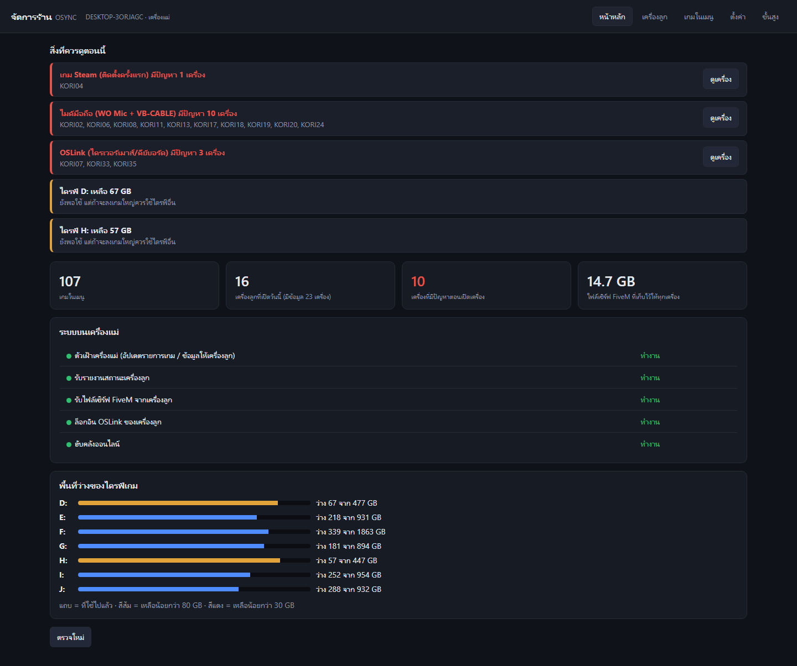

*ภาพจริงจากคอนโซลของร้าน ถ่ายเมื่อ 20 พ.ย. 2026: ปัญหาตอนบูตแยกตามขั้น (เกม Steam 1, ไมค์มือถือ 10, OSLink 3 เครื่อง) ไดรฟ์ D / H เหลือ 67 / 57 GB (ส้ม) และระบบ 5 อย่างทำงานครบ*

#### เครื่องลูก (`loadClients` → `/api/clients`)
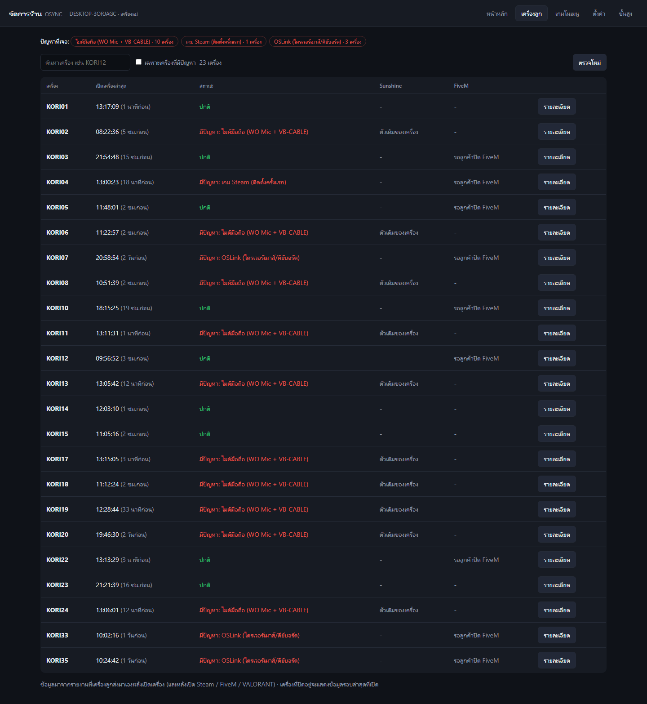

*ภาพจริงจากคอนโซลของร้าน ถ่ายเมื่อ 20 พ.ย. 2026: ชิปสรุปปัญหาด้านบน และตารางเครื่อง KORI 23 เครื่อง (สถานะ, Sunshine, FiveM, ปุ่มรายละเอียด)*

#### เกมในเมนู (`loadGames` → `/api/games`)
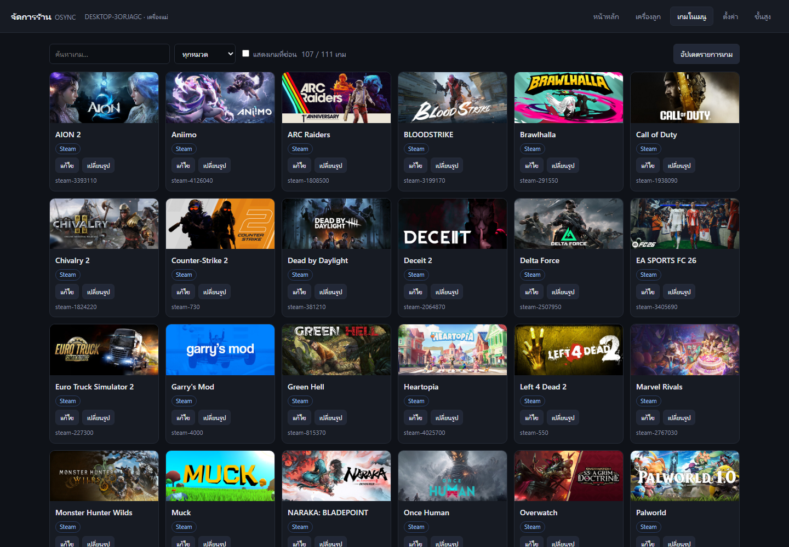

*ภาพจริงจากคอนโซลของร้าน ถ่ายเมื่อ 20 พ.ย. 2026: แสดง 107 จาก 111 เกม (111 รวมเกมที่ซ่อน) แต่ละการ์ดมีหมวด ปุ่มแก้ไข / เปลี่ยนรูป และ id ใต้การ์ด*

#### ตั้งค่า › การทำงานของเครื่องลูก (`loadSettings` → `/api/settings`)
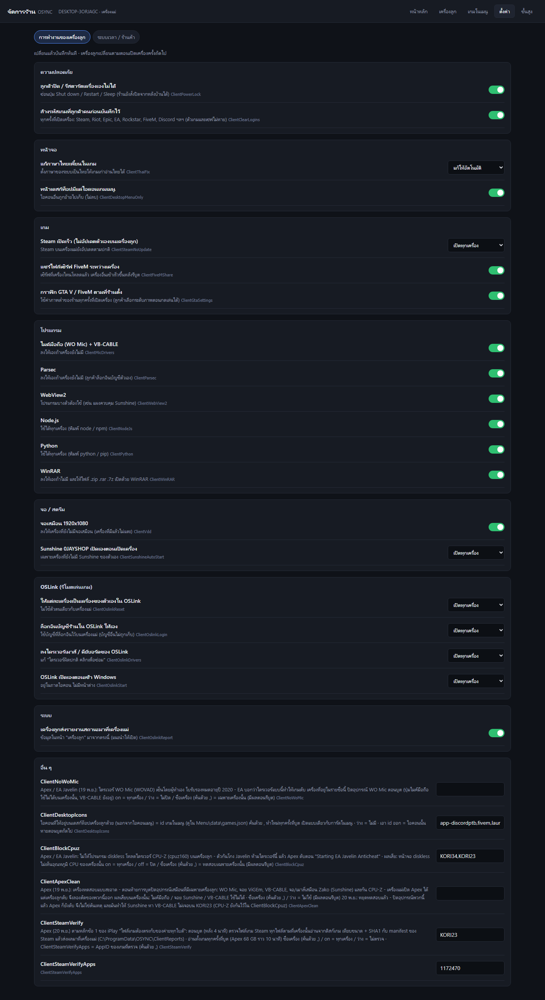

*ภาพจริงจากคอนโซลของร้าน ถ่ายเมื่อ 20 พ.ย. 2026: คีย์ `Client*` แยกตามกลุ่มใน `OPT` ส่วนคีย์ที่ไม่มีใน `OPT` (เช่น `ClientNoWoMic`, `ClientSteamVerify`) อยู่กลุ่ม "อื่น ๆ" เป็นช่องข้อความ*

#### ขั้นสูง › ไดรฟ์ที่เก็บเกม (`loadDrives` → `/api/drives`)
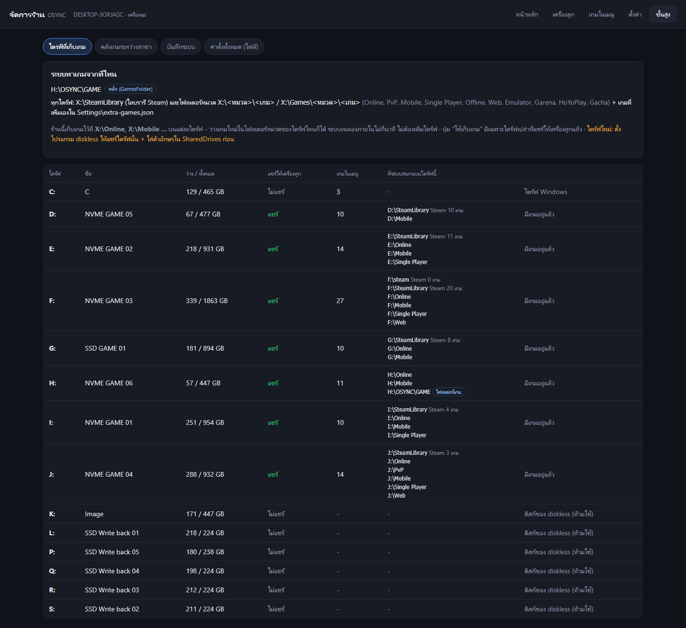

*ภาพจริงจากคอนโซลของร้าน ถ่ายเมื่อ 20 พ.ย. 2026: โฟลเดอร์หลัก `H:\OSYNC\GAME` · D–J "มีเกมอยู่แล้ว" · C "ไดรฟ์ Windows" · K, L, P, Q, R, S "ดิสก์ของ diskless (ห้ามใช้)" จึงไม่มีปุ่ม "ใช้เก็บเกม"*

**ขั้นตอนการทำงาน:**
1. โหลดหน้า → `loadHome()` (หน้าหลัก)
2. กดแท็บ → `openPage()` → ฟังก์ชันโหลดของแท็บนั้น (`PAGES`) · แท็บตั้งค่าเรียกทั้ง `loadSettings` และ `loadShop` · แท็บขั้นสูงเปิดหน้าย่อย "ไดรฟ์ที่เก็บเกม"
3. กดหน้าย่อย → `openSub()` → ฟังก์ชันใน `SUBLOAD`
4. ทุกคำขอผ่าน `api()`: ไม่มี body = GET · มี body = POST + `X-OSYNC: 1` · HTTP ไม่ใช่ 2xx หรือ `ok:false` = โยน error ไปแสดง toast

**ฟังก์ชัน:**

| ฟังก์ชัน | บรรทัด | หลักการทำงาน |
|---|---|---|
| [`$`](../Console/index.html#L195) | 195 | ย่อ `document.querySelector` |
| [`esc`](../Console/index.html#L196) | 196 | escape `& < > " '` ก่อนใส่ HTML |
| [`toast`](../Console/index.html#L198) | 198 | แสดงข้อความมุมขวาล่าง (error ขอบแดง 8 วิ) |
| [`api`](../Console/index.html#L199) | 199 | fetch ไปยัง API (POST มีหัว `X-OSYNC: 1`) · error เมื่อ HTTP ไม่ ok หรือ `ok === false` |
| [`showList`](../Console/index.html#L206) | 206 | ใส่ log ผลอัปเดตรายการเกมลงกล่อง `#ulog` |
| [`modal`](../Console/index.html#L207) | 207 | หน้าต่างลอยแสดงข้อความยาว (รายงานเครื่องลูก, SHOP-API.md) |
| [`openPage`](../Console/index.html#L211) | 211 | สลับแท็บแล้วเรียกฟังก์ชันโหลดใน `PAGES` |
| [`openSub`](../Console/index.html#L218) | 218 | สลับหน้าย่อยแล้วเรียกฟังก์ชันใน `SUBLOAD` |
| [`stepOf`](../Console/index.html#L230) | 230 | แยกรหัสขั้นตอนบูตจากข้อความ fail แล้วแปลงเป็นชื่อไทยจาก `STEP` |
| [`isFixed`](../Console/index.html#L231) | 231 | ปัญหาขั้นนี้แก้บนเครื่องแม่แล้ว และรายงานเก่ากว่าเวลาที่แก้ (`FIXED`) = "แก้แล้ว รอรีบูต" |
| [`realClients`](../Console/index.html#L233) | 233 | เก็บเฉพาะเครื่องชื่อ `KORI*` และไม่ใช่ IP เครื่องแม่ |
| [`ago`](../Console/index.html#L234) | 234 | นาที → "x นาทีก่อน / ชม.ก่อน / วันก่อน" |
| [`loadHome`](../Console/index.html#L244) | 244 | เรียก `/api/overview` ครั้งเดียว แล้ววาดรายการที่ต้องทำ การ์ดตัวเลข ตารางระบบ แถบไดรฟ์ |
| [`loadClients`](../Console/index.html#L272) | 272 | เรียก `/api/clients` นับปัญหาที่ยังไม่แก้เป็นชิป แล้ว `drawClients` |
| [`drawClients`](../Console/index.html#L280) | 280 | วาดตารางเครื่องลูกตามคำค้นและตัวกรอง "มีปัญหา" · แปลบรรทัด Sunshine / FiveM เป็นไทย |
| [`showReport`](../Console/index.html#L298) | 298 | เรียก `/api/client?ip=` แล้วเปิดรายงานใน modal |
| [`loadSettings`](../Console/index.html#L326) | 326 | เรียก `/api/settings` เก็บใน `SETS` แล้ววาดทั้งหน้าเครื่องลูกและหน้าค่าทั้งหมด |
| [`ctl`](../Console/index.html#L331) | 331 | สร้างตัวควบคุมตามชนิด: `ask` (on/ask/off), `multi` (ทุกเครื่อง / บางเครื่อง + ช่องชื่อ / ปิด), ค่าอื่น = สวิตช์ on/off |
| [`multiChange`](../Console/index.html#L341) | 341 | เลือก "เฉพาะบางเครื่อง" = แสดงช่องชื่อเครื่อง · อย่างอื่น = บันทึกทันที |
| [`drawSettings`](../Console/index.html#L346) | 346 | วาดคีย์กลุ่ม `client` ตามกลุ่มไทยใน `OPT` · คีย์ที่ไม่รู้จักไปกลุ่ม "อื่น ๆ" |
| [`saveSetting`](../Console/index.html#L356) | 356 | POST `/api/setting` · ไม่สำเร็จ = toast แล้วโหลดใหม่ |
| [`loadRaw`](../Console/index.html#L360) | 360 | ยังไม่มีข้อมูล = `loadSettings` ไม่งั้น `drawRaw` |
| [`drawRaw`](../Console/index.html#L361) | 361 | วาดทุกคีย์ (กรองด้วยช่องค้นหา) · on/off = สวิตช์ อื่น ๆ = ช่องข้อความ |
| [`loadShop`](../Console/index.html#L371) | 371 | เรียก `/api/shop` ใส่ค่าลงฟอร์ม เก็บข้อความเอกสาร |
| [`shopBody`](../Console/index.html#L375) | 375 | อ่านฟอร์มเป็น `{apiUrl, machineId, brandName, menuOnly, sidePanel}` (`menuOnly` = ไม่ติ๊กหน้านับเวลา) |
| [`saveShop`](../Console/index.html#L376) | 376 | ถ้าเปิดหน้านับเวลาแต่ไม่มีที่อยู่เซิร์ฟเวอร์ ถามยืนยันก่อน แล้ว POST `/api/shop` |
| [`testShop`](../Console/index.html#L381) | 381 | POST `/api/shop/test` แสดงผลว่าต่อได้ (HTTP xxx) หรือไม่ได้ |
| [`showDoc`](../Console/index.html#L385) | 385 | เปิด SHOP-API.md ใน modal |
| [`loadGames`](../Console/index.html#L388) | 388 | เรียก `/api/games` เติมตัวกรองหมวด แล้ว `drawGames` |
| [`drawGames`](../Console/index.html#L395) | 395 | วาดการ์ดเกมตามคำค้น หมวด และ "แสดงเกมที่ซ่อน" · รูปที่ร้านเปลี่ยนเอาเติม `?v=` กันแคช |
| [`saveGame`](../Console/index.html#L421) | 421 | POST `/api/game` · ชื่อไม่เปลี่ยนและไม่เคยเปลี่ยน = ส่งชื่อว่าง (ไม่สร้างค่าทับ) |
| [`pickIcon`](../Console/index.html#L427) | 427 | เลือกไฟล์ PNG/JPEG/WEBP ≤ 8 MB อ่านเป็น data URL แล้ว POST `/api/icon` |
| [`resetIcon`](../Console/index.html#L433) | 433 | POST `/api/icon/reset` |
| [`runUpdate`](../Console/index.html#L434) | 434 | POST `/api/update` แสดง log แล้วโหลดรายการเกมใหม่ |
| [`loadDrives`](../Console/index.html#L437) | 437 | เรียก `/api/drives` วาดกล่อง "ระบบหาเกมจากที่ไหน" คำอธิบายตามแบบร้าน (`top` / `game`) และตารางไดรฟ์ |
| [`addDrive`](../Console/index.html#L458) | 458 | ถามยืนยัน 2 ครั้ง (จะสร้างอะไร + เครื่องลูกปิดหมดไหม) แล้ว POST `/api/drives/add` พร้อม `clientsOff: true` |
| [`removeDrive`](../Console/index.html#L464) | 464 | ถามยืนยันแล้ว POST `/api/drives/remove` (ไฟล์เกมไม่ถูกลบ) |
| [`loadOnline`](../Console/index.html#L471) | 471 | เรียก `/api/online` วาดสถานะ ตารางเกมที่ขาด งาน และสาขา · มีงานค้างอยู่ = ตั้งเวลาเรียกตัวเองอีกใน 4 วิ |
| [`publish`](../Console/index.html#L487) | 487 | POST `/api/online/publish` แสดงจำนวนเกมที่ส่ง |
| [`pull`](../Console/index.html#L488) | 488 | POST `/api/online/pull` `{key}` แสดงปลายทาง |
| [`loadStatus`](../Console/index.html#L491) | 491 | เรียก `/api/status` วาดกล่องสถานะและ log ตัวเฝ้า |

**ค่าคงที่ในหน้า:** `PAGES` (L210) · `SUBLOAD` (L217) · `STEP` (L227 ชื่อไทยของขั้นตอนบูต 0–8 เช่น `1f` = ไมค์มือถือ) · `FIXED` (L229) · `MASTER_IPS` (L232) · `SVC_FIX` (L237 วิธีแก้แต่ละระบบ) · `OPT` (L302 ชื่อไทย/กลุ่ม/ชนิดของคีย์ `Client*` 21 คีย์) · `stateTh` (L470 ชื่อไทยของสถานะงาน)

> หมายเหตุจากโค้ด: ใน `SVC_FIX` วิธีแก้ของ "ฮับคลังออนไลน์" บอกให้ "ดับเบิลคลิก OSYNC.bat แล้วเลือกเมนูเปิดฮับ" แต่เมนูของ `OSYNC.ps1` ไม่มีรายการเกี่ยวกับฮับ · ฝั่งเซิร์ฟเวอร์บอก `Hub-Server.ps1 -Register` (งาน `OSYNC-Hub`)

**ค่าในร้านนี้ตอนนี้:** ร้านนี้ไม่ได้ตั้ง apiUrl จึงเป็นเมนูเกมอย่างเดียว (`menuOnly=true`) · หน้าคลังเกมระหว่างสาขาจะขึ้น "UPnP ปิด (OnlineUpnp=off)"

---

## 4. `Online-Library.ps1` — คลังออนไลน์ฝั่งสาขา

**หน้าที่:** ทุกอย่างของสาขาในคลังออนไลน์: หาเกมที่แชร์ได้ ส่งรายการขึ้นฮับ ดูว่าสาขาอื่นมีเกมอะไรที่สาขานี้ไม่มี ขอเกม สร้างทอร์เรนต์แล้ว seed ให้สาขาอื่น ดาวน์โหลดด้วย aria2 และดูแล aria2 / UPnP

**เรียกจาก / ทำงานเมื่อไหร่:**
- `Console-Server.ps1` dot-source (ใช้แค่ฟังก์ชัน) สำหรับ `/api/online*` และสถานะ
- `Master-Watch.ps1` ขั้นที่ 4: ถ้า `OnlineHub` ไม่ว่าง รัน `Online-Library.ps1 -Sync` ทุก 5 นาที · log ลงไฟล์ตัวเฝ้าเฉพาะเมื่อ exit ≠ 0 หรือมี `served` / `finished` ≥ 1
- ตัวมันเองเปิด `-MockWorker <job id>` เป็น process ซ่อน (เฉพาะ engine `mock`)
- `Sim-OnlineLibrary.ps1` เรียกทุกโหมด
- รันมือได้: `-Publish`, `-Pull <key>`, `-List`, `-Stop`

**พารามิเตอร์:**
- `-Sync` ส่งรายการ (ถ้าเกิน 30 นาที) + ตอบคำขอของสาขาอื่น + เดินงานดาวน์โหลด + ดูแล aria2 / UPnP
- `-Publish` ส่งรายการเกมขึ้นฮับเดี๋ยวนี้
- `-Pull <key>` ขอเกม key นั้น (key = id ของเกมในเมนู)
- `-MockWorker <job id>` ตัวทำงานของ engine mock (ทดสอบ)
- `-List` ดูว่าเกมไหนในเมนูแชร์ได้ จากที่ไหน (ไม่คิดขนาด ไม่ไล่ไฟล์)
- `-Stop` ปิด aria2 และคืนพอร์ต UPnP
- dot-source (`. Online-Library.ps1`) = ไม่รันอะไร ได้แค่ฟังก์ชัน

**อ่านค่า:**
- Settings: `OnlineHub`, `OnlineBranch` (ค่าเริ่ม = ชื่อเครื่อง ตัวอักษรนอก `A-Z a-z 0-9 . _ -` เป็น `-`), `OnlineBranchName`, `OnlineEngine` (ว่าง = `aria2` ถ้ามี `Tools\aria2\aria2c.exe` ไม่งั้น `none`), `OnlineBtPort` (6881), `OnlineRpcPort` (6800), `OnlineMaxDownKB` / `OnlineMaxUpKB` (0 = ไม่จำกัด), `OnlineBind`, `OnlineUpnp` (off), `OnlineExternalIP`, `OnlineData`, `SharedDrives`, `GamesFolder`, `GameFolders`
- กุญแจฮับจาก `Get-OnlineSecret` (`System\Data\Online\online.key` หรือ `$env:OSYNC_ONLINEKEY`) · "ตั้งแล้ว" (`enabled`) = มี `OnlineHub` และกุญแจยาว ≥ 12 ตัว
- ไฟล์: `Menu\data\games.json`, `Settings\extra-games.json`, `appmanifest_<appid>.acf` ในไลบรารี Steam, โฟลเดอร์ `Launchers\HoYoPlay\games`
- ตัวแปรทดสอบ: `OSYNC_ONLINEDATA`, `OSYNC_DRIVEROOTS`, `OSYNC_UPNP_LOCATION`, `OSYNC_GAMEFOLDERS`

**เขียน / เปลี่ยน:**
- โฟลเดอร์ทำงาน `<OnlineData>` (ไม่ตั้ง = `System\Data\Online`): `online.log`, `sizes.json` (แคชขนาดโฟลเดอร์ 24 ชม.), `published.txt`, `jobs.json`, `jobs\<id>.json` (mock), `torrents\<infohash>.torrent` / `.acf`, `aria2.session`, `aria2.log`, `aria2.secret`, `aria2.extip`, `upnp.json`
- โฟลเดอร์เกมปลายทางที่ดาวน์โหลด · เกม Steam: ก๊อป `appmanifest_<appid>.acf` ลง `<ไลบรารี>\steamapps`
- process `aria2c.exe` · ฟัง RPC `127.0.0.1:<OnlineRpcPort>` และ BitTorrent `<OnlineBtPort>` (ผูกกับ `OnlineBind` ถ้าตั้ง)
- พอร์ตบนเราเตอร์ผ่าน UPnP (เฉพาะ `OnlineUpnp=on`)
- ข้อมูลบนฮับ (รายการเกม คำขอ ทอร์เรนต์) ผ่าน HTTP

**Log:** `<OnlineData>\online.log` (aria2 เริ่ม/หยุด, UPnP, IP สาธารณะเปลี่ยน) · `<OnlineData>\aria2.log` (ของ aria2 ระดับ notice) · ตัวเฝ้าเขียน `online library: ...` ลง `C:\Users\Public\OSYNC-Master-Watch.log`

**ขั้นตอนการทำงาน (`-Sync` = [`Invoke-OnlineSync`](../Scripts/Online-Library.ps1#L318)):**
1. อ่านค่า ไม่ได้ตั้ง = คืน `ok:false` (exit 1)
2. `published.txt` ไม่มีหรือเก่ากว่า 30 นาที → `Publish-Branch`
3. `Invoke-ServeRequests`: อ่านคำขอที่สาขาอื่นขอจากสาขานี้ สร้างทอร์เรนต์ทั้งโฟลเดอร์ เริ่ม seed แล้วส่งทอร์เรนต์ขึ้นฮับ
4. `Update-PullJobs`: เดินงานที่สาขานี้ขอ (รอทอร์เรนต์ → ดาวน์โหลด → เสร็จ)
5. `Update-Aria2Network`: aria2 ต้องทำงานไหม ต่ออายุ/คืน UPnP ส่ง IP สาธารณะใหม่ให้ aria2

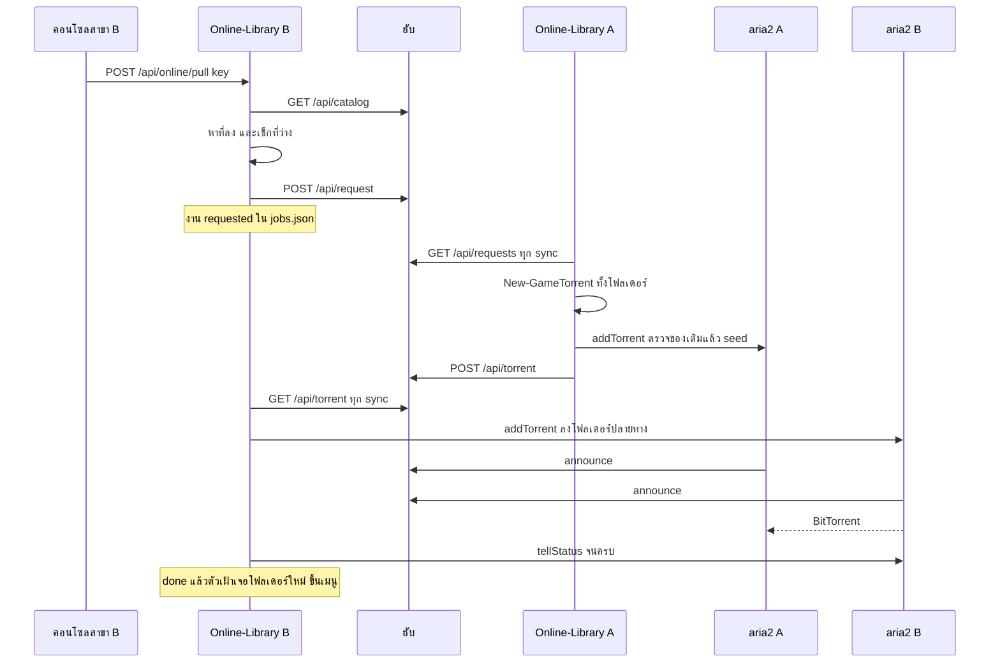

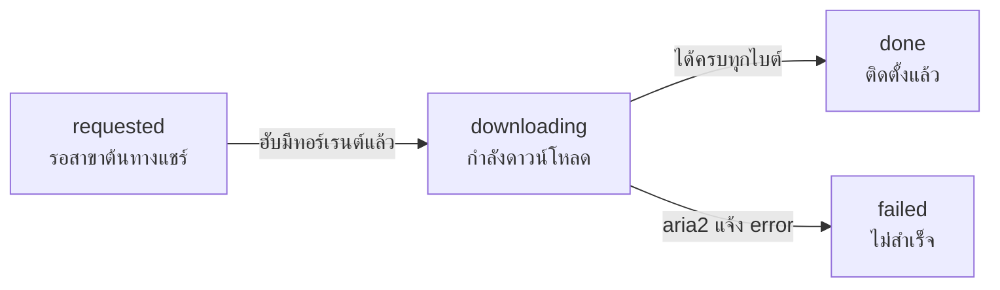

**ฟังก์ชัน:**

| ฟังก์ชัน | บรรทัด | หลักการทำงาน |
|---|---|---|
| [`Get-OnlineConfig`](../Scripts/Online-Library.ps1#L41) | 41 | รวมค่าทั้งหมดเป็น object เดียว (hub, branch, name, engine, key, data, aria2, btPort, rpcPort, ความเร็ว, bind, upnp, externalIP, enabled) |
| [`Initialize-OnlineData`](../Scripts/Online-Library.ps1#L55) | 55 | สร้าง `<OnlineData>`, `torrents`, `jobs` |
| [`Write-OnlineLog`](../Scripts/Online-Library.ps1#L56) | 56 | เพิ่มบรรทัดมีเวลาใน `online.log` (error เงียบ) |
| [`Invoke-Hub`](../Scripts/Online-Library.ps1#L58) | 58 | เรียก API ฮับพร้อมหัว `X-Hub-Key` (รอ 30 วิ) · 404 = `$null` · error อื่น = โยน "hub METHOD PATH : ..." |
| [`Get-MenuGames`](../Scripts/Online-Library.ps1#L70) | 70 | อ่าน `Menu\data\games.json` |
| [`Get-SteamManifest`](../Scripts/Online-Library.ps1#L71) | 71 | หา appmanifest ของ appid ในทุกไลบรารี คืนไฟล์, โฟลเดอร์เกม, installdir, `SizeOnDisk` |
| [`Get-DriveGameRoots`](../Scripts/Online-Library.ps1#L83) | 83 | รากที่มีโฟลเดอร์หมวด: `X:\Games` และ `X:\` ของไดรฟ์ใน SharedDrives (เฉพาะที่มีโฟลเดอร์หมวดอย่างน้อย 1 อัน) |
| [`Get-RootedParts`](../Scripts/Online-Library.ps1#L90) | 90 | แยกส่วนของ path ที่อยู่ใต้ราก · ไม่อยู่ใต้ = `$null` |
| [`Get-ExtraGameIndex`](../Scripts/Online-Library.ps1#L95) | 95 | เกมที่เพิ่มเอง (มี `exe`) ใน extra-games.json ตาม id |
| [`Expand-OnlinePath`](../Scripts/Online-Library.ps1#L96) | 96 | แทน `{GAMES} {LAUNCHERS} {GAMELUNCHER} {OSYNC}` ใน `root` |
| [`Resolve-ShareableGame`](../Scripts/Online-Library.ps1#L98) | 98 | เกมในเมนู → ข้อมูลที่แชร์ได้ (`kind` = steam / hoyoplay / folder, `rel`, `folder`) หรือ `$null` ดูหัวข้อย่อย |
| [`Get-FolderSize`](../Scripts/Online-Library.ps1#L143) | 143 | ไล่ทุกไฟล์ในโฟลเดอร์ รวมขนาดและจำนวนไฟล์ |
| [`Get-ShareableGames`](../Scripts/Online-Library.ps1#L144) | 144 | ทุกเกมที่แชร์ได้ + ขนาด (Steam จาก manifest, โฟลเดอร์จากแคช `sizes.json` ไม่เกิน 24 ชม. หรือไล่ใหม่) · `-NoSize` = ไม่คิดขนาด |
| [`Publish-Branch`](../Scripts/Online-Library.ps1#L165) | 165 | ส่ง `{branch, name, games}` ไป `POST /api/report` แล้วเขียน `published.txt` |
| [`Get-OnlineView`](../Scripts/Online-Library.ps1#L176) | 176 | ข้อมูลหน้าคลังออนไลน์: เดินงาน → อ่าน catalog (รอ 8 วิ) → เกมที่สาขาอื่นมีแต่สาขานี้ไม่มี (id ตรง หรือชื่อโฟลเดอร์ตรง = มีแล้ว) + รายชื่อสาขา + งาน + net (upnp, btPort, externalIP, mappings) |
| [`Get-JobFile`](../Scripts/Online-Library.ps1#L206) | 206 | path `<OnlineData>\jobs.json` |
| [`Get-PullJobs`](../Scripts/Online-Library.ps1#L207) | 207 | อ่านงานทั้งหมดจาก `jobs.json` |
| [`Save-PullJobs`](../Scripts/Online-Library.ps1#L208) | 208 | เขียน `jobs.json` |
| [`Get-FreeBytes`](../Scripts/Online-Library.ps1#L209) | 209 | ที่ว่างของไดรฟ์ของ path (error = 0) |
| [`Get-PullDestination`](../Scripts/Online-Library.ps1#L210) | 210 | หาที่ลง: HoYoPlay = `Launchers\HoYoPlay\games\<rel>` · Steam = ไลบรารีที่ว่างที่สุด · โฟลเดอร์ = โฟลเดอร์เกมหรือรากไดรฟ์ที่ว่างที่สุด (รากไดรฟ์: เกมลอย ๆ ใส่ใต้ `Online\`, หมวดที่ไม่มีใช้หมวดใกล้เคียงที่มีอยู่) |
| [`Start-Pull`](../Scripts/Online-Library.ps1#L236) | 236 | ขอเกม ดูหัวข้อย่อย |
| [`Update-PullJobs`](../Scripts/Online-Library.ps1#L259) | 259 | เดินทุกงานที่ยังไม่ done/failed: requested → ขอทอร์เรนต์ (`GET /api/torrent`) เปลี่ยน tracker เป็นฮับของสาขานี้ เริ่มดาวน์โหลด · downloading → อ่านความคืบหน้า ครบ = done (Steam ก๊อป manifest) · error ของงานเก็บใน `message` |
| [`Complete-SteamPull`](../Scripts/Online-Library.ps1#L290) | 290 | ก๊อป `.acf` ที่ได้จากต้นทางไปเป็น `<ไลบรารี>\steamapps\appmanifest_<appid>.acf` |
| [`Invoke-ServeRequests`](../Scripts/Online-Library.ps1#L299) | 299 | อ่าน `GET /api/requests?branch=<สาขานี้>` · เกมที่มีจริง: สร้างทอร์เรนต์ (announce = ฮับ/announce/กุญแจ) เขียนลง `torrents\` เริ่ม seed แล้ว `POST /api/torrent` (Steam แนบ manifest) · คืนจำนวนที่ตอบ |
| [`Invoke-OnlineSync`](../Scripts/Online-Library.ps1#L318) | 318 | งานของ `-Sync` (ดูขั้นตอนด้านบน) |
| [`Start-EngineDownload`](../Scripts/Online-Library.ps1#L332) | 332 | สร้างโฟลเดอร์แม่ของปลายทาง · mock = เขียน `jobs\<id>.json` แล้วเปิด `-MockWorker` · aria2 = `aria2.addTorrent` (dir = โฟลเดอร์แม่, `seed-ratio=0.0`) คืน gid |
| [`Get-EngineProgress`](../Scripts/Online-Library.ps1#L348) | 348 | mock = อ่านไฟล์งาน · aria2 = `aria2.tellStatus` คิด % จาก completedLength/totalLength · status error = ข้อความ error |
| [`Start-EngineSeed`](../Scripts/Online-Library.ps1#L359) | 359 | aria2 = `aria2.addTorrent` (dir = โฟลเดอร์แม่ของเกม, `check-integrity=true`) · mock = ไม่ทำอะไร |
| [`Get-Aria2Secret`](../Scripts/Online-Library.ps1#L368) | 368 | รหัสลับ RPC ของ aria2 ใน `aria2.secret` (ไม่มีก็สุ่มใหม่ 18 ไบต์) |
| [`Invoke-Aria2`](../Scripts/Online-Library.ps1#L373) | 373 | JSON-RPC ไป `http://127.0.0.1:<OnlineRpcPort>/jsonrpc` พร้อม `token:<secret>` |
| [`Test-Aria2`](../Scripts/Online-Library.ps1#L379) | 379 | aria2 ตอบ `aria2.getVersion` ภายใน 3 วิไหม |
| [`Get-Aria2BindIP`](../Scripts/Online-Library.ps1#L381) | 381 | IP ที่ aria2 ผูก: `OnlineBind` · ไม่ตั้งและ UPnP เปิด = IP ของการ์ดที่ออกเน็ต · ไม่งั้นว่าง (ทุกการ์ด) |
| [`Get-OnlineExternalIP`](../Scripts/Online-Library.ps1#L384) | 384 | IP สาธารณะที่บอก tracker: `OnlineExternalIP` (IP หรือชื่อ DDNS) · ไม่ตั้งและ UPnP เปิด = ถามเราเตอร์ (ต้องไม่ใช่ IP ส่วนตัว / CGNAT) · ไม่งั้นว่าง |
| [`Get-Aria2ExternalIP`](../Scripts/Online-Library.ps1#L391) | 391 | IP ที่ส่งให้ aria2 ไปแล้ว (`aria2.extip`) |
| [`Initialize-Aria2`](../Scripts/Online-Library.ps1#L392) | 392 | เปิด aria2 ถ้ายังไม่ทำงาน ดูหัวข้อย่อย |
| [`Update-Aria2Network`](../Scripts/Online-Library.ps1#L416) | 416 | ทุก sync: aria2 ไม่ทำงานแต่ session มีงาน = เปิดใหม่ · ไม่ทำงาน = คืนพอร์ต UPnP ที่เคยขอ · ทำงาน = ต่ออายุ UPnP, IP สาธารณะเปลี่ยน = `aria2.changeGlobalOption bt-external-ip` |
| [`Stop-OnlineEngine`](../Scripts/Online-Library.ps1#L437) | 437 | `aria2.shutdown` และคืนพอร์ต UPnP ที่บันทึกไว้ เขียน log |
| [`Invoke-MockWorker`](../Scripts/Online-Library.ps1#L447) | 447 | engine mock: ก๊อปทีละไฟล์จากโฟลเดอร์ของผู้ seed บนเครื่องเดียวกัน (ความคืบหน้าถึง 95%) แล้วตรวจทุกชิ้นด้วย `Test-TorrentData` ผ่าน = done |

### `Resolve-ShareableGame` — เกมไหนแชร์ได้
1. หมวด `Apps` / `Launchers` หรือ id ขึ้นต้น `app-` `launcher-` `tool-` = ไม่แชร์
2. `steam-<appid>`: ต้องมี appmanifest และโฟลเดอร์เกม → kind `steam`, rel `steamapps\common\<installdir>`
3. เอา exe จาก `cmd` ต้องเป็น path เต็มบนไดรฟ์
4. exe อยู่ใต้ `Launchers\HoYoPlay\games` → kind `hoyoplay`
5. exe อยู่ใต้โฟลเดอร์เกม (`GAME\<หมวด>\<เกม>` หรือ `GAME\<เกม>`) → kind `folder` · ยกเว้นหมวด `Web` และชื่อที่ตรง `OSLink RustDesk AnyDesk TeamViewer Parsec Sunshine Discord Telegram WeChat LDPlayer CooperAgent Overwolf`
6. exe อยู่ใต้ `X:\<หมวด>\<เกม>` / `X:\Games\<หมวด>\<เกม>` ของไดรฟ์ที่แชร์ → kind `folder` (ข้อยกเว้นเดียวกัน)
7. เกมที่เพิ่มเองใน extra-games.json: ใช้ `root` หรือโฟลเดอร์ของ exe · ต้องอยู่บนไดรฟ์ใน SharedDrives · ห้ามอยู่ใน Launchers / Menu / Tools / System (รวมโฟลเดอร์โครงเดิม) · rel = `<หมวด>\<ชื่อโฟลเดอร์>` (หมวดของร้าน `Anime RPG` → `Gacha`, หมวดอื่นที่ไม่รู้จัก → `Online`)
8. ไม่เข้าข้อไหน (เช่น เกมของ Riot / Epic / EA ที่เปิดผ่านตัวเปิดเกม) = ไม่แชร์

### `Start-Pull` — ขอเกม
1. ต้องตั้งแล้ว และ engine ไม่ใช่ `none`
2. มีงานของ key นี้ที่ยังไม่ done/failed = "already being installed"
3. อ่าน catalog เลือกสาขาอื่นที่มีเกมนี้และส่งรายการล่าสุด
4. หาที่ลง (`Get-PullDestination`) · ปลายทางมีไฟล์อยู่แล้ว = ปฏิเสธ "is not empty"
5. เช็กที่ว่าง: ต้องมี ≥ ขนาดเกม + มากกว่าระหว่าง 5 GB กับ 5% ของขนาดเกม
6. `POST /api/request` แล้วเพิ่มงาน `requested` ใน `jobs.json` แล้วเรียก `Update-PullJobs` ทันที

### `Initialize-Aria2` — เปิด aria2
- ตอบอยู่แล้ว = ไม่ทำอะไร · ไม่มี `aria2c.exe` = error
- ตัวเลือก: RPC เฉพาะเครื่อง (`--rpc-listen-all=false`) พอร์ต `OnlineRpcPort` + รหัสลับ · BitTorrent พอร์ต `OnlineBtPort` · ปิด DHT, DHT6, LPD, peer exchange (ทอร์เรนต์ private ฮับเป็น tracker เดียว) · `--seed-ratio=0.0` · `--file-allocation=none` · ดาวน์โหลดพร้อมกันสูงสุด 3 · session `aria2.session` บันทึกทุก 60 วิ · จำกัดความเร็วตาม `OnlineMaxDownKB` / `OnlineMaxUpKB`
- `--interface=<bind>` ถ้ามี · `--bt-external-ip=<IP>` ถ้ารู้ IP สาธารณะ (เขียนลง `aria2.extip`)
- ลองเรียก aria2 สูงสุด 20 ครั้ง ห่างกัน 0.3 วิ ไม่ตอบ = error "aria2 did not start" · UPnP เปิด = ขอพอร์ต `OnlineBtPort` lease 3600 วิ ชื่อ `OSYNC aria2 <สาขา>`

**ค่าในร้านนี้ตอนนี้:** `OnlineHub=http://127.0.0.1:4667` · `OnlineBranch=0JAYSHOP` · `OnlineBranchName=0JAYSHOP` · `OnlineEngine=aria2` (มี `Tools\aria2\aria2c.exe`) · `OnlineBtPort=6881` · `OnlineRpcPort` ไม่ได้ตั้ง = 6800 · `OnlineMaxDownKB=0` `OnlineMaxUpKB=0` (ไม่จำกัด) · `OnlineUpnp=off` · `OnlineBind=192.168.51.203` (ตรวจ 20 พ.ย. 2026 = การ์ด "Ethernet 7" ซึ่งเป็นการ์ดที่มีเส้นทางออกเน็ต) · `OnlineExternalIP=` ว่าง · `OnlineData=C:\OSYNC-Online` · ตรวจ 20 พ.ย. 2026: `published.txt` อัปเดตวันนี้ (ตัวเฝ้าส่งรายการอยู่), ยังไม่มี `jobs.json` และ `aria2.session` (ยังไม่เคยมีงานดาวน์โหลด/แชร์)

---

## 5. `Hub-Server.ps1` — ฮับและ tracker

**หน้าที่:** ศูนย์กลางของคลังออนไลน์: เก็บว่าสาขาไหนมีเกมอะไร รับคำขอเกม เก็บไฟล์ทอร์เรนต์ และเป็น BitTorrent tracker แบบ private · โปรโตคอลเป็น HTTP + JSON ธรรมดา (คอมเมนต์: ย้ายไปไว้บนเว็บทีหลังได้)

**เรียกจาก / ทำงานเมื่อไหร่:**
- งาน `OSYNC-Hub` ตอนล็อกอิน (สร้างด้วย `Hub-Server.ps1 -Register`) · ร้านนี้ตรวจ 20 พ.ย. 2026: มีงานนี้และกำลังทำงาน ฟัง `0.0.0.0:4667`
- `Sim-OnlineLibrary.ps1` เปิดบน `127.0.0.1:4790`
- ไม่ได้อยู่ในเมนู `OSYNC.bat`

**พารามิเตอร์:**
- `-Port` (4667) · `-Bind` (`0.0.0.0` = รับจากทุกการ์ด / `127.0.0.1` = ทดสอบ)
- `-Key` กุญแจ (ไม่ใส่ = `Get-OnlineSecret`) ต้องยาว ≥ 12 ตัว
- `-HubDir` โฟลเดอร์ข้อมูล (ไม่ใส่ = `<OnlineData>\Hub` หรือ `System\Data\Hub`)
- `-AllowStop` เปิดให้ `POST /api/_stop` (ต้องมีกุญแจ) · `-UpnpRenewSec` (300) ต่ออายุ UPnP ทุกกี่วินาที
- `-Register` ลงงาน `OSYNC-Hub` (ผู้ใช้นี้, Interactive, ไม่ยกสิทธิ์, รีสตาร์ต 3 ครั้งทุก 5 นาทีถ้าล้ม, ไม่มีเวลาจำกัด) แล้วเริ่มทันที · ไม่มีกุญแจ = ไม่ลง (exit 1) · ส่งแค่ `-Port` ให้งาน (Bind = ค่าเริ่ม 0.0.0.0) · `-Unregister` ลบงาน (ฮับที่รันอยู่ไม่ถูกหยุด)

**อ่านค่า:** Settings `OnlineData`, `OnlineUpnp` · กุญแจจาก `-Key` / `$env:OSYNC_ONLINEKEY` / `System\Data\Online\online.key`

**เขียน / เปลี่ยน:** `<HubData>\branches\<สาขา>.json`, `requests.json`, `torrents.json`, `torrents\<infohash>.torrent` / `.acf`, `hub.log` · ฟังพอร์ต `<Bind>:<Port>` · งาน `OSYNC-Hub` · พอร์ตบนเราเตอร์ (เฉพาะ UPnP เปิด และ Bind ไม่ใช่ 127.x) · mutex `Local\OSYNC-Hub-<port>` · ไม่ตั้งกฎ firewall

**Log:** `<HubData>\hub.log` (เริ่ม หยุด UPnP)

**เส้นทางของฮับ:**

| Method | Path | ทำอะไร | เขียน |
|---|---|---|---|
| ทุก method | `/announce/<กุญแจ>?info_hash=&peer_id=&port=&left=&event=&ip=` | tracker (`Get-Announce`) ไม่ต้องมีหัวกุญแจ (กุญแจอยู่ใน path) | ข้อมูล peer ในหน่วยความจำ |
| POST | `/api/_stop` | หยุดฮับ (เฉพาะ `-AllowStop` + กุญแจถูก) | - |
| POST | `/api/report` `{branch,name,games}` | แทนรายการเกมของสาขานั้นทั้งหมด บันทึก IP ที่เห็นและเวลา | `branches\<สาขา>.json` |
| GET | `/api/catalog` | ทุกสาขาพร้อมเกม (lastSeen, ip) | - |
| POST | `/api/request` `{branch,from,key}` | สาขา `branch` ขอเกม `key` จากสาขา `from` (ซ้ำ = แทนของเดิม) · คืน `torrentReady` | `requests.json` |
| GET | `/api/requests?branch=<b>` | คำขอที่รอสาขา `b` (สาขาที่มีเกม) | - |
| POST | `/api/torrent` `{from,key,infohash,torrent,size,source,manifest}` | เก็บทอร์เรนต์ของผู้ seed แล้วลบคำขอนั้นออก (ตอบแล้ว) | `torrents\*.torrent`, `.acf`, `torrents.json`, `requests.json` |
| GET | `/api/torrent?from=&key=` | ส่งทอร์เรนต์ (base64) + manifest · ยังไม่มี = 404 `ready:false` | - |

ทุก `/api/*` ต้องมีหัว `X-Hub-Key` ตรงกับกุญแจ (ไม่งั้น 403) · path อื่น = 404 · error = 400 · ชื่อสาขา/key ต้องเป็น `A-Z a-z 0-9 . _ -` ยาว 1–64 · body ใหญ่สุด 16 MB (`$script:HttpMaxBody`)

**ขั้นตอนการทำงาน:**
1. dot-source `Common.ps1`, `Http-Lib.ps1`, `Online-Torrent.ps1`, `Online-Upnp.ps1`
2. `-Register` / `-Unregister` → จัดการงานแล้วจบ
3. เช็กกุญแจ (≥ 12 ตัว) ไม่ผ่าน = exit 1
4. หาโฟลเดอร์ข้อมูล สร้าง `branches`, `torrents`
5. จับ mutex ไม่ได้ = "the hub already runs" แล้วจบ
6. UPnP เปิดเมื่อ `OnlineUpnp` เป็น on และ Bind ไม่ใช่ 127.x (หรือมีเราเตอร์ปลอมของการทดสอบ)
7. เขียน log "hub started" · UPnP เปิด = ขอพอร์ตทันทีแล้วเริ่มเซิร์ฟเวอร์ที่ต่ออายุทุก `UpnpRenewSec` ระหว่างว่าง · ไม่งั้นเริ่มเซิร์ฟเวอร์ธรรมดา
8. หยุด (finally) = คืนพอร์ต UPnP และเขียน log "stopped"

**ฟังก์ชัน:**

| ฟังก์ชัน | บรรทัด | หลักการทำงาน |
|---|---|---|
| [`Get-SafeName`](../Scripts/Hub-Server.ps1#L41) | 41 | ชื่อต้องเป็น `A-Z a-z 0-9 . _ -` ยาว 1–64 ไม่งั้น error (กันชื่อไฟล์แปลก) |
| [`Read-Json`](../Scripts/Hub-Server.ps1#L42) | 42 | อ่าน JSON (ไม่มีไฟล์ = `$null`) |
| [`Write-Json`](../Scripts/Hub-Server.ps1#L43) | 43 | เขียน JSON UTF-8 ไม่มี BOM |
| [`Get-Requests`](../Scripts/Hub-Server.ps1#L46) | 46 | อ่าน `requests.json` เป็น array |
| [`Get-TorIndex`](../Scripts/Hub-Server.ps1#L47) | 47 | อ่าน `torrents.json` เป็น array |
| [`Get-Announce`](../Scripts/Hub-Server.ps1#L51) | 51 | tracker ดูหัวข้อย่อยด้านล่าง |
| `$handler` (scriptblock) | [75](../Scripts/Hub-Server.ps1#L75) | แยกเส้นทางตามตารางด้านบน |
| [`Write-HubLog`](../Scripts/Hub-Server.ps1#L137) | 137 | เพิ่มบรรทัดมีเวลาใน `hub.log` |
| `$renew` (scriptblock) | [138](../Scripts/Hub-Server.ps1#L138) | ขอ/ต่ออายุพอร์ตฮับ (`OSYNC hub`, lease 3600 วิ) แล้วเขียน log |

### `Get-Announce` — tracker
- กุญแจใน path ไม่ตรง = ตอบ bencode `failure reason: unknown key`
- อ่าน `info_hash` และ `peer_id` เป็นไบต์ดิบ · info_hash ต้องได้ 40 ตัวอักษร hex และ port > 0 ไม่งั้น `bad announce`
- IP ของ peer = ค่า `ip=` ที่ peer บอก (ถ้าเป็น IPv4) ไม่งั้น IP ที่ฮับเห็น (aria2 ส่ง `ip=` มาจาก `--bt-external-ip`)
- `event=stopped` = ลบ peer · peer ที่ไม่ announce เกิน 30 นาทีถูกลบ
- ตอบแบบ compact (IPv4 + port 6 ไบต์ต่อ peer ไม่รวมตัวเอง) + `complete` (left = 0) / `incomplete` · `interval 60` `min interval 20`
- ข้อมูล peer อยู่ในหน่วยความจำเท่านั้น (ฮับรีสตาร์ต = เริ่มใหม่ แล้ว peer announce เข้ามาใหม่เอง)

**ค่าในร้านนี้ตอนนี้:** งาน `OSYNC-Hub` ทำงาน ฟัง `0.0.0.0:4667` · ข้อมูลฮับที่ `C:\OSYNC-Online\Hub` (จาก `OnlineData`) · `OnlineUpnp=off` = ไม่ขอพอร์ต 4667 จากเราเตอร์ · สาขาเดียว (`0JAYSHOP`) ต่อฮับผ่าน `127.0.0.1`

---

## 6. `Online-Torrent.ps1` — สร้างและตรวจไฟล์ทอร์เรนต์

**หน้าที่:** bencode (รูปแบบข้อมูลของ BitTorrent) และไฟล์ `.torrent`: สร้างทอร์เรนต์จากโฟลเดอร์เกม เปลี่ยน tracker และตรวจข้อมูลทุกชิ้นเทียบกับทอร์เรนต์

**เรียกจาก / ทำงานเมื่อไหร่:** dot-source โดย `Online-Library.ps1`, `Hub-Server.ps1`, `Sim-OnlineLibrary.ps1` · ไม่มีโหมดรันเอง

**พารามิเตอร์:** ไม่มี

**อ่านค่า:** ไฟล์ทุกไฟล์ในโฟลเดอร์เกม (ตอนสร้าง/ตรวจ) · ไม่อ่าน Settings

**เขียน / เปลี่ยน:** ไม่เขียนไฟล์เอง (คืนไบต์ให้คนเรียกเขียน)

**Log:** ไม่มี

**ฟังก์ชัน:**

| ฟังก์ชัน | บรรทัด | หลักการทำงาน |
|---|---|---|
| [`ConvertTo-Bencode`](../Scripts/Online-Torrent.ps1#L7) | 7 | object → byte[] แบบ bencode |
| [`Write-BBytes`](../Scripts/Online-Torrent.ps1#L12) | 12 | เขียนสตริงไบต์แบบ `<ความยาว>:<ข้อมูล>` |
| [`Write-Bencode`](../Scripts/Online-Torrent.ps1#L13) | 13 | เขียน byte[], string (UTF-8), ตัวเลข/bool (`i..e`), dictionary (`d..e` เรียงคีย์ตามไบต์), list (`l..e`) · ชนิดอื่น = error |
| [`ConvertFrom-Bencode`](../Scripts/Online-Torrent.ps1#L31) | 31 | byte[] → object |
| [`Read-Bencode`](../Scripts/Online-Torrent.ps1#L32) | 32 | อ่านทีละตัวแบบ recursive · สตริงคืนเป็น byte[] |
| [`Get-BStr`](../Scripts/Online-Torrent.ps1#L49) | 49 | byte[] → ข้อความ UTF-8 |
| [`Get-TorrentInfoHash`](../Scripts/Online-Torrent.ps1#L52) | 52 | SHA1 ของ `info` ที่ encode ใหม่ เป็น hex ตัวเล็ก |
| [`Set-TorrentAnnounce`](../Scripts/Online-Torrent.ps1#L60) | 60 | เปลี่ยน `announce` (ลบ `announce-list`) · ถ้า info hash เปลี่ยนหรือ error = คืนไบต์เดิม |
| [`New-GameTorrent`](../Scripts/Online-Torrent.ps1#L73) | 73 | สร้างทอร์เรนต์จากโฟลเดอร์ ดูหัวข้อย่อย |
| [`Test-TorrentData`](../Scripts/Online-Torrent.ps1#L111) | 111 | อ่านทุกไฟล์ตามลำดับในทอร์เรนต์ SHA1 ทุกชิ้นเทียบ `pieces` · ไฟล์หายหรือขนาดไม่ตรง = นับเป็น missing · คืน `ok`, `bad`, `missing`, `pieces` |

### `New-GameTorrent`
- **รับ:** `-Folder`, `-Announce` (URL tracker), `-PieceLength` (0 = เลือกเอง), `-Progress`
- เก็บทุกไฟล์ในโฟลเดอร์ (รวมไฟล์ซ่อน ไม่รวม reparse point / ลิงก์) เรียงตาม path แบบแยกตัวพิมพ์
- ไม่มีข้อมูล = error
- ขนาดชิ้นเริ่ม 256 KB แล้วคูณ 2 จนจำนวนชิ้น ≤ 2000 หรือถึง 16 MB
- เปิดไฟล์แบบอ่านโดยยอมให้คนอื่นเขียนอยู่ (`ReadWrite` share)
- `info` = `files`, `name` (ชื่อโฟลเดอร์), `piece length`, `pieces`, `private = 1` · บนสุดมี `announce`, `created by = OSYNC online library`, `creation date`
- **คืน:** `Bytes`, `InfoHash`, `Size`, `Files`, `PieceLength`, `Name` · BitTorrent v1

**ค่าในร้านนี้ตอนนี้:** ไม่มีค่าตั้งของตัวเอง

---

## 7. `Online-Upnp.ps1` — ขอพอร์ตจากเราเตอร์ (UPnP)

**หน้าที่:** ขอให้เราเตอร์ของร้าน (UPnP IGD เช่น miniupnpd ของ OPNsense) เปิดพอร์ตมาที่เครื่องนี้ ให้สาขาอื่นต่อเข้า aria2 / ฮับได้โดยไม่ต้อง forward พอร์ตเอง · คอมเมนต์: aria2 ไม่มี UPnP หรือ NAT-PMP ในตัว OSYNC จึงทำเอง · **ปิดอยู่จนกว่าจะตั้ง `OnlineUpnp=on`**

**เรียกจาก / ทำงานเมื่อไหร่:**
- dot-source โดย `Online-Library.ps1` และ `Hub-Server.ps1` (ใช้เมื่อ UPnP เปิด · `Get-UpnpState` และ `Get-OnlineDataDir` ถูกใช้เสมอ)
- รันมือ: `Online-Upnp.ps1 -Status` / `-Map <port>` / `-Unmap <port>`
- `Sim-OnlineLibrary.ps1 -Upnp`

**พารามิเตอร์:**
- `-Status` อ่านอย่างเดียว: เราเตอร์ IP สาธารณะ IP เครื่องนี้ และทุกพอร์ตที่ map อยู่ (ในโค้ด สวิตช์นี้ไม่ได้ถูกเช็ก: รันโดยไม่มี `-Map` / `-Unmap` ก็แสดงสถานะ)
- `-Map <port>` ขอพอร์ต TCP · `-Description` (ค่าเริ่ม `OSYNC`) · `-LeaseSec` (3600)
- `-Unmap <port>` คืนพอร์ต (เฉพาะของ OSYNC ที่ชี้มาเครื่องนี้)

**อ่านค่า:** Settings `OnlineBind`, `OnlineData` · เส้นทางเน็ต (`Find-NetRoute 1.1.1.1`, `Get-NetRoute 0.0.0.0/0`) · `$env:OSYNC_UPNP_LOCATION`, `$env:OSYNC_ONLINEDATA` (ทดสอบ)

**เขียน / เปลี่ยน:** พอร์ต map บนเราเตอร์ · `<OnlineData>\upnp.json` (พอร์ตที่ OSYNC ขอไว้ ให้คอนโซลแสดงโดยไม่ต้องถามเราเตอร์)

**Log:** ไม่มีของตัวเอง (คนเรียกเขียนลง `online.log` / `hub.log`) · โหมดรันมือพิมพ์ออกหน้าจอ

**ขั้นตอนการทำงาน (โหมดรันมือ):**
1. หา IP เครื่องนี้ (`Get-UpnpLocalIP`) แล้วหาเราเตอร์ (`Find-UpnpIgd`)
2. `-Map` = `Add-UpnpMapping` · `-Unmap` = `Remove-UpnpMapping` · ไม่งั้นพิมพ์สถานะ (IP สาธารณะเป็นส่วนตัว / CGNAT = เตือนว่าสาขาอื่นต่อไม่ได้)
3. error = พิมพ์สีแดง exit 1

**ฟังก์ชัน:**

| ฟังก์ชัน | บรรทัด | หลักการทำงาน |
|---|---|---|
| [`Test-PrivateIPv4`](../Scripts/Online-Upnp.ps1#L16) | 16 | IP ส่วนตัวไหม: 10., 127., 169.254., 192.168., 172.16–31., 100.64–127. (CGNAT), 0. |
| [`Get-UpnpLocalIP`](../Scripts/Online-Upnp.ps1#L20) | 20 | IP ที่ใช้คุยกับเราเตอร์: `OnlineBind` (ไม่ใช่ 127.x ยกเว้นทดสอบ) → IP ต้นทางของเส้นทางไป 1.1.1.1 → `Get-LanIP` |
| [`Invoke-UpnpHttp`](../Scripts/Online-Upnp.ps1#L28) | 28 | HTTP/1.1 แบบง่ายบน TCP ที่ผูกกับ IP ของเรา (เราเตอร์จะเห็น IP นั้น) · รอ 4 วิ · แกะ chunked ได้ |
| [`Find-UpnpIgd`](../Scripts/Online-Upnp.ps1#L59) | 59 | ส่ง SSDP M-SEARCH (3 แบบ) ไป 239.255.255.250:1900 และ gateway รอ 2.5 วิ → อ่าน description หา service WANIPConnection:2 / :1 / WANPPPConnection:1 → controlURL · จำไว้ 10 นาที · ไม่เจอ = error |
| [`Invoke-UpnpAction`](../Scripts/Online-Upnp.ps1#L105) | 105 | ส่ง SOAP action · ไม่ใช่ 200 = error `UPnP <action>: <code> <คำอธิบาย>` |
| [`Get-UpnpExternalIP`](../Scripts/Online-Upnp.ps1#L120) | 120 | `GetExternalIPAddress` |
| [`Get-UpnpMappings`](../Scripts/Online-Upnp.ps1#L121) | 121 | ไล่ `GetGenericPortMappingEntry` index 0–255 จน error (713 = หมดรายการ) |
| [`Get-UpnpMapping`](../Scripts/Online-Upnp.ps1#L128) | 128 | `GetSpecificPortMappingEntry` ของพอร์ตเดียว · ไม่มี = `$null` |
| [`Add-UpnpMapping`](../Scripts/Online-Upnp.ps1#L134) | 134 | พอร์ตนี้ชี้ไปเครื่องอื่นอยู่ = ปฏิเสธ · `AddPortMapping` พอร์ตเดียวกันมาที่ IP เรา (ขอซ้ำ = ต่ออายุ) · error 725 = เราเตอร์รับแค่ lease ถาวร ลองใหม่ด้วย lease 0 · บันทึกลง `upnp.json` |
| [`Remove-UpnpMapping`](../Scripts/Online-Upnp.ps1#L147) | 147 | ลบเฉพาะเมื่อชี้มาที่ IP เราและคำอธิบายขึ้นต้น `OSYNC` ไม่งั้น "left alone" · ลบออกจาก `upnp.json` เสมอ |
| [`Get-OnlineDataDir`](../Scripts/Online-Upnp.ps1#L158) | 158 | โฟลเดอร์ทำงานของคลังออนไลน์: `$env:OSYNC_ONLINEDATA` → `OnlineData` → `System\Data\Online` |
| [`Get-UpnpStateFile`](../Scripts/Online-Upnp.ps1#L159) | 159 | path `<OnlineData>\upnp.json` |
| [`Get-UpnpState`](../Scripts/Online-Upnp.ps1#L160) | 160 | อ่าน `upnp.json` (ไม่มี/อ่านไม่ได้ = object ว่าง) |
| [`Save-UpnpState`](../Scripts/Online-Upnp.ps1#L161) | 161 | เพิ่ม/ลบคีย์ `<port>/<protocol>` ใน `upnp.json` |

### ทำไมต้องส่งจาก IP ของการ์ดที่ใช้จริง
คอมเมนต์ในหัวไฟล์: เราเตอร์ใน secure mode map ให้เฉพาะ IP ของเครื่องที่ขอ · และถ้าเครื่องแม่มีหลายการ์ด การเชื่อมต่อเข้ามาที่การ์ดอื่นตอบกลับไม่ได้ (strong host model ของ Windows) จึงใช้ `OnlineBind` หรือการ์ดที่มี default route

**ค่าในร้านนี้ตอนนี้:** `OnlineUpnp=off` → ฟังก์ชันขอ/ต่ออายุ/คืนพอร์ตไม่ถูกเรียกจาก aria2 และฮับ · `OnlineBind=192.168.51.203`

---

## 8. `Test-Console.ps1` — ทดสอบคอนโซล

**หน้าที่:** ทดสอบ API ของคอนโซลทุกตัวบน **สำเนา** settings / extra-games / games.json / posters ในโฟลเดอร์ชั่วคราว ของจริงไม่ถูกแตะ

**เรียกจาก / ทำงานเมื่อไหร่:** รันมือบนเครื่องแม่ `powershell -ExecutionPolicy Bypass -File System\Tests\Test-Console.ps1 [-Port 4766] [-Keep]`

**พารามิเตอร์:** `-Port` (4766) พอร์ตของคอนโซลทดสอบ · `-Keep` ไม่ลบโฟลเดอร์ทดสอบ

**อ่านค่า:** `Settings\settings.txt`, `Settings\extra-games.json`, `Menu\data\games.json`, `Menu\data\posters` (ก๊อป) · ไดรฟ์จริงแบบอ่านอย่างเดียว

**เขียน / เปลี่ยน:** `%TEMP%\osync-console-test-<เวลา>` (สำเนา + โฟลเดอร์ไดรฟ์ทดสอบ `X-GAME`) · เปิด Console-Server ชั่วคราว · ตั้ง `$env:OSYNC_SETTINGS` / `$env:OSYNC_MENU` ชี้สำเนา

**Log:** หน้าจอ `PASS` / `FAIL` · มี FAIL = exit 1

**ขั้นตอนการทำงาน:**
1. ก๊อปไฟล์ลงโฟลเดอร์ทดสอบ จด hash ของไฟล์จริง 3 ไฟล์
2. เปิด `Console-Server.ps1 -Port <port> -AllowStop -TestRoot <โฟลเดอร์ทดสอบ>` แล้วลอง `/api/status` สูงสุด 40 ครั้ง (ห่างกัน 0.3 วิ)
3. หน้าเว็บ `/` ตอบ และมีคำว่า `OSYNC Console` · สถานะชี้สำเนา · สถานะตอบภายใน 1.5 วิ
4. ความปลอดภัย: POST ไม่มี `X-OSYNC` = 403 · Host อื่น = 403 · `/poster/C:\Windows\win.ini` = 404
5. เกม: เปลี่ยนชื่อ+หมวด → ซ่อน → คืนค่า (ไม่มีรายการค้าง, `_help` อยู่, รายการอื่นไม่เปลี่ยน)
6. รูป: อัปโหลด PNG 460×215 → เสิร์ฟได้ → ไฟล์ที่ไม่ใช่รูปถูกปฏิเสธ (400) → คืนรูปเดิม · รูปจากโฟลเดอร์เกมบนไดรฟ์เกมเสิร์ฟได้
7. หมวดที่ร้านใช้อยู่เลือกได้ทุกหมวด · เกมที่เพิ่มเอง: เปลี่ยนชื่อคงหมวด ซ่อน/แสดง รายการเดิมเหมือนเดิม
8. ไดรฟ์จริง (อ่านอย่างเดียว): ไดรฟ์ที่มีเกม และไดรฟ์ Windows ถูกปฏิเสธ (400)
9. ไดรฟ์ทดสอบ: เพิ่ม → มีโฟลเดอร์หมวด + `GameFolders` → วางเกมแล้วอัปเดตเจอ → เพิ่มซ้ำถูกปฏิเสธ → เอาออก เกมหายจากรายการ ไฟล์ยังอยู่
10. hash ไฟล์จริงไม่เปลี่ยน · สุดท้าย `POST /api/_stop` ลบตัวแปรและโฟลเดอร์ทดสอบ

**ฟังก์ชัน:**

| ฟังก์ชัน | บรรทัด | หลักการทำงาน |
|---|---|---|
| [`Check`](../Tests/Test-Console.ps1#L15) | 15 | พิมพ์ PASS (เขียว) / FAIL (แดง) และนับ |
| [`Get-Api`](../Tests/Test-Console.ps1#L28) | 28 | GET ไปคอนโซลทดสอบ (รอ 60 วิ) |
| [`Post-Api`](../Tests/Test-Console.ps1#L29) | 29 | POST JSON พร้อม `X-OSYNC: 1` (รอ 120 วิ) |
| [`Get-Code`](../Tests/Test-Console.ps1#L30) | 30 | รัน scriptblock แล้วคืนรหัส HTTP (สำเร็จ = 200) |

**ค่าในร้านนี้ตอนนี้:** ไม่มีค่าตั้ง · หมายเหตุจากโค้ด: ข้อ 3 หาคำว่า `OSYNC Console` ในหน้าเว็บ แต่ `index.html` ตอนนี้ใช้หัว "จัดการร้าน - OSYNC" ไม่มีคำนั้น

---

## 9. `Sim-OnlineLibrary.ps1` — จำลองคลังออนไลน์

**หน้าที่:** จำลองฮับ + 2 สาขา (A, B) บนเครื่องเดียว แต่ละสาขามี settings / เมนู / ข้อมูลของตัวเองในโฟลเดอร์ชั่วคราว แล้วทดสอบตั้งแต่ส่งรายการจนสาขา B ได้เกมขึ้นเมนู ของจริงไม่ถูกแตะ

**เรียกจาก / ทำงานเมื่อไหร่:** รันมือ `powershell -ExecutionPolicy Bypass -File System\Tests\Sim-OnlineLibrary.ps1 [-Engine mock|aria2] [-ClosedSide A|B] [-Upnp] [-Keep]`

**พารามิเตอร์:**
- `-Engine` `mock` (ค่าเริ่ม ก๊อปในเครื่องแล้วตรวจทุกชิ้น) หรือ `aria2` (BitTorrent จริงระหว่าง aria2 2 ตัวบน 127.0.0.1)
- `-HubPort` (4790) · เราเตอร์ปลอมใช้ HubPort + 1
- `-ClosedSide A|B` ฝั่งนั้นต่อเข้าไม่ได้ (บอก tracker เป็น 127.0.0.2) พิสูจน์ว่าเปิดฝั่งเดียวก็พอ (ต้องใช้กับ aria2)
- `-Upnp` ทั้งสองสาขาใช้ `OnlineUpnp=on` กับ `Fake-Igd.ps1`
- `-Keep` ไม่ลบโฟลเดอร์ทดสอบ

**อ่านค่า:** `Settings\settings.txt` จริง (ก๊อปแล้วตัด `GamesFolder GameFolders SharedDrives Online*` ออก) · posters จริง (ก๊อป) · หาไดรฟ์ที่ไม่มีโฟลเดอร์เกมไว้ใส่เป็น SharedDrives ของสาขาจำลอง

**เขียน / เปลี่ยน:** `%TEMP%\osync-online-sim-<เวลา>` (ใช้ชื่อเต็มของ TEMP) · สร้างกุญแจสุ่มส่งผ่าน `$env:OSYNC_ONLINEKEY` (ไม่ใช้กุญแจจริง) · เปิดฮับ / เราเตอร์ปลอม / aria2 ชั่วคราว แล้วปิดและลบ · สาขา A BT 6991 RPC 6900 · สาขา B BT 6992 RPC 6901

**Log:** หน้าจอ PASS / FAIL · มี FAIL = exit 1

**ขั้นตอนการทำงาน:**
1. สร้างเกมปลอม: A มี "Sim Racer", "Sim Arena" ใน `GAME\Online` และ "Sim Hand" (`drv\Online`), "Sim Twin" (`drv\Mobile`) ที่เพิ่มเองใน extra-games.json · B มี "Sim Arena" และ "Sim Twin" ของตัวเอง (คนละ id)
2. (`-Upnp`) เปิด `Fake-Igd.ps1` และใส่พอร์ต 6993 ของเครื่องอื่นไว้ก่อน
3. เปิดฮับบน 127.0.0.1 · เช็กฮับขึ้น และกุญแจผิด = 403
4. สร้างรายการเกมทั้งสองสาขา (`Master-GameList.ps1`) → ส่งรายการ (`-Publish`) → ฮับรู้จักเกมของ A (kind, rel, size)
5. "เกมที่สาขานี้ไม่มี" ของ B = Sim Racer + Sim Hand (Sim Twin คนละ id แต่ชื่อโฟลเดอร์ตรง = มีแล้ว)
6. ปลายทางแบบรากไดรฟ์ (`Online\Minecraft`, `Gacha` → `Mobile`) · ขอเกมใหญ่เกินดิสก์ = "not enough space"
7. tracker: peer 2 ได้ที่อยู่ peer 1 · ใช้ `ip=` ที่ peer บอก · กุญแจผิด = failure reason
8. B ขอ 2 เกม → ฮับมีคำขอ 2 อัน → A `-Sync` ตอบ 2 → B `-Sync` วนจนเสร็จ (สูงสุด 240 วิ)
9. ทุกไฟล์ของ B ตรงกับ A (SHA256) · ผ่านการตรวจทุกชิ้น · ทอร์เรนต์ของ B ชี้ฮับของ B · เปลี่ยน tracker แล้ว info hash เท่าเดิม
10. เมนูของ B มีเกมใหม่ · "ไม่มี" ไม่แสดง 2 เกมนี้แล้ว
11. (`-Upnp`) พอร์ต aria2 ของ A, B ถูก map · aria2 บอก IP จากเราเตอร์ · ฮับ map และต่ออายุ (≥ 4 ครั้ง) · พอร์ตของเครื่องอื่นไม่ถูกแตะ · `-Stop` ของ A ลบเฉพาะพอร์ตของ A · ฮับคืนพอร์ตตอนหยุด
12. games.json จริงไม่มี Sim Racer · ปิดทุก process และลบโฟลเดอร์

**ฟังก์ชัน:**

| ฟังก์ชัน | บรรทัด | หลักการทำงาน |
|---|---|---|
| [`Check`](../Tests/Sim-OnlineLibrary.ps1#L23) | 23 | พิมพ์ PASS / FAIL และนับ |
| [`New-FakeGame`](../Tests/Sim-OnlineLibrary.ps1#L37) | 37 | สร้างโฟลเดอร์เกมปลอม: `game.exe` (ก๊อป notepad) + ไฟล์ `.pak` ข้อมูลสุ่มตามขนาดที่ให้ |
| [`Invoke-As`](../Tests/Sim-OnlineLibrary.ps1#L59) | 59 | รัน powershell ในนามสาขา A/B (ตั้ง `OSYNC_SETTINGS OSYNC_MENU OSYNC_ONLINEDATA OSYNC_ONLINEKEY` ฯลฯ) แล้วลบตัวแปรทิ้ง |
| [`Get-View`](../Tests/Sim-OnlineLibrary.ps1#L66) | 66 | เรียก `Get-OnlineView` ในนามสาขานั้น คืน JSON |
| [`Get-Games`](../Tests/Sim-OnlineLibrary.ps1#L67) | 67 | อ่าน games.json ของสาขานั้น |
| [`Hub-Api`](../Tests/Sim-OnlineLibrary.ps1#L68) | 68 | เรียก API ฮับพร้อม `X-Hub-Key` |
| [`Get-Igd`](../Tests/Sim-OnlineLibrary.ps1#L73) | 73 | อ่าน `/_state` ของเราเตอร์ปลอม |

**ค่าในร้านนี้ตอนนี้:** ไม่มีค่าตั้ง (ไม่ใช้ค่า Online* ของร้าน)

---

## 10. `Fake-Igd.ps1` — เราเตอร์ปลอมสำหรับทดสอบ

**หน้าที่:** **ใช้ทดสอบเท่านั้น** เราเตอร์ UPnP ปลอม (WANIPConnection:1) บน 127.0.0.1 ทำตัวเหมือน miniupnpd แบบ secure mode: เครื่องหนึ่ง map / ลบได้เฉพาะ IP ของตัวเอง พอร์ตที่เป็นของเครื่องอื่น = ชน (718) · ไม่มี SSDP (สคริปต์ได้ URL จาก `$env:OSYNC_UPNP_LOCATION`)

**เรียกจาก / ทำงานเมื่อไหร่:** `Sim-OnlineLibrary.ps1 -Upnp` เปิดเป็น process ซ่อน

**พารามิเตอร์:** `-Port` (4791) · `-ExternalIP` (203.0.113.10 · Sim ส่ง 127.0.0.1)

**อ่านค่า:** ไม่มี (ใช้ `Http-Lib.ps1`)

**เขียน / เปลี่ยน:** ข้อมูล map ในหน่วยความจำ · ฟัง `127.0.0.1:<Port>`

**Log:** ไม่มี

**เส้นทาง:** `GET /rootDesc.xml` (description) · `/ctl/IPConn` (SOAP: `GetExternalIPAddress`, `AddPortMapping`, `GetSpecificPortMappingEntry`, `GetGenericPortMappingEntry`, `DeletePortMapping` · action อื่น = 401) · ตัวช่วยทดสอบ `GET /_state` (map ทั้งหมด + จำนวน AddPortMapping), `POST /_seed` (ใส่ map ของเครื่องอื่น), `POST /_stop`

**ฟังก์ชัน:**

| ฟังก์ชัน | บรรทัด | หลักการทำงาน |
|---|---|---|
| [`Soap`](../Tests/Fake-Igd.ps1#L19) | 19 | สร้างคำตอบ SOAP 200 ของ action นั้น |
| [`Fault`](../Tests/Fake-Igd.ps1#L23) | 23 | สร้างคำตอบ error 500 พร้อม `errorCode` / `errorDescription` |
| `$handler` (scriptblock) | [26](../Tests/Fake-Igd.ps1#L26) | แยกเส้นทางและ action · AddPortMapping: IP ที่ขอ ≠ IP ผู้ส่ง = 606, ชนเครื่องอื่น = 718 · ไม่มี map = 714 · หมดรายการ = 713 |

**ค่าในร้านนี้ตอนนี้:** ไม่เกี่ยวกับร้าน (ทดสอบเท่านั้น)

---

## ค่าในร้านนี้ตอนนี้ (สรุป)

ค่าจาก `Settings\settings.txt` และ `Menu\config.json` · บรรทัดที่เขียน "ตรวจ 20 พ.ย. 2026" มาจากการเช็กเครื่องแม่ตอนเขียนบทนี้

| ค่า | ร้านนี้ | ความหมาย |
|---|---|---|
| `MasterPC` | `DESKTOP-3ORJAGC` | คอนโซลเปิดได้แค่เครื่องนี้ |
| `ConsolePort` | `4666` | คอนโซล `http://127.0.0.1:4666` |
| `SharedDrives` | `DEFGHIJ` | ไดรฟ์ที่คอนโซลถือว่าแชร์ให้เครื่องลูก |
| `GamesFolder` / `GameFolders` | `GAME` / ว่าง | ร้านเก็บเกมแบบ `X:\Online ...` ที่รากไดรฟ์ (แบบ `top`) |
| `OnlineHub` | `http://127.0.0.1:4667` | เครื่องแม่เป็นฮับเอง และคุยกับฮับในเครื่อง |
| `OnlineBranch` / `OnlineBranchName` | `0JAYSHOP` / `0JAYSHOP` | ชื่อสาขาเดียวที่มี |
| `OnlineEngine` | `aria2` | ใช้ `Tools\aria2\aria2c.exe` |
| `OnlineBtPort` / `OnlineRpcPort` | `6881` / ไม่ตั้ง (6800) | พอร์ต BitTorrent / RPC ของ aria2 |
| `OnlineMaxDownKB` / `OnlineMaxUpKB` | `0` / `0` | ไม่จำกัดความเร็ว |
| `OnlineUpnp` | `off` | ไม่ขอพอร์ตจากเราเตอร์ |
| `OnlineBind` | `192.168.51.203` | aria2 ผูกการ์ดนี้ |
| `OnlineExternalIP` | ว่าง | ไม่บอก IP สาธารณะให้ tracker |
| `OnlineData` | `C:\OSYNC-Online` | ไฟล์ทำงานของสาขา และ `C:\OSYNC-Online\Hub` ของฮับ (อยู่บนดิสก์ของเครื่องแม่ ไม่ใช่ไดรฟ์ที่แชร์) |
| `Menu\config.json` | `apiUrl` ว่าง, `machineId` ว่าง, `brandName=0JAYSHOP`, `menuOnly=true`, `sidePanel=false` | ยังไม่ต่อระบบเวลา/ร้านค้า |

**แปลว่าอะไรสำหรับร้านนี้**
- **มีสาขาเดียว:** ฮับมีแค่ `0JAYSHOP` ดังนั้นตาราง "เกมที่สาขาอื่นมี แต่สาขานี้ยังไม่มี" ว่างเสมอ ไม่มีใครขอเกม ไม่มีงานดาวน์โหลด และ aria2 ไม่ถูกเปิด (aria2 เปิดเมื่อมีงานเท่านั้น) · ที่ยังทำงานอยู่คือ ตัวเฝ้ารัน `-Sync` ทุก 5 นาที และส่งรายการเกมขึ้นฮับทุก 30 นาที (การส่งรายการไล่ขนาดโฟลเดอร์เกมที่ไม่ใช่ Steam โดยใช้แคช `sizes.json` 24 ชม.)
- **ไม่มี UPnP:** aria2 และฮับไม่ขอพอร์ตจากเราเตอร์ และ `OnlineExternalIP` ว่าง aria2 จึงไม่ส่ง `--bt-external-ip` · ถ้าวันหน้ามีสาขาที่ 2 ต่อผ่านเน็ต สาขานั้นต้องเข้าถึงฮับพอร์ต 4667 และอย่างน้อยหนึ่งฝั่งต้องรับการเชื่อมต่อ BitTorrent ได้ — ร้านนี้ต้องเปิด `OnlineUpnp=on` หรือทำ port forward เอง (การ forward เองไม่ระบุในโค้ด) และ `OnlineHub` ของสาขาอื่นต้องเป็นที่อยู่ที่เข้าถึงจากเน็ตได้ ไม่ใช่ `127.0.0.1`
- ฮับฟัง `0.0.0.0:4667` (ค่าเริ่มของ `-Bind`) จึงรับจากทุกการ์ดของเครื่องแม่ รวมวง LAN ร้าน แต่ทุกคำขอต้องมีกุญแจ

---

## ปัญหาที่เคยเจอ / ข้อควรรู้

จากคอมเมนต์ในโค้ด:
- **18 พ.ย. 2026 — ใช้ 127.0.0.1 ไม่ใช้ localhost** (`OSYNC-Console.cs`): "localhost" ลอง IPv6 (`::1`) ก่อน ทำให้รอ 2 วิทุกคำขอ ส่วนเซิร์ฟเวอร์ฟังแค่ 127.0.0.1
- **เช็กเซิร์ฟเวอร์ด้วย TCP ไม่ใช่ HTTP** (`OSYNC-Console.cs`): เซิร์ฟเวอร์ตอบทีละคำขอ และ `/api/status` ใช้เวลาหลายวินาที โพล HTTP จะต่อคิว
- **ลบ `PSModulePath` ก่อนเปิด PowerShell** (`OSYNC-Console.cs`): module path ของ PowerShell 7 ทำให้ Windows PowerShell 5.1 พัง
- **สถานะต้องเร็ว** (`Console-Server.ps1`): ไล่รายการ process ใช้ 2–5 วิ จึงดูตัวเฝ้าจาก mutex `Local\OSYNC-Master-Watch` และดูโฟลเดอร์จาก log · log ส่งเป็นข้อความธรรมดา เพราะบรรทัดจาก `Get-Content` พกข้อมูล PSProvider ทำให้แปลง JSON ใช้หลายนาที
- **เช็กพอร์ตด้วย `GetActiveTcpListeners`** (`Console-Server.ps1`): `Get-NetTCPConnection` ใช้ 8 วิ
- **18 พ.ย. 2026 — "easier to manage, in Thai"**: เพิ่มหน้าภาพรวม เครื่องลูก ตั้งค่า และระบบร้านค้า
- **รายงานเครื่องลูกใช้ตาราง RESULT อันสุดท้าย** (`Console-Server.ps1`): ส่วน OSLink มีตาราง RESULT สั้น ๆ ของตัวเอง
- **ห้ามเขียนลงไดรฟ์ที่เครื่องลูกเปิดอยู่** (`Console-Server.ps1` `Add-GameDrive`): เครื่องลูกอาจอ่านเพี้ยนจนกว่าจะรีบูต จึงต้องยืนยันว่าเครื่องลูกปิดหมด · หน้าเกมเตือนเช่นกันว่า ทุกการแก้เขียน games.json ใหม่ เครื่องลูกที่เปิดอยู่ถ้าเปิดเมนูใหม่อาจเห็นเมนูว่างจนกว่าจะรีบูต แก้ตอนร้านปิดดีที่สุด
- **เครื่องลูกเห็นการแก้หลังรีบูตครั้งถัดไป** (diskless)
- **ปัญหาที่แก้แล้วรอรีบูต** (`index.html` `FIXED`): ขั้น `1f` (ไมค์มือถือ) แก้บนเครื่องแม่เมื่อ 2026-11-18 15:28 รายงานที่เก่ากว่านั้นแสดงเป็น "แก้แล้ว รอรีบูต"
- **ทอร์เรนต์ต้องชี้ฮับของสาขาตัวเอง** (`Online-Library.ps1`): ผู้ seed เขียนที่อยู่ฮับของตัวเองลงทอร์เรนต์ (บนเครื่องที่เป็นฮับคือ 127.0.0.1) ฝั่งดาวน์โหลดจึงเปลี่ยน tracker เป็นที่อยู่ฮับของตัวเอง โดย info hash เท่าเดิม
- **`OnlineData` ต้องอยู่นอกไดรฟ์ที่แชร์ให้เครื่องลูก** (`Online-Library.ps1`, `Hub-Server.ps1`)
- **กุญแจฮับไม่อยู่ใน Settings** (`Common.ps1`, settings.txt): Settings ขึ้น git จึงเก็บที่ `System\Data\Online\online.key` (ไฟล์เดียวกันทั้งฮับและทุกสาขา)
- **BitTorrent ต้องมีอย่างน้อยฝั่งเดียวรับการเชื่อมต่อได้** (`Online-Library.ps1`): aria2 ต่อออกเองทั้งตอนโหลดและตอน seed และ tracker บอกที่อยู่ให้ทั้งสองฝั่ง
- **UPnP: ขอจาก IP ของการ์ดที่ใช้จริง** (`Online-Upnp.ps1`): เราเตอร์ secure mode map ให้เฉพาะ IP ที่ขอ · เครื่องหลายการ์ดตอบการเชื่อมต่อจากการ์ดอื่นไม่ได้ · error 725 = เราเตอร์รับแค่ lease ถาวร · 713 = หมดรายการ · ไม่แตะพอร์ตที่เป็นของเครื่องอื่น
- **ฮับที่ถูกฆ่า** (`Hub-Server.ps1`): ไม่ได้คืนพอร์ต แต่ lease (1 ชม.) หมดอายุเอง
- **ทดสอบใช้ชื่อเต็มของ TEMP** (`Sim-OnlineLibrary.ps1`): TEMP แบบสั้น เช่น `C:\Users\ABCDEF~1` ไม่ตรงกับ path ยาวที่ตัวทำรายการเกมเขียน
- **ทดสอบต้องใช้ไดรฟ์ที่มีอยู่จริงแต่ไม่มีเกม** (`Sim-OnlineLibrary.ps1`): ตัวอักษรไดรฟ์ที่ไม่มีทำให้ `Get-SteamLibraries` พัง
