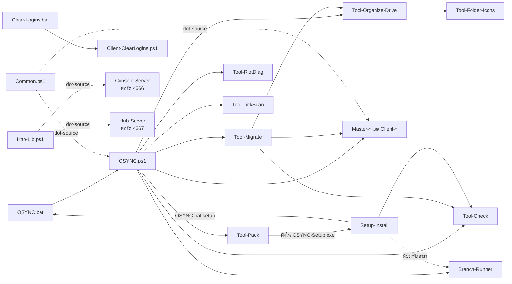
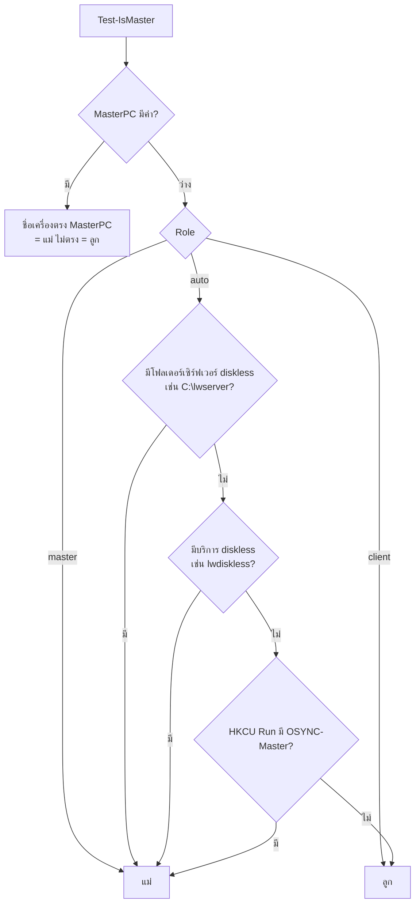
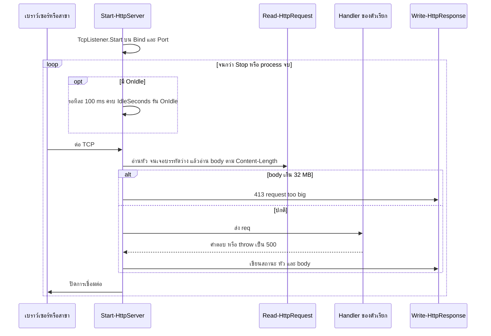
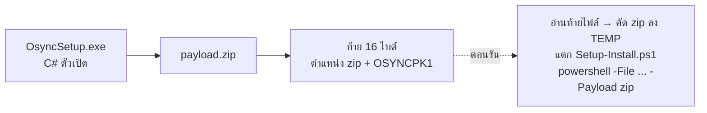
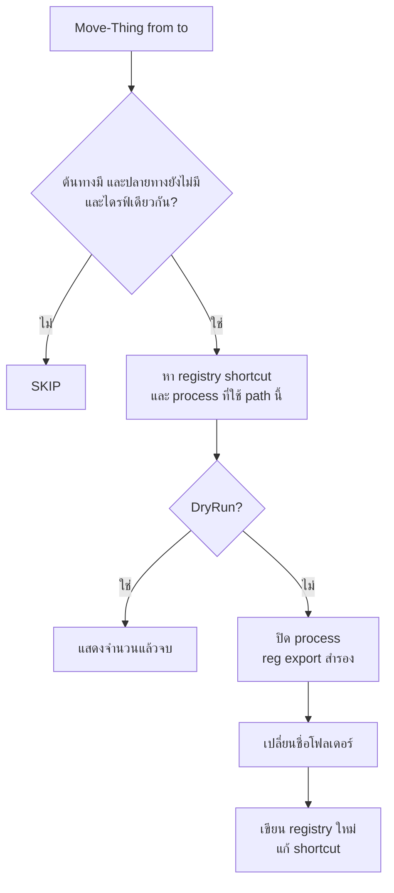
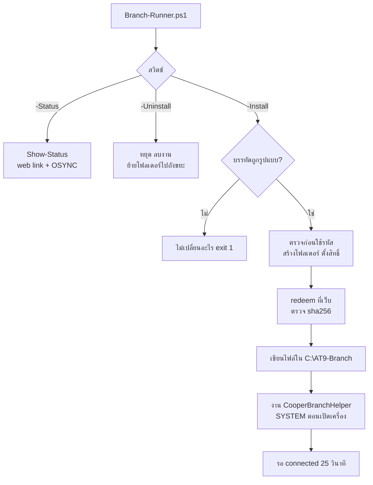

# 08 · แกนกลางและเครื่องมือ (Common, Http-Lib, OSYNC.ps1, Tool-*)

บทนี้คือคู่มืออ้างอิงทีละฟังก์ชันของแกนกลาง OSYNC: ปุ่ม `OSYNC.bat` / `OSYNC.ps1`, คลังกลาง `Common.ps1` ที่เกือบทุกสคริปต์ dot-source,
เว็บเซิร์ฟเวอร์จิ๋ว `Http-Lib.ps1` ของคอนโซลและฮับ, ตัวทำ/ตัวติดตั้ง `OSYNC-Setup.exe` และเครื่องมือ `Tool-*`
วิธีใช้งานทีละขั้น (เมนูทุกเลข, ติดตั้ง, อัปเดต, ทำ Image) อยู่ใน [02 · ติดตั้ง อัปเดต และทำ Image](02-INSTALL-UPDATE.md)
ค่าของร้านนี้มาจาก `H:\OSYNC\Settings\settings.txt` และ `H:\OSYNC\Menu\config.json` ณ วันที่ 20 พ.ย. 2026

## สารบัญ

- [ภาพรวม: ใครเรียกใคร](#ภาพรวม-ใครเรียกใคร)
- [1. `OSYNC.bat` — ปุ่มเดียวของทุกเครื่อง](#1-osyncbat--ปุ่มเดียวของทุกเครื่อง)
- [2. `OSYNC.ps1` — ตัวเมนูและตัวแจกงาน](#2-osyncps1--ตัวเมนูและตัวแจกงาน)
- [3. `Common.ps1` — คลังกลางที่ทุกสคริปต์ใช้](#3-commonps1--คลังกลางที่ทุกสคริปต์ใช้)
- [4. `Http-Lib.ps1` — เว็บเซิร์ฟเวอร์จิ๋ว](#4-http-libps1--เว็บเซิร์ฟเวอร์จิ๋ว)
- [5. `Tool-Check.ps1` — ตรวจระบบ](#5-tool-checkps1--ตรวจระบบ)
- [6. `Tool-Pack.ps1` — ทำไฟล์ติดตั้ง](#6-tool-packps1--ทำไฟล์ติดตั้ง)
- [7. `Setup-Install.ps1` — ตัวติดตั้งและอัปเดตเครื่องแม่](#7-setup-installps1--ตัวติดตั้งและอัปเดตเครื่องแม่)
- [8. `Tool-Migrate.ps1` — ย้ายโครงเดิม (ขั้น B)](#8-tool-migrateps1--ย้ายโครงเดิม-ขั้น-b)
- [9. `Tool-Organize-Drive.ps1` — จัดไดรฟ์เกม](#9-tool-organize-driveps1--จัดไดรฟ์เกม)
- [10. `Tool-Folder-Icons.ps1` — ไอคอนโฟลเดอร์](#10-tool-folder-iconsps1--ไอคอนโฟลเดอร์)
- [11. `Tool-RiotDiag.ps1` — รายงาน Riot REPAIR](#11-tool-riotdiagps1--รายงาน-riot-repair)
- [12. `Tool-LinkScan.ps1` — หาลิงก์โฟลเดอร์ที่เสีย](#12-tool-linkscanps1--หาลิงก์โฟลเดอร์ที่เสีย)
- [13. `Clear-Logins.bat` — ล้างล็อกอินเกม](#13-clear-loginsbat--ล้างล็อกอินเกม)
- [14. `Branch-Runner.ps1` — ตัวเชื่อมสาขา (ร้านนี้ไม่ใช้)](#14-branch-runnerps1--ตัวเชื่อมสาขา-ร้านนี้ไม่ใช้)
- [ปัญหาที่เคยเจอ / ข้อควรรู้](#ปัญหาที่เคยเจอ--ข้อควรรู้)

## ภาพรวม: ใครเรียกใคร

`Common.ps1` ถูก dot-source โดยสคริปต์ใน `System\Scripts` เกือบทุกตัว (ยกเว้น `Branch-Runner`, `Setup-Install`, `Tool-LinkScan`, `Http-Lib`, `Client-NEWTHINGS`, `Client-PopupGuard`, `Online-Torrent`, `SteamQueue-Lib`)
`Http-Lib.ps1` ถูก dot-source โดย `Console-Server.ps1`, `Hub-Server.ps1` และตัวทดสอบ `System\Tests\Fake-Igd.ps1` เท่านั้น

---

## 1. `OSYNC.bat` — ปุ่มเดียวของทุกเครื่อง

**หน้าที่:** จุดเข้าเดียวของเครื่องแม่และเครื่องลูก ส่งทุกอย่างต่อให้ `OSYNC.ps1`
**เรียกจาก / ทำงานเมื่อไหร่:** คนดับเบิลคลิก หรือพิมพ์ `OSYNC.bat <งาน> [ค่า]` · `Setup-Install.ps1` เรียก `OSYNC.bat setup` ตอนติดตั้งใหม่ · เครื่องลูกดับเบิลคลิก = ติดตั้งเครื่องลูก
**พารามิเตอร์:** `%*` ทั้งหมดส่งต่อให้ `OSYNC.ps1` (คำแรก = งาน, คำที่สอง = ค่า)
**อ่านค่า:** ไม่มี
**เขียน / เปลี่ยน:** ล้างตัวแปร `PSModulePath` เฉพาะในหน้าต่างนี้ (`setlocal`)
**Log:** ไม่มี

**ขั้นตอนการทำงาน**
1. `setlocal` และ `set "PSModulePath="` (เปิดจาก PowerShell 7 แล้ว module path ทำให้ Windows PowerShell หา `Get-FileHash` ไม่เจอ)
2. `powershell.exe -NoProfile -ExecutionPolicy Bypass -File "%~dp0System\Scripts\OSYNC.ps1" %*`

**ฟังก์ชัน:** ไม่มี (ไฟล์ batch 11 บรรทัด [`OSYNC.bat`](../../OSYNC.bat))

**ค่าในร้านนี้ตอนนี้:** `H:\OSYNC\OSYNC.bat`

---

## 2. `OSYNC.ps1` — ตัวเมนูและตัวแจกงาน

**หน้าที่:** แสดงเมนูตัวเลข (เฉพาะเครื่องแม่) หรือทำงานเดียวตามชื่อ แล้วรันสคริปต์ของงานนั้นด้วย `Run-Ps`
**เรียกจาก / ทำงานเมื่อไหร่:** `OSYNC.bat` เท่านั้น · ตารางทุกเลขอยู่ใน [02 ข้อ 1](02-INSTALL-UPDATE.md#1-เมนู-osyncbat-ทุกเลข)
**พารามิเตอร์:**
- `-Action` ชื่องาน: `master update watch-on watch-off setup client check move steam-library build-menu steam-firstrun ea-install ea-uninstall ea-anticheat eac newthings riot-startup-on riot-startup-off firewall boot-off riot-diag link-scan migrate pack branch branch-status branch-off organize`
- `-Arg` ค่าของงาน: ชื่อ launcher (`move`), `master` / `lan` / `off` (`firewall`), บรรทัดติดตั้ง (`branch`)

**อ่านค่า:** ผ่าน `Common.ps1`: `Test-IsMaster` (`MasterPC`, `Role`), `Test-PreMigration` (มี `GAMELUNCHER` ไหม), `$LauncherTable` · env `OSYNC_NOPAUSE` (ไม่รอ Enter ตอนจบ)
**เขียน / เปลี่ยน:** เองโดยตรงเฉพาะ `riot-startup-on/off` (`HKLM\...\Run\RiotStart`, ลบ `HKCU\...\Run\RiotClient`) และ `boot-off` (ลบงาน `OSYNC-Client-Boot`) · ที่เหลือทำโดยสคริปต์ที่เรียก
**Log:** ไม่มี (สคริปต์ที่เรียกมี log ของตัวเอง)

**ขั้นตอนการทำงาน**
1. dot-source `Common.ps1` → ถ้าโฟลเดอร์นี้ไม่มีทั้ง `Launchers\` และ `System\Data\` (= โฟลเดอร์ที่แตกจาก zip ของโปรเจกต์ ยังไม่ได้ติดตั้ง) และไม่ใช่โครงเดิมก่อนขั้น B: ขึ้น `This folder is a download of OSYNC, not an installed OSYNC - nothing was done.` บอกให้ใช้ `EASY-INSTALL.bat` แล้ว exit 1 ([บรรทัด 8-16](../Scripts/OSYNC.ps1#L8), เพิ่ม 20 พ.ย. 2026: `settings.txt` ในโฟลเดอร์นั้นยังเป็นชื่อเครื่องแม่ของร้านต้นทาง ถ้าไม่กัน เครื่องแม่ของร้านใหม่จะถูกนับเป็นเครื่องลูกและดับเบิลคลิกเดียวจะติดตั้งของเครื่องลูกลงไป) → `$isMaster = Test-IsMaster`
2. ตั้งรายการงานที่ต้อง admin ([บรรทัด 18](../Scripts/OSYNC.ps1#L18)): `setup client move steam-library organize steam-firstrun ea-install ea-uninstall ea-anticheat eac newthings riot-startup-on riot-startup-off firewall boot-off migrate branch branch-off`
3. `$preB = Test-PreMigration` และรายการงานที่กันก่อนขั้น B: `master update watch-on setup client move steam-library`
4. ไม่มีชื่องาน และไม่ใช่เครื่องแม่ → งาน = `client` ([บรรทัด 155](../Scripts/OSYNC.ps1#L155))
5. มีชื่องาน → `Invoke-Action` → `Pause-End` → ออก
6. ไม่มี → วนแสดงเมนูหลัก (1-7, 0) จนกด 0

**ฟังก์ชัน**

| ฟังก์ชัน | บรรทัด | หลักการทำงาน |
|---|---|---|
| [`Pause-End`](../Scripts/OSYNC.ps1#L24) | 24 | รอ "Press Enter to close" เว้นแต่ตั้ง env `OSYNC_NOPAUSE` (Setup-Install ตั้งให้) |
| [`Ask`](../Scripts/OSYNC.ps1#L25) | 25 | ถาม `[Y/N]` คืน `$true` เมื่อตอบขึ้นต้นด้วย Y |
| [`Choose-Launcher`](../Scripts/OSYNC.ps1#L26) | 26 | แสดง `Title` ของ `$LauncherTable` เป็นเลข คืน `Key` ที่เลือก หรือ '' |
| [`Invoke-Action`](../Scripts/OSYNC.ps1#L34) | 34 | ตัวแจกงาน: กันงานก่อนขั้น B → ถ้าต้อง admin แต่ยังไม่ใช่ เปิด `powershell.exe -Verb RunAs` ด้วยงานเดิมแล้วจบ → `switch` รันสคริปต์ของงาน (งานที่ย้ายของ = DryRun ก่อนแล้วถาม) |
| [`Show-Tools`](../Scripts/OSYNC.ps1#L117) | 117 | เมนู 7 Tools: ตาราง `[ordered]` เลข → `งาน[:ค่า]` แสดงเป็นกลุ่ม · เลข 17 ใส่เฉพาะเมื่อมี `GAMELUNCHER` · แยก `งาน:ค่า` แล้วส่ง `Invoke-Action` |

### `Invoke-Action` — จุดที่ควรรู้

- **อินพุต:** `$a` ชื่องาน (ตัวเล็ก), `$x` ค่า
- **ขอ admin แบบเปิดหน้าต่างใหม่:** ส่ง `-File "<OSYNC.ps1>" <งาน> "<ค่า>"` ให้ `Start-Process powershell.exe -Verb RunAs` แล้ว `return` ทันที หน้าต่างเดิมจึงขึ้น "Press Enter to close" ขณะงานจริงทำในหน้าต่างใหม่
- **งานที่ย้ายของจริง** (`move`, `steam-library`, `organize`) รันแบบ `-DryRun` ก่อนเสมอ DryRun ไม่ผ่าน (exit ไม่ใช่ 0) = ไม่ถามต่อ
- **`client` บนเครื่องแม่** ถาม "This PC looks like the MASTER..." ก่อน
- **`newthings`** ถามเรื่องแก้ภาษาไทยก่อน แล้วใส่ `-FixThaiText` ถ้าตอบ Y

**ค่าในร้านนี้ตอนนี้:** เครื่อง `DESKTOP-3ORJAGC` = MASTER (ตรง `MasterPC`) · `$preB` = false (ไม่มี `H:\OSYNC\GAMELUNCHER`) จึงไม่มีงานถูกกันและเลข 17 ไม่ขึ้น

---

## 3. `Common.ps1` — คลังกลางที่ทุกสคริปต์ใช้

**หน้าที่:** ที่เดียวที่รู้ว่าของอยู่ไหน: path ของโฟลเดอร์ OSYNC ทุกส่วน, ค่า Settings, ตาราง launcher, Steam, FiveM / RedM, เมนู และตัวช่วยหน้าจอ ทำงานได้จากโฟลเดอร์ไหนก็ได้บนไดรฟ์เกมไหนก็ได้ (ไม่ผูกกับร้านใด)
**เรียกจาก / ทำงานเมื่อไหร่:** ทุกสคริปต์ที่ขึ้นต้นด้วย `. (Join-Path $PSScriptRoot 'Common.ps1')` (53 ตัวใน `System\Scripts`: 51 ตัวโหลดเสมอ, `Online-Library` และ `Online-Upnp` โหลดเมื่อยังไม่มี `Get-Setting` + `Tests\Sim-OnlineLibrary`, `Tests\Test-Console`) ทำงานตอนสคริปต์นั้นเริ่ม
**พารามิเตอร์:** ไม่มี (คำนวณ path จาก `$PSScriptRoot`)
**อ่านค่า:**
- Settings: `SharedDrives`, `GamesFolder`, `GameFolders`, `MasterPC`, `Role`
- ไฟล์: `Settings\settings.txt`, `Settings\extra-games.json`, `Menu\config.json`, `Menu\data\games.json`, `System\Data\Online\online.key`, `<Steam>\steamapps\libraryfolders.vdf`, `appmanifest_*.acf`, `CitizenFX.ini`, `%ProgramData%\Riot Games\RiotClientInstalls.json`, `%ProgramData%\Riot Games\Metadata\*`
- Registry: Uninstall (HKLM, WOW6432Node, HKCU), `HKCU\Software\Valve\Steam`, คีย์ของ EA / Epic / Garena / Ubisoft / Rockstar / HoYoPlay / Modrinth, `HKLM\...\Rockstar Games\<เกม>`, `HKCU\...\Run\OSYNC-Master`
- env (ทดสอบ): `OSYNC_LAUNCHERS`, `OSYNC_MENU`, `OSYNC_SETTINGS`, `OSYNC_GAMEFOLDERS`, `OSYNC_ONLINEKEY`

**เขียน / เปลี่ยน:** เฉพาะ `Set-CfxIVPath` (เขียน `CitizenFX.ini`), `Show-Live` (ชื่อหน้าต่าง console), `Invoke-Installer` (รันตัวติดตั้ง และ `taskkill` เมื่อเกินเวลา), `Stop-IfPreMigration` (`exit 2`)
**Log:** ไม่มี (`Show-Live` ตั้งใจไม่ลง log)

**ขั้นตอนการทำงาน** (ตอนถูก dot-source)
1. คำนวณ path ทั้งหมดจากที่อยู่ของไฟล์ ([บรรทัด 14-26](../Scripts/Common.ps1#L14)) แล้วให้ env ทดสอบทับได้
2. ตั้ง path ของโครงเดิม `GAMELUNCHER`, `GCafe` ([บรรทัด 28](../Scripts/Common.ps1#L28))
3. ตั้ง `$SettingsFile`, `$ExtraGamesFile` แล้วอ่าน `GamesFolder` → `$GamesRoot` ([บรรทัด 61](../Scripts/Common.ps1#L61))
4. ประกาศรายชื่อโปรแกรม diskless ฝั่งเซิร์ฟเวอร์ ([บรรทัด 116](../Scripts/Common.ps1#L116)), `$LauncherTable` ([บรรทัด 133](../Scripts/Common.ps1#L133)), `$CfxGames` ([บรรทัด 235](../Scripts/Common.ps1#L235)) และฟังก์ชันทั้งหมด

### ตัวแปรกลาง

| ตัวแปร | ค่า | ร้านนี้ |
|---|---|---|
| `$ScriptsDir` / `$SystemDir` / `$Root` | โฟลเดอร์ของไฟล์นี้ / แม่ / แม่ของแม่ | `H:\OSYNC\System\Scripts` / `H:\OSYNC\System` / `H:\OSYNC` |
| `$SettingsDir` | `<Root>\Settings` (env `OSYNC_SETTINGS`) | `H:\OSYNC\Settings` |
| `$Launchers` | `<Root>\Launchers` (env `OSYNC_LAUNCHERS`) | `H:\OSYNC\Launchers` |
| `$Menu` | `<Root>\Menu` (env `OSYNC_MENU`) | `H:\OSYNC\Menu` |
| `$ClientDir` / `$DataDir` / `$DocsDir` / `$BackupDir` | `System\Client` / `System\Data` / `System\Docs` / `System\Backup` | ใต้ `H:\OSYNC\System` |
| `$OldLauncherRoot` / `$OldMenuDir` | `<Root>\GAMELUNCHER` / `<Root>\GCafe` (โครงเดิม) | ไม่มีแล้ว |
| `$SettingsFile` / `$ExtraGamesFile` | `settings.txt` / `extra-games.json` | ใน `H:\OSYNC\Settings` |
| `$GamesRoot` | `GamesFolder` (สัมพัทธ์ = ใต้ `$Root`, ค่าเริ่ม `GAME`) | `H:\OSYNC\GAME` |
| `$ToolsDir` | `<Root>\Tools` | `H:\OSYNC\Tools` |
| `$DisklessServerFolders` | `C:\lwserver`, CCBoot, iCafeCloud, NxD, ggRock | มี `C:\lwserver` |
| `$DisklessServerServices` | regex ชื่อบริการ: `lwdiskless`, `lwserver`, `CCBoot`, `iCafeCloudServer`, `iCafe8Server`, `NxdServer`, `ggRock`, `SmartBoot`, `DisklessServer` | - |
| `$CfxGames` | FiveM → GTA V Legacy (Steam 271590, `GTA5.exe`, ห้ามมี `GTA5_Enhanced.exe`) · RedM → RDR2 (Steam 1174180, `RDR2.exe`) | - |

### `$LauncherTable` (บรรทัด 123-138)

| Key | โฟลเดอร์ใน `Launchers\` (ชื่อเก่า) | exe | ร้านนี้ |
|---|---|---|---|
| Steam | `Steam` | `steam.exe -silent` | ไม่อยู่ใน Launchers: Steam อยู่ `F:\steam` (registry `SteamPath=f:/steam`) |
| Riot | `Riot Client` (`Riot`, `RiotClient`) | `RiotClientServices.exe` | มี |
| EA | `EA` (`EA Desktop`) | `EA Desktop\EALauncher.exe -silentOs` | มี |
| Epic | `Epic` (`Epic Games`) | `Launcher\Portal\Binaries\Win64\EpicGamesLauncher.exe -silent` | มี |
| Garena | `Garena` | `Garena.exe` | มี |
| Ubisoft | `Ubisoft` | `Ubisoft Game Launcher\UbisoftConnect.exe` | มี |
| Rockstar | `Rockstar` (`Rockstar Games Launcher`) | `LauncherPatcher.exe` | มี |
| HoYoPlay | `HoYoPlay` | `launcher.exe` | มี |
| Modrinth | `Modrinth` (`Modrinth App`) | `Modrinth App.exe` | มี |
| BattleNet | `BattleNet` (`Battle.net`) | `Battle.net Launcher.exe` | มีโฟลเดอร์ |
| GOG | `GOG` (`GOG Galaxy`) | `GalaxyClient.exe` | ไม่มี |
| Nexon | `Nexon` (`Nexon Plug`) | `NexonPlug.exe` | ไม่มี |
| Amazon | `Amazon` (`Amazon Games`) | `Amazon Games.exe` | ไม่มี |

Roblox ไม่อยู่ในตาราง (ไม่มีอะไรต้องเปิดค้าง) ใช้ `Get-RobloxExe` แทน · ร้านนี้มี `H:\OSYNC\Launchers\Roblox`

### ฟังก์ชัน (35 ตัว)

| ฟังก์ชัน | บรรทัด | หลักการทำงาน | ใช้ที่ (สคริปต์อื่น) |
|---|---|---|---|
| [`Test-PreMigration`](../Scripts/Common.ps1#L31) | 31 | `$true` เมื่อโครงเดิมยังทำงาน: ไม่ได้ตั้ง `OSYNC_LAUNCHERS` + มี `GAMELUNCHER\` + ยังไม่มี `Launchers\` | `OSYNC.ps1` (กันงาน), `Master-Watch`, `Stop-IfPreMigration` |
| [`Stop-IfPreMigration`](../Scripts/Common.ps1#L32) | 32 | ถ้ายังเป็นโครงเดิม พิมพ์ "<งาน> : not yet ..." บอกให้ทำ 7 → 17 แล้ว `exit 2` | `Client-Install`, `Master-GameList`, `Master-Setup`, `Master-Update`, `Master-Watch -Register` |
| [`Get-Setting`](../Scripts/Common.ps1#L44) | 44 | อ่าน `settings.txt` (UTF-8) บรรทัดแรกที่ขึ้นต้น `ชื่อ=` คืนค่าที่ตัดช่องว่าง ว่างหรือไม่มี = `$Default` | ~20 สคริปต์ เช่น `Client-Install` (28 ครั้ง), `Online-Library`, `Console-Server`, `Hub-Server`, `SteamQueue-Lib`, `Tool-Migrate` |
| [`Get-SharedDrives`](../Scripts/Common.ps1#L52) | 52 | `SharedDrives` เหลือแต่ตัวอักษร ตัวใหญ่ · ว่าง = ไดรฟ์ fixed ทุกตัวยกเว้นไดรฟ์ระบบ | Snapshot Riot / EA / Epic, `Master-GameList`, `Master-Steam-Library`, `Master-SteamQueue`, `Client-EAC`, `Client-Mic`, `Client-Oslink*`, `Client-SteamVerify`, `Console-Server`, `Online-Library`, `Tool-Check` |
| [`Get-GameFolders`](../Scripts/Common.ps1#L66) | 66 | โฟลเดอร์เกมทั้งหมด: `$GamesRoot` ก่อน แล้ว `GameFolders` (คั่นด้วย `;` `,` หรือ `\|`, สัมพัทธ์ = ใต้ `$Root`) ตัดซ้ำ คืนเฉพาะที่มีอยู่ | `Console-Server` (หน้า "ไดร์ฟเกม"), `Master-GameList`, `Online-Library` |
| [`Get-OnlineSecret`](../Scripts/Common.ps1#L80) | 80 | กุญแจคลังออนไลน์จาก `System\Data\Online\online.key` (ไม่เก็บใน Settings เพราะ Settings ขึ้น git) | `Hub-Server`, `Online-Library` |
| [`Read-ExtraGames`](../Scripts/Common.ps1#L85) | 85 | อ่าน `extra-games.json` เป็นออบเจ็กต์ · ไม่มีไฟล์ = `$null` · JSON เสีย = throw | `Master-GameList`, `Online-Library`, `Tool-Check` |
| [`Run-Ps`](../Scripts/Common.ps1#L91) | 91 | รันสคริปต์อื่นใน `System\Scripts` ในหน้าต่างเดียวกัน คืน exit code (ดูข้างล่าง) | `OSYNC.ps1`, `Master-Setup`, `Tool-Migrate`, `Tool-Organize-Drive` |
| [`Get-SunshinePlan`](../Scripts/Common.ps1#L106) | 106 | แผนพอร์ต Sunshine 0JAYSHOP จาก `SunshineIpBase` (`<net>.<offset>`), `SunshinePcPrefix`, `SunshinePcCount` (ค่าผิดรูป / ว่าง = `192.168.51.100`, `KORI`, `72`; จำนวนสูงสุด 99 และไม่เกิน .254) คืน `Net`, `Offset`, `Prefix`, `Count` | `Client-Sunshine0J`, `Tool-SunshineProfiles` |
| [`Get-LanIP`](../Scripts/Common.ps1#L97) | 97 | IPv4 ของการ์ดที่มี default gateway (ไม่ใช่ 169.254.x) ไม่มี = IP private ตัวแรก (10., 192.168., 172.16-31.) | `Master-Setup` (`MasterIP`), `Online-Upnp` |
| [`Test-Admin`](../Scripts/Common.ps1#L103) | 103 | process นี้อยู่ในกลุ่ม Administrators (สิทธิ์ยกระดับแล้ว) | `OSYNC.ps1`, `Client-*` หลายตัว, `Master-*`, `Tool-Migrate`, `Tool-Organize-Drive` |
| [`Test-IsMaster`](../Scripts/Common.ps1#L118) | 118 | ตัดสินว่าเครื่องนี้คือเครื่องแม่ (ดูข้างล่าง) | `OSYNC.ps1`, `Tool-Check`, `Client-Install` (24 ครั้ง: ข้ามขั้นบนเครื่องแม่), `Client-*`, `Console-Server`, `Master-ClientReports`, `Master-FiveMShare`, `Master-OslinkLogins` |
| [`Find-UninstallPath`](../Scripts/Common.ps1#L150) | 150 | หารายการ Uninstall ที่ `DisplayName` ตรง regex คืน `InstallLocation` หรือโฟลเดอร์ของ exe ใน `DisplayIcon` / `UninstallString` (ต้องมีอยู่จริง) | `Get-LauncherInstallPath`, `Master-Move-Launcher` |
| [`Get-Launcher`](../Scripts/Common.ps1#L161) | 161 | แถวของ `$LauncherTable` ตาม `Key` | ภายใน (`Get-LauncherDir`, `Get-LauncherExe`) |
| [`Get-LauncherDir`](../Scripts/Common.ps1#L162) | 162 | `Launchers\<Dir>` · ไม่มี = ลองชื่อเก่า (`Old`) ที่มีอยู่ · ไม่เจอเลย = คืน path ใหม่ | `Client-EA`, `Client-Riot-Start`, `Master-GameList`, `Master-Setup`, `Master-Snapshot-EA`, `Master-Snapshot-Riot`, `Online-Library`, `Tool-Check`, `Tool-Folder-Icons`, `Tool-RiotDiag` |
| [`Get-LauncherExe`](../Scripts/Common.ps1#L168) | 168 | `Get-LauncherDir` + `Exe` ของแถว | `Client-Epic-Start`, `Client-Install`, `Master-GameList`, `Master-Setup`, `Master-Watch`, `Tool-Check`, `Tool-Folder-Icons` |
| [`Get-RobloxExe`](../Scripts/Common.ps1#L171) | 171 | `RobloxPlayerBeta.exe` ตัวใหม่สุดใน `Launchers\Roblox\Versions\version-*` ไม่มี = '' | `Client-DesktopClean`, `Client-Install` (1c), `Client-Roblox`, `Master-GameList`, `Tool-Check`, `Tool-Folder-Icons` |
| [`Get-LauncherInstallPath`](../Scripts/Common.ps1#L178) | 178 | ที่ติดตั้งตาม registry / config ของ launcher เอง (ตารางข้างล่าง) แปลง `/` เป็น `\` ต้องมีอยู่จริง ไม่งั้น '' | `Master-Setup` (ขั้น 2), `Tool-Check` (`Launchers outside`), `Tool-Migrate` (ขั้น 3) |
| [`RegVal`](../Scripts/Common.ps1#L179) | 179 | ฟังก์ชันซ้อนใน `Get-LauncherInstallPath`: อ่านค่า registry 1 ค่า error = `$null` | ภายในเท่านั้น (`Master-Move-Launcher` มีตัวของเอง) |
| [`Get-SteamDir`](../Scripts/Common.ps1#L201) | 201 | `Launchers\Steam` ถ้ามี `steam.exe` ไม่งั้น `SteamPath` ใน `HKCU\Software\Valve\Steam` ไม่มี = '' | `Client-GameStart`, `Client-SteamVerify`, `Master-GameList`, `Master-Setup`, `Master-Steam-Library`, `Master-Watch`, `Tool-Check`, `Tool-Folder-Icons` |
| [`Get-SteamLibraries`](../Scripts/Common.ps1#L209) | 209 | library Steam ทุกอันบนไดรฟ์ที่แชร์ (ดูข้างล่าง) | `Client-Steam-FirstRun`, `Client-EAC`, `Client-EA-AntiCheat`, `Client-GameStart`, `Client-SteamVerify`, `Master-GameList`, `Master-SteamQueue`, `Master-Watch`, `Master-Setup`, `Online-Library`, `Console-Server`, `Tool-Check`, `Tests\Sim-OnlineLibrary` |
| [`Test-CfxGameDir`](../Scripts/Common.ps1#L240) | 240 | โฟลเดอร์ใช้กับ FiveM / RedM ได้: อยู่บนไดรฟ์ที่แชร์ + มี exe ของเกม + (FiveM) ไม่มี `GTA5_Enhanced.exe` | ภายใน (`Find-CfxGameDir`, `Get-CfxStatus`) |
| [`Find-CfxGameDir`](../Scripts/Common.ps1#L246) | 246 | หาโฟลเดอร์เกม: appmanifest ใน library Steam → registry Rockstar (`InstallFolder`, `InstallFolderSteam`, `InstallFolderEpic` และโฟลเดอร์แม่) → `GAME\Rockstar...`, `GAME\Epic\...` · ตัวแรกที่ผ่าน `Test-CfxGameDir` คืนแบบตัวพิมพ์จริง | ภายใน (`Get-CfxStatus`) |
| [`Get-RealCasePath`](../Scripts/Common.ps1#L261) | 261 | ไล่ทีละชั้นหาชื่อโฟลเดอร์ตามตัวพิมพ์จริง (libraryfolders.vdf เก็บ path ตัวเล็ก) | ภายใน (`Find-CfxGameDir`) |
| [`Get-CfxApps`](../Scripts/Common.ps1#L272) | 272 | หา FiveM / RedM บนดิสก์เกม: จาก `cmd` ใน `Menu\data\games.json` + `FiveM.exe` / `RedM.exe` ลึก 2 ชั้นในโฟลเดอร์หมวดของทุก game folder (ยกเว้น `Steam`) · ต้องมี `<ชื่อ>.app\CoreRT.dll` · คืน Name, App, Ini | `Client-ClearLogins`, `Client-FiveMShare`, `Console-Server`, `Master-FiveMShare` |
| [`Read-CfxIni`](../Scripts/Common.ps1#L291) | 291 | อ่าน `CitizenFX.ini` ตาม BOM (UTF-16 LE / UTF-8 / ANSI) คืนอาร์เรย์บรรทัด | ภายใน (`Get-CfxIVPath`, `Set-CfxIVPath`) |
| [`Get-CfxIVPath`](../Scripts/Common.ps1#L297) | 297 | ค่า `IVPath=` ในหมวด `[Game]` (ตัด `"`) | `Master-CitizenFX` |
| [`Set-CfxIVPath`](../Scripts/Common.ps1#L303) | 303 | ตั้ง `[Game] IVPath=` เก็บบรรทัดอื่นไว้ ไม่มีหมวด = เพิ่มท้ายไฟล์ เขียน CRLF แบบ ASCII หรือ UTF-16 ถ้ามีอักษรนอก ASCII | `Master-CitizenFX` (ขั้น 6 ของ Master-Update) |
| [`Get-CfxStatus`](../Scripts/Common.ps1#L317) | 317 | ต่อ FiveM / RedM: `Name`, `Game`, `App`, `Ini`, `Have` (IVPath ตอนนี้), `HaveOk`, `Want` (โฟลเดอร์ที่ควรชี้) | `Master-CitizenFX`, `Tool-Check` |
| [`Get-GameFolderStamp`](../Scripts/Common.ps1#L327) | 327 | รายการบรรทัดที่ใช้เทียบว่ามีเกมใหม่ / ถูกลบ (ดูข้างล่าง) | `Master-Watch` |
| [`Get-MenuInfo`](../Scripts/Common.ps1#L349) | 349 | ชื่อและ exe ของโปรแกรมเมนู + `config.json` (ดูข้างล่าง) | `Client-Install`, `Client-Menu`, `Client-DesktopClean`, `Master-GameList`, `Master-Setup`, `Tool-Check`, `Tool-Migrate`, `Tool-Pack` |
| [`Show-Live`](../Scripts/Common.ps1#L363) | 363 | บรรทัดสถานะที่วาดทับที่เดิม + ชื่อหน้าต่าง `OSYNC <ข้อความ>` · output ถูก pipe = พิมพ์ `~ข้อความ` ให้ตัวเรียกวาด · '' = ล้าง · ไม่ลง log | `Client-Install` (แปลงบรรทัด `~`), `Client-OslinkDrivers`, ภายใน `Invoke-Installer` |
| [`Format-Sec`](../Scripts/Common.ps1#L374) | 374 | วินาที → `m:ss` | `Client-SteamVerify`, ภายใน `Invoke-Installer` |
| [`Invoke-Installer`](../Scripts/Common.ps1#L378) | 378 | รันตัวติดตั้งแบบซ่อน รอไม่เกินเวลา แสดงบรรทัดสด เกินเวลา = ฆ่าทั้งต้นไม้ (ดูข้างล่าง) | `Client-Steam-FirstRun`, `Client-EAC`, `Client-EA-AntiCheat` |
| [`Get-RiotBusy`](../Scripts/Common.ps1#L406) | 406 | ชื่อผลิตภัณฑ์ Riot ที่ยังโหลด / แพตช์อยู่บนเครื่องนี้ (ดูข้างล่าง) | `Master-Snapshot-Riot`, `Master-Watch`, `Tool-Check` |

### `Get-Setting` — อ่านค่าร้าน

- **อินพุต:** `-Name` ชื่อคีย์, `-Default` ค่าเมื่อไม่มี
- **คืน:** ข้อความหลัง `=` ตัวแรก ตัดช่องว่างหัวท้าย
- **วิธี:** อ่านทั้งไฟล์ทุกครั้ง (ไม่แคช) หาบรรทัดแรกที่ตรง `^\s*<Name>\s*=` บรรทัดที่ขึ้นต้นด้วย `#` จึงไม่ตรง (เป็นคำอธิบาย)
- **ข้อควรรู้:** ค่าว่าง (เช่น `ClientApexClean=`) = ใช้ `$Default` · ชื่อคีย์ถูกใส่ใน regex ตรง ๆ (คีย์ของ OSYNC เป็นตัวอักษรล้วน)

### `Test-IsMaster` — เครื่องแม่หรือเครื่องลูก

`settings.txt` เครื่องลูกก็อ่าน (อยู่บนไดรฟ์เกม) จึงใช้ "ชื่อเครื่องแม่" เป็นตัวตัดสิน ซึ่งถูกต้องบนทุกเครื่องไม่ว่าโปรแกรม diskless ยี่ห้อไหน

### `Run-Ps` — รันสคริปต์ลูก

- **อินพุต:** `-File` ชื่อไฟล์ใน `System\Scripts`, `-ArgList` อาร์เรย์อาร์กิวเมนต์
- **คืน:** exit code อย่างเดียว
- **วิธี:** `Start-Process powershell.exe -NoNewWindow -Wait -PassThru` อาร์กิวเมนต์ที่มีช่องว่างหรือว่างถูกครอบด้วย `"`
- **ทำไม:** output และสีของสคริปต์ลูกขึ้นจอตรง ๆ และสคริปต์ลูกถามคำถามได้ · ผลข้างเคียง: transcript ของตัวเรียก (เช่น `Tool-Migrate`) ไม่มี output ของสคริปต์ลูก

### `Get-LauncherInstallPath` — launcher อยู่ไหนจริง

| Key | อ่านจาก |
|---|---|
| Steam | `HKCU\Software\Valve\Steam` `SteamPath` |
| Riot | `%ProgramData%\Riot Games\RiotClientInstalls.json` `rc_default` (โฟลเดอร์ของไฟล์) |
| EA | `HKLM\SOFTWARE\Electronic Arts\EA Desktop` `InstallLocation` |
| Epic | `HKLM\SOFTWARE\EpicGames\Unreal Engine` `INSTALLDIR` |
| Garena | `HKLM\SOFTWARE\WOW6432Node\Garena\gxx` `path` (โฟลเดอร์แม่) |
| Ubisoft | `HKLM\SOFTWARE\WOW6432Node\Ubisoft\Launcher` `InstallDir` |
| Rockstar | `HKLM\SOFTWARE\WOW6432Node\Rockstar Games\Launcher` `InstallFolder` |
| HoYoPlay | `HKCU\Software\Cognosphere\HYP\1_0` `InstallPath` |
| Modrinth | `HKCU\...\Uninstall\Modrinth App` `InstallLocation` |
| BattleNet / GOG / Nexon / Amazon | `Find-UninstallPath` ด้วย `^Battle\.net$` / `^GOG GALAXY` / `(?i)nexon ?plug` / `^Amazon Games$` |

### `Get-SteamLibraries` — library Steam

1. เริ่มจาก `Get-SteamDir` และทุก `"path"` ใน `<Steam>\steamapps\libraryfolders.vdf`
2. เพิ่ม `<GAME>\Steam` และ `X:\Games\Steam`, `X:\SteamLibrary`, `X:\Steam` ของทุกไดรฟ์ใน `SharedDrives`
3. ตัดซ้ำ (ไม่สนตัวพิมพ์) ตัดที่ไม่อยู่บนไดรฟ์ที่แชร์ เก็บเฉพาะที่มี `steamapps\common`

ร้านนี้ (ผลตรวจ 17 พ.ย. 2026): `f:\steam`, `D:\SteamLibrary`, `E:\SteamLibrary`, `F:\SteamLibrary`, `G:\SteamLibrary`, `I:\SteamLibrary`, `J:\SteamLibrary` (ตัวเล็ก `f:` มาจาก registry จึงต้องมี `Get-RealCasePath` ตอนเขียน path ให้ FiveM)

### FiveM / RedM (`Test-CfxGameDir` ถึง `Get-CfxStatus`)

FiveM ใช้ GTA V **Legacy** (Steam 271590 ไม่ใช่ Enhanced 3240220) RedM ใช้ RDR2 (1174180) ทั้งคู่หาเกมจาก registry ของ Rockstar ซึ่งเครื่องลูก diskless ไม่มี
แล้วจะเปิดหน้าต่างให้เลือกไฟล์ และจำคำตอบไว้ที่ `<FiveM|RedM>.app\CitizenFX.ini` `[Game] IVPath=` ไฟล์นี้อยู่บนดิสก์เกม เครื่องแม่จึงเขียนครั้งเดียวให้ทุกเครื่อง (`Master-CitizenFX.ps1`)
ร้านนี้ (ผลตรวจ 17 พ.ย.): `FiveM: game folder: J:\SteamLibrary\steamapps\common\Grand Theft Auto V`

### `Get-GameFolderStamp` — ลายนิ้วมือของเกม

คืนรายการข้อความ ตัวเฝ้าเทียบกับรอบก่อน ถ้าต่างแปลว่ามีเกมใหม่ / ถูกลบ โดยไม่ต้องรอ launcher บอก:
- ทุกโฟลเดอร์ชั้นแรกในทุก game folder และชั้นที่สองถ้าชั้นแรกเป็นชื่อหมวด (`Online`, `PvP`, `Mobile`, `Single Player`, `Offline`, `Web`, `Emulator`, `Garena`, `HoYoPlay`, `Gacha`)
- `X:\Games\<หมวด>\*` และ `X:\<หมวด>\*` ของทุกไดรฟ์ที่แชร์
- เกมใน `Launchers\HoYoPlay\games` พร้อมจำนวน exe (`<path>|<จำนวน>`)
- รายการ Uninstall ที่ `InstallLocation` อยู่บนไดรฟ์ที่ไม่ใช่ C: (`app|<คีย์>|<path>`)

### `Get-MenuInfo` — โปรแกรมเมนู

1. อ่าน `Menu\config.json` → `brandName` ตัดอักษรที่ใช้ในชื่อไฟล์ไม่ได้ ไม่มี = `0JAYSHOP`
2. exe = `Menu\app\<ชื่อ>.exe` · ไม่มี = `Menu\app\0JAYSHOP.exe` · ไม่มีอีก = exe ตัวแรกใน `Menu\app` ที่ใหญ่กว่า 50 MB (ชื่อ = ชื่อไฟล์นั้น)
3. คืน `Name`, `Exe`, `Names` (ชื่อนี้ + `0JAYSHOP`), `Config`

ร้านนี้: `brandName=0JAYSHOP` → `H:\OSYNC\Menu\app\0JAYSHOP.exe` (235 MB, build 19 พ.ย. 2026 21:11)

### `Invoke-Installer` และ `Show-Live` — ตัวติดตั้งที่ค้างไม่ได้

- **อินพุต:** `-Exe`, `-ArgList`, `-Label` (ชื่อที่แสดง), `-TimeoutSec` (ค่าเริ่ม 300)
- **คืน:** `[pscustomobject]@{ Code = exit code หรือ $null; Sec = วินาทีที่ใช้ }`
- **วิธี:** `Start-Process -WindowStyle Hidden` (โฟลเดอร์ทำงาน = โฟลเดอร์ของ exe) วน `WaitForExit(1000)` ครบ 15 วินาทีพิมพ์ "... still running" ครั้งเดียว วาด `| / - \ m:ss / m:ss <Label>` ด้วย `Show-Live`
  เกินเวลา → `taskkill /PID <pid> /T /F` แล้วพิมพ์ `TIMEOUT` · เปิดไม่ได้ → พิมพ์ `FAIL`
- **ทำไม:** ลูกของตัวติดตั้งที่ค้างอยู่ทำให้ Windows Installer ไม่ว่าง จึงต้องฆ่าทั้งต้นไม้ · บรรทัดสดไม่ลง log: ถ้า output ถูก pipe (สคริปต์ที่ `Client-Install` เรียก) จะส่งเป็นบรรทัด `~` ให้ `Client-Install` วาดแทน

### `Get-RiotBusy` — Riot ยังแพตช์อยู่ไหม

ในแต่ละโฟลเดอร์ของ `%ProgramData%\Riot Games\Metadata\<ชื่อ>`:
1. `<ชื่อ>.manifest` เก่ากว่า 3 ชั่วโมง = การโหลดที่ถูกทิ้ง ไม่นับ
2. ไม่มี `.ok` และไม่มี `.db` = ผลิตภัณฑ์ที่ไม่เคยลงบนเครื่องนี้ (เช่น PBE) ไม่นับ (18 พ.ย. 2026: เคยทำให้การอัปเดตเครื่องลูกค้างหลังแพตช์ LoL)
3. ไม่มี `.ok` หรือ manifest ใหม่กว่า `.ok` เกิน 1 วินาที = ยังแพตช์ → คืนชื่อ · มี `RiotClient` ในรายการ = Riot Client รออัปเดตตัวเอง

**ค่าในร้านนี้ตอนนี้:** `SharedDrives=DEFGHIJ` · `MasterPC=DESKTOP-3ORJAGC` · `MasterIP=192.168.51.201` · `Role=auto` · `GamesFolder=GAME` · `GameFolders=` (ว่าง = ใช้แค่ `GAME`) · `Menu\config.json brandName=0JAYSHOP` · ไม่ได้ตั้ง env ทดสอบ

---

## 4. `Http-Lib.ps1` — เว็บเซิร์ฟเวอร์จิ๋ว

**หน้าที่:** เซิร์ฟเวอร์ HTTP/1.1 เล็ก ๆ บน `TcpListener` สำหรับคอนโซลแอดมินและฮับคลังออนไลน์ ไม่ต้องจอง URL และไม่ต้องใช้ admin · รับทีละคำขอ ตอบแบบ `Connection: close`
**เรียกจาก / ทำงานเมื่อไหร่:** dot-source โดย
- `Console-Server.ps1` → `Start-HttpServer -Port <ConsolePort> -Bind 127.0.0.1` (เปิดได้จากเครื่องแม่เท่านั้น)
- `Hub-Server.ps1` → `Start-HttpServer -Port 4667 -Bind 0.0.0.0` (ค่าเริ่มของ param) และถ้า `OnlineUpnp` เปิด ใส่ `-OnIdle` ต่ออายุ UPnP ทุก `UpnpRenewSec` (300) วินาที · ใช้ `ConvertFrom-UrlBytes` ถอด `info_hash` / `peer_id` ของ BitTorrent
- `System\Tests\Fake-Igd.ps1` (เราเตอร์ปลอมสำหรับทดสอบ)
- ตัวรับในวง LAN (`Master-FiveMShare` 4671, `Master-ClientReports` 4670, `Master-OslinkLogins` 4669) **ไม่ได้ใช้ไฟล์นี้** แต่ละตัวมี `TcpListener` ของตัวเอง

**พารามิเตอร์:** ไม่มี (ไฟล์ไลบรารี)
**อ่านค่า:** env `OSYNC_HTTP_LOG` (path ไฟล์ log) · ไม่อ่าน Settings
**เขียน / เปลี่ยน:** เปิดพอร์ต TCP ตาม `-Port` / `-Bind` ที่ตัวเรียกส่งมา · ไม่ตั้ง firewall
**Log:** เฉพาะเมื่อตั้ง env `OSYNC_HTTP_LOG` (ไม่มีสคริปต์ไหนในโค้ดตั้งค่านี้ ปกติจึงไม่มี log)

**ค่าคงที่:** `$script:HttpMaxBody = 32MB` ([บรรทัด 7](../Scripts/Http-Lib.ps1#L7)) · `$script:HttpStatusText` 200, 204, 400, 403, 404, 405, 409, 413, 500 ([บรรทัด 58](../Scripts/Http-Lib.ps1#L58)) · `$script:MimeTypes` html, js, css, json, png, jpg, jpeg, webp, gif, ico, svg, torrent ([บรรทัด 81](../Scripts/Http-Lib.ps1#L81))

**ออบเจ็กต์คำขอ `$req`** (hashtable): `Method` (ตัวใหญ่), `Path` (ถอดรหัสแล้ว ไม่มี query), `RawPath`, `RawQuery`, `Query` (ชื่อ → ค่าถอดรหัสแล้ว), `Headers` (ชื่อตัวเล็ก), `Body` (byte[]), `BodyText` (UTF-8), `Remote` (IP ผู้ขอ) · ตัวใหญ่เกิน = `@{ TooBig = $true; ... }`
**ออบเจ็กต์คำตอบ** (hashtable ที่ handler คืน): `Status` (ค่าเริ่ม 200), `Type` (ค่าเริ่ม `application/octet-stream`), `Body` (byte[] หรือ string), `Headers` (เพิ่มเติม), `Stop` (`$true` = ปิดเซิร์ฟเวอร์หลังตอบ ใช้ในการทดสอบ)

**ขั้นตอนการทำงาน** (`Start-HttpServer`)

**ฟังก์ชัน**

| ฟังก์ชัน | บรรทัด | หลักการทำงาน |
|---|---|---|
| [`ConvertFrom-UrlBytes`](../Scripts/Http-Lib.ps1#L9) | 9 | ถอด `%xx` เป็น byte ดิบ, `+` เป็นช่องว่าง, อักษรอื่นเป็น UTF-8 · คืน byte[] (BitTorrent `info_hash` / `peer_id` เป็นไบนารี) |
| [`ConvertFrom-UrlString`](../Scripts/Http-Lib.ps1#L20) | 20 | `ConvertFrom-UrlBytes` แล้วแปลงเป็นข้อความ UTF-8 |
| [`Read-HttpRequest`](../Scripts/Http-Lib.ps1#L22) | 22 | อ่าน stream ทีละ 8 KB จนเจอ `\r\n\r\n` (หัวเกิน 64 KB = `$null`) แยกบรรทัดแรก หัว (ชื่อตัวเล็ก) `Content-Length` (เกิน 32 MB = `TooBig`) อ่าน body ให้ครบ แยก path / query แล้วคืน `$req` |
| [`Write-HttpResponse`](../Scripts/Http-Lib.ps1#L59) | 59 | เขียน `HTTP/1.1 <สถานะ>` + `Content-Type`, `Content-Length`, `Connection: close`, `Cache-Control: no-store`, `X-Content-Type-Options: nosniff` + หัวเพิ่ม แล้ว body (string → UTF-8) และ flush |
| [`New-JsonResponse`](../Scripts/Http-Lib.ps1#L75) | 75 | คำตอบ JSON (`ConvertTo-Json -Depth 12 -Compress`, `application/json; charset=utf-8`) |
| [`New-ErrorResponse`](../Scripts/Http-Lib.ps1#L78) | 78 | JSON `{ ok: false, error: <ข้อความ> }` พร้อมสถานะที่ให้ |
| [`Get-JsonBody`](../Scripts/Http-Lib.ps1#L79) | 79 | body ว่าง = `$null` ไม่งั้น `ConvertFrom-Json` |
| [`New-FileResponse`](../Scripts/Http-Lib.ps1#L83) | 83 | ส่งไฟล์ทั้งไฟล์ ชนิดตามนามสกุลจาก `$MimeTypes` · ไม่ใช่ไฟล์ = 404 · ไม่กัน path แปลก ๆ เอง ตัวเรียกต้องกรองชื่อ (คอนโซลรับเฉพาะ `[A-Za-z0-9._\-]+`) |
| [`Write-HttpLog`](../Scripts/Http-Lib.ps1#L89) | 89 | เขียน `HH:mm:ss.fff <ข้อความ>` ต่อท้ายไฟล์ใน `OSYNC_HTTP_LOG` ถ้าตั้งไว้ error เงียบ |
| [`Start-HttpServer`](../Scripts/Http-Lib.ps1#L92) | 92 | วนรับคำขอทีละตัว (ดูข้างล่าง) |

### `Start-HttpServer`

- **อินพุต:** `-Port`, `-Bind` (ค่าเริ่ม `127.0.0.1`), `-Handler` (scriptblock รับ `$req` คืนคำตอบ), `-Name` (ชื่อที่พิมพ์ "listening on"), `-OnIdle` + `-IdleSeconds` (ค่าเริ่ม 300)
- **วิธี:** ตั้ง timeout รับ/ส่ง 20 วินาทีต่อการเชื่อมต่อ · handler throw = 500 พร้อมข้อความ error · handler คืนหลายค่า (อาร์เรย์) = ใช้ตัวสุดท้าย (กันค่าที่หลุดออกจาก pipeline) · error ระหว่างคุย = log แล้วปิดการเชื่อมต่อ ไม่ล้มทั้งเซิร์ฟเวอร์ · `finally` ปิด listener เสมอ
- **ทำไมเป็นแบบนี้:** `TcpListener` ไม่ต้องจอง URL (`netsh http`) และไม่ต้อง admin ต่างจาก `HttpListener` · ทีละคำขอ ง่ายและพอสำหรับคอนโซลคนเดียว / ฮับ · คำขอช้าหนึ่งตัวกันตัวอื่นได้ถึง 20 วินาที

**ค่าในร้านนี้ตอนนี้:** `ConsolePort=4666` · `OnlineHub=http://127.0.0.1:4667` (ฮับอยู่บนเครื่องนี้ งาน `OSYNC-Hub` สถานะ Running) · `OnlineUpnp=off` (ฮับจึงไม่ใช้ `-OnIdle`)

---

## 5. `Tool-Check.ps1` — ตรวจระบบ

**หน้าที่:** ตรวจระบบแบบอ่านอย่างเดียว ไม่เปลี่ยนอะไร บอกทุกข้อเป็น `OK` / `WARN` / `FAIL` พร้อมวิธีแก้
**เรียกจาก / ทำงานเมื่อไหร่:** `OSYNC.bat` 6 / `OSYNC.bat check` · ท้าย `Master-Setup` (ขั้น 7), `Setup-Install -Upgrade`, `Tool-Migrate` (ขั้น 11) ด้วย `-Mode master`
**พารามิเตอร์:** `-Mode auto|master|client` (ค่าเริ่ม `auto` = `Test-IsMaster`)
**อ่านค่า:** `SharedDrives` และทุกอย่างผ่าน `Common.ps1` · `HKCU\...\Run\OSYNC-Master`, งาน `OSYNC-Master-Watch`, process `Master-Watch.ps1`, `C:\Users\Public\OSYNC-Master-Watch.log` (300 บรรทัดท้าย), `C:\AT9-Branch\state.json`, `%ProgramData%\CooperBranch\state.json`, `System\Data\Riot\Metadata`, `System\Data\EA\ea-client.reg`, `Menu\config.json`, `Menu\data\games.json`, `Menu\source\src` / `electron`
  เครื่องลูก: งาน `OSYNC-Client-Boot` (ถอด `-EncodedCommand`), `HKLM\...\Run\RiotStart`, บริการ `vgc`, shortcut ใน Startup ของทุกผู้ใช้, บริการ `EABackgroundService`, code page (`HKLM\SYSTEM\CurrentControlSet\Control\Nls\CodePage ACP`), `C:\Users\Public\OSYNC-Boot-Setup.log`
**เขียน / เปลี่ยน:** เขียนทับ `C:\Users\Public\OSYNC-Check.log` เท่านั้น · exit 1 เมื่อมี FAIL
**Log:** `C:\Users\Public\OSYNC-Check.log`

**ขั้นตอนการทำงาน**
1. ตัดสินโหมด แล้วเก็บผลใน `$rows`
2. เช็กทั้งสองฝั่ง: ไฟล์ OSYNC, ไดรฟ์ที่แชร์, ไดรฟ์ของ OSYNC, `extra-games.json`, `Tools` ([บรรทัด 24](../Scripts/Tool-Check.ps1#L24), เพิ่ม 20 พ.ย. 2026: มี `Tools\TOOLS-MANIFEST.txt` = เทียบขนาดทุกไฟล์ ไม่ตรง = WARN "run the newest OSYNC-Setup.exe again" · ร้านนี้ไม่มีไฟล์นี้ (เป็นต้นทาง) จึงไม่มีแถวนี้)
3. เครื่องแม่: launcher, Steam, ตัวเฝ้า (autostart + กำลังทำงาน + อัปเดตล่าสุด), branch runner, ข้อมูล Riot / Roblox / FiveM / RedM / EA, เมนู, รายการเกม, โครงเดิม, ไฟล์หลุดในโฟลเดอร์ launcher
4. เครื่องลูก: งานบูต, Riot ตอนล็อกอิน, Vanguard, เมนูตอนล็อกอิน, บริการ EA, ภาษาไทย, บูตครั้งล่าสุด
5. พิมพ์ทีละบรรทัดตามสี บรรทัด `->` วิธีแก้ (ไม่แสดงกับ OK) สรุป `OK n WARN n FAIL n` เขียน log

ตารางทุกข้อพร้อมความหมายอยู่ใน [02 ข้อ 6](02-INSTALL-UPDATE.md#6-ตรวจระบบด้วย-tool-check-เลข-6)

**ฟังก์ชัน**

| ฟังก์ชัน | บรรทัด | หลักการทำงาน |
|---|---|---|
| [`Add`](../Scripts/Tool-Check.ps1#L10) | 10 | เพิ่มผล 1 ข้อ: `Level` (OK / WARN / FAIL), `Item`, `Detail`, `Fix` |
| [`Age`](../Scripts/Tool-Check.ps1#L11) | 11 | เวลาที่ผ่านมาเป็นข้อความ: `n min ago` (< 1 ชม.), `n h ago` (< 48 ชม.), `n days ago` |

**ค่าในร้านนี้ตอนนี้:** ผลล่าสุดในไฟล์ log 2026-11-17 15:42 MASTER: OK 15 · WARN 1 (`Launchers outside: Steam (f:\steam)`) · FAIL 0

---

## 6. `Tool-Pack.ps1` — ทำไฟล์ติดตั้ง

**หน้าที่:** ทำ `OSYNC-Setup-<yyyyMMdd-HHmm>.exe` ไฟล์เดียวที่ติดตั้ง OSYNC บนเครื่องแม่ร้านไหนก็ได้ หรืออัปเดต OSYNC ที่มีอยู่ ไม่ต้องดาวน์โหลดอะไร
**เรียกจาก / ทำงานเมื่อไหร่:** `OSYNC.bat` 7 → 19 (`pack`, ไม่ต้อง admin)
**พารามิเตอร์:** `-Out <โฟลเดอร์>` (ค่าเริ่ม `System\Dist`) · `-NoExe` หยุดหลังทำ `payload.zip` + `Setup.cmd` + `Setup-Install.ps1` ใน `%TEMP%\osync-pack-<เวลา>` · `-NoTools` ไม่ใส่ `Tools\` (20 พ.ย. 2026)
**อ่านค่า:** `OSYNC.bat`, `README.md`, `System\Scripts`, `System\Client`, `System\Docs`, `Settings\settings.txt`, `Settings\extra-games.json`, `Get-MenuInfo` (exe เมนู), `Menu\tools`, `Menu\README-TH.txt`, `Menu\config.json` · `csc.exe` ของ .NET Framework 4 (`Framework64` ก่อน)
**เขียน / เปลี่ยน:** โฟลเดอร์ชั่วคราว `%TEMP%\osync-pack-<เวลา>` (ลบตอนจบ; ใช้ชื่อเต็มของ `%TEMP%` จาก `Get-Item` เพราะ `%TEMP%` แบบ 8.3 เช่น `C:\Users\CCU_MA~1` เคยทำให้ชื่อไฟล์ใน zip ขึ้นต้นด้วย `d/` แก้ 20 พ.ย. 2026) และไฟล์ exe ใน `-Out` · ไม่แตะไฟล์ของร้าน
**Log:** ไม่มี (ขึ้นจอ)

**ขั้นตอนการทำงาน**
1. คัดลอก `OSYNC.bat`, `README.md`, `System\Scripts`, `Client`, `Docs` และเขียน `System\VERSION.txt` = `OSYNC <เวลา> (packed on <ชื่อเครื่อง>)`
2. Settings ของร้านใหม่: ล้างค่าเฉพาะร้านนี้ (`SharedDrives`, `MasterIP`, `MasterPC`, `GameFolders`, `ClientBlockCpuz`, `ClientApexClean`, `ClientApexMinimal`, `ClientSteamVerify`, `ClientSteamVerifyApps`, `OnlineBranch`, `OnlineBranchName`, `OnlineBind`, `OnlineExternalIP`; รายการเดียวกับ `$ShopKeys` ของ `Setup-Install`) · `Role=auto` · `extra-games.json` ให้ `"games": []` แล้วเช็กว่ายังเป็น JSON · คัดลอก `.json` / `.xml` อื่นใน `Settings\` (`game-start.json`, `gta5_settings*.xml`)
3b. **Tools** ([บรรทัด 73](../Scripts/Tool-Pack.ps1#L73), ไม่ใส่เมื่อ `-NoTools`): คัดลอก `Tools\` ทั้งหมด (ข้าม `*.log`) แล้วเขียน `Tools\TOOLS-MANIFEST.txt` = บรรทัดหัว `# OSYNC Tools <เวลา> from <ชื่อเครื่อง>` + `SHA256<TAB>ขนาด<TAB>ที่อยู่` ทุกไฟล์ ยกเว้น `Sunshine0J\config\*` (คอนฟิกของแต่ละร้าน) · ร้านนี้ 20 พ.ย. 2026: 14 โฟลเดอร์ 6,969 ไฟล์ 1,000 MB → `payload.zip` 754 MB ทั้งหมด 118 วินาที
3. เมนู: `Menu\app` (ข้าม exe ใหญ่ตัวอื่นที่ไม่ใช่ตัวหลัก เช่นสำเนา `0JAYSHOP.exe` เก่า), `Menu\tools`, `README-TH.txt`, `config.json` แบบกลาง (`brandName=GAME CENTER`, ล้าง `brandBadge`, `brandLogo`, `brandMark`, `apiUrl`, `machineId`, `hudBanner`, `hudBannerTag`, `hudBannerText`, `featured=[]`), `Menu\data` ว่าง
4. บีบ `payload.zip` ทีละไฟล์ด้วย `/` + คัดลอก `Setup-Install.ps1` + เขียน `Setup.cmd` (ล้าง `PSModulePath` แล้วรัน `Setup-Install.ps1 %*`) · `-NoExe` = จบตรงนี้
5. คอมไพล์ตัวเปิด C# `OsyncSetup` ด้วย `csc.exe` แล้วต่อไฟล์: **stub exe + payload.zip + ท้าย 16 ไบต์** (8 ไบต์ = ตำแหน่งเริ่มของ zip, 8 ไบต์ = `OSYNCPK1`)
6. คัดลอก `SETUP-AI.md` และ `00-EASY-INSTALL.md` ไปไว้ข้างไฟล์ exe ใน `-Out` (คู่มือชุดที่ตรงกับรุ่นของ exe ให้สาขา)

**ตัวเปิด C# (`OsyncSetup.Main`, ฝังใน here-string บรรทัด 115-149):** อ่าน 16 ไบต์ท้ายไฟล์ตัวเอง ไม่ใช่ `OSYNCPK1` = "This file has no OSYNC inside." (exit 2) · คัด zip ลง `%TEMP%\osync-setup-<8 ตัว>` · แตกเฉพาะ `System/Scripts/Setup-Install.ps1` · รัน `powershell.exe -NoProfile -ExecutionPolicy Bypass -File <ps1> -Payload <zip>` + อาร์กิวเมนต์ทุกตัว (ตัด `"` ออกแล้วครอบใหม่) โดยลบ `PSModulePath` · รอจบ ลบโฟลเดอร์ชั่วคราว คืน exit code

**ฟังก์ชัน**

| ฟังก์ชัน | บรรทัด | หลักการทำงาน |
|---|---|---|
| [`Copy-Dir`](../Scripts/Tool-Pack.ps1#L27) | 27 | `robocopy <จาก> <ไป> /E /R:1 /W:1` แบบเงียบ (`/NP /NFL /NDL /NJH /NJS`) ข้ามไฟล์ด้วย `/XF` · exit ≥ 8 = throw "copy failed" |

**ค่าในร้านนี้ตอนนี้:** ยังไม่มีโฟลเดอร์ `H:\OSYNC\System\Dist` · ไม่มี `System\VERSION.txt` (เขียนเฉพาะในไฟล์แพ็ก) · 20 พ.ย. 2026 ทำ exe ลงโฟลเดอร์ทดสอบ (188 MB) แล้วติดตั้งลงโฟลเดอร์ทดสอบผ่าน

---

## 7. `Setup-Install.ps1` — ตัวติดตั้งและอัปเดตเครื่องแม่

**หน้าที่:** Easy Install: สิ่งที่ `OSYNC-Setup.exe` และ `EASY-INSTALL.bat` รัน: ตรวจเครื่องแม่ (`Setup-Plan.ps1`) แล้วติดตั้ง OSYNC ใหม่บนไดรฟ์เกมที่เครื่องลูกเห็น ล้างค่าของร้านต้นทาง เขียน Settings ของร้านนี้ ตั้งชื่อเมนู แล้วเปิดตั้งค่าครั้งแรก หรืออัปเดต OSYNC ที่มีอยู่ในที่เดิม (คู่มือผู้ใช้: [00-EASY-INSTALL.md](00-EASY-INSTALL.md))
**เรียกจาก / ทำงานเมื่อไหร่:** ตัวเปิด C# ใน `OSYNC-Setup.exe` หรือ `Setup.cmd` (ทั้งคู่ทำโดย `Tool-Pack`) · [`EASY-INSTALL.bat`](../../EASY-INSTALL.bat) ในโฟลเดอร์ที่แตกจาก zip ของโปรเจกต์ (`-Source <โฟลเดอร์นั้น>`) · ไม่ dot-source `Common.ps1` (ทำงานก่อนมี OSYNC ในเครื่อง) แต่เรียก `Setup-Plan.ps1` จากไฟล์ที่แตกแล้ว
**พารามิเตอร์:**
- `-Target <โฟลเดอร์>` ที่ติดตั้งใหม่ · `-ShopName "<ชื่อ>"` ชื่อร้าน (ค่าเริ่ม `GAME CENTER`) · `-Upgrade <โฟลเดอร์>` อัปเดต OSYNC นั้น
- `-PlanOnly` แค่ตรวจเครื่องแล้วจบ (ดึง `System/Scripts/*` จาก payload ลงโฟลเดอร์ชั่วคราวแล้วรัน `Setup-Plan.ps1`, ไม่ถามเรื่องอัปเดต)
- `-Payload <zip>` (ค่าเริ่ม `payload.zip` ข้างไฟล์) · `-Source <โฟลเดอร์>` ไฟล์จากโฟลเดอร์แทน zip (ไม่มีโปรแกรมเมนูที่ build แล้ว) · `-Yes` ไม่ถาม · `-NoWizard` ไม่เปิดขั้นต่อไป · `-BranchCommand <บรรทัด>` ติดตั้ง branch runner

**อ่านค่า:** `System/VERSION.txt` ใน zip, ไดรฟ์ fixed (`Win32_LogicalDisk`), `C:\lwserver\config\lwservice.db` ตาราง `tServerDiskMng` (ผ่าน Node.js `node:sqlite` แบบ readOnly), IP ของการ์ดที่มี gateway, `Menu\config.json` เดิม, process ที่รันจาก `Menu\app` และ `Master-Watch.ps1`, `C:\AT9-Branch\state.json`
**เขียน / เปลี่ยน:** โฟลเดอร์ OSYNC ทั้งหมด (ติดตั้งใหม่) หรือรายการที่แทนที่ (อัปเดต) · `Settings\settings.txt` (ล้าง `$ShopKeys`, เขียน `SharedDrives`, `MasterPC`, `MasterIP` / คีย์ใหม่) · `Menu\config.json` (`brandName` + ล้างค่าร้านต้นทาง) · `System\Data\setup-plan.txt` · ชื่อ exe เมนู · `System\Backup\upgrade-<เวลา>` · `Unblock-File` · หยุด/เปิดตัวเฝ้า
**Log:** ไม่มี (ขึ้นจอ)

**ขั้นตอนการทำงาน** (ทีละขั้นแบบผู้ใช้อยู่ใน [02 ข้อ 2](02-INSTALL-UPDATE.md#2-ตั้งเครื่องแม่สาขาใหม่ด้วย-osync-setupexe) และ [ข้อ 3](02-INSTALL-UPDATE.md#3-อัปเดตเครื่องแม่ที่มี-osync-อยู่แล้ว))
1. หา payload (หรือ `-Source`: ต้องมี `System\Scripts\Common.ps1` และต้องไม่ใช่ OSYNC ที่ติดตั้งแล้ว), อ่านรุ่น, หาไดรฟ์ และ OSYNC ที่ติดตั้งแล้ว (`Test-Installed`: `OSYNC.bat` + `System\Scripts\Common.ps1` + `Launchers\` หรือ `System\Data\`; ไม่นับโฟลเดอร์ `-Source`)
2. เจอ OSYNC และไม่ได้ใส่ `-Upgrade` / `-Target`: `-Yes` = หยุด exit 1 · ไม่งั้นถามว่าจะอัปเดตไหม
3. หาไดรฟ์ที่เครื่องลูกเห็น (LW db หรือไดรฟ์ fixed) เรียงตามตัวอักษร
4. **อัปเดต:** แตกไฟล์ (`Expand-Files`) → หยุดตัวเฝ้า → แทนที่ `OSYNC.bat`, `README.md`, `System\Scripts`, `System\Client`, `System\Docs`, `System\VERSION.txt` → `Sync-Tools` + `Test-ToolsSame` (ถ้าไฟล์ติดตั้งมี `Tools\`) → เพิ่มคีย์ใหม่ใน `settings.txt` พร้อมคำอธิบาย → `MasterPC` ถ้าว่าง → แทนที่ `Menu\app` ถ้าเมนูปิด → เปิดตัวเฝ้าใหม่
   **ติดตั้งใหม่:** แตกไฟล์ → ตรวจเครื่อง (`Setup-Plan.ps1 -SharedDrives <ที่หาได้> -PassThru`) → เลือกโฟลเดอร์ (ค่าแนะนำ = `OsyncRoot` ของผลตรวจ; ตอบไม่ = `Quit` ลบโฟลเดอร์ชั่วคราว) → ย้าย → สร้างโฟลเดอร์ว่าง → `Clear-ShopValues` + `Clear-MenuShop` + บันทึก `setup-plan.txt` → เขียน Settings → ชื่อร้าน → ชื่อ exe (ไม่มีโปรแกรมเมนู = บอกให้ build ที่ตั้งค่าครั้งแรกข้อ 4)
5. `Unblock-File` ใน `System`, `Menu\app`, `Menu\tools` · ลบโฟลเดอร์ชั่วคราว
6. branch runner: ใช้ `-BranchCommand` หรือถาม (ไม่ถามเมื่อ `-Yes` หรือมี `C:\AT9-Branch\state.json`) · บรรทัดต้องตรง `https?://<host>/api/branch/setup/<รหัส 20-64 ตัว>` แล้วรัน `Branch-Runner.ps1 -Install -Yes -Command <url> -OsyncRoot <root>` แบบ RunAs
7. `-NoWizard` = บอกขั้นต่อไปแล้วจบ · อัปเดต = `Tool-Check.ps1 -Mode master` · ใหม่ = ตั้ง `OSYNC_NOPAUSE=1` แล้ว `cmd /c OSYNC.bat setup`

**ฟังก์ชัน**

| ฟังก์ชัน | บรรทัด | หลักการทำงาน |
|---|---|---|
| [`Test-Installed`](../Scripts/Setup-Install.ps1#L19) | 19 | โฟลเดอร์เป็น OSYNC ที่ติดตั้งแล้วไหม: `OSYNC.bat` + `System\Scripts\Common.ps1` + (`Launchers\` หรือ `System\Data\`) · โฟลเดอร์ที่แตกจาก zip ไม่มีสองโฟลเดอร์หลัง จึงไม่นับ |
| [`Ask`](../Scripts/Setup-Install.ps1#L31) | 31 | ถามพร้อมค่าแนะนำ `[ค่า]` Enter = ค่าแนะนำ · `-Yes` = คืนค่าแนะนำทันที |
| [`YesNo`](../Scripts/Setup-Install.ps1#L32) | 32 | ถาม `[Y/N]` · `-Yes` = `$true` ทันที |
| [`Head`](../Scripts/Setup-Install.ps1#L33) | 33 | พิมพ์หัวขั้น `== <ข้อความ>` สีเหลือง |
| [`Set-Line`](../Scripts/Setup-Install.ps1#L34) | 34 | ตั้ง `คีย์=ค่า` ในไฟล์ (แทนบรรทัดแรกที่ตรง ไม่มี = ต่อท้าย) · `-OnlyIfEmpty` = ไม่ทับค่าที่มีอยู่ · เขียน UTF-8 ไม่มี BOM |
| [`Set-BrandName`](../Scripts/Setup-Install.ps1#L41) | 41 | แทนค่า `"brandName": "..."` ตัวแรกด้วย regex โดยไม่จัดรูปไฟล์ใหม่ · UTF-8 ไม่มี BOM |
| [`Get-Watchers`](../Scripts/Setup-Install.ps1#L47) | 47 | process `powershell.exe` ที่ command line มี `<root>\System\Scripts\Master-Watch.ps1` |
| [`Expand-Files`](../Scripts/Setup-Install.ps1#L51) | 51 | วางไฟล์ลงโฟลเดอร์ชั่วคราว: แตก `payload.zip` หรือ `robocopy` โฟลเดอร์ `-Source` โดยข้าม `.git`, `System\Data`, `System\Backup`, `System\Dist`, `Menu\source\node_modules` · exit ≥ 8 = throw |
| [`Clear-ShopValues`](../Scripts/Setup-Install.ps1#L59) | 59 | ล้างค่าใน `$ShopKeys` เป็นว่างและ `Role=auto` (regex ต่อบรรทัด ไม่แตะท้ายบรรทัด CRLF) · UTF-8 ไม่มี BOM |
| [`Clear-MenuShop`](../Scripts/Setup-Install.ps1#L66) | 66 | ล้าง `brandBadge`, `brandLogo`, `brandMark`, `apiUrl`, `machineId`, `hudBanner`, `hudBannerTag`, `hudBannerText` และ `featured=[]` ใน `Menu\config.json` แล้วเช็กว่ายังเป็น JSON |
| [`Sync-Tools`](../Scripts/Setup-Install.ps1#L78) | 78 | ใส่ `Tools\` จากไฟล์ติดตั้งทีละโฟลเดอร์: โฟลเดอร์เดิมย้ายไป `<backup>\Tools\<ชื่อ>` (ย้ายไม่ได้เพราะเปิดอยู่ = ขึ้น `is in use - not updated` แล้วข้าม) · คืน `$KeepInTools` (`Sunshine0J\config`) จากของเดิม · คัดลอก `TOOLS-MANIFEST.txt` · โฟลเดอร์ที่ไฟล์ติดตั้งไม่มีไม่แตะ |
| [`Test-ToolsSame`](../Scripts/Setup-Install.ps1#L98) | 98 | อ่าน `Tools\TOOLS-MANIFEST.txt` ทุกบรรทัด: ไฟล์ต้องมี ขนาดเท่า และ SHA256 ตรง → `tools: all <n> files are the same as the pack (SHA256)` (เขียว) หรือรายชื่อไฟล์ที่ไม่ตรง 5 ตัวแรก (แดง) |
| [`Quit`](../Scripts/Setup-Install.ps1#L139) | 139 | ลบโฟลเดอร์ชั่วคราวแล้ว `exit <รหัส>` (ใช้ตอนผู้ใช้ตอบไม่ที่คำถามเรื่องโฟลเดอร์) |

### `Setup-Plan.ps1` — ตรวจเครื่องแม่และแนะนำที่วางไฟล์ (อ่านอย่างเดียว)

**หน้าที่:** ดูเครื่องแม่แล้วบอกว่าแต่ละส่วนของ OSYNC ควรอยู่ที่ไหน ไม่เปลี่ยนอะไรเลย (ผลจริงและวิธีอ่าน: [00 ข้อ 3](00-EASY-INSTALL.md#3-วางไฟล์ตรงไหนให้เหมาะกับเครื่องแม่ของคุณ))
**เรียกจาก / ทำงานเมื่อไหร่:** `Setup-Install` ตอนติดตั้งใหม่ (`-PassThru`) · `OSYNC.bat` 7 → 23 (`-OutFile System\Data\setup-plan.txt`)
**พารามิเตอร์:** `-SharedDrives <อักษร>` · `-OutFile <ไฟล์>` (UTF-8 มี BOM) · `-PassThru` คืนออบเจกต์ (`OsyncRoot`, `Why`, `SharedDrives`, `SharedHow`, `MoreGameFolders`, `Existing`, `Server`, `IP`, `Dhcp`, `Drives`, `Launchers`, `SteamLibraries`, `Text`) · `-Quiet` ไม่พิมพ์
**อ่านค่า:** โฟลเดอร์ / เซอร์วิสของ diskless server (`$DisklessServerFolders`, `$DisklessServerServices` ของ `Common.ps1`), `lwservice.db` (Node.js), `SharedDrives` (เฉพาะ OSYNC ที่ติดตั้งแล้ว), `Win32_LogicalDisk`, `Get-PhysicalDisk` + `Get-Partition` (SSD / HDD / NVMe), `$LauncherTable` + `Get-LauncherInstallPath`, `libraryfolders.vdf` + `appmanifest_*.acf` (`SizeOnDisk`), `Win32_NetworkAdapterConfiguration` (IP, gateway, DHCP), `Win32_OperatingSystem`, `node --version`, `csc.exe`
**เขียน / เปลี่ยน:** ไฟล์ `-OutFile` เท่านั้น

**กติกาเลือกที่วาง OSYNC** (บรรทัด 99-114, เฉพาะไดรฟ์ที่เครื่องลูกเห็นและไม่ใช่ไดรฟ์ระบบ): 1) ไดรฟ์ของ OSYNC ที่ติดตั้งแล้ว 2) ไดรฟ์ที่มีเกม Steam มากที่สุด (library ≥ 50 GB, ว่าง ≥ 50 GB) 3) SSD ที่ว่าง ≥ 200 GB มากที่สุด 4) ไดรฟ์ที่ว่างมากที่สุด · ไดรฟ์ที่แชร์อื่นที่ว่าง ≥ 100 GB เสนอเป็น `X:\GAME` (ไม่เขียนลงค่า)

| ฟังก์ชัน | บรรทัด | หลักการทำงาน |
|---|---|---|
| [`Out`](../Scripts/Setup-Plan.ps1#L15) | 15 | เก็บบรรทัดไว้ทำไฟล์ / ข้อความ และพิมพ์ขึ้นจอ (สีได้) เว้นแต่ `-Quiet` |
| [`GB`](../Scripts/Setup-Plan.ps1#L16) | 16 | ไบต์ → GB ปัดเต็ม |
| [`Test-OsyncInstalled`](../Scripts/Setup-Plan.ps1#L57) | 57 | กติกาเดียวกับ `Test-Installed` ของ `Setup-Install` |

**ค่าในร้านนี้ตอนนี้:** ร้านนี้ไม่ได้ติดตั้งด้วยไฟล์นี้ (โฟลเดอร์ `H:\OSYNC` เป็นต้นทาง) · ถ้ารันบนเครื่องนี้จะเจอ OSYNC เดิมที่ `H:\OSYNC` · มี `C:\lwserver\config\lwservice.db` และ Node.js จึงอ่านไดรฟ์จาก LW ได้ (`DEFGHIJ`) · 20 พ.ย. 2026 ทดสอบลงโฟลเดอร์ทดสอบ 4 แบบผ่าน: exe ใหม่, `EASY-INSTALL.bat` ใหม่, `-Upgrade` จาก zip (ค่าเดิมคงอยู่), เปิด `EASY-INSTALL.bat` ในโฟลเดอร์ที่ติดตั้งแล้ว (หยุดตามที่ตั้งใจ)

### `Tool-SunshineProfiles.ps1` — โปรไฟล์เครื่องของ Sunshine 0JAYSHOP สำหรับสาขา

**หน้าที่:** เขียน `shop_ip_profiles` (ทุกเครื่อง: IP, ชื่อ, พอร์ต) และ `shop_gateway_list` ลง `Tools\Sunshine0J\config\sunshine.conf` จากแผนใน Settings ([`Get-SunshinePlan`](../Scripts/Common.ps1#L106)) ค่าอื่นในไฟล์ไม่แตะ (คู่มือผู้ใช้: [00 ข้อ 7.2](00-EASY-INSTALL.md#72-sunshine-ของสาขา-วง-ip-และชื่อเครื่อง))
**เรียกจาก / ทำงานเมื่อไหร่:** `OSYNC.bat` 7 → 24 (`-DryRun` ก่อน แล้วถาม) · สาขาที่วง IP / ชื่อเครื่องไม่ใช่แบบร้านนี้ รันครั้งเดียวหลังติดตั้ง
**พารามิเตอร์:** `-DryRun` แค่แสดง · `-Gateway <ip>` เราเตอร์ (ค่าเริ่ม = default gateway ของการ์ดเครื่องนี้ที่อยู่วงเดียวกัน ไม่มี = `<net>.1`)
**เขียน / เปลี่ยน:** `sunshine.conf` (คง BOM และท้ายบรรทัดเดิม) · ไฟล์เดิมสำรองที่ `System\Backup\sunshine-conf-<เวลา>.conf`
**ขั้นตอน:** ไม่มี `sunshine.conf` = จบ · `SunshinePcCount` = 0 = exit 1 · สร้างรายการ `{"ip":"<net>.<offset+n>","name":"<prefix><nn>","port":20000+n*100}` n = 1..จำนวน · เทียบกับค่าปัจจุบัน เหมือน = `already has these profiles - nothing to change`
**ค่าในร้านนี้ตอนนี้ (20 พ.ย. 2026):** `-DryRun` ขึ้น `72 PCs, KORI01 = 192.168.51.101 port 20100 ... KORI72 = 192.168.51.172 port 27200, router 192.168.51.1` และ `already has these profiles` (ตรงกับคอนฟิกที่ใช้อยู่ทุกตัว) · ทดสอบกับสำเนา: `10.0.0.20` / `PC` / 5 เครื่อง → เขียน `PC01 = 10.0.0.21 port 20100 ... PC05`, เราเตอร์ `10.0.0.1` จำนวนบรรทัดไฟล์เท่าเดิม
---

## 8. `Tool-Migrate.ps1` — ย้ายโครงเดิม (ขั้น B)

**หน้าที่:** ทำครั้งเดียว: เปลี่ยนโฟลเดอร์จากโครงเดิม (`GAMELUNCHER\`, `GCafe\`, `_system\`, ปุ่ม 3 ตัว) เป็นโครงใหม่ (`Launchers\`, `Menu\`, `System\`, `OSYNC.bat`)
**เรียกจาก / ทำงานเมื่อไหร่:** `OSYNC.bat` 7 → 17 (ขึ้นเฉพาะเมื่อมี `GAMELUNCHER`) ตอนร้านปิดและเครื่องลูกปิดหมด · ร้านนี้ทำแล้ว 17 พ.ย. 2026 (ประวัติใน [02 ข้อ 7](02-INSTALL-UPDATE.md#7-tool-migrate-ย้ายโครงเดิมเป็นโครงใหม่-ขั้น-b))
**พารามิเตอร์:** `-DryRun` แสดงอย่างเดียว · `-OldRoot <โฟลเดอร์>` ย้ายจากโฟลเดอร์อื่น · `-SkipSteamGames` · `-Yes` ตอบใช่ · `-NoMenuStart`
**อ่านค่า:** `Get-LauncherInstallPath` ทุก launcher, shortcut ใน Start Menu / Public Desktop / Desktop / AppData Start Menu, `GAMELUNCHER\ClientSetup\settings.txt` (`SharedDrives` เดิม), `games.custom.json`, ซอร์สเมนู (`src`, `electron`, `public`), `System\Staging`
**เขียน / เปลี่ยน:** ย้าย launcher (ผ่าน `Master-Move-Launcher`), เปลี่ยนชื่อ `GCafe` → `Menu`, แก้ shortcut, ย้ายไฟล์เก่าไป `System\Backup\menu-old-files-<วันที่>` และ `X:\_ลบได้\Autosync-old-<วันที่>`, `System\Backup\GAMELUNCHER-archive`, วาง README / `.gitignore` / `.gitattributes` (ซ่อน) และ `_system\Install-All.ps1` (โฟลเดอร์ซ่อน) · หยุด/เปิดตัวเฝ้า
**Log:** `C:\Users\Public\OSYNC-Migrate.log` (transcript, ไม่มีเมื่อ `-DryRun`)

**ขั้นตอนการทำงาน:** ขั้น 1-11 อยู่ใน [02 ข้อ 7.2](02-INSTALL-UPDATE.md#72-ทำงานอย่างไร) · ก่อนเริ่มหยุดเมื่อ: ตั้ง env ทดสอบ (exit 1), ไม่มี `GAMELUNCHER` ("Nothing to move" exit 0), ไม่ใช่ admin (exit 1), ตอบว่าเครื่องลูกยังไม่ปิด (exit 1)
ถังขยะ `X:\_ลบได้` สร้างจากอักษร Unicode `0x0E25 0x0E1A 0x0E44 0x0E14 0x0E49` (ชื่อไทยที่ร้านใช้) บนไดรฟ์เดียวกับ OSYNC

**ฟังก์ชัน**

| ฟังก์ชัน | บรรทัด | หลักการทำงาน |
|---|---|---|
| [`Head`](../Scripts/Tool-Migrate.ps1#L26) | 26 | พิมพ์หัวขั้น `== <ข้อความ>` สีเหลือง |
| [`Ask`](../Scripts/Tool-Migrate.ps1#L27) | 27 | `-DryRun` = `$true` เงียบ ๆ · `-Yes` = พิมพ์ `-> yes (-Yes)` แล้ว `$true` · ไม่งั้นถาม `[Y/N]` |

**ค่าในร้านนี้ตอนนี้:** ไม่มี `GAMELUNCHER` / `GCafe` แล้ว · `H:\_ลบได้\Autosync-old-20261117` รอเจ้าของร้านลบ · `H:\OSYNC\_system\Install-All.ps1` (ซ่อน) ยังส่งต่อให้ Image เก่า

---

## 9. `Tool-Organize-Drive.ps1` — จัดไดรฟ์เกม

**หน้าที่:** จัดเกมเข้าโฟลเดอร์เกมของ OSYNC (`GAME\Online`, `GAME\Garena`, `GAME\<หมวด>`) และเครื่องมือที่ไม่ใช่เกมเข้า `Tools\` ด้วยการเปลี่ยนชื่อบนไดรฟ์เดียวกันเท่านั้น (ไม่คัดลอก ไม่ลบ) แล้วแก้ registry และ shortcut ที่ชี้เข้าไป
**เรียกจาก / ทำงานเมื่อไหร่:** `OSYNC.bat` 7 → 18 (DryRun ก่อนแล้วถาม) · `Tool-Migrate` ขั้น 6b · ร้านปิดและเครื่องลูกปิดหมด
**พารามิเตอร์:** `-DryRun` แสดงอย่างเดียว · `-MoveTools` ย้าย `X:\Agen`, `X:\Appdata`, `X:\123.bat`, `X:\ZakoVirtualMouse*` เข้า `Tools\` ด้วย
**อ่านค่า:** `GamesFolder` (ผ่าน `$GamesRoot`), registry Uninstall ทั้ง 3 ที่ + คีย์ของเกมเอง (`HKCU\Software\CitizenFX`, `HKCU\Software\Garena`, `HKLM\SOFTWARE\WOW6432Node\Garena`, `HKCU\Software\Juvio`), shortcut ใน Start Menu / Desktop, process ที่รันจากโฟลเดอร์
**เขียน / เปลี่ยน:** ย้ายโฟลเดอร์ / ไฟล์, ค่า registry (String / ExpandString), shortcut, ปิด process ที่รันจากโฟลเดอร์ที่ย้าย · สำรอง registry ไป `System\Backup\organize-<เวลา>\reg_*.reg` · เรียก `Tool-Folder-Icons.ps1`
**Log:** ไม่มี (ขึ้นจอ)

**ขั้นตอนการทำงาน** (`$D` = ไดรฟ์ของ OSYNC เท่านั้น)
1. เกมของค่ายเล็ก: `$D\Online\*`, `$D\Games\Online\*`, `$D\PvP\*` → `GAME\Online\` · โฟลเดอร์ที่วางตรงใน `GAME\` ที่ไม่ใช่ชื่อหมวด / launcher / เครื่องมือ → `GAME\Online\`
2. `$D\Delta Force` → `GAME\Garena\Delta Force` · `$D\Games\<หมวด>\<เกม>` → `GAME\<หมวด>\<เกม>` (ข้ามถ้า `$D\Games` คือ `GAME` เอง)
3. เครื่องมือใน `GAME\`: `DiscordPTB`, `Discord`, `RustDesk`, `OSLink`, `Sunshine`, `Agent`, `CooperAgent` → `Tools\`
4. `-MoveTools`: `Agen` → `Tools\Agent`, `Appdata` → `Tools\Sunshine`, `ZakoVirtualMouse*` / `123.bat` → `Tools\Sunshine\`
5. ไม่ใช่ DryRun → `Tool-Folder-Icons.ps1` · พิมพ์สิ่งที่ไม่ย้าย (`$D\Riot Games`, `$D\LDPlayer`, ของที่ Garena โหลดเอง)

**ฟังก์ชัน**

| ฟังก์ชัน | บรรทัด | หลักการทำงาน |
|---|---|---|
| [`Move-Thing`](../Scripts/Tool-Organize-Drive.ps1#L30) | 30 | ย้ายโฟลเดอร์หรือไฟล์ 1 ชิ้นบนไดรฟ์เดียวกัน แล้วแก้ทุกอย่างที่ชี้เข้าไป (ดูข้างล่าง) |

### `Move-Thing`

- **อินพุต:** `$from`, `$to`, `$why` (ข้อความที่แสดง)
- **ข้ามเมื่อ:** ไม่มีต้นทาง · ต้นทาง = ปลายทาง · ปลายทางมีอยู่แล้ว (`SKIP`) · คนละไดรฟ์ (`SKIP`)
- **วิธี:** regex `<from>(?![\w.-])` (และแบบ `/`) จึงไม่ไปโดน `...\FooBar` ตอนย้าย `...\Foo` → รวบรวมค่า registry ที่มี path นี้ + shortcut ที่ชี้เข้าไป (รวม `.lnk` ในโฟลเดอร์เอง) + process ที่รันจากที่นั่น → DryRun = แสดงแล้วจบ → ปิด process → `reg export` สำรองทุกคีย์ → `Directory.Move` / `File.Move` → เขียนค่า registry ใหม่ตามชนิดเดิม → แก้ `TargetPath`, `WorkingDirectory`, `IconLocation` ของ shortcut → นับ `$moves`

**ค่าในร้านนี้ตอนนี้:** `$D = H:` (OSYNC อยู่ `H:\OSYNC`) ตัวนี้ดูเฉพาะไดรฟ์ H: · `H:\OSYNC\GAME` มี `HoYoPlay`, `Online`

---

## 10. `Tool-Folder-Icons.ps1` — ไอคอนโฟลเดอร์

**หน้าที่:** ให้ทุกโฟลเดอร์เกม launcher และเครื่องมือมีไอคอนของตัวเองใน Explorer ด้วย `desktop.ini` ที่ใช้ path สัมพัทธ์ เครื่องลูกจึงเห็นเหมือนกัน เพิ่มเฉพาะที่ยังไม่มี ไม่แตะไฟล์เกม
**เรียกจาก / ทำงานเมื่อไหร่:** `Tool-Organize-Drive.ps1` ตอนท้าย (ไม่ใช่ DryRun) · ไม่มีเลขในเมนู
**พารามิเตอร์:** `-Force` เขียนทับ `desktop.ini` ที่มีอยู่ (หลังเกมเปลี่ยน exe เริ่ม)
**อ่านค่า:** `$GamesRoot`, `$ToolsDir`, `$LauncherTable`, `Get-RobloxExe`, `Get-SteamDir`
**เขียน / เปลี่ยน:** `desktop.ini` (UTF-16, Hidden + System) ในแต่ละโฟลเดอร์ · เพิ่ม attribute ReadOnly ให้โฟลเดอร์ · `Launchers\Roblox\Roblox.ico` (Hidden)
**Log:** ไม่มี (พิมพ์ด้วย `Write-Output` ทุกไอคอนที่ตั้ง + จำนวนรวม)

**ขั้นตอนการทำงาน**
1. โฟลเดอร์เกม: ลูกของหมวด (`Garena`, `HoYoPlay`, `Online`, `Gacha`, `Mobile`, `Single Player`, `Offline`, `Web`, `Emulator`, `PvP`; ไม่รวม `Steam`) และโฟลเดอร์ที่วางตรงใน `GAME\` + ทุกโฟลเดอร์ใน `Tools\` → ไอคอนจาก exe เริ่มของโฟลเดอร์นั้น
2. launcher: ไอคอนจาก exe ใน `$LauncherTable`
3. Roblox: สร้าง `Roblox.ico` จาก exe (เพราะ exe ย้ายไปโฟลเดอร์ `version-<hash>` ใหม่ทุกอัปเดต)
4. โฟลเดอร์หมวด: ไอคอนของ Windows (`imageres.dll,-1025` ให้ `Online`, `-1023` ให้ `Garena`, `HoYoPlay`, `Gacha`, `Mobile`) · `GAME\Steam` = ไอคอน `steam.exe` (path เต็ม)

**ฟังก์ชัน**

| ฟังก์ชัน | บรรทัด | หลักการทำงาน |
|---|---|---|
| [`Pick-Exe`](../Scripts/Tool-Folder-Icons.ps1#L9) | 9 | หา exe ลึกไม่เกิน 2 ชั้น ใหญ่กว่า 100 KB ชื่อไม่ตรงคำต้องห้าม (unins, setup, install, updat, patch, crash, redist, anticheat, battleye, helper, service ฯลฯ) เลือกตัวที่อยู่ตื้นสุด แล้วใหญ่สุด |
| [`Set-Icon`](../Scripts/Tool-Folder-Icons.ps1#L13) | 13 | มี `desktop.ini` แล้วและไม่ `-Force` = ข้าม · เขียน `[.ShellClassInfo] IconResource=<ref>` ตั้ง Hidden + System · ตั้งโฟลเดอร์ ReadOnly (Explorer อ่าน `desktop.ini` เฉพาะโฟลเดอร์ ReadOnly / System) · คืน `$true` เมื่อเขียน |

**ค่าในร้านนี้ตอนนี้:** ไม่มีค่า Settings เฉพาะ · ทำงานกับ `H:\OSYNC\GAME`, `H:\OSYNC\Tools`, `H:\OSYNC\Launchers`

---

## 11. `Tool-RiotDiag.ps1` — รายงาน Riot REPAIR

**หน้าที่:** บนเครื่องลูกที่ Riot ขึ้น "REPAIR NEEDED" ทำรายงานสั้น ๆ แล้วเปิดใน Notepad
**เรียกจาก / ทำงานเมื่อไหร่:** `OSYNC.bat` 7 → 15 บนเครื่องแม่ · บนเครื่องลูกสั่ง `OSYNC.bat riot-diag` (เครื่องลูกไม่มีเมนู)
**พารามิเตอร์:** ไม่มี
**อ่านค่า:** `System\Data\Riot\riotclient-files.csv` (รายการไฟล์ Riot Client ของเครื่องแม่: `Rel`, `Length`, `SHA256` ทำโดย `Master-Snapshot-Riot.ps1`), `Launchers\Riot Client`, บริการ `vgc` / `vgk`, `%ProgramData%\Riot Games\RiotClientInstalls.json` และ `Metadata`, `C:\Riot Games`, `%LOCALAPPDATA%\Riot Games`, `%TEMP%\RiotStart.log`, log ล่าสุดของ Riot Client
**เขียน / เปลี่ยน:** `%TEMP%\RiotDiag.txt` แล้วเปิด Notepad
**Log:** รายงาน `%TEMP%\RiotDiag.txt`

**ขั้นตอนการทำงาน**
1. หัวรายงาน: เวลา, ชื่อเครื่อง, ผู้ใช้, admin, สถานะ `vgc` / `vgk`
2. เทียบไฟล์ Riot Client กับรายการของเครื่องแม่: MISSING / SIZE / CONTENT (SHA256) แสดง 15 รายการแรก + ไฟล์ที่เกินมา 8 รายการแรก
3. สถานะ Riot ใน ProgramData และโฟลเดอร์ Riot อื่น
4. 8 บรรทัดท้ายของ `RiotStart.log`
5. 22 บรรทัดท้ายของ log Riot Client ที่มีคำ repair / corrupt / missing / mismatch / Verification / FAIL / ERROR / denied / integrity / install at (ตัดที่ 170 ตัวอักษร)

**ฟังก์ชัน**

| ฟังก์ชัน | บรรทัด | หลักการทำงาน |
|---|---|---|
| [`A`](../Scripts/Tool-RiotDiag.ps1#L7) | 7 | เพิ่ม 1 บรรทัดในรายงาน |

**ค่าในร้านนี้ตอนนี้:** Riot Client อยู่ `H:\OSYNC\Launchers\Riot Client` · VALORANT อยู่ `H:\RIOT\Riot Games`

---

## 12. `Tool-LinkScan.ps1` — หาลิงก์โฟลเดอร์ที่เสีย

**หน้าที่:** บนเครื่องลูก ไล่ลิงก์โฟลเดอร์ (junction / symlink) ในที่ที่ launcher มักใช้ แล้วบอกตัวที่ปลายทางไม่มีแล้ว (เช่น ชี้เข้า `J:\AutoSync`)
**เรียกจาก / ทำงานเมื่อไหร่:** `OSYNC.bat` 7 → 16 · บนเครื่องลูกสั่ง `OSYNC.bat link-scan` · ไม่ใช้ `Common.ps1`
**พารามิเตอร์:** ไม่มี
**อ่านค่า:** โฟลเดอร์ที่เป็น ReparsePoint ใน `C:\` (1 ชั้น), `%ProgramData%`, `C:\Program Files`, `C:\Program Files (x86)`, `%LOCALAPPDATA%`, `%APPDATA%`, `%USERPROFILE%\Documents`, `C:\Riot Games` (2 ชั้น) · ข้ามลิงก์ความเข้ากันได้ของ Windows (`Application Data`, `My Documents`, `Desktop`, `Documents` ฯลฯ)
**เขียน / เปลี่ยน:** `%TEMP%\LinkScan.txt` แล้วเปิด Notepad
**Log:** รายงาน `%TEMP%\LinkScan.txt` (บรรทัดที่ 2 = จำนวน broken / working)

**ขั้นตอนการทำงาน:** ไล่ทุกราก → ทุกลิงก์ที่มีปลายทาง เช็ก `Test-Path` → เขียน `ok` หรือ `BROKEN  <ลิงก์>  ->  <ปลายทาง>` → ใส่สรุปเป็นบรรทัดที่ 2 → เปิด Notepad

**ฟังก์ชัน:** ไม่มี

**ค่าในร้านนี้ตอนนี้:** ไม่มีค่า Settings เฉพาะ

---

## 13. `Clear-Logins.bat` — ล้างล็อกอินเกม

**หน้าที่:** บนเครื่องลูก ออกจากระบบ launcher เกมทุกตัวของทุกผู้ใช้ (FiveM / RedM, Rockstar, Steam, Epic, EA app, Riot, Ubisoft, Battle.net, Garena, HoYoPlay, Discord) ตัวเกม ค่ากราฟิก และเซฟอยู่ครบ บนเครื่องแม่ไม่ทำอะไร
**เรียกจาก / ทำงานเมื่อไหร่:** คนดับเบิลคลิก `H:\OSYNC\Clear-Logins.bat` · ทำเองทุกบูตอยู่แล้วผ่าน `Client-Install` ขั้น 1i (`ClientClearLogins`)
**พารามิเตอร์:** ไม่มี = ล้างเลย · `check` = แค่แสดงรายการ (`-CheckOnly`)
**อ่านค่า:** สิทธิ์ admin (`fltmc`)
**เขียน / เปลี่ยน:** ผ่าน [`Client-ClearLogins.ps1`](../Scripts/Client-ClearLogins.ps1)
**Log:** ไม่มีในไฟล์นี้

**ขั้นตอนการทำงาน**
1. `setlocal`, ล้าง `PSModulePath`, เก็บ path ตัวเองและอาร์กิวเมนต์ใน `OSYNC_BAT` / `OSYNC_ARG`
2. `fltmc` ไม่ผ่าน (ไม่ใช่ admin) → เปิดตัวเองใหม่ด้วย `Start-Process -Verb RunAs` แล้วจบ
3. `check` → `Client-ClearLogins.ps1 -CheckOnly` · ไม่งั้น → `Client-ClearLogins.ps1`
4. `pause`

**ฟังก์ชัน:** ไม่มี (ไฟล์ batch [`Clear-Logins.bat`](../../Clear-Logins.bat))

**ค่าในร้านนี้ตอนนี้:** `ClientClearLogins=on`

---

## 14. `Branch-Runner.ps1` — ตัวเชื่อมสาขา (ร้านนี้ไม่ใช้)

**มีในโค้ด แต่ร้านนี้ไม่ใช้:** ไม่มี `C:\AT9-Branch`, ไม่มีงาน `CooperBranchHelper`, ไม่มีคีย์สาขาใน Settings และผลตรวจล่าสุด `Branch runner: not installed (only branches need it)`

**หน้าที่:** "โฟลเดอร์ 2" ของระบบร้าน บนเครื่องแม่ของ **สาขา**: ให้เครื่องแม่ต่อกับเว็บร้านตลอดตั้งแต่ Windows เริ่ม (ไม่ต้องล็อกอิน) เพื่อให้เว็บปลุกเครื่องของสาขาได้ (Wake-on-LAN) และแสดงสถานะเว็บ + OSYNC ที่เดียว
**เรียกจาก / ทำงานเมื่อไหร่:** `OSYNC.bat` 7 → 20 (`-Install`), 21 (`-Status`), 22 (`-Uninstall`) · `Setup-Install` เมื่อได้บรรทัดติดตั้ง · `C:\AT9-Branch\status.cmd` / `uninstall.cmd` · ไม่ใช้ `Common.ps1` (ASCII ล้วนโดยตั้งใจ: PowerShell 5.1 อ่านไฟล์ไม่มี BOM เป็น ANSI)
**พารามิเตอร์:** `-Install` (+ `-Command <บรรทัดติดตั้งจากหน้า admin > Branches>`) · `-Status` · `-Uninstall` · `-OsyncRoot <โฟลเดอร์>` · `-Yes` (ไม่ถามบรรทัด ไม่มี = error)
**อ่านค่า:** บรรทัดติดตั้ง, `C:\AT9-Branch\state.json`, `osync.json`, `%ProgramData%\CooperBranch\state.json` (ตัวเก่า), `<OSYNC>\System\VERSION.txt`, ที่ว่างไดรฟ์เกม, process ตัวเฝ้า, บริการ `lwdiskless*`, `Menu\data\games.json`
**เขียน / เปลี่ยน:** `C:\AT9-Branch\` (สิทธิ์: Administrators + SYSTEM เต็ม, Users อ่าน/รัน) มี `branch-helper.ps1` (สคริปต์จากเว็บ), `branch.json` (ที่อยู่เว็บ + กุญแจของสาขา, เฉพาะ Administrators + SYSTEM), `osync.json`, `runner.ps1`, `status.cmd`, `uninstall.cmd`, `README.txt` · งาน `CooperBranchHelper` (SYSTEM, ตอนเปิดเครื่อง + ทุก 5 นาทีถ้าหยุด) · ถอด = ย้ายโฟลเดอร์ไป `C:\_ลบได้\AT9-Branch-<เวลา>` (ไม่ลบ) · ไม่เปิดพอร์ตรับ (ต่อออกไปหาเว็บ)
**Log:** `helper.log` และ `state.json` เขียนโดยตัว web link (`branch-helper.ps1`) ไม่ใช่ไฟล์นี้

**ขั้นตอนการทำงาน (`-Install`)**
1. ต้อง admin · รับบรรทัด ต้องตรง `(https?://<host>)/api/branch/setup/<รหัส 20-64 ตัว>`
2. ตรวจทุกอย่างที่อาจพังก่อนใช้รหัส (ใช้รหัสแล้วสาขาเปลี่ยนเป็นกุญแจใหม่ทันที): มีคำสั่ง Task Scheduler, สร้างโฟลเดอร์, ตั้งสิทธิ์ด้วย `icacls`
3. [1/4] `POST <server>/api/branch/setup/<รหัส>/redeem` ส่งชื่อเครื่อง · ตรวจ `ok` และ `sha256` ของสคริปต์ที่ได้
4. [2/4] หยุดตัวเก่าทุกตัว เขียน `branch-helper.ps1`, `branch.json`, `osync.json`, `runner.ps1`, `status.cmd`, `uninstall.cmd`, `README.txt`
5. [3/4] ลงงาน `CooperBranchHelper` แล้วสั่งเริ่ม
6. [4/4] รอ `state.json` บอก `connected` ได้ถึง 25 วินาที · ย้ายตัวเก่าใน ProgramData ไปถังขยะ · exit 0 ทั้งต่อได้และยังไม่ได้ (ยังต่อไม่ได้ = ลองเองต่อ)

**ฟังก์ชัน**

| ฟังก์ชัน | บรรทัด | หลักการทำงาน |
|---|---|---|
| [`Test-Admin`](../Scripts/Branch-Runner.ps1#L34) | 34 | สิทธิ์ admin (ตัวของไฟล์นี้เอง ไม่ใช้ Common) |
| [`Say`](../Scripts/Branch-Runner.ps1#L35) | 35 | `Write-Host` พร้อมสี (ค่าเริ่ม Gray) |
| [`Get-NowMs`](../Scripts/Branch-Runner.ps1#L36) | 36 | เวลา UTC เป็นมิลลิวินาที Unix |
| [`Read-Json`](../Scripts/Branch-Runner.ps1#L37) | 37 | อ่านไฟล์ JSON error = `$null` |
| [`Inner`](../Scripts/Branch-Runner.ps1#L38) | 38 | ข้อความของ exception ชั้นในสุด |
| [`Get-OsyncRoot`](../Scripts/Branch-Runner.ps1#L41) | 41 | โฟลเดอร์ OSYNC: `-OsyncRoot` → OSYNC ที่ไฟล์นี้อยู่ (มี `OSYNC.bat` สองชั้นขึ้นไป) → `osync.json` |
| [`Stop-Helpers`](../Scripts/Branch-Runner.ps1#L51) | 51 | หยุดงาน `CooperBranchHelper`, process ตาม pid ใน `state.json` (ที่ใหม่และที่เก่า) และ `powershell.exe` ที่รัน `branch-helper.ps1` ที่เหลือ |
| [`Move-ToTrash`](../Scripts/Branch-Runner.ps1#L65) | 65 | ย้ายโฟลเดอร์ไป `C:\_ลบได้\<ชื่อ>-<yyyyMMdd-HHmm>` คืน path ปลายทาง |
| [`Write-Ascii`](../Scripts/Branch-Runner.ps1#L72) | 72 | เขียนบรรทัดเป็น ASCII + CRLF |
| [`Show-Status`](../Scripts/Branch-Runner.ps1#L75) | 75 | รัน `branch-helper.ps1 -Status` ถ้ามี (ไม่มี = บอกวิธีติดตั้ง) แล้วแสดง OSYNC: รุ่น, ที่ว่างไดรฟ์เกม (< 10 GB แดง, < 50 GB เหลือง), ตัวเฝ้า, บริการ `lwdiskless*`, จำนวนเกมใน `games.json` |

**ค่าในร้านนี้ตอนนี้:** มีในโค้ด แต่ร้านนี้ไม่ใช้ (ไม่ได้ติดตั้ง)

---

## ปัญหาที่เคยเจอ / ข้อควรรู้

จากคอมเมนต์ในโค้ด
- **PowerShell 7 กับ `PSModulePath`:** เปิดจาก PowerShell 7 แล้ว Windows PowerShell หา `Get-FileHash` ไม่เจอ ทุกตัวเปิด (`OSYNC.bat`, `Clear-Logins.bat`, `Setup.cmd`, ตัวเปิด C#) จึงล้าง `PSModulePath` ก่อน
- **`MasterPC` คือตัวตัดสิน:** `settings.txt` อยู่บนไดรฟ์เกม เครื่องลูกอ่านด้วย ชื่อเครื่องแม่จึงเป็นค่าเดียวที่ถูกบนทุกเครื่อง · เปลี่ยนชื่อเครื่องแม่แล้วต้องแก้ `MasterPC` ด้วย ไม่งั้นเครื่องแม่จะถูกนับเป็นเครื่องลูก
- **โฟลเดอร์ Riot ต้องชื่อ `Riot Client`:** ไม่งั้น Riot Client ติดตั้งตัวเองใหม่เข้า `<parent>\Riot Client`
- **Steam เก็บ path ตัวเล็ก:** `libraryfolders.vdf` เก็บ path เป็นตัวเล็ก → `Get-RealCasePath` ก่อนเขียน `IVPath`
- **FiveM ใช้ GTA V Legacy เท่านั้น:** ไม่ใช่ Enhanced (`GTA5_Enhanced.exe`) · เครื่องลูก diskless ไม่มี registry ของ Rockstar จึงต้องเขียน `CitizenFX.ini` จากเครื่องแม่
- **Riot PBE (18 พ.ย. 2026):** ผลิตภัณฑ์ที่ไม่เคยลงในเครื่องมีแค่ manifest ไม่มี `.ok` / `.db` เคยทำให้รอ 3 ชั่วโมงจนการอัปเดตเครื่องลูกค้าง → ไม่นับแล้ว
- **ตัวติดตั้งค้าง:** ลูกของตัวติดตั้งที่ค้างทำให้ Windows Installer ไม่ว่าง → `Invoke-Installer` ฆ่าทั้งต้นไม้เมื่อเกินเวลา
- **บรรทัดสดไม่ลง log:** `Show-Live` ส่ง `~` เมื่อ output ถูก pipe ให้ `Client-Install` วาดทับที่เดิม
- **กุญแจคลังออนไลน์ไม่อยู่ใน Settings:** Settings ขึ้น git จึงเก็บใน `System\Data\Online\online.key`
- **zip ของ .NET Framework:** `ZipFile.CreateFromDirectory` เขียน `\` ซึ่งไม่ใช่ zip มาตรฐาน → `Tool-Pack` เขียนทีละไฟล์ด้วย `/`
- **อัปเดตต้องมีคนสั่ง:** `Setup-Install -Yes` ไม่อัปเดต OSYNC เดิมเอง ต้องมี `-Upgrade` · โปรแกรมเมนูแทนที่ได้เฉพาะตอนปิด
- **ขั้น B ตอนเครื่องลูกเปิด:** เปลี่ยนชื่อโฟลเดอร์บนไดรฟ์เกมขณะเครื่องลูกเปิด เครื่องลูกอ่านไฟล์เสียจนรีบูต · Image เก่าเรียก `_system\Install-All.ps1` จึงต้องมีไฟล์ส่งต่อซ่อน · `.git` ไม่ย้าย ประวัติอยู่ต่อ
- **ไม่ย้าย `X:\Riot Games` / `X:\LDPlayer`:** ย้ายแล้ว Riot จะซ่อม VALORANT ทุกเครื่อง · บริการรีโมตของ LDPlayer (OSLink) รันจากที่นั่น · เกมที่ Garena โหลดเองอยู่ที่ที่ Garena เก็บ
- **ไอคอนโฟลเดอร์:** Explorer อ่าน `desktop.ini` เฉพาะโฟลเดอร์ ReadOnly / System · Roblox ย้าย exe ไปโฟลเดอร์ใหม่ทุกอัปเดต จึงมี `Roblox.ico` ของตัวเอง
- **Branch runner ไม่อยู่บนไดรฟ์เกม:** เครื่องลูกค้าอ่านไดรฟ์เกม และ `branch.json` คือกุญแจของสาขา · `C:\` ให้ผู้ใช้ทุกคนแก้โฟลเดอร์ใหม่ได้โดยค่าเริ่ม จึงตั้งสิทธิ์เอง (ไฟล์รันเป็น SYSTEM)
- **`Http-Lib` กับ `TcpListener`:** ไม่ต้องจอง URL และไม่ต้อง admin · ทีละคำขอ คำขอช้ากันตัวอื่นได้ถึง 20 วินาที
