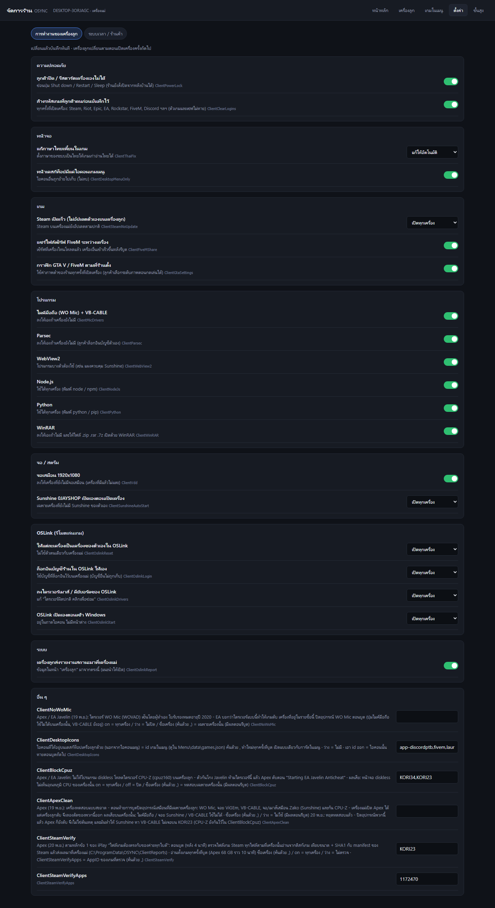

# 09 · ค่าของร้าน (Settings) — ทุกค่า ค่าปัจจุบัน และสคริปต์ที่อ่าน

สร้างจากไฟล์จริงเมื่อ 20 Nov 2026 21:46 (สคริปต์อ่าน `Settings\settings.txt` แล้วค้นในโค้ดว่าไฟล์ไหนอ่านค่านั้น)

- ไฟล์ค่าหลัก: `H:\OSYNC\Settings\settings.txt` แก้ด้วย Notepad ได้ หรือแก้จากคอนโซลแอดมิน หน้า **ตั้งค่า** (ดูภาพด้านล่าง)
- บรรทัดที่ขึ้นต้นด้วย `#` คือคำอธิบาย · รูปแบบ `ชื่อ=ค่า` · ค่า `on` / `off` / ชื่อเครื่อง (คั่นด้วย `,`) แล้วแต่ตัว
- **เครื่องลูกอ่านไฟล์นี้ตอนบูต** จึงเห็นค่าใหม่หลังรีบูต (ไดรฟ์เกมแบบ diskless) · เครื่องแม่เห็นทันที
- ฟังก์ชันที่อ่านค่าคือ `Get-Setting` ใน [`Common.ps1`](../Scripts/Common.ps1) (ดู [08-CORE-TOOLS.md](08-CORE-TOOLS.md))
- ไฟล์ค่าอื่น: `Settings\extra-games.json` + `Settings\game-start.json` → [03-MASTER.md](03-MASTER.md) · `Settings\gta5_settings*.xml` → [GTA-GRAPHICS.md](GTA-GRAPHICS.md) · `Menu\config.json` → [06-MENU.md](06-MENU.md)

*ภาพจริงจากคอนโซลแอดมินของร้าน (หน้า ตั้งค่า) — แต่ละสวิตช์คือค่าหนึ่งตัวในไฟล์นี้ ชื่อค่าเขียนตัวเล็กไว้ท้ายคำอธิบาย*

## สารบัญ

1. [ทั่วไป](#g1)
2. [เครื่องแม่: คอนโซลแอดมิน / หลายไดร์ฟเกม / คลังออนไลน์ (System\Docs\CONSOLE-ONLINE.md)](#g2)
3. [ค่าที่โค้ดอ่านแต่ไม่มีในไฟล์ (ใช้ค่าเริ่มต้นในโค้ด)](#missing)

## 1. ทั่วไป

| ค่า | ตอนนี้ | คำอธิบาย (จากไฟล์) | สคริปต์ที่อ่าน |
|---|---|---|---|
| `SharedDrives` | `DEFGHIJ` | ตัวอักษรไดรฟ์เกมที่เครื่องลูกเห็น (ต้องตรงกับที่ตั้งในโปรแกรม diskless) เช่น SharedDrives=DEFGH เว้นว่าง = ทุกไดรฟ์ในเครื่องยกเว้น C: | [`Common.ps1`](../Scripts/Common.ps1#L53) [`Master-Setup.ps1`](../Scripts/Master-Setup.ps1#L17) [`Setup-Install.ps1`](../Scripts/Setup-Install.ps1#L58) [`Setup-Plan.ps1`](../Scripts/Setup-Plan.ps1#L37) [`Tool-Migrate.ps1`](../Scripts/Tool-Migrate.ps1#L114) |
| `MasterIP` | `192.168.51.201` | IP ของเครื่องแม่ ใช้ตอนเปิดไฟร์วอลล์ให้รีโมตจากเครื่องแม่ได้ (OSYNC.bat > Tools > Firewall) | [`Client-Firewall.ps1`](../Scripts/Client-Firewall.ps1#L10) [`Client-FiveMShare.ps1`](../Scripts/Client-FiveMShare.ps1#L38) [`Client-GameStart.ps1`](../Scripts/Client-GameStart.ps1#L108) [`Client-OslinkLogin.ps1`](../Scripts/Client-OslinkLogin.ps1#L26) [`Client-OslinkReport.ps1`](../Scripts/Client-OslinkReport.ps1#L317) [`Client-SteamVerify.ps1`](../Scripts/Client-SteamVerify.ps1#L128) [`Master-Setup.ps1`](../Scripts/Master-Setup.ps1#L36) [`Setup-Install.ps1`](../Scripts/Setup-Install.ps1#L58) [`main.js`](../../Menu/source/electron/main.js#L885) |
| `MasterPC` | `DESKTOP-3ORJAGC` | ชื่อเครื่องแม่ (ชื่อคอมพิวเตอร์) - เครื่องที่ชื่อตรงนี้คือเครื่องแม่ เครื่องอื่นคือเครื่องลูก (ใช้ได้กับโปรแกรม diskless ทุกยี่ห้อ) ตัวติดตั้ง / ตั้งค่าครั้งแรก เขียนให้เอง · เว้นว่าง = ดูจาก Role | [`Common.ps1`](../Scripts/Common.ps1#L121) [`Master-Setup.ps1`](../Scripts/Master-Setup.ps1#L36) [`Setup-Install.ps1`](../Scripts/Setup-Install.ps1#L58) |
| `Role` | `auto` | ใช้เมื่อไม่ได้ใส่ MasterPC: auto = ดูเอง (มีโปรแกรม diskless ฝั่งเซิร์ฟเวอร์ = เครื่องแม่) / master / client ระวัง: ไฟล์นี้เครื่องลูกอ่านด้วย - ใส่ master ตรงนี้ เครื่องลูกจะเข้าใจผิดว่าเป็นเครื่องแม่ | [`Common.ps1`](../Scripts/Common.ps1#L123) |
| `GamesFolder` | `GAME` | โฟลเดอร์เก็บเกม (เทียบกับโฟลเดอร์ OSYNC หรือใส่ path เต็ม) ข้างในแยกตามค่าย: Steam, Garena, HoYoPlay, Online, Gacha ... | [`Common.ps1`](../Scripts/Common.ps1#L61) |
| `ClientPowerLock` | `on` | ลูกค้าปิด / รีสตาร์ตเครื่องเองไม่ได้ (ซ่อนปุ่ม Shut down / Restart / Sleep ใน Start, Alt+F4, Ctrl+Alt+Del, หน้าล็อกอิน) ร้านยังสั่งปิด / รีสตาร์ตจากหลังบ้านได้ตามปกติ  on = เปิดใช้ / off = ปิด (มีผลตอนรีบูตเครื่องลูกครั้งถัดไป) | [`Client-Install.ps1`](../Scripts/Client-Install.ps1#L221) |
| `ClientMicDrivers` | `on` | WO Mic (ไมค์มือถือ) + VB-CABLE: เครื่องลูกที่ยังไม่มี จะลงให้เองแบบเงียบตอนบูต (ตัวติดตั้งอยู่ Tools\WOMic, Tools\VBCABLE) on = เปิดใช้ / off = ปิด (มีผลตอนรีบูตเครื่องลูกครั้งถัดไป) | [`Client-Install.ps1`](../Scripts/Client-Install.ps1#L355) |
| `ClientNoWoMic` | *(ว่าง)* | Apex / EA Javelin (19 พ.ย.): ไดรเวอร์ WO Mic (WOVAD) เซ็นโดยผู้ทำเอง ใบรับรองหมดอายุปี 2020 - EA บอกว่าไดรเวอร์แบบนี้ทำให้เกมดับ เครื่องที่อยู่ในรายชื่อนี้ ปิดอุปกรณ์ WO Mic ตอนบูต (ปุ่มไมค์มือถือใช้ไม่ได้บนเครื่องนั้น, VB-CABLE ยังอยู่) on = ทุกเครื่อง / ว่าง = ไม่ปิด / ชื่อเครื่อง (คั่นด้วย ,) = เฉพาะเครื่องนั้น (มีผลตอนรีบูต) | [`Client-Install.ps1`](../Scripts/Client-Install.ps1#L348) |
| `ClientParsec` | `on` | Parsec: เครื่องลูกที่ยังไม่มี จะลงให้เองแบบเงียบตอนบูต (ตัวติดตั้งอยู่ Tools\Parsec · ลงแบบต่อผู้ใช้ ลูกค้าล็อกอินบัญชีตัวเอง) on = เปิดใช้ / off = ปิด (มีผลตอนรีบูตเครื่องลูกครั้งถัดไป) | [`Client-Install.ps1`](../Scripts/Client-Install.ps1#L363) |
| `ClientWebView2` | `on` | WebView2 Runtime (โปรแกรมที่มีหน้าต่างแบบเว็บต้องใช้ เช่น แผงควบคุม Sunshine 0JAYSHOP): เครื่องลูกที่ยังไม่มี ลงให้เองแบบเงียบตอนบูต (ตัวติดตั้งอยู่ Tools\WebView2) · on = เปิดใช้ / off = ปิด | [`Client-Runtimes.ps1`](../Scripts/Client-Runtimes.ps1#L61) |
| `ClientNodeJs` | `on` | Node.js (Tools\NodeJS) และ Python (Tools\Python): ใช้จากไดรฟ์เกมโดยตรง ใส่ไว้ใน PATH ของเครื่องลูกตอนบูต (พิมพ์ node / npm / python / pip ได้) on = เปิดใช้ / off = ปิด (มีผลตอนรีบูตเครื่องลูกครั้งถัดไป) | [`Client-Runtimes.ps1`](../Scripts/Client-Runtimes.ps1#L84) |
| `ClientPython` | `on` | (ดูคำอธิบายของค่าด้านบน) | [`Client-Runtimes.ps1`](../Scripts/Client-Runtimes.ps1#L96) |
| `ClientVdd` | `on` | จอเสมือน VDD 1920x1080 240Hz (Tools\VirtualDisplay): เครื่องลูกที่ยังไม่มี VDD เลย ลงให้เองตอนบูต · มีอยู่แล้ว (ใช้งานอยู่ / ปิดใช้งาน / มีปัญหา) = ข้าม ไม่แตะ on = เปิดใช้ / off = ปิด (มีผลตอนรีบูตเครื่องลูกครั้งถัดไป) | [`Client-Install.ps1`](../Scripts/Client-Install.ps1#L378) |
| `ClientSteamNoUpdate` | `on` | Steam บนเครื่องลูกไม่ต้องอัปเดต/ซ่อมตัวเองทุกครั้งที่เปิด (เดิมขึ้น Updating Steam... เกือบ 1 นาที): ใส่ steam.cfg เฉพาะในสำเนาของเครื่องลูก Steam เครื่องแม่ยังอัปเดตตัวเองตามปกติ · on = ทุกเครื่อง / off = ปิด / ใส่ชื่อเครื่อง เช่น KORI12 = เฉพาะเครื่องนั้น (ตอนทดสอบ) | [`Client-Install.ps1`](../Scripts/Client-Install.ps1#L389) |
| `ClientWinRAR` | `on` | WinRAR: เครื่องลูกที่ยังไม่มี ลงให้เองแบบเงียบตอนบูต (Tools\WinRAR) และให้ไฟล์ .rar .zip .7z ฯลฯ เปิดด้วย WinRAR · on = เปิดใช้ / off = ปิด | [`Client-Install.ps1`](../Scripts/Client-Install.ps1#L467) |
| `ClientSunshineAutoStart` | `on` | Sunshine 0JAYSHOP เปิดเองตอนเข้า Windows แบบพับไว้ในถาด เฉพาะเครื่องที่ยังไม่มี Sunshine ของตัวเอง (เครื่องที่มีอยู่แล้ว = ไม่เปิดทับ) on = ทุกเครื่องที่ไม่มี Sunshine / off = ปิด / ใส่ชื่อเครื่อง = เฉพาะเครื่องนั้น | [`Client-Install.ps1`](../Scripts/Client-Install.ps1#L130) |
| `SunshineIpBase` | `192.168.51.100` | Sunshine 0JAYSHOP: แผนพอร์ตตาม IP ของเครื่องลูก (เครื่องที่ n มี IP = SunshineIpBase + n, พอร์ต 20000 + n x 100, หน้าเว็บ = พอร์ต + 1) ร้านนี้: 192.168.51.100 -> KORI01 = 192.168.51.101 พอร์ต 20100 · สาขาอื่นที่ใช้วง IP / ชื่อเครื่องต่างไป แก้ 3 ค่านี้แล้วกด OSYNC.bat > 7 > 24 (เขียนโปรไฟล์เครื่องลงคอนฟิก Sunshine ใหม่) ว่าง = ค่าของร้านนี้ | [`Common.ps1`](../Scripts/Common.ps1#L107) |
| `SunshinePcPrefix` | `KORI` | ชื่อเครื่องในโปรไฟล์ = SunshinePcPrefix + เลข 2 หลัก (KORI01) · SunshinePcCount = จำนวนเครื่องลูก (สูงสุด 99) | [`Common.ps1`](../Scripts/Common.ps1#L112) |
| `SunshinePcCount` | `72` | (ดูคำอธิบายของค่าด้านบน) | [`Common.ps1`](../Scripts/Common.ps1#L110) |
| `ClientFiveMShare` | `on` | FiveM: ไฟล์เซิร์ฟที่เครื่องลูกโหลด (ตอนปิด FiveM) ส่งเข้าเครื่องแม่ เครื่องอื่นได้ใช้หลังรีบูต (ไม่ส่งล็อกอิน) · on = เปิดใช้ / off = ปิด | [`Client-Install.ps1`](../Scripts/Client-Install.ps1#L147) |
| `FiveMSharePort` | `4671` | พอร์ตที่เครื่องแม่รับไฟล์เซิร์ฟ FiveM (Master-FiveMShare.ps1 · เปิดเฉพาะวง LAN) | [`Client-FiveMShare.ps1`](../Scripts/Client-FiveMShare.ps1#L38) [`Console-Server.ps1`](../Scripts/Console-Server.ps1#L330) [`Master-FiveMShare.ps1`](../Scripts/Master-FiveMShare.ps1#L30) |
| `ClientGtaSettings` | `on` | GTA V / FiveM: ตั้งกราฟิกตามไฟล์ Settings\gta5_settings.xml (ตอนนี้ = ภาพต่ำ) ให้ทุกบัญชีในเครื่องลูกทุกครั้งที่บูต เปลี่ยนค่า = เอาไฟล์ settings.xml ของ GTA V มาวางทับไฟล์นั้น (ชื่อการ์ดจอจะเปลี่ยนเป็นของแต่ละเครื่องให้เอง) on = เปิดใช้ / off = ปิด (มีผลตอนรีบูตเครื่องลูกครั้งถัดไป) | [`Client-Install.ps1`](../Scripts/Client-Install.ps1#L234) |
| `ClientClearLogins` | `on` | ล้างรหัสเกมที่ค้าง: ทุกครั้งที่บูตเครื่องลูก ลบการล็อกอินที่บันทึกไว้ของ FiveM / Rockstar / Steam / Epic / EA / Riot / Ubisoft / Battle.net / Garena / HoYoPlay / Discord ทุกบัญชีในเครื่อง (ตัวเกม ค่าเกม และเซฟไม่หาย) · สั่งเองได้ด้วย Clear-Logins.bat on = เปิดใช้ / off = ปิด (มีผลตอนรีบูตเครื่องลูกครั้งถัดไป) | [`Client-Install.ps1`](../Scripts/Client-Install.ps1#L243) |
| `ClientOslinkReset` | `on` | OSLink: ลบ MAC ของเครื่องแม่ (cacheIpAdress) ที่ติดมากับไดร์ฟเกม ให้เครื่องลูกแต่ละเครื่องใช้ MAC ตัวเอง · บัญชีช่วยเหลือที่ล็อกอินไว้ยังอยู่ on = ทุกเครื่องลูก / off = ปิด / ชื่อเครื่อง เช่น AT9COM22 = ทดสอบเฉพาะเครื่องนั้น (คั่นหลายเครื่องด้วย ,) · มีผลตอนรีบูตเครื่องลูกครั้งถัดไป | [`Client-Install.ps1`](../Scripts/Client-Install.ps1#L262) |
| `ClientOslinkLogin` | `on` | OSLink ล็อกอินบัญชีช่วยเหลือของเครื่องแม่บนเครื่องลูกเอง โดยแต่ละเครื่องเป็นเครื่องของตัวเอง (Client-OslinkLogin.ps1) บูตแรก: เครื่องลูกใช้ล็อกอินของเครื่องแม่ลงทะเบียนตัวเอง แล้วส่งกุญแจของเครื่องนั้นไปเก็บที่เครื่องแม่ · บูตต่อไป: ใส่กุญแจของเครื่องนั้นคืนให้เอง on = ทุกเครื่องลูก / off = ปิด / ชื่อเครื่อง เช่น AT9COM22 = ทดสอบเฉพาะเครื่องนั้น (คั่นหลายเครื่องด้วย ,) · มีผลตอนรีบูตเครื่องลูกครั้งถัดไป | [`Client-Install.ps1`](../Scripts/Client-Install.ps1#L272) |
| `ClientThaiFix` | `on` | OSYNC.bat client: Thai text in games - on = set the Thai code page without asking / off = leave it / ask = ask | [`Client-Install.ps1`](../Scripts/Client-Install.ps1#L41) |
| `ClientDesktopMenuOnly` | `on` | หน้าเดสก์ท็อปเครื่องลูกมีแค่ไอคอนเมนูเกม: ไอคอนอื่นทุกตัว (EA, Parsec, WO Mic, ที่ติดมากับ Image ...) ถูกย้ายไปเก็บที่ C:\ProgramData\OSYNC\DesktopRemoved ทุกครั้งที่บูต (ไม่ลบทิ้ง) · on = เปิดใช้ / off = ปิด (มีผลตอนรีบูตเครื่องลูกครั้งถัดไป) | [`Client-Install.ps1`](../Scripts/Client-Install.ps1#L542) |
| `ClientDesktopIcons` | `app-discordptb,fivem,launcher-steam,launcher-rockstar,launcher-roblox` | ไอคอนที่ให้อยู่บนเดสก์ท็อปเครื่องลูกด้วย (นอกจากไอคอนเมนู) = id เกมในเมนู (ดูใน Menu\data\games.json) คั่นด้วย , ทำใหม่ทุกครั้งที่บูต เปิดแบบเดียวกับการ์ดในเมนู · ว่าง = ไม่มี · เอา id ออก = ไอคอนนั้นหายตอนบูตถัดไป | [`Client-DesktopClean.ps1`](../Scripts/Client-DesktopClean.ps1#L21) |
| `ClientBlockCpuz` | `KORI34,KORI23` | Apex / EA Javelin: ไม่ให้โปรแกรม diskless โหลดไดรเวอร์ CPU-Z (cpuz160) บนเครื่องลูก - ตัวกันโกง Javelin ห้ามไดรเวอร์นี้ แล้ว Apex ดับตอน "Starting EA Javelin Anticheat" · ผลเสีย: หน้าจอ diskless ไม่เห็นอุณหภูมิ CPU ของเครื่องนั้น on = ทุกเครื่อง / off = ปิด / ชื่อเครื่อง (คั่นด้วย ,) = ทดสอบเฉพาะเครื่องนั้น (มีผลตอนรีบูต) | [`Client-Install.ps1`](../Scripts/Client-Install.ps1#L104) [`Setup-Install.ps1`](../Scripts/Setup-Install.ps1#L58) |
| `ClientApexMinimal` | `KORI23` | Apex (19 พ.ย.): เครื่องทดสอบแบบสะอาด - ตอนท้ายการบูตปิดอุปกรณ์เสมือนที่มีเฉพาะเครื่องลูก: WO Mic, จอย ViGEm, VB-CABLE, จอ/เมาส์เสมือน Zako (Sunshine) และกัน CPU-Z - เครื่องแม่เปิด Apex ได้ แต่เครื่องลูกดับ จึงลองตัดของพวกนี้ออก ผลเสียบนเครื่องนั้น: ไมค์มือถือ / จอย Sunshine / VB-CABLE ใช้ไม่ได้ · ชื่อเครื่อง (คั่นด้วย ,) / ว่าง = ไม่ใช้ (มีผลตอนรีบูต) 20 พ.ย.: หยุดทดสอบแล้ว - ปิดอุปกรณ์พวกนี้แล้ว Apex ก็ยังดับ จึงไม่ใช่ต้นเหตุ และมันทำให้ Sunshine หา VB-CABLE ไม่เจอบน KORI23 (CPU-Z ยังกันไว้ใน ClientBlockCpuz) Apex (20 พ.ย.): เครื่องทดสอบแบบ "เปล่า" - ตอนบูตทำแค่ขั้นของ Steam และ EA AntiCheat (0a 1q 1r 1u 2 3) ข้ามงานอื่นของ OSYNC ทั้งหมด (Sunshine, OSLink, ไมค์, Parsec, จอเสมือน, เมนู, เดสก์ท็อป ...) เพื่อดูว่า Apex เข้าได้ไหมเมื่อไม่มีงานของเรา · ชื่อเครื่อง (คั่นด้วย ,) / ว่าง = ไม่ใช้ ผลเสียบนเครื่องนั้นระหว่างทดสอบ: ไม่มี Sunshine / ไมค์ / OSLink จากระบบเรา (มีผลตอนรีบูต) | [`Client-Install.ps1`](../Scripts/Client-Install.ps1#L61) |
| `ClientApexClean` | *(ว่าง)* | (ดูคำอธิบายของค่าด้านบน) | [`Client-Install.ps1`](../Scripts/Client-Install.ps1#L105) [`Setup-Install.ps1`](../Scripts/Setup-Install.ps1#L58) |
| `ClientSteamVerify` | *(ว่าง)* | Apex (20 พ.ย.) ตามหลักข้อ 1 ของ iPlay "ไฟล์เกมต้องตรงกับของค่ายทุกไบต์": ตอนบูต (หลัง 4 นาที) ตรวจไฟล์เกม Steam ทุกไฟล์ตามที่เครื่องนั้นอ่านจากดิสก์เกม เทียบขนาด + SHA1 กับ manifest ของ Steam แล้วส่งผลมาที่เครื่องแม่ (C:\ProgramData\OSYNC\ClientReports) · อ่านทั้งเกมทุกครั้งที่บูต (Apex 68 GB ราว 10 นาที) ชื่อเครื่อง (คั่นด้วย ,) / on = ทุกเครื่อง / ว่าง = ไม่ตรวจ · ClientSteamVerifyApps = AppID ของเกมที่ตรวจ (คั่นด้วย ,) | [`Client-Install.ps1`](../Scripts/Client-Install.ps1#L327) [`Setup-Install.ps1`](../Scripts/Setup-Install.ps1#L58) |
| `ClientSteamVerifyApps` | `1172470` | (ดูคำอธิบายของค่าด้านบน) | [`Client-Install.ps1`](../Scripts/Client-Install.ps1#L330) [`Setup-Install.ps1`](../Scripts/Setup-Install.ps1#L58) |
| `ClientOslinkDrivers` | `on` | OSLink: ไดรเวอร์เมาส์ / คีย์บอร์ด / จอยเสมือนของ OSLink ลงให้เองตอนบูตเมื่อยังไม่มี (แก้ "ไดร์เวอร์ผิดปกติ คลิกเพื่อซ่อมแซม") on = ทุกเครื่องลูก / off = ปิด / ชื่อเครื่อง เช่น KORI12 = ทดสอบเฉพาะเครื่องนั้น (คั่นด้วย ,) | [`Client-Install.ps1`](../Scripts/Client-Install.ps1#L253) |
| `ClientOslinkStart` | `on` | OSLink: เปิดเองตอนล็อกอินแบบไม่มีหน้าต่าง (อยู่ที่ถาดข้างนาฬิกา) · on / off / ชื่อเครื่อง | [`Client-Install.ps1`](../Scripts/Client-Install.ps1#L284) |
| `ClientOslinkReport` | `on` | ชั่วคราว (17 พ.ย.): เครื่องลูกส่งผลตรวจ OSLink มาที่เครื่องแม่หลังบูต 2.5 และ 6 นาที (พอร์ต 4670 ในวง LAN) · แก้ OSLink เสร็จแล้วเปลี่ยนเป็น off | [`Client-Install.ps1`](../Scripts/Client-Install.ps1#L306) |
| `OslinkLoginPort` | `4669` | พอร์ตที่เครื่องแม่เก็บกุญแจ OSLink ของแต่ละเครื่อง (Master-OslinkLogins.ps1 · เปิดเฉพาะวง LAN) | [`Client-OslinkLogin.ps1`](../Scripts/Client-OslinkLogin.ps1#L25) [`Console-Server.ps1`](../Scripts/Console-Server.ps1#L331) [`Master-OslinkLogins.ps1`](../Scripts/Master-OslinkLogins.ps1#L23) |

## 2. เครื่องแม่: คอนโซลแอดมิน / หลายไดร์ฟเกม / คลังออนไลน์ (System\Docs\CONSOLE-ONLINE.md)

| ค่า | ตอนนี้ | คำอธิบาย (จากไฟล์) | สคริปต์ที่อ่าน |
|---|---|---|---|
| `GameFolders` | *(ว่าง)* | ไดร์ฟเกมเพิ่มนอกจาก GamesFolder (คั่นด้วย ;) เช่น D:\GAME;H:\GAME - แต่ละอันจัดแบบ GAME\ (Online\ Mobile\ Garena\ ...) ปกติเพิ่มจากคอนโซลหน้า "ไดร์ฟเกม" · เว้นว่าง = ใช้แค่ GamesFolder (เหมือนเดิม) | [`Common.ps1`](../Scripts/Common.ps1#L69) [`Console-Server.ps1`](../Scripts/Console-Server.ps1#L220) [`Setup-Install.ps1`](../Scripts/Setup-Install.ps1#L58) |
| `ConsolePort` | `4666` | พอร์ตคอนโซลแอดมิน http://localhost:4666 (เปิดได้จากเครื่องแม่เท่านั้น) | [`Console-Server.ps1`](../Scripts/Console-Server.ps1#L24) |
| `OnlineHub` | `http://127.0.0.1:4667` | คลังออนไลน์: ที่อยู่ฮับ เช่น http://<IP สาธารณะของสาขาที่เป็นฮับ>:4667 · เว้นว่าง = ปิด กุญแจของฮับอยู่ที่ System\Data\Online\online.key (ไม่อยู่ในไฟล์นี้ - ไฟล์นี้ขึ้น git) | [`Master-Watch.ps1`](../Scripts/Master-Watch.ps1#L190) [`Online-Library.ps1`](../Scripts/Online-Library.ps1#L47) |
| `OnlineBranch` | `0JAYSHOP` | ชื่อสาขา (ตัวอักษรอังกฤษ/ตัวเลข/-) และชื่อที่โชว์ · เว้นว่าง = ชื่อเครื่อง | [`Online-Library.ps1`](../Scripts/Online-Library.ps1#L46) [`Setup-Install.ps1`](../Scripts/Setup-Install.ps1#L58) |
| `OnlineBranchName` | `0JAYSHOP` | (ดูคำอธิบายของค่าด้านบน) | [`Online-Library.ps1`](../Scripts/Online-Library.ps1#L49) [`Setup-Install.ps1`](../Scripts/Setup-Install.ps1#L58) |
| `OnlineEngine` | `aria2` | ตัวส่งไฟล์: aria2 (Tools\aria2\aria2c.exe) · พอร์ต BitTorrent ต้องเปิด/forward ที่เราเตอร์อย่างน้อยฝั่งหนึ่ง | [`Online-Library.ps1`](../Scripts/Online-Library.ps1#L44) |
| `OnlineBtPort` | `6881` | (ดูคำอธิบายของค่าด้านบน) | [`Online-Library.ps1`](../Scripts/Online-Library.ps1#L50) |
| `OnlineMaxDownKB` | `0` | จำกัดความเร็ว KB/s (0 = ไม่จำกัด) | [`Online-Library.ps1`](../Scripts/Online-Library.ps1#L51) |
| `OnlineMaxUpKB` | `0` | (ดูคำอธิบายของค่าด้านบน) | [`Online-Library.ps1`](../Scripts/Online-Library.ps1#L51) |
| `OnlineUpnp` | `off` | คลังออนไลน์ไม่ต้อง forward พอร์ตเอง: on = ขอพอร์ต OnlineBtPort จากเราเตอร์ด้วย UPnP เฉพาะตอน aria2 ทำงาน (และพอร์ตฮับ ถ้าเครื่องนี้เป็นฮับ) ต่ออายุเองทุก 5 นาที คืนพอร์ตเองตอนหยุด (ถ้าเครื่องดับ พอร์ตหมดอายุเองใน 1 ชม.) · off = ไม่ขอ (ส่งได้เมื่ออีกสาขารับการเชื่อมต่อได้) | [`Hub-Server.ps1`](../Scripts/Hub-Server.ps1#L33) [`Online-Library.ps1`](../Scripts/Online-Library.ps1#L52) |
| `OnlineBind` | `192.168.51.203` | IP ของการ์ดแลนที่ aria2 / UPnP ใช้ · เว้นว่าง = การ์ดที่มีเส้นทางออกเน็ต (default route) | [`Online-Library.ps1`](../Scripts/Online-Library.ps1#L52) [`Online-Upnp.ps1`](../Scripts/Online-Upnp.ps1#L21) [`Setup-Install.ps1`](../Scripts/Setup-Install.ps1#L58) |
| `OnlineExternalIP` | *(ว่าง)* | IP สาธารณะที่บอกสาขาอื่น: IP หรือชื่อ DDNS · เว้นว่าง = ถามเราเตอร์ทาง UPnP | [`Online-Library.ps1`](../Scripts/Online-Library.ps1#L52) [`Setup-Install.ps1`](../Scripts/Setup-Install.ps1#L58) |
| `OnlineData` | `C:\OSYNC-Online` | โฟลเดอร์ทำงานของคลังออนไลน์ (aria2 session/log, งานดาวน์โหลด) บนดิสก์ของเครื่องแม่เอง ไม่ใช่ไดร์ฟที่แชร์ให้เครื่องลูก · เว้นว่าง = System\Data\Online | [`Hub-Server.ps1`](../Scripts/Hub-Server.ps1#L38) [`Online-Upnp.ps1`](../Scripts/Online-Upnp.ps1#L158) |
| `SteamRequests` | `on` | ขอเกม Steam (19 พ.ย. 2026): ปุ่ม "ขอเกม" ในเมนูเครื่องลูก - ลูกค้าส่งลิงก์/AppID แล้วสแกน QR ด้วยแอป Steam ของตัวเอง เครื่องแม่โหลดด้วย Tools\DepotDownloader ตรวจ SHA1 ทุกไฟล์ แล้วเพิ่มเข้า SteamLibrary + เมนูเอง (ลูกเห็นเกมหลังรีบูต) · รายละเอียด System\Docs\STEAM-REQUESTS.md on = เปิดรับคำขอ · off = ปิด (ปุ่มยังอยู่ ลูกค้าจะเห็นว่าร้านปิดระบบไว้; ซ่อนปุ่ม = Menu\config.json ui.steamRequest false) | [`SteamQueue-Lib.ps1`](../Scripts/SteamQueue-Lib.ps1#L19) |
| `SteamRequestMinFreeGB` | `30` | พื้นที่ว่างที่ต้องเหลือในไดรฟ์หลังลงเกม (GB) - ไม่พอ = ไม่โหลด / หยุดโหลด | [`SteamQueue-Lib.ps1`](../Scripts/SteamQueue-Lib.ps1#L20) |
| `SteamRequestDrives` | *(ว่าง)* | ไดรฟ์ที่ให้ลงเกมได้ (ต้องมี X:\SteamLibrary อยู่แล้ว) · เว้นว่าง = ทุกไดรฟ์ใน SharedDrives · เลือกไดรฟ์ที่ว่างที่สุดให้เอง | [`SteamQueue-Lib.ps1`](../Scripts/SteamQueue-Lib.ps1#L16) |
| `SteamRequestQrMinutes` | `5` | เวลารอลูกค้าสแกน QR (นาที) | [`SteamQueue-Lib.ps1`](../Scripts/SteamQueue-Lib.ps1#L22) |

## 3. ค่าที่โค้ดอ่านแต่ไม่มีในไฟล์ (ใช้ค่าเริ่มต้นในโค้ด)

ใส่เพิ่มในไฟล์ได้ถ้าต้องการเปลี่ยน (รูปแบบ `ชื่อ=ค่า`) · ค่าเริ่มต้นคือที่เขียนไว้ในโค้ดตรงที่อ่าน

| ค่า | ค่าเริ่มต้นในโค้ด | อ่านที่ |
|---|---|---|
| `ClientBattleNet` | `'on'` | [`Client-Install.ps1`](../Scripts/Client-Install.ps1#L453) |
| `ClientReportPort` | `'4670'` | [`Client-GameStart.ps1`](../Scripts/Client-GameStart.ps1#L108) |
| `ClientRockstar` | `'on'` | [`Client-Install.ps1`](../Scripts/Client-Install.ps1#L476) |
| `ClientSteamService` | `'on'` | [`Client-Install.ps1`](../Scripts/Client-Install.ps1#L429) |
| `OnlineRpcPort` | `'6800'` | [`Online-Library.ps1`](../Scripts/Online-Library.ps1#L50) |

---
[← กลับสารบัญเอกสาร](README.md)
