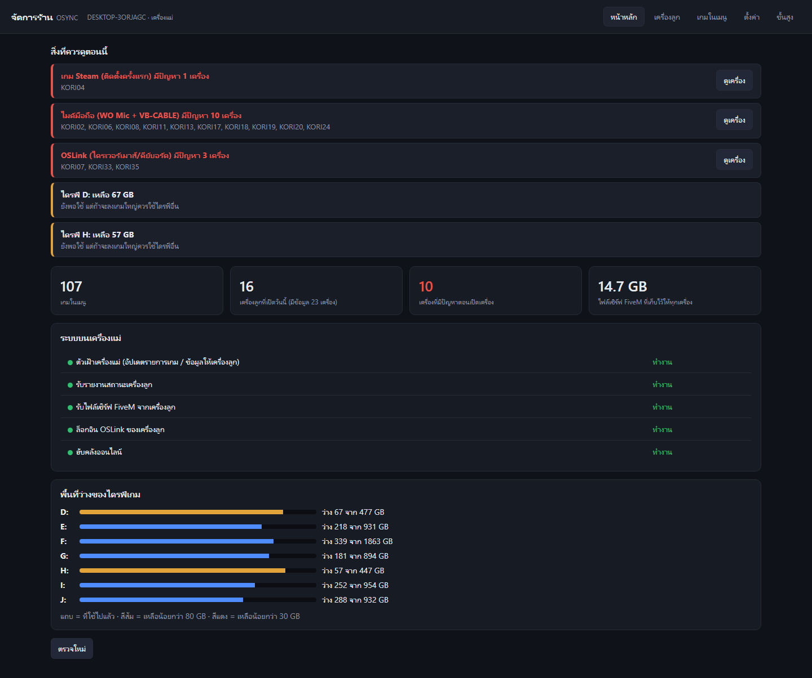
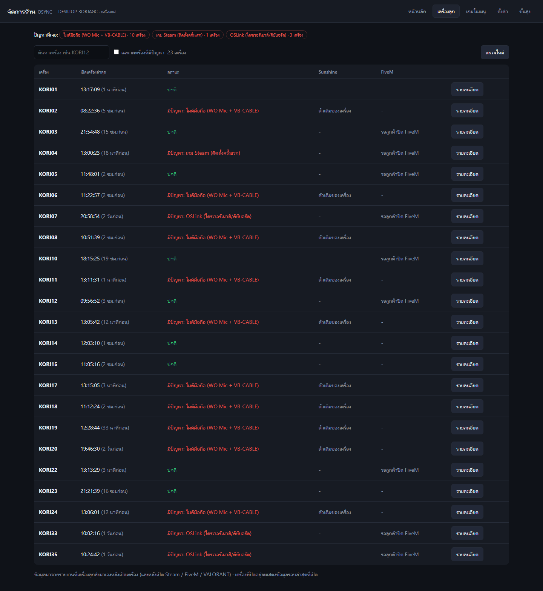
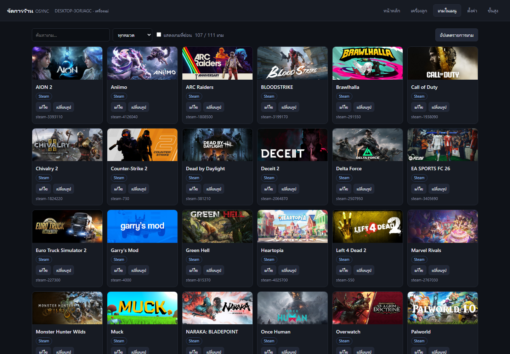
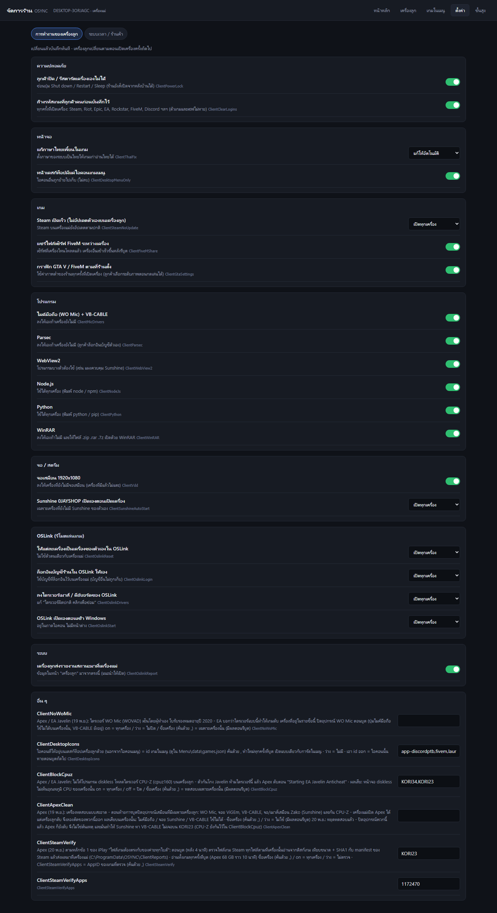
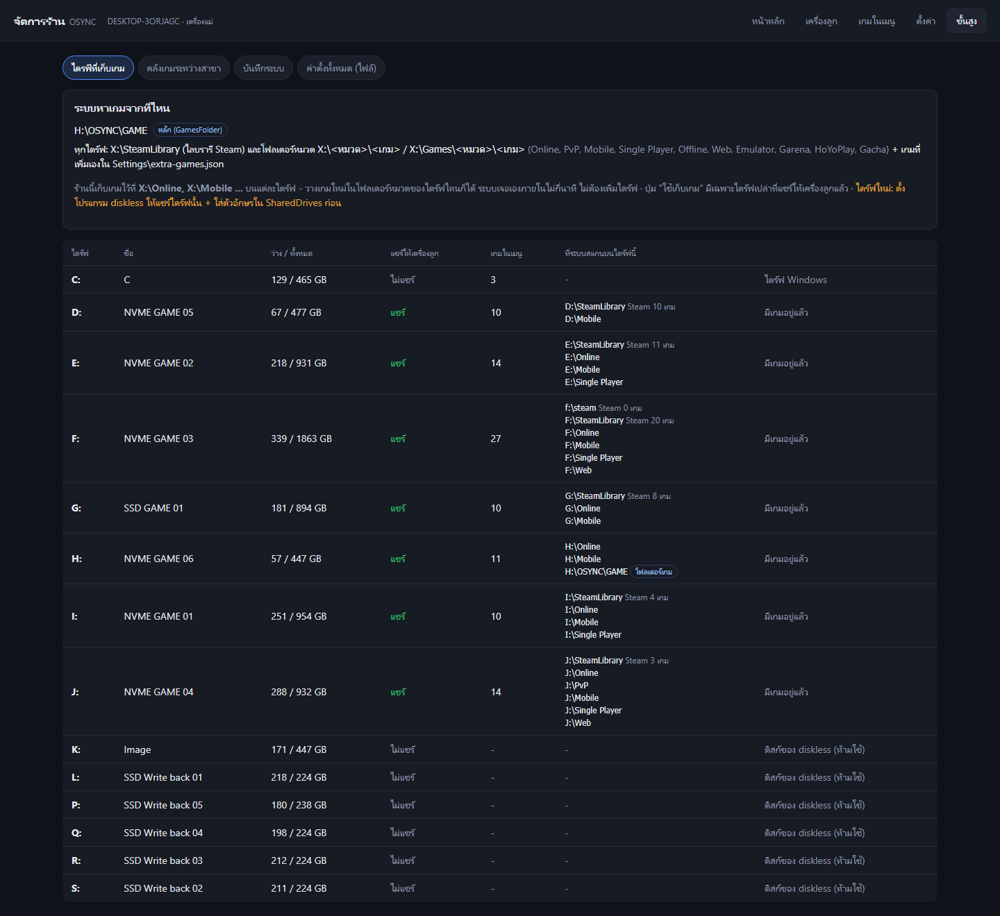

# คอนโซลแอดมิน · หลายไดร์ฟเกม · คลังออนไลน์

ทั้งหมดทำงาน **บนเครื่องแม่เท่านั้น** ไม่แตะเครื่องลูก ไม่แตะเอเจนต์ เว็บ หรือระบบ diskless — เครื่องลูกเห็นผล (ชื่อ/รูป/เกมใหม่) หลังรีบูตครั้งถัดไปตามปกติ

## 1. คอนโซลแอดมิน `http://127.0.0.1:4666`

`System\Scripts\Console-Server.ps1` + หน้าเว็บ `System\Console\index.html` · พอร์ต = `ConsolePort` (ร้านนี้ 4666)

**เปิดด้วย `127.0.0.1` ไม่ใช่ `localhost`:** คอมเมนต์ใน `OSYNC-Console.cs` (18 พ.ย. 2026) — "localhost" ลอง IPv6 (`::1`) ก่อน ทำให้รอ 2 วินาที **ทุกคำขอ** เพราะเซิร์ฟเวอร์ฟังแค่ `127.0.0.1` · `OSYNC-Console.exe` จึงเปิด `http://127.0.0.1:<ConsolePort>/`

| หน้า | แสดงอะไร |
|---|---|
| หน้าหลัก | สิ่งที่ควรดูตอนนี้ (ระบบที่ไม่ทำงาน, ขั้นตอนบูตที่มีปัญหา, ไดรฟ์ใกล้เต็ม) + ตัวเลขสรุป + ระบบบนเครื่องแม่ + ที่ว่างไดรฟ์เกม |
| เครื่องลูก | เครื่อง KORI ทุกเครื่องจากรายงานที่เครื่องลูกส่งมา: เปิดเครื่องล่าสุด, สถานะ, Sunshine, FiveM, รายงานเต็ม |
| เกมในเมนู | การ์ดเกมทุกเกม: ค้นหา / กรองหมวด, แก้ชื่อ / หมวด / ซ่อน, เปลี่ยนรูป / คืนรูป, อัปเดตรายการเกม |
| ตั้งค่า › การทำงานของเครื่องลูก | คีย์ `Client*` ของ settings.txt เป็นภาษาไทย จัดกลุ่ม เปลี่ยนแล้วบันทึกทันที |
| ตั้งค่า › ระบบเวลา / ร้านค้า | 5 ค่าใน `Menu\config.json` (ที่อยู่เซิร์ฟเวอร์ร้าน, หน้านับเวลา, แถบขวา, ชื่อร้าน, รหัสเครื่อง) + ปุ่มลองต่อ + เอกสาร `SHOP-API.md` |
| ขั้นสูง › ไดรฟ์ที่เก็บเกม | ทุกไดรฟ์ + สิ่งที่ระบบสแกนจริงบนไดรฟ์นั้น + ปุ่ม "ใช้เก็บเกม" / "เลิกสแกน" |
| ขั้นสูง › คลังเกมระหว่างสาขา | เกมที่สาขาอื่นมีแต่สาขานี้ไม่มี, ปุ่มติดตั้ง, ความคืบหน้า, สาขาที่ต่อฮับ, ส่งรายการเกมขึ้นฮับ |
| ขั้นสูง › บันทึกระบบ | เครื่องแม่ไหม, จำนวนเกม, ตัวเฝ้าทำงานไหม (และจากโฟลเดอร์ไหน) + log, ปุ่มอัปเดตรายการเกม |
| ขั้นสูง › ค่าตั้งทั้งหมด (ไฟล์) | ทุกคีย์ใน `Settings\settings.txt` ตามชื่อจริง + คำอธิบาย แก้ได้ทุกคีย์ |

### หน้าหลัก


*ภาพจริงจากคอนโซลของร้าน ถ่ายเมื่อ 20 พ.ย. 2026: ปัญหาตอนบูตแยกตามขั้น ไดรฟ์ D / H ใกล้เต็ม ตัวเลขสรุป ระบบ 5 อย่างบนเครื่องแม่ และที่ว่างไดรฟ์ D–J*

- ข้อมูลทั้งหน้ามาจาก `/api/overview` คำขอเดียว · ระบบบนเครื่องแม่ = ตัวเฝ้า (mutex), รับรายงานเครื่องลูก (พอร์ต `ClientReportPort` 4670), รับไฟล์เซิร์ฟ FiveM (`FiveMSharePort` 4671), ล็อกอิน OSLink (`OslinkLoginPort` 4669), ฮับคลังออนไลน์ (พอร์ต 4667)
- ไดรฟ์เหลือน้อยกว่า 80 GB = สีส้ม · น้อยกว่า 30 GB = สีแดง

### เครื่องลูก


*ภาพจริงจากคอนโซลของร้าน ถ่ายเมื่อ 20 พ.ย. 2026: เครื่อง KORI 23 เครื่อง พร้อมสถานะตอนเปิดเครื่อง Sunshine และ FiveM*

- ข้อมูลมาจากรายงานที่เครื่องลูกส่งมาเอง (`%ProgramData%\OSYNC\ClientReports`) · เครื่องที่ปิดอยู่แสดงรอบล่าสุดที่เปิด · ปุ่ม "รายละเอียด" = รายงานเต็มของเครื่องนั้น

### เกมในเมนู


*ภาพจริงจากคอนโซลของร้าน ถ่ายเมื่อ 20 พ.ย. 2026: การ์ดเกมในเมนู 107 จาก 111 เกม (อีก 4 เกมซ่อนอยู่) พร้อมปุ่มแก้ไข / เปลี่ยนรูป*

- **แก้ชื่อ, ย้ายหมวด, ซ่อน/แสดง** (เขียน `Settings\extra-games.json` เหมือนแก้มือ) · หมวดที่เลือกได้ = หมวดมาตรฐาน + ทุกหมวดที่ร้านใช้อยู่ (เช่น `Anime RPG`)
- **เกมที่เพิ่มเอง** (รายการที่มี `exe`): แก้ชื่อ/หมวดในรายการของมันเอง ไม่มีวันว่าง · ซ่อน = รายการ `{ "id", "hide": true }` แยกอีกอัน (ตัวทำรายการเกมซ่อนได้เฉพาะแบบนี้)
- **เปลี่ยนรูปการ์ด/โลโก้** (PNG/JPG/WEBP ≤ 8 MB → `Menu\data\posters\<id>.png` / `.jpg` / `.webp` (ตามชนิดรูป) ซึ่งระบบรายการเกมใช้ก่อนรูปอื่น) · คืนรูปเดิม
- ทุกการแก้รันรายการเกมใหม่ให้ทันที (เขียน `Menu\data\games.json` ใหม่ → แก้ตอนร้านปิดดีที่สุด)

### ตั้งค่า


*ภาพจริงจากคอนโซลของร้าน ถ่ายเมื่อ 20 พ.ย. 2026: หน้า "การทำงานของเครื่องลูก" แยกกลุ่ม ความปลอดภัย, หน้าจอ, เกม, โปรแกรม, จอ / สตรีม, OSLink, ระบบ, อื่น ๆ*

- **การทำงานของเครื่องลูก:** สวิตช์ on/off, "เปิดทุกเครื่อง / เฉพาะบางเครื่อง / ปิด", "แก้ให้อัตโนมัติ / ถามก่อน / ไม่แก้" · บันทึกลง `Settings\settings.txt` ทันที · เครื่องลูกเปลี่ยนตามตอนเปิดเครื่องครั้งถัดไป
- **ระบบเวลา / ร้านค้า:** แก้เฉพาะ `apiUrl`, `machineId`, `brandName`, `ui.menuOnly`, `ui.sidePanel` ใน `Menu\config.json` (ข้อความส่วนอื่นของไฟล์ไม่เปลี่ยน) · "ลองต่อเซิร์ฟเวอร์" = GET `<apiUrl>/station/session`

### ขั้นสูง › ไดรฟ์ที่เก็บเกม


*ภาพจริงจากคอนโซลของร้าน ถ่ายเมื่อ 20 พ.ย. 2026: D–J แชร์และมีเกมอยู่แล้ว C คือไดรฟ์ Windows ส่วน K, L, P, Q, R, S เป็นดิสก์ของ diskless (ห้ามใช้)*

- ทุกไดร์ฟ + สิ่งที่ระบบสแกนจริงบนไดร์ฟนั้น: ไลบรารี Steam (กี่เกม), `X:\Online` `X:\Mobile` ... และ `X:\Games\<หมวด>`, โฟลเดอร์เกม (GamesFolder/GameFolders) และจำนวนเกมในเมนูที่เปิดจากไดร์ฟนั้น
- ปุ่ม **"ใช้เก็บเกม"** มีเฉพาะไดร์ฟเปล่าที่แชร์ให้เครื่องลูกแล้ว และต้องยืนยันว่าเครื่องลูกปิดหมด: สร้างโฟลเดอร์หมวดตามแบบของร้าน (ร้านที่เก็บ `X:\Online ...` บนแต่ละไดร์ฟ = สร้าง `X:\Online ...` ไม่ต้องตั้งอะไร · ร้านแบบ `GAME\` = สร้าง `X:\GAME\...` + `GameFolders`)
- **ไม่แก้ `SharedDrives` เอง** (แชร์ไดร์ฟในโปรแกรม diskless + ใส่ใน SharedDrives ก่อน) · **ไดร์ฟ Windows, ดิสก์ของ diskless (`kimage\` / `kwrite\` / ไฟล์ .vhd/.img), ไดร์ฟที่มีเกมอยู่แล้ว ใช้ไม่ได้ ทั้งในหน้าเว็บและฝั่งเซิร์ฟเวอร์** · เลิกสแกน = เอาออกจาก GameFolders (ไม่ลบไฟล์)

### ขั้นสูง › คลังเกมระหว่างสาขา / บันทึกระบบ / ค่าตั้งทั้งหมด
- **คลังเกมระหว่างสาขา:** เกมที่สาขาอื่นมีแต่สาขานี้ไม่มี (id เดียวกัน หรือโฟลเดอร์ชื่อเดียวกัน = มีแล้ว) · ปุ่ม "ติดตั้ง" · ความคืบหน้า (รีเฟรชเองทุก 4 วิขณะมีงาน) · สาขาที่ต่อฮับ · UPnP / IP สาธารณะที่บอก tracker · ส่งรายการเกมขึ้นฮับ (รายละเอียดในหัวข้อ 3)
- **บันทึกระบบ:** ดูตัวเฝ้าจาก mutex ไม่ไล่ process — คอมเมนต์ในโค้ดบอกว่าการไล่ process ใช้ 2–5 วิ · ตอบเร็วแค่ไหนเป็นตัวเลข: ไม่ระบุในโค้ด (ชุดทดสอบ `Test-Console.ps1` ตั้งเกณฑ์ไว้ต่ำกว่า 1.5 วิ)
- **ค่าตั้งทั้งหมด (ไฟล์):** แก้ได้ทุกคีย์ที่มีอยู่แล้วในไฟล์ (สำหรับผู้ดูแล)

ความปลอดภัย: ฟังแค่ `127.0.0.1` (เครื่องอื่นในร้านเปิดไม่ได้) · ต้องเป็น Host `localhost/127.0.0.1` · คำสั่งแก้ (POST) ต้องมีหัว `X-OSYNC` ที่เว็บอื่นส่งเองไม่ได้ · เสิร์ฟรูปเฉพาะใต้ Menu / Launchers / โฟลเดอร์เกม หรือรูปที่ `games.json` ใช้อยู่ (เช่น `zPoster.jpg` ในโฟลเดอร์เกมบนไดร์ฟเกม)

**เปิดเป็นหน้าต่างโปรแกรม:** `System\Console\OSYNC-Console.exe` (ไอคอน "OSYNC Console" บนเดสก์ท็อปเครื่องแม่) — ไม่ต้องตั้งงานเปิดเอง
- **ใช้ยังไง:** ดับเบิลคลิก ตัว exe จะเปิดเซิร์ฟเวอร์คอนโซลแบบซ่อน แล้วเปิดหน้าคอนโซลเป็นหน้าต่าง Edge แยก (ใช้โปรไฟล์ของตัวเอง ไม่มีแท็บ ไม่มีแถบที่อยู่) พอปิดหน้าต่าง เซิร์ฟเวอร์จะปิดตาม แต่ถ้าเปิดงาน `OSYNC-Console` ไว้ เซิร์ฟเวอร์จะเปิดค้างต่อ
- **ไม่ยอมทำงานเมื่อ:** เปิดบนเครื่องลูก (ดูจาก `MasterPC`) หรือโฟลเดอร์ยังเป็นโครงเดิม (ก่อนขั้น B)
- **ทดสอบกับสำเนา:** ใส่ `--root <โฟลเดอร์>`
- **ซอร์ส:** `OSYNC-Console.cs` คอมไพล์ด้วย csc ของ .NET Framework ที่มากับ Windows คำสั่งอยู่บนหัวไฟล์ (17 พ.ย.)
- เปิดค้างตลอด (ไม่จำเป็น): `Console-Server.ps1 -Register` (งาน `OSYNC-Console` ตอนล็อกอิน) · ถอด: `-Unregister`

## 2. หลายไดร์ฟเกม + เจอเกมใหม่เอง

- ระบบรายการเกมสแกน **ทุกไดร์ฟ** อยู่แล้ว: ไลบรารี Steam, `X:\<หมวด>\<เกม>` และ `X:\Games\<หมวด>\<เกม>` (หมวด = Online, PvP, Mobile, Single Player, Offline, Web, Emulator, Garena, HoYoPlay, Gacha) + เกมที่เพิ่มเองใน `extra-games.json` → ร้านที่เก็บเกมแบบนี้ **ไม่ต้องตั้ง `GameFolders`**
- `Settings\settings.txt` `GameFolders=D:\GAME;H:\GAME` สำหรับร้านแบบ `GAME\` (คอนโซลเขียนให้) — ว่าง = ใช้แค่ `GamesFolder` เหมือนเดิม
- `Common.ps1` `Get-GameFolders` = GamesFolder + GameFolders · ใช้ใน `Master-GameList.ps1`, `Get-GameFolderStamp` (ตัวเฝ้า), `Get-CfxApps` (FiveM/RedM)
- เจอเกมใหม่: ตัวเฝ้า (Master-Watch) ดูโฟลเดอร์เกมทุกอันอยู่แล้วทุก 60 วิ — มีโฟลเดอร์เกมใหม่แล้วนิ่ง 2 นาที → อัปเดตรายการเกมเอง
- **ต้องทำเอง:** ตั้งโปรแกรม diskless ให้แชร์ไดร์ฟใหม่ให้เครื่องลูก + ใส่ใน `SharedDrives` (OSYNC ไม่แตะระบบ diskless)

## 3. คลังออนไลน์ (แชร์เกมข้ามสาขาด้วย BitTorrent)

```
สาขา B (ไม่มีเกม)           ฮับ (Hub-Server.ps1)                 สาขา A (มีเกม)
 คอนโซล "ติดตั้ง"  ── request ──▶  รายการเกมทุกสาขา + tracker  ◀── ส่งรายการทุก 30 นาที
                                    คำขอที่รอ  ──────────────────▶  ตัวเฝ้า (ทุก 5 นาที) สร้าง .torrent
 aria2 ◀═════════════ BitTorrent (private, tracker = ฮับ) ═══════════▶ aria2 แชร์ (seed)
 ตรวจทุกชิ้น → โฟลเดอร์เกม → ตัวเฝ้าเจอ → เมนู
```

- **ฮับ** `System\Scripts\Hub-Server.ps1` — HTTP+JSON ธรรมดา (ย้ายไปอยู่ในเว็บเป็นแพตช์ทีหลังได้โดยไม่เปลี่ยนสาขา): `/api/report`, `/api/catalog`, `/api/request`, `/api/requests`, `/api/torrent`, `/announce/<key>` (tracker แบบ compact, ใช้ `ip=` ที่สาขาบอกมา) · ทุกคำขอต้องมีกุญแจ · ข้อมูลใน `<OnlineData>\Hub` หรือ `System\Data\Hub` · เปิดเองตอนล็อกอิน: `Hub-Server.ps1 -Register` (งาน `OSYNC-Hub`, ผู้ใช้นี้, ไม่ใช่ admin) · ถอด `-Unregister`
- **สาขา** `System\Scripts\Online-Library.ps1` — `-Publish` / `-Pull <id>` / `-Sync` (ตัวเฝ้าเรียกทุก 5 นาทีเมื่อตั้ง `OnlineHub`) / `-List` (ดูว่าเกมไหนแชร์ได้ ไม่ไล่ไฟล์) / `-Stop` (ปิด aria2 + คืนพอร์ต UPnP)
  - เกมที่แชร์ได้ (หาจากเมนู): เกม Steam ทุกไลบรารีบนไดร์ฟที่แชร์ (ขนาดจาก appmanifest ไม่ไล่ไฟล์), เกมโฟลเดอร์ใน `GAME\<หมวด>\...`, ใน `X:\<หมวด>\...` / `X:\Games\<หมวด>\...` ทุกไดร์ฟที่แชร์, เกม HoYoPlay (`Launchers\HoYoPlay\games\...`), เกมที่เพิ่มเองใน `extra-games.json` (ใช้ `root` หรือโฟลเดอร์ของ exe เช่น `J:\Star Rail Games`)
  - **ไม่แชร์:** หมวด Apps / Launchers และ `X:\Web` (เบราว์เซอร์ แชท รีโมต มีล็อกอินอยู่ข้างใน), เกมของตัวเปิดเกม Riot / Epic / EA / Ubisoft / Battle.net (ตัวเปิดเกมต้องติดตั้งเอง), อะไรก็ตามใน Launchers / Menu / Tools / System · ระวัง: เกมโฟลเดอร์ถูกส่งทั้งโฟลเดอร์ ถ้าเกมเก็บล็อกอินไว้ในโฟลเดอร์ตัวเอง ล็อกอินนั้นไปด้วย
  - ดึงลงที่ว่างที่สุดตามแบบของร้าน: โฟลเดอร์เกม หรือ `X:\<หมวด>\<เกม>` บนไดร์ฟที่ใช้แบบ `X:\Online` (ไม่สร้างโฟลเดอร์หมวดใหม่ถ้ามีหมวดใกล้เคียง) · เกม Steam ลงไลบรารีที่ว่างที่สุด · เช็กที่ว่างก่อน (ขนาดเกม + 5 GB หรือ 5%) · ปลายทางต้องว่าง
  - torrent: BitTorrent v1, private (ไม่มี DHT / LPD / peer exchange / tracker สาธารณะ), ชิ้นละ 256 KB–16 MB · ฝั่งดาวน์โหลดเปลี่ยน tracker ใน torrent เป็นที่อยู่ฮับของตัวเอง (info hash เท่าเดิม) · **ยังไม่มีการอัปเดตเกมที่ดึงมาแล้ว:** `Start-Pull` ไม่ยอมลงปลายทางที่มีไฟล์อยู่ (`<ปลายทาง> is not empty`) และ `Get-OnlineView` ซ่อนเกมที่สาขานี้มีแล้ว (id เดียวกัน หรือโฟลเดอร์ชื่อเดียวกัน) จึงขอเกมเดิมซ้ำจากหน้าเว็บไม่ได้ · ฝั่งที่แชร์ (seed) aria2 ตรวจไฟล์เดิมก่อนแชร์ (`check-integrity`)
  - aria2 เปิดเองเมื่อมีงาน และเปิดใหม่เองหลังรีบูตถ้ายังมีงานค้าง/แชร์อยู่
- **ตัวส่งไฟล์** `OnlineEngine=aria2` (`Tools\aria2\aria2c.exe` ไฟล์เดียว ไม่ต้องติดตั้ง · RPC เฉพาะ 127.0.0.1 + รหัสลับ) · `mock` = ใช้ทดสอบเท่านั้น
- **กุญแจ** `System\Data\Online\online.key` (เหมือนกันทั้งฮับและทุกสาขา) — ไม่อยู่ใน Settings เพราะ Settings ขึ้น git (repo เป็นสาธารณะ)
- **ไฟล์ทำงาน** (aria2 session ทุก 60 วิ, log, งาน, ขนาด) ที่ `OnlineData=` — ตั้งเป็นโฟลเดอร์บนดิสก์ของเครื่องแม่เอง (เช่น `C:\OSYNC-Online`) เพื่อไม่เขียนลงไดร์ฟที่เครื่องลูกเปิดอยู่

### เครือข่าย: ไม่ต้อง forward พอร์ตเอง
- aria2 ไม่มี UPnP / NAT-PMP ในตัว (คอมเมนต์ใน `Online-Upnp.ps1` · เรื่อง uTP / hole punching: ไม่ระบุในโค้ด) → OSYNC ขอพอร์ตจากเราเตอร์ให้เอง (`System\Scripts\Online-Upnp.ps1`, UPnP IGD แบบ SSDP + SOAP ส่งจาก IP ของการ์ดที่ใช้จริง เพราะเราเตอร์ secure mode map ให้เฉพาะ IP ที่ขอ)
- `OnlineUpnp=on`: ขอ `OnlineBtPort` (TCP) เฉพาะตอน aria2 ทำงาน, ต่ออายุทุก sync (5 นาที, lease 1 ชม.), คืนเมื่อ aria2 หยุด / `-Stop` · ฮับขอพอร์ตของตัวเองตอนเปิด ต่ออายุทุก 5 นาที คืนตอนปิด · ไม่แตะพอร์ตที่เป็นของเครื่องอื่น · ถ้าเครื่องดับ พอร์ตหมดอายุเองใน 1 ชม.
- IP สาธารณะ: aria2 บอก tracker ด้วย `--bt-external-ip` (จาก `OnlineExternalIP` = IP หรือชื่อ DDNS หรือจาก UPnP) → สาขาอื่นได้ IP ของเส้นที่มีพอร์ตจริง แม้เครื่องแม่ออกเน็ตอีกเส้น · IP เปลี่ยน → sync ถัดไปแก้ให้ aria2 เอง
- `OnlineBind=` เว้นว่าง: **ตอน `OnlineUpnp=on`** = ใช้การ์ดที่มี default route ทั้งขอพอร์ตและผูก aria2 (เครื่องแม่หลายการ์ด: การ์ดอื่นตอบการเชื่อมต่อจากเน็ตไม่ได้) · **ตอน `OnlineUpnp=off`** = aria2 ไม่ได้ `--interface` เลย ฟังทุกการ์ด (`Get-Aria2BindIP`) · ใส่ค่า = ผูกการ์ดนั้นเสมอ (ร้านนี้ `OnlineBind=192.168.51.203`)
- **ฝั่งเดียวเปิดได้ก็พอ:** aria2 ต่อออกเองทั้งตอนโหลดและตอนแชร์ และ tracker บอกที่อยู่ให้ทั้งสองฝั่ง → ถ้าสาขาใดสาขาหนึ่งรับการเชื่อมต่อได้ ก็ส่งกันได้ (ทดสอบแล้วทั้งสองทาง) · ปิดทั้งสองฝั่ง (CGNAT ทั้งคู่ ไม่มี UPnP) = ส่งไม่ได้ (ต้องมีตัวกลาง relay ซึ่งยังไม่มี)
- ฮับต้องให้ทุกสาขาเข้าถึงได้: อยู่ที่สาขาที่รับการเชื่อมต่อได้ (`OnlineUpnp=on` → `http://<DDNS>:4667`) หรือบนเว็บ · บนเครื่องที่เป็นฮับเอง `OnlineHub=http://127.0.0.1:4667` ได้

### ก่อนใช้จริง (rollout)
1. aria2: `Tools\aria2\aria2c.exe` (1.37.0, zip SHA256 `67D01530…D9B288`) — สาขาอื่นก๊อปโฟลเดอร์นี้ไปได้เลย · ถ้าเปิด Windows Firewall ไว้: ตั้งกฎอนุญาต `aria2c.exe` TCP `OnlineBtPort` (และ TCP 4667 ถ้าเป็นฮับ) — ต้องใช้ admin
2. เลือกสาขาที่เป็นฮับ (รับการเชื่อมต่อได้) แล้ว `Hub-Server.ps1 -Register`
3. ทุกสาขา: `OnlineHub`, `OnlineBranch`, `OnlineBranchName`, `OnlineEngine=aria2`, `OnlineUpnp`, `OnlineData` + วาง `online.key` (ไฟล์เดียวกันทุกสาขา)
4. ทดสอบจริงต้องมีเครื่องแม่สาขาที่ 2
5. ยังไม่มี: จำกัดความเร็วตามช่วงเวลา (ตอนนี้จำกัดคงที่ `OnlineMaxDownKB/UpKB`), BitTorrent v2, relay เมื่อปิดทั้งสองฝั่ง

## 4. ทดสอบจำลอง (รันบนเครื่องแม่ได้ทุกเมื่อ ไม่แตะของจริง)

- `System\Tests\Test-Console.ps1` — คอนโซลบนสำเนา settings/เมนู: หน้าเว็บ, สถานะ (เร็ว), ความปลอดภัย 3 ข้อ, แก้ชื่อ/หมวด/ซ่อน/คืนค่า, อัปโหลด/คืนรูป, รูปจากโฟลเดอร์เกม, หมวดของร้าน, เกมที่เพิ่มเอง (แก้ชื่อ/ซ่อน/แสดง), ไดร์ฟจริงแบบอ่านอย่างเดียว (ไดร์ฟที่มีเกม/ไดร์ฟ Windows ถูกปฏิเสธ), เพิ่ม/เอาออกไดร์ฟ (โฟลเดอร์ทดสอบ), ของจริงไม่เปลี่ยน
- `System\Tests\Sim-OnlineLibrary.ps1 [-Engine mock|aria2] [-ClosedSide A|B] [-Upnp]` — ฮับ + 2 สาขาบนเครื่องเดียว (ไม่เห็นไดร์ฟเกมจริง): เกมแบบ `GAME\` และแบบ `X:\Online` ที่เพิ่มเองใน extra-games, "สาขานี้ไม่มี" (id / ชื่อโฟลเดอร์), ปลายทางแบบไดร์ฟ, tracker (`ip=`), เช็กที่ว่าง, ขอ 2 เกม → สาขา A สร้าง torrent → สาขา B โหลด → ทุกไฟล์ตรงกัน + ผ่านเช็กทุกชิ้น → ขึ้นเมนูสาขา B · `-ClosedSide` = ฝั่งนั้นเข้าไม่ได้ (พิสูจน์ว่าฝั่งเดียวเปิดก็พอ) · `-Upnp` = เราเตอร์ปลอม (`Fake-Igd.ps1`, secure mode): ขอ/ต่ออายุ/คืนพอร์ตของ aria2 และฮับ, ไม่แตะพอร์ตของเครื่องอื่น
- `System\Scripts\Online-Upnp.ps1 -Status` — อ่านอย่างเดียว: เราเตอร์, IP สาธารณะ, การ์ดที่ใช้, พอร์ตที่ map อยู่ทั้งหมด
