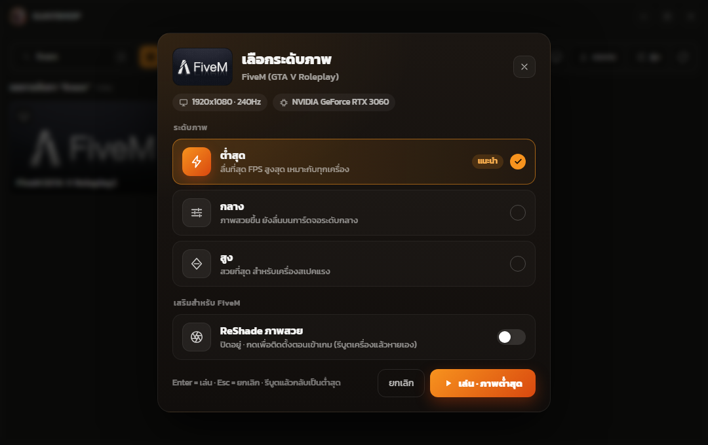

# กราฟิก GTA V / FiveM — ลูกค้าเลือกระดับภาพก่อนเข้าเกม (17 พ.ย. 2026)

## ลูกค้าเห็นอะไร
กดการ์ด **GTA V Legacy** หรือ **FiveM** ในเมนูร้าน จะมีหน้าต่าง **เลือกระดับภาพ** ขึ้นทุกครั้ง:

| ปุ่ม | ค่า |
|---|---|
| ⚡ **ต่ำสุด** (แนะนำ ถูกเลือกไว้แล้ว) | ไฟล์ของร้าน `Settings\gta5_settings.xml` ลื่นที่สุด |
| ⚖️ **กลาง** | `Settings\gta5_settings-medium.xml` |
| ✨ **สูง** | `Settings\gta5_settings-high.xml` สำหรับเครื่องแรง |

- คลิกปุ่มไหน เกมเปิดด้วยระดับนั้นทันที · Enter = เล่นระดับที่เลือกอยู่ (เริ่มที่ต่ำสุด) · ลูกศร ←/→ = เปลี่ยน · Esc หรือคลิกนอกกรอบ = ยกเลิก (เกมไม่เปิด)
- ในหน้าต่างบอกจอที่ตรวจได้ เช่น "จอ 1920x1080 · 240Hz · NVIDIA GeForce RTX 3060"

*ภาพจริงจากเมนูของร้าน (20 พ.ย. 2026) กดการ์ด FiveM · ขนาดจอและชื่อการ์ดจอในภาพเป็นค่าตัวอย่าง บนเครื่องลูกจะเห็นค่าของเครื่องนั้น · แถว ReShade มีเฉพาะ FiveM*

## ระบบทำอะไรตอนกดเล่น
1. อ่านไฟล์ของระดับที่เลือก
2. ใส่ค่าของ **เครื่องนี้**:
   - ความละเอียดและ Hz ของจอหลัก
   - ชื่อการ์ดจอแบบเดียวกับที่ DirectX เห็น (ชื่อไม่ตรง GTA จะรีเซ็ตค่าทั้งหมด)
   - โหมดจอ Borderless
3. เขียนให้บัญชีที่กำลังเล่น:
   - GTA V: `Documents\Rockstar Games\GTA V\settings.xml`
   - FiveM: `AppData\Roaming\CitizenFX\gta5_settings.xml`
4. เปิดเกม ถ้าข้อ 1–3 ผิดพลาด เกมยังเปิดด้วยค่าที่มีอยู่ บันทึกไว้ที่ `%TEMP%\gcafe-gta-graphics.log` ของเครื่องลูก

**ตอนบูตเครื่องลูก:** สคริปต์ `Client-GtaSettings.ps1` เขียนค่าต่ำสุดให้ทุกบัญชีทุกครั้ง พร้อมใส่จอจริงของเครื่องและการ์ดจอ เปิดเกมจากที่อื่นที่ไม่ใช่เมนูก็ได้ค่าต่ำสุด

## ปรับเอง
- **เปลี่ยนค่าระดับไหน:** แก้หรือวางไฟล์ `settings.xml` ของ GTA V ทับไฟล์ของระดับนั้นใน `Settings\` แล้วรีบูตเครื่องลูก ไม่ต้อง build เมนูใหม่
- **เกมที่มีหน้าต่างนี้:** `Menu\config.json` → `ui.graphicsPicker` (id เกมจาก `Menu\data\games.json`) ค่าเริ่ม `["steam-271590","fivem"]`
- **ไม่ครอบคลุม:** GTA V Enhanced ซึ่งใช้ไฟล์คนละรูปแบบ และเกมอื่น

## ค่าระดับกลาง / สูง (ตั้ง 17 พ.ย.)
| ค่า | ต่ำสุด | กลาง | สูง |
|---|---|---|---|
| Texture / Shader / Shadow / Reflection / Water / Particle / Grass | 0 | 1 | 2 |
| SSAO · Tessellation · PostFX | 0 | 1 | 2 |
| AnisotropicFiltering | 0 | 4 | 16 |
| MSAA | 0 | 0 | 2 |
| LodScale | 0.4 | 0.7 | 1.0 |
| City / Ped / Vehicle density-variety | 0 | 0.5 | 1.0 |
| DoF | ปิด | ปิด | เปิด |

## ทดสอบ (บนเครื่องแม่ ไม่เปิดเกม)
- **เปิดหน้าต่างเลือกภาพ:** `GCAFE_SELFTEST=<โฟลเดอร์>` แล้วเปิด `Menu\app\0JAYSHOP.exe` จะได้ `selftest.json` (มีหัวข้อ `gfx`) และภาพ `selftest-gfx.png`
- **ทดสอบเขียนไฟล์:** ใส่ `GCAFE_GTA_TESTDIR=<โฟลเดอร์>` เพิ่ม ระบบจะกด "กลาง" แล้วเขียนไฟล์ลงโฟลเดอร์นั้นแทน ไม่เปิดเกม
- **สคริปต์บูต:** `Client-GtaSettings.ps1 -TestDir <โฟลเดอร์>`

## FiveM: ReShade / ม็อด ในหน้าต่างเดียวกัน (17 พ.ย.)
- **หน้าต่างเลือกภาพของ FiveM** มีส่วน "เสริมสำหรับ FiveM" เพิ่ม: เปิด/ปิด **ReShade ภาพสวย** และม็อดแต่ละตัว ตามที่มีไฟล์ในเครื่อง
- **ReShade:** ไฟล์อยู่ที่ `Tools\FiveM-ReShade` ได้แก่ ReShade 6.8.0 จาก reshade.me และเอฟเฟกต์ `OSYNC_Look.fx` ของร้าน (สีสด + คม + คอนทราสต์เล็กน้อย เบาเครื่อง)
  - เปิดแล้ว ระบบก๊อปเข้า `<FiveM>\FiveM.app\plugins` (ReShade64.dll → dxgi.dll) ของเครื่องนั้น
  - ในเกม: Home = หน้าตั้งค่า, End = เปิด/ปิดเอฟเฟกต์
- **ม็อด:** วางไฟล์ไว้ที่ `Tools\FiveM-Mods\<ชื่อม็อด>\` (ไฟล์ .rpf ตามที่ต้องลงใน FiveM.app\mods) ม็อดจะขึ้นเป็นตัวเลือกเอง ส่วนม็อดเสียเงินอย่าง QuantV ร้านต้องซื้อไฟล์เอง
- **ปิดแล้วลบเฉพาะไฟล์ที่ระบบลงไว้:** รายการอยู่ใน `osync-installed.json` ข้างไฟล์เหล่านั้น เครื่องลูก diskless รีบูตแล้วหายเองอยู่แล้ว

## เมนูแบบ "เมนูเกมอย่างเดียว" (`Menu\config.json` → `ui`)
- **`menuOnly: true`:** เปิดเครื่องแล้วขึ้นหน้าเมนูเกมเลย ไม่มีหน้าต่างนับเวลา ไม่มีแท็บร้าน (ซื้อไอดี / คลังรหัส / แชท / เติมเงิน / บัญชี)
  - กดปิดหรือกดเล่นเกม = ย่อเมนูลงแถบงาน
  - กดไอคอนเมนูบนเดสก์ท็อปแล้วเมนูเด้งกลับมา
- **`sidePanel: false`:** ไม่มีแถบขวา (โฆษณา / แนะนำจากร้าน) การ์ดเกมเต็มความกว้าง
- **ไอคอน:** เป็นไอคอนเส้น (`Menu\source\src\components\Icons.jsx`) ไม่ใช้อิโมจิ
