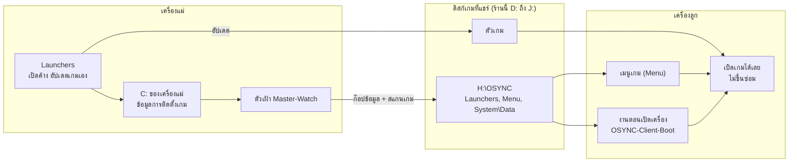
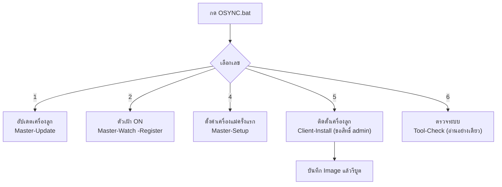

# OSYNC ทำงานยังไง

วิธีใช้แบบสั้นอยู่ใน [README.md](../../README.md) ส่วนปัญหาที่เคยเจออยู่ใน [KNOWLEDGE.md](KNOWLEDGE.md)

## ปัญหาที่ OSYNC แก้

ร้านเกม diskless มีเครื่องแม่ 1 เครื่อง เครื่องลูกทุกเครื่องไม่มีฮาร์ดดิสก์ของตัวเอง ทำให้เกิด 3 เรื่อง:

| ข้อจำกัดของ diskless | ผลที่ตามมา |
|---|---|
| C: ของเครื่องลูกกลับเป็นค่าเดิมทุกครั้งที่รีบูต | ของที่ติดตั้งตอนเปิดเกมครั้งแรก (กันโกง, VC++, Social Club) หายหมด เกมช้าหรือเด้งปิด |
| เครื่องลูกมองไม่เห็น C: ของเครื่องแม่ | ข้อมูลว่า "ติดตั้งเกมนี้แล้ว" ของ Riot, EA, Epic อยู่ใน C: ของเครื่องแม่ launcher บนเครื่องลูกจึงขึ้นให้ติดตั้งหรือซ่อม |
| เครื่องลูกเห็นดิสก์เกมร่วมกัน ด้วยตัวอักษรไดรฟ์เดียวกับเครื่องแม่ | ทางแก้จึงต้องผ่านดิสก์นี้: OSYNC อยู่ที่นี่ (ร้านนี้ `H:\OSYNC`) เครื่องแม่เขียน เครื่องลูกอ่าน |

แนวคิดหลัก: **เครื่องแม่ก๊อปข้อมูลที่จำเป็นจาก C: ขึ้นดิสก์เกม (`System\Data`) แล้วเครื่องลูกดึงไปใช้เอง**

## โฟลเดอร์ และใครใช้อะไร

| โฟลเดอร์ | มีอะไร | ใครแตะ |
|---|---|---|
| `OSYNC.bat` | ปุ่มเดียว: เมนูตัวเลข หรือ `OSYNC.bat master / client / update / check / setup` | เจ้าของร้าน |
| `Settings\` | `settings.txt` (ไดรฟ์ที่เครื่องลูกเห็น, IP เครื่องแม่, `Role`, `GamesFolder`), `extra-games.json` (เกมที่เพิ่มเอง) | เจ้าของร้าน แก้ได้ |
| `Launchers\` | Steam, Riot Client (ชื่อนี้เท่านั้น ไม่งั้น Riot ลงตัวเองใหม่), EA, Epic, Garena, Ubisoft, Rockstar, HoYoPlay, Modrinth, Battle.net, GOG, Nexon, Amazon, Roblox · ร้านนี้มี 10 ตัว: `Riot Client` `EA` `Epic` `Garena` `Ubisoft` `Rockstar` `HoYoPlay` `Modrinth` `BattleNet` `Roblox` — Steam อยู่ที่ `F:\steam` (ไม่ได้ย้ายเข้ามา), ไม่มี GOG / Nexon / Amazon | ระบบ (ย้ายเข้ามาด้วย OSYNC.bat > 7 > 1) |
| `GAME\` | ตัวเกม: `Steam\` `Garena\` `HoYoPlay\` `Gacha\` `Online\` (เกมค่ายเล็ก / ค่ายที่มีเกมเดียว) — แต่ละโฟลเดอร์มีไอคอนของเกม · ร้านนี้มีแค่ `HoYoPlay\` (Genshin) และ `Online\` (NEWTHINGS-GAMES) เกมอื่นอยู่ในโฟลเดอร์ของแต่ละไดรฟ์ เช่น `X:\SteamLibrary`, `X:\Online`, `X:\Mobile` | เจ้าของร้าน / launcher ลงเกม |
| `Tools\` | โปรแกรมของร้านที่ไม่ใช่เกม (ร้านนี้: ตัวติดตั้ง WO Mic, VB-CABLE, Parsec, WebView2, WinRAR, VirtualDisplay และ Sunshine0J, NodeJS, Python, Medal, aria2, DepotDownloader, FiveM-ReShade, FiveM-Mods · Discord PTB / RustDesk ของร้านนี้อยู่ที่ `J:\Web\DiscordPTB` / `F:\Web\RustDesk` ไม่ได้อยู่ใน `Tools\`) - OSLink อยู่ที่ `E:\LDPlayer\OSLink` ที่เดิม (ต้องใช้ `userData` ข้าง `bin` และ service ผูกที่นั่น ย้าย/คัดลอกแล้วพัง) - ใส่เข้าเมนูหมวด Apps ได้ทาง `Settings\extra-games.json` | เจ้าของร้าน |
| `Menu\` | โปรแกรมเมนูเกม GCafe: `app\` ตัวโปรแกรม, `data\games.json` รายการเกม, `data\posters\` รูปปก, `source\` ซอร์ส, `config.json` ชื่อร้าน | ระบบ / คนแก้เมนู |
| `System\Client\` | `Boot.ps1`, `Riot.vbs`, `Epic.vbs`, `Menu.vbs` (ตอนนี้มีเพิ่ม: `GameStart.vbs`, `Medal.vbs`, `OslinkHelper.vbs`, `OslinkStart.vbs`, `PopupGuard.vbs`, `Roblox.vbs`, `Sunshine0J.vbs`, `WOMic.vbs`) — ไฟล์ที่ Image เครื่องลูกและเมนูเรียกตรง | **ห้ามย้าย / เปลี่ยนชื่อ** |
| `System\Scripts\` | สคริปต์ทั้งหมด: `Master-*` รันที่เครื่องแม่, `Client-*` รันที่เครื่องลูก, `Tool-*` เครื่องมือ, `Common.ps1` ที่เดียวที่รู้ว่าโฟลเดอร์ไหนอยู่ไหน | คนพัฒนา |
| `System\Data\` | ข้อมูลที่เครื่องแม่สร้างให้เครื่องลูก: `Riot\` `EA\` `Epic\` `EAC\` (สร้างใหม่ทุกรอบ ไม่อยู่ใน git) | ระบบ |
| `System\Docs\`, `System\Backup\` | คู่มือ / ของสำรองตอนย้าย launcher | |

**ทำไม `System\Client` ห้ามย้าย:** Image ของเครื่องลูกจำ path ของไฟล์ในนี้ไว้ (งานตอนบูต, Riot ตอนล็อกอิน, ไอคอนเมนู) ถ้าเครื่องลูกเรียกได้แค่ไฟล์ในโฟลเดอร์นี้ ต่อไปจะจัดของข้างใน `System\Scripts` ใหม่ยังไงก็ไม่ต้องทำ Image ใหม่
ไอคอนเมนูเรียก `Menu.vbs` ซึ่งหาโปรแกรมใน `Menu\app` เอง เปลี่ยนชื่อร้าน (= ชื่อ exe) จึงไม่ต้องแก้ Image

## ปุ่มเดียว: OSYNC.bat

`OSYNC.bat master` = ข้อ 1 + 2 (แบบ All-In-One เดิมของเครื่องแม่), `OSYNC.bat client` = ข้อ 5
เครื่องมือที่ต้องใช้สิทธิ์ admin จะขึ้นหน้าต่าง UAC ให้กด Yes แล้วทำงานในหน้าต่างใหม่

## เครื่องแม่: ตัวเฝ้า Master-Watch

เริ่มเองทุกครั้งที่ล็อกอิน (`HKCU\...\Run\OSYNC-Master` → `System\Scripts\Master-Watch.vbs`) ทำงานซ่อนอยู่ ทุก 1 นาที:

1. **เปิด launcher ทุกค่ายใน `Launchers\` ค้างไว้** ตัวไหนปิดไปจะเปิดกลับ เกมจึงอัปเดตเองที่เครื่องแม่
2. **ติดตั้งอัปเดตของ Riot Client ที่ค้างอยู่** โดยรีสตาร์ท Riot Client ให้เมื่อไม่มีเกมเปิดหรือกำลังอัปเดตอยู่
3. **อัปเดตเครื่องลูก (Master-Update)** เมื่อเกมเปลี่ยนแล้วนิ่งครบ 2 นาที และทุก 1 ชั่วโมงอีกรอบ — ถ้ามีเกมอัปเดตไม่เสร็จจะรอก่อน (ข้อมูลครึ่งทางทำให้เครื่องลูกขึ้นซ่อม) ถ้าไม่ผ่านจะลองใหม่ใน 30 นาที

### สิ่งที่ Master-Update ทำ

| ขั้น | ค่าย | ทำอะไร | ไปที่ |
|---|---|---|---|
| 1 | Riot | ก๊อปสถานะการติดตั้ง VALORANT / LoL / TFT โดยปิด auto-update ในสำเนาของเครื่องลูกเสมอ และไม่เอาไฟล์อัปเดตของ Riot Client ที่ค้างอยู่ | `System\Data\Riot` |
| 2 | EA | Registry ของ EA app และเกม พร้อมข้อมูลการติดตั้ง | `System\Data\EA` |
| 3 | Epic | รายการเกม Epic | `System\Data\Epic` |
| 4 | EasyAntiCheat | รายการเกมที่เครื่องแม่ติดตั้งกันโกงไว้ | `System\Data\EAC` |
| 5 | เมนู | สแกนเกมทุกไดรฟ์ (เขียนไฟล์ใหม่เฉพาะเมื่อรายการเปลี่ยน) | `Menu\data\games.json` |
| 6 | FiveM / RedM | ชี้ FiveM ไปที่ GTA V **Legacy** (Steam 271590 — FiveM ใช้ Enhanced 3240220 ไม่ได้) และ RedM ไปที่ RDR2 (1174180): หาโฟลเดอร์เกมจาก Steam library → คีย์ Registry ของ Rockstar → `GAME\Rockstar` / `GAME\Epic` (ต้องอยู่บนไดร์ฟที่เครื่องลูกเห็น) แล้วเขียน `[Game] IVPath=` ไม่งั้นเครื่องลูกจะเด้งหน้าต่างให้เลือกโฟลเดอร์ทุกครั้ง (เครื่องลูกไม่มีคีย์ Rockstar) · เขียนเฉพาะเมื่อยังไม่ได้ตั้ง หรือค่าเดิมใช้ไม่ได้แล้ว (ย้าย / ลบเกม) — โฟลเดอร์ที่ร้านเลือกเองและยังใช้ได้จะไม่ทับ · บรรทัดอื่นในไฟล์อยู่ครบ (`Master-CitizenFX.ps1`) | `FiveM.app\CitizenFX.ini`, `RedM.app\CitizenFX.ini` (ข้าง FiveM / RedM บนไดร์ฟเกม ไฟล์เดียวใช้ทุกเครื่อง) |

ทำได้ทีละรอบ ถ้าตัวเฝ้ากับปุ่มเริ่มพร้อมกัน รอบหลังจะรอรอบแรกจบก่อน

### เมนูแอดเกมเอง (Master-GameList)

| แหล่ง | เจออะไร |
|---|---|
| Steam | ทุกเกมในทุก library ที่ Steam รู้จัก (`libraryfolders.vdf`) |
| Riot / EA / Epic | ข้อมูลการติดตั้งของแต่ละค่าย |
| โฟลเดอร์ | `GAME\<หมวด>\<เกม>` (Online, Garena, HoYoPlay, Gacha, Mobile ...), เกมที่วางตรงๆ ใน `GAME\`, `X:\Games\<หมวด>\<เกม>`, `X:\Online` แบบเดิม, เกมที่ HoYoPlay เก็บในโฟลเดอร์ตัวเอง — หา exe ตัวเปิดเกมให้เอง |
| รายการโปรแกรมที่ติดตั้ง (Windows) | เกมที่ตัวติดตั้งใดๆ ลงไว้บนไดรฟ์ที่แชร์ (Ubisoft, Battle.net, GOG, Rockstar, Amazon, Nexon ...) — ชื่อจากรายการ หมวดจากผู้จัดจำหน่าย |
| `Settings\extra-games.json` | เกมที่เพิ่มเอง / แก้ชื่อ / ซ่อน |
| `Launchers\` | การ์ด launcher ทุกค่ายในหมวด Launchers |

ไม่นับเป็นเกม: launcher, เครื่องมือ (Discord, RustDesk, OSLink, Sunshine, Agent), ตัวติดตั้งไลบรารี (VC++, DirectX, กันโกง) และของใน `Tools\`
ตัวเฝ้าจำรายชื่อโฟลเดอร์เกมและรายการโปรแกรมที่ติดตั้งไว้ด้วย พอมีเกมใหม่ (ลงเอง / วางโฟลเดอร์ / launcher ลง) จึงสแกนเข้าเมนูให้เองภายในราว 3 นาที

### Steam library

ทุกสคริปต์อ่านรายการ library จาก `libraryfolders.vdf` ของ Steam เอง (`Common.ps1` → `Get-SteamLibraries`) จึงเจอเกมทุกที่ที่ Steam รู้จักบนไดรฟ์ที่แชร์
ที่เก็บเกมคือ `GAME\Steam` — เกมที่อยู่ใน `Launchers\Steam\steamapps` ย้ายออกได้ด้วย OSYNC.bat > 7 > 2 (ไดรฟ์เดียวกัน = เปลี่ยนชื่อโฟลเดอร์ ไม่ต้องก๊อป;
ถ้า Steam ยังไม่รู้จัก library นี้ จะเพิ่มให้ใน `libraryfolders.vdf` ตอน Steam ปิดอยู่ แล้ว Steam เติมรายการเกมเองตอนเปิดครั้งต่อไป)
**ร้านนี้:** Steam อยู่ที่ `F:\steam` (ไม่ได้ย้ายเข้า `Launchers\` · สคริปต์หาเจอจาก `SteamPath` ใน Registry) ไม่มี `GAME\Steam` — เกมอยู่ใน `X:\SteamLibrary` ของแต่ละไดรฟ์เกม D ถึง J (ตาม `libraryfolders.vdf`)

### หลายไดร์ฟเกม · คอนโซลแอดมิน · คลังออนไลน์

- **หลายไดร์ฟเกม:** `Settings` `GameFolders=D:\GAME;H:\GAME` (ว่าง = เหมือนเดิม) — รายการเกม, ตัวเฝ้า (เจอโฟลเดอร์เกมใหม่ → อัปเดตเองใน ~2 นาที) และ FiveM/RedM สแกนทุกอัน (`Get-GameFolders`)
- **คอนโซลแอดมิน** `http://localhost:4666` (`Console-Server.ps1`, เปิดเองตอนล็อกอินด้วย `-Register` · ร้านนี้ไม่ได้ `-Register` — เปิดด้วย `System\Console\OSYNC-Console.exe` ซึ่งเปิดเซิร์ฟเวอร์ให้เองแล้วเปิดหน้า `http://127.0.0.1:4666`): แก้ชื่อ / หมวด / ซ่อนเกม, เปลี่ยนรูปการ์ด, เพิ่มไดร์ฟเกม (ห้ามดิสก์ของ diskless), คลังออนไลน์, สถานะ
- **คลังออนไลน์:** ฮับ (`Hub-Server.ps1`: รายการเกมทุกสาขา + tracker) + สาขา (`Online-Library.ps1`, ตัวเฝ้าเรียก `-Sync` ทุก 5 นาทีเมื่อตั้ง `OnlineHub`) + aria2 ส่งไฟล์ BitTorrent แบบ private
- รายละเอียด วิธีเปิดใช้ และเทสจำลอง: `System\Docs\CONSOLE-ONLINE.md`
- **ที่เก็บล็อกอิน OSLink ของแต่ละเครื่อง** (`Master-OslinkLogins.ps1`, 16 พ.ย. โดย PC CCU): งาน `OSYNC-OslinkLogins` (เปิดตอนเครื่องแม่เปิด, SYSTEM) ฟัง TCP `OslinkLoginPort` (4669, ไฟร์วอลล์เปิดเฉพาะวงแลน) — เครื่องลูกอ่าน / เขียนได้เฉพาะของ IP ตัวเอง · ข้อมูลใน `C:\ProgramData\OSYNC\OslinkLogins` (SYSTEM + Administrators เท่านั้น ไม่อยู่บนไดร์ฟเกม) · `-Status` / `-Uninstall` · ใช้คู่กับขั้น 1k ของเครื่องลูก

## เครื่องลูก: 3 จังหวะ

### 1. ครั้งเดียว ตอนแก้ Image — OSYNC.bat > 5

| ขั้น | ทำอะไร |
|---|---|
| 1 Riot | ให้ Riot เตรียมเครื่องแบบเงียบตอนล็อกอิน (`Run\RiotStart` → `System\Client\Riot.vbs background`) |
| 1b เมนู (ตอนบูต) | ทำไอคอนเมนูใหม่ทันที (ไม่กี่วินาที) ก่อนตัวติดตั้งที่ช้า ให้ทันก่อน Windows ล็อกอิน |
| 1d Windows | แก้ป๊อปอัป `CrossDeviceResume.exe` "The parameter is incorrect" (Windows 11 บนเครื่อง diskless): แถบงาน (sihost) เปิดตัวนี้เองตอนล็อกอินและตอนหน้าล็อกหาย **ไม่สนค่า Resume** จึงทำ 3 ชั้น — (1) ปิดฟีเจอร์ทั้งเครื่อง FeatureManagement override `Overrides\8\1387020943` (= ViVeTool 56517033 · Windows อ่านตอนเปิดเครื่อง → ได้ผลแน่เมื่ออยู่ใน Image หลังข้อ 5) (2) `IsResumeAllowed=0` ผ่าน Active Setup + Run + policy `EnableMmx=0` (3) `Run\OSYNC-PopupGuard` → `System\Client\PopupGuard.vbs`: ตัวเฝ้าซ่อนต่อเซสชันปิดป๊อปอัปนั้นภายใน 2 วินาที (เหมือนกด OK · log `C:\Users\Public\OSYNC-PopupGuard.log`) |
| 1e ปุ่มปิดเครื่อง | `Settings\settings.txt` `ClientPowerLock=on`: ซ่อน Shut down / Restart / Sleep ใน Start, Alt+F4, Ctrl+Alt+Del และหน้าล็อกอิน (`NoClose=1`, `shutdownwithoutlogon=0`) — ลูกค้าปิดเครื่องเองไม่ได้ แต่ร้านยังสั่งปิด / รีสตาร์ตจากหลังบ้านได้ (เอเจนต์ใช้ shutdown.exe เป็น SYSTEM) · `off` = แสดงปุ่มตามเดิมตอนบูตครั้งถัดไป |
| 1f ไมค์ | `System\Scripts\Client-Mic.ps1`: เช็กก่อนว่าเครื่องมี WO Mic Client (โปรแกรม + อุปกรณ์ WO Mic Device) และไดรเวอร์ VB-CABLE ไหม ถ้าไม่มีจึงลงแบบเงียบจาก `Tools\WOMic\WOMicClientSetup*.exe /S` (ลง `Program Files (x86)\WOMic` + ไอคอนเดสก์ท็อป + ไดรเวอร์ลายเซ็น Microsoft · ไม่ตั้งเปิดเอง · ไม่รีบูต) และ `Tools\VBCABLE\VBCABLE_Setup_x64.exe -i -h` (ทั้งชุดที่แตก zip) — ไดรเวอร์ VB-CABLE ลายเซ็นของผู้พัฒนา จึงใส่ใบรับรอง "Vincent Burel" ใน Trusted Publishers ของเครื่องก่อน (เท่ากับติ๊ก "เชื่อถือเสมอ" ตอนลงเอง · ลงเฉพาะเมื่อไฟล์มีลายเซ็นของเขาถูกต้อง) · ถ้าลำโพง / ไมค์หลักกลายเป็น CABLE หลังลง → ตั้งกลับเป็นตัวเดิม · ตัวติดตั้งค้างเกิน 3 นาที → หยุดแล้วทำขั้นต่อไป · ไม่ทำบนเครื่องแม่ · `ClientMicDrivers=off` = ข้าม · Image ที่มีครบแล้ว = แค่เช็ก (วินาที) |
| 1g Parsec | `System\Scripts\Client-Parsec.ps1`: ถ้าเครื่องยังไม่มี `Program Files\Parsec\parsecd.exe` (ที่การ์ด Parsec ในเมนูเปิด) จึงลงแบบเงียบจาก `Tools\Parsec\parsec-windows*.exe /silent /norun` — แบบ "ต่อผู้ใช้" เหมือนเครื่องแม่ (ลูกค้าแต่ละคนล็อกอินบัญชี Parsec ตัวเอง · บูต LW ปกติลืมให้เองตอนรีสตาร์ต) ได้บริการ Parsec + กฎไฟร์วอลล์ parsecd.exe + ไดรเวอร์ Parsec Virtual USB (ลายเซ็น Microsoft ไม่มีคำถาม) · `/norun` = ตัวติดตั้งไม่เปิด Parsec เอง · **ไม่ใช้** `/vdd` (จอเสมือน) และ `/shared` (ใช้บัญชีเดียวทั้งเครื่อง เปิดได้ตั้งแต่หน้าล็อกอิน — ไม่เหมาะกับร้าน) · รันเฉพาะไฟล์ที่ลายเซ็น Parsec (Unity Technologies SF / Parsec Cloud) ถูกต้อง · ค้างเกิน 4 นาที → หยุดแล้วทำขั้นต่อไป · ไม่ทำบนเครื่องแม่ · `ClientParsec=off` = ข้าม · Image ที่มีแล้ว = แค่เช็ก |
| 1h GTA | `System\Scripts\Client-GtaSettings.ps1` (ทำก่อน 1f ไม่กี่วินาที): เขียนไฟล์ของร้าน `Settings\gta5_settings.xml` (ภาพต่ำ) ทับ `Documents\Rockstar Games\GTA V\settings.xml` (GTA V Story / Online) และ `AppData\Roaming\CitizenFX\gta5_settings.xml` (FiveM) ของทุกบัญชีในเครื่อง + โปรไฟล์ Default (บัญชีใหม่) ทุกครั้งที่บูต · ทุกค่าตามไฟล์ ยกเว้น `<VideoCardDescription>` = ชื่อการ์ดจอของเครื่องนั้น (ชื่อไม่ตรง GTA จะตรวจการ์ดใหม่แล้วเปลี่ยนค่าเอง · ไม่มีไดรเวอร์การ์ด = คงชื่อในไฟล์), ความละเอียด / Hz = จอของเครื่องนั้น (17 พ.ย. · อ่านจอไม่ได้ = ตามไฟล์ ซึ่งตอนนี้เป็น 2560x1440 180Hz) และ `Windowed=2` (Borderless) · ลูกค้าแก้ในเกม = กลับเป็นค่าร้านตอนรีบูต · เปลี่ยนค่าได้โดยเอา settings.xml ของ GTA V มาวางทับไฟล์ร้าน · GTA V Enhanced (`GTAV Enhanced`) รูปแบบต่างกัน ไม่แตะ · ไม่ทำบนเครื่องแม่ · `ClientGtaSettings=off` = ข้าม |
| 1i ล้างรหัส | `System\Scripts\Client-ClearLogins.ps1` (ทำก่อน 1f · สั่งเองได้ที่ `Clear-Logins.bat` ข้าง OSYNC.bat — `Clear-Logins.bat check` = แค่ดูรายการ): ลบเฉพาะการล็อกอินที่บันทึกไว้ / คุกกี้ล็อกอิน ของทุกบัญชีในเครื่อง + Default — รหัสที่ติดมากับ Image ไม่ถึงลูกค้า · **FiveM / RedM**: `<FiveM\|RedM>.app\data\nui-storage`, `game-storage` (ล็อกอิน Rockstar), `cache\browser` (ล็อกอิน Cfx.re) ทั้งข้าง FiveM บนไดร์ฟเกม (สำเนาของเครื่องนั้น) และแบบลงต่อผู้ใช้ · **Rockstar**: `Documents\Rockstar Games\Social Club` + `Launcher`, `AppData\Local\Rockstar Games\Launcher` + `Social Club`, `DigitalEntitlements` · **Steam** `local.vdf` + `htmlcache` · **Epic** `GameUserSettings.ini` (RememberMe) + `webcache*` · **EA** `cookie.ini`, `user_*.ini`, `CEF` · **Riot** `*PrivateSettings.yaml` · **Ubisoft** `user.dat`, `ConnectSecureStorage.dat` · **Battle.net** `BrowserCaches`, `SavedAccountNames` ใน Battle.net.config, registry `WEB_TOKEN*` · **Garena** `ProgramData\Garena\gxx\cache\login`, `cache\cef`, `user` (`gxx.dat` = ค่า / โฟลเดอร์เกม ไม่ลบ) · **HoYoPlay** `HYP\*\fedata` + registry `MIHOYOSDK_ADL*` ของเกม · **Discord** `Local Storage`, `Session Storage`, `Network`, `WebStorage` · **ไม่ลบ**: ตัวเกม, ค่ากราฟิก GTA, เซฟ (`Documents\Rockstar Games\GTA V`), แคชเซิร์ฟเวอร์ FiveM, `ros_id.dat` (ตัวระบุเครื่องของ FiveM ไม่ใช่รหัส), เบราว์เซอร์ · ตอนบูตไม่ปิดโปรแกรม (Riot ที่เปิดตอนล็อกอินอยู่ต่อ) ไฟล์ที่ใช้อยู่ = ข้ามและบอกใน log · `.bat` / โหมด Image = ปิดตัวเปิดเกม + เกมก่อน (ไม่แตะ service) · บัญชีที่ไม่ได้ล็อกอิน = โหลด NTUSER.DAT ชั่วครู่เพื่อลบค่า registry · ไม่ทำบนเครื่องแม่ (รหัสของร้านอยู่ที่นั่น) · `ClientClearLogins=off` = ข้ามตอนบูต |
| 1j OSLink | `System\Scripts\Client-OslinkReset.ps1`: OSLink เก็บข้อมูลไว้ข้างโปรแกรมบนไดร์ฟเกม (`LDPlayer\OSLink\userData`) เครื่องลูกทุกเครื่องจึงได้ MAC ของเครื่องแม่ (`accounts\settings.config` `"cacheIpAdress"` — OSLink เครื่องแม่เขียนกลับเองตลอด) → ทุกเครื่องเป็นอุปกรณ์เดียวกัน หลุดกันเอง · ทำ: หยุดบริการ LDRemoteSvc + ldremote / ldremoteevent (เปิดอยู่จะเขียนค่าเดิมทับตอนปิด) → ลบเฉพาะ `cacheIpAdress` ค่าอื่นอยู่ครบ เขียนแบบไม่มี BOM (เหมือนเอเจนต์ · BOM / ค่าหาย = OSLink เด้งหน้าต่าง Update) → เปิดบริการกลับ OSLink เขียน MAC ของเครื่องตัวเอง · **บัญชีช่วยเหลือของร้านที่ล็อกอินไว้ (`accounts\<uid>\`, `lastuser.data`) ไม่ลบ** · เครื่องลูกเขียนลงสำเนาไดร์ฟเกมของตัวเอง (หายตอนรีบูต) เครื่องแม่ไม่เปลี่ยน · ไม่ทำบนเครื่องแม่ · `ClientOslinkReset=on` ทุกเครื่อง / `off` / ชื่อเครื่อง (คั่นด้วย ,) = ทดสอบเฉพาะเครื่องนั้น — เครื่องอื่น log ขึ้น SKIP · `Clear-Logins.bat` ไม่แตะ OSLink · **รุ่น 2 (16 พ.ย.)**: ลบรหัสเครื่องที่เซิร์ฟเวอร์ OSLink ออกให้ด้วย (registry `rcmac` ใน `HKLM\SOFTWARE\ld\OSLink` + `HKCU\Software\ld\OSLink` ของทุกบัญชี — มากับ Image = เหมือนกันทุกเครื่อง) ให้ OSLink ลงทะเบียนเครื่องนั้นเป็นเครื่องใหม่ด้วยบัญชีช่วยเหลือ · ผลทดสอบที่ร้าน AT9 (เครื่อง AT9COM22): รุ่น 1 (ลบแค่ MAC) ถาม "เครื่องใหม่?" แล้วบูตถัดไปให้ล็อกอินใหม่ · รุ่น 2: OSLink พัง บัญชีช่วยเหลือหลุด (ลบ rcmac แล้วรหัสล็อกอินที่ผูกกับเครื่องใช้ไม่ได้) → ร้าน AT9 **ตั้ง `off` แล้ว (16 พ.ย. 13:18)** · **ร้านนี้ตอนนี้ `ClientOslinkReset=on`** (ทุกเครื่องลูก) |
| 1k OSLink ล็อกอินของเครื่องเอง | `System\Scripts\Client-OslinkLogin.ps1` (16 พ.ย. โดย PC CCU, ผู้ใช้เลือก "อัตโนมัติ"): รหัสล็อกอิน OSLink ผูกกับเครื่องเดียว จึงเก็บของแต่ละเครื่องไว้ที่เครื่องแม่ (`Master-OslinkLogins.ps1` แยกตาม IP ของเครื่อง) แล้วใส่คืนก่อน OSLink เปิด — มีของเครื่องนั้น = คืนไฟล์บัญชี / MAC / rcmac ของมัน · ยังไม่มี = ครั้งแรก ลบแค่ MAC เครื่องแม่ แล้วตัวช่วยตอนล็อกอิน (`Client-OslinkHelper.ps1`, งาน `OSYNC-OslinkHelper`) กด "ใช่" ที่ "เครื่องใหม่?" (เฉพาะเมื่ออ่านข้อความ + ปุ่มได้ชัด) และส่งรหัสใหม่ไปเก็บ · ต่อเครื่องแม่ไม่ได้ = ไม่เปลี่ยนอะไร · ไม่ทำบนเครื่องแม่ · `ClientOslinkLogin=on / off / ชื่อเครื่อง` — ร้านนี้ตอนนี้ `on` (ทุกเครื่องลูก · ที่ร้าน AT9 ทดสอบด้วย `AT9COM22`) |
| 1c Roblox | `Run\RobloxPrep` → `System\Client\Roblox.vbs background`: ตอนล็อกอินผูกลิงก์ `roblox://` ของผู้ใช้ไปที่ Roblox รุ่นล่าสุดใน `Launchers\Roblox\Versions` (ไม่ต้องติดตั้ง) |
| 1u Steam Service | (18 พ.ย.) กด PLAY ใน Steam แล้วไม่มีอะไรเกิดขึ้น บนเครื่องที่ Image ไม่มีบริการ `Steam Client Service` (KORI06 / 12 / 13 / 19) → ลงด้วยตัวติดตั้งของ Steam เอง `<Steam>\bin\steamservice.exe /install` (3 วินาที ไม่มีหน้าต่าง) ทุกครั้งที่บูต · มีอยู่แล้ว = แค่เช็ก · ไม่ทำบนเครื่องแม่ · `ClientSteamService=off` = ข้าม |
| 1v Battle.net | (18 พ.ย.) Battle.net (`Launchers\BattleNet`) และ Overwatch บน Steam ต้องใช้ Battle.net Update Agent ใน `C:\ProgramData\Battle.net\Agent` ซึ่งเครื่องลูกไม่มี → ก๊อปสำเนาของเครื่องแม่ (`System\Data\BattleNet\Agent` ที่ `Master-Snapshot-BattleNet.ps1` ทำใน OSYNC.bat > 1 / ตัวเฝ้า ขั้น 4b) ไปวางทุกครั้งที่บูต (~21 MB) · registry ไม่ก๊อป (กุญแจเข้ารหัสเฉพาะเครื่องแม่) · `ClientBattleNet=off` = ข้าม |
| 2 Steam | ทำสิ่งที่ Steam ทำตอนเปิดเกมครั้งแรก โดยอ่านจาก `installscript.vdf` ของแต่ละเกม เช่น กันโกง, Social Club, Rockstar Launcher, VC++, DirectX และค่า Registry |
| 3 EA | ลงทะเบียน EA app, เกม EA, บริการ EABackgroundService และติดตั้ง EA AntiCheat |
| 4 EAC | ติดตั้ง EasyAntiCheat ของเกมนอก Steam เช่น Fortnite |
| 5 เมนู | ไอคอนเมนูบนเดสก์ท็อป + เปิดเองตอนล็อกอิน (→ `System\Client\Menu.vbs`) |
| 6 NT | ตั้งค่า NEWTHINGS-GAMES (GTA SA / SA-MP) |
| 7 Boot | งาน `OSYNC-Client-Boot` → `System\Client\Boot.ps1` ให้เครื่องลูกเซ็ตตัวเองทุกครั้งที่เปิดเครื่อง |

ทุกขั้นเขียนทับของเก่า: Image ที่เคยติดตั้งจากโครงเดิม (`GAMELUNCHER\ClientSetup`, `_system`, `GCafe\app`) จะชี้มาที่ `System\Client` หลังกดข้อ 5 แล้วบันทึก Image
ถ้าเครื่องใช้ภาษาระบบที่ทำให้ภาษาไทยในเกมเป็นตัวเอเลี่ยน จะถาม 1 คำถามตอนเริ่มว่าจะแก้ไหม

### 2. ทุกครั้งที่เปิดเครื่อง

งาน `OSYNC-Client-Boot` ทำงานเป็น SYSTEM รอดิสก์เกมพร้อมสูงสุด 3 นาที แล้วทำขั้น 1-4 ซ้ำ **เฉพาะของที่ยังไม่มี** และทำไอคอนเมนูใหม่ (ขั้น 5) ลงเกมใหม่ที่เครื่องแม่จึงไม่ต้องแก้ Image แค่รีบูตเครื่องลูก

**Image ที่ทำจากโครงเดิม** (งานตอนบูตชี้ `_system\Install-All.ps1`) ยังใช้ได้: `_system\Install-All.ps1` ที่ซ่อนไว้ส่งต่อมาที่ `System\Client\Boot.ps1`
ซึ่งตั้ง Riot ตอนล็อกอิน, EA app (Registry + บริการ) และไอคอนเมนูให้ชี้ที่ใหม่ทุกครั้งที่บูต — ทำ Image ใหม่ด้วยข้อ 5 เมื่อสะดวก แล้วลบ `_system` ได้

| ของที่จำว่าทำแล้ว | จำไว้ที่ |
|---|---|
| Steam first-run ที่ Steam มีตัวจำให้ | `HasRunKey` ของเกมนั้น |
| Steam first-run รายการอื่น | `HKLM\SOFTWARE\OSYNC\SteamFirstRun` ค่า 1 = สำเร็จ, 2 = ไม่ผ่าน (ตอนบูตข้าม ตอนแก้ Image ลองใหม่) |
| EA AntiCheat | `HKLM\SOFTWARE\OSYNC\EAAntiCheat` (ชื่อเกม + เวอร์ชันตัวติดตั้ง) |
| EasyAntiCheat | `ProductsInstalled` ของ EasyAntiCheat เอง |

C: ของเครื่องลูกกลับค่าเดิมทุกรีบูต ค่าที่จำจึงอยู่ถาวรเฉพาะที่อยู่ใน Image ถ้าบูตเริ่มช้าให้กดข้อ 5 ในโหมดแก้ Image แล้วบันทึกอีกรอบ

### 3. ตอนเปิดเกมจากเมนู

เมนูอ่าน `Menu\data\games.json` แล้วเปิดเกมด้วยคำสั่งของแต่ละเกม:

- **Riot:** `System\Client\Riot.vbs <เกม>` ก๊อปสถานะการติดตั้งล่าสุดจาก `System\Data\Riot` ลง C: ของเครื่องลูกก่อนเปิด Riot Client จึงไม่ขึ้นซ่อม
- **Epic:** `System\Client\Epic.vbs <เกม>` เตรียมรายการเกมแบบเดียวกัน
- **Steam:** `<Steam>\steam.exe -applaunch <appid>` — ร้านนี้ `"F:\steam\steam.exe" -applaunch <appid>` (ถ้าย้าย Steam เข้า `Launchers\` แล้ว = `Launchers\Steam\steam.exe`)
- **Roblox:** `System\Client\Roblox.vbs launch` ผูกลิงก์ `roblox://` แล้วเปิด `RobloxPlayerBeta.exe` จากดิสก์เกม — Roblox ติดตั้งต่อคนและเปลี่ยนชื่อโฟลเดอร์ทุกครั้งที่อัปเดต (`version-<hash>`)
  เครื่องแม่จึงให้ `%LOCALAPPDATA%\Roblox\Versions` เป็น junction ไป `Launchers\Roblox\Versions` อัปเดตแล้วลงดิสก์เกมเอง (Roblox ไม่มีตัวอัปเดตเบื้องหลัง: เปิด Roblox ที่เครื่องแม่หลังอัปเดต)
  ถ้าดิสก์เกมรุ่นเก่ากว่า Roblox บนเครื่องลูกจะอัปเดตลง C: ของตัวเอง (หายตอนรีบูต) — ตรวจด้วย OSYNC.bat > 6 (บรรทัด Roblox)
- **EA และเกมที่เปิดจาก exe:** เปิดจากดิสก์เกมตรงๆ

## ตัวติดตั้งแต่ละตัว

ผ่าน `Invoke-Installer` ใน `System\Scripts\Common.ps1`: ซ่อนหน้าต่าง จำกัดเวลา 5 นาทีต่อตัว มีบรรทัดสถานะที่ขยับทุกวินาที หมดเวลาแล้วปิดทั้งตัวติดตั้งและโปรแกรมย่อย

| ตั้งใจข้าม | เหตุผล |
|---|---|
| `EAappInstaller`, `EAAntiCheat` ใน script ของ Steam | ใช้ EA app ตัวกลาง และมีขั้น 3 จัดการแล้ว |
| .NET ของ Steam | Windows 10/11 มี .NET 4.8 แล้ว ส่วน .NET 3.5 จะค้างรอ Windows Update |
| รายการที่ Steam ระบุว่าใช้กับ Windows รุ่นอื่น | ไม่เกี่ยวกับเครื่องนี้ |

ของที่หลายเกมใช้ร่วมกัน เช่น Rockstar Games Launcher ของ GTA V และ RDR2 จะติดตั้งครั้งเดียว

## ไฟล์ log และปุ่มปิด

| เรื่อง | ที่อยู่ | ปิดด้วย |
|---|---|---|
| ตัวเฝ้าเครื่องแม่ | `C:\Users\Public\OSYNC-Master-Watch.log` | OSYNC.bat > 3 |
| ติดตั้งเครื่องลูกตอนแก้ Image | `C:\Users\Public\OSYNC-Install-All.log` | - |
| เซ็ตตัวเองตอนเปิดเครื่อง | `C:\Users\Public\OSYNC-Boot-Setup.log` | OSYNC.bat > 7 > 14 (โหมดแก้ Image) |
| ตรวจระบบ | `C:\Users\Public\OSYNC-Check.log` | - |
| ย้ายจากโฟลเดอร์เดิม (ขั้น B) | `C:\Users\Public\OSYNC-Migrate.log` | - |

## เปลี่ยนจากโครงเดิมในโฟลเดอร์เดียวกัน (ขั้น B ทำครั้งเดียว)

โครงเดิมในโฟลเดอร์ OSYNC (ร้าน AT9 `E:\Autosync` · ร้านนี้ `H:\OSYNC`): `GAMELUNCHER\` (launcher + `ClientSetup\` ปุ่ม — ที่ AT9 35 ไฟล์), `GCafe\`, `_system\`, ปุ่ม 3 ตัว + คู่มือที่ราก
**ร้านนี้ทำขั้น B แล้ว 17 พ.ย. 2026** (`C:\Users\Public\OSYNC-Migrate.log`) — ไม่มี `GAMELUNCHER\` แล้ว ข้อ 17 จึงไม่ขึ้นในเมนูเครื่องมือ
ระหว่างที่โครงเดิมยังทำงาน เมนูใหม่จะไม่ยอมทำข้อ 1, 2, 4, 5 (กันเขียนทับของที่เครื่องลูกใช้อยู่)
ตัวเปลี่ยนคือ OSYNC.bat > 7 > 17 (`Tool-Migrate.ps1`, มี `-DryRun` · ข้อนี้ขึ้นเฉพาะเมื่อยังมี `GAMELUNCHER\`) ทำตอน **ร้านปิดและเครื่องลูกปิดหมด**:

1. หยุดตัวเฝ้า ปิดเมนูบนเครื่องแม่
2. ย้าย launcher จาก `GAMELUNCHER\` เข้า `Launchers\` (เปลี่ยนชื่อ ไม่ก๊อป) แก้ Registry / บริการ / shortcut / ไฟล์ตั้งค่าให้ชี้ที่ใหม่ สำรองไว้ใน `System\Backup`
   เกมที่ HoYoPlay โหลดไว้ใน `HoYoPlay\games` ย้ายไป `GAME\HoYoPlay` (แล้วกด Locate game ใน HoYoPlay 1 ครั้ง)
3. เปลี่ยนชื่อ `GCafe` → `Menu`, แก้ shortcut และ build เมนูใหม่ถ้าซอร์สใหม่กว่าตัวโปรแกรม
4. ย้ายเกม Steam ไป `GAME\Steam` (เพิ่ม library ให้ Steam เอง) และจัดโฟลเดอร์เกม: `<ไดรฟ์ OSYNC>:\Online\*` (ร้านนี้ `H:\Online\*`) และ FiveM / RedM → `GAME\Online`,
   Delta Force ของ Garena → `GAME\Garena`, Discord / RustDesk → `Tools\` (OSLink ไม่ย้าย), ใส่ไอคอนให้ทุกโฟลเดอร์เกม
5. ไฟล์ของโครงเดิม (`GAMELUNCHER\ClientSetup`, `_system`, ปุ่มเก่า, คู่มือเก่า) ย้ายไป `<ไดรฟ์ OSYNC>:\_ลบได้\Autosync-old-<วันที่>` (ไม่ลบเอง · ร้านนี้ `H:\_ลบได้\Autosync-old-20261117`) แล้ววาง README ใหม่
6. อัปเดตเครื่องลูก เปิดตัวเฝ้า เปิดเมนู ตรวจระบบ

แล้วทำ Image ใหม่: เครื่องลูก 1 เครื่องต่อ 1 Image (ที่ AT9: Kernelos10, Kernelos11 · ร้านนี้: Win10 IoT LTSC 2021 และ Win11 Pro 26300) เข้าโหมดแก้ Image → OSYNC.bat > 5 → บันทึก Image
**ก่อนทำ Image ใหม่ เครื่องลูกที่บูตด้วย Image เก่าจะไม่มีเมนูขึ้นเอง และเปิดเกม Riot / EA ไม่ได้** จึงต้องทำให้จบในรอบปิดร้านเดียวกัน

## สิ่งที่ยังทำเองไม่ได้

- **Ubisoft, Rockstar, Battle.net แบบไม่ผ่าน Steam:** ยังไม่หาเกมรายตัวเอง (Ubisoft / Rockstar มีตัว launcher ให้)
- **กันโกงที่ติดตั้งตอนเปิดเกมครั้งแรก เช่น ACE (Delta Force, Arena Breakout), BattlEye ของ PUBG:** ต้องเปิดเกมครั้งแรกในโหมดแก้ Image
- **เกมที่ต้องใช้ .NET 3.5:** ต้องเปิดฟีเจอร์ `NetFx3` ของ Windows ในโหมดแก้ Image
