# เอกสาร OSYNC — สารบัญ

เอกสารทุกบทเขียนจากโค้ดและค่าจริงของร้าน 0JAYSHOP (อัปเดต 20 พ.ย. 2026)

- อะไรที่โค้ดไม่ได้กำหนดจะเขียนว่า "ไม่ระบุในโค้ด"
- ฟีเจอร์ที่มีในโค้ดแต่ร้านนี้ปิดอยู่ จะบอกไว้ด้วย
- ลิงก์ชื่อฟังก์ชันพาไปที่บรรทัดจริงในโค้ด

## อ่านตามลำดับนี้

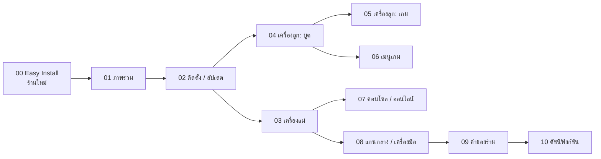

| บท | เรื่อง | เหมาะกับ |
|---|---|---|
| [00-EASY-INSTALL.md](00-EASY-INSTALL.md) | ร้านอื่นติดตั้ง OSYNC: สิ่งที่ต้องมี, ตัวตรวจเครื่องแม่ + ที่วางไฟล์ที่แนะนำ, ติดตั้งจาก zip ของ GitHub (`EASY-INSTALL.bat`) หรือ `OSYNC-Setup.exe`, ค่าที่ต้องตรวจ, โปรแกรมเครื่องมือใน `Tools\` (exe พาไปครบ ตรวจ SHA256), Sunshine ของสาขา | ร้านใหม่ / สาขา อ่านบทเดียวจบ |
| [01-OVERVIEW.md](01-OVERVIEW.md) | OSYNC คืออะไร, diskless ทำงานยังไง, ภาพใหญ่, โฟลเดอร์, บริการบนเครื่องแม่, วงจรประจำวัน | ทุกคน อ่านก่อน |
| [02-INSTALL-UPDATE.md](02-INSTALL-UPDATE.md) | ติดตั้งสาขาใหม่, อัปเดตเครื่องแม่, ทำ Image เครื่องลูก, ปุ่มทุกข้อของ `OSYNC.bat`, `Tool-Check` | เจ้าของร้าน / ช่าง |
| [03-MASTER.md](03-MASTER.md) | ทุกสคริปต์ฝั่งเครื่องแม่: อัปเดต, ตัวเฝ้า, รายชื่อเกม, snapshot launcher, ขอเกม Steam, ตัวรับรายงาน | ช่าง / คนแก้โค้ด |
| [04-CLIENT-BOOT.md](04-CLIENT-BOOT.md) | เครื่องลูกบูตแล้วทำอะไรทีละขั้น, ไมค์ WO Mic + VB-CABLE, จอเสมือน, Parsec, Sunshine, เดสก์ท็อป | ช่าง / คนแก้โค้ด |
| [05-CLIENT-GAMES.md](05-CLIENT-GAMES.md) | ล้างล็อกอิน, launcher แต่ละค่าย, Apex (ตรวจไฟล์ + ตัวเปิดเกม), GTA / FiveM, OSLink, รายงานบูต | ช่าง / คนแก้โค้ด |
| [06-MENU.md](06-MENU.md) | โปรแกรมเมนูเกม 0JAYSHOP Client ทีละฟังก์ชัน + วิธี build | คนแก้โค้ดเมนู |
| [07-CONSOLE-ONLINE-FUNCTIONS.md](07-CONSOLE-ONLINE-FUNCTIONS.md) | คอนโซลแอดมิน (API ทุกเส้น), คลังออนไลน์ (ฮับ, aria2, UPnP) | คนแก้โค้ด |
| [08-CORE-TOOLS.md](08-CORE-TOOLS.md) | `Common.ps1` (ไลบรารีกลาง), `Http-Lib.ps1`, `OSYNC.ps1`, `Setup-Install.ps1`, `Tool-*` | คนแก้โค้ด |
| [09-SETTINGS.md](09-SETTINGS.md) | ทุกค่าใน `settings.txt`: ค่าตอนนี้ คำอธิบาย สคริปต์ที่อ่าน (สร้างจากไฟล์จริง) | เจ้าของร้าน / ช่าง |
| [10-FUNCTION-INDEX.md](10-FUNCTION-INDEX.md) | ฟังก์ชันทั้งหมด 646 ตัว ใน 88 ไฟล์ พร้อมบรรทัดและพารามิเตอร์ (สร้างจากโค้ดอัตโนมัติ) | คนแก้โค้ด |

## เอกสารเฉพาะเรื่อง

| เอกสาร | เรื่อง |
|---|---|
| [KNOWLEDGE.md](KNOWLEDGE.md) | บทเรียนที่เคยเจอ: อาการ → สาเหตุ → วิธีแก้ |
| [HOW-IT-WORKS.md](HOW-IT-WORKS.md) | คำอธิบายเดิมของระบบทั้งชุด (ก่อนมีเอกสารชุด 01-10) |
| [CONSOLE-ONLINE.md](CONSOLE-ONLINE.md) | คู่มือใช้คอนโซลแอดมินและคลังออนไลน์ |
| [STEAM-REQUESTS.md](STEAM-REQUESTS.md) | ปุ่ม "ขอเกม" Steam: ลูกค้าสแกน QR เครื่องแม่โหลดให้ |
| [GTA-GRAPHICS.md](GTA-GRAPHICS.md) | ตัวเลือกกราฟิก GTA V / FiveM ต่ำสุด / กลาง / สูง + ReShade |
| [IPLAY-WAY.md](IPLAY-WAY.md) | Apex: ตรวจไฟล์เกมทุกไบต์ + ตัวเปิดเกมที่เช็กเครื่องก่อน (ใช้หลักการแบบ iPlay) |
| [SHOP-API.md](SHOP-API.md) | สำหรับคนทำ backend: ต่อระบบเวลา / ร้านค้าเข้ากับเมนู (ร้านนี้ยังปิดอยู่) |
| [SETUP-AI.md](SETUP-AI.md) | ขั้นตอนสำหรับ AI ที่ช่วยติดตั้งบนเครื่องแม่ร้านอื่น: ตรวจเครื่อง → สัมภาษณ์เจ้าของร้าน (ไดรฟ์, launcher, เกม, ฟีเจอร์) → ติดตั้ง → ตั้งค่า · บอกจุดที่ต้องถามและที่คนต้องทำเอง |
| [TEST-PLAN.md](TEST-PLAN.md) | แผนทดสอบทั้งระบบ (เขียนที่ร้าน AT9 มีหมายเหตุว่าร้านนี้ต่างตรงไหน) |

## ภาพประกอบทั้งหมด

ภาพทั้งหมดถ่ายจากระบบจริงของร้านเมื่อ 20 พ.ย. 2026 (ไฟล์อยู่ใน [images/](images))

**เมนูเกม:**
- ถ่ายจากโปรแกรมเมนูที่ build จริง (`Menu\app\resources\app\out`) กับรายชื่อเกมจริง (`Menu\data\games.json`) บนเครื่องแม่
- ส่วนที่ปกติ Electron ต่อกับ Windows ใช้ตัวจำลองแทน ภาพจึงเหมือนเครื่องลูก
- ยกเว้นขนาดจอและชื่อการ์ดจอในหน้าต่างเลือกกราฟิก ซึ่งเป็นค่าตัวอย่าง บนเครื่องลูกจะเห็นค่าของเครื่องนั้น

| ภาพ | อยู่ในบท |
|---|---|
| 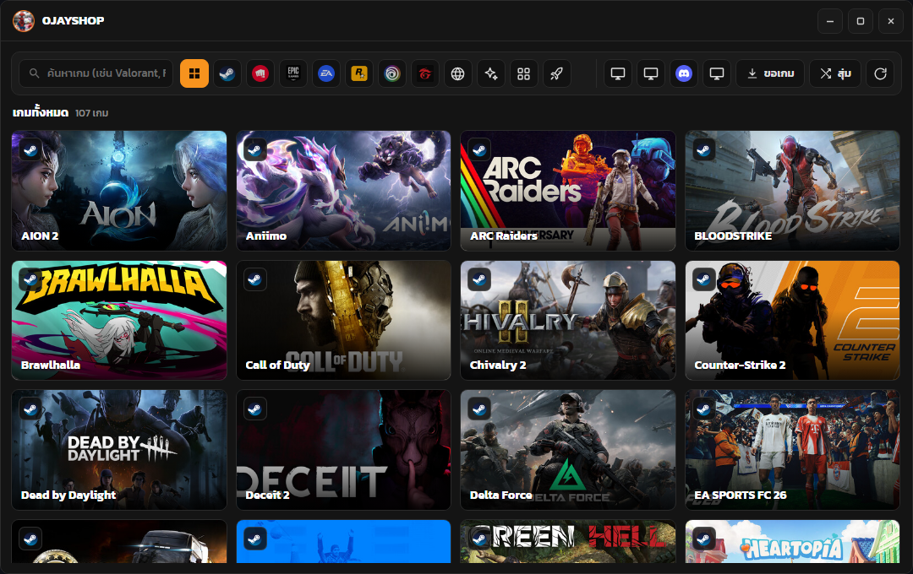 หน้าเมนูเกม ทุกเกม | [06](06-MENU.md) |
| 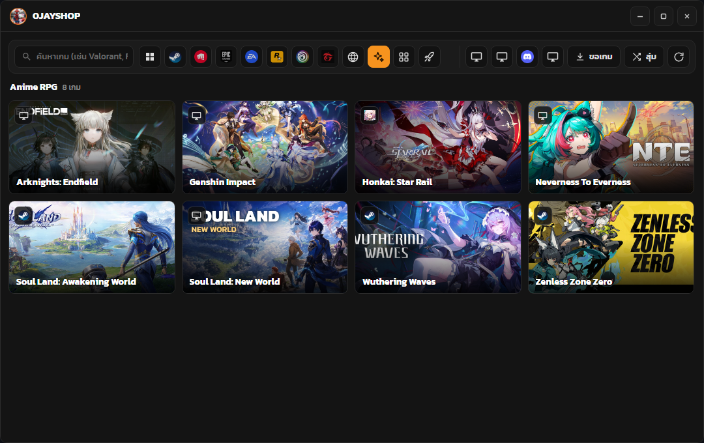 เลือกหมวด Anime RPG | [06](06-MENU.md) |
| 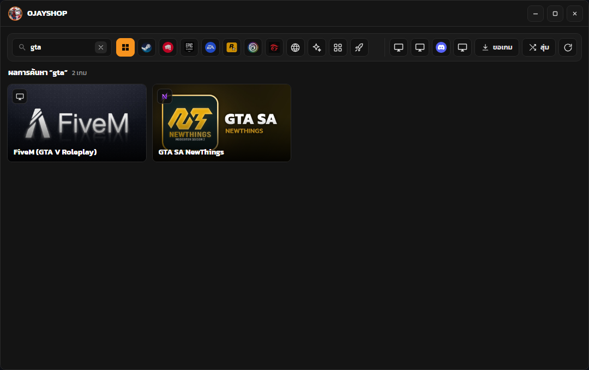 ค้นหา "gta" | [06](06-MENU.md) |
| 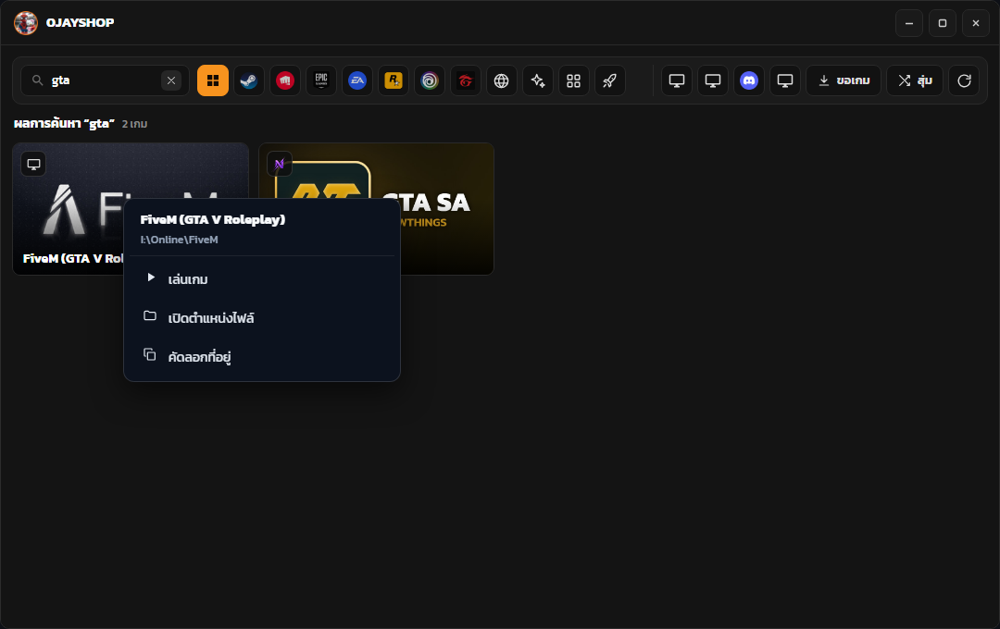 คลิกขวาที่การ์ด: เล่น / เปิดตำแหน่งไฟล์ / คัดลอกที่อยู่ | [06](06-MENU.md) |
| 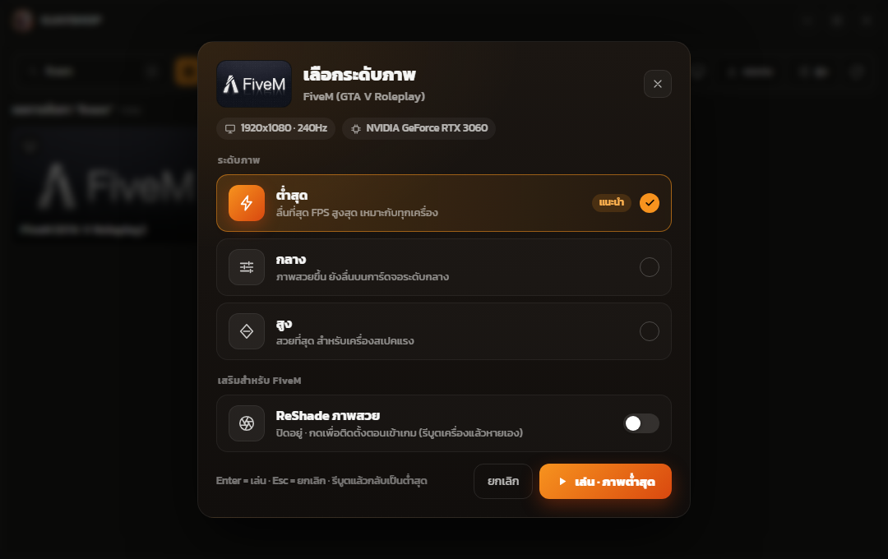 เลือกระดับภาพ FiveM / GTA V | [06](06-MENU.md), [GTA-GRAPHICS](GTA-GRAPHICS.md) |
| 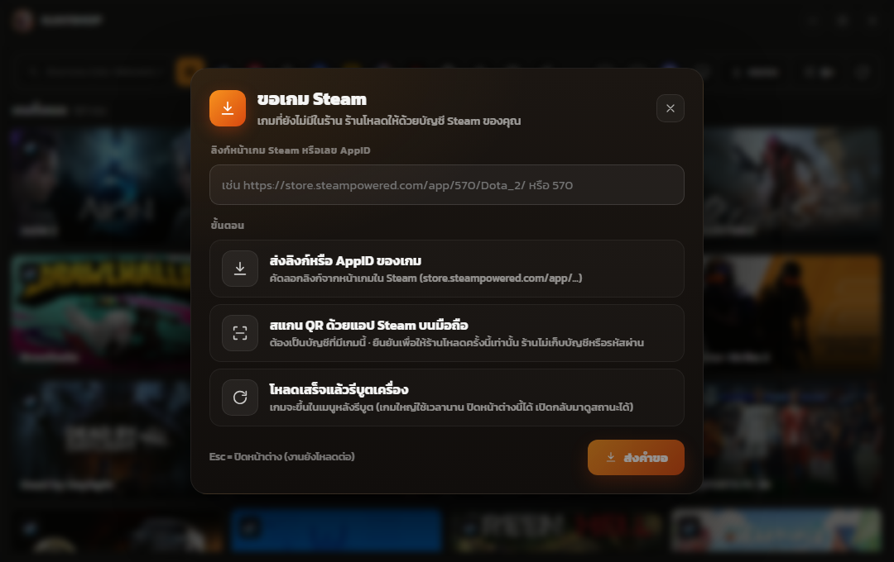 ขอเกม Steam | [06](06-MENU.md), [STEAM-REQUESTS](STEAM-REQUESTS.md) |
| 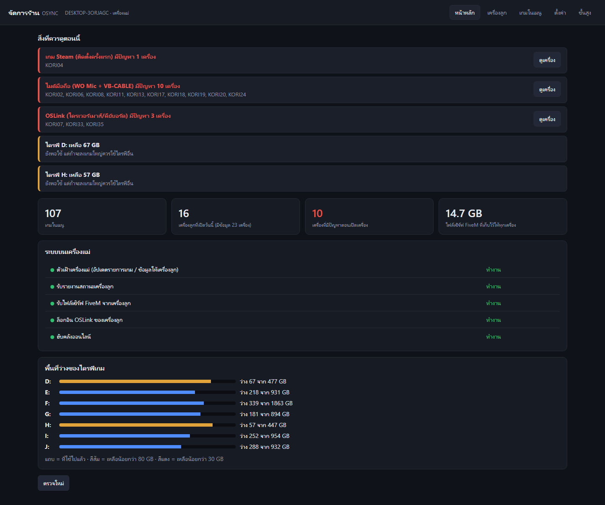 คอนโซล: หน้าหลัก | [01](01-OVERVIEW.md), [07](07-CONSOLE-ONLINE-FUNCTIONS.md) |
| 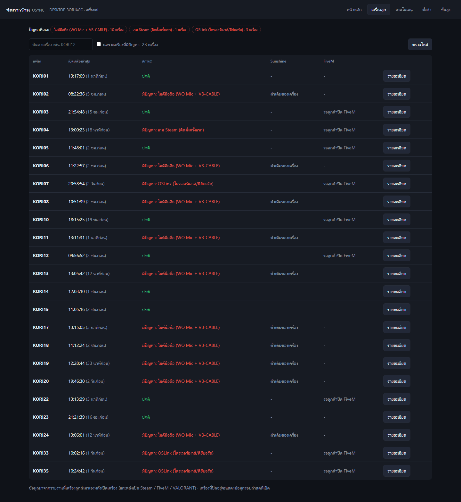 คอนโซล: เครื่องลูก | [07](07-CONSOLE-ONLINE-FUNCTIONS.md) |
| 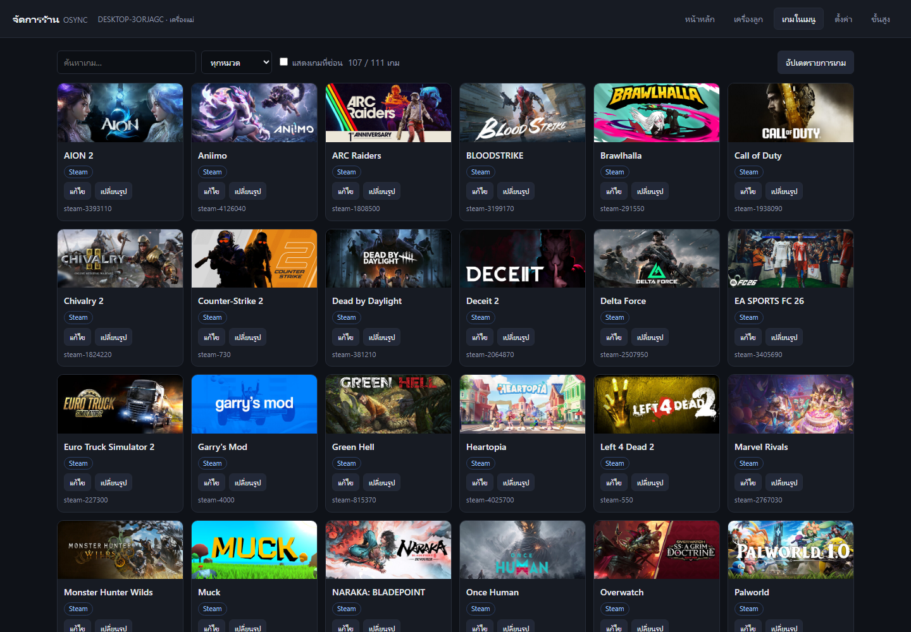 คอนโซล: เกมในเมนู | [07](07-CONSOLE-ONLINE-FUNCTIONS.md) |
| 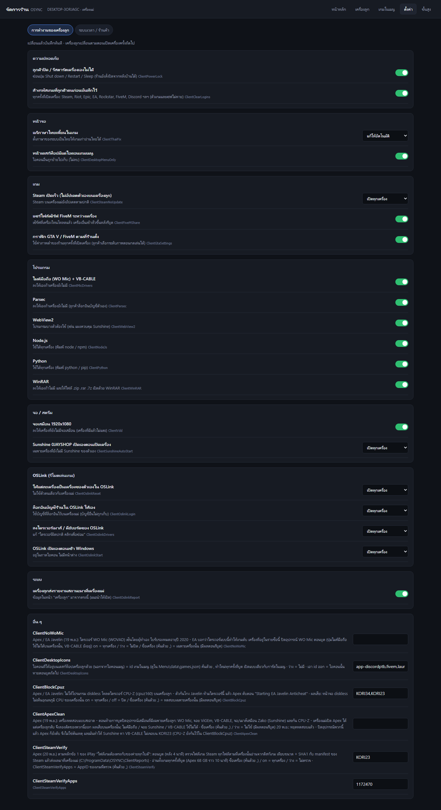 คอนโซล: ตั้งค่า | [09](09-SETTINGS.md) |
| 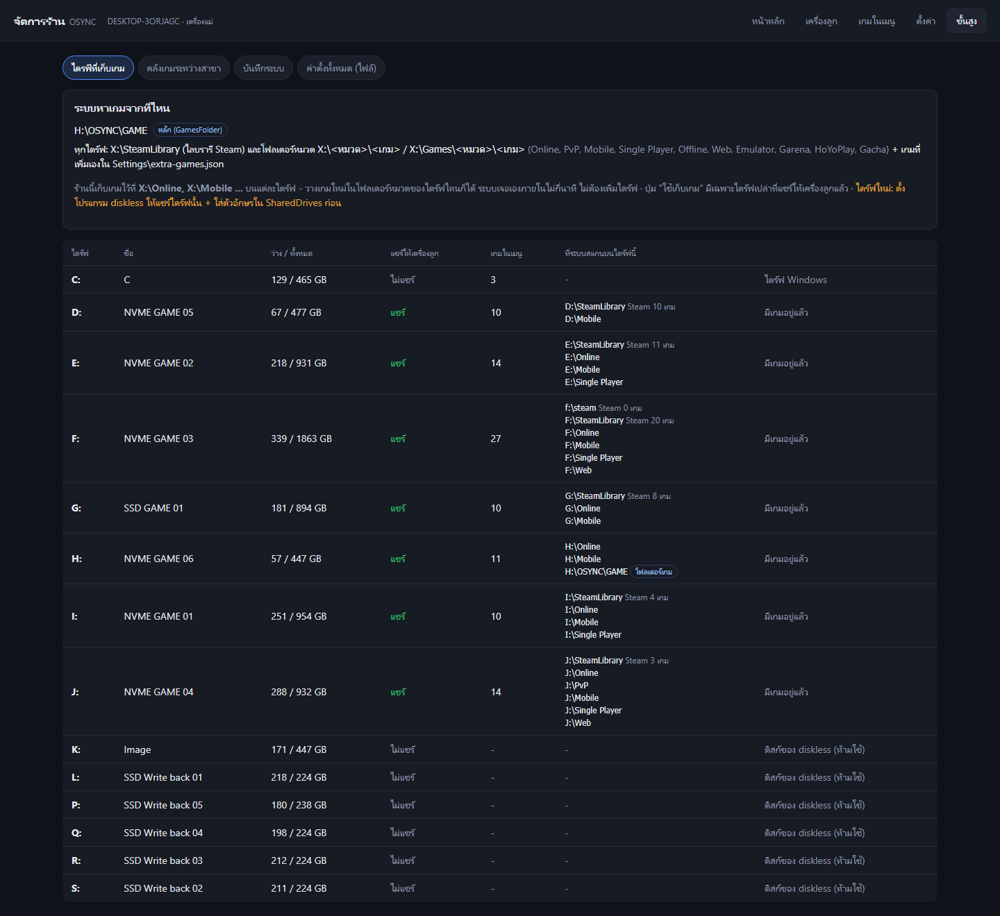 คอนโซล: ขั้นสูง > ไดรฟ์ที่เก็บเกม | [01](01-OVERVIEW.md), [07](07-CONSOLE-ONLINE-FUNCTIONS.md) |

---
[← กลับหน้าแรก repo](../../README.md)
