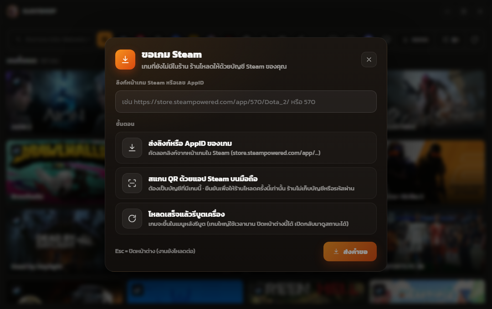

# ขอเกม Steam จากเมนูเครื่องลูก

เพิ่มเมื่อ 19 พ.ย. 2026 ตามคู่มือระบบ ComOom ที่เจ้าของร้านส่งมา (ทำเฉพาะส่วน "โหลดเกมใหม่ตามคำขอลูก" ส่วนอัปเดตเกมยังใช้ Steam บนเครื่องแม่เหมือนเดิม)

## ลูกค้าใช้ยังไง

1. ในเมนูกดปุ่ม **ขอเกม** ที่แถบด้านบน ข้างปุ่มสุ่ม
2. วางลิงก์หน้าเกม Steam เช่น `https://store.steampowered.com/app/570/Dota_2/` หรือใส่เลข AppID แล้วกด **ส่งคำขอ**
3. ถึงคิวแล้ว QR จะขึ้นบนจอ ให้เปิดแอป Steam บนมือถือ แตะไอคอนโล่ (Steam Guard) แล้วสแกนและกดอนุมัติ
   - ต้องเป็นบัญชีที่มีเกมนี้ ถ้าบัญชีไม่มีเกม ระบบจะแจ้งว่าโหลดไม่ได้
   - ร้านไม่ได้เก็บบัญชีหรือรหัสผ่าน การอนุมัติใช้กับการโหลดครั้งนี้ครั้งเดียว
4. ระหว่างโหลดปิดหน้าต่างได้ กดปุ่ม **ขอเกม** อีกครั้งเพื่อดูความคืบหน้า
5. โหลดเสร็จแล้ว **รีบูตเครื่อง** เกมจะขึ้นในเมนู
   - เครื่อง diskless เห็นไฟล์ใหม่บนดิสก์เกมหลังรีบูตเท่านั้น



*ภาพจริงจากเมนูของร้าน (20 พ.ย. 2026): กดปุ่ม ขอเกม ตอนยังไม่มีคำขอ*

## ระบบทำงานยังไง

```
เมนูเครื่องลูก --(LAN พอร์ต 4670)--> Master-ClientReports.ps1 (ตัวรับ, SYSTEM)
                                          |  งานละไฟล์: C:\ProgramData\OSYNC\SteamQueue\jobs\<id>.json
                                          v
                                    Master-SteamQueue.ps1 (ตัวโหลด, ทีละงาน)
```

ขั้นตอนของตัวโหลด:

1. **ตรวจ**
   - ถ้ามี `appmanifest_<AppID>.acf` ในคลัง Steam ของร้านแล้ว จะตอบว่า "มีเกมนี้แล้ว"
   - ดึงชื่อเกม โฟลเดอร์ เลข build depot และขนาด จาก api.steamcmd.net โดยส่งไปแค่ AppID
2. **เลือกไดรฟ์**
   - เลือกจากไดรฟ์ใน `SteamRequestDrives` (ว่าง = SharedDrives) ที่มี `X:\SteamLibrary` อยู่แล้ว
   - เอาตัวที่ว่างที่สุด และลงเกมแล้วต้องเหลือมากกว่า `SteamRequestMinFreeGB` (30 GB)
3. **QR**
   - รัน `Tools\DepotDownloader\DepotDownloader.exe -qr` (SteamRE 3.4.0 ของทางการ)
   - QR ที่ตัวโหลดพิมพ์ออกมาจะถูกส่งให้เมนูของเครื่องที่ขอ
   - ไม่สแกนภายใน `SteamRequestQrMinutes` (5 นาที) จะยกเลิกเอง
4. **โหลด**
   - ลงที่ `X:\OSYNCStaging\<AppID>` ก่อน ไม่ลงคลังตอนยังโหลดไม่เสร็จ
   - ถ้าไดรฟ์จะเหลือน้อยกว่า 30 GB จะหยุดเอง
5. **ตรวจไฟล์**: เทียบขนาดและ SHA1 ทุกไฟล์กับ manifest ของ depot
6. **เพิ่มเข้าคลัง**
   - ย้าย (rename ในไดรฟ์เดียวกัน) ไปที่ `X:\SteamLibrary\steamapps\common\<installdir>`
   - เขียน `appmanifest_<AppID>.acf` ให้
   - Master-Watch เห็น appmanifest ใหม่ แล้วอัปเดตรายชื่อในเมนูเองภายในไม่กี่นาที

ถ้าขอใหม่หลังโหลดไม่สำเร็จหรือกดยกเลิก ระบบจะใช้ไฟล์ที่โหลดไว้แล้วต่อ (`-validate`) ถ้ามีโฟลเดอร์เก่าของเกมที่ไม่มี appmanifest ก็จะเอามาใช้ต่อเหมือนกัน

## ตั้งค่า

**Settings\settings.txt**

| ค่า | ความหมาย |
|---|---|
| `SteamRequests=on/off` | เปิด/ปิดรับคำขอ |
| `SteamRequestMinFreeGB=30` | พื้นที่ที่ต้องเหลือในไดรฟ์หลังลงเกม (GB) |
| `SteamRequestDrives=` | ไดรฟ์ที่ให้ลงเกมได้ (ว่าง = SharedDrives) |
| `SteamRequestQrMinutes=5` | เวลารอสแกน QR (นาที) |

**Menu\config.json**: `ui.steamRequest: true` คือมีปุ่ม ส่วน false คือไม่มีปุ่ม ที่อยู่เครื่องแม่อ่านจาก `MasterIP` และ `ClientReportPort` ใน settings.txt (ร้านนี้ `MasterIP=192.168.51.201` และไม่ได้ใส่ `ClientReportPort` = ใช้ค่าเริ่ม 4670)

## ไฟล์และ log

- **งานแต่ละงาน**: `C:\ProgramData\OSYNC\SteamQueue\jobs\<id>.json`
  - output ของ DepotDownloader อยู่ใน `<id>.log`
  - เก็บงานไว้ 200 งาน และ log ไว้ 7 วัน
- **log ของตัวโหลด**: `C:\ProgramData\OSYNC\SteamQueue\worker.log`
- **ข้อมูลของ DepotDownloader** (manifest, depot.config): `X:\OSYNCStaging\_meta\<AppID>` เก็บไว้ใช้ตรวจไฟล์รอบหน้า

## ข้อจำกัด

- **อัปเดต**: เกมที่โหลดด้วยระบบนี้อัปเดตเองได้เฉพาะเมื่อบัญชี Steam บนเครื่องแม่มีเกมนั้นด้วย ถ้าไม่มี เกมจะค้างที่รุ่นที่โหลดมา
  - ส่วนอัปเดตอัตโนมัติด้วยบัญชีร้าน (ข้อ 5 ในคู่มือ ComOom) ยังไม่ได้ทำ
- **ภาษา**: โหลดเฉพาะ depot ของ Windows 64-bit ภาษาอังกฤษ ไม่รวม DLC
- **คิว**: โหลดทีละงาน รับได้สูงสุด 10 งาน ขอได้เครื่องละ 1 งาน เกมเดียวกันจะขอซ้อนกันไม่ได้
- **เครื่องแม่รีสตาร์ตกลางคัน**: งานที่ค้างจะขึ้นว่าไม่สำเร็จ ให้ลูกค้ากดขอใหม่ ระบบจะโหลดต่อจากไฟล์เดิม

## ทดสอบแล้ว (19 พ.ย. 2026 บนเครื่องแม่)

- **โหลดจริงแบบไม่ล็อกอิน** (แอป 1007) ลงคลังทดสอบ `C:\SqTest`
  - ตรวจ SHA1 ผ่าน และ appmanifest ถูกต้อง
  - ทำไฟล์ให้เสียแล้วขอใหม่ ระบบซ่อมไฟล์ได้
- **QR และการยกเลิก**: QR 29x29 ขึ้นในเมนู กดยกเลิกแล้วตัวโหลดหยุดจริง
- **ตัวรับจริง (SYSTEM)**: ขอ AppID 730 แล้วได้คำตอบว่ามีเกมนี้แล้ว
- **self-test ของเมนูบน H:**: ผ่าน 105 การ์ด ปุ่ม ขอเกม ส่งคำขอถึงเครื่องแม่ได้
- **ยังไม่ได้ทดสอบ**: ลูกค้าสแกน QR จริงด้วยมือถือ แล้วโหลดเกมที่ต้องล็อกอินจนเสร็จ
