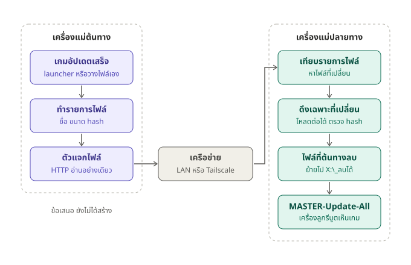

# ข้อเสนอ: ระบบ Game Sync ระหว่างเครื่องแม่

> **สถานะ: ข้อเสนอ ยังไม่ได้สร้าง** — อธิบายแนวคิดให้เจ้าของโปรเจกต์ตัดสินใจก่อนลงมือ

## ปัญหา
ตอนนี้ OSYNC sync แค่ **เครื่องแม่ → เครื่องลูก** ในร้านเดียวกัน (ดู [HOW-IT-WORKS.md](../HOW-IT-WORKS.md)) แต่ละเครื่องแม่ยังต้องโหลดเกมเอง:
- เกมจาก launcher (Steam, Riot, EA, Epic): แต่ละสาขาโหลดจากอินเทอร์เน็ตแยกกัน
- เกมนอก launcher (`X:\Online`, `X:\Mobile`, `X:\PvP`, `X:\Single Player`, `X:\Web`): ต้องวางไฟล์เองทีละสาขา หรือใช้ AutoSync ของร้านเก่า (ดู [KNOWLEDGE.md](../KNOWLEDGE.md) ข้อ 10)

เป้าหมาย: เครื่องแม่ต้นทาง (สาขาหลัก) อัปเดตเกมครั้งเดียว แล้วเครื่องแม่ปลายทาง (สาขาอื่น หรือ server ตัวที่ 2 ในร้าน) ได้เกมชุดเดียวกันเอง

## วิธีทำงานที่เสนอ
| ขั้น | ที่ | ทำอะไร |
|---|---|---|
| 1 | ต้นทาง | เกมอัปเดตเสร็จ (Master-Watch รู้อยู่แล้วจาก `Get-Busy`) หรือวางไฟล์เกมเอง |
| 2 | ต้นทาง | ทำรายการไฟล์ของแต่ละเกม: path, ขนาด, เวลาแก้ไข, hash — คำนวณ hash ใหม่เฉพาะไฟล์ที่ขนาดหรือเวลาเปลี่ยน จึงไม่ต้องอ่านทั้งเกมทุกรอบ |
| 3 | ต้นทาง | ตัวแจกไฟล์ HTTP แบบอ่านอย่างเดียว แจกเฉพาะโฟลเดอร์เกมที่เลือกไว้ |
| 4 | ปลายทาง | ดึงรายการไฟล์มาเทียบกับของตัวเอง หาไฟล์ใหม่หรือไฟล์ที่เปลี่ยน |
| 5 | ปลายทาง | ดึงเฉพาะไฟล์ที่เปลี่ยน ลงไฟล์ชั่วคราวก่อน หลุดแล้วโหลดต่อได้ ตรวจ hash ผ่านแล้วค่อยสลับเข้าที่ — เกมจะไม่เสียเพราะไฟล์โหลดค้างครึ่งทาง |
| 6 | ปลายทาง | ไฟล์ที่ต้นทางลบไปแล้ว **ไม่ลบเอง** ย้ายไป `X:\_ลบได้\` ตามกฎของร้าน |
| 7 | ปลายทาง | เรียก `MASTER-Update-All` ให้เมนูและข้อมูลเครื่องลูกเป็นของใหม่ เครื่องลูกรีบูตแล้วเห็นเกม |

## แต่ละค่าย
| ค่าย | ต้อง sync อะไรเพิ่มนอกจากไฟล์เกม |
|---|---|
| เกมนอก launcher | ไม่มี — ไฟล์เกมพอ แล้ว Build-GameList หา exe ให้เอง |
| Steam | `appmanifest_<id>.acf` ของเกมนั้น และต้อง **ปิด Steam ปลายทาง** ระหว่าง sync (ไม่งั้น Steam เห็นไฟล์เปลี่ยนแล้วตรวจหรือโหลดซ้ำ) ต้องกำหนดว่า `SteamLibrary` ไดรฟ์ไหนของต้นทางไปลงไดรฟ์ไหนของปลายทาง |
| Riot / EA / Epic | ข้อมูลการติดตั้งอยู่ใน C: ของแต่ละเครื่องแม่ ต้องออกแบบเพิ่ม (อาจใช้ snapshot แบบเดียวกับที่ส่งให้เครื่องลูก) ทางที่ง่ายกว่าคือให้ launcher ปลายทางอัปเดตเอง ซึ่ง MASTER-Start-All ทำอยู่แล้ว |

## ข้อควรรู้
- **Steam ข้ามสาขาผ่านอินเทอร์เน็ต** มักช้ากว่าปล่อยให้ Steam โหลดเองจากเซิร์ฟเวอร์ของ Steam ระบบนี้คุ้มที่สุดใน LAN และกับเกมนอก launcher
- **ความปลอดภัย:** อย่าเปิด port ตัวแจกไฟล์ให้ทั้งอินเทอร์เน็ตเห็น ให้ใช้ Tailscale / ZeroTier ระหว่างสาขา และมีรหัสเข้าใช้ (เก็บนอก git เพราะ repo นี้เป็น public)
- **AutoSync:** ถ้าสาขาไหนยังใช้ AutoSync อย่าให้สองระบบดูแลโฟลเดอร์เดียวกัน ([KNOWLEDGE.md](../KNOWLEDGE.md) ข้อ 10)
- ไดรฟ์ปลายทางต้องมีพื้นที่ว่างพอสำหรับไฟล์ชั่วคราวของเกมที่ใหญ่ที่สุด

## ต้องตัดสินใจก่อนสร้าง
1. ปลายทางคือสาขาอื่นผ่านอินเทอร์เน็ต, server อีกตัวใน LAN หรือทั้งคู่
2. sync เกมไหนบ้าง — ทุกเกม, เฉพาะเกมนอก launcher หรือเลือกเป็นรายเกม
3. sync ตอนไหน — ทันทีที่ต้นทางเปลี่ยน หรือเฉพาะช่วงร้านปิด (กันเน็ตร้านช้าตอนลูกค้าเล่น)
